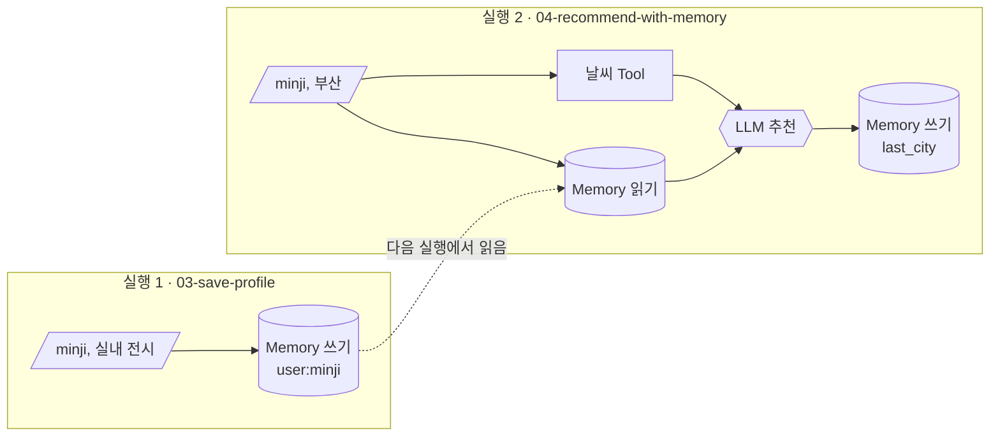

# Lab 02 · LLM·Tool·Memory 연결하기

- 관련 강의: [2단계 · LLM·Tool·Memory 노드와 데이터 흐름](../../Lecture/64/02-STAGE2-LLM-TOOL-MEMORY.md)
- 소요 시간: 약 45분
- 목표: Tool 결과와 Memory가 LLM 노드로 흘러가는 과정을 실행 기록으로 확인하고, 워크플로우를 직접 수정한다.

## 1. Tool → LLM: 근거 제공 패턴 (10분)

```bash
uv run miniflow tools
uv run miniflow run flows/02-llm-tool.json -i city=제주 -i question="우산이 필요할까?"
```

```text
[2/4] weather        tool         ok    0.1ms  {"city": "제주", "condition": "비", "temp_c": 20, "rain_chance": 80, ...}
[3/4] answer         llm          ok 1426.2ms  "네, 제주에 비가 오고 비 올 확률이 80%이므로 우산이 필요합니다."
```

확인할 것

1. 실행 기록에서 `answer` 노드의 `prompt`를 찾아, `{{nodes.weather.output}}`이 실제 데이터로 바뀐 것을 확인합니다.
2. `city=평양`으로 실행해 봅니다. 어느 노드에서 멈추나요? 그 뒤의 노드는 실행되었나요?

## 2. Memory: 실행과 실행 사이를 잇기 (10분)

```bash
uv run miniflow memory --clear
uv run miniflow run flows/03-save-profile.json -i user=minji -i preference="실내 전시"
uv run miniflow run flows/04-recommend-with-memory.json -i user=minji -i city=부산
uv run miniflow memory
```



확인할 것

1. `04`를 `city=강릉`으로 한 번 더 실행합니다. `recall` 노드 출력에 `last_city`가 무엇으로 나오나요?
2. `user=jun`처럼 저장하지 않은 사용자로 실행하면 추천 문장이 어떻게 바뀌나요? 왜 그런가요?

## 3. 워크플로우 수정하기 (15분)

`flows/02-llm-tool.json`을 복사해 `flows/my-02-with-count.json`을 만들고 다음을 수정합니다.

1. `answer` 노드 뒤에 `count_chars` Tool 노드를 추가합니다.
   - id: `length`
   - args: `{"text": "{{nodes.answer.output}}"}`
2. `result` 노드의 값을 아래처럼 바꿔 두 결과를 함께 내보냅니다.
   ```json
   {"answer": "{{nodes.answer.output}}", "length": "{{nodes.length.output}}"}
   ```
3. 연결(edges)을 `answer → length → result` 순서로 고칩니다.

```bash
uv run miniflow validate flows/my-02-with-count.json
uv run miniflow show flows/my-02-with-count.json
uv run miniflow run flows/my-02-with-count.json -i city=서울 -i question="산책하기 좋을까?"
```

`validate`가 오류를 내면 오류 메시지를 읽고 고칩니다. 대부분 노드 id 오타나 연결 누락입니다.

## 4. Mock·OpenAI·대체 모델 비교 (10분)

지금까지는 OpenAI `gpt-4.1-mini`가 답했습니다. 같은 워크플로우를 Mock, 대체 모델(Ollama)과 번갈아 실행해 비교합니다.

```bash
uv run miniflow run flows/05-tech-support-ticket.json -i user=kim -i ticket="프린터에서 출력이 안 됩니다"
uv run miniflow run flows/05-tech-support-ticket.json -i user=kim -i ticket="프린터에서 출력이 안 됩니다"
MINIFLOW_LLM=mock uv run miniflow run flows/05-tech-support-ticket.json -i user=kim -i ticket="프린터에서 출력이 안 됩니다"
MINIFLOW_LLM=ollama uv run miniflow run flows/05-tech-support-ticket.json -i user=kim -i ticket="프린터에서 출력이 안 됩니다"
```

| 비교할 것 | Mock | OpenAI | Ollama |
| --- | --- | --- | --- |
| `classify`·`draft` 노드의 `ms` |  |  |  |
| 두 번 실행한 답변이 같은가? |  |  |  |
| 분류 결과가 정해진 값(`device`)과 정확히 같은가? |  |  |  |

수업 전에 같은 문의 4건(비밀번호, VPN, 프린터, 메일 프로그램 설치)으로 확인한 결과입니다. 내 노트북 결과와 비교해 보세요. Ollama 시간은 노트북 성능에 따라 크게 다릅니다.

| 모델 | 분류 4건 정답 | 분류 노드 | 답변 초안 노드 |
| --- | --- | --- | --- |
| `gpt-4.1-mini` (OpenAI, 기본) | 4/4 | 약 1~2.6초 | 약 1.2~1.7초 |
| `gemma3:4b` (대체) | 4/4 | 약 1.6~2.3초 | 7~11초 |
| `gemma3:1b` (8GB 노트북 대체) | 1/4 (나머지 `software`, 대문자 `Software`가 나온 적도 있음) | 약 1초 | 4~7초 |

작은 모델은 빠르지만 판단이 틀리거나 대소문자처럼 형식이 흔들립니다. 8GB 노트북은 `OLLAMA_MODEL=gemma3:1b MINIFLOW_LLM=ollama`로, 메모리가 넉넉하면 두 모델을 모두 돌려 봅니다. 다음 노드가 분류값을 비교해야 한다면, LLM 출력을 그대로 믿지 말고 **검증하는 단계**가 필요합니다. (73일차 입력·출력 검증)

(선택) Anthropic·Gemini 키가 있으면 다른 제공사 모델과도 비교할 수 있습니다. 가지고 있는 키 하나만 설정하면 됩니다.

| 제공사 | 설치 | 설정 |
| --- | --- | --- |
| Anthropic | `uv sync --extra anthropic` | `export MINIFLOW_LLM=anthropic`, `export ANTHROPIC_API_KEY=...` |
| Gemini (10일차에 발급한 키) | `uv sync --extra gemini` | `export MINIFLOW_LLM=gemini`, `export GEMINI_API_KEY=...` |

## 도전 과제: 인자 추출 패턴 (LLM → Tool)

지금은 사용자가 `city=부산`처럼 도시를 직접 입력합니다. "다음 주에 부산 가는데 날씨 어때?" 같은 문장만 받아서 도시를 뽑아내도록 바꿔 보세요.

- `inputs`를 `["question"]`으로 바꾸고, 맨 앞에 도시 이름만 답하는 `llm` 노드(`extract_city`)를 추가합니다.
- 프롬프트에 "도시 이름만 답하세요. 예: 부산"처럼 출력 형식을 정해 줍니다. Mock으로도 확인하려면 `mock.rules`에 `{"if_contains": ["부산"], "then": "부산"}` 같은 규칙을 넣습니다.
- `weather` 노드의 args를 `{"city": "{{nodes.extract_city.output}}"}`로 바꿉니다.

## 확인

- [ ] Tool 결과가 LLM 프롬프트에 들어간 것을 실행 기록에서 찾았다.
- [ ] Memory가 두 번의 실행을 이어 주는 것을 확인했다.
- [ ] `my-02-with-count.json`을 만들어 `validate`와 `run`을 통과했다.
- [ ] Mock·OpenAI·Ollama의 결과·속도 차이를 표로 정리했다.
