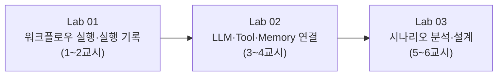

# 64일차 실습 · AI 워크플로우 구조 이해와 업무 자동화 시나리오 분석

- 일자: 2026-10-14 (64일차)
- 교과목: 노코드 멀티 에이전트 워크플로우 설계 및 운영
- 단원: AI 워크플로우 개념 및 구성 요소 이해
- 강의 자료: [Lecture/64](../../Lecture/64/README.md)

## 구성

```text
Last3Mon/64/
├── README.md
├── SETUP-WSL-LLM.md               # 사전 준비 · WSL, OpenAI API 키(.env), 대체 Ollama
├── LAB-01-FIRST-WORKFLOW.md        # 1단계 · 첫 워크플로우 실행과 실행 기록 읽기
├── LAB-02-LLM-TOOL-MEMORY.md       # 2단계 · LLM·Tool·Memory 연결하기
├── LAB-03-SCENARIO-ANALYSIS.md     # 3단계 · 업무 자동화 시나리오 분석과 설계
├── templates/
│   └── SCENARIO-ANALYSIS-TEMPLATE.md
├── my-work/                        # 여러분의 결과물 (직접 만듭니다)
└── workflow-lab/                   # 미니 워크플로우 엔진 (uv 프로젝트)
    ├── flows/                      # 예제 워크플로우 01~05
    ├── data/                       # 날씨·FAQ 샘플 데이터
    ├── src/miniflow/               # 엔진 소스
    └── tests/
```

## 실습 순서



| 예제 워크플로우 | 패턴 | 사용하는 노드 |
| --- | --- | --- |
| `01-llm-only.json` | LLM 단독 | input → llm → output |
| `02-llm-tool.json` | 근거 제공 (Tool → LLM) | input → tool → llm → output |
| `03-save-profile.json` | 기억 저장 | input → memory_write → output |
| `04-recommend-with-memory.json` | 개인화 순환 (Memory → LLM → Memory) | memory_read·tool → llm → memory_write |
| `05-tech-support-ticket.json` | 업무 시나리오 (분류 + FAQ 검색 + 이력) | memory_read·llm·tool → llm → memory_write |

## 준비 (수업 전날)

실습은 Windows 11의 WSL(Ubuntu)에서 진행합니다. LLM은 OpenAI API(`gpt-4.1-mini`, 키는 `Last3Mon/.env`)를 쓰고, 키·인터넷에 문제가 있으면 노트북의 Ollama(`gemma3:4b`, 8GB 노트북은 `gemma3:1b`)가 대신 답합니다.

먼저 **[실습 준비 안내](../../Lecture/64/00-DAY64-PREP.md)** 로 전체 준비 항목을 확인하고, 설치는 **[SETUP-WSL-LLM.md](SETUP-WSL-LLM.md)** 의 순서대로 진행한 뒤 마지막에 아래 명령이 통과하는지 확인합니다.

```bash
uv run pytest -q          # 18 passed, 1 skipped
uv run miniflow check     # Reply (openai, ...)
OPENAI_API_KEY=sk-wrong uv run miniflow check   # Reply (ollama, ...) : 대체 경로
```
