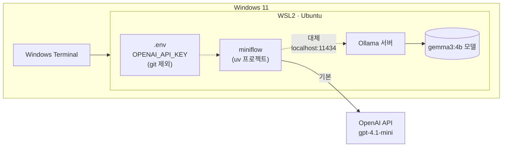

# 사전 준비 · WSL 실습 환경과 LLM (OpenAI API 기본, Ollama 대체)

64일차 실습은 Windows 11의 **WSL(Ubuntu)** 에서 진행합니다. LLM은 **OpenAI API**(기본 모델 `gpt-4.1-mini`)를 쓰고, 키가 없거나 인터넷·API에 문제가 있으면 노트북에서 직접 실행하는 **Ollama**(`gemma3:4b`)가 대신 답합니다. 이 구성은 65일차 이후 모든 실습에서 그대로 씁니다.

> Ollama 모델 파일이 1~3GB입니다. 수업 중에 21명이 동시에 받으면 강의실 네트워크가 느려지므로 **수업 전날 5단계(모델 다운로드)까지 끝내 주세요.**



## 1. WSL 확인 (5분)

PowerShell에서 확인합니다.

```powershell
wsl --list --verbose
```

`Ubuntu`가 `VERSION 2`로 보이면 됩니다. 없으면 `wsl --install -d Ubuntu`로 설치하고 노트북을 다시 시작합니다.

이후 명령은 모두 **WSL(Ubuntu) 터미널**에서 실행합니다.

## 2. 실습 코드와 uv 준비 (10분)

```bash
# uv (이미 설치되어 있으면 건너뜀)
curl -LsSf https://astral.sh/uv/install.sh | sh
source ~/.bashrc

# 실습 폴더는 WSL 홈(~) 아래에 둡니다. /mnt/c 아래는 느리고 권한 문제가 생깁니다.
cd ~
# 수업 자료를 받는 방법은 강사가 따로 안내합니다.
cd ~/<수업 저장소>/Last3Mon/64/workflow-lab
uv sync
uv run pytest -q
```

`18 passed, 1 skipped`가 나오면 됩니다. (`skipped` 1개는 선택 기능인 Anthropic 연결 테스트로, 해당 패키지를 설치하지 않으면 건너뜁니다.) 테스트는 `.env`를 읽지 않고 Mock LLM으로만 돌기 때문에 키가 없어도 통과합니다.

## 3. OpenAI API 키를 `.env`에 넣기 (3분)

과정에서 받은 OpenAI API 키를 `Last3Mon/.env` 한 곳에 넣습니다. `miniflow`는 실행한 폴더에서 위로 올라가며 가장 가까운 `.env`를 읽으므로, 64일차부터 모든 일차가 이 파일 하나를 씁니다.

```bash
cd ~/<수업 저장소>/Last3Mon
cp .env.example .env
nano .env          # OPENAI_API_KEY= 뒤에 키를 붙여 넣고 저장 (Ctrl+O, Enter, Ctrl+X)
```

| 줄 | 뜻 |
| --- | --- |
| `OPENAI_API_KEY=` | 받은 키 (`sk-`로 시작). **문서·워크플로우·채팅·화면 캡처에 올리지 않습니다** |
| `OPENAI_MODEL=gpt-4.1-mini` | 수업 기본 모델 |
| `MINIFLOW_LLM=openai` | `miniflow`가 OpenAI를 씀. 키를 받지 못했으면 `ollama`로 바꿈 |
| `MINIFLOW_LLM_FALLBACK=ollama` | OpenAI 호출이 실패하면 Ollama로 한 번 더 시도 |
| `OLLAMA_MODEL=gemma3:4b` | 대체 모델. 8GB 노트북은 `gemma3:1b` |

> `.env`는 `.gitignore`에 들어 있어 커밋되지 않습니다. 키가 들어간 파일을 다른 이름으로 복사해 두지 마세요.
>
> 셸에 `export MINIFLOW_LLM=...`을 적어 두었다면(`~/.bashrc`) 그 값이 `.env`보다 우선합니다. 지난 실습에서 넣은 줄이 있으면 지우고 터미널을 다시 엽니다.

## 4. 노트북 메모리에 맞는 대체 모델 고르기

WSL은 기본으로 **Windows 전체 메모리의 절반**까지만 사용합니다.

| 노트북 메모리 | WSL이 쓸 수 있는 메모리 | 대체 모델 (`OLLAMA_MODEL`) |
| --- | --- | --- |
| 8GB | 약 4GB | `gemma3:1b` |
| 16GB 이상 | 약 8GB 이상 | `gemma3:4b` (권장) |

내 노트북 메모리는 PowerShell에서 확인합니다.

```powershell
(Get-CimInstance Win32_ComputerSystem).TotalPhysicalMemory / 1GB
```

메모리가 부족하다는 오류가 나면 `C:\Users\<사용자>\.wslconfig` 파일을 만들어 상한을 올린 뒤 PowerShell에서 `wsl --shutdown` 하고 WSL을 다시 엽니다.

```ini
[wsl2]
memory=10GB
swap=4GB
```

## 5. Ollama 설치와 모델 다운로드 (10~20분)

OpenAI가 기본이지만 Ollama는 **꼭** 준비합니다. 키·인터넷에 문제가 있을 때 대신 답하고, 2단계 실습에서 모델 크기에 따른 차이를 직접 비교합니다.

```bash
curl -fsSL https://ollama.com/install.sh | sh
ollama --version

# 메모리 16GB 이상
ollama pull gemma3:4b
# 메모리 8GB
ollama pull gemma3:1b

ollama list
```

`ollama list`에 모델이 보이면 됩니다. 설치 스크립트가 Ollama 서버를 자동으로 실행합니다. `ollama list`에서 연결 오류가 나면 다른 터미널 창에서 `ollama serve`를 실행해 두세요.

## 6. 연결 확인 (5분)

```bash
cd ~/<수업 저장소>/Last3Mon/64/workflow-lab
uv run miniflow check
```

```text
MINIFLOW_LLM : openai
.env         : /home/<사용자>/<수업 저장소>/Last3Mon/.env
OPENAI_MODEL : gpt-4.1-mini
API key      : set
OLLAMA_HOST  : http://localhost:11434
OLLAMA_MODEL : gemma3:4b
FALLBACK     : ollama
Reply (openai, 2.0s): ready
```

대체 경로도 한 번 확인합니다. 키를 일부러 틀리게 넣으면(이 명령에서만) Ollama가 대신 답합니다.

```bash
OPENAI_API_KEY=sk-wrong uv run miniflow check
```

```text
[miniflow] openai failed (OpenAI rejected the API key (check OPENAI_API_KEY in .env)); trying ollama
Reply (ollama, 20.9s): Ready
```

Ollama의 첫 호출은 모델을 메모리에 올리느라 10~20초 걸립니다. 두 번째부터는 빨라집니다.

## 7. 이미 Windows나 Docker에 Ollama가 있는 경우

9월 실습에서 Docker로 Ollama를 실행해 둔 경우에는 WSL에 새로 설치하지 않고 그대로 써도 됩니다.

| 상황 | 설정 |
| --- | --- |
| Docker Desktop으로 실행한 Ollama (`11434` 포트 공개) | 컨테이너를 켜 두면 WSL에서도 `http://localhost:11434`로 연결됩니다. 6절의 대체 경로 확인으로 점검 |
| Windows용 Ollama 앱 | `.wslconfig`에 `networkingMode=mirrored`를 추가하고 `wsl --shutdown` 후 다시 열면 `localhost`로 연결됩니다 |

```ini
[wsl2]
networkingMode=mirrored
```

## 8. 문제 해결

| 증상 | 해결 |
| --- | --- |
| `API key : MISSING` | `Last3Mon/.env`에 `OPENAI_API_KEY`가 비어 있음. 키를 넣거나, 키가 없으면 `MINIFLOW_LLM=ollama` |
| `.env : (none)` | `.env` 위치 확인 (`Last3Mon/.env`), 실습 폴더 안에서 실행했는지 확인 |
| `OpenAI rejected the API key` | 키를 잘못 붙여 넣음 (앞뒤 공백·줄바꿈 확인) |
| `HTTP 429 ... insufficient_quota` | 키의 크레딧이 없음. 강사에게 알리고 그동안 `MINIFLOW_LLM=ollama` |
| `Cannot reach the OpenAI API` | 인터넷·프록시 문제. 그동안 `MINIFLOW_LLM=ollama` |
| `MINIFLOW_LLM : ollama`로 나옴 | `~/.bashrc`의 `export MINIFLOW_LLM=ollama`가 `.env`보다 우선. 그 줄을 지우고 터미널 다시 열기 |
| `Cannot reach Ollama at http://localhost:11434` | `ollama serve` 실행, 또는 7절의 연결 설정 확인 |
| `Model 'gemma3:4b' not found on Ollama` | `ollama pull gemma3:4b` |
| Ollama 응답이 1분 넘게 걸림, WSL이 멈춤 | 메모리 부족. `gemma3:1b`로 바꾸거나 `.wslconfig`의 `memory` 상향 |
| `uv: command not found` | `source ~/.bashrc` 또는 터미널 다시 열기 |
| 한글이 깨져 보임 | Windows Terminal 사용 (기본 UTF-8) |
| OpenAI와 Ollama 모두 안 됨 | `export MINIFLOW_LLM=mock`으로 Mock LLM 사용 (결과는 정해진 답) |

## 확인

- [ ] `uv run pytest -q` → `18 passed, 1 skipped`
- [ ] `Last3Mon/.env`에 키를 넣었다 (키는 이 파일에만 있다)
- [ ] `ollama list`에 모델이 보인다
- [ ] `uv run miniflow check`에서 `Reply (openai, ...)`가 나온다
- [ ] `OPENAI_API_KEY=sk-wrong uv run miniflow check`에서 `Reply (ollama, ...)`가 나온다
