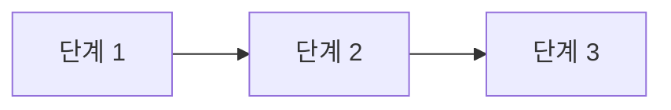
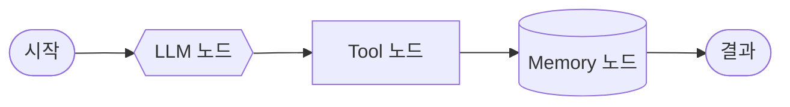
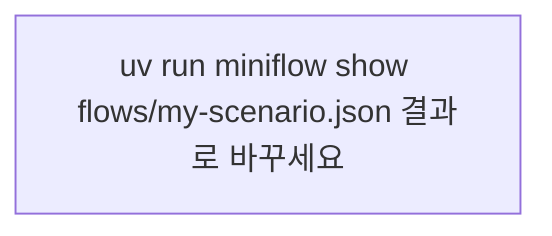

# 업무 자동화 시나리오 분석

- 작성자:
- 선택한 시나리오:

## 1. 자동화 후보 판단

| 기준 | 점수 (1~5) | 근거 |
| --- | :-: | --- |
| 반복성 |  |  |
| 절차의 명확성 |  |  |
| 데이터 준비 |  |  |
| 판단의 난이도 (AI가 잘하는 판단인가) |  |  |
| 실패했을 때 영향 (작을수록 높은 점수) |  |  |
| 합계 |  |  |

## 2. 분석 항목

| 항목 | 내용 |
| --- | --- |
| 목표 |  |
| 시작 조건 |  |
| 입력 데이터 (필드) |  |
| 처리 단계 |  |
| 필요한 Tool·데이터 |  |
| 기억 (읽기 / 쓰기) |  |
| 결과와 전달 |  |
| 사람 확인 단계 |  |
| 예외 상황 |  |
| 성공 기준 |  |

## 3. AS-IS (현재 방식)

| 단계 | 담당 | 소요 시간 | 문제점 |
| --- | --- | --- | --- |
|  |  |  |  |

## 4. TO-BE (자동화 이후)

## 5. 단계 → 노드 매핑

| TO-BE 단계 | 노드 종류 (LLM·Tool·Memory·데이터 처리·사람) | 입력 | 출력 | 이유 |
| --- | --- | --- | --- | --- |
|  |  |  |  |  |

## 6. 구현한 워크플로우

- 파일: `workflow-lab/flows/my-scenario.json`
- 이번 실습에서 구현하지 못한 노드 (향후 노드):

## 7. 실행 결과

| 구분 | 입력 | 결과 (status / result) | 메모 |
| --- | --- | --- | --- |
| 정상 1 |  |  |  |
| 정상 2 |  |  |  |
| 문제 입력 |  |  | 어느 노드에서, 왜 |

## 8. 개선 아이디어

- 
