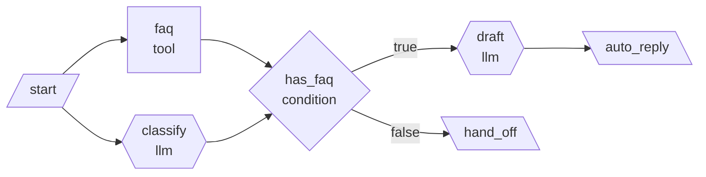

# Lab 01 · Condition으로 "결과 없음" 경로 만들기

- 관련 강의: [1단계 · Trigger·Condition·Action](../../Lecture/65/01-STAGE1-TRIGGER-CONDITION-ACTION.md)
- 소요 시간: 약 40분
- 목표: 64일차에 멈췄던 워크플로우를 Condition으로 고치고, Switch로 여러 갈래를 만든다.

## 1. 어제 멈춘 장면 다시 보기 (5분)

```bash
cd ~/aio-01d4-stu/Last3Mon/65/workflow-lab
uv sync
uv run pytest -q
uv run miniflow run flows/05-tech-support-ticket.json -i user=lee -i ticket="점심 메뉴 추천해줘"
```

FAQ 검색 결과가 없는데 다음 노드가 첫 번째 FAQ를 꺼내려다 멈춥니다. 오늘은 이 경우를 **다른 길(Action)** 로 보냅니다.

## 2. Condition이 들어간 워크플로우 실행 (10분)

```bash
uv run miniflow show flows/06-request-with-condition.json
uv run miniflow run flows/06-request-with-condition.json -i user=kim -i text="VPN 접속이 계속 끊겨요"
uv run miniflow run flows/06-request-with-condition.json -i user=lee -i text="점심 메뉴 추천해줘"
```



확인할 것

1. 두 실행에서 `has_faq` 노드의 출력(`branch`)은 각각 무엇인가요?
2. 실행 기록에서 `skipped`로 표시된 노드는 어느 것인가요?
3. 두 번째 실행의 `route` 값은 무엇인가요? 이제 워크플로우가 멈추지 않는 이유를 설명해 보세요.

## 3. Switch로 담당 팀 배정 (10분)

```bash
uv run miniflow run flows/07-route-by-category.json -i text="비밀번호를 잊어버렸어요"
uv run miniflow run flows/07-route-by-category.json -i text="회의실 예약은 어떻게 하나요"
```

- `route` 노드는 분류 결과가 `cases` 중 하나이면 그 길로, 아니면 `default` 길로 보냅니다.
- LLM이 `Software`처럼 대문자로 답하거나 `software.`처럼 마침표를 붙이면 정해진 값과 달라 `default`로 갑니다. OpenAI 모델은 대부분 지시를 지키지만, 대체용 작은 모델(Ollama)에서는 자주 일어납니다. 이런 경우를 막으려면 어떤 노드가 필요할까요?

## 4. 직접 만들기: 긴급 문의 분기 (15분)

`flows/06-request-with-condition.json`을 복사해 `flows/my-06-urgent.json`을 만들고, 다음 조건을 추가합니다.

- 문의에 "긴급"이라는 단어가 있으면 FAQ 검색과 상관없이 바로 담당자에게 연결합니다.

힌트

```json
{"id": "is_urgent", "type": "condition", "check": {"left": "{{input.text}}", "op": "contains", "right": "긴급"}}
```

- `start → is_urgent` 연결을 추가합니다.
- `is_urgent`의 `true` 길은 새 output 노드 `urgent_call`로 보냅니다.
- `false` 길이 기존 흐름(`has_faq`)으로 이어지도록 `["is_urgent", "has_faq", "false"]`를 추가합니다.

```bash
uv run miniflow validate flows/my-06-urgent.json
uv run miniflow run flows/my-06-urgent.json -i user=kim -i text="긴급! VPN이 끊겼어요"
uv run miniflow run flows/my-06-urgent.json -i user=kim -i text="VPN이 끊겼어요"
```

## 5. 설계표 작성 (선택)

[TCA 설계 템플릿](templates/TCA-DESIGN-TEMPLATE.md)을 `my-work/LAB-01-TCA.md`로 복사해, 64일차 Lab 03에서 분석한 시나리오를 Trigger·Condition·Action으로 다시 정리합니다.

## 확인

- [ ] `06` 워크플로우의 true·false 두 길을 모두 실행했다.
- [ ] `07`에서 `default` 길이 선택되는 경우를 확인했다.
- [ ] `my-06-urgent.json`이 `validate`와 두 입력의 실행을 통과했다.
