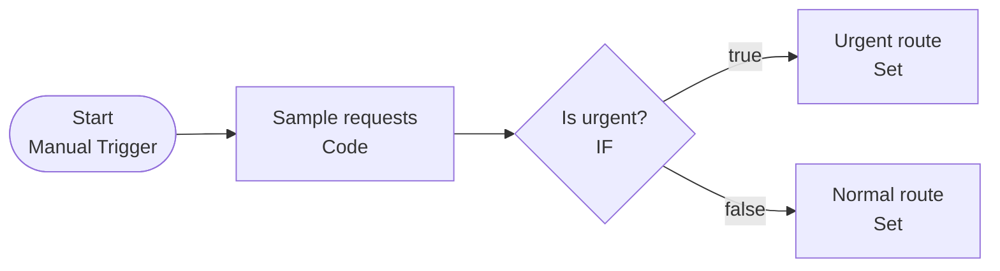
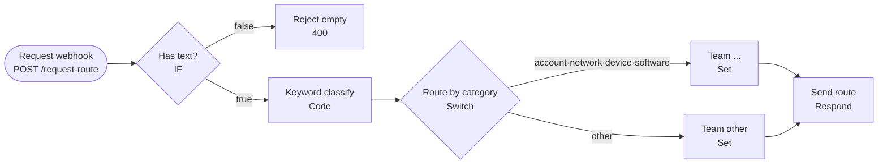

# Lab 02 · n8n 화면 익히기와 첫 워크플로우

- 관련 강의: [2단계 · n8n 실습 환경과 기본 설정](../../Lecture/65/02-STAGE2-N8N-ENVIRONMENT.md)
- 소요 시간: 약 45분
- 준비: [SETUP-N8N.md](SETUP-N8N.md) 완료, **[Lab 02A](./LAB-02A-FIRST-WORKFLOW-IN-BROWSER.md)(브라우저에서 직접 만들기) 완료**, 브라우저에서 http://localhost:5678 로그인

## 1. 워크플로우 가져오기 (5분)

1. 왼쪽 위 **+ (Create)** → **Workflow**로 빈 워크플로우를 엽니다.
2. 오른쪽 위 **⋯ (더보기)** → **Import from File...** 을 선택합니다.
3. `Last3Mon/65/n8n/workflows/01-condition-basics.json`을 고릅니다. Windows 파일 선택 창에서는 주소창에 `\\wsl$\Ubuntu\home\<사용자>\aio-01d4-stu\Last3Mon\65\n8n\workflows`를 입력하면 WSL 폴더로 이동합니다.
4. 오른쪽 위 **Save**를 누릅니다.

같은 방법으로 `02-webhook-router.json`도 새 워크플로우로 가져와 둡니다.

## 2. Manual Trigger + IF: `65-01 Condition basics` (15분)



1. 아래쪽 **Execute workflow** 버튼을 누릅니다.
2. 각 노드를 더블클릭해 **INPUT / OUTPUT** 데이터를 확인합니다.

확인할 것

| 질문 | 내 답 |
| --- | --- |
| `Sample requests`가 만든 항목(item)은 몇 개인가? |  |
| `Is urgent?`의 true 출력과 false 출력에는 각각 몇 개의 항목이 있는가? |  |
| `Urgent route` 출력에 새로 생긴 필드 두 개는? |  |

n8n은 항목(item) 여러 개를 한 번에 흘려보냅니다. IF 노드는 항목마다 조건을 검사해 두 출력으로 나눕니다.

### 직접 바꿔 보기

1. `Is urgent?` 노드를 열고 조건을 `{{ $json.text }}` **contains** `계정`으로 바꿔 다시 실행합니다. 결과가 어떻게 달라지나요?
2. 원래 조건(`priority` equals `urgent`)으로 되돌립니다.

## 3. Webhook Trigger + Switch: `65-02 Webhook request router` (20분)



### 3-1. 테스트 실행 (Test URL)

1. `Request webhook` 노드를 열고 **Test URL**을 복사합니다. (`http://localhost:5678/webhook-test/request-route`)
2. 노드 화면의 **Listen for test event**를 누른 상태에서 WSL 터미널에서 요청을 보냅니다.

```bash
curl -s -X POST http://localhost:5678/webhook-test/request-route \
  -H 'Content-Type: application/json' -d '{"user":"kim","text":"VPN 접속이 계속 끊겨요"}'
```

3. 캔버스에서 실제로 지나간 길이 초록색으로 표시되는지 확인합니다.

### 3-2. 게시 후 실행 (Production URL)

1. 오른쪽 위 **Publish**(게시)를 켭니다.
2. 이제 `/webhook/`(test 없음) 주소로 언제든 호출할 수 있습니다.

```bash
for t in "VPN 접속이 계속 끊겨요" "모니터가 안 켜져요" "점심 메뉴 추천해줘" ""; do
  curl -s -w "  [HTTP %{http_code}]\n" -X POST http://localhost:5678/webhook/request-route \
    -H 'Content-Type: application/json' -d "{\"user\":\"kim\",\"text\":\"$t\"}"
done
```

3. 왼쪽 메뉴 **Executions**에서 방금 실행된 기록 4건을 열어 봅니다.

| 입력 | 응답의 `team` 또는 오류 | 지나간 길 |
| --- | --- | --- |
| VPN 접속이 계속 끊겨요 |  |  |
| 모니터가 안 켜져요 |  |  |
| 점심 메뉴 추천해줘 |  |  |
| (빈 문자열) |  |  |

### 3-3. 직접 바꿔 보기

`Keyword classify`의 규칙과 `Route by category`에 **"보안"** 분류를 추가해 보세요.

- Code 노드 `rules`에 `{ category: 'security', words: ['해킹', '피싱', '바이러스'] }` 추가
- Switch 노드에 `security` 규칙 추가, 새 Set 노드 `Team security`(team: `보안 담당`) 연결
- 저장 후 `"피싱 메일을 받은 것 같아요"`로 호출해 확인

## 확인

- [ ] 두 워크플로우를 가져와 저장했다.
- [ ] IF 노드의 true/false 출력 항목 수를 확인했다.
- [ ] Test URL과 Production URL의 차이를 직접 실행해 보았다.
- [ ] Executions에서 실행 기록을 열어 보았다.
