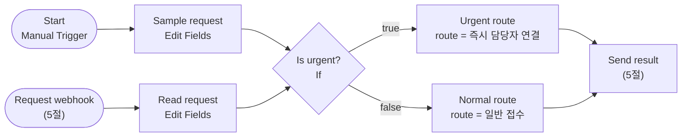
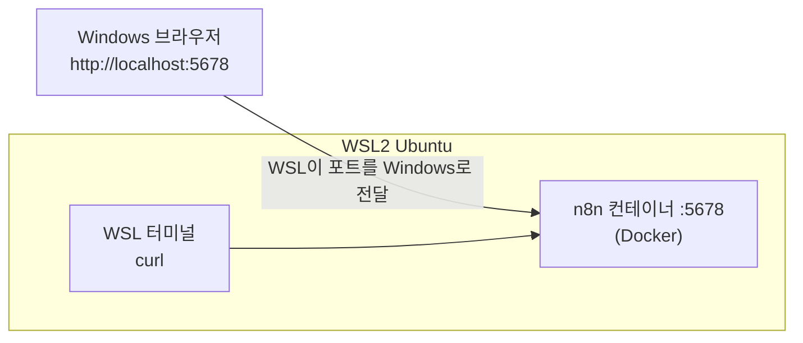

# Lab 02A · 브라우저에서 n8n 첫 워크플로우 직접 만들기 (기본)

- 관련 강의: [2단계 · n8n 실습 환경과 기본 설정](../../Lecture/65/02-STAGE2-N8N-ENVIRONMENT.md)
- 소요 시간: 약 25분 (1~4절 15분 + 5절 10분)
- 준비: [SETUP-N8N.md](SETUP-N8N.md) 완료 (WSL에서 `docker compose ps` → n8n running)
- 목표: **WSL의 Docker에서 돌아가는 n8n을 Windows 브라우저로 열고**, 파일을 가져오지 않고 화면에서 직접 작은 시나리오를 만들어 실행한다. 마지막에는 WSL 터미널에서 보낸 요청이 브라우저 화면에 나타나는 것을 확인한다.

## 오늘 만드는 시나리오: 긴급 문의 나누기

직원의 IT 문의에 "긴급"이 들어 있으면 **즉시 담당자 연결**, 아니면 **일반 접수**로 나눕니다. LLM 없이 Trigger·Condition·Action만으로 만듭니다 (1단계 TCA).



---

## 1. Windows 브라우저에서 WSL의 n8n 열기 (3분)

n8n은 **WSL 안의 Docker 컨테이너**에서 돌고, 화면은 **Windows 브라우저**로 봅니다. 둘은 `localhost:5678`로 이어집니다.



1. WSL 터미널에서 n8n이 살아 있는지 먼저 봅니다.

   ```bash
   cd ~/aio-01d4-stu/Last3Mon/65/n8n
   docker compose ps                     # n8n  running
   curl -s localhost:5678/healthz        # {"status":"ok"}
   ```

2. Windows의 Chrome·Edge 주소창에 **http://localhost:5678** 을 입력하고 SETUP 5단계에서 만든 계정으로 로그인합니다.

| 확인 | 결과 |
| --- | --- |
| WSL `curl`은 되는데 Windows 브라우저가 안 열림 | WSL 터미널에서 `hostname -I`의 첫 번째 주소(예: `172.24.x.x`)로 `http://172.24.x.x:5678` 접속. 그래도 안 되면 PowerShell `wsl --shutdown` 후 WSL을 다시 열고 `docker compose start` |
| WSL `curl`도 실패 | 컨테이너가 꺼져 있음 → `docker compose start`, `docker compose logs n8n --tail 30` |

> 브라우저는 Windows, n8n은 WSL 안입니다. **화면을 보는 곳과 실제로 실행되는 곳이 다르다**는 것을 기억해 두면 5절이 쉽게 이해됩니다.

## 2. 빈 워크플로우와 Manual Trigger (3분)

1. 왼쪽 위 **+ (Create) → Workflow**. 왼쪽 위 이름을 `65-00 My first workflow`로 바꿉니다.
2. 가운데 **Add first step** → `Trigger manually`(Manual Trigger)를 고릅니다. 이름은 `Start`로 둡니다.

## 3. 입력 만들기와 조건 (5분)

**3-1. Sample request (Edit Fields)**

`Start` 오른쪽 `+` → `Edit Fields (Set)`. 이름을 `Sample request`로 바꾸고 **Add Field**로 두 필드를 만듭니다.

| Name | Type | Value |
| --- | --- | --- |
| `user` | String | `kim` |
| `text` | String | `긴급! VPN이 끊겼어요` |

**3-2. Is urgent? (If)**

`Sample request` 다음에 `If`. 이름을 `Is urgent?`로 바꿉니다.

| 칸 | 값 |
| --- | --- |
| value 1 | `{{ $json.text }}` (왼쪽 INPUT의 `text`를 끌어다 놓으면 자동으로 만들어짐) |
| 연산자 | **String → contains** |
| value 2 | `긴급` |

## 4. 두 길과 실행 (4분)

1. `Is urgent?`의 **true** 출력 `+` → `Edit Fields (Set)` `Urgent route`: 필드 `route`(String) = `즉시 담당자 연결`, **Include Other Input Fields** 켜기
2. **false** 출력 `+` → `Edit Fields (Set)` `Normal route`: 필드 `route` = `일반 접수`, **Include Other Input Fields** 켜기
3. 아래쪽 **Execute workflow** → 지나간 길이 초록색으로 표시됩니다.
4. `Urgent route`를 더블클릭해 OUTPUT을 봅니다.

```json
[{"user": "kim", "text": "긴급! VPN이 끊겼어요", "route": "즉시 담당자 연결"}]
```

5. `Sample request`의 `text`를 `프린터 토너가 떨어졌어요`로 바꿔 다시 실행 → 이번에는 `Normal route`로 갑니다.
6. 오른쪽 위 **Save**.

| 확인할 것 | 내 답 |
| --- | --- |
| 두 번 실행에서 초록색으로 표시된 길은 각각? | |
| `Is urgent?`의 OUTPUT 탭은 몇 개이고, 각각 항목이 몇 개였나? | |
| `Include Other Input Fields`를 끄면 `Urgent route` OUTPUT은 어떻게 바뀌나? | |

## 5. WSL 터미널에서 부르기: Webhook (10분)

이번에는 같은 조건을 **다른 프로그램(WSL의 curl)** 이 부르게 합니다.

1. 캔버스 빈 곳에서 `+` → `Webhook`. 이름 `Request webhook`.

   | 설정 | 값 |
   | --- | --- |
   | HTTP Method | `POST` |
   | Path | `my-first-route` |
   | Respond | `Using 'Respond to Webhook' Node` |

2. `Request webhook` 다음에 `Edit Fields (Set)` `Read request`: `user` = `{{ $json.body.user }}`, `text` = `{{ $json.body.text }}` (웹훅 데이터는 `body` 안에, 2단계 4.3절)
3. `Read request`의 출력을 **이미 있는 `Is urgent?`** 에 연결합니다. 이제 Trigger가 둘이고 조건은 하나를 같이 씁니다.
4. `Urgent route`와 `Normal route` 다음에 `Respond to Webhook` 하나를 두고(이름 `Send result`, Respond With `JSON`, Response Body `{{ $json }}`) 두 노드를 모두 연결합니다.
5. **Save** → `Request webhook`을 열고 **Listen for test event**를 누른 채로, WSL 터미널에서 보냅니다.

```bash
curl -s -X POST http://localhost:5678/webhook-test/my-first-route \
  -H 'Content-Type: application/json' -d '{"user":"kim","text":"긴급! VPN이 끊겼어요"}'
```

```text
{"user":"kim","text":"긴급! VPN이 끊겼어요","route":"즉시 담당자 연결"}
```

**WSL 터미널에서 보낸 요청이 Windows 브라우저의 캔버스에 초록색 길로 나타나는 것**을 확인합니다. 요청을 보낸 곳(WSL), 실행한 곳(WSL의 n8n 컨테이너), 화면을 본 곳(Windows 브라우저)이 모두 다릅니다.

6. 오른쪽 위 **Publish**를 켜고, 이번에는 `/webhook/`(test 없음) 주소로 두 번 보냅니다.

```bash
for t in "긴급! VPN이 끊겼어요" "프린터 토너가 떨어졌어요"; do
  curl -s -w "  [HTTP %{http_code}]\n" -X POST http://localhost:5678/webhook/my-first-route \
    -H 'Content-Type: application/json' -d "{\"user\":\"kim\",\"text\":\"$t\"}"
done
```

```text
{"user":"kim","text":"긴급! VPN이 끊겼어요","route":"즉시 담당자 연결"}  [HTTP 200]
{"user":"kim","text":"프린터 토너가 떨어졌어요","route":"일반 접수"}  [HTTP 200]
```

7. 왼쪽 메뉴 **Executions**에서 방금 두 실행을 열어 지나간 길을 확인합니다.

## 막혔을 때

| 증상 | 해결 |
| --- | --- |
| `{{ $json.text }}`가 글자 그대로 들어감 | 입력칸 위 `Fixed / Expression`에서 Expression |
| Test URL로 보냈는데 404 | **Listen for test event**를 누른 상태에서 보내기 (한 번 받으면 다시 눌러야 함) |
| `/webhook/` 주소가 404 | Publish를 안 켬 |
| `text`가 비어서 늘 false | `Read request`에서 `$json.body.text`로 꺼냈는지 |
| Manual 실행인데 `Send result`도 실행됨 | 정상. 응답할 요청이 없으면 받은 데이터를 그대로 넘기고 끝남 |

## 확인

- [ ] Windows 브라우저에서 WSL의 n8n(`localhost:5678`)에 로그인했다.
- [ ] 파일을 가져오지 않고 노드 5개(Start · Sample request · Is urgent? · Urgent route · Normal route)를 직접 만들어 두 길을 모두 실행했다.
- [ ] WSL 터미널의 `curl`이 Test URL과 Production URL로 워크플로우를 불렀다.

다음: [Lab 02](LAB-02-N8N-FIRST-WORKFLOWS.md)에서 준비된 워크플로우를 가져와 Switch까지 다룹니다.
