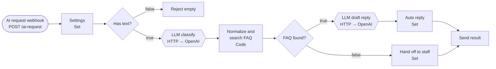

# Lab 03 · AI 문의 처리 워크플로우와 플랫폼 전환

- 관련 강의: [3단계 · 샘플 AI 워크플로우와 실행 흐름](../../Lecture/65/03-STAGE3-SAMPLE-AI-WORKFLOW.md)
- 소요 시간: 약 45분
- 목표: LLM이 들어간 Trigger·Condition·Action 워크플로우를 실행하고, 같은 업무를 Python에서 플랫폼과 상관없이 호출한다.

## 1. AI 문의 처리 워크플로우 가져오기 (10분)

1. Lab 02와 같은 방법으로 `03-ai-request-flow.json`을 가져와 저장합니다.
2. `Settings` 노드를 열어 값을 확인합니다.

| 필드 | 값 | 바꿔야 하는 경우 |
| --- | --- | --- |
| `llm_url` | `https://api.openai.com/v1` | 대체: Ollama로 바꿀 때 `http://ollama:11434/v1` |
| `model` | `gpt-4.1-mini` | 대체: Ollama로 바꿀 때 `gemma3:4b` |

   `LLM classify`·`LLM draft reply` 노드의 Authentication이 **OpenAI → `OpenAI (.env)`** 인지 확인합니다 (SETUP 6단계에서 등록한 Credential).

3. **Publish**를 켭니다.



## 2. 실행과 실행 기록 확인 (10분)

```bash
for t in "VPN 접속이 계속 끊겨요" "비밀번호를 잊어버려서 로그인이 안 돼요" "점심 메뉴 추천해줘"; do
  curl -s -m 300 -w "  [%{time_total}s]\n" -X POST http://localhost:5678/webhook/ai-request \
    -H 'Content-Type: application/json' -d "{\"user\":\"kim\",\"text\":\"$t\"}"
done
```

요청마다 3초 안팎 걸립니다 (OpenAI 호출 2회). "점심 메뉴"처럼 FAQ가 없는 문의는 LLM을 한 번만 불러 1초 안에 끝납니다.

**Executions**에서 각 실행을 열고 다음을 확인합니다.

| 확인할 것 | 어디서 |
| --- | --- |
| LLM이 돌려준 원래 분류값 | `Normalize and search FAQ` 출력의 `raw_label` |
| 정리된 분류값 | 같은 출력의 `category` |
| 어느 길로 갔나 | `FAQ found?` 노드의 true/false 출력 |
| 가장 오래 걸린 노드 | 각 노드 오른쪽 위의 실행 시간 |

## 3. Python에서 플랫폼과 상관없이 호출하기 (15분)

같은 업무(`request`)를 n8n과 `miniflow` 두 플랫폼이 모두 처리할 수 있습니다. 호출하는 쪽은 업무 이름만 알고, 어느 플랫폼에서 실행할지는 설정이 정합니다.

```bash
cd ~/aio-01d4-stu/Last3Mon/65/workflow-lab
# LLM 설정은 Last3Mon/.env (MINIFLOW_LLM=openai, gpt-4.1-mini)
uv run miniflow call request -i user=kim -i text="VPN 접속이 계속 끊겨요"
```

```text
Workflow: request   platforms: n8n -> miniflow
  n8n        ok        2506.8ms
Served by: n8n
```

### 장애 상황 만들기

```bash
cd ../n8n && docker compose stop n8n && cd ../workflow-lab
uv run miniflow call request -i user=kim -i text="VPN 접속이 계속 끊겨요"
```

```text
  n8n        failed      11.7ms  n8n is not reachable at http://localhost:5678/webhook/ai-request (...)
  miniflow   ok           …ms
Served by: miniflow
```

n8n이 멈춰도 `miniflow`가 같은 업무를 이어받습니다. 확인이 끝나면 n8n을 다시 켭니다.

```bash
cd ../n8n && docker compose start n8n && cd ../workflow-lab
```

### 순서 바꾸기

```bash
WORKFLOW_PLATFORMS=miniflow,n8n uv run miniflow call request -i user=kim -i text="프린터가 안 돼요"
uv run miniflow call request --platforms n8n -i user=kim -i text="프린터가 안 돼요"
```

어떤 플랫폼을 먼저 쓸지 바꿀 때 코드를 고쳤나요? 설정(환경 변수·옵션)만 바꿨나요?

### LLM도 바꿔 쓸 수 있게: OpenAI → Ollama 대체

플랫폼(n8n → miniflow)과 마찬가지로 LLM에도 대체 경로가 있습니다. `Last3Mon/.env`의 `MINIFLOW_LLM_FALLBACK=ollama` 덕분에 OpenAI 호출이 실패하면 Ollama로 한 번 더 시도합니다. 잘못된 키를 **이 명령에서만** 넣어 실패를 만들어 봅니다 (`.env`는 고치지 않습니다).

```bash
OPENAI_API_KEY=sk-invalid-key-for-demo-0000000000 \
  uv run miniflow run flows/06-request-with-condition.json -i user=kim -i text="VPN 접속이 계속 끊겨요"
```

```text
[miniflow] openai failed (OpenAI rejected the API key (check OPENAI_API_KEY in .env)); trying ollama
...
  "route": "자동 답변",
```

- 수업 전 측정: OpenAI 대신 Ollama(`gemma3:4b`)가 답해 같은 `자동 답변`이 나왔습니다. 대신 시간이 더 걸립니다 (모델을 처음 올리면 20초 이상).
- n8n의 HTTP Request 노드는 Settings의 `llm_url`·`model`을 Ollama 값으로 바꾸면 같은 워크플로우가 동작합니다 (Ollama도 `/v1/chat/completions` 형식을 지원).

## 4. 정리 질문 (10분)

`my-work/LAB-03-ANSWERS.md`에 답을 적습니다.

1. n8n 워크플로우와 `06-request-with-condition.json`은 같은 업무를 처리합니다. 노드 구성에서 같은 점과 다른 점을 두 가지씩 적어 보세요.
2. `Normalize and search FAQ` 노드에서 LLM의 분류값을 정해진 값으로 바꾸는 이유는 무엇인가요?
3. 플랫폼 전환이 되려면 두 플랫폼의 **입력과 출력 형식**이 같아야 합니다. 이 실습에서 같은 형식으로 맞춘 필드는 무엇인가요?
4. 플랫폼을 바꿀 때 바꾸지 않아도 되는 것과, 다시 만들어야 하는 것은 각각 무엇인가요?

## 확인

- [ ] `03` 워크플로우의 자동 답변·담당자 전달 두 길을 모두 실행했다.
- [ ] Executions에서 `raw_label`과 `category`를 비교했다.
- [ ] n8n을 멈춘 상태에서 `miniflow`로 전환되는 것을 확인했다.
