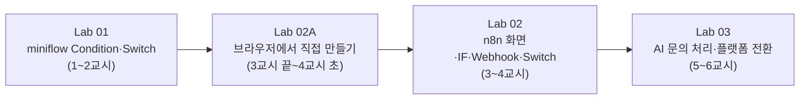

# 65일차 실습 · Trigger·Condition·Action과 n8n

- 일자: 2026-10-15 (65일차)
- 교과목: 노코드 멀티 에이전트 워크플로우 설계 및 운영
- 단원: AI 워크플로우 개념 및 구성 요소 이해
- 강의 자료: [Lecture/65](../../Lecture/65/README.md)

## 구성

```text
Last3Mon/65/
├── README.md
├── SETUP-N8N.md                    # 사전 준비 · API 키(.env), n8n 실행, Credential 등록
├── LAB-01-CONDITION-IN-MINIFLOW.md # 1단계 · Condition·Switch로 분기 만들기
├── LAB-02A-FIRST-WORKFLOW-IN-BROWSER.md # 2단계 · (기본) Windows 브라우저로 WSL의 n8n 열고 직접 만들기
├── LAB-02-N8N-FIRST-WORKFLOWS.md   # 2단계 · n8n 화면 익히기, IF·Webhook·Switch
├── LAB-03-AI-WORKFLOW-FAILOVER.md  # 3단계 · AI 문의 처리 워크플로우와 플랫폼 전환
├── templates/
│   └── TCA-DESIGN-TEMPLATE.md      # Trigger·Condition·Action 설계표
├── my-work/                        # 여러분의 결과물 (직접 만듭니다)
├── n8n/
│   ├── compose.yml                 # n8n 2.42.6 + Ollama (대체용)
│   ├── .env.example                # 64일차 모델 폴더 연결 설정 (키는 넣지 않음)
│   ├── register-credentials.sh     # Last3Mon/.env의 키를 n8n Credential로 등록
│   └── workflows/                  # n8n에 가져올 워크플로우 3개
└── workflow-lab/                   # miniflow (64일차 버전 + condition·switch·call)
```

## 실습 순서



| n8n 워크플로우 | Trigger | Condition | Action |
| --- | --- | --- | --- |
| (Lab 02A, 직접 만듦) `65-00 My first workflow` | Manual + Webhook `POST /my-first-route` | If (`긴급` 포함) | 처리 경로 지정, 응답 |
| `01-condition-basics.json` | Manual | IF (긴급 여부) | 처리 경로·처리 기한 지정 |
| `02-webhook-router.json` | Webhook `POST /request-route` | IF (내용 있음) → Switch (분류) | 담당 팀 지정, 응답 |
| `03-ai-request-flow.json` | Webhook `POST /ai-request` | IF (내용 있음) → IF (FAQ 있음) | LLM 분류·답변 작성, 담당자 전달, 응답 |

| miniflow 워크플로우 | 새로 쓰는 노드 |
| --- | --- |
| `06-request-with-condition.json` | `condition` (FAQ 있음?) → 자동 답변 / 담당자 전달 |
| `07-route-by-category.json` | `switch` (분류값) → 담당 팀 5갈래 |

## 준비

**[SETUP-N8N.md](SETUP-N8N.md)** 를 수업 전날 끝내고, 아래가 모두 되는지 확인합니다.

```bash
cd ~/aio-01d4-stu/Last3Mon/65/workflow-lab && uv sync && uv run pytest -q   # 35 passed, 1 skipped
cd ../n8n && docker compose ps                                               # n8n, ollama running
```
