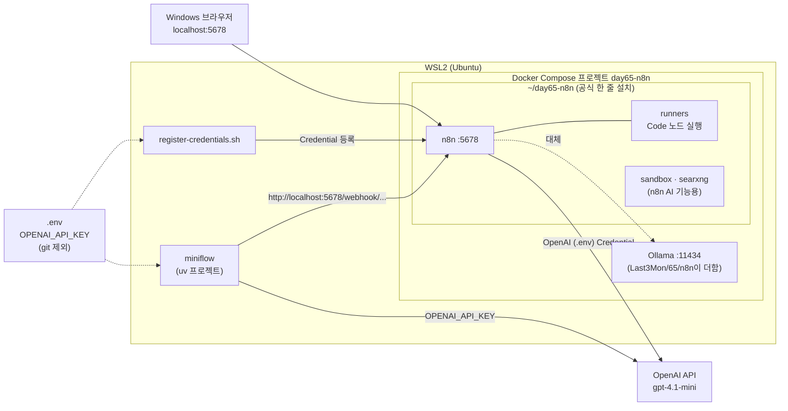

# 사전 준비 · n8n 실행과 OpenAI API 키 연결

65일차부터 노코드 워크플로우 도구 **n8n**을 사용합니다. 수업의 LLM은 **OpenAI API**(기본 모델 `gpt-4.1-mini`)입니다. API 키는 git에 올라가지 않는 `.env` 파일 한 곳에만 두고, n8n과 WSL의 `miniflow`가 모두 그 파일에서 키를 읽습니다. n8n은 **n8n 공식 한 줄 설치**(`curl -fsSL https://get.n8n.io | sh`, [공식 안내](https://docs.n8n.io/deploy/host-n8n/install-options/one-line-setup))로 WSL의 Docker에 설치하고, 64일차의 Ollama는 **대체용**으로 수업 Compose가 함께 실행합니다 (OpenAI가 실패하거나 키가 없을 때).

> 이미지 다운로드가 약 6.5GB입니다 (공식 설치의 n8n 묶음 약 2.3GB: n8n 1.1GB · 코드 실행기 0.55GB · 샌드박스 0.43GB · 검색 0.26GB / Ollama 4.2GB). **수업 전날 집에서 6단계까지 끝내 주세요.** 9월에 Docker로 Ollama를 써 봤다면 Ollama 이미지는 이미 있을 수 있습니다.



## 1. WSL에 Docker 설치 (10분)

Windows용 Docker Desktop은 쓰지 않습니다. **WSL(Ubuntu) 안에 Docker Engine을 직접 설치**하고, 컨테이너 상태를 보는 도구 **ctop**도 함께 설치합니다. 설치 스크립트와 설명은 [install-sh · 2. 시스템 & 컨테이너 DevOps](https://gl.isitsoft.kr/publicproj/install-sh#-2-%EC%8B%9C%EC%8A%A4%ED%85%9C--%EC%BB%A8%ED%85%8C%EC%9D%B4%EB%84%88-devops-1)의 **Docker**와 **ctop** 항목을 참고합니다.

WSL 터미널에서 실행합니다.

```bash
# Docker Engine + Compose 플러그인 (Ubuntu 공식 저장소, sudo 비밀번호 입력)
curl -fsSL "https://gl.isitsoft.kr/publicproj/install-sh/-/raw/main/install-docker.sh?ref_type=heads" | bash
# ctop: 컨테이너별 CPU·메모리를 실시간으로 보는 도구
curl -fsSL "https://gl.isitsoft.kr/publicproj/install-sh/-/raw/main/install-ctop.sh?ref_type=heads" | bash
```

설치 스크립트가 내 계정을 `docker` 그룹에 넣습니다. 그룹은 **새로 로그인해야** 적용되므로 WSL 터미널을 모두 닫고 다시 엽니다 (지금 창에서 바로 쓰려면 `newgrp docker`).

```bash
docker version                  # Client와 Server가 모두 나오면 성공
docker compose version
sudo systemctl enable --now docker   # 노트북을 켤 때 Docker가 자동으로 시작되게 (이미 켜져 있으면 그대로)
docker run --rm hello-world     # "Hello from Docker!"
```

| 증상 | 해결 |
| --- | --- |
| `permission denied ... docker.sock` | `docker` 그룹이 아직 적용 안 됨 → WSL 터미널을 모두 닫고 다시 열기 (또는 `newgrp docker`) |
| `Cannot connect to the Docker daemon` | `sudo systemctl start docker`. `System has not been booted with systemd`가 나오면 `sudo service docker start` |
| 이미 Docker Desktop이 설치되어 있음 | Docker Desktop을 종료하고(트레이 아이콘 → Quit), Settings → Resources → WSL integration에서 Ubuntu를 끈 뒤 위 설치를 진행 (두 Docker가 섞이지 않게) |
| `Docker is already installed ... Skipping` | 이미 WSL에 Docker가 있음. `docker version`의 Server 줄만 확인 |

`ctop`을 실행하면 n8n·Ollama 컨테이너의 CPU·메모리를 실시간으로 볼 수 있습니다 (`q`로 종료). 노트북이 느려질 때 어느 컨테이너 때문인지 확인할 때 씁니다.

## 2. API 키 `.env` 확인 (1분)

64일차에 `Last3Mon/.env`를 만들어 키를 넣었다면 아래 표만 확인하고 넘어갑니다 (`cat`으로 열지 말고 `grep -c '^OPENAI_API_KEY=sk-' ~/aio-01d4-stu/Last3Mon/.env`가 `1`이면 됨). 아직 없다면 다음 순서로 만듭니다.

과정에서 받은 OpenAI API 키를 `Last3Mon/.env` 한 곳에 넣습니다. 64일차 이후 모든 실습이 이 파일을 찾아 읽습니다 (실행한 폴더에서 위로 올라가며 가장 가까운 `.env`).

```bash
cd ~/aio-01d4-stu/Last3Mon
cp .env.example .env
nano .env          # OPENAI_API_KEY= 뒤에 키를 붙여 넣고 저장 (Ctrl+O, Enter, Ctrl+X)
git status --short .env    # 아무것도 나오지 않으면 git이 무시하는 파일 (정상)
```

| 줄 | 뜻 |
| --- | --- |
| `OPENAI_API_KEY=` | 받은 키 (`sk-`로 시작). **문서·워크플로우·채팅에 붙여 넣지 않습니다** |
| `OPENAI_MODEL=gpt-4.1-mini` | 수업 기본 모델 |
| `OPENAI_EMBED_MODEL=text-embedding-3-large` | 71일차부터 쓰는 임베딩 모델 (한국어 규정 검색에서 small보다 정확) |
| `MINIFLOW_LLM=openai` | `miniflow`가 OpenAI를 쓰게 함 (`mock`이면 LLM 없이 정해진 답) |
| `MINIFLOW_LLM_FALLBACK=ollama` | OpenAI 호출이 실패하면 Ollama로 한 번 더 시도 |

> `.env`는 `.gitignore`에 들어 있어 커밋되지 않습니다. 키가 들어간 파일을 다른 이름으로 복사해 두지 마세요 (`.env.bak` 같은 이름도 커밋 대상이 될 수 있습니다).

## 3. WSL의 Ollama 서비스 멈추기 (2분)

64일차에 WSL에 설치한 Ollama가 11434 포트를 쓰고 있으면 Docker의 Ollama가 시작되지 않습니다. 대체용 Ollama는 Docker 쪽 하나만 사용합니다.

```bash
sudo systemctl stop ollama        # 오늘 수업 동안 멈춤
sudo systemctl disable ollama     # (선택) 노트북을 켤 때 자동으로 시작하지 않게 함
```

64일차 실습을 다시 할 때는 `sudo systemctl start ollama`로 다시 켜면 됩니다.

## 4. 모델 폴더 연결 설정 (2분)

64일차에 받은 모델을 다시 받지 않도록, Docker의 Ollama가 같은 모델 폴더를 쓰게 합니다. 이 `.env`는 Compose 설정용이고 API 키는 넣지 않습니다.

```bash
cd ~/aio-01d4-stu/Last3Mon/65/n8n
cp .env.example .env
ls /usr/share/ollama/.ollama/models 2>/dev/null && echo "서비스 설치 경로 사용" || echo "홈 경로 확인 필요"
```

| 결과 | `.env`에 둘 줄 |
| --- | --- |
| `서비스 설치 경로 사용` | `OLLAMA_DATA=/usr/share/ollama/.ollama` (기본값 그대로) |
| `홈 경로 확인 필요` | `OLLAMA_DATA=/home/<WSL 사용자 이름>/.ollama` 로 바꾸기 |

## 5. n8n 공식 한 줄 설치 (이미지 다운로드 5~15분)

n8n이 제공하는 설치 스크립트가 Docker Compose 설정을 **자동으로** 만들고 n8n을 켭니다. 수업에서는 두 가지만 정해서 실행합니다.

```bash
cd ~
curl -fsSL https://get.n8n.io | N8N_DIR=./day65-n8n sh -s -- --version 2.42.6
```

| 옵션 | 이유 |
| --- | --- |
| `N8N_DIR=./day65-n8n` | 설치 폴더 `~/day65-n8n`. 폴더 이름이 Docker 프로젝트 이름이 되어, 67일차부터 쓰는 사내 데이터 API가 같은 네트워크(`day65-n8n_default`)에 붙습니다 |
| `--version 2.42.6` | 수업 자료를 이 버전으로 만들고 측정했습니다. 빼면 그날의 최신 버전이 설치됩니다 |

```text
✔ Started n8n 2.42.6 and sandbox services
n8n is running at: http://localhost:5678
Config files:      ./day65-n8n/compose.yml, ./day65-n8n/.env
```

스크립트가 만든 파일은 이렇습니다. **고치지 않고 그대로 둡니다.**

| 파일 | 내용 |
| --- | --- |
| `~/day65-n8n/compose.yml` | n8n, `runners`(Code 노드의 코드를 따로 실행), `sandbox-*`·`searxng`(n8n 화면 안 AI 도우미용) |
| `~/day65-n8n/.env` | n8n 버전과 내부 비밀값 (git 밖, 공유하지 않음) |
| Docker 볼륨 `day65-n8n_n8n-data` | 워크플로우·계정·Credential·실행 기록 |

### 5.1 수업 Compose로 Ollama까지 함께 켜기

`Last3Mon/65/n8n/compose.yml`은 위 공식 `compose.yml`을 **포함(include)** 하고 Ollama만 더합니다. 그래서 오늘부터는 이 폴더에서 Compose 명령 하나로 n8n과 Ollama를 함께 다룹니다.

```bash
cd ~/aio-01d4-stu/Last3Mon/65/n8n
docker compose up -d              # Ollama를 더하고, n8n 쪽은 이미 켜져 있으면 그대로
docker compose ps
```

- `docker compose ps`에서 `n8n`, `runners`, `ollama`(그리고 `sandbox-api`, `sandbox-runner-1`, `searxng`)가 `running`이면 성공입니다.
- Windows 브라우저에서 **http://localhost:5678** 을 열고, 처음 한 번 관리자 계정(이메일·이름·비밀번호)을 만듭니다. 이 계정은 내 노트북 안에만 저장되며, 외부로 가입되는 것이 아닙니다.
- 설문 화면이 나오면 건너뛰어도 됩니다.

## 6. n8n에 Credential 등록 (2분)

`.env`의 키를 n8n의 **Credential**로 등록합니다. 키를 화면에 직접 붙여 넣지 않아도 되고, 수업 워크플로우가 쓰는 이름·ID로 만들어집니다.

```bash
cd ~/aio-01d4-stu/Last3Mon/65/n8n
bash register-credentials.sh
```

```text
Successfully imported 2 credentials.
Registered 'OpenAI (.env)' and 'Ollama local' from /home/.../Last3Mon/.env
```

n8n 화면 왼쪽 **Credentials**(또는 Overview → Credentials)에 `OpenAI (.env)`와 `Ollama local`이 보이면 성공입니다. 키를 바꾸면 `.env`를 고치고 이 명령을 다시 실행합니다.

## 7. 확인: OpenAI 호출 한 번

```bash
cd ~/aio-01d4-stu/Last3Mon/65/workflow-lab
uv sync
uv run miniflow check
```

```text
MINIFLOW_LLM : openai
.env         : /home/.../Last3Mon/.env
OPENAI_MODEL : gpt-4.1-mini
API key      : set
Reply (openai, 2.9s): ready
```

## 8. 끄고 켜기

`Last3Mon/65/n8n` 폴더에서 합니다. 공식 설치 폴더(`~/day65-n8n`)에서 따로 켜고 끌 필요는 없습니다.

```bash
cd ~/aio-01d4-stu/Last3Mon/65/n8n
docker compose stop      # 수업이 끝나면 멈춤 (데이터는 유지)
docker compose start     # 다음에 다시 켬
docker compose down      # 컨테이너 삭제 (워크플로우·계정·Credential은 n8n-data 볼륨에 유지)
```

`docker compose down -v`는 볼륨까지 지우므로 쓰지 않습니다. n8n 버전을 올리는 공식 명령(`... | sh -s -- --upgrade`)도 수업 중에는 쓰지 않습니다 (자료가 2.42.6 기준).

## 9. 문제 해결

| 증상 | 해결 |
| --- | --- |
| `miniflow check`가 `OPENAI_API_KEY is not set` | 2단계: `Last3Mon/.env`에 키가 있는지, 파일 이름이 정확히 `.env`인지 확인 |
| `HTTP 401` / `rejected the API key` | 키를 잘못 붙여 넣음 (앞뒤 공백·따옴표 확인) → `.env` 수정 후 6단계 다시 |
| `HTTP 429 insufficient_quota` | 키의 조직에 API 크레딧이 없음 → 강사·운영진에 알림 |
| `register-credentials.sh`가 `No .env with OPENAI_API_KEY found` | 2단계를 `Last3Mon` 폴더에서 했는지 확인 |
| `port is already allocated` (11434) | 3단계: `sudo systemctl stop ollama` |
| `port is already allocated` (5678) / 설치 스크립트가 `something is already listening on port 5678` | 다른 n8n이 실행 중인지 `docker ps`로 확인 후 멈춤 |
| 설치 스크립트가 `Docker is not installed` / `daemon is not running` | 1단계(WSL Docker 설치), `docker` 그룹 적용을 위해 터미널 다시 열기, `sudo systemctl start docker` |
| 설치 스크립트가 `./day65-n8n exists and is not empty` | 이미 설치됨. 5.1절로 넘어가기 (`~/day65-n8n`을 지우지 않습니다) |
| `docker compose up`이 `.../day65-n8n/compose.yml: no such file or directory` | 5단계를 홈(`cd ~`)에서 하지 않았거나 수업 저장소가 `~/aio-01d4-stu`가 아님 → n8n을 설치한 폴더를 `.env`의 `N8N_HOME=`에 적기 |
| `Docker Hub pull rate limit` | 잠시 후 다시, 또는 `docker login` |
| 브라우저에서 `localhost:5678`이 열리지 않음 | `docker compose ps`로 상태 확인, `docker compose logs n8n`으로 오류 확인. WSL 안의 컨테이너도 Windows 브라우저에서 `localhost`로 열리는 것이 기본이며, 계속 안 되면 PowerShell에서 `wsl --shutdown` 후 WSL을 다시 열기 |
| 웹훅 호출이 404 (`not registered`) | 워크플로우 오른쪽 위 **Publish** 토글 확인. 같은 워크플로우를 여러 번 가져왔다면 기존 것을 삭제하고 한 번만 가져온 뒤 Publish |

## 확인

- [ ] `Last3Mon/.env`에 키를 넣었고, `git status`에 `.env`가 보이지 않는다
- [ ] `~/day65-n8n`에 공식 설치가 있고(`compose.yml`, `.env`), `Last3Mon/65/n8n`에서 `docker compose ps` → n8n, runners, ollama 모두 running
- [ ] n8n Credentials에 `OpenAI (.env)`, `Ollama local`이 있다
- [ ] `uv run miniflow check` → `Reply (openai, …): ready`
