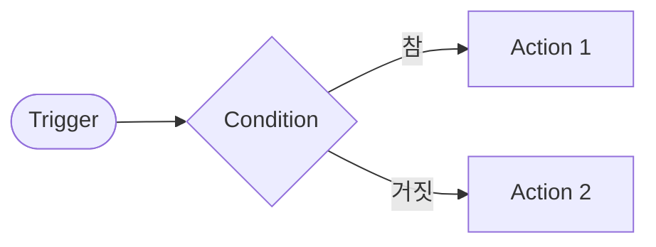

# Trigger·Condition·Action 설계표

- 작성자:
- 업무 이름:

## 1. Trigger (언제 시작하나)

| 항목 | 내용 |
| --- | --- |
| 시작 방식 | 수동 / 웹훅·폼 / 일정 / 이벤트 중 선택 |
| 시작할 때 받는 데이터 (필드) |  |
| 데이터가 비었거나 형식이 틀리면? |  |

## 2. Condition (어느 길로 갈까)

| 번호 | 검사할 값 | 조건 | 참일 때 | 거짓일 때 |
| --- | --- | --- | --- | --- |
| C1 |  |  |  |  |
| C2 |  |  |  |  |

여러 갈래(Switch)가 필요하면:

| 값 | 보낼 길 |
| --- | --- |
|  |  |
| (그 밖의 값, default) |  |

## 3. Action (무엇을 하나)

| 번호 | 길 | 할 일 | 노드 종류 (LLM·Tool·데이터 처리·저장·응답·사람 확인) |
| --- | --- | --- | --- |
| A1 |  |  |  |
| A2 |  |  |  |

## 4. 흐름 그림

## 5. 점검

- [ ] 모든 길의 끝에 결과(응답·저장·알림)가 있다.
- [ ] 정해진 값에 맞지 않는 경우를 받는 default 길이 있다.
- [ ] LLM 출력으로 분기할 때 값을 정리하거나 검증하는 단계가 있다.
