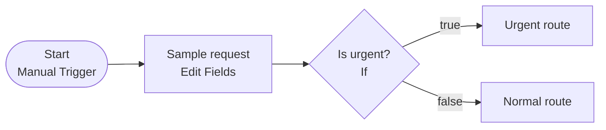
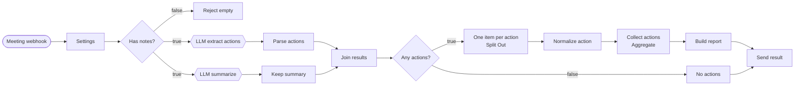

# Lab 01 · 회의록 자동 정리 워크플로우 설계하기

- 관련 강의: [1단계 · 단일 업무 자동화 설계와 데이터 흐름](../../Lecture/66/01-STAGE1-DESIGN-AND-DATA-FLOW.md)
- 소요 시간: 약 22분 (예제 1 5분 · 예제 2 7분 · 과제 10분)
- 목표: 노드를 만들기 전에 **연결선마다 몇 개의 항목이 흐르는지** 읽고 쓸 수 있다.
- 결과물: `my-work/LAB-01-DESIGN.md`


먼저 활동지를 복사합니다.

```bash
cd ~/aio-01d4-stu/Last3Mon/66
mkdir -p my-work
cp templates/LAB-01-WORKSHEET.md my-work/LAB-01-DESIGN.md
```

## 예제 1 · 어제 만든 흐름 읽기 (5분)

65일차 Lab 02A에서 직접 만든 `65-00 My first workflow`입니다.



활동지 1절의 표를 채웁니다. 항목(item)은 노드 사이를 지나가는 **데이터 한 덩어리**입니다.

| 연결 | 항목 수 | 지나가는 필드 |
| --- | --- | --- |
| Start → Sample request | 1 | (없음) |
| Sample request → Is urgent? | ( ? ) | `user`, `text` |
| Is urgent? → Urgent route | ( ? ) | `user`, `text` |

<details><summary>답 보기</summary>

모두 **1개**입니다. If 노드는 항목을 **나누어 보낼 뿐** 개수를 늘리지 않습니다. 요청 1건은 true나 false 중 **한쪽 길로만** 갑니다.
</details>

## 예제 2 · 오늘 흐름의 빈칸 채우기 (7분)

오늘 만들 회의록 워크플로우입니다. 회의록 1건에서 할 일 4건이 나옵니다 (예시: `n8n/requests/weekly.json`).



활동지 2절의 빈칸 다섯 개를 채웁니다.

| 번호 | 질문 | 답 |
| --- | --- | --- |
| ① | `Parse actions` → `Join results` 의 항목 수 | ( ? ) |
| ② | `One item per action` → `Normalize action` 의 항목 수 | ( ? ) |
| ③ | `Collect actions` → `Build report` 의 항목 수 | ( ? ) |
| ④ | `LLM extract actions`와 `LLM summarize`를 **동시에** 돌려도 되는 이유 | ( ? ) |
| ⑤ | 할 일 찾기·요약·`미정` 채우기·우선순위 정하기 중 **LLM이 하는 일** 두 가지 | ( ? ) |

<details><summary>답 보기</summary>

| 번호 | 답 |
| --- | --- |
| ① | 1 (할 일 4건이 `actions` **목록 하나**에 들어 있음) |
| ② | **4** (Split Out이 목록을 할 일 하나씩으로 펼침, 1 → 4) |
| ③ | **1** (Aggregate가 다시 목록 하나로 모음, 4 → 1) |
| ④ | 할 일 찾기와 요약은 **서로의 결과가 필요 없기** 때문 |
| ⑤ | 할 일 찾기, 요약. `미정` 채우기와 우선순위는 **규칙**(항상 같은 답) |
</details>

## 과제 · 요청이 바뀌면 어디를 고치나? (10분)

팀장이 새로 요청했습니다.

> "담당자나 기한이 정해지지 않은 할 일은 **확인 필요**로 표시해 주세요. 그리고 확인이 필요한 할 일이 **몇 건인지**도 결과에 넣어 주세요."

예제 2의 그림을 보면서 활동지 3절의 질문에 답합니다. 노드를 새로 만들 필요가 있는지, 있던 노드를 고치면 되는지 생각해 보세요.

1. 이 판단은 LLM이 할 일인가요, 규칙이 할 일인가요? 왜 그런가요?
2. "이 할 일은 확인 필요인가?"는 할 일 **하나마다** 정하는 일입니다. 그림에서 할 일이 하나씩 흐르는 노드는 어디인가요? 거기에 어떤 필드를 더하나요?
3. "몇 건인지"는 할 일을 **모두 모은 뒤**에야 셀 수 있습니다. 어느 노드에서 세나요?
4. 할 일이 하나도 없는 회의(`No actions` 길)의 결과에는 무엇을 넣어야 하나요?
5. 이 변경으로 연결선의 항목 수가 바뀌는 곳이 있나요?

> 정답은 하나가 아닙니다. 위치와 이유를 한 줄씩 적으면 됩니다. 이 설계는 **Lab 03 과제**에서 실제로 만듭니다.

<details><summary>힌트</summary>

- 규칙으로 쓸 수 있는지 문장으로 적어 보세요: "담당자가 `미정`이거나 기한이 `미정`이면 확인 필요".
- 할 일 하나마다 우선순위(`priority`)를 정하던 노드를 떠올려 보세요.
- 결과 형식은 두 길이 **같은 필드**로 끝나야 합니다 (1단계 2.1절).
</details>

## 확인

- [ ] 예제 1의 표를 채우고, If가 항목 수를 바꾸지 않는다는 것을 설명할 수 있다.
- [ ] 예제 2의 ①~⑤를 채웠다 (1 → 4 → 1).
- [ ] 과제 1~5에 위치와 이유를 한 줄씩 적었다.
