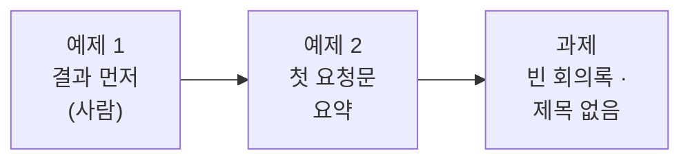

# Lab 01 · 결과 먼저, 첫 요청문

- 관련 강의: [1단계 · 바이브 코딩으로 n8n 만들기, 결과 먼저](../../Lecture/66/01-STAGE1-VIBE-N8N-AND-RESULT-FIRST.md)
- 소요 시간: 약 40분 (예제 1 10분 · 예제 2 15분 · 과제 15분)
- 준비: [실습 준비](../../Lecture/66/00-DAY66-PREP.md)의 `uv run tools/flow.py doctor` → `ready`
- 목표: 만들기 전에 **결과를 먼저** 정하고, 노드를 끌어다 놓지 않고 **내가 쓴 요청문**으로 첫 워크플로우를 만들어 **테스트로 확인**한다.



> 이 실습에는 **복사해 붙일 요청문이 없습니다.** 요청문은 직접 씁니다. 막히면 아래 `▶` 를 하나씩 펼쳐 보세요. 펼칠수록 구체적이 되지만, 정답 요청문은 나오지 않습니다.

## 시작하기 · 터미널 두 개

| 터미널 | 하는 일 |
| --- | --- |
| ① 에이전트 | `cd ~/aio-01d4-stu/Last3Mon/66` 후 `codex` (또는 `claude`, `agy`) 실행. 내가 쓴 요청문을 보낸다 |
| ② 확인 | `cd ~/aio-01d4-stu/Last3Mon/66` 에서 `push`·`test`를 **내가** 실행한다 |

- 에이전트는 이 폴더의 [AGENTS.md](AGENTS.md)를 읽고 일합니다 (노드 모양, Credential, 오늘의 계약). `agy`가 읽지 않으면 첫 요청 앞에 "AGENTS.md를 먼저 읽어"를 붙입니다.
- 에이전트가 명령 실행이나 파일 쓰기를 허락해 달라고 하면 **무엇을 하는지 읽고** 허용합니다.
- 요청문은 **메모장에 먼저 쓰고** 한 번 읽어 본 뒤 보냅니다. `my-work/PROMPTS.md`에 모아 둡니다.

## 예제 1 · 결과 먼저 (10분, 에이전트 없이)

`cat requests/weekly.json`으로 회의록을 읽고 `my-work/RESULT-FIRST.md`에 두 가지를 씁니다.

1. 오늘 끝(Lab 03)에 이 회의록을 넣으면 나와야 할 **결과 JSON**을 손으로 써 봅니다 ([AGENTS.md](AGENTS.md) 3절 모양).
2. 아래 데이터 흐름 표의 빈칸 (항목 수)

| 단계 | 들어오는 항목 수 | 나가는 항목 수 |
| --- | --- | --- |
| 웹훅 | | 1 |
| 할 일 뽑기 (LLM) | 1 | |
| 할 일 하나씩 | | |
| 다시 모으기 | | |

<details><summary>▶ 1단계 · 왜 결과부터</summary>

결과를 정하지 않으면 에이전트가 만든 것이 맞는지 판단할 기준이 없습니다. 내가 쓴 결과 JSON이 곧 **테스트의 기대 결과**가 됩니다. `cases/lab03.json`을 열어 내 결과와 비교해 보세요.
</details>

<details><summary>▶ 2단계 · 회의록에서 헷갈리는 곳</summary>

4번 "회의실 예약 규칙 개선은 담당자를 다음 회의에서 정한다"의 담당자와 기한은 무엇인가요? 회의록에 없는 것을 채워 넣으면 안 됩니다. "다음 회의는 10월 23일"은 할 일인가요?
</details>

## 예제 2 · 첫 요청문: 회의 요약 (15분)

**만들 것**: 회의록을 받아 한 문장으로 요약하는 워크플로우. 할 일은 아직 뽑지 않습니다.

| 조건 | 값 |
| --- | --- |
| 저장할 파일 | `my-work/meeting.json` (오늘 끝까지 이 파일을 고쳐 나감) |
| 웹훅 | POST, 경로 `my-meeting`, 본문 `title`, `notes` |
| 모델 | OpenAI `gpt-4.1-mini` |
| 결과 | `{"title": "...", "summary": "한 문장"}` |
| 기대 결과 | `cases/lab01.json` |

<details><summary>▶ 1단계 · 요청문에 들어갈 다섯 가지</summary>

[1단계 교안](../../Lecture/66/01-STAGE1-VIBE-N8N-AND-RESULT-FIRST.md) 4절: ① 파일 ② 입력 ③ 처리 ④ 결과 모양 ⑤ 기대 결과. 위 표의 줄이 각각 어디에 해당하는지 짝지어 봅니다.
</details>

<details><summary>▶ 2단계 · 빠뜨리기 쉬운 것</summary>

- 요약의 **길이와 언어**를 정했나요? 정하지 않으면 길게 씁니다.
- "회의록에 있는 것만"을 적었나요?
- "할 일은 아직 뽑지 않는다"처럼 **하지 말 것**도 적어야 에이전트가 앞서 나가지 않습니다.
</details>

<details><summary>▶ 3단계 · 보내기 전 점검표</summary>

- [ ] 파일 경로 · 웹훅 경로 · 입력 필드
- [ ] 모델 이름
- [ ] 결과 JSON 모양 (필드 이름 `title`, `summary`)
- [ ] 테스트 파일 경로, "check까지 하고 명령을 알려 달라"
</details>

에이전트가 끝났다고 하면 터미널 ②에서:

```bash
uv run tools/flow.py push my-work/meeting.json
uv run tools/flow.py call my-meeting requests/weekly.json
uv run tools/flow.py test cases/lab01.json --repeat 3
```

**관찰**: 브라우저 n8n(http://localhost:5678)에서 워크플로우를 열어 봅니다. 64·65일차에 손으로 놓던 노드가 어떻게 놓였나요? **Executions**에서 방금 실행을 열어 LLM이 받은 글을 봅니다.

## 과제 · 빈 회의록과 제목 없는 요청 (15분)

먼저 보내 봅니다.

```bash
uv run tools/flow.py call my-meeting requests/empty.json
uv run tools/flow.py call my-meeting requests/no-title.json
```

팀장이 요청했습니다.

> "빈 회의록이 오면 AI를 부르지 말고 바로 돌려보내 주세요. 제목이 없으면 '회의'라고 해 주고요."

기대 결과는 `cases/lab01-challenge.json` (빈 회의록 400, 공백만 보내도 400, 제목 없음 → `회의`, 원래 요약 그대로).

<details><summary>▶ 1단계 · 지금 무슨 일이 일어나나</summary>

빈 회의록에 지금 워크플로우는 무엇을 돌려주나요? LLM이 "내용이 없다"는 글을 만들어 냈다면, 돈과 시간을 쓰고 쓸모없는 답을 받은 것입니다. **어디서** 막아야 LLM을 부르지 않을까요?
</details>

<details><summary>▶ 2단계 · 공백만 보낸 회의록</summary>

`"notes": "   "`는 비어 있나요? 사람 눈에는 비었지만 프로그램에는 글자 3개입니다. 요청문에 어떻게 적어야 할까요?
</details>

<details><summary>▶ 3단계 · 고치는 요청문</summary>

새로 만드는 게 아니라 **고치는** 요청입니다. 고칠 파일, 바꿀 것(입력 확인, 제목 기본값), 그대로 둘 것(요약), 그리고 `cases/lab01.json`도 계속 통과해야 한다는 조건.
</details>

```bash
uv run tools/flow.py push my-work/meeting.json
uv run tools/flow.py test cases/lab01-challenge.json
uv run tools/flow.py test cases/lab01.json
```

## 막혔을 때

| 증상 | 할 일 |
| --- | --- |
| `check`에 ✘ | 에이전트에게 그 줄을 그대로 붙여 주고 고쳐 달라고 합니다 |
| `push` 후 `call`이 404 | 몇 초 뒤 다시. 계속이면 `uv run tools/flow.py doctor` |
| 에이전트가 계속 엉뚱하게 고침 | 요청을 더 작게 나눕니다. 그래도 안 되면 `cp reference/lab01-example2-summary.json my-work/meeting.json` 후 push |

## 확인

- [ ] 예제 1: 결과 JSON과 항목 수 표를 썼다.
- [ ] 예제 2: 노드를 직접 놓지 않고 `cases/lab01.json` 통과.
- [ ] 과제: `cases/lab01-challenge.json` 통과, 원래 테스트도 통과.
- [ ] `my-work/PROMPTS.md`에 요청문을 모았다.
