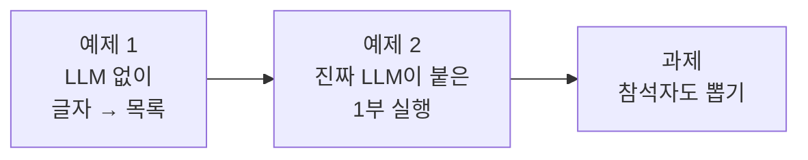
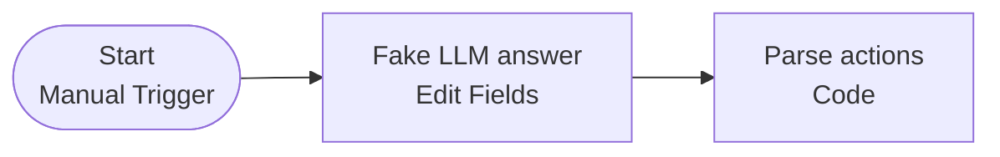
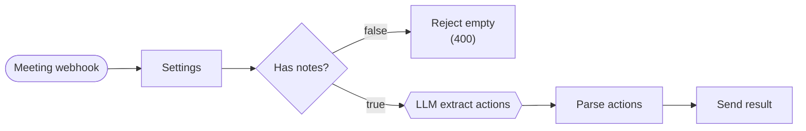

# Lab 02 · LLM 답을 데이터로 바꾸기 (입력 → LLM → 파싱)

- 관련 강의: [2단계 · 데이터 파싱과 변환 노드](../../Lecture/66/02-STAGE2-PARSE-AND-TRANSFORM.md)
- 소요 시간: 약 55분 (예제 1 15분 · 예제 2 15분 · 과제 25분)
- 준비: 65일차 n8n 실행 (`cd ~/aio-01d4-stu/Last3Mon/65/n8n && docker compose start`), Windows 브라우저에서 http://localhost:5678
- 목표: LLM의 답은 **글자**라는 것을 눈으로 확인하고, Code 노드로 **목록**으로 바꾼다. 그다음 뽑을 정보를 하나 늘려 본다.



> 노드 이름은 뒤의 표현식에서 그대로 쓰므로 **안내와 똑같이** 지어 주세요. 노드 이름은 노드를 열고 맨 위 제목을 눌러 바꿉니다.

## 예제 1 · LLM 없이 "글자 → 목록" (15분)

LLM을 부르기 전에, LLM이 돌려줄 법한 답을 **직접 적어 넣고** 파싱부터 연습합니다. 돈도 시간도 들지 않고 결과가 항상 같습니다.



1. 왼쪽 위 **+ (Create) → Workflow**. 이름을 `66 Practice 1 · parse text`로 바꿉니다.
2. **Add first step**에서 `Manual Trigger`(Trigger manually)를 추가하고 이름을 `Start`로 바꿉니다.
3. 오른쪽 `+` → **Edit Fields (Set)**, 이름 `Fake LLM answer`. **Add Field**로 필드 하나를 만듭니다.

| Name | Type | Value (Fixed 모드 그대로) |
| --- | --- | --- |
| `content` | String | 아래 한 줄 |

```text
{"actions": [{"task": "신규 고객 문의 응답 템플릿 정리", "owner": "이준호", "due": "금요일"}, {"task": "회의실 예약 규칙 개선", "owner": "", "due": ""}]}
```

4. 오른쪽 `+` → **Code**, 이름 `Parse actions`. Language `JavaScript`, Mode `Run Once for All Items`. 원래 있던 코드를 지우고 아래를 붙여 넣습니다.

```javascript
// Parse the answer text (JSON written as text) into a clean list of action items.
const raw = String($input.first().json.content ?? '').trim().replace(/^```(json)?\s*|```$/g, '');
let data;
try {
  data = JSON.parse(raw);
} catch (error) {
  return [{ json: { actions: [], count: 0, error: 'answer is not valid JSON' } }];
}
const items = Array.isArray(data) ? data : (data.actions ?? []);
const actions = items
  .filter(item => item && String(item.task ?? '').trim())
  .map(item => ({
    task: String(item.task).trim(),
    owner: String(item.owner || '미정').trim() || '미정',
    due: String(item.due || '미정').trim() || '미정',
  }));
return [{ json: { actions, count: actions.length } }];
```

5. 아래쪽 **Execute workflow**를 누르고 두 노드의 OUTPUT을 비교합니다. (오른쪽 위 `Table / JSON / Schema` 보기를 바꿔 가며 봅니다.)

| 노드 | 보이는 것 |
| --- | --- |
| Fake LLM answer | `content` **한 칸**에 긴 글자 한 줄 |
| Parse actions | `actions`가 **목록 2개**로 펼쳐짐, `count: 2`, 두 번째 할 일의 `owner`·`due`가 `미정` |

6. **답을 일부러 망가뜨려 봅니다.** `Fake LLM answer`의 값에서 **맨 끝 `}` 하나를 지우고** 다시 실행합니다.

| 결과 | 뜻 |
| --- | --- |
| `{"actions": [], "count": 0, "error": "answer is not valid JSON"}` | 망가진 답이 와도 **같은 모양**으로 끝나고, 이유(`error`)가 남음 |

확인한 뒤 지운 `}`를 다시 넣고 **Save** 합니다.

## 예제 2 · 진짜 LLM이 붙은 1부 실행하기 (15분)

이번에는 같은 파싱 앞에 **Webhook과 LLM**이 붙은 워크플로우를 가져와 실행합니다.



1. **+ (Create) → Workflow** → 오른쪽 위 **⋯ → Import from File...** → `Last3Mon/66/n8n/workflows/lab02-example2-meeting-part1.json`
   - Windows 파일 선택 창 주소창: `\\wsl$\Ubuntu\home\<사용자>\aio-01d4-stu\Last3Mon\66\n8n\workflows`
2. 이름이 `66 Meeting notes (my)`인지 확인하고 **Save** 합니다. (Lab 03에서 이 워크플로우를 이어서 완성합니다.)
3. 노드 세 개를 열어 **어디서 무엇을 하는지** 확인합니다.

| 노드 | 볼 곳 |
| --- | --- |
| `Settings` | `title`, `notes`가 Webhook 입력(`$json.body`)에서 꺼낸 값 |
| `LLM extract actions` | 아래로 내려 **JSON** 칸: ① `schema`(답의 모양) ② `role: 'system'`(지시문) ③ `role: 'user'`(회의록) |
| `Parse actions` | 예제 1과 같은 코드. 첫 줄만 `choices[0].message.content`(LLM 답이 있는 곳)를 읽음 |

4. `Meeting webhook` 노드를 열고 **Listen for test event**를 누른 뒤, WSL 터미널에서 보냅니다.

```bash
cd ~/aio-01d4-stu/Last3Mon/66
curl -s -m 300 -X POST http://localhost:5678/webhook-test/my-meeting-actions \
  -H 'Content-Type: application/json' -d @n8n/requests/weekly.json
```

5. 결과와 캔버스의 OUTPUT을 확인합니다. (수업 준비 때 `gpt-4.1-mini`로 실제 실행한 결과)

```text
{"actions":[{"task":"신규 고객 문의 응답 템플릿 정리","owner":"이준호","due":"금요일"},
 {"task":"VPN 장애 보고서 작성","owner":"박서연","due":"다음 주 월요일"},
 {"task":"서버 점검 일정 공지","owner":"김민지","due":"오늘"},
 {"task":"회의실 예약 규칙 개선 담당자 선정","owner":"미정","due":"10월 23일"}],"count":4}
```

| 노드 | 확인할 것 |
| --- | --- |
| LLM extract actions | `choices[0].message.content`가 따옴표로 둘러싸인 **글자** (예제 1의 `Fake LLM answer`와 같은 모양) |
| Parse actions | `actions`가 **목록 4개**, 4번째 `owner`가 `미정` (`due`는 LLM이 "다음 회의는 10월 23일"을 보고 `10월 23일`로 채우는 경우가 많음) |

6. Listen을 다시 누르고 `empty.json` → HTTP **400** `{"error":"notes is required"}`, `no-action.json` → `{"actions":[],"count":0}` 도 확인합니다. (Test URL은 **한 번에 한 요청**만 받습니다.)

## 과제 · 참석자도 뽑기 (25분)

팀장이 요청했습니다.

> "할 일과 함께 **회의 참석자 명단**도 받아 보고 싶어요."

예제 2의 `66 Meeting notes (my)`를 고쳐서, 결과에 `attendees`(참석자 이름 목록)가 들어가게 만드세요.

| 요청 | 기대 결과 |
| --- | --- |
| `weekly.json` | 할 일 4건과 함께 `"attendees":["김민지","이준호","박서연"]` |
| `no-action.json` | `"attendees":[]` (참석자가 적혀 있지 않음) |
| `empty.json` | 그대로 HTTP 400 |

**먼저 생각해 보기 (3분)**: LLM에게 무엇을 더 알려 줘야 하나요? LLM 답이 바뀌면 그다음 노드는 무엇을 더 꺼내야 하나요? 고칠 곳은 **세 군데**입니다. 활동지나 메모장에 세 곳을 먼저 적은 뒤 고칩니다.

<details><summary>힌트 1 · 고칠 세 곳</summary>

| 곳 | 노드 | 무엇을 |
| --- | --- | --- |
| ① 답의 모양 | `LLM extract actions`의 `schema` | `properties`에 `attendees`(글자 목록) 추가, `required`에도 추가 |
| ② 지시문 | `LLM extract actions`의 `role: 'system'` 문장 | 참석자 이름도 `attendees`에 넣으라고 한 문장 추가 |
| ③ 꺼내기 | `Parse actions`의 마지막 `return` | `attendees`도 돌려주기 (없으면 `[]`) |
</details>

<details><summary>힌트 2 · ① schema에 넣을 한 줄</summary>

`actions: { ... } },` 줄 **바로 아래**에 넣습니다.

```text
      attendees: { type: 'array', items: { type: 'string' } },
```

그리고 `required: ['actions'],` 를 `required: ['actions', 'attendees'],` 로 바꿉니다.
</details>

<details><summary>힌트 3 · ② 지시문과 ③ 코드</summary>

② `"... when there is no action item.` 뒤, 닫는 따옴표 `"` **앞**에 붙입니다.

```text
 Also list the attendee names in \"attendees\" (use [] when not stated).
```

③ 마지막 `return` 줄을 아래 두 줄로 바꿉니다.

```javascript
const attendees = Array.isArray(data.attendees) ? data.attendees.map(name => String(name).trim()).filter(Boolean) : [];
return [{ json: { actions, count: actions.length, attendees } }];
```
</details>

**테스트**: Listen for test event → `weekly.json`, 다시 Listen → `no-action.json`, 다시 Listen → `empty.json`. 세 결과를 위 표와 비교합니다.

> 참석자를 넣었더니 **할 일이 3건**으로 줄었다면 한 번 더 보내 보세요. 수업 준비 때 8번 중 1번 이런 일이 있었습니다. 뽑을 것을 늘리면 원래 뽑던 결과도 흔들릴 수 있으니, 고친 뒤에는 **원래 기대 결과(할 일 4건)도 다시** 확인합니다.

**더 생각해 보기 (빨리 끝난 사람)**

- ①만 고치고 ②를 안 고치면? ③을 안 고치면? 하나씩 되돌려 실행해 보고, 어느 노드의 OUTPUT에서 `attendees`가 사라지는지 찾아보세요.
- 참석자 명단은 LLM이 찾는 일인가요, 규칙이 하는 일인가요?

## 막혔을 때

- `invalid syntax`: JSON 칸에서 `}`와 `}`가 **붙은** 곳이 있는지 봅니다. 표현식 `{{ }}` 안에서 `}}`가 붙으면 표현식이 거기서 끝납니다. `} }`처럼 띄어 씁니다.
- `401`: `LLM extract actions`의 Credential이 `OpenAI (.env)`인지 확인합니다. 없다면 65일차 SETUP 6단계(`register-credentials.sh`)를 다시 실행합니다.
- 고치다가 망가졌다면: 워크플로우를 지우고 예제 2의 파일을 **다시 가져옵니다**.
- Test URL 404: Listen for test event를 다시 누릅니다.

## 확인

- [ ] 예제 1: `Fake LLM answer`(글자)와 `Parse actions`(목록)의 차이를 OUTPUT으로 확인했다. 망가진 답에서 `error`를 봤다.
- [ ] 예제 2: `weekly` 4건, `empty` 400, `no-action` 0건을 확인했다.
- [ ] 과제: `weekly`에서 `attendees` 3명, `no-action`에서 `[]`를 받았다.
