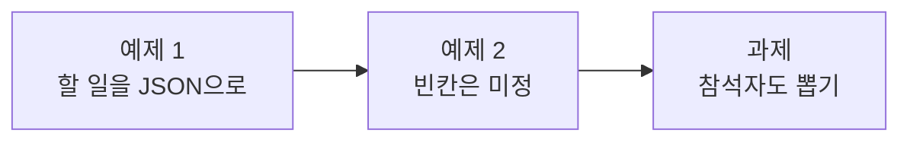

# Lab 02 · LLM에게 JSON으로 받고, 코드로 읽기

- 관련 강의: [2단계 · LLM JSON 출력, 파싱과 변환](../../Lecture/66/02-STAGE2-JSON-AND-PARSE.md)
- 소요 시간: 약 70분 (예제 1 20분 · 예제 2 15분 · 과제 35분)
- 준비: Lab 01의 `my-work/meeting.json` (없으면 `cp reference/lab01-example2-summary.json my-work/meeting.json` 후 push)
- 목표: LLM에게 할 일을 **정해진 JSON 모양**으로 받고, 그 글자를 **코드로 읽어** 목록으로 만든다. 회의록에 없는 값은 지어내지 않고 `미정`으로 채운다.



> 복사해 붙일 요청문은 없습니다. 막히면 `▶` 를 하나씩 펼칩니다.

## 예제 1 · 할 일을 JSON으로 받아 읽기 (20분)

**만들 것**: Lab 01 워크플로우에 **할 일 뽑기**를 더한다. 요약은 그대로.

| 조건 | 값 |
| --- | --- |
| 고칠 파일 | `my-work/meeting.json` |
| 처리 | 요약 다음에 LLM이 할 일을 JSON으로 → 다음 노드에서 그 글자를 JSON으로 읽기 |
| 결과 | `{"title", "summary", "count", "actions": [{"owner", "task", "due"}]}` |
| 기대 결과 | `cases/lab02.json` 앞 세 케이스 (나머지는 예제 2) |

<details><summary>▶ 1단계 · LLM에게 모양을 알려 주기</summary>

"할 일을 정리해 줘"만 쓰면 LLM은 보기 좋은 글로 답합니다. 프로그램이 읽으려면 **필드 이름까지 정한 JSON 모양**을 지시문에 넣어야 합니다. 예시 한 줄을 넣으면 더 잘 따릅니다.
</details>

<details><summary>▶ 2단계 · LLM의 답은 글자</summary>

JSON을 달라고 해도 n8n이 받는 것은 **글자**입니다. 앞뒤에 ```` ``` ````를 붙이거나 설명을 붙이기도 합니다. 읽는 노드에서 무엇을 지우고, 읽지 못하면 어떻게 할지(멈추지 말고 빈 목록) 요청문에 적습니다.
</details>

<details><summary>▶ 3단계 · 순서</summary>

테스트는 `actions.0`이 이준호의 할 일이라고 봅니다. 회의록에 나온 **순서대로** 달라고 적었나요?
</details>

```bash
uv run tools/flow.py push my-work/meeting.json
uv run tools/flow.py test cases/lab02.json
```

## 예제 2 · 빈칸은 미정, 할 일 없는 회의 (15분)

```bash
uv run tools/flow.py call my-meeting requests/no-action.json
```

| 케이스 | 기대 |
| --- | --- |
| 담당자 없는 할 일 (4번) | `owner: "미정"` |
| 할 일 없는 회의 | `count: 0`, `actions: []` |
| 빈 회의록 | 400 (Lab 01 과제) |

<details><summary>▶ 1단계 · 누가 "미정"을 쓰나</summary>

LLM에게 "없으면 미정"이라고 시킬 수도, LLM은 빈 칸으로 두고 **코드가** 채울 수도 있습니다. 어느 쪽이 매번 같은 답을 낼까요?
</details>

<details><summary>▶ 2단계 · 지어내지 않기</summary>

LLM은 빈칸을 그럴듯한 값으로 채울 수도 있습니다. "회의록에 없으면 비워 둘 것, 지어내지 말 것"을 지시문에 넣었나요?
</details>

```bash
uv run tools/flow.py push my-work/meeting.json
uv run tools/flow.py test cases/lab02.json --repeat 3
```

## 과제 · 참석자도 뽑기 (35분)

팀장이 요청했습니다.

> "할 일 목록 옆에 참석자 명단도 주세요. 회의록의 '참석:' 줄에 있는 사람만요. 없으면 빈 목록으로."

기대 결과는 `cases/lab02-challenge.json` (참석자 3명, 2명, 참석 줄이 없는 회의는 `[]`, **할 일은 그대로 4개**).

<details><summary>▶ 1단계 · 어디를 고치나</summary>

참석자를 뽑으려면 몇 곳을 고쳐야 할까요? LLM에게 주는 **모양**, 읽는 **코드**, **결과** 필드. 세 곳 중 하나라도 빠지면 테스트가 무엇을 보여 줄지 생각해 봅니다.
</details>

<details><summary>▶ 2단계 · 하나 바꾸면 다른 것이 바뀐다</summary>

지시문을 고치면 LLM은 **고치지 않은 부분**도 다르게 답할 수 있습니다. 과제 테스트의 마지막 케이스("할 일은 그대로")와 `cases/lab02.json`을 꼭 같이 돌립니다. 할 일 개수가 바뀌었다면 무엇이 빠졌는지 보고서에서 찾고, 지시문에 무엇을 더할지 정합니다.
</details>

```bash
uv run tools/flow.py push my-work/meeting.json
uv run tools/flow.py test cases/lab02-challenge.json --repeat 3
uv run tools/flow.py test cases/lab02.json
```

## 막혔을 때

| 증상 | 할 일 |
| --- | --- |
| `count: 0`인데 회의록에는 할 일이 있음 | 읽는 코드가 실패해 빈 목록이 됐을 수 있음 → Executions에서 LLM이 돌려준 글자를 확인 |
| `actions`가 글자 하나로 나옴 | JSON으로 읽지 않고 그대로 넘김 → 읽는 노드 확인 |
| 계속 안 됨 | `cp reference/lab02-example2-actions.json my-work/meeting.json` 후 push |

## 확인

- [ ] 예제 1·2: `cases/lab02.json` 3번 반복 통과.
- [ ] 과제: `cases/lab02-challenge.json` 통과, 할 일 개수가 바뀌지 않았다.
