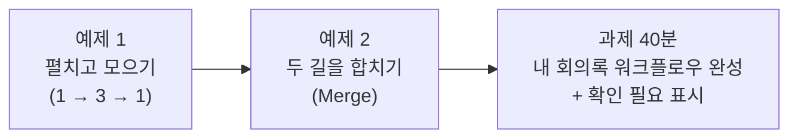
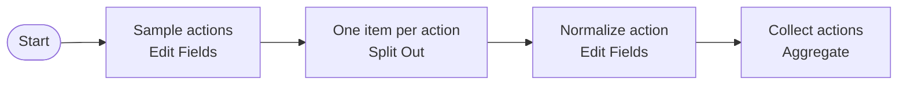
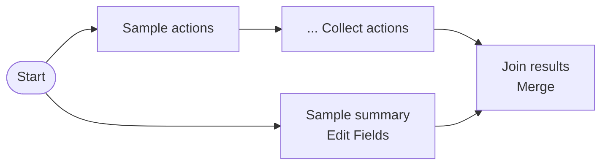
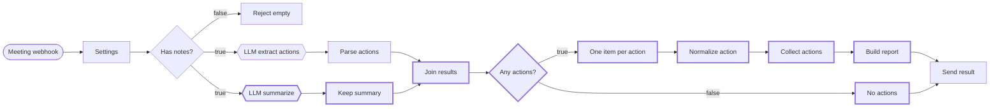

# Lab 03 · 반복·병렬로 회의록 워크플로우 완성하기

- 관련 강의: [3단계 · 반복·병렬 제어 구조와 완성](../../Lecture/66/03-STAGE3-LOOP-PARALLEL-AND-FINISH.md)
- 소요 시간: 약 65분 (예제 1 12분 · 예제 2 10분 · **과제 40분**)
- 목표: 연습용 데이터로 **펼치기 → 항목마다 처리 → 모으기**와 **병렬 → 합치기**를 먼저 익히고, 이것을 Lab 02의 내 워크플로우에 옮겨 완성한다.



## 예제 1 · 펼치고 모으기 (12분)

LLM 없이, 할 일 3건이 든 목록을 직접 만들어 연습합니다.



1. 새 워크플로우 `66 Practice 2 · loop and merge`, 첫 노드는 `Manual Trigger`(이름 `Start`).
2. **Edit Fields (Set)** `Sample actions`: 필드 하나

| Name | Type | Value (Expression 모드) |
| --- | --- | --- |
| `actions` | Array | 아래 한 줄 |

```text
{{ [ { task: '신규 고객 문의 응답 템플릿 정리', owner: '이준호', due: '금요일' }, { task: '서버 점검 일정 공지', owner: '김민지', due: '오늘' }, { task: '회의실 예약 규칙 개선', owner: '미정', due: '미정' } ] }}
```

3. **Split Out** `One item per action`: Fields To Split Out `actions`
4. **Edit Fields (Set)** `Normalize action`: 필드 네 개

| Name | Type | Value (Expression 모드) |
| --- | --- | --- |
| `task` | String | `{{ $json.task }}` |
| `owner` | String | `{{ $json.owner }}` |
| `due` | String | `{{ $json.due }}` |
| `priority` | String | `{{ ['오늘', '내일', '긴급'].some(w => $json.due.includes(w)) ? '높음' : '보통' }}` |

5. **Aggregate** `Collect actions`: Aggregate `All Item Data (Into a Single List)`, Put Output in Field `actions`
6. **Execute workflow** 후, 캔버스의 노드 사이 연결선 위에 표시되는 **항목 수**를 읽습니다.

| 노드 | 항목 수 | 보이는 것 |
| --- | --- | --- |
| Sample actions | 1 | `actions` 목록 하나 (3건) |
| One item per action | **3** | 할 일 하나씩 |
| Normalize action | **3** | + `priority` (`서버 점검 일정 공지`만 `높음`) |
| Collect actions | **1** | 다시 `actions` 목록 하나 |

> 펼쳤으면(1 → 3) 반드시 모읍니다(3 → 1). 모으지 않으면 뒤의 노드가 할 일마다 따로 실행됩니다.

## 예제 2 · 두 길을 합치기 (10분)

같은 워크플로우에 **두 번째 길**을 하나 더 만들고 Merge로 합칩니다.



1. `Start` 노드의 오른쪽 점에서 **선을 하나 더** 끌어 **Edit Fields (Set)** `Sample summary` 추가

| Name | Type | Value |
| --- | --- | --- |
| `summary` | String | `주간 회의에서 할 일 3건을 정했습니다. 서버 점검 공지는 오늘 안에 합니다.` |

2. **Merge** `Join results`: Mode `Combine`, Combine By `Position`
   - `Collect actions` → `Join results`의 **Input 1**
   - `Sample summary` → `Join results`의 **Input 2**
3. **Execute workflow** → `Join results`의 OUTPUT이 **항목 1개**이고 `actions`(3건)와 `summary`가 **함께** 들어 있는지 확인합니다.

```text
{"actions":[ ...3건, priority 포함 ... ], "summary":"주간 회의에서 할 일 3건을 정했습니다. 서버 점검 공지는 오늘 안에 합니다."}
```

4. **Save** 합니다. 이 워크플로우의 노드는 과제에서 **복사해 붙여** 씁니다.

> 막혔다면 `n8n/workflows/lab03-examples-loop-merge-practice.json`을 가져와 비교합니다.

## 과제 · 내 회의록 워크플로우 완성하기 (40분)

### 상황

팀장의 요청을 모두 담은 회의록 워크플로우를 완성합니다. 예제 1·2는 **가짜 데이터**였습니다. 이제 그 자리에 Lab 02의 **진짜 LLM 결과**를 넣습니다.

> "회의록을 보내면 **2문장 요약**, **우선순위가 붙은 할 일 목록**, **공유용 정리문**을 한 번에 받고 싶어요. 할 일이 없는 회의면 `할 일 없음`으로 알려 주세요. 그리고 담당자나 기한이 정해지지 않은 할 일은 **확인 필요**로 표시하고 몇 건인지 알려 주세요." (Lab 01 과제에서 설계한 내용)

### 완성 그림

`66 Meeting notes (my)`(Lab 02)를 아래 모양으로 만듭니다. 굵은 테두리가 새로 넣을 노드입니다.



### 기대 결과 (이 표가 정답 기준입니다)

| 요청 | 기대 결과 |
| --- | --- |
| `weekly.json` | `route: 할 일 정리`, `count: 4`, `need_check: 1`, `summary`(2문장 안팎), 3번째 할 일 `priority: 높음`, 4번째 할 일 `check: true`, `report_text` 4번째 줄 끝에 `※ 확인 필요` |
| `no-action.json` | `route: 할 일 없음`, `count: 0`, `need_check: 0`, `summary`, `actions: []` |
| `empty.json` | HTTP 400 `{"error":"notes is required"}` |

### 진행 순서 (시간은 기준)

각 단계를 마칠 때마다 **Listen for test event → `weekly.json`** 으로 실행해 OUTPUT을 확인하고 다음으로 갑니다.

#### 1단계 · 요약 길을 만들고 합치기 (10분)

- `Parse actions` → `Send result` 연결선을 지웁니다. (선 위에 마우스 → 휴지통)
- `LLM extract actions`를 오른쪽 클릭 → **Duplicate** → 이름 `LLM summarize`. `Has notes?`의 **true**에서 선을 하나 더 끌어 연결하고, JSON 칸을 아래로 **통째로** 바꿉니다.

```text
{{ JSON.stringify({ model: $('Settings').first().json.model, temperature: 0, messages: [ { role: 'system', content: "You summarize meeting notes. Reply only with the summary in Korean, at most 2 sentences. No English, no comments." }, { role: 'user', content: '다음 회의록을 요약하세요.\n\n회의록:\n' + $('Settings').first().json.notes } ] }) }}
```

- **생각할 것**: 요약은 LLM 답(`choices[0].message.content`)에서 꺼내야 합니다. 예제 2의 `Sample summary`처럼 `summary` 필드 하나를 만드는 `Keep summary`를 직접 만들어 보세요. 그다음 `Join results`(예제 2에서 복사)의 Input 1·2에 어느 노드를 연결하나요?

<details><summary>힌트</summary>

- `Keep summary`: Edit Fields, `summary`(String) = `{{ $json.choices[0].message.content.trim() }}`
- `Parse actions` → Input 1, `Keep summary` → Input 2. 합친 결과에 `actions`, `count`, `summary`가 함께 있으면 성공.
</details>

#### 2단계 · 할 일이 있을 때와 없을 때 (5분)

- `Join results` 다음에 **If** `Any actions?`를 넣습니다.
- **생각할 것**: 할 일이 있는지 무엇으로 알 수 있나요? (`Parse actions`가 만든 필드를 떠올려 보세요.)

<details><summary>힌트</summary>

`{{ $json.count }}` · **Number → is greater than** · `0`
</details>

#### 3단계 · 펼치고 모아서 정리문 만들기 (12분)

- 예제 1·2의 워크플로우에서 `One item per action`, `Normalize action`, `Collect actions` **세 노드를 드래그로 함께 선택 → Ctrl+C**, 내 워크플로우에서 **Ctrl+V** 합니다. `Any actions?`의 **true**에 연결합니다.
- `Collect actions` 다음에 **Code** `Build report`를 넣고 아래 코드를 붙여 넣은 뒤 `Send result`에 연결합니다.

```javascript
// Build the final result from the collected actions.
const settings = $('Settings').first().json;
const joined = $('Join results').first().json;
const actions = $input.first().json.actions;
const lines = actions.map((a, i) => `${i + 1}. [${a.priority}] ${a.task} - ${a.owner} (${a.due})`);
return [{ json: {
  title: settings.title,
  route: '할 일 정리',
  count: actions.length,
  summary: joined.summary,
  actions,
  report_text: `${settings.title}\n${joined.summary}\n\n${lines.join('\n')}`,
} }];
```

- `Any actions?`의 **false**에 **Edit Fields** `No actions`를 넣고 `Send result`에 연결합니다.
- **생각할 것**: `No actions`의 결과는 할 일이 있을 때와 **같은 필드**여야 받는 쪽이 편합니다. `Build report`가 돌려주는 필드를 보고 `No actions`의 필드를 정해 보세요. `summary`는 어디서 가져오나요?

<details><summary>힌트</summary>

| Name | Type | Value |
| --- | --- | --- |
| `title` | String | `{{ $('Settings').first().json.title }}` |
| `route` | String | `할 일 없음` |
| `count` | Number | `0` |
| `summary` | String | `{{ $json.summary }}` |
| `actions` | Array | `{{ [] }}` |

`Any actions?`의 false로 들어온 항목은 `Join results`의 결과이므로 `$json.summary`가 있습니다.
</details>

여기까지 `weekly.json`으로 `count: 4`와 정리문(`report_text`)이 나오면, `no-action.json`으로 `할 일 없음`도 확인합니다.

#### 4단계 · 확인 필요 표시 (Lab 01 과제 구현) (8분)

Lab 01 과제에서 적은 내 설계를 펼쳐 놓고 만듭니다.

- **생각할 것 ①**: 할 일 하나마다 `check`(참/거짓)를 붙일 노드는 어디인가요? `priority`를 만든 방식을 참고해, "담당자가 `미정`이거나 기한이 `미정`이면 참"을 표현식으로 써 보세요.
- **생각할 것 ②**: `need_check`(확인 필요 건수)는 할 일을 다 모은 뒤에 셀 수 있습니다. `Build report` 코드의 어디에 무엇을 더하나요? `No actions`에는요?
- (선택) `report_text`에서 확인이 필요한 줄 끝에 `※ 확인 필요`를 붙여 보세요.

<details><summary>힌트 1 · check 필드</summary>

`Normalize action`에 필드를 하나 더합니다. Name `check`, Type **Boolean**, Value (Expression 모드)

```text
{{ $json.owner === '미정' || $json.due === '미정' }}
```
</details>

<details><summary>힌트 2 · need_check와 표시</summary>

`Build report`의 `count: actions.length,` 아래에 한 줄

```javascript
  need_check: actions.filter(a => a.check).length,
```

`lines`를 만드는 줄 끝의 `` (${a.due})` `` 를 `` (${a.due})${a.check ? ' ※ 확인 필요' : ''}` `` 로 바꾸면 표시가 붙습니다. `No actions`에는 `need_check`(Number) `0`을 더합니다.
</details>

#### 5단계 · 세 요청 확인과 게시 (5분)

```bash
cd ~/aio-01d4-stu/Last3Mon/66
curl -s -m 300 -w "  [HTTP %{http_code}]\n" -X POST http://localhost:5678/webhook-test/my-meeting-actions \
  -H 'Content-Type: application/json' -d @n8n/requests/weekly.json
```

요청마다 Listen for test event를 다시 누르고 `no-action.json`, `empty.json`도 보냅니다. 위 **기대 결과** 표와 모두 같으면 오른쪽 위 **Publish** 합니다.

**실행 기록으로 검증**: `weekly.json` 실행에서 `Join results` 1 → `One item per action` 4 → `Normalize action` 4 → `Collect actions` 1 → `Build report` 1 인지 소리 내어 읽어 봅니다.

**Lab 02 과제(참석자)를 한 사람**: `Build report`의 결과에 `attendees`가 없습니다. 왜 사라졌을까요? (`Build report`는 결과를 **새로** 만듭니다.) `attendees: joined.attendees ?? [],` 한 줄로 살려 보세요.

### 막혔을 때

| 증상 | 볼 곳 |
| --- | --- |
| 응답에 첫 할 일 **하나만** 옴 | `Normalize action`에서 `Send result`로 바로 연결하지 않았나? `Collect actions`를 거쳐야 함 |
| `Build report`에서 오류 | `Collect actions`를 빼먹었거나, 노드 이름(`Settings`, `Join results`)이 다름 |
| `summary`가 비어 있음 | `Keep summary`가 `Join results`의 Input 2에 연결됐는지 |
| `no-action`에서 HTTP 200인데 **내용이 비어 있음** | `Any actions?`의 false → `No actions` → `Send result`가 연결됐는지 (수업 준비 때 실측: false 길이 끊기면 오류 없이 빈 응답) |
| `need_check`가 4 (할 일 수와 같음) | `check`의 Type이 **String**이면 `"false"`라는 글자가 되어 모두 참으로 셈 (실측). Type을 **Boolean**으로 |

- 구조가 헷갈리면 `n8n/workflows/01-meeting-actions-solution.json`(확인 필요 표시 **전**까지의 정답)을 새 워크플로우로 가져와 비교합니다.

## 마무리 · Python에서 부르기 (8교시에 함께)

게시한 뒤 `workflow-lab/platforms.json`의 `meeting` → `n8n` → `webhook` 값을 `my-meeting-actions`로 바꾸고 부릅니다.

```bash
cd ~/aio-01d4-stu/Last3Mon/66/workflow-lab
uv run miniflow call meeting -i title="주간 회의" \
  -i notes="$(python3 -c "import json;print(json.load(open('data/meeting-notes.json'))['weekly']['notes'])")"
git checkout platforms.json   # 끝나면 되돌리기
```

코드는 그대로 두고 **설정 한 줄**만 바꿔 호출 대상이 내 워크플로우로 바뀝니다. n8n을 멈추면 같은 업무를 `miniflow`의 `flows/08-meeting-actions.json`이 이어받습니다.

## 확인

- [ ] 예제 1: 항목 수 1 → 3 → 3 → 1을 확인했다.
- [ ] 예제 2: `Join results`에서 `actions`와 `summary`가 한 항목으로 합쳐졌다.
- [ ] 과제: 세 요청의 기대 결과를 모두 확인했다 (`need_check: 1` 포함).
- [ ] 과제: 실행 기록에서 1 → 4 → 4 → 1 → 1을 확인했다.
