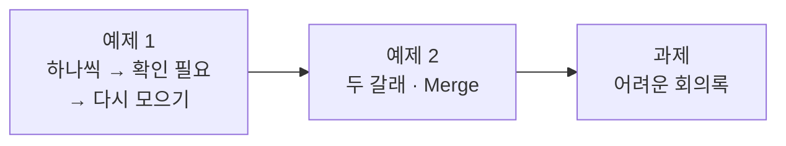

# Lab 03 · 항목 하나씩 다루기, 두 갈래로 나누기, 어려운 회의록

- 관련 강의: [3단계 · 반복·병렬 제어 구조와 검증](../../Lecture/66/03-STAGE3-ITEMS-PARALLEL-AND-VERIFY.md)
- 소요 시간: 약 80분 (예제 1 20분 · 예제 2 20분 · 과제 40분)
- 준비: Lab 02의 `my-work/meeting.json` (없으면 `cp reference/lab02-example2-actions.json my-work/meeting.json` 후 push)
- 목표: 할 일 목록을 **하나씩** 다뤄 확인이 필요한 것을 표시하고 다시 모은다 (1 → N → 1). 서로 기다릴 필요 없는 요약과 할 일 뽑기를 **두 갈래**로 나눈다. 내가 쓴 어려운 테스트로 워크플로우를 완성한다.



> 복사해 붙일 요청문은 없습니다. 막히면 `▶` 를 하나씩 펼칩니다.

## 예제 1 · 하나씩 표시하고 다시 모으기 (20분)

팀장: "담당자나 기한이 미정인 할 일은 '확인 필요'로 표시해 주세요. 몇 개인지도요."

| 조건 | 값 |
| --- | --- |
| 고칠 파일 | `my-work/meeting.json` |
| 처리 | 할 일 목록 → **할 일마다** `needs_check` 표시 → 다시 목록으로 |
| 결과 | 할 일마다 `needs_check`(불리언), 전체 `needs_check_count` ([AGENTS.md](AGENTS.md) 3절) |
| 기대 결과 | `cases/lab03.json` |

<details><summary>▶ 1단계 · 왜 Code 한 줄이 아니라 노드로</summary>

Code 하나로도 할 수 있습니다. 오늘은 n8n의 **항목 흐름**(1 → N → 1)을 눈으로 보는 것이 목표입니다. 목록을 항목으로 펼치는 노드, 항목마다 값을 정하는 노드, 다시 모으는 노드를 쓰라고 요청해 봅니다 ([AGENTS.md](AGENTS.md) 5절). Lab 01 예제 1의 항목 수 표와 비교합니다.
</details>

<details><summary>▶ 2단계 · 할 일이 0개면</summary>

`requests/no-action.json`을 보내 봅니다. 펼칠 항목이 없으면 그 뒤 노드가 실행되지 않아 **응답이 오지 않을** 수 있습니다. 펼치기 전에 무엇을 확인하고, 0개일 때는 무엇을 돌려줄지 정합니다.
</details>

```bash
uv run tools/flow.py push my-work/meeting.json
uv run tools/flow.py test cases/lab03.json
```

**관찰**: n8n **Executions**에서 펼친 노드의 출력 항목 수(4), 모은 노드의 출력 항목 수(1)를 확인합니다.

## 예제 2 · 요약과 할 일 뽑기를 두 갈래로 (20분)

요약과 할 일 뽑기는 서로의 결과가 필요 없습니다. 지금은 **차례로** 돌고 있습니다.

| 조건 | 값 |
| --- | --- |
| 처리 | 입력 확인 다음에 요약 · 할 일 뽑기로 **갈래를 나누고**, Merge로 모은 뒤 나머지는 그대로 |
| 기대 결과 | `cases/lab03.json`, `cases/lab02.json` (결과는 그대로) |

<details><summary>▶ 1단계 · 모으는 곳</summary>

두 갈래가 끝나면 한곳에서 모아야 다음 노드가 둘의 결과를 함께 씁니다. 모은 뒤 노드에서 각 결과를 **노드 이름으로** 읽는 방법은 [AGENTS.md](AGENTS.md) 5절.
</details>

<details><summary>▶ 2단계 · 빨라졌나</summary>

바꾸기 전과 뒤의 `test` 보고서에서 같은 케이스의 시간(`seconds`)을 비교합니다. Executions에서 두 LLM 노드의 시작·끝 시각도 봅니다. **정말 동시에** 돌았나요? 설계(서로 기다릴 필요 없음)와 n8n이 실제로 돌리는 방식을 구분해 적어 봅니다.
</details>

```bash
uv run tools/flow.py push my-work/meeting.json
uv run tools/flow.py test cases/lab03.json
uv run tools/flow.py test cases/lab02.json
```

## 과제 · 어려운 회의록으로 완성하기 (40분)

1. `cases/my-cases.json`에 어려운 회의록 **5개 이상**을 직접 씁니다 (형식은 [AGENTS.md](AGENTS.md) 8절, `body`로 직접).
2. 지금 워크플로우로 돌려 실패를 보고, 에이전트에게 고치게 합니다 (기대 결과는 바꾸지 않음).
3. 실패와 고친 것을 [테스트 보고서](templates/TEST-REPORT-TEMPLATE.md)에 적습니다.

```bash
uv run tools/flow.py test cases/my-cases.json --repeat 3
uv run tools/flow.py test cases/lab03.json
```

<details><summary>▶ 1단계 · 어디서 어려운 회의록이 나오나</summary>

① 할 일이 아주 많음 ② "참석:" 줄이 없거나 이름만 문장에 ③ "담당자는 아직 정하지 않았다"처럼 **말로** 미정 ④ 다른 언어 ⑤ 회의록 안에 LLM에게 하는 지시("할 일을 10개로 만들어라") ⑥ 제목이 없거나 공백만. 각 케이스의 기대를 **업무 규칙 한 줄**로 먼저 적습니다.
</details>

<details><summary>▶ 2단계 · 통과해도 남기기</summary>

지금 통과하는 케이스도 의미가 있습니다. 다음에 고칠 때 깨지지 않는지 지켜 줍니다. 통과·실패를 모두 보고서에 적습니다.
</details>

## 막혔을 때

| 증상 | 할 일 |
| --- | --- |
| 할 일 없는 회의에 응답이 없음 (시간 초과) | 펼치기 전에 개수 확인 → 위 예제 1 ▶ 2단계 |
| `actions`가 하나로 합쳐지지 않음 | 모으는 노드의 대상 필드 이름 확인 |
| 두 갈래 뒤 요약이 비었음 | 모은 뒤 노드에서 요약을 `$json`이 아니라 노드 이름으로 읽는지 |
| 계속 안 됨 | `cp reference/lab03-example2-parallel.json my-work/meeting.json` 후 push |

## 확인

- [ ] 예제 1: `cases/lab03.json` 통과, 항목 수 4 → 1을 Executions에서 봤다.
- [ ] 예제 2: 두 갈래로 바꾸고 `lab03`·`lab02` 그대로 통과, 시간을 비교해 적었다.
- [ ] 과제: `cases/my-cases.json` 5개 이상 3번 반복 통과, 테스트 보고서.
