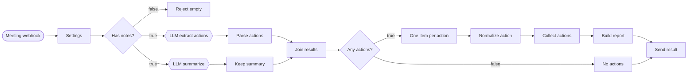

# 66일차 실습 · 단일 업무 자동화 워크플로우 직접 만들기

- 일자: 2026-10-16 (66일차)
- 교과목: 노코드 멀티 에이전트 워크플로우 설계 및 운영
- 단원: AI 워크플로우 설계 및 구현
- 강의 자료: [Lecture/66](../../Lecture/66/README.md)

## 오늘 만드는 업무: 회의록 → 할 일 정리



## 실습 방식

모든 Lab은 **쉬운 예제 2개 → 예제를 고치는 과제** 순서입니다. 예제는 안내를 그대로 따라 하면 되고, 과제에서 생각합니다.

| Lab | 시간 | 예제 1 | 예제 2 | 과제 |
| --- | --- | --- | --- | --- |
| [Lab 01](LAB-01-DESIGN-DATA-FLOW.md) 설계 | 2교시 22분 | 어제 만든 흐름의 항목 수 읽기 | 오늘 흐름의 빈칸 채우기 (1 → 4 → 1) | "확인 필요" 요청이 오면 어디를 고치나 |
| [Lab 02](LAB-02-BUILD-PARSE-TRANSFORM.md) 파싱 | 3교시 끝 + 4교시 | LLM 없이 글자 → 목록 | 진짜 LLM이 붙은 1부 가져와 실행 | 참석자도 뽑기 (세 곳 고치기) |
| [Lab 03](LAB-03-BUILD-LOOP-PARALLEL.md) 완성 | 5교시 끝 + 6교시 | 펼치고 모으기 (1 → 3 → 1) | 두 길을 Merge로 합치기 | **40분** · 내 워크플로우 완성 + 확인 필요 표시 |

## 구성

```text
Last3Mon/66/
├── README.md
├── LAB-01-DESIGN-DATA-FLOW.md      # 1단계 · 설계 (예제 2개 + 과제)
├── LAB-02-BUILD-PARSE-TRANSFORM.md # 2단계 · 입력 → LLM → 파싱 (예제 2개 + 과제)
├── LAB-03-BUILD-LOOP-PARALLEL.md   # 3단계 · 반복·병렬로 완성 (예제 2개 + 40분 과제), Python 호출
├── templates/
│   ├── LAB-01-WORKSHEET.md         # Lab 01 활동지
│   └── DATA-FLOW-DESIGN-TEMPLATE.md # 내 업무 설계서 (복습 과제용)
├── my-work/                        # 여러분의 결과물 (직접 만듭니다)
├── n8n/
│   ├── requests/                   # 테스트 요청 (weekly · no-action · empty)
│   └── workflows/
│       ├── lab02-example1-parse-practice.json      # Lab 02 예제 1 (막혔을 때 비교)
│       ├── lab02-example2-meeting-part1.json       # Lab 02 예제 2 (가져와서 시작)
│       ├── lab03-examples-loop-merge-practice.json # Lab 03 예제 1·2 (막혔을 때 비교)
│       └── 01-meeting-actions-solution.json        # Lab 03 과제 구조 비교용 (확인 필요 표시 전까지)
└── workflow-lab/                   # miniflow (65일차 + JSON 출력·parse_actions·08 회의록 flow)
```

## 준비

- 65일차의 n8n(Credential `OpenAI (.env)`)과 `Last3Mon/.env`를 그대로 사용합니다: `cd ~/aio-01d4-stu/Last3Mon/65/n8n && docker compose start`
- 실습 엔진 확인:

```bash
cd ~/aio-01d4-stu/Last3Mon/66/workflow-lab && uv sync && uv run pytest -q   # 43 passed, 1 skipped
```
