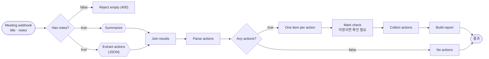
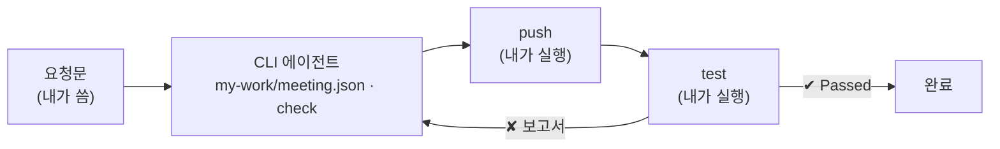

# 66일차 실습 · 바이브 코딩으로 만드는 단일 업무 자동화 워크플로우

- 일자: 2026-10-16 (66일차)
- 교과목: 노코드 멀티 에이전트 워크플로우 설계 및 운영
- 단원: AI 워크플로우 설계 및 구현
- 강의 자료: [Lecture/66](../../Lecture/66/README.md)
- **오늘부터 n8n 노드를 손으로 끌어다 놓지 않습니다.** CLI 코딩 에이전트(Codex · Claude Code · Antigravity)에게 **내가 쓴 요청문**으로 워크플로우 JSON을 만들게 하고, 우리는 **실행 결과를 테스트로 확인**합니다. 64·65일차에 화면에서 배운 노드와 데이터 흐름이 요청문의 재료가 됩니다.

## 오늘 만드는 업무: 회의록 → 할 일 정리



## 일하는 방식



| 누가 | 무엇을 |
| --- | --- |
| 나 | 결과 먼저 정하기, 요청문 쓰기, push·test 실행, 결과 판단 |
| CLI 에이전트 | [AGENTS.md](AGENTS.md) 규칙대로 워크플로우 JSON 작성, `check`로 형식 오류 고치기, 실패 원인 찾기 |
| `tools/flow.py` | 형식 검사(check), n8n에 가져오기·게시(push), 요청 보내기(call), 테스트(test) |

## 실습 문서 읽는 법

- 실습 문서(`LAB-0x-Q-*.md`, `VIBE-Q-TURL.md`)에는 **복사해 붙일 요청문이 없습니다.** 만들 것 · 조건 · 기대 결과만 있고, 요청문은 직접 씁니다.
- 막히면 `▶` 를 하나씩 펼칩니다. 뒤로 갈수록 구체적이 되지만 정답 요청문은 나오지 않습니다.
- 쓴 요청문은 `my-work/PROMPTS.md`에 모아 두고, 수업 끝에 옆 사람과 비교합니다.

## 구성

```text
Last3Mon/66/
├── README.md
├── AGENTS.md                         # CLI 에이전트용 n8n 작업 규칙 (CLAUDE.md가 이 파일을 불러옴)
├── LAB-01-Q-RESULT-FIRST.md          # 1단계 · 결과 먼저 → 첫 요청문(요약) → 빈 회의록 · 제목 없음
├── LAB-02-Q-JSON-AND-PARSE.md        # 2단계 · 할 일을 JSON으로 → 빈칸 채우기 → 참석자
├── LAB-03-Q-ITEMS-AND-PARALLEL.md    # 3단계 · 항목 하나씩 · 확인 필요 → 두 갈래 → 어려운 회의록
├── VIBE-Q-TURL.md                    # 7교시 바이브 코딩 · turl (curl을 TUI로)
├── *-A-*.md                          # 정답 해설 (수업이 끝난 뒤 공개)
├── answers/                          # 과제 정답 워크플로우
├── tools/flow.py                     # doctor · check · push · off · call · test
├── cases/                            # lab01 · lab01-challenge · lab02 · lab02-challenge · lab03
├── requests/                         # weekly · no-action · empty · no-title · vendor
├── reference/                        # 막혔을 때 이어 가는 워크플로우 (예제 단계)
├── templates/TEST-REPORT-TEMPLATE.md
├── my-work/                          # 에이전트가 만든 워크플로우 (JSON은 git에 올라가지 않음)
└── runs/                             # 테스트 보고서 (자동 생성)
```

## 준비

[실습 준비](../../Lecture/66/00-DAY66-PREP.md)를 끝내 주세요 (CLI 코딩 에이전트 설치·로그인 포함). 요약:

```bash
cd ~/aio-01d4-stu/Last3Mon/65/n8n && docker compose start         # 65일차 n8n (Ollama는 쓰지 않음 · 처음 한 번 PREP 1절대로 끄기)
cd ~/aio-01d4-stu/Last3Mon/66 && uv run tools/flow.py doctor      # 마지막 줄 ready
```

## `flow.py` 명령

| 명령 | 하는 일 | 수업 준비 때 |
| --- | --- | --- |
| `uv run tools/flow.py doctor` | n8n · Credential · CLI 에이전트 확인 | |
| `uv run tools/flow.py check my-work/meeting.json` | 노드 종류·버전·연결·Credential·API 키 노출 검사 | 1초 미만 |
| `uv run tools/flow.py push my-work/meeting.json` | n8n에 가져오기 → 게시 → n8n 재시작 → 웹훅 준비 확인 | |
| `uv run tools/flow.py call my-meeting requests/weekly.json` | 요청 한 번 보내고 응답 보기 | 요약만 1~3초, 할 일까지 2~4초 |
| `uv run tools/flow.py test cases/lab02.json --repeat 3` | 테스트 실행, `Passed x/y`, 보고서를 `runs/`에 저장 | |
