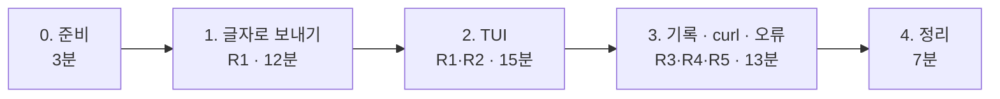

# 7교시 바이브 코딩 · `turl` 만들기

- 시간: 16:00~16:50 (50분) · 발표와 정리는 8교시
- 도구: CLI 코딩 에이전트(codex / claude / agy), Python + uv + [Textual](https://textual.textualize.io/), [httpx](https://www.python-httpx.org/)
- 결과물: 터미널에서 HTTP 요청을 만들고 보내고 응답을 보는 TUI (`curl`을 화면으로). 오늘 만든 `my-meeting` 웹훅을 이 도구로 불러 봅니다.

```text
$ turl
┌ turl ──────────────────────────────────────────────────────────────┐
│ [POST ▾] [ http://localhost:5678/webhook/my-meeting        ] [보내기] │
│ ┌ Body ┬ Headers ┬ History ┐   ┌ 응답 · 200 · x.xs ─────────────┐  │
│ │ {"title": "10월 16일 …",  │   │ {                               │  │
│ │  "notes": "참석: …"}       │   │   "title": "10월 16일 주간 회의",│  │
│ │                           │   │   "count": 4, …                 │  │
│ └───────────────────────────┘   └─────────────────────────────────┘  │
│ [파일에서 Body 불러오기]  [curl 명령으로 복사]                        │
└────────────────────────────────────────────────────────────────────┘
```

> 요청문은 **직접** 씁니다. 단계마다 `▶` 를 펼치면 생각할 거리가 나옵니다. 정답 요청문은 없습니다.

## 요구 사항

| 번호 | 요구 | 확인 방법 |
| --- | --- | --- |
| R1 | 메서드(GET·POST·PUT·DELETE), URL, 헤더, Body를 정해 보내고, 응답의 **상태 코드 · 걸린 시간 · 본문**(JSON이면 보기 좋게)을 보여 준다 | `turl`에서 `my-meeting`에 `weekly.json` |
| R2 | Body를 **파일에서** 불러온다 (오늘 Lab의 `requests/*.json`) | `requests/weekly.json` 불러오기 |
| R3 | 보낸 요청을 기록(History)에 남기고, 고르면 다시 불러온다. 프로그램을 껐다 켜도 남는다 | 껐다 켜기 |
| R4 | 지금 요청을 **`curl` 명령**으로 만들어 준다 (복사해 터미널에서 그대로 실행되게) | 만든 명령을 터미널에 붙여 실행 |
| R5 | 잘못된 URL, 응답 없음(시간 초과), JSON이 아닌 응답에서도 멈추지 않고 알려 준다 | 꺼진 주소로 보내기 |

## 진행 (50분)



요청문은 단계마다 `~/vibe/turl/PROMPTS.md`에 남깁니다.

### 0. 준비 (3분)

```bash
mkdir -p ~/vibe/turl && cd ~/vibe/turl
git init
codex        # 또는 claude, agy
```

### 1. 글자로 보내기 (12분)

**목표**: `uv run turl send POST http://localhost:5678/webhook/my-meeting --body-file requests/weekly.json`이 상태 · 시간 · 본문을 글자로 출력한다. 화면은 아직 없다.

<details><summary>▶ 1단계 · 프로젝트를 어떻게 시작하게 할까</summary>

에이전트는 우리 수업 규칙을 모릅니다. Python 패키지 관리를 무엇으로 할지, 명령 이름, 코드와 화면 글자의 언어를 적었나요? 오늘 n8n 실습의 AGENTS.md처럼 **이 프로젝트의 규칙 파일**을 먼저 만들게 해도 좋습니다.
</details>

<details><summary>▶ 2단계 · 보내는 부분을 따로</summary>

요청을 보내고 결과(상태, 시간, 본문)를 돌려주는 부분은 글자 모드, TUI, 기록이 모두 씁니다. 이 부분을 **따로** 만들고 **테스트**하게 하려면? 테스트에서 진짜 서버 대신 무엇을 쓸까요?
</details>

**확인**: 오늘 만든 `my-meeting`에 보내기, `uv run pytest -q`, `git commit`.

### 2. TUI (15분)

**목표**: 위 그림처럼 메서드 · URL · 보내기, 왼쪽 Body · Headers 탭, 오른쪽 응답.

<details><summary>▶ 1단계 · 화면을 말로 그리기</summary>

화면의 위 · 왼쪽 · 오른쪽에 무엇이 있는지, 버튼을 누르면 무엇이 바뀌는지 순서대로 적습니다. 응답이 오는 동안 화면이 굳지 않게 하려면?
</details>

### 3. 기록 · curl · 오류 (13분)

<details><summary>▶ 1단계 · 기록은 어디에</summary>

껐다 켜도 남으려면 파일에 써야 합니다. 어디에, 어떤 모양으로? 헤더에 비밀값(`Authorization`)이 있으면 기록에 그대로 남겨도 될까요?
</details>

<details><summary>▶ 2단계 · curl 명령의 따옴표</summary>

Body에 한국어, 따옴표, 줄바꿈이 있으면 만든 `curl` 명령이 깨지기 쉽습니다. 만든 명령을 **실제로 실행**해 같은 응답이 오는지 확인하게 합니다.
</details>

**확인**: `my-meeting`에 `empty.json`(400이 보이나), 꺼진 주소(오류가 보이나), curl 명령 실행, `git commit`.

### 4. 정리 (7분)

| 발표 (3분) | 내용 |
| --- | --- |
| 요청문 | 가장 잘 먹힌 요청문 한 개, 안 먹힌 요청문 한 개 (`PROMPTS.md`에서) |
| 막힌 곳 | 에이전트가 틀린 것, 어떻게 알아챘고 고쳤나 |
| 시연 | `turl`로 `my-meeting` 호출, curl 명령 복사 · 실행 |

## 확인

- [ ] R1 `my-meeting`에 보내 상태 · 시간 · 본문이 보인다.
- [ ] R2 `requests/*.json`을 Body로 불러온다.
- [ ] R3 껐다 켜도 기록이 남는다.
- [ ] R4 만든 curl 명령이 그대로 실행된다.
- [ ] R5 오류에서도 멈추지 않는다.
- [ ] `uv run pytest -q` 통과, 단계마다 git commit, `PROMPTS.md`.
