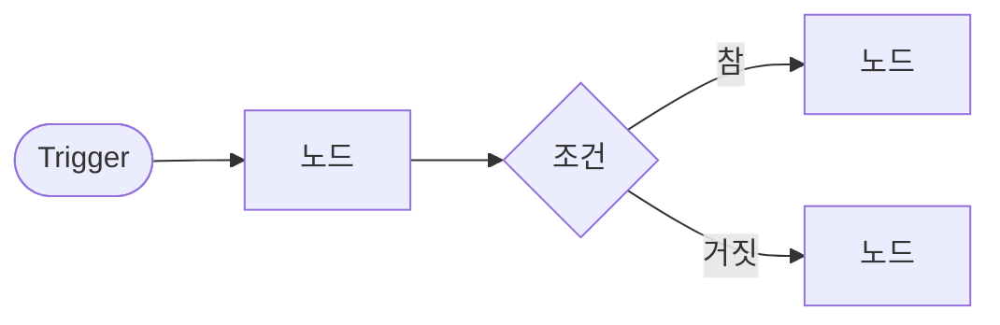

# 업무 자동화 워크플로우 설계서 (데이터 흐름 포함)

- 작성자:
- 업무 이름:
- 한 줄 목표:

## 1. Trigger·Condition·Action

| 구분 | 내용 |
| --- | --- |
| Trigger (시작과 입력 필드) |  |
| Condition (분기 지점) |  |
| Action (각 길에서 하는 일) |  |

## 2. 노드 목록

| 번호 | 노드 이름 | 종류 (Trigger·Set·IF·Switch·LLM·Code·Split Out·Aggregate·Merge·Respond 등) | 하는 일 |
| --- | --- | --- | --- |
| N1 |  |  |  |
| N2 |  |  |  |

## 3. 노드 간 데이터 (연결선마다)

| 연결 | 항목 수 | 주요 필드와 형식 | 예시 |
| --- | --- | --- | --- |
| N1 → N2 | 1개 | `title`(문자), `notes`(문자) | `{"title": "주간 회의", "notes": "..."}` |
|  |  |  |  |

항목 수가 바뀌는 곳(1개 → 여러 개, 여러 개 → 1개)은 반드시 표시합니다.

## 4. 제어 구조

| 구조 | 어디에 | 이유 |
| --- | --- | --- |
| 조건 분기 (IF·Switch) |  |  |
| 반복 (항목마다 처리) |  |  |
| 병렬 (Fork-Join) |  |  |

## 5. 흐름 그림



## 6. 최종 결과 형식

```json
{"route": "", "count": 0, "summary": "", "actions": []}
```

## 7. 점검

- [ ] 모든 길의 끝에 결과가 있다.
- [ ] 항목 수가 바뀌는 곳을 표시했다.
- [ ] LLM 출력이 다음 노드로 가기 전에 정리·검증하는 노드가 있다.
- [ ] 비어 있거나 잘못된 입력을 맨 앞에서 거절한다.
