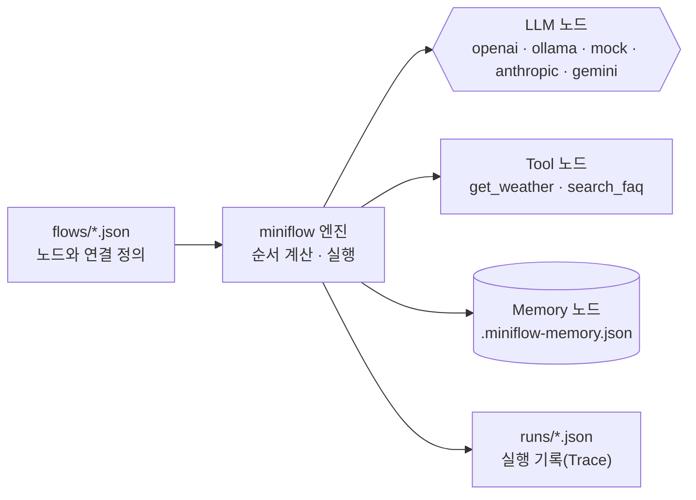

# workflow-lab (66일차): JSON 출력 파싱과 회의록 워크플로우

65일차 버전(조건 분기·플랫폼 전환)에 **LLM JSON 출력(`json_schema`)** 과 **`parse_actions` Tool**, 회의록 워크플로우(`08`)를 더한 버전입니다.

노코드 워크플로우 도구는 화면에서 **노드를 놓고 선으로 연결**합니다. 이 실습에서는 같은 구조를 JSON 파일로 적고 `miniflow`로 실행합니다. 화면 대신 파일을 쓸 뿐, 노드·연결·데이터 전달이라는 개념은 같습니다.



## 1. 설치와 확인

```bash
cd Last3Mon/64/workflow-lab
uv sync
uv run miniflow tools
uv run pytest -q
```

## 2. 명령어

| 명령 | 하는 일 |
| --- | --- |
| `uv run miniflow run flows/01-llm-only.json -i text="..."` | 워크플로우 실행. 입력은 `-i 이름=값`으로 여러 개 전달 |
| `uv run miniflow validate flows/02-llm-tool.json` | 실행하지 않고 구조만 검사, 실행 순서 출력 |
| `uv run miniflow show flows/04-recommend-with-memory.json` | 워크플로우를 Mermaid 다이어그램으로 출력 |
| `uv run miniflow tools` | 사용할 수 있는 Tool 목록 |
| `uv run miniflow call request -i user=kim -i text="..."` | 같은 업무를 n8n → miniflow 순서로 실행 (앞 플랫폼이 실패하면 다음으로 전환) |
| `uv run miniflow check` | 설정한 LLM에 연결되는지 확인 |
| `uv run miniflow memory` / `--clear` | Memory 내용 보기 / 지우기 |

실행할 때마다 각 노드의 입력·출력·소요 시간이 `runs/` 폴더에 JSON으로 저장됩니다.

## 3. 노드 종류

| type | 역할 | 필수 필드 |
| --- | --- | --- |
| `input` | 실행 시 받은 입력을 흐름에 넣음 | 없음 |
| `llm` | 프롬프트를 LLM에 보내고 답을 받음 | `prompt` (선택: `system`, `temperature`, `mock`, `json_schema`) |

`json_schema`를 적으면 LLM이 그 모양의 JSON으로만 답합니다 (OpenAI 구조화 출력, Ollama `format`). 답은 JSON **문자열**이므로 `parse_actions` 같은 Tool로 정리해서 씁니다.
| `tool` | 등록된 함수를 호출해 데이터를 가져옴 | `tool`, `args` |
| `memory_read` | 저장된 기억을 키로 읽음 | `key` |
| `memory_write` | 기억을 키에 저장(기존 값과 병합) | `key`, `value` |
| `output` | 최종 결과를 만듦 (분기마다 하나씩 둘 수 있음) | `value` |
| `condition` | 조건을 검사해 `true`/`false` 중 한 길로 보냄 | `check` (`left`, `op`, `right`) |
| `switch` | 값에 따라 여러 길 중 하나로 보냄. 맞는 값이 없으면 `default` | `value`, `cases` |

`condition`의 `op`: `equals`, `not_equals`, `contains`, `empty`, `not_empty`, `in`, `gt`, `lt`

분기 노드에서 나가는 연결에는 세 번째 값으로 길 이름을 적습니다. 실행 규칙은 다음과 같습니다.

- 길 이름이 있는 연결은 **관문**입니다. 분기 노드가 다른 길을 골랐거나 분기 노드 자체가 건너뛰어졌으면, 연결된 노드는 실행되지 않고 실행 기록에 `skipped`로 남습니다.
- 길 이름이 없는 일반 연결은 하나라도 이어지면 실행됩니다. 그래서 갈라졌던 두 길이 다시 만나는 노드는 정상적으로 실행됩니다.

```json
"edges": [["has_faq", "draft", "true"], ["has_faq", "hand_off", "false"], ["route", "team_device", "device"]]
```

## 4. 데이터 전달 규칙

앞 노드의 결과는 `{{...}}`로 꺼내 씁니다.

| 표현 | 의미 |
| --- | --- |
| `{{input.city}}` | 실행할 때 받은 입력 `city` |
| `{{nodes.weather.output}}` | `weather` 노드의 결과 전체 |
| `{{nodes.weather.output.temp_c}}` | 결과 안의 특정 값 |
| `{{nodes.faq.output.0.answer}}` | 목록의 첫 번째 항목 안의 값 |

## 5. LLM 선택

`MINIFLOW_LLM`으로 LLM을 고릅니다. 수업 기본값은 **OpenAI API**(`gpt-4.1-mini`)이고, 설정은 `Last3Mon/.env` 한 곳에 둡니다. `miniflow`는 실행한 폴더에서 위로 올라가며 가장 가까운 `.env`를 읽습니다 (셸에서 `export`한 값이 있으면 그 값이 우선). `.env`는 `.gitignore`에 들어 있어 커밋되지 않습니다. 준비 방법은 [65일차 SETUP-N8N.md](../../65/SETUP-N8N.md) 2절을 참고하세요.

| `MINIFLOW_LLM` | LLM | 필요한 것 |
| --- | --- | --- |
| `openai` (수업 기본) | OpenAI (`OPENAI_MODEL`, 기본 `gpt-4.1-mini`) | `.env`의 `OPENAI_API_KEY` |
| `ollama` (대체) | 로컬 모델 (`OLLAMA_MODEL`, 기본 `gemma3:4b`) | 65일차 Compose의 Ollama, 모델 다운로드 |
| `mock` (설정하지 않았을 때) | 노드의 `mock` 설정대로 정해진 답 | 없음 (자동 테스트, 키 없이 연습) |
| `anthropic` | Anthropic Claude (`ANTHROPIC_MODEL`, 기본 `claude-opus-5-5`) | `uv sync --extra anthropic`, `ANTHROPIC_API_KEY` |
| `gemini` | Google Gemini (`GEMINI_MODEL`) | `uv sync --extra gemini`, `GEMINI_API_KEY` |

`MINIFLOW_LLM_FALLBACK=ollama`이면 OpenAI 호출이 실패할 때(키 없음, 크레딧 부족, 네트워크 오류) Ollama로 한 번 더 시도하고, 화면에 `[miniflow] openai failed (...); trying ollama`를 남깁니다.

```bash
cat ../../.env | grep -v API_KEY            # 설정 확인 (키는 화면에 띄우지 않기)
uv run miniflow check                       # 연결 확인: Reply (openai, …): ready
uv run miniflow check   # 대체 모델 확인 (한 번만 바꿔 실행)
```

## 6. 플랫폼 전환 실행 (`call`)

`platforms.json`에 업무 이름(`request`)과 플랫폼별 실행 방법을 적어 둡니다. 실행 코드는 업무 이름만 알고, 어느 플랫폼에서 실행할지는 설정이 정합니다.

```json
{"workflows": {"request": {
  "n8n": {"webhook": "ai-request"},
  "miniflow": {"flow": "flows/06-request-with-condition.json"}
}}}
```

| 환경 변수 | 의미 | 기본값 |
| --- | --- | --- |
| `WORKFLOW_PLATFORMS` | 시도할 플랫폼 순서 | `n8n,miniflow` |
| `N8N_BASE_URL` | n8n 주소 | `http://localhost:5678` |
| `N8N_TIMEOUT` | n8n 응답 대기 시간(초) | `120` |

플랫폼을 추가할 때는 `src/miniflow/platforms.py`에 `run(workflow, inputs)`를 가진 어댑터 클래스를 만들고 `register_platform()`으로 등록합니다. `call`을 쓰는 코드는 바꾸지 않습니다.

## 7. 회의록 워크플로우 (`08-meeting-actions.json`)

```bash
uv run miniflow run flows/08-meeting-actions.json -i title="주간 회의" \
  -i notes="$(python3 -c "import json;print(json.load(open('data/meeting-notes.json'))['weekly']['notes'])")"
uv run miniflow call meeting -i title="주간 회의" -i notes="..."   # n8n → miniflow 순서로 실행
```

| Tool | 하는 일 |
| --- | --- |
| `parse_actions(text)` | LLM의 JSON 답을 `{"actions": [{task, owner, due}], "count": n}`로 정리. 비어 있는 담당자·기한은 `미정`, JSON이 아니면 `count: 0` |
