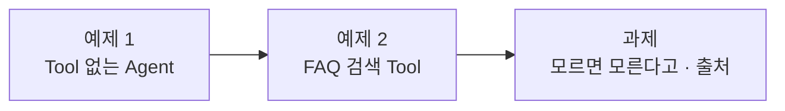

# Lab 01 · CLI 에이전트로 AI Agent 워크플로우 만들기 (Tool 1개)

- 관련 강의: [1단계 · 바이브 코딩으로 n8n 만들기, Agent와 Tool](../../Lecture/67/01-STAGE1-VIBE-N8N-AGENT-AND-TOOL.md)
- 소요 시간: 약 40분 (예제 1 10분 · 예제 2 15분 · 과제 15분)
- 준비: [실습 준비](../../Lecture/67/00-DAY67-PREP.md)의 `uv run tools/flow.py doctor` → `ready`
- 목표: n8n 화면에서 노드를 끌어다 놓지 않고, **내가 쓴 요청문**으로 워크플로우를 만들고 **테스트로 확인**한다.



> 이 실습에는 **복사해 붙일 요청문이 없습니다.** 요청문은 직접 씁니다. 막히면 아래 `▶` 를 하나씩 펼쳐 보세요. 펼칠수록 구체적이 되지만, 정답 요청문은 나오지 않습니다.

## 시작하기 · 터미널 두 개

| 터미널 | 하는 일 |
| --- | --- |
| ① 에이전트 | `cd ~/aio-01d4-stu/Last3Mon/67` 후 `codex` (또는 `claude`, `agy`) 실행. 내가 쓴 요청문을 보낸다 |
| ② 확인 | `cd ~/aio-01d4-stu/Last3Mon/67` 에서 `push`·`test`를 **내가** 실행한다 |

- 에이전트는 이 폴더의 [AGENTS.md](AGENTS.md)를 읽고 일합니다. `agy`가 읽지 않으면 첫 요청 앞에 "AGENTS.md를 먼저 읽어"를 붙입니다.
- 에이전트가 명령 실행이나 파일 쓰기를 허락해 달라고 하면 **무엇을 하는지 읽고** 허용합니다.
- 요청문을 보내기 전에 **메모장에 먼저 쓰고** 한 번 읽어 봅니다. 나중에 비교할 수 있게 `my-work/PROMPTS.md`에 모아 둡니다.

## 예제 1 · Tool 없는 Agent (10분)

**만들 것**: 질문을 받으면 AI Agent가 사내 IT 담당자처럼 짧게 한국어로 답하는 워크플로우. Tool은 아직 없음.

| 조건 | 값 |
| --- | --- |
| 저장할 파일 | `my-work/chat.json` |
| 웹훅 | POST, 경로 `my-chat`, 질문은 요청 본문의 `question` |
| 모델 | OpenAI `gpt-4.1-mini` |
| 결과 | `{"answer": "..."}` |

<details><summary>▶ 1단계 · 요청문에 무엇이 들어가야 하나</summary>

[1단계 교안 4절](../../Lecture/67/01-STAGE1-VIBE-N8N-AGENT-AND-TOOL.md)의 다섯 가지를 떠올립니다: ① 파일 ② 입력 ③ 처리 ④ 결과 모양 ⑤ 기대 결과. 위 표에서 각각 무엇에 해당하는지 짝지어 봅니다. 예제 1에는 테스트 파일이 없으니 ⑤ 대신 "만든 뒤 무엇을 해 달라"(예: check)를 적습니다.
</details>

<details><summary>▶ 2단계 · 빠뜨리기 쉬운 것</summary>

- 답의 **길이와 말투**를 정하지 않으면 길고 장황한 답이 나옵니다. 몇 문장, 어떤 언어로 할지 적었나요?
- "Tool은 아직 넣지 않는다"처럼 **하지 말 것**도 적어야 에이전트가 앞서 나가지 않습니다.
- 결과의 **필드 이름**(`answer`)을 정확히 적었나요? 테스트는 필드 이름으로 확인합니다.
</details>

<details><summary>▶ 3단계 · 보내기 전 점검표</summary>

- [ ] 파일 경로가 한 번, 정확히 들어 있다
- [ ] 웹훅 방식·경로·입력 필드가 있다
- [ ] 모델 이름이 있다
- [ ] 결과 JSON 모양이 예시로 들어 있다
- [ ] 한 번에 한 가지 일만 시킨다
</details>

에이전트가 끝났다고 하면 터미널 ②에서:

```bash
uv run tools/flow.py push my-work/chat.json
uv run tools/flow.py call my-chat requests/faq-vpn.json
uv run tools/flow.py call my-chat requests/off-topic.json
```

**관찰**: VPN 질문의 답에 사내 FAQ에만 있는 내용(`data-api`의 FAQ-003)이 들어 있나요? 점심 메뉴 질문에는 어떻게 답하나요? 브라우저 n8n에서 워크플로우를 열어 노드가 어떻게 연결됐는지도 봅니다.

## 예제 2 · FAQ 검색 Tool 붙이기 (15분)

**만들 것**: 예제 1을 바탕으로, Agent가 사내 FAQ를 검색하는 Tool을 **먼저 쓰고 그 결과로만** 답하게 하기. 어떤 Tool을 썼는지도 결과에 남기기.

| 조건 | 값 |
| --- | --- |
| 저장할 파일 | `my-work/it-agent.json` (오늘 끝까지 이 파일을 고쳐 나감) |
| 웹훅 | POST, 경로 `my-it-agent` |
| Tool | Search FAQ (데이터 API `/faq`) |
| 결과 | `answer` + `tools_used`(사용한 Tool 이름 목록) |
| 기대 결과 | `cases/lab01.json` (먼저 열어 읽기) |

<details><summary>▶ 1단계 · 기대 결과부터 읽기</summary>

`cases/lab01.json`의 케이스 세 개가 각각 무엇을 확인하나요? `contains`에 들어 있는 낱말과 필드 이름을 보면, 요청문에 반드시 들어가야 할 것이 보입니다. 테스트 파일 경로를 요청문에 넣으면 에이전트도 그 파일을 읽습니다.
</details>

<details><summary>▶ 2단계 · "바탕으로"를 어떻게 말할까</summary>

새로 만드는 파일과 바탕이 되는 파일을 **둘 다** 적습니다. 바꾸는 것(경로, Tool 추가, 결과 필드)과 그대로 둘 것(모델, 답의 길이·말투)을 나눠 적으면 에이전트가 덜 헤맵니다.
</details>

<details><summary>▶ 3단계 · Tool을 "어떻게 쓰게" 할지</summary>

Tool을 붙이기만 하면 Agent가 안 쓰고 답하기도 합니다. "언제 Tool을 쓰는지", "Tool 결과 밖의 내용으로 답해도 되는지"를 요청문에 적었나요? Tool 이름은 [AGENTS.md](AGENTS.md) 4절 규칙대로 결과에 어떤 글자로 남는지도 확인합니다.
</details>

<details><summary>▶ 4단계 · 테스트가 실패하면 다음 요청문</summary>

실패 줄을 요약하지 말고 **그대로** 붙이고, 보고서 경로(`runs/lab01-....json`)를 알려 줍니다. "고쳐 줘"만 쓰지 말고 "어느 케이스가 왜 실패했는지 먼저 설명하고 고쳐 줘"처럼 원인 설명을 먼저 요구합니다.
</details>

```bash
uv run tools/flow.py push my-work/it-agent.json
uv run tools/flow.py test cases/lab01.json --repeat 3
uv run tools/flow.py test cases/lab01.json --webhook my-chat     # 같은 테스트를 예제 1에 보내 비교
```

**관찰**: 예제 1과 예제 2의 `Passed`가 어떻게 다른가요? 예제 1이 실패한 줄은 무엇을 확인하던 줄인가요? n8n **Executions** → 최근 실행 → `IT help agent` 노드에서 Tool이 받은 검색어와 돌려받은 FAQ를 찾아봅니다.

## 과제 · 모르면 모른다고, 출처는 밝히고 (15분)

팀장이 요청했습니다.

> "FAQ에 없는 질문에 지어내서 답하면 곤란해요. 그리고 답에 어떤 FAQ를 썼는지 번호도 같이 주세요."

기대 결과는 `cases/lab01-challenge.json`에 있습니다.

| 케이스 | 기대 |
| --- | --- |
| 비밀번호 출처 | `sources`에 `FAQ-001` |
| VPN 출처 | `sources`에 `FAQ-003` |
| 모르면 모른다고 | 점심 메뉴 질문에 `찾지 못했습니다`가 들어간 답, 메뉴 추천 없음 |

**먼저 생각해 보기 (3분)**: 팀장의 말에는 요구가 몇 개 들어 있나요? 각각을 "결과에 무엇이 달라지는가"로 바꿔 적어 봅니다.

<details><summary>▶ 1단계 · 팀장의 말을 요구로 나누기</summary>

요구는 두 가지입니다. 하나는 **답의 내용**(모를 때 무엇이라고 말할지), 하나는 **결과의 모양**(새 필드). 각각 테스트 파일의 어느 케이스가 확인하는지 연결해 봅니다. "모른다"는 문장은 테스트가 찾는 낱말이 들어가야 통과합니다.
</details>

<details><summary>▶ 2단계 · 고치는 요청문의 모양</summary>

새로 만드는 요청이 아니라 **고치는** 요청입니다. 어느 파일을 고치는지, 요구를 번호 매겨 적고, 새 필드는 예시 값까지 적습니다. 그리고 원래 테스트(`cases/lab01.json`)도 계속 통과해야 한다는 조건을 붙여 봅니다.
</details>

<details><summary>▶ 3단계 · 번호를 누가 만들게 할까</summary>

`sources`를 LLM이 쓰게 할 수도, Tool이 돌려준 결과에서 찾게 할 수도 있습니다 ([1단계 교안 7절](../../Lecture/67/01-STAGE1-VIBE-N8N-AGENT-AND-TOOL.md)). 어느 쪽이 더 믿을 만한지 정하고, 원하는 방식을 요청문에 적을지 에이전트에게 맡길지 결정합니다. 맡겼다면 결과 JSON을 열어 무엇을 골랐는지 확인합니다.
</details>

```bash
uv run tools/flow.py push my-work/it-agent.json
uv run tools/flow.py test cases/lab01-challenge.json --repeat 3
uv run tools/flow.py test cases/lab01.json                        # 원래 테스트도 그대로 통과하는지
```

**더 생각해 보기**: 내 요청문과 옆 사람의 요청문을 바꿔 읽어 봅니다. 같은 결과가 나왔나요? 누구 요청문이 더 짧고, 에이전트가 덜 헤맸나요?

## 막혔을 때

| 증상 | 할 일 |
| --- | --- |
| `check`에 ✘ | 에이전트에게 그 줄을 그대로 붙여 주고 고쳐 달라고 합니다 |
| `push` 후 `call`이 404 | 몇 초 뒤 다시. 계속이면 `uv run tools/flow.py doctor` |
| `status 500 · 'Error in workflow'` 가 30초 넘게 걸림 | OpenAI 쪽 일시 오류일 수 있습니다. 한 번 더 실행 |
| 에이전트가 계속 엉뚱하게 고침 | 요청문을 더 작게 나눕니다. 그래도 안 되면 `cp reference/lab01-example2-faq-tool.json my-work/it-agent.json` 후 push로 이어 갑니다 |

## 확인

- [ ] 예제 1: 노드를 직접 놓지 않고, 내가 쓴 요청문으로 `my-chat` 워크플로우를 만들어 불렀다.
- [ ] 예제 2: `cases/lab01.json` 통과, 예제 1은 어느 검사에서 실패하는지 봤다.
- [ ] 과제: `cases/lab01-challenge.json` 3번 반복 통과, 원래 테스트도 통과.
- [ ] `my-work/PROMPTS.md`에 오늘 쓴 요청문을 모았다.
