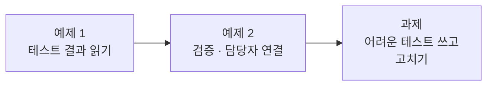
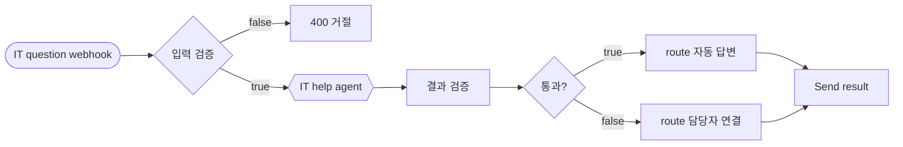
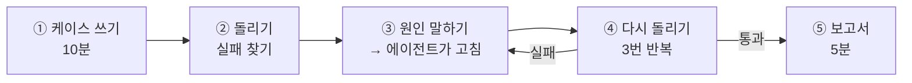

# Lab 03 · 실행 결과 검증과 실패 고치기

- 관련 강의: [3단계 · 실행 결과 검증과 테스트](../../Lecture/67/03-STAGE3-VERIFY-AND-FIX.md)
- 소요 시간: 약 70분 (예제 1 10분 · 예제 2 20분 · 과제 40분)
- 준비: Lab 02의 `my-work/it-agent.json` (없으면 `cp reference/lab03-start.json my-work/it-agent.json` 후 push)
- 목표: 답을 사용자에게 보내기 **전에** 워크플로우가 스스로 확인하게 하고, **내가 쓴 테스트**로 숨은 실패를 찾아 고친다.



> 요청문과 테스트는 직접 씁니다. 막히면 `▶` 를 하나씩 펼쳐 보세요. 정답은 나오지 않습니다.

## 예제 1 · 테스트 결과 읽기 (10분)

검증을 넣기 **전에** 새 기대 결과로 돌려 봅니다.

```bash
uv run tools/flow.py test cases/lab03.json
```

1. `cases/lab03.json`을 열어 케이스마다 **무엇을 기대하는지** 읽습니다. `route`는 "이 답을 그대로 보냈는가, 사람에게 넘겼는가"입니다.
2. `runs/`의 최신 보고서 파일을 열어 `빈 질문`의 `response`와 `seconds`를 봅니다. 질문이 비었는데 LLM이 불렸나요?
3. 아래 표를 채웁니다. 예제 2의 요청문 재료가 됩니다.

| 케이스 | 지금 결과 | 기대 | 무엇이 없어서 실패했나 |
| --- | --- | --- | --- |
| 빈 질문 | | HTTP 400 | |
| 비밀번호 FAQ | | `route` 자동 답변 | |
| 없는 접수 번호 | | `route` 담당자 연결 | |
| 다른 사람 접수 건 | | `route` 담당자 연결 | |

## 예제 2 · 검증과 담당자 연결 (20분)

**만들 것**: 두 번 지키기. ① LLM을 부르기 전에 입력을 확인하고, ② 답을 보내기 전에 답을 확인해, 통과하면 자동 답변, 아니면 담당자에게 넘기기.



| 조건 | 값 |
| --- | --- |
| 빈 질문 | HTTP 400 `{"error": "question is required"}` |
| 결과 검증 | 내가 정한 검사 여러 개 (아래 1단계) |
| 통과 | `route` = `자동 답변` + 답 |
| 실패 | `route` = `담당자 연결`, 정해진 안내 문장, 원래 답(`draft`), 걸린 검사(`failed`) |
| 기대 결과 | `cases/lab03.json` |

<details><summary>▶ 1단계 · 무엇을 검사할지 먼저 적기</summary>

"좋은 답"의 조건을 **한 줄 조건**으로 적어 봅니다 (66일차 "한 줄 조건이면 규칙"). 예제 1 표에서 실패한 케이스들이 힌트입니다: 답이 비었을 때, Tool이 아무것도 못 찾았을 때(빈 결과·404·403), 접수 번호 질문인데 접수 Tool을 안 썼을 때… 다섯 개 안팎이면 충분합니다.
</details>

<details><summary>▶ 2단계 · 요청문을 번호로 나누기</summary>

이번 변화는 크므로 ① 입력 검증 ② 결과 검증(검사 목록) ③ 통과/실패 때 각각의 결과 모양 으로 번호를 나눠 적습니다. 실패 때 보낼 안내 문장과 필드 이름은 정확히 적습니다. 테스트가 `route` 값을 글자 그대로 비교합니다.
</details>

<details><summary>▶ 3단계 · 검사를 LLM에게 맡길까</summary>

"답이 괜찮은지 LLM에게 다시 물어보기"와 "Code 노드의 조건문"은 무엇이 다른가요? 어느 쪽으로 만들게 할지 요청문에 적습니다 ([3단계 교안 2절](../../Lecture/67/03-STAGE3-VERIFY-AND-FIX.md)).
</details>

```bash
uv run tools/flow.py push my-work/it-agent.json
uv run tools/flow.py test cases/lab03.json --repeat 3
```

`담당자 연결` 응답의 `failed`를 보면 **어느 검사에 걸렸는지** 알 수 있습니다. 에이전트가 만든 검사 노드의 코드를 열어, 내가 1단계에서 적은 검사와 같은지 비교합니다.

## 과제 · 어려운 테스트를 쓰고 고치기 (40분)

지금까지는 준비된 테스트만 통과시켰습니다. 실제 직원들은 **예상하지 못한 질문**을 합니다. 직접 테스트를 써서 숨은 실패를 찾고, 에이전트와 함께 고칩니다.



### ① 케이스 쓰기 (10분)

`cases/my-cases.json`을 만들고 **5개 이상** 씁니다. 형식은 [AGENTS.md](AGENTS.md) 7절과 `cases/lab03.json`을 봅니다.

> 기대 결과는 **내가 정하는 업무 규칙**입니다. 예를 들어 이상한 요청을 400으로 거절할지, 담당자에게 넘길지는 팀이 정합니다. 정한 것을 `expect`에 씁니다.

<details><summary>▶ 1단계 · 어떤 질문이 어려울까</summary>

직원 입장에서 생각합니다: 다른 언어로 묻는 사람, 한 번에 두 가지를 묻는 사람, 번호를 대충 쓰는 사람, 시스템을 속이려는 사람, 그리고 **필드가 빠진 요청**을 보내는 다른 프로그램. 오늘 만든 기능(FAQ, 접수 현황, 본인 건만, 검증)마다 "이걸 깨뜨리려면?"을 하나씩 떠올려 봅니다.
</details>

<details><summary>▶ 2단계 · 기대 결과를 정하는 법</summary>

케이스마다 "이러면 안 된다"를 먼저 정하고 `not_contains`로, "이래야 한다"를 `equals`·`contains`로 씁니다. 새면 안 되는 정보(남의 접수 상태·담당자 이름)는 `answer`뿐 아니라 `draft`에도 없어야 하는지 생각해 봅니다. 요청 본문은 `body`에 직접 씁니다.
</details>

<details><summary>▶ 3단계 · 케이스를 쓴 뒤 점검</summary>

- [ ] 케이스 이름만 보고 무엇을 시험하는지 알 수 있다
- [ ] 기대 결과가 LLM의 표현이 바뀌어도 맞는다 (`contains`는 낱말 하나라도)
- [ ] 적어도 하나는 **보안**(남의 정보)을 시험한다
- [ ] 적어도 하나는 **요청 모양이 이상한** 경우를 시험한다
</details>

### ② 돌리기

```bash
uv run tools/flow.py test cases/my-cases.json --repeat 3
```

모두 통과했다면 케이스가 너무 쉬운 것일 수 있습니다. ① 1단계로 돌아가 하나 더 써 봅니다.

### ③ 원인 말하기 → 에이전트가 고침

실패한 케이스마다 **원인을 내가 먼저 한 줄로** `my-work/TEST-REPORT.md`에 적습니다. 그다음 에이전트에게 요청합니다.

<details><summary>▶ 1단계 · 에이전트에게 무엇을 줄까</summary>

에이전트는 내 화면을 못 봅니다. 실패 보고서 **파일 경로**, 고칠 파일, 그리고 "고치는 동안 지켜야 할 것"(원래 테스트도 통과)을 줍니다. 실패 줄을 내 말로 바꾸지 말고 그대로 줍니다.
</details>

<details><summary>▶ 2단계 · 바로 고치게 할까, 설명부터 들을까</summary>

먼저 원인을 설명하게 하고, 내가 적은 원인과 비교한 뒤 고치게 하는 방법도 있습니다. 두 원인이 다르면 어느 쪽이 맞는지 보고서의 요청·응답으로 확인합니다.
</details>

<details><summary>▶ 3단계 · 여러 개가 실패했을 때</summary>

한 번에 다 고치게 하면 서로 다른 수정이 부딪칠 수 있습니다. 하나씩 고치게 할지, 한 번에 고치게 할지 정하고 결과를 비교해 봅니다.
</details>

### ④ 다시 돌리기

```bash
uv run tools/flow.py push my-work/it-agent.json
uv run tools/flow.py test cases/my-cases.json --repeat 3
uv run tools/flow.py test cases/lab03.json --repeat 3      # 고치다가 원래 것이 망가지지 않았는지
```

가끔 30초 넘게 걸리고 `status 500`이 나오면 워크플로우 문제인지 밖의 문제(OpenAI 일시 오류)인지 보고서와 `docker logs day65-n8n-n8n-1`로 구분합니다.

### ⑤ 보고서 (5분)

[templates/TEST-REPORT-TEMPLATE.md](templates/TEST-REPORT-TEMPLATE.md)를 `my-work/TEST-REPORT.md`로 복사해 채웁니다. 실패 → 내가 생각한 원인 → 에이전트가 고친 곳 → 다시 돌린 결과를 한 줄씩 남깁니다.

## 막혔을 때

| 증상 | 할 일 |
| --- | --- |
| 고칠수록 다른 케이스가 깨짐 | 하나씩 고치게 하고, 고칠 때마다 원래 테스트도 다시 |
| 에이전트가 테스트의 기대 결과를 바꾸자고 함 | 기대 결과는 업무 규칙입니다. 규칙이 정말 틀렸을 때만 내가 바꿉니다 |
| 매번 결과가 다름 | `--repeat 5`로 몇 번 중 몇 번인지 봅니다. 지시문보다 규칙 노드로 고치게 하면 덜 흔들립니다 |
| 예제 2부터 이어 가기 | `cp reference/lab03-example2-check.json my-work/it-agent.json` 후 push |

## 확인

- [ ] 예제 1: 보고서에서 요청·응답·시간을 읽고 표를 채웠다.
- [ ] 예제 2: `cases/lab03.json` 3번 반복 통과, `failed`로 담당자 연결 이유를 봤다.
- [ ] 과제: 내가 쓴 케이스 5개 이상, 실패를 1개 이상 찾아 고쳤고 `lab03`도 다시 통과, 보고서 작성.
