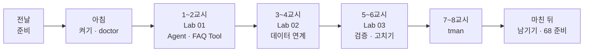
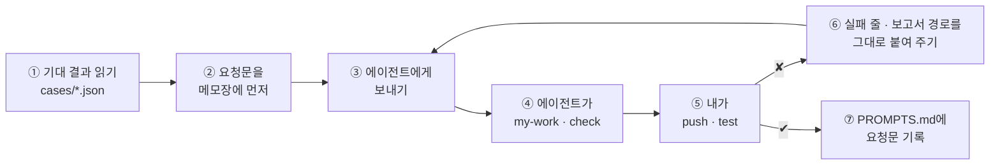

# 67일차 수강 안내 · 수업 준비부터 마칠 때까지

- 일자: 2026-10-19 (월) · 67일차
- 주제: 바이브 코딩으로 만드는 Agent·Tool·데이터 연계 워크플로우와 결과 검증
- 실습 폴더: [Last3Mon/67](README.md) · 강의 자료: [Lecture/67](../../Lecture/67/README.md)
- 환경: 65일차 n8n 2.42.6 + **OpenAI API 키만**(`gpt-4.1-mini`, Credential `OpenAI (.env)`) + 데이터 API + CLI 코딩 에이전트 하나 (Codex · Claude Code · Antigravity). **Ollama는 쓰지 않습니다.**
- 이 문서: 오늘 하루 내가 할 일을 수업 준비부터 마칠 때까지 순서대로 모은 수강 안내입니다. 수업 중에도 띄워 두고 어디까지 왔는지 확인하세요.



## 0. 하루 한눈에

| 교시 | 시간 | 할 일 | 문서 | 끝났다는 표시 |
| --- | --- | --- | --- | --- |
| 전날 | 약 20분 | 자료 받기 · n8n · 데이터 API · CLI 에이전트 · doctor | [PREP](../../Lecture/67/00-DAY67-PREP.md) | `ready` |
| 1 | 09:00~09:50 | 개요 · 1단계 강의 (워크플로우는 JSON, AGENTS.md, 요청문 5요소, Agent와 Tool) | [개요](../../Lecture/67/00-DAY67-OVERVIEW.md), [1단계](../../Lecture/67/01-STAGE1-VIBE-N8N-AGENT-AND-TOOL.md) | |
| 2 | 10:00~10:50 | Lab 01 예제 1 · 2 · 과제 | [Lab 01](LAB-01-Q-AGENT-AND-FIRST-TOOL.md) | `lab01-challenge` 통과 |
| 3 | 11:00~11:50 | 2단계 강의 · Lab 02 예제 1 · 2 | [2단계](../../Lecture/67/02-STAGE2-DATA-TOOLS.md), [Lab 02](LAB-02-Q-DATA-TOOLS.md) | `lab02` 통과 |
| 4 | 12:00~12:50 | Lab 02 과제 35분 · 풀이 | Lab 02 | `lab02-challenge` 통과 |
| - | 13:00~14:00 | 점심 | | |
| 5 | 14:00~14:50 | 3단계 강의 · Lab 03 예제 1 · 2 | [3단계](../../Lecture/67/03-STAGE3-VERIFY-AND-FIX.md), [Lab 03](LAB-03-Q-VERIFY-AND-FIX.md) | `lab03` 통과 |
| 6 | 15:00~15:50 | Lab 03 과제 40분 · 풀이 | Lab 03 | 내 케이스 5개 · 보고서 |
| 7 | 16:00~16:50 | 바이브 코딩 `tman` 각자 만들기 | [VIBE-Q-TMAN](VIBE-Q-TMAN.md) | R1~R4 · `pytest` |
| 8 | 17:00~17:50 | 발표 · 강사 정리 · 강사 바이브 코딩 · 팁 · 68일차 예고 | [진행](../../Lecture/67/04-VIBE-CODING.md) | |

## 1. 전날 준비 (약 20분, 10/18 일요일 밤까지)

### 1.1 자료 받기

```bash
cd ~/aio-01d4-stu && git pull
```

### 1.2 n8n과 데이터 API 켜기 (Ollama는 끔)

```bash
sudo systemctl disable --now ollama 2>/dev/null   # WSL에 설치한 Ollama가 있으면 끄고 자동 시작도 끔
cd ~/aio-01d4-stu/Last3Mon/65/n8n
docker compose rm -sf ollama                      # Ollama 컨테이너가 있으면 지움 (없으면 그냥 지나감)
docker compose start
cd ~/aio-01d4-stu/Last3Mon/67/data-api
docker compose up -d --force-recreate             # 데이터 파일 위치가 바뀌었으므로 다시 만듦
curl -s localhost:8800/health                     # {"status": "ok"}
```

- 66일차부터 LLM은 **OpenAI API 키**(`Last3Mon/.env`) 하나로 씁니다. Ollama는 켤 필요가 없습니다.
- n8n은 `docker compose start`로 켭니다. `up -d`를 쓰면 지운 Ollama 컨테이너가 다시 생깁니다.

### 1.3 CLI 코딩 에이전트 (66일차에 했으면 확인만)

```bash
codex --version      # 또는 claude --version, agy --version
```

처음 실행해 브라우저 로그인을 끝내고, "안녕"에 답이 오는지 봅니다.

### 1.4 준비 확인

```bash
cd ~/aio-01d4-stu/Last3Mon/67
uv run tools/flow.py doctor        # 마지막 줄 ready
```

### 1.5 미리 읽기 (선택, 5분)

[PREP 4절](../../Lecture/67/00-DAY67-PREP.md): 워크플로우는 JSON 파일, Agent와 Tool.

### 준비물

노트북과 충전기, WSL의 Docker, Windows Terminal(WSL) 창 두 개, 브라우저 (http://localhost:5678).

## 2. 수업 당일 아침 (09:00 전)

1. 노트북을 껐다 켰다면 1.2를 다시 합니다 (같은 명령 그대로).
2. 터미널 두 개를 엽니다. 둘 다 `cd ~/aio-01d4-stu/Last3Mon/67`.

   | 터미널 | 하는 일 |
   | --- | --- |
   | ① 에이전트 | `codex` (또는 `claude`, `agy`) 실행. 내가 쓴 요청문을 보냄 |
   | ② 확인 | `push` · `call` · `test`를 **내가** 실행 |

3. 터미널 ②에서 `uv run tools/flow.py doctor` → `ready`.
4. `my-work/PROMPTS.md`를 만들어 둡니다 (오늘 쓴 요청문을 모으는 곳).

## 3. 실습할 때마다 같은 순서



- 요청문 다섯 가지: ① 파일 ② 입력 ③ 처리 ④ 결과 모양 ⑤ 기대 결과(테스트 파일).
- 한 번에 한 가지 변화만 요청합니다. 에이전트가 "끝났다"고 해도 **내가 push·test로 확인**합니다.
- 막히면 Lab 문서의 `▶`를 하나씩 펼칩니다. 그래도 안 되면 `reference/`의 파일로 이어 갑니다 (각 Lab의 "막혔을 때").
- 에이전트가 명령 실행·파일 쓰기 허락을 물으면 무엇을 하는지 읽고 허용합니다.

## 4. 1~2교시 · 1단계 · Agent와 첫 Tool

1교시는 강의를 듣습니다. 2교시에 [Lab 01](LAB-01-Q-AGENT-AND-FIRST-TOOL.md)을 합니다 (약 40분).

| 순서 | 만들 것 | 파일 · 웹훅 | 확인 (터미널 ②) |
| --- | --- | --- | --- |
| 예제 1 (10분) | Tool 없는 Agent, 짧은 한국어 답 | `my-work/chat.json` · `my-chat` | `push my-work/chat.json` → `call my-chat requests/faq-vpn.json`, `call my-chat requests/off-topic.json` |
| 예제 2 (15분) | FAQ 검색 Tool을 먼저 쓰고 그 결과로만 답, `tools_used` | `my-work/it-agent.json` · `my-it-agent` | `push my-work/it-agent.json` → `test cases/lab01.json --repeat 3`, 비교 `test cases/lab01.json --webhook my-chat` |
| 과제 (15분) | 모르면 "찾지 못했습니다", 출처 `sources` | `my-work/it-agent.json` 고치기 | `test cases/lab01-challenge.json --repeat 3`, `test cases/lab01.json` |

(명령 앞에는 모두 `uv run tools/flow.py`가 붙습니다.)

- 볼 것: 예제 1의 VPN 답에 사내 FAQ에만 있는 내용(인증서)이 있는지, 점심 메뉴 질문에 어떻게 답하는지. n8n **Executions**에서 `IT help agent`가 Tool에 보낸 검색어.
- `my-work/it-agent.json`은 오늘 끝까지 고쳐 나가는 파일입니다.

## 5. 3~4교시 · 2단계 · 사내 데이터 연계

[Lab 02](LAB-02-Q-DATA-TOOLS.md) (약 60분). 먼저 데이터 API를 직접 불러 봅니다.

```bash
curl -s localhost:8800/tickets/T-1002
curl -s localhost:8800/tickets/T-9999       # 없는 번호
```

| 순서 | 만들 것 | 확인 |
| --- | --- | --- |
| 예제 1 (15분) | 접수 번호가 있으면 접수 현황 Tool(`Get ticket`)을 쓰게 | `push my-work/it-agent.json` → `test cases/lab02.json --repeat 3` |
| 예제 2 (10분) | 만들지 않음. Executions에서 `Get_ticket`이 받은 값과 404 응답을 보고 표 채우기 | |
| 과제 (35분, 4교시) | 질문한 사람(`user`)이 접수한 건만 | 고치기 전 `test cases/lab02-challenge.json` → 고친 뒤 `test cases/lab02-challenge.json --repeat 3`, `test cases/lab02.json` |

- 과제의 핵심 질문: **질문한 사람 값은 누가 정하나요?** LLM이 정하면 "나는 박서연이야"에 속습니다. 어디서 와야 하는지 정해서 요청문에 적습니다.
- 4교시 끝 10분은 강사 풀이입니다.

## 6. 5~6교시 · 3단계 · 실행 결과 검증과 고치기

[Lab 03](LAB-03-Q-VERIFY-AND-FIX.md) (약 70분).

| 순서 | 할 일 | 확인 |
| --- | --- | --- |
| 예제 1 (10분) | 지금 워크플로우로 테스트를 돌리고 `runs/`의 보고서에서 요청·응답·시간 읽기 | `test cases/lab03.json` |
| 예제 2 (20분) | 두 번 지키기: LLM 전에 입력 확인(빈 질문 400), 답을 보내기 전에 답 확인 → 자동 답변 / 담당자 연결 | `push my-work/it-agent.json` → `test cases/lab03.json --repeat 3` |
| 과제 (40분, 6교시) | ① `cases/my-cases.json`에 어려운 케이스 5개 이상 쓰기 ② 돌리기 ③ 실패 원인을 내가 말하고 에이전트가 고침 ④ 다시 돌리기 ⑤ 보고서 | `test cases/my-cases.json --repeat 3`, 고친 뒤 `test cases/lab03.json --repeat 3` |

- 보고서: `cp templates/TEST-REPORT-TEMPLATE.md my-work/TEST-REPORT.md` 후 채웁니다.
- 테스트를 통과시키려고 **기대 결과를 바꾸지 않습니다.** 에이전트가 바꾸려 하면 멈추게 합니다.

## 7. 7~8교시 · 바이브 코딩 `tman`

[VIBE-Q-TMAN](VIBE-Q-TMAN.md): tldr 한국어 사용 예와 man을 탭으로 보여 주고, 설명을 한국어로 번역하는 TUI.

```bash
mkdir -p ~/vibe/tman && cd ~/vibe/tman
git init
codex        # 또는 claude, agy
```

| 시간 | 단계 | 확인 |
| --- | --- | --- |
| 16:00~16:03 | 0. 준비 (위 명령) | |
| 16:03~16:13 | 1. 글자로 출력 (R1) | `tman tar`에 한국어 사용 예 |
| 16:13~16:28 | 2. TUI와 탭 (R2 · R4) | man 탭, 입력칸으로 다른 명령 |
| 16:28~16:43 | 3. 번역과 캐시 (R3) | 번역 전 아래 `export` 한 줄 |
| 16:43~16:50 | 4. 정리 | `uv run pytest -q`, `PROMPTS.md` |

```bash
export OPENAI_API_KEY=$(grep '^OPENAI_API_KEY=' ~/aio-01d4-stu/Last3Mon/.env | cut -d= -f2-)   # 3단계, 키를 화면에 출력하지 않음
```

- 한 단계씩 요청하고, 매번 **직접 실행**하고, 단계마다 `git commit`.
- 8교시: 1~2명 발표(잘 먹힌 요청문 / 안 먹힌 요청문 / 에이전트가 틀린 곳), 강사 정리 · 시연 · 팁, 68일차 예고.

## 8. 마친 뒤

| 할 일 | 이유 |
| --- | --- |
| `my-work/PROMPTS.md`, `TEST-REPORT.md` 정리 | 내일 옆 사람과 비교, 최종 프로젝트 재료 |
| **`my-work/it-agent.json` 지우지 않기** | 68일차 7교시 `tflow`의 입력 |
| `~/vibe/turl`, `~/vibe/tman` 지우지 않기 | 이후 바이브 코딩에서 다시 씀 |
| n8n · 데이터 API는 켜 두어도 됨 | 끄려면 `docker compose stop` (각 폴더에서) |
| 68일차 준비: [00-DAY68-PREP](../../Lecture/68/00-DAY68-PREP.md) 1~3절 | 두 Agent 게시 · doctor `ready` |

## 9. 막혔을 때 (오늘 공통)

| 증상 | 할 일 |
| --- | --- |
| `network day65-n8n_default not found` | n8n이 꺼져 있음. 1.2의 n8n부터 |
| `.../day65-n8n/compose.yml: no such file` | n8n을 홈이 아닌 곳에 설치함. `Last3Mon/65/n8n/.env`에 `N8N_HOME=<설치 폴더>` |
| doctor의 credential ✘ | `cd ~/aio-01d4-stu/Last3Mon/65/n8n && bash register-credentials.sh` |
| `check`에 ✘ | 그 줄을 그대로 에이전트에게 붙여 주기 |
| `push` 뒤 `call`이 404 | 몇 초 뒤 다시, 계속이면 doctor |
| `status 500`이 30초 넘게 | OpenAI 쪽 일시 오류일 수 있음. 한 번 더 |
| 같은 곳을 3번 고쳐도 실패 | 요청을 더 작게 나누거나 `reference/`의 파일을 `my-work/`로 복사해 이어 가기 |

## 확인

- [ ] 전날 `doctor` → `ready`
- [ ] Lab 01: `lab01`, `lab01-challenge` 통과
- [ ] Lab 02: `lab02`, `lab02-challenge` 통과
- [ ] Lab 03: `lab03` 통과, 내 케이스 5개 이상, `TEST-REPORT.md`
- [ ] `tman`: R1~R4, `pytest`, 단계마다 commit
- [ ] `PROMPTS.md`, 68일차 준비
