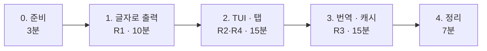

# 7교시 바이브 코딩 · `tman` 만들기

- 시간: 16:00~16:50 (50분) · 발표와 정리는 8교시
- 도구: CLI 코딩 에이전트(codex / claude / agy), Python + uv + [Textual](https://textual.textualize.io/)
- 결과물: 명령어 이름을 넣으면 **사용 예**를 보여 주는 터미널 프로그램(TUI)

```text
$ tman tar
┌ tman ─────────────────────────────────────────────┐
│ [ tar ]                                            │
│ ┌ tldr ┬ man ┐                                     │
│ │ 아카이브 유틸리티.                               │
│ │ - 아카이브 생성 후 파일로 저장:                  │
│ │   tar cf {{경로/대상/파일.tar}} {{파일1 ...}}    │
│ │ ...                                              │
└────────────────────────────────────────────────────┘
```

> 요청문은 **직접** 씁니다. 단계마다 `▶` 를 하나씩 펼치면 생각할 거리가 나옵니다. 정답 요청문은 없습니다.

## 요구 사항

| 번호 | 요구 | 확인 방법 |
| --- | --- | --- |
| R1 | [tldr pages.ko](https://github.com/tldr-pages/tldr/tree/main/pages.ko)에서 명령어 페이지를 가져와 **사용 예**를 보여 준다 | `tman tar` |
| R2 | 그 명령어의 `man` 결과가 있으면 **별도 탭**에 보여 준다 | `tman ls` → man 탭 |
| R3 | 사용 예(명령 줄)를 **뺀** 모든 설명은 한국어로 자동 번역한다 (한국어 페이지가 없을 때의 영어 tldr, man 설명) | `tman wcurl` (한국어 페이지 없음), `tman ls`의 man 탭 |
| R4 | 화면 안에서 다른 명령어를 검색할 수 있다 | 입력칸에 `git` |

알아 둘 것 (수업 준비 때 확인):

- 한국어 페이지 주소: `https://raw.githubusercontent.com/tldr-pages/tldr/main/pages.ko/common/tar.md`. `common` 외에 `linux` 폴더도 있습니다. 영어 페이지는 `.../main/pages/common/<명령>.md`.
- 2026-10-17 기준 영어 `pages/common` 4,728개 중 한국어 페이지가 없는 것은 96개입니다 (예: `wcurl`, `vllm`). 번역이 가장 많이 필요한 곳은 **man 탭**입니다.
- 페이지를 `curl`로 한 번 받아 모양을 직접 봅니다: `curl -s https://raw.githubusercontent.com/tldr-pages/tldr/main/pages.ko/common/tar.md`
- 번역 LLM 키는 `OPENAI_API_KEY` 환경 변수로 받습니다 (`~/aio-01d4-stu/Last3Mon/.env`에 있는 값). **키를 코드에 쓰지 않습니다.**
- WSL에서 `man ls`가 "minimized" 안내만 보이면 man 페이지가 설치되지 않은 것입니다.

## 진행 (50분)



요청문은 단계마다 `~/vibe/tman/PROMPTS.md`에 남깁니다. 발표 때 씁니다.

### 0. 준비 (3분)

```bash
mkdir -p ~/vibe/tman && cd ~/vibe/tman
git init
codex        # 또는 claude, agy
```

### 1. 글자로 출력 (10분)

**목표**: `uv run tman tar`를 실행하면 tar의 한국어 페이지가 터미널에 **글자로** 나온다. 화면(TUI)은 아직 없다.

<details><summary>▶ 1단계 · 왜 화면부터 만들지 않나</summary>

화면과 데이터 가져오기를 한 번에 만들면, 안 될 때 어디가 문제인지 모릅니다. 가장 작은 동작(가져와서 출력)부터 확인하고, 다음 단계에서 화면을 얹습니다. 요청문에 "이번에는 하지 말 것"을 적어 보세요.
</details>

<details><summary>▶ 2단계 · 프로젝트를 어떻게 시작하게 할까</summary>

에이전트는 도구를 고를 때 우리 수업 규칙을 모릅니다. Python 패키지 관리를 무엇으로 할지, 패키지·명령 이름을 무엇으로 할지, 코드와 화면 글자를 어떤 언어로 쓸지 적었나요?
</details>

<details><summary>▶ 3단계 · 나중을 위해 나눠 두기</summary>

페이지 글자를 받아 "설명"과 "(사용 예 설명, 명령 줄)" 목록으로 나누는 부분은 2단계 화면, 3단계 번역에서 계속 씁니다. 이 부분을 **따로** 만들고 **테스트**하게 하려면 요청문에 무엇을 적어야 할까요? 페이지가 `common`에 없을 때는?
</details>

**확인**: `uv run tman tar`, `uv run pytest -q`, 그리고 `git commit`.

### 2. TUI와 탭 (15분)

**목표**: 위에 명령어 입력칸, 아래에 tldr · man 탭. 시작할 때 준 명령을 바로 보여 주고, 입력칸에서 바꿀 수 있다 (R2 · R4).

<details><summary>▶ 1단계 · 화면을 말로 그리기</summary>

위 그림처럼 화면의 **위·아래에 무엇이 있는지**, 탭 이름이 무엇인지, Enter를 누르면 무엇이 바뀌는지를 순서대로 적어 봅니다. 명령 줄은 설명과 구분되게 보여야 읽기 쉽습니다.
</details>

<details><summary>▶ 2단계 · man 탭의 까다로운 점</summary>

터미널에서 `man ls`를 그대로 받아 보면 페이지 넘김 프로그램과 굵은 글씨용 문자가 섞여 나옵니다. 화면에 깨끗하게 보이려면 어떻게 받아야 하는지 에이전트에게 조건으로 알려 줍니다. man이 **없을 때** 보여 줄 문구도 정합니다.
</details>

<details><summary>▶ 3단계 · 화면이 멈추지 않게</summary>

인터넷에서 페이지를 받는 동안 화면이 굳으면 불편합니다. 이 조건을 요청문에 넣었나요? 1단계에서 만든 부분을 **다시 쓰라고** 적었나요?
</details>

**확인**: `uv run tman tar`, `uv run tman ls`(탭 전환), 입력칸에 `git` → Enter, 그리고 `git commit`.

### 3. 번역과 캐시 (15분)

**목표**: 명령 줄은 그대로 두고 설명만 한국어로 (R3). 같은 내용은 다시 번역하지 않는다.

<details><summary>▶ 1단계 · 무엇을 번역하고 무엇을 남길까</summary>

tldr 영어 페이지와 man 결과에서 번역할 곳과 번역하면 **안 되는** 곳(명령 줄, 옵션 이름, 예시)을 구분해 적습니다. 직접 `man ls` 한 부분을 보며 어디까지가 "설명"인지 정해 봅니다.
</details>

<details><summary>▶ 2단계 · 키와 실패</summary>

어떤 모델로 번역할지, 키를 어디서 읽을지, 키가 **없거나** 번역이 **실패하면** 화면이 어떻게 되어야 하는지 정합니다. 키 값을 요청문에 붙여 넣지 않습니다.
</details>

<details><summary>▶ 3단계 · 돈과 시간 아끼기</summary>

man 페이지는 길어서 매번 번역하면 느리고 비용이 듭니다. 한 번 번역한 결과를 어디에 두고 다시 쓸지 정해 줍니다.
</details>

<details><summary>▶ 4단계 · 테스트에서 진짜 API를 부르지 않게</summary>

번역 테스트가 실제 LLM을 부르면 느리고, 돈이 들고, 결과가 매번 다릅니다. LLM을 부르는 부분을 **바꿔 끼울 수 있게** 만들고 테스트에서는 가짜를 쓰게 하려면 어떻게 요청할까요? (n8n에서 Chat Model 노드만 바꾸면 모델이 바뀌는 것과 같은 생각입니다.)
</details>

```bash
export OPENAI_API_KEY=$(grep '^OPENAI_API_KEY=' ~/aio-01d4-stu/Last3Mon/.env | cut -d= -f2-)
```

**확인**: `uv run tman wcurl`(한국어 페이지 없음), `uv run tman ls`의 man 탭, `uv run pytest -q`, 그리고 `git commit`.

### 4. 정리 (7분)

- README와 설치 방법(어디서나 `tman` 실행)도 에이전트에게 맡겨 봅니다. 무엇을 넣으라고 할지 직접 정합니다.
- 발표 준비: 아래 3가지를 메모합니다.

| 발표 (3분) | 내용 |
| --- | --- |
| 요청문 | 가장 잘 먹힌 요청문 한 개, 안 먹힌 요청문 한 개 (`PROMPTS.md`에서) |
| 막힌 곳 | 에이전트가 틀린 것, 어떻게 알아챘고 어떻게 고쳤나 |
| 시연 | `tman tar`, 탭 전환, 번역된 명령 하나 |

## 확인

- [ ] R1 `tman tar`에 한국어 사용 예가 나온다.
- [ ] R2 man 탭이 있고, man이 없으면 안내가 나온다.
- [ ] R3 한국어 페이지가 없는 명령에서 설명은 한국어, 명령 줄은 원래 그대로다.
- [ ] R4 입력칸으로 다른 명령을 볼 수 있다.
- [ ] `uv run pytest -q` 통과, 단계마다 git commit이 있다, `PROMPTS.md`에 요청문이 남아 있다.
