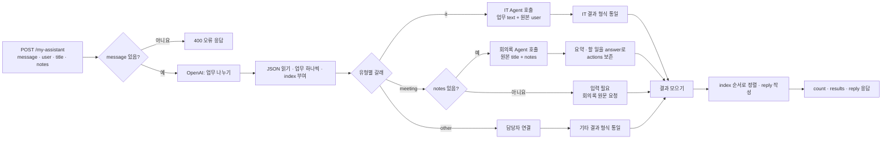

# Multi-Agent 설계서 · 사내 업무 도우미

- 이름: 복합 요청 업무 분석
- 사용한 CLI 에이전트: codex
- 이 파일을 `my-work/DESIGN.md`로 복사해 채웁니다.

## 1. 업무 분석표 (Lab 01 예제 1)

한 사람이 한 번에 처리할 수 있는 일을 한 업무로 나눈다. 접속사로 이어져도 서로 다른 결과가 필요하면 나누고, 한 업무를 설명하는 말은 함께 둔다. 유형은 현재 있는 IT 문의·회의록 Agent 기준이며, 둘 다 맡지 않는 일은 `other`로 둔다.

| 요청 | 업무 | 유형 (it · meeting · other) | 필요한 입력 | 요청에 있나 | 업무 관계 (독립 · 순서) |
| --- | --- | --- | --- | --- | --- |
| `composite` | T-1002 처리 상태 확인 | it | 문의 내용·접수 번호 T-1002, 요청자 `user` | 있음: `message`, `user`(박서연) | 독립: 다른 두 업무의 결과가 필요 없음 |
| `composite` | 첨부 회의록에서 할 일 정리 | meeting | 회의록 원문 `notes`, 회의 제목 `title` | 있음: `notes`, `title`(10월 16일 주간 회의) | 독립: 다른 두 업무의 결과가 필요 없음 |
| `composite` | 프린터 출력 장애 문의 | it | 장애 내용, 요청자 `user` | 있음: `message`, `user`(박서연) | 독립: 다른 두 업무의 결과가 필요 없음 |
| `two-it` | 잊어버린 비밀번호 처리 문의 | it | 문의 내용, 요청자 `user` | 있음: `message`, `user`(이준호) | 독립: 메일함 문제의 결과가 필요 없음 |
| `two-it` | 메일함 용량 초과 문의 | it | 문의 내용, 요청자 `user` | 있음: `message`, `user`(이준호) | 독립: 비밀번호 문제의 결과가 필요 없음 |
| `it-and-other` | 프린터 출력 장애 문의 | it | 장애 내용, 요청자 `user` | 있음: `message`, `user`(최유진) | 독립: 회식 장소 추천의 결과가 필요 없음 |
| `it-and-other` | 다음 주 회식 장소 추천 | other | 지역, 인원, 예산, 날짜 등 추천 조건 | 없음: 추천 조건이 요청 본문에 없음 | 독립: 프린터 문의의 결과가 필요 없음 |
| `meeting-no-notes` | 이번 회의록에서 할 일 정리 | meeting | 회의록 원문 `notes`(필수), 제목 `title`(선택) | 없음: `notes`·`title` 모두 없음 | 단일 업무: 다른 업무와 순서 관계 없음 |
| 내 업무에서 하나: 64일차 Lab 03 S3 | 신규 입사자의 사내 계정 로그인 문제 문의에 답하기 | it | 로그인 문제의 구체적 내용, 요청자 `user` | 별도 요청 JSON 없음: 이 문장에 문제는 있으나 `user`가 없어 실제 호출 전 필요 | 단일 업무: 다른 업무와 순서 관계 없음 |

> 64일차 개인 작성 시나리오 파일은 확인되지 않아 Lab 03의 선택지 S3(신규 입사자 질문 응답)에서 사내 계정 로그인 질문 하나를 예시로 골랐다. `other` 업무에는 현재 담당 Agent가 없으며, 추천 조건의 부재는 IT·회의록 Agent의 필수 입력 누락과는 구분한다.

## 2. Agent 목록과 계약 (Lab 02 예제 1)

| Agent | 맡는 업무 | 웹훅 | 입력 | 결과 | 실패할 때 돌려주는 것 |
| --- | --- | --- | --- | --- | --- |
| IT 문의 Agent | IT 문제·접수 상태 | `POST /webhook/it-agent` | `question`, `user` 모두 필수 | `route`, `answer`, `tools_used`, `sources` | 입력 누락은 HTTP 400; 근거가 부족하면 `route: 담당자 연결` |
| 회의록 Agent | 회의 요약·할 일 정리 | `POST /webhook/meeting-agent` | `notes` 필수, `title` 선택 | `route`, `title`, `count`, `summary`, `actions` | `notes` 누락 시 HTTP 400 `{"error":"notes are required"}` |

## 3. 흐름도 (mermaid)



### Supervisor 흐름과 라우터 비교 (Lab 02 과제)

Supervisor는 업무 나누기·Agent 선택·답변 조합을 AI Agent 한 곳에서 수행한다. IT 질문 문장만 AI가 Tool 입력으로 정하고, 요청자 `user`와 회의록 `title`·`notes`는 웹훅 본문에서 그대로 보낸다. AI 입력에는 회의록을 요청한 경우에만 원문 첨부 여부를 표시한다. 회의록 원문을 AI가 다시 쓰면 담당자·기한 등이 바뀌거나 누락될 수 있다. `agents_used`는 AI의 답이 아니라 실제 Tool 호출 기록에서 중복을 제거해 만든다.

| 비교 항목 | 라우터 (`my-assistant`) | Supervisor (`my-supervisor`) |
| --- | --- | --- |
| 복합 요청 시간 | 6.8초 · 7.1초 · 7.4초 (`runs/lab02-20261020-123539.json`, `123405.json`, `123132.json`) | 최근 10.7초 · 9.9초 · 9.5초 (`runs/lab02-challenge-20261020-124828.json`); 재수정 후 재측정 필요 |
| 같은 요청 3번의 결과 | 3번 모두 `cases/lab02.json` 통과, 문장 표현은 조금씩 달랐음 | 최근 복합 요청 3번 모두 통과했으나 IT 단독·기타 단독 각 3번 실패; 재수정 후 재확인 필요 |
| 결과 모양·계약 | `count`, `results`, `reply` · `cases/lab02.json` 통과 | `reply`, `agents_used` · 최근 `cases/lab02-challenge.json` 9/15 통과; 재수정 후 재검증 필요 |
| Agent 하나 추가할 때 고칠 곳 | 유형 규칙, Switch 갈래, HTTP 호출, 결과 형식, Merge 입력 | 새 HTTP Request Tool, Tool 설명·연결, Supervisor 지시문, 호출 기록 이름 매핑 |

`cases/lab02.json --webhook my-supervisor`는 라우터의 `count`·`results.*` 필드를 요구하므로, Supervisor가 지정된 `reply`·`agents_used` 계약만 반환하면 그 필드 검사에서 실패한다. 이는 응답 계약의 차이이며 같은 내용을 답했는지와 별도로 비교한다.

## 4. 통합 응답 형식

```json
{"count": 0, "results": [{"index": 1, "type": "", "text": "", "agent": "", "route": "", "answer": ""}], "reply": ""}
```

## 5. 예외 경로 (Lab 03)

### 예제 1 · 회의록 원문이 없는 요청

새 시나리오 없이 `requests/meeting-no-notes.json`의 김민지 요청 하나로 확인했다. `runs/lab03-20261020-144003.json`에서 수정 전 라우터는 HTTP 200이었지만 회의록 Agent의 `notes are required`를 `route: 오류`로 돌려 케이스가 실패했다. 같은 JSON을 직접 호출하면 라우터는 HTTP 200, `route: 입력 필요`, `reply`에 "회의록 원문을 보내 주세요."를 반환하고, 회의록 Agent는 계약대로 HTTP 400 `{"error":"notes are required"}`를 반환한다.

라우터는 업무 나누기 결과의 `missing: ["notes"]`를 회의록 Agent 호출 **전에** 확인한다. 이 경우 Agent를 호출하지 않고 필요한 입력을 요청한다. 수정 후 `runs/lab03-20261020-144147.json`에서 5/5 통과했다. `cases/lab02.json` 회귀 테스트는 다시 확인해야 한다.

| 상황 | 라우터가 할 일 | 확인한 테스트 |
| --- | --- | --- |
| 필요한 입력이 없음 | `missing: ["notes"]`인 회의록 업무는 Agent를 부르지 않고 `입력 필요`와 "회의록 원문을 보내 주세요."를 반환 | 수정 전 `runs/lab03-20261020-144003.json` 4/5; 수정 후 `runs/lab03-20261020-144147.json` 5/5 |
| 담당 Agent가 꺼짐 |  |  |
| 맡을 Agent가 없는 업무 |  |  |

## 6. 확장 계획 (Lab 03 과제, 측정값으로)

| 측정 | 값 (`runs/` 보고서) |
| --- | --- |
| IT 하나 |  초 |
| 회의록 하나 |  초 |
| 복합 요청 (업무 3개) |  초 |

- 직원 21명이 동시에 복합 요청을 보내면 어디가 먼저 막히나?
- 수직 확장(더 큰 서버)과 수평 확장(n8n 작업자 여러 개, Agent별 분리) 중 무엇을 먼저 하나? 이유는?
