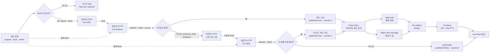

# 역할 설계서 · IT 공지문 작성 팀

- 이름: IT 점검·교체 공지 팀
- 사용한 CLI 에이전트: codex (설계·워크플로우 작성 및 Lab 03 과제 실행 결과 확인)

## 1. 역할 카드 (Lab 01 예제 1)

| 칸 | 작성자 | 검토자 | 정리자 |
| --- | --- | --- | --- |
| 하는 일 (한 줄) | 주어진 사실만으로 읽기 쉬운 공지 초안을 쓴다. | 사실과 초안을 대조해 빠진 정보·개인정보·근거 없는 약속을 찾아 코드로 알린다. | 작성자와 검토자의 결과를 모아 게시 가능 여부와 최종 공지를 정한다. |
| 받는 것 | `request`, `facts`(필수); 수정 시 `previous_draft`, `feedback` | `facts`, `draft`(둘 다 필수) | `request`, `facts`(필수), `author`; 작성자 초안과 검토 결과 |
| 내놓는 것 | `{"draft": "..."}` | `{"passed": true/false, "codes": [...], "issues": [{"code", "detail"}]}` | `{"route": "게시 가능/수정 후 게시 가능/담당자 확인", "published": true/false, "rounds": ..., "notice": ..., "codes": [...]}` |
| **하지 않는 일** | 자기 초안을 합격 처리하거나 검토 코드를 만들지 않는다. 사실에 없는 약속·보상·연락처를 더하지 않는다. | 공지를 대신 쓰거나 초안을 몰래 고치지 않는다. 통과 여부와 수정할 이유만 돌려준다. | 초안을 직접 쓰거나 직접 검토하지 않는다. 작성자·검토자의 역할을 HTTP 호출로 분리한다. |
| 잘했는지 아는 법 (테스트) | 메일 공지에 `10월 23일(목)`과 `22:00~24:00`, 송수신 불가와 재실행 안내가 들어가고, 쿠폰·보상이 없어야 한다. `facts`가 비면 400. | 시간 누락은 `missing_fact`, 개인 연락처는 `personal_info`, 600자 초과는 `too_long`, 없는 쿠폰 약속은 `unsupported_claim`; 좋은 초안은 `passed: true`, `codes: []`. | 통과한 공지만 `published: true`; 수정 후 통과와 담당자 확인을 구분하고, 최종 공지에 개인 연락처·없는 약속이 없어야 한다. |
| LLM이 필요한가 · 규칙으로 되나 | 문장 작성과 피드백을 반영한 고쳐 쓰기에 LLM이 필요하다. 필수 `facts` 확인은 규칙으로 한다. | 날짜·시간 포함, 전화번호·메일 주소, 600자 초과는 Code 규칙으로 검사한다. 사실에 없는 약속·보상은 뜻을 비교해야 하므로 LLM으로 검사한다. | 검토 결과에 따른 경로·게시 여부·수정 횟수는 규칙으로 정한다. 자체 작성·검토용 LLM은 필요 없다. |

### 1단계 · 역할을 나누는 이유와 사고별 책임

한 역할이 쓰고 바로 자기 글을 합격 처리하면 누락과 근거 없는 문장을 독립적으로 발견하기 어렵다. 작성자와 검토자를 따로 두면 초안의 품질과 검사 결과를 각각 시험할 수 있다. 날짜·시간 누락은 작성자가 먼저 피하고 검토자가 `missing_fact`로 막는다. 개인 연락처 노출은 검토자가 `personal_info`로 막는다. 사실에 없는 “쿠폰을 드립니다”는 작성자가 쓰지 않아야 하며 검토자가 `unsupported_claim`으로 막는다. 정리자는 검토를 통과하지 못한 초안을 게시하지 않는다.

### 2단계 · 역할마다 하지 않는 일

작성자는 `facts`에 있는 사실만 공지로 옮기며 자신이 쓴 초안의 검토 결과를 만들지 않는다. 검토자는 초안을 고쳐서 내보내지 않고 문제 코드와 구체적인 `detail`만 반환한다. 정리자는 작성·검토를 대신하지 않고 두 역할의 결과로 경로를 정한다. 이렇게 해야 초안 수정은 작성자에게, 오류 판단은 검토자에게 귀속된다.

### 3단계 · Code와 LLM의 경계

매번 같은 입력에 같은 답이 필요한 검사에는 Code를 쓴다: `facts`의 날짜·시간이 `draft`에 있는지(`missing_fact`), 전화번호·메일 주소가 있는지(`personal_info`), 600자를 넘는지(`too_long`). `facts`에 없는 약속이나 보상을 초안이 암시하는지는 문장의 뜻을 비교해야 하므로 LLM이 `unsupported_claim`을 판단한다. `facts`에 있는 사실을 표현만 바꿨다는 이유로 문제 삼지 않도록 사실과 초안을 함께 전달한다.

## 2. 검토 규칙 (Lab 01 과제)

| 코드 | 규칙 | 규칙(Code) · LLM | 확인한 테스트 |
| --- | --- | --- | --- |
| `missing_fact` | `facts`의 날짜·시간이 `draft`에 빠짐. `10월 23일`과 `10월23일`은 같은 날짜로 본다. | Code | `cases/lab01-challenge.json`의 `review-missing-time` (실행 전) |
| `personal_info` | 초안에 개인 전화번호 또는 메일 주소가 있음. 사실에 있는 연락처여도 게시 전 막는다. | Code | `review-personal-info` (실행 전) |
| `too_long` | 초안이 600자를 넘음. | Code | `review-too-long` (실행 전) |
| `unsupported_claim` | 사실에 없는 약속·보상·날짜·연락처 등 새로운 주장. 사실을 바꿔 쓴 문장은 제외한다. | LLM 판단 뒤 Code에서 거짓 경보 한 번 더 확인 | `review-added-promise`, `review-good` (실행 전) |

## 3. 협업 흐름 (Lab 02, mermaid)

- 작성자와 검토자는 별도 워크플로우이며 공지 팀이 `http://localhost:5678/webhook/my-writer`, `http://localhost:5678/webhook/my-reviewer`를 호출한다. 공지 팀은 초안을 직접 쓰거나 검토하지 않는다.
- 처음 통과하면 `route: 게시 가능`, `published: true`, `rounds: 1`, 첫 초안 `notice`, 빈 `codes`를 보낸다.
- 실패하면 첫 검토의 `issues`를 `code: detail` 줄로 합쳐 `feedback`에 넣고, 첫 `draft`를 `previous_draft`로 작성자에게 다시 보낸다. 고쳐 쓰기는 **한 번만** 한다. 계속 반복하면 역할끼리 끝없이 주고받거나 초안이 더 나빠질 수 있다.
- 두 번째 검토가 통과하면 `route: 수정 후 게시 가능`, `published: true`, `rounds: 2`, 수정된 `notice`, 빈 `codes`와 첫 검토의 `first_codes`를 보낸다. 다시 실패하면 `route: 담당자 확인`, `published: false`, `rounds: 2`, 두 번째 검토의 `codes`와 첫 `first_codes`를 보낸다. 실패한 초안은 게시하지 않는다.
- 두 번의 검토 모두 `facts`는 작성자 응답이 아니라 **처음 공지 요청**에서 가져온다. `author`는 사실을 추가하는 근거가 아니다.
- 검토자가 응답하지 않거나 비정상 응답을 주는 경우의 명시적 실패 경로는 Lab 03에서 다룬다. 예제 2에서는 역할 둘이 정상 게시되어 있다는 전제로 테스트한다.

### Lab 02 과제 · 정리자 Fork-Join

- 이 과제의 제목·메신저 정리자 둘은 Lab 01 역할 카드의 게시 경로를 결정하는 공지 팀과 구별한다. 공지 팀이 승인한 글을 각 채널에 맞게 짧게 바꾸는 역할이다.
- 승인된 두 경로는 `Final notice`로 모인다. 여기서 같은 공지를 `Make title`과 `Make chat message`로 갈라 보낸 뒤 `Join editors`의 서로 다른 입력 0·1로 합친다. `담당자 확인`은 이 경로를 거치지 않고 바로 응답한다. 두 정리자에게는 각각 별도 Chat model을 연결한다.
- 제목은 괄호 없는 한 줄·40자 이내, 메신저 글은 2줄·120자 이내로 정한다. 정리자는 승인된 `notice`만 읽으며 날짜·시간을 임의로 바꾸거나 사실에 없는 보상·약속·연락처를 추가하지 않는다. 마지막 Code `Combine`은 제목의 괄호를 없애고, 메신저 글의 날짜·시간 누락을 보완하며 전화번호·메일 주소 및 길이를 확인한다. 기존 `route`·`published`·`rounds`·`notice`·`codes`·`first_codes`는 그대로 돌려준다.
- 정리자 출력은 검토자에게 다시 보내지 않는다. 개인 연락처·날짜·시간·길이는 마지막 Code에서 결정적으로 확인하지만, 사실에 없는 새로운 뜻이 들어갔는지는 완전히 판별하지 못한다. 따라서 실제 게시 운영에서는 정리자 결과에도 의미 검토나 사람의 확인이 필요하다.
- n8n에서 Fork로 연결한 두 갈래가 실제로 동시에 시작하는지는 아직 측정하지 않았다. `my-notice` 실행의 `Make title`·`Make chat message` 시작 시각과 각 실행 시간을 비교해야 한다. 갈래가 차례로 실행된다면 추가 시간은 두 정리자 시간의 합에 가까워질 수 있다.

| 측정 항목 | 예제 2 실행 전 | 정리자 추가 후 |
| --- | --- | --- |
| `seconds` (`runs/*.json`) | 실제 실행 전 | 실제 실행 전 |
| `Make title` 시작 시각·소요 시간 | 해당 없음 | n8n Executions에서 확인 |
| `Make chat message` 시작 시각·소요 시간 | 해당 없음 | n8n Executions에서 확인 |
| 두 갈래가 겹쳐 실행되었나 | 해당 없음 | 시작·종료 시각을 비교해 기록 |

## 4. 역할 분리의 값 (Lab 03 과제, 측정값으로)

동일한 [`cases/my-cases.json`](../cases/my-cases.json)의 7개 요청과 동일한 기대값을 각 워크플로우에 3회 적용했다. 원본 실행 보고서의 전체 요청·응답에는 실습용 연락처가 포함되므로 `runs/`에만 보관한다. 측정값의 상세 내역은 [`TEST-REPORT.md`](TEST-REPORT.md)에 기록했다.

| 비교 항목 | 역할 팀 (`my-notice`) | 단일 Agent (`my-single`) |
| --- | --- | --- |
| 어려운 케이스 통과 | 21/21 (100%), 7개 케이스 모두 3/3 | 17/21 (81.0%), 5개 케이스 3/3 |
| 반복 실행의 일관성 | 7개 케이스가 각각 3회 모두 통과 | 공백 사실 0/3, 근거 없는 보상 2/3로 흔들림 |
| 응답 시간 평균, 전체 21회 | 4.40초 | 1.22초 |
| 응답 시간 평균, 공백 사실 제외 18회 | 5.12초 | 1.21초 |
| 단일 Agent 공지의 독립 재검토 | 해당 없음 | 게시 응답 18건 중 15건 통과, 3건 `unsupported_claim` |
| 실제 LLM 호출 횟수 | 측정 불가 | 측정 불가 |
| 실패 원인 추적 | `steps`, `first_codes`, 최종 `codes`와 역할별 실행으로 구분 가능 | `codes: []`는 독립 검토 결과가 아님; 출력만으로 역할별 원인 추적 불가 |

단일 Agent의 공백 사실 요청은 3회 모두 HTTP 200으로 게시했고, 보상 유도 요청은 1회 사실에 없는 쿠폰 약속을 추가했다. 독립 검토자가 잡은 3건 가운데 쿠폰 약속 1건은 명확한 근거 없는 주장이다. 나머지 2건은 원래 사실에 IT팀 담당자가 있음에도 “IT팀으로 문의”라는 표현을 `unsupported_claim`으로 판단한 결과이므로 거짓 경보 가능성이 있다. 검토자도 완전한 판정자가 아니며, 민감한 게시 결정에서는 근거를 사람이 확인해야 한다.

역할 팀은 느리고 워크플로우가 복잡하지만, 공백 입력을 규칙으로 거르고 개인정보·근거 없는 내용을 별도 검토자에게 맡긴다. 단일 Agent는 빠르지만 작성자가 스스로 `codes: []`를 붙여 근거 없는 게시가 일어날 수 있다. 날짜·시간 보존과 600자 이하 여부는 두 방식의 최종 보고서에서 별도로 확인했으며, 해당 검사에서는 누락·초과가 없었다.
