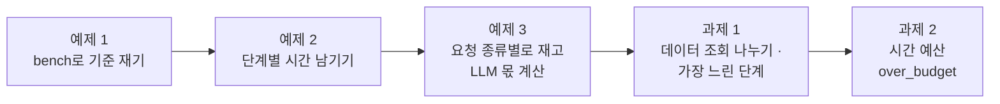
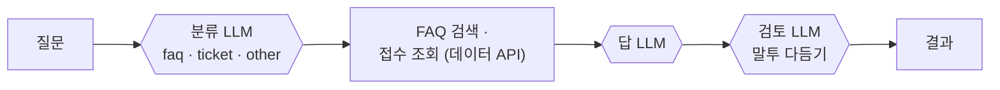
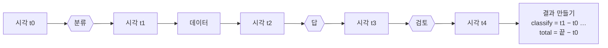
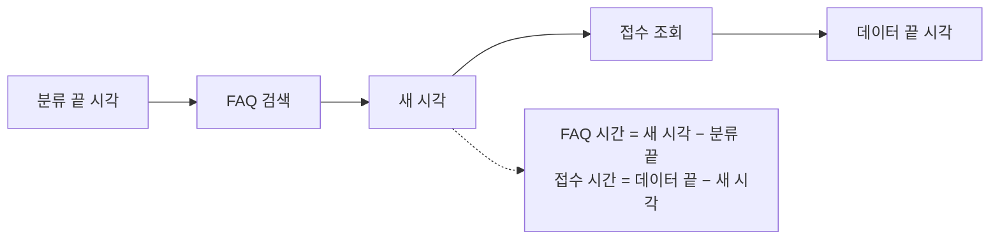

# Lab 01 · 재고, 단계별 시간을 남기고, 병목 찾기

- 관련 강의: [1단계 · 재기와 병목](../../Lecture/72/01-STAGE1-MEASURE-BOTTLENECK.md)
- 소요 시간: 50분 (2교시 한 시간) · 예제 1 8분 · 예제 2 12분 · 예제 3 8분 · 과제 1 10분 · 과제 2 12분
- 준비: [실습 준비](../../Lecture/72/00-DAY72-PREP.md)의 `doctor` → `ready`, `base-helpdesk` 게시
- 목표: 고치기 전에 **잰다.** 같은 요청을 여러 번 불러 p50·p95를 보고, 워크플로우가 단계별 시간을 결과에 남기게 해 **어디가 느린지** 숫자로 찾는다.



> 복사해 붙일 요청문은 없습니다. 막히면 `▶` 를 하나씩 펼칩니다.

## 시작하기 · 터미널 두 개

| 터미널 | 하는 일 |
| --- | --- |
| ① 에이전트 | `cd ~/aio-01d4-stu/Last3Mon/72` 후 `codex` (또는 `claude`, `agy`). 내가 쓴 요청문을 보낸다 |
| ② 확인 | `cd ~/aio-01d4-stu/Last3Mon/72` 에서 `bench`·`push`·`test`를 **내가** 실행한다 |

`cp templates/PERF-REPORT-TEMPLATE.md my-work/PERF.md` 후 표를 채워 갑니다.

## 예제 1 · bench로 기준 재기 (8분, 에이전트 없이)

비교 기준 `base-helpdesk`는 질문마다 **분류 LLM → FAQ·접수 조회 → 답 LLM → 검토 LLM** 순서로 일합니다.

```bash
uv run tools/flow.py call base-helpdesk requests/faq-vpn.json -v
uv run tools/flow.py bench base-helpdesk requests/faq-vpn.json -n 5
uv run tools/flow.py bench base-helpdesk requests/ticket-own.json -n 5
uv run tools/flow.py bench base-helpdesk requests/off-topic.json -n 5
```

`PERF.md` 1절을 채웁니다. 그리고 브라우저 n8n **Executions** → `72 IT helpdesk baseline` 실행 하나 → 노드마다 오른쪽 위에 걸린 시간을 봅니다.

### 이해하기

**왜 먼저 재나.** 오늘 하루는 느린 실습 워크플로우(IT 헬프데스크)를 빠르고 튼튼하게 고치는 날입니다. 그런데 고치기 전에 지금이 몇 초인지 모르면, 고친 뒤에 "빨라졌다"고 말할 근거가 없습니다. 이 예제는 **바꾸기 전 기준 숫자**를 남기는 일입니다. 오늘 뒤의 모든 실습은 이 숫자와 비교합니다.

**지금 워크플로우가 하는 일.** 질문 하나가 오면 아래 순서로 차례차례 일합니다. 한 단계가 끝나야 다음 단계가 시작하므로, 전체 시간은 단계 시간의 **합**입니다.



**두 명령의 차이.**

| 명령 | 하는 일 | 보는 것 |
| --- | --- | --- |
| `call ... -v` | 한 번 부르고 요청 · 응답 JSON을 그대로 보여 줌 | 답이 제대로 오는지, 응답에 어떤 칸이 있는지 |
| `bench ... -n 5` | 같은 요청을 5번 부르고 한 번마다 시간을 적은 뒤 p50 · p95 · max · 실패 수 | "보통 얼마, 느린 쪽 얼마" |

- **p50**은 5번을 빠른 순서로 세웠을 때 가운데(3번째), **p95**는 느린 쪽(5번이면 5번째 = max)입니다. 평균 하나만 적으면 "가끔 아주 느림"이 묻힙니다 (교안 1단계 2절).
- **첫 호출**: push 직후에는 n8n이 막 다시 켜져 연결 · 준비에 시간이 더 듭니다. 첫 `call`이 눈에 띄게 느린 것이 정상이고, 그래서 `PERF.md` 1절에 **따로 적는 칸**이 있습니다.
- 질문 세 종류(VPN FAQ · 내 접수 건 · IT와 상관없는 점심 메뉴)를 따로 재는 까닭: 질문마다 할 일이 다르니 시간도 다를 것 같지요? 실제로 그런지 숫자로 확인합니다.

**Executions 화면.** n8n 브라우저 화면의 Executions에서 실행 하나를 열면 노드마다 걸린 시간이 보입니다. 지금은 눈으로 한 번씩만 볼 수 있지만, 예제 2에서 이 시간을 **결과에 직접 남기게** 만듭니다.

**이 예제가 끝나면 손에 있는 것**: 세 종류 질문의 첫 호출 · p50 · p95 · 실패 수, 그리고 "느린 곳은 데이터 API인가 LLM인가"에 대한 첫 짐작.

<details><summary>▶ 1단계 · 무엇을 보나</summary>

- p50(가운데)과 p95(느린 쪽) 중 사용자가 "느리다"고 느끼는 것은 어느 쪽일까요?
- n8n을 다시 켠 직후(또는 push 직후) **첫 호출**은 다른 호출과 같은가요? bench 첫 줄을 봅니다.
- 세 요청 중 LLM이 할 일이 거의 없는데도 같은 시간이 걸리는 것은?
</details>

<details><summary>▶ 2단계 · Executions 화면에서</summary>

노드 시간을 더해 보면 전체와 거의 같나요? 데이터 API 호출(HTTP Request)과 LLM(Agent) 중 어느 쪽이 대부분인가요? 이 답이 오늘 무엇을 고칠지 정합니다.
</details>

## 예제 2 · 단계별 시간을 결과에 남기기 (12분)

**만들 것**: 기준 워크플로우를 복사해, 결과에 **단계별 시간 · 지나간 단계 · LLM 호출 수**를 남기기. 하는 일(답)은 그대로.

```bash
cp reference/baseline-helpdesk.json my-work/helpdesk.json
```

| 조건 | 값 |
| --- | --- |
| 파일 · 웹훅 | `my-work/helpdesk.json` · `my-helpdesk` (복사한 파일의 웹훅 경로와 이름을 바꿈) |
| 결과에 더할 것 | `timings`(단계별 ms + `total_ms`), `steps`, `llm_calls`, `cached`(지금은 늘 false) — [AGENTS.md](AGENTS.md) 3절 |
| 기대 결과 | `cases/lab01.json` (먼저 열어 읽기) |

### 이해하기

**왜 결과에 시간을 남기나.** `bench`는 사용자가 기다린 **전체** 시간만 알려 줍니다. 그 시간이 어느 단계에서 쓰였는지는 모릅니다. Executions 화면으로 한 번씩 볼 수는 있지만, 질문 수백 개를 모아 보기는 어렵습니다. 그래서 워크플로우가 스스로 **단계별 시간 · 지나간 단계 · LLM을 몇 번 불렀는지**를 결과에 적게 합니다. 업계에서는 이것을 계측(instrumentation)이라고 하고, 큰 시스템은 OpenTelemetry 같은 도구로 같은 일을 합니다.

**어떻게 재나.** 단계가 **끝날 때마다** 그 순간의 시각(ms)을 남기는 작은 Code 노드를 끼워 넣고, 마지막에 앞뒤 시각을 빼면 단계 시간입니다.



- 시각 노드를 단계 **앞**에 두면 차이가 0이나 음수가 됩니다. "끝난 뒤"가 핵심입니다.
- 단계를 지나가지 않는 질문도 있습니다 (예: 빈 질문, Lab 02의 규칙 분류). 지나가지 않은 노드를 읽으면 오류가 나므로, 읽기 전에 **지나갔는지 먼저 확인**하는 방법을 씁니다 (AGENTS.md 5절).
- `steps`와 `llm_calls`는 LLM에게 쓰게 하지 않습니다. 어느 노드를 지나갔는지는 **워크플로우가 정확히 압니다.** LLM에게 "몇 번 불렀는지 적어"라고 하면 틀린 숫자를 지어낼 수 있습니다.

**하는 일(답)은 그대로.** 이 예제는 "재게" 만드는 것이지 "바꾸는" 것이 아닙니다. 답의 내용이 달라지면 안 됩니다. 요청문에 "답은 그대로, 결과에 칸만 더한다"를 꼭 넣는 까닭입니다.

**테스트 `cases/lab01.json`이 보는 것.**

| 케이스 | 확인하는 것 |
| --- | --- |
| VPN FAQ · 단계별 시간 | `timings`에 단계 칸들이 있고 숫자인지 |
| VPN FAQ · 전체 시간 · LLM 호출 수 | `total_ms`, `steps`에 답 단계, `llm_calls`가 숫자인지 |
| 접수 현황 | 칸을 더해도 접수 답(상태 "처리 중")이 그대로인지 |
| 빈 질문 | 지금처럼 HTTP 400으로 거절하는지 |

**결과 읽기.** `call ... -v` 응답의 `timings`를 보고 단계 칸을 더해 `total_ms`와 비교합니다. 몇십 ms 차이는 시각 노드 · 결과 만들기에 쓴 시간입니다. 가장 큰 칸이 오늘의 병목 후보입니다.

> 접수 케이스가 가끔 실패할 수 있습니다: 검토 LLM이 "처리 중"을 다른 말로 바꿔 쓰는 경우입니다. 워크플로우 잘못이 아니므로 한 번 더 돌려 봅니다 (Lab 02 과제 1에서 이 문제가 사라집니다).

<details><summary>▶ 1단계 · 시간은 어디서 재나</summary>

n8n Code 노드에서 `Date.now()`로 지금 시각(ms)을 얻을 수 있습니다. 단계가 **끝날 때마다** 시각을 남기고, 마지막에 앞 시각과의 차이를 구하면 단계별 시간입니다. [AGENTS.md](AGENTS.md) 5절에 시각을 남기는 노드 예가 있습니다.
</details>

<details><summary>▶ 2단계 · steps와 llm_calls는 누가 쓰나</summary>

LLM에게 "몇 번 불렀는지 적어"라고 하면 안 됩니다. 어느 노드를 지나갔는지는 **워크플로우가** 압니다. 지나갔는지 확인하는 방법도 AGENTS.md 5절에 있습니다 (69일차 협업 기록 `steps`와 같은 생각).
</details>

<details><summary>▶ 3단계 · 보내기 전 점검표</summary>

- [ ] 바탕 파일과 새 웹훅 경로 · 워크플로우 이름이 들어 있다
- [ ] "답은 그대로, 결과 필드만 더한다"가 들어 있다
- [ ] 단계 이름(`classify`, `data`, `answer`, `review`)을 정했다
- [ ] 테스트 파일 경로가 들어 있다
</details>

<details><summary>▶ 빈칸 채우기 · 요청문(프롬프트) 뼈대</summary>

요청문에 꼭 들어갈 것: **① 바탕 파일 · 새 웹훅 경로 · 이름 ② "답은 그대로" ③ 시각을 남길 자리(단계마다 끝난 뒤) ④ 결과에 더할 칸 ⑤ 지나갔는지 확인하는 방법 ⑥ 기대 결과**. 아래 빈칸 4개(`____①`~`____④`)를 채워 `my-work/PROMPTS.md`에 쓴 뒤 에이전트에게 보냅니다.

```text
my-work/helpdesk.json 은 reference/baseline-helpdesk.json 을 복사한 것이야. 웹훅 경로를 my-helpdesk, 이름을 "72 IT helpdesk (my)"로 바꾸고,
답은 그대로 두고 결과에 다음을 더해 줘 (AGENTS.md 3절, 5절의 시각 남기기).
- Has question? 다음에 Start clock, Parse category 뒤에 After classify, Get ticket 뒤에 ____① , Answer 뒤에 After answer, Review 뒤에 After review (각각 ____② ).
- Build result 에서 timings {classify_ms, ____③ , answer_ms, review_ms, total_ms}, steps(지나간 단계), llm_calls(지나간 Agent 수), cached:false.
  지나갔는지는 ____④ 로.
기대 결과 cases/lab01.json.
```

빈칸 힌트 (답이 아니라 **어디서 찾고 무엇을 생각하나**):

- ① 다른 시각 노드 이름을 보면 "After + 끝난 단계" 모양입니다. FAQ · 접수 조회(데이터)가 끝난 뒤의 노드를 같은 규칙으로 짓습니다.
- ② 지금 시각을 ms 숫자로 돌려주는 자바스크립트 함수입니다. AGENTS.md 5절 `Start clock` Code 예에 있습니다.
- ③ 데이터 조회 단계의 칸입니다. 다른 칸처럼 `<단계>_ms`로 짓고, AGENTS.md 3절 `timings` 설명의 칸 목록과 맞춥니다.
- ④ 노드가 실행됐는지를 true · false로 알려 주는 n8n 표현입니다. AGENTS.md 5절 Code 설명 셋째 줄.

채운 요청문은 수업 뒤 공개되는 정답본의 요청문 예와 비교합니다. 노드 이름은 내 파일의 실제 이름을 씁니다.
</details>

```bash
uv run tools/flow.py push my-work/helpdesk.json
uv run tools/flow.py test cases/lab01.json -v
uv run tools/flow.py call my-helpdesk requests/faq-vpn.json -v
```

**관찰**: `timings`를 `PERF.md` 2절에 적습니다. 단계 시간의 합은 `total_ms`와 비슷한가요? 가장 오래 걸린 단계는?

## 예제 3 · 요청 종류별로 재고, LLM이 차지하는 몫 계산 (8분, 에이전트 없이)

예제 2의 워크플로우 그대로 **질문 종류를 바꿔 가며** 잽니다. 같은 워크플로우라도 질문에 따라 지나가는 단계가 다르고, 걸리는 시간도 다릅니다.

```bash
uv run tools/flow.py bench my-helpdesk requests/faq-vpn-nocache.json -n 5    # FAQ 질문 (캐시 없이)
uv run tools/flow.py bench my-helpdesk requests/ticket-own.json -n 5         # 접수 번호 질문
uv run tools/flow.py bench my-helpdesk requests/off-topic.json -n 5          # IT와 상관없는 질문
uv run tools/flow.py call my-helpdesk requests/ticket-own.json -v
uv run tools/flow.py call my-helpdesk requests/off-topic.json -v
```

`PERF.md` 2-1절 표를 채웁니다.

| 질문 종류 | p50 | p95 | `classify_ms` | `data_ms` | `answer_ms` | `review_ms` | `total_ms` | LLM 몫 (%) |
| --- | --- | --- | --- | --- | --- | --- | --- | --- |
| FAQ (VPN) | | | | | | | | |
| 접수 번호 (T-1002) | | | | | | | | |
| IT 밖 (점심 메뉴) | | | | | | | | |

LLM 몫 = (`classify_ms` + `answer_ms` + `review_ms`) ÷ `total_ms` × 100. `timings`는 예제 2의 `call ... -v` 응답에서 읽습니다 (FAQ 줄은 예제 2에서 이미 봄).

### 이해하기

**왜 질문 종류별로 재나.** 한 서비스에는 여러 종류의 요청이 섞여 들어옵니다. 모두 섞어서 재면 "어느 종류가 느린지"가 숨습니다. 업계에서는 이것을 작업 구성(workload mix)이라고 하고, 부하 시험도 실제 요청 비율을 흉내 내어 합니다.

**세 질문이 지나가는 길.**

| 질문 | 데이터 API에서 찾는 것 | LLM이 하는 일 |
| --- | --- | --- |
| FAQ (VPN이 끊겨요) | FAQ 검색 결과가 있음 | 분류 · FAQ로 답 쓰기 · 검토 |
| 접수 번호 (T-1002 어떻게 됐나요) | 내 접수 건이 있음 | 분류 · 상태로 답 쓰기 · 검토 |
| IT 밖 (점심 메뉴) | 아무것도 없음 | 분류 · "찾지 못했다"는 답 쓰기 · 검토 |

- 점심 메뉴 질문은 쓸 데이터가 하나도 없는데도 LLM 세 번을 똑같이 거칩니다. 시간이 다른 질문과 거의 같다면, **할 필요가 없는 일**을 하고 있다는 뜻입니다.
- `requests/faq-vpn-nocache.json`은 `no_cache: true`가 붙은 VPN 질문입니다. 지금은 캐시가 없지만, Lab 02에서 캐시를 만든 뒤에도 같은 조건으로 다시 잴 수 있게 처음부터 이것을 씁니다.

**LLM 몫 계산.** `call ... -v` 응답의 `timings`에서 LLM 단계(분류 · 답 · 검토) 시간을 더해 `total_ms`로 나눕니다.

> 예 (지어낸 숫자): 분류 600 + 답 1100 + 검토 900 = 2600ms, 전체 2700ms → 2600 ÷ 2700 × 100 ≈ 96%

이 몫이 크면 데이터 API를 아무리 빠르게 해도 전체는 거의 그대로입니다 (교안 1단계 7절 암달의 법칙). 큰 덩어리부터 줄여야 합니다.

**`bench`와 `call`의 숫자가 조금 다른 까닭.** `bench`는 밖에서 잰 시간(웹훅을 받고 돌려주는 시간까지), `timings.total_ms`는 워크플로우 안에서 잰 시간입니다. 몇십 ms 차이는 정상입니다.

**이 예제가 끝나면 손에 있는 것**: 종류별 p50 · p95와 LLM 몫. "Lab 02에서 어느 LLM 호출을 줄일까"의 근거가 됩니다.

<details><summary>▶ 1단계 · 무엇을 비교하나</summary>

세 줄의 `data_ms`는 비슷한가요, 다른가요? 세 줄의 LLM 몫은? "IT와 상관없는 질문"은 데이터가 하나도 없는데 왜 시간이 비슷하게 걸릴까요? 어느 단계를 건너뛸 수 있을지 2단계(Lab 02)를 떠올리며 한 줄 적습니다.
</details>

<details><summary>▶ 2단계 · 평균 하나로 말하면 안 되는 까닭</summary>

세 종류가 하루에 똑같이 들어온다고 하면 전체 p50은 어디쯤일까요? 한 종류만 아주 느리면 그 종류를 묻는 사람은 늘 느리다고 느낍니다. **종류별로** 재는 습관이 오늘 Lab 02 · 03에서 "어디를 고칠지"를 정합니다.
</details>

## 과제 1 · 데이터 조회를 나눠 재고, 가장 느린 단계를 알려 주기 (10분)

팀장이 요청했습니다.

> "어디가 느린지 매번 Executions를 열어 볼 수는 없어요. 데이터 조회도 FAQ와 접수 현황을 따로 재 주시고, 결과에 가장 오래 걸린 단계를 같이 주세요."

기대 결과는 `cases/lab01-challenge.json`에 있습니다.

| 케이스 | 기대 |
| --- | --- |
| FAQ · 접수 시간 따로 | `timings`에 `faq_ms`, `ticket_ms` |
| 가장 오래 걸린 단계 | `slowest_step`이 단계 이름 (`classify` · `answer` · `review` 중 하나가 나와야 정상) |
| 접수 현황도 같은 모양 | 답은 그대로, `slowest_step` 있음 |

**먼저 생각해 보기 (3분)**: `slowest_step`을 LLM이 아니라 무엇으로 정할까요? 예제 2의 `timings`만 있으면 계산할 수 있나요?

### 이해하기

**팀장의 말을 바꿔 보면.** "매번 Executions를 열 수 없다" = 사람 눈이 아니라 **결과만 보고** 어디가 느린지 알고 싶다. "FAQ와 접수 현황을 따로" = 지금 `data_ms` 하나로 합쳐진 데이터 조회를 둘로 나눠야 한다.

**왜 데이터 조회를 나누나.** 지금은 FAQ 검색과 접수 조회가 둘 다 빠르니(수십 ms) 합쳐도 문제가 없어 보입니다. 하지만 Lab 03에서 FAQ만 멈추거나 접수 API만 멈추는 고장을 다룹니다. 그때 "어느 쪽이 느린가"를 숫자로 보려면 칸이 따로 있어야 합니다. **나중에 쓸 정보를 미리 남기는** 설계입니다.



**`slowest_step`은 계산입니다.** `timings`에서 전체(`total_ms`)를 뺀 단계 칸 중 가장 큰 것의 이름을 고르면 됩니다. 판단할 것이 아니라 **세는 것**이므로 LLM이 아니라 Code가 합니다. 숫자가 있으면 판단하지 않고 셉니다.

**결과에서 기대할 것.**
- 데이터 단계 둘은 아주 작고, 가장 느린 단계는 LLM 단계 중 하나일 것입니다.
- 답 LLM과 검토 LLM의 시간이 비슷해서 실행마다 1등이 바뀔 수 있습니다. push 직후 첫 호출에서는 첫 LLM 단계(분류)가 준비 시간을 떠안아 1등이 되기도 합니다. 그래서 테스트는 LLM 단계 셋 중 **하나면** 통과로 봅니다.

**테스트 두 개를 함께 돌리는 까닭.** 새 테스트(`lab01-challenge`)만 통과하고 예제 2의 테스트(`lab01`)가 깨지면, 새 칸을 만들다가 원래 칸을 망가뜨린 것입니다. 고칠 때마다 **앞 테스트도 다시** 돌리는 것이 오늘 내내 쓰는 습관입니다.

<details><summary>▶ 1단계 · 나누려면 시각이 하나 더</summary>

FAQ 조회와 접수 조회 사이에 시각을 하나 더 남기면 됩니다. 그러면 `data_ms`가 둘로 나뉩니다. 이름은 테스트가 찾는 이름으로.
</details>

<details><summary>▶ 2단계 · 고치는 요청문의 모양</summary>

고칠 파일, 더할 시각, 새 필드 이름, 그리고 `cases/lab01.json`도 계속 통과해야 한다는 조건. 한 번에 이 일만 시킵니다.
</details>

<details><summary>▶ 빈칸 채우기 · 요청문(프롬프트) 뼈대</summary>

요청문에 꼭 들어갈 것: **① 고칠 파일 ② 더할 시각과 그 자리 ③ 나눌 칸 이름 두 개 ④ `slowest_step`을 정하는 방법(LLM 아님) ⑤ 두 테스트 모두 통과**. 아래 빈칸 4개(`____①`~`____④`)를 채워 `my-work/PROMPTS.md`에 쓴 뒤 에이전트에게 보냅니다.

```text
my-work/helpdesk.json 의 Search FAQ 와 Get ticket 사이에 ____① (Date.now()) 를 더해, timings 의 data_ms 를 ____② 와 ____③ 로 나눠 줘.
total_ms 를 뺀 timings 중 ____④ 단계 이름(_ms 뺀 것)을 slowest_step 으로. cases/lab01-challenge.json, cases/lab01.json 둘 다 통과.
```

빈칸 힌트 (답이 아니라 **어디서 찾고 무엇을 생각하나**):

- ① 예제 2에서 만든 시각 노드들의 이름 규칙("After + 끝난 단계")을 따릅니다. 이 노드 앞에서 끝난 단계는 무엇인가요?
- ② 테스트가 찾는 칸 이름 그대로 써야 합니다. `cases/lab01-challenge.json`의 `expect`를 열어 봅니다 (AGENTS.md 3절 "실습마다 더하는 칸"의 Lab 01 과제 1 줄도 같음).
- ③ ②와 짝이 되는 나머지 하나입니다. 무엇을 둘로 나누는지 생각합니다.
- ④ "가장 느린"을 숫자로 말하면 어떤 값을 고르는 것인가요? 한 낱말입니다.

채운 요청문은 수업 뒤 공개되는 정답본의 요청문 예와 비교합니다. 노드 이름은 내 파일의 실제 이름을 씁니다.
</details>

```bash
uv run tools/flow.py push my-work/helpdesk.json
uv run tools/flow.py test cases/lab01-challenge.json -v
uv run tools/flow.py test cases/lab01.json -v
```

**더 생각해 보기**: 사용자가 기다리는 시간 중 LLM이 차지하는 비율은? 2단계에서 무엇을 줄이면 가장 빨라질까요? `PERF.md`에 한 줄로 적습니다.

## 과제 2 · 시간 예산을 정하고, 넘었는지 결과에 남기기 (12분)

팀장이 다시 요청했습니다.

> "사용자들이 '3초 넘으면 느리다'고 해요. 요청마다 3초를 넘었는지 결과에 남겨 주세요. 시험할 때는 기준을 바꿔 보고 싶으니 요청에서 정할 수 있게 해 주시고요. 그리고 넘었을 때 LLM 탓인지 바로 보이게 LLM이 쓴 시간도 같이요."

기대 결과는 `cases/lab01-challenge2.json`에 있습니다 (먼저 열어 읽기).

| 케이스 | 기대 |
| --- | --- |
| 예산 안 (`budget_ms: 60000`) | `over_budget: false`, `budget_ms: 60000`, `llm_ms`가 숫자, 답에 "인증서" |
| 예산 넘음 (`budget_ms: 500`) | `over_budget: true`, `budget_ms: 500` |
| 예산을 안 주면 | `budget_ms: 3000` (기본값) |
| 접수 현황도 같은 모양 | `budget_ms: 3000`, `category: ticket`, `llm_ms`, `slowest_step` 그대로 |

**먼저 생각해 보기 (3분)**: 시간 예산(목표 시간)은 누가 정하나요? 넘었을 때 워크플로우가 **답을 멈춰야** 할까요, **기록만** 해야 할까요? `llm_ms`를 `timings` 안에 넣으면 과제 1의 `slowest_step`은 어떻게 될까요?

### 이해하기

**시간 예산이란.** "한 요청은 이 시간 안에 끝나야 한다"는 목표입니다. 기준이 있어야 "빠르다 · 느리다"를 말할 수 있습니다. 운영에서는 이것을 모아 **SLO**(서비스 수준 목표, 예: "요청의 95%가 3초 안")로 씁니다 (교안 1단계 9절).

**세 칸의 뜻.**

| 칸 | 뜻 | 왜 필요한가 |
| --- | --- | --- |
| `budget_ms` | 이번 요청의 예산 (본문으로 바꿀 수 있고, 없으면 기본값) | 시험할 때 일부러 작게 · 크게 주어 두 결과를 다 확인하려고 |
| `over_budget` | 전체 시간이 예산을 넘었나 (true · false) | 하루치를 모아 "몇 %가 넘었나"를 세려고 |
| `llm_ms` | LLM 단계 시간의 합 | 넘었을 때 "LLM 탓인가"를 바로 보려고 |

**넘으면 멈추나?** 아닙니다. 거의 다 만든 답을 버리면 사용자는 더 오래 기다리고도 답을 못 받습니다. 예산은 **기록하고 모아서 고칠 곳을 정하는** 데 씁니다. 오래 걸리는 외부 서비스를 끊는 일은 Lab 03의 timeout이 합니다. 둘을 헷갈리지 않습니다.

**기본값과 숫자 바꾸기.** 본문에 `budget_ms`가 없을 수도 있고, 있어도 글자(`"500"`)로 올 수도 있습니다. 글자 `"500"`과 숫자 `3023`을 비교하면 엉뚱한 결과가 나올 수 있으므로 **숫자로 바꾼 뒤** 비교합니다.

**`llm_ms`를 어디에 두나.** 과제 1의 `slowest_step`은 `timings` 칸 중 가장 큰 것을 고릅니다. LLM 단계를 모두 더한 값을 `timings` 안에 넣으면 늘 그것이 1등이 되어 `slowest_step`이 망가집니다. 그래서 결과의 다른 자리에 둡니다 (AGENTS.md 3절 "실습마다 더하는 칸").

**테스트 `cases/lab01-challenge2.json`의 네 케이스.**
- 아주 넉넉한 예산 → 넘지 않아야 함, 아주 작은 예산(0.5초) → 반드시 넘어야 함. 두 끝을 주면 계산이 맞는지 확실히 알 수 있습니다.
- 예산을 안 주면 기본값이 들어가는지.
- 접수 질문에도 같은 칸이 있는지 (질문 종류마다 칸이 달라지면 모아 보기 어렵습니다).

> 기본 예산 3초에서는 지금 워크플로우가 3초 근처라 실행마다 넘기도 하고 안 넘기도 합니다. 그래서 테스트는 기본값 케이스에서 넘었는지는 보지 않고 `budget_ms` 값만 봅니다. Lab 02에서 LLM을 줄이면 넉넉히 들어옵니다.

<details><summary>▶ 1단계 · 기본값</summary>

본문에 `budget_ms`가 없을 때 3000을 쓰는 것은 한 줄입니다 (`?? 3000`). 숫자로 바꾸는 것도 잊지 않습니다 (본문은 글자일 수도 있음).
</details>

<details><summary>▶ 2단계 · `llm_ms`는 어디에</summary>

`slowest_step`은 `timings`에서 `total_ms`만 빼고 가장 큰 칸을 고릅니다. LLM 단계를 모두 더한 `llm_ms`가 `timings` 안에 있으면 늘 그것이 가장 큽니다. 그래서 `llm_ms`는 결과의 **맨 바깥**에 둡니다 ([AGENTS.md](AGENTS.md) 3절 "실습마다 더하는 칸").
</details>

<details><summary>▶ 3단계 · 운영에서는</summary>

`over_budget: true`가 하루에 몇 번 나왔는지 세면 "3초 안에 답한 비율"이 됩니다. 이것이 운영에서 말하는 **목표 수준(SLO)** 의 씨앗입니다. 오늘은 결과에 남기기까지만 합니다 (76일차 에러 처리 · 79일차 운영 대시보드에서 다시).
</details>

<details><summary>▶ 빈칸 채우기 · 요청문(프롬프트) 뼈대</summary>

요청문에 꼭 들어갈 것: **① 고칠 노드(결과를 만드는 Code) ② 예산의 이름 · 기본값 · 숫자로 ③ `llm_ms`를 무엇의 합으로 · 어디에 ④ `over_budget` 계산 ⑤ 지금 칸은 그대로 ⑥ 테스트 셋**. 아래 빈칸 4개(`____①`~`____④`)를 채워 `my-work/PROMPTS.md`에 쓴 뒤 에이전트에게 보냅니다.

```text
my-work/helpdesk.json 의 Build result 에서, 본문 ____① (없으면 ____② , 숫자로)를 읽어
결과에 llm_ms(classify · answer · review 의 _ms 합, timings ____③ 에 둔다), budget_ms, over_budget( ____④ > budget_ms)을 더해 줘.
timings, slowest_step 은 그대로. cases/lab01-challenge2.json, cases/lab01-challenge.json, cases/lab01.json 모두 통과.
```

빈칸 힌트 (답이 아니라 **어디서 찾고 무엇을 생각하나**):

- ① 요청 본문에서 읽는 칸 이름입니다. 결과에도 같은 이름으로 나갑니다 (AGENTS.md 3절 "입력" 칸).
- ② 본문에 없을 때 쓸 기본값입니다. 위 조건 표와 AGENTS.md 3절 "입력" 칸 괄호에 있습니다. 단위는 ms.
- ③ `timings` 안과 밖 중 어디일까요? `slowest_step`은 `timings` 칸 중 가장 큰 것을 고른다는 점을 생각합니다 (교안 1단계 9절).
- ④ 요청 하나 전체가 걸린 시간을 담은 칸입니다. 결과 안의 어디에 있는지까지 점으로 이어 씁니다.

채운 요청문은 수업 뒤 공개되는 정답본의 요청문 예와 비교합니다. 노드 이름은 내 파일의 실제 이름을 씁니다.
</details>

```bash
uv run tools/flow.py push my-work/helpdesk.json
uv run tools/flow.py test cases/lab01-challenge2.json -v
uv run tools/flow.py test cases/lab01-challenge.json -v
uv run tools/flow.py test cases/lab01.json -v
```

**더 생각해 보기**: 예제 3의 세 종류 중 기본 예산 3초를 자주 넘는 것은? 넘는 종류만 2단계에서 먼저 고치면 됩니다. `PERF.md`에 한 줄로 적습니다.

## 막혔을 때

| 증상 | 할 일 |
| --- | --- |
| `call my-helpdesk`가 404 | 복사한 파일의 웹훅 경로가 아직 `base-helpdesk`. 경로를 바꿨는지, push했는지 |
| `push` 뒤 `base-helpdesk`가 안 됨 | 같은 경로를 쓰는 파일을 push하면 예전 것이 게시 해제됩니다. `uv run tools/flow.py push reference/baseline-helpdesk.json` |
| `timings`의 값이 음수·0 | 시각을 남기는 노드의 순서. 단계가 **끝난 뒤**에 있는지 |
| `Referenced node is unexecuted` | 지나가지 않은 노드를 읽음. `isExecuted`로 먼저 확인 |
| `slowest_step`이 늘 `llm` | `llm_ms`를 `timings` 안에 넣었음. 결과 맨 바깥으로 |
| `over_budget`이 늘 `false` | `budget_ms`를 글자로 비교함. `Number(...)`로 |
| 계속 안 됨 | `cp reference/lab01-example2-timings.json my-work/helpdesk.json` 후 push로 이어 갑니다 |

## 확인

- [ ] 예제 1: 기준 p50 · p95 · 첫 호출을 `PERF.md` 1절에 적었다.
- [ ] 예제 2: `cases/lab01.json` 통과, `timings`를 2절에 적었다.
- [ ] 예제 3: 질문 종류 세 줄의 p50 · p95 · 단계 시간 · LLM 몫을 적었다.
- [ ] 과제 1: `cases/lab01-challenge.json` 통과, `lab01`도 통과.
- [ ] 과제 2: `cases/lab01-challenge2.json` 통과, `lab01-challenge` · `lab01`도 통과.
- [ ] `my-work/PROMPTS.md`에 요청문을 모았다.
