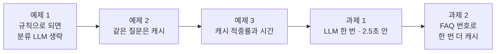
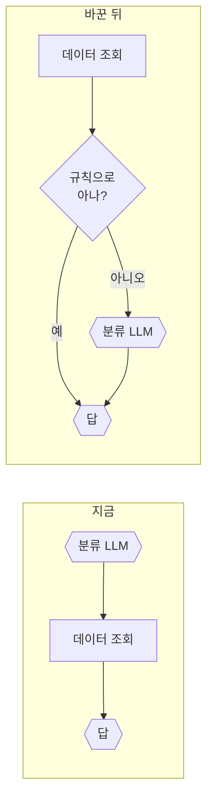
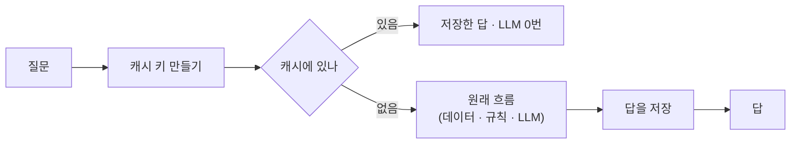
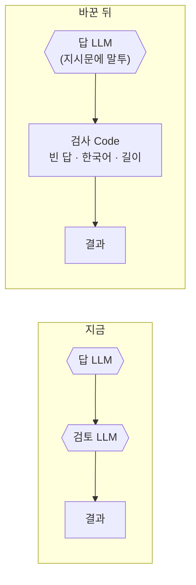
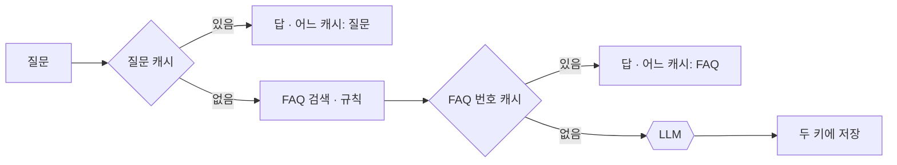

# Lab 02 · 규칙 먼저, 캐시, LLM 한 번 — 빠르게, 품질은 그대로

- 관련 강의: [2단계 · 실행 흐름 최적화](../../Lecture/72/02-STAGE2-OPTIMIZE-FLOW.md)
- 소요 시간: 50분 (4교시 한 시간) · 예제 1 10분 · 예제 2 10분 · 예제 3 6분 · 과제 1 12분 · 과제 2 12분
- 준비: Lab 01의 `my-work/helpdesk.json` (없으면 `cp reference/lab01-example2-timings.json my-work/helpdesk.json` 후 push)
- 목표: Lab 01에서 찾은 병목(LLM 호출)을 **한 가지씩** 줄이고, 바꿀 때마다 **다시 재고** 원래 테스트로 품질을 확인한다.



> 복사해 붙일 요청문은 없습니다. 막히면 `▶` 를 하나씩 펼칩니다. 바꿀 때마다 `PERF.md` 3절에 한 줄씩 적습니다.

## 예제 1 · 규칙으로 되면 분류 LLM을 부르지 않기 (10분)

**만들 것**: 접수 번호(`T-1002` 같은)가 있으면 `ticket`, FAQ 검색 결과가 있으면 `faq`로 **규칙이** 정하고, 규칙으로 모를 때만 분류 LLM을 부르게 하기.

| 조건 | 값 |
| --- | --- |
| 파일 | `my-work/helpdesk.json` 고치기 |
| `steps` | 규칙으로 정했으면 `rule`, LLM이 정했으면 `classify` |
| 기대 결과 | `cases/lab02.json` 앞 네 케이스 (나머지는 예제 2) |

### 이해하기

**Lab 01에서 알게 된 것.** 시간의 대부분이 LLM 세 번(분류 · 답 · 검토)이었습니다. 그중 **분류**는 "이 질문이 FAQ냐, 접수냐, 그 밖이냐"를 고르는 일입니다. 그런데 이 중 많은 경우는 LLM 없이도 확실히 알 수 있습니다.

| 질문의 단서 | 확실히 아는 것 |
| --- | --- |
| `T-1002`처럼 접수 번호 모양이 있음 | 접수 질문 |
| FAQ 검색에서 결과가 나옴 | FAQ로 답할 수 있는 질문 |
| 둘 다 아님 | 모름 → 이때만 LLM에게 묻는다 |

이렇게 **싼 규칙을 먼저, 모를 때만 비싼 LLM**을 쓰는 것을 단계적 처리(cascade) 또는 라우팅이라고 합니다. 고객센터가 자주 묻는 질문은 자동 응답으로, 나머지만 상담원에게 넘기는 것과 같습니다.

**순서를 바꿔야 하는 까닭.** "FAQ 결과가 있으면 faq"라는 규칙은 FAQ 검색을 **먼저** 해야 쓸 수 있습니다. 지금은 분류가 먼저입니다. 데이터 조회는 수십 ms라 앞으로 옮겨도 손해가 거의 없습니다.



**두 길이 다시 만날 때.** 규칙 길과 LLM 길이 같은 답 노드로 들어갑니다. 답 노드는 "분류 결과"를 한 가지 방법으로 읽어야 하므로, 두 길의 마지막 노드가 **같은 모양**으로 분류를 내놓게 합니다. 결과의 `steps`에는 어느 길로 왔는지(규칙 · LLM)를 남겨, 나중에 "규칙이 몇 %를 처리했나"를 셀 수 있게 합니다.

**규칙의 위험.** 규칙은 빠르고 늘 같지만 정해 둔 것밖에 모릅니다. FAQ 낱말이 들어 있지만 FAQ가 답이 아닌 질문도 있을 수 있습니다. 그래서 규칙도 테스트합니다: `cases/lab02.json`에는 규칙으로 정해지는 질문(프린터 FAQ · 접수 번호 · 없는 접수 번호)과 **규칙으로 모르는 질문**이 함께 있습니다.

**결과에서 기대할 것.** 규칙으로 정한 질문은 `llm_calls`가 하나 줄고 시간도 그만큼 줄어듭니다. `cases/lab02.json`의 뒤쪽 캐시 케이스는 예제 2에서 만들 것이니 지금은 실패가 정상입니다.

<details><summary>▶ 1단계 · 순서를 바꿔야 하나</summary>

지금은 분류 → 데이터 조회 순서입니다. "FAQ 검색 결과가 있으면 faq"라는 규칙을 쓰려면 무엇이 먼저 있어야 할까요? 68일차 "나누기와 유형은 LLM, 담당과 빠진 입력은 규칙"을 떠올립니다.
</details>

<details><summary>▶ 2단계 · 두 길이 다시 만나는 곳</summary>

규칙으로 정한 길과 LLM이 정한 길이 같은 답 노드로 들어갑니다. 답 노드가 분류를 **어느 길에서 왔든 같은 이름**으로 읽게 하려면? (두 길의 마지막 노드가 같은 모양 `{category}`를 내놓게)
</details>

<details><summary>▶ 3단계 · 규칙이 틀리면</summary>

규칙으로 `faq`가 됐는데 사실 FAQ와 상관없는 질문이라면? 테스트의 "규칙으로 모르면 LLM이 분류" 케이스는 어떤 질문인가요?
</details>

<details><summary>▶ 빈칸 채우기 · 요청문(프롬프트) 뼈대</summary>

요청문에 꼭 들어갈 것: **① 바뀐 노드 순서 ② 규칙 셋(접수 번호 · FAQ 결과 · 나머지) ③ 규칙으로 모를 때만 분류 LLM ④ 두 길이 같은 모양으로 만나기 ⑤ `steps`에 무엇을 ⑥ 기대 결과(앞 네 케이스)**. 아래 빈칸 4개(`____①`~`____④`)를 채워 `my-work/PROMPTS.md`에 쓴 뒤 에이전트에게 보냅니다.

```text
my-work/helpdesk.json 의 순서를 바꿔 줘: Has question? → Start clock → Search FAQ → Get ticket → After data → Rule classify(Code) → Known?(If).
Rule classify: 질문에 T-1234 같은 번호( ____① )가 있으면 ticket, FAQ 결과가 ____② 이면 faq, 아니면 unknown. {category, by:'rule'}.
Known? true → Answer, false → Classify → Parse category → After classify → Answer. Answer 는 $json.category 로 분류를 읽는다.
Build result: 분류는 ____③ 가 실행됐으면 그것, 아니면 Rule classify. steps 에 ____④ 또는 classify.
나머지(답, 검토, timings)는 그대로. 기대 결과 cases/lab02.json 앞 네 케이스.
```

빈칸 힌트 (답이 아니라 **어디서 찾고 무엇을 생각하나**):

- ① 정규식입니다. `T-1002`와 `t1002`가 모두 잡혀야 합니다: 하이픈은 있어도 없어도, 대소문자는 가리지 않고, 숫자는 몇 자리인가요?
- ② FAQ 검색 결과 `results`가 몇 개일 때 "FAQ로 답할 수 있다"고 볼까요? (AGENTS.md 2절 `/faq` 응답 모양)
- ③ LLM이 분류하는 길에서 분류 결과를 마지막으로 만든 노드입니다. 위 줄의 false 쪽 순서를 봅니다.
- ④ 규칙 길을 지났다는 표시입니다. AGENTS.md 3절 `steps` 예에 있는 단계 이름을 봅니다.

채운 요청문은 수업 뒤 공개되는 정답본의 요청문 예와 비교합니다. 노드 이름은 내 파일의 실제 이름을 씁니다.
</details>

```bash
uv run tools/flow.py push my-work/helpdesk.json
uv run tools/flow.py test cases/lab02.json -v
uv run tools/flow.py bench my-helpdesk requests/faq-printer.json -n 5
```

## 예제 2 · 같은 질문은 캐시에서 (10분)

**만들 것**: FAQ 답은 데이터 API의 캐시(`/cache/<key>`)에 저장하고, 같은 질문이 오면 **LLM 없이** 바로 답하기.

| 조건 | 값 |
| --- | --- |
| 캐시 키 | 질문을 앞뒤 공백 제거 · 소문자 · 연속 공백 하나로 ([AGENTS.md](AGENTS.md) 3절) |
| 결과 | 캐시에서 왔으면 `cached: true`, `llm_calls: 0` |
| 캐시하지 않는 것 | 접수 현황(`ticket`), 본문 `no_cache: true` |
| 기대 결과 | `cases/lab02.json` 전체 (`before`가 캐시를 비움) |

### 이해하기

**캐시란.** 한 번 만든 답을 저장해 두었다가, 같은 질문이 오면 다시 만들지 않고 저장한 답을 돌려주는 것입니다. 오늘은 데이터 API에 있는 작은 저장소(`/cache/<key>`)를 씁니다. 운영에서는 Redis 같은 저장소가 같은 일을 합니다.



- **확인은 일하기 전, 저장은 답을 만든 뒤.** 이 순서가 바뀌면 캐시가 아무 일도 하지 않습니다. 이 방식을 캐시 어사이드(cache-aside)라고 부릅니다.
- **캐시 키**: 같은 답을 받아야 할 질문이 같은 키를 갖게 하는 이름표입니다. `"  VPN 접속이…"`와 `"vpn 접속이…"`는 사람 눈에는 같은 질문이므로, 앞뒤 공백 · 대소문자 · 연속 공백을 다듬은 글자를 키로 씁니다.
- **없을 때 404**: 데이터 API는 캐시에 없으면 HTTP 404를 돌려줍니다. 이것은 고장이 아니라 "없음"이라는 정상 답이므로, 404에서 워크플로우가 멈추지 않게 해야 합니다.
- **수명(ttl)**: 오늘은 600초가 지나면 저절로 지워집니다. FAQ 원문이 바뀌어도 최대 10분 뒤에는 새 답이 나갑니다.

**캐시하면 안 되는 것.**

| 답 | 캐시해도 되나 |
| --- | --- |
| VPN FAQ 답 | 됨: 같은 질문이면 언제 · 누구에게나 같은 답 |
| T-1002 접수 상태 | **안 됨**: 10분 뒤 상태가 바뀌면 예전 답이 나감 |
| `no_cache: true`를 보낸 요청 | 읽지도 쓰지도 않음 (재기 · 테스트용) |

**테스트를 흔드는 캐시.** 앞 테스트가 남긴 캐시 때문에 다음 테스트 결과가 달라질 수 있습니다. 그래서 `cases/lab02.json`은 맨 앞 `before`에서 캐시를 비우고 시작합니다. 손으로 시험할 때도 결과가 이상하면 먼저 캐시를 비워 봅니다.

**결과에서 기대할 것.** 처음 묻는 VPN은 평소 시간, 띄어쓰기만 다른 같은 질문은 0.1초 안팎에 `cached: true`, `llm_calls: 0`. 접수 질문은 두 번 물어도 매번 새로 조회합니다.

<details><summary>▶ 1단계 · 어디서 확인하고 어디서 저장하나</summary>

캐시는 **일을 하기 전에** 보고, 답을 만든 **뒤에** 저장합니다. 캐시에 없을 때 데이터 API는 404를 돌려줍니다. 404에서 워크플로우가 멈추지 않게 하는 옵션이 AGENTS.md 5절에 있습니다.
</details>

<details><summary>▶ 2단계 · 캐시하면 안 되는 것</summary>

"T-1002 처리 상태"를 캐시하면 10분 뒤 상태가 바뀌어도 예전 답이 나갑니다. 캐시해도 되는 답과 안 되는 답을 나누는 기준을 요청문에 적습니다.
</details>

<details><summary>▶ 빈칸 채우기 · 요청문(프롬프트) 뼈대</summary>

요청문에 꼭 들어갈 것: **① 캐시 키 만드는 법 ② 확인은 일하기 **전**, 404에서 멈추지 않게 ③ 캐시에 있으면 무엇을 돌려주나 ④ 저장은 답을 만든 **뒤**, 무엇만 ⑤ 캐시하지 않는 것 ⑥ 기대 결과**. 아래 빈칸 4개(`____①`~`____④`)를 채워 `my-work/PROMPTS.md`에 쓴 뒤 에이전트에게 보냅니다.

```text
my-work/helpdesk.json 에 캐시를 더해 줘 (AGENTS.md 2절 데이터 API, 3절 캐시 규칙).
Start clock 다음: Cache key(Code: question 을 ____① , use_cache = ____② )
→ Cache lookup(GET http://data-api:8800/cache/<encodeURIComponent(key)>, ____③ ) → Cached?(value 있고 use_cache)
  true → Cached result(route·category·answer·sources + llm_calls 0, cached true, steps ['cache'], timings.total_ms) → Send cached
  false → 지금 흐름(Search FAQ ...).
Build result 뒤: Cache it?(category faq 이고 use_cache) true → Store in cache(POST /cache/<key> {value:{route,category,answer,sources}, ttl 600}) → Send result.
____④ 는 저장하지 않는다. 기대 결과 cases/lab02.json 전체, lab01 도 통과.
```

빈칸 힌트 (답이 아니라 **어디서 찾고 무엇을 생각하나**):

- ① 띄어쓰기 · 대소문자만 다른 두 질문이 같은 키가 되게 하는 다듬기 세 가지입니다. AGENTS.md 3절 마지막 줄.
- ② 요청 본문의 어느 칸이 "캐시를 쓰지 마"라는 뜻인가요? (AGENTS.md 3절 "입력" 칸) 그 칸이 true가 **아닐** 때 참이 되는 식입니다.
- ③ 캐시에 없으면 데이터 API가 404를 돌려줍니다. 404에서 워크플로우가 멈추지 않게 하는 HTTP Request 옵션입니다 (AGENTS.md 5절).
- ④ 상태가 바뀌어서 캐시하면 안 되는 답입니다. AGENTS.md 3절의 굵은 글씨 줄.

채운 요청문은 수업 뒤 공개되는 정답본의 요청문 예와 비교합니다. 노드 이름은 내 파일의 실제 이름을 씁니다.
</details>

```bash
uv run tools/flow.py push my-work/helpdesk.json
uv run tools/flow.py test cases/lab02.json -v
uv run tools/flow.py test cases/lab01.json -v               # 원래 테스트도
curl -s localhost:8800/cache-stats
```

**관찰**: 두 번째 VPN 질문은 몇 초였나요? `cache-stats`의 hits · misses는? 캐시가 맞을 확률(적중률)이 낮은 질문은 어떤 질문일까요?

## 예제 3 · 캐시 적중률과 시간 재기 (6분, 에이전트 없이)

예제 2의 캐시가 **얼마나** 도움이 되는지 숫자로 봅니다.

```bash
curl -s -XPOST localhost:8800/cache-clear
uv run tools/flow.py bench my-helpdesk requests/faq-vpn.json -n 5            # 첫 번은 캐시에 없음, 나머지 4번은 있음
uv run tools/flow.py bench my-helpdesk requests/faq-vpn-nocache.json -n 5    # 캐시를 쓰지 않음
curl -s localhost:8800/cache-stats
```

`PERF.md` 3-1절에 적습니다.

| 재기 | 첫 호출 | p50 | max | 적중 (`hits`) · 못 찾음 (`misses`) |
| --- | --- | --- | --- | --- |
| 캐시 씀 (`faq-vpn`) | | | | |
| 캐시 안 씀 (`faq-vpn-nocache`) | | | | |

### 이해하기

**적중률이란.** 캐시를 찾았을 때 있었던 비율입니다. 데이터 API의 `/cache-stats`가 `hits`(있었음) · `misses`(없었음)를 셉니다.

> 적중률 = hits ÷ (hits + misses)

**적중률이 정하는 평균 시간.** 캐시가 아무리 빨라도, 맞는 경우가 적으면 평균은 거의 그대로입니다.

> 평균 ≈ 적중률 × 캐시 시간 + (1 − 적중률) × 원래 시간

| 적중률 | 캐시 0.1초 · 원래 2초일 때 평균 (계산 예) |
| --- | --- |
| 10% | 0.1 × 0.1 + 0.9 × 2 = 1.81초 |
| 30% | 0.3 × 0.1 + 0.7 × 2 = 1.43초 |
| 60% | 0.6 × 0.1 + 0.4 × 2 = 0.86초 |

**두 번의 bench가 보여 주는 것.**
- 캐시를 비우고 같은 VPN 질문 5번: 첫 번은 캐시에 없어 평소 시간, 나머지 넷은 캐시에서 아주 빠르게. 그래서 **p50은 아주 작고 p95 · max는 첫 번의 시간**이 됩니다. 캐시는 "보통"을 크게 줄이지만 "처음 묻는 질문"은 줄이지 못한다는 뜻입니다.
- `no_cache`로 5번: 매번 원래 흐름. 이것이 캐시 없는 기준입니다.

**숫자가 무엇을 세는지 먼저 확인.** `no_cache` 요청도 캐시를 **조회는** 할 수 있습니다 (쓰지는 않음). 그러면 hits · misses에 함께 세어집니다. 도구가 내놓는 숫자는 늘 "무엇을 셌나"를 먼저 봅니다.

**실제 서비스라면.** 사람들은 같은 것을 **다른 말로** 묻습니다. 질문 글자를 키로 쓰는 캐시는 글자가 같아야만 맞으므로 실제 적중률이 낮을 수 있습니다. 이 생각이 과제 2(FAQ 번호로 캐시)로 이어집니다.

<details><summary>▶ 1단계 · 적중률로 평균 시간 어림하기</summary>

캐시에서 오면 약 0.1초, 아니면 약 2초라고 할 때, 하루 질문의 30%가 캐시에서 온다면 평균은 얼마쯤일까요? (0.3 × 0.1 + 0.7 × 2) 적중률이 10%라면? **캐시가 빨라도 적중률이 낮으면 평균은 거의 그대로**입니다.
</details>

<details><summary>▶ 2단계 · 적중률을 올리려면</summary>

지금 캐시 키는 "질문 글자"입니다. "VPN이 자꾸 끊겨요"와 "VPN 접속이 자꾸 끊겨요"는 다른 키입니다. 같은 답을 받을 질문들이 **같은 키**를 갖게 하려면 무엇을 키로 쓸 수 있을까요? (과제 2)
</details>

## 과제 1 · LLM 한 번, 2.5초 안 (12분)

팀장이 요청했습니다.

> "캐시는 같은 질문에만 도움이 되잖아요. 처음 묻는 FAQ · 접수 질문도 2.5초 안에 답해 주세요. 대신 답의 내용은 지금과 같아야 합니다."

```bash
uv run tools/flow.py test cases/lab02-challenge.json -v     # 고치기 전
uv run tools/flow.py bench my-helpdesk requests/faq-vpn-nocache.json -n 5
```

| 케이스 | 기대 |
| --- | --- |
| VPN · 비밀번호 · 접수 현황 (캐시 없이) | `llm_calls: 1`, 답에 핵심 내용, 2.5초 안 |
| 규칙으로 모르는 질문 | `llm_calls: 2` (분류 + 답) |
| 빈 질문 | 400, 1초 안 (LLM 없이) |

**먼저 생각해 보기 (5분)**: 지금 남은 LLM 호출은 무엇무엇인가요? 그중 **셀 수 있는 검사**로 바꿀 수 있는 것은? (69일차 "셀 수 있는 검사는 규칙, 뜻을 봐야 하는 검사만 LLM")

### 이해하기

**팀장의 말을 바꿔 보면.** 캐시는 **두 번째 같은 질문**에만 도움이 됩니다. 처음 묻는 질문을 빠르게 하려면 흐름 자체에서 LLM을 줄여야 합니다. 지금 남은 LLM은 (규칙으로 정해진 질문이면) 답 · 검토 두 번입니다. 목표는 한 번입니다.

**검토 LLM이 실제로 하는 일.** Executions에서 답 LLM의 출력과 검토 LLM의 출력을 나란히 보면, 대부분 **말투만** 다듬습니다. 그런데 가끔 사실을 바꿔 쓰기도 합니다 (Lab 01에서 접수 상태 "처리 중"이 다른 말로 바뀌어 테스트가 실패한 일). 검토가 오히려 틀림을 만든 것입니다.

**두 가지 검사 방법.**

| 방법 | 잘하는 것 | 약한 것 |
| --- | --- | --- |
| 코드 검사 | 빠름(ms), 늘 같음: 빈 답, 한국어인지, 너무 긴지 | 뜻은 모름 |
| LLM 검토 | 뜻을 봄: 사실과 맞나, 없는 약속 | 느리고(약 1초) 비싸고, 흔들림 |

말투는 처음부터 **답 LLM의 지시문**으로 정하면 검토가 필요 없습니다. 셀 수 있는 것은 코드가 봅니다 (69일차 "셀 수 있는 검사는 규칙, 뜻을 봐야 하는 검사만 LLM").



**잃는 것도 있습니다.** 검토가 하던 "뜻을 보는" 일은 이제 아무도 하지 않습니다. 그 일이 꼭 필요한 업무(예: 규제가 있는 답)라면 검토를 남기고 다른 곳을 줄여야 합니다. 바꾼 것과 잃은 것을 `PERF.md` 3절에 함께 적습니다.

**테스트 `cases/lab02-challenge.json`의 조건.**
- 처음 묻는 FAQ · 접수 질문(캐시 없이)이 LLM 한 번, 2.5초 안.
- 규칙으로 모르는 질문은 분류 + 답 두 번 (분류는 남김).
- 빈 질문은 LLM 없이 바로 거절.
- 시간 기대가 있는 테스트는 첫 호출에 흔들리므로, 이 파일의 `before`가 먼저 한 번 불러 둡니다(워밍업). `--repeat 3`으로 세 번씩 돌려 운이 아닌지 확인합니다.

**결과에서 기대할 것.** LLM 하나를 빼면 약 1초가 줄어듭니다 (Lab 01 예제 3의 검토 단계 시간과 비슷한 만큼). 같은 요청으로 `bench`를 다시 재어 전 · 후를 같은 날 비교합니다.

<details><summary>▶ 1단계 · 검토 LLM은 무엇을 하나</summary>

Executions에서 검토 LLM의 입력과 출력을 비교해 봅니다. 답의 **사실**이 바뀌나요, 말투만 바뀌나요? 말투는 답 LLM의 지시문으로도 정할 수 있지 않을까요?
</details>

<details><summary>▶ 2단계 · 무엇을 남길까</summary>

검토 LLM을 없애면 잃는 것이 있습니다. 빈 답, 한국어가 아님, 너무 김 같은 것은 Code로 확인할 수 있습니다. `steps`의 이름도 바뀌겠지요 (예: `check`).
</details>

<details><summary>▶ 3단계 · 확인 순서</summary>

`lab02-challenge` → `lab02` → `lab01` 순서로 모두. 그리고 `bench`로 p50 · p95를 다시 재 `PERF.md` 3절에 적습니다. 첫 호출이 느리면 테스트가 실패할 수 있습니다. 이 테스트 파일의 `before`가 무엇을 하는지 열어 봅니다.
</details>

<details><summary>▶ 빈칸 채우기 · 요청문(프롬프트) 뼈대</summary>

요청문에 꼭 들어갈 것: **① 지울 노드(검토 LLM과 그 모델) ② 그 자리에 둘 Code와 셀 수 있는 검사 셋 ③ 말투는 어디서 정하나 ④ `steps` · `llm_calls`가 어떻게 바뀌나 ⑤ "나머지는 그대로" ⑥ 테스트 셋 모두**. 아래 빈칸 4개(`____①`~`____④`)를 채워 `my-work/PROMPTS.md`에 쓴 뒤 에이전트에게 보냅니다.

```text
my-work/helpdesk.json 에서 Review(검토 LLM)와 Review model 을 지우고, 그 자리에 Review check(Code)를 둬:
Answer 의 output 을 trim, 비었으면 empty, 한글이 없으면 not_korean, ____① 자 넘으면 자르고 too_long 을 review_problems 에.
Answer 지시문에 " ____② "가 이미 있는지 확인. steps 에는 review 대신 ____③ , llm_calls 는 ____④ .
나머지는 그대로. cases/lab02-challenge.json, lab02.json, lab01.json 모두 통과.
```

빈칸 힌트 (답이 아니라 **어디서 찾고 무엇을 생각하나**):

- ① 답 길이의 상한입니다. 교안 2단계 6절의 검사 표에 있습니다. 내 업무라면 몇 자가 알맞을지도 생각해 봅니다.
- ② 검토 LLM이 하던 말투 다듬기를 대신할 지시입니다. 말투 하나와 길이 제한 하나를 넣습니다.
- ③ 검토 대신 코드 검사를 지났다는 짧은 단계 이름입니다. 보고서에서 알아볼 수 있으면 내가 정해도 됩니다.
- ④ 지운 노드는 세면 안 됩니다. 이제 요청 하나에 LLM 노드를 몇 개 지나가나요? (테스트의 `llm_calls` 기대도 확인)

채운 요청문은 수업 뒤 공개되는 정답본의 요청문 예와 비교합니다. 노드 이름은 내 파일의 실제 이름을 씁니다.
</details>

```bash
uv run tools/flow.py push my-work/helpdesk.json
uv run tools/flow.py test cases/lab02-challenge.json -v --repeat 3
uv run tools/flow.py test cases/lab02.json -v
uv run tools/flow.py test cases/lab01.json -v
uv run tools/flow.py bench my-helpdesk requests/faq-vpn-nocache.json -n 5
```

**더 생각해 보기**: 더 작은 모델(예: 분류만 작은 모델)로 바꾸는 방법도 있습니다. 그때 무엇을 다시 재야 할까요? (75일차 비용에서 다시)

## 과제 2 · FAQ 번호로 한 번 더 캐시 (12분)

팀장이 다시 요청했습니다.

> "캐시 적중이 생각보다 적어요. 다들 VPN이 끊긴다고 묻는데, 말이 조금씩 달라서 매번 LLM을 부르더라고요. 같은 FAQ로 답하는 질문이면 말이 달라도 저장해 둔 답을 쓰게 해 주세요. 그리고 어떤 캐시에서 왔는지 결과에 남겨 주세요."

기대 결과는 `cases/lab02-challenge2.json`에 있습니다 (`before`가 캐시를 비움).

| 케이스 | 기대 |
| --- | --- |
| 처음 묻는 VPN | `cached: false` |
| 다른 말로 묻는 VPN ("VPN 연결이 계속 끊어지는데요") | `cached: true`, `cache_by: "faq"`, `llm_calls: 0`, 1초 안 |
| 같은 말 (띄어쓰기 · 대소문자만 다름) | `cached: true`, `cache_by: "question"` |
| `no_cache: true` | 두 캐시 모두 쓰지 않음 |
| 다른 FAQ (프린터 처음) | `cached: false` |
| 접수 현황 | `cached: false` |

**먼저 생각해 보기 (3분)**: FAQ 번호를 알려면 무엇을 먼저 해야 하나요? 그러면 두 번째 캐시는 흐름의 **어디에** 들어가나요? 질문 캐시(예제 2)와 무엇이 다른가요? 잃는 것은 무엇일까요?

### 이해하기

**팀장의 말을 바꿔 보면.** 질문 캐시는 글자가 같아야 맞습니다. 사람들은 같은 것을 다른 말로 묻습니다 ("VPN이 끊겨요" · "VPN 연결이 계속 끊어지는데요"). 그런데 이 두 질문은 결국 **같은 FAQ**(같은 FAQ 번호)로 답합니다. 그렇다면 "질문 글자"가 아니라 "FAQ 번호"를 키로 쓰면 더 많이 맞습니다.

**키를 넓게 잡을수록.**

| 키 | 같은 키가 되는 질문 | 적중 | 잘못 맞을 위험 |
| --- | --- | --- | --- |
| 질문을 다듬은 글자 (예제 2) | 띄어쓰기 · 대소문자만 다른 질문 | 낮음 | 거의 없음 |
| FAQ 번호 (이 과제) | 같은 FAQ로 답하는 질문 모두 | 높음 | 답이 질문에 꼭 맞지 않을 수 있음 |
| 뜻 (임베딩, 오늘 안 함) | 비슷한 뜻의 질문 | 더 높음 | 비슷하지만 다른 질문에 같은 답 |

**두 번째 캐시의 자리.** FAQ 번호는 FAQ 검색을 해야 알 수 있습니다. 그래서 이 캐시는 질문 캐시처럼 맨 앞이 아니라 **FAQ 검색 뒤, LLM 앞**에 들어갑니다. 데이터 조회(수십 ms)는 하고 LLM(1초 이상)만 건너뜁니다.



**어느 캐시에서 왔는지 남기기.** 결과에 `cache_by`를 두어 질문 캐시 · FAQ 번호 캐시 · 캐시 아님을 구분합니다. 나중에 "FAQ 번호 캐시가 하루에 몇 번 맞았나"를 세어 이 캐시가 쓸모 있는지 판단할 수 있습니다.

**캐시하지 않는 것은 그대로.** 접수 현황과 `no_cache` 요청은 두 캐시 모두 읽지도 쓰지도 않습니다. FAQ가 아닌 질문은 FAQ 번호가 없으니 이 캐시를 쓸 수 없습니다.

**테스트 `cases/lab02-challenge2.json`의 순서가 중요합니다.** 캐시를 비운 뒤 (1) 처음 VPN → 캐시에 저장, (2) 다른 말 VPN → FAQ 번호 캐시에 맞아야 함, (3) 처음 질문과 띄어쓰기만 다른 것 → 질문 캐시, (4) `no_cache` → 두 캐시 모두 안 씀, (5) 다른 FAQ(프린터) 처음 → 캐시 없음, (6) 접수 → 캐시 안 함. 앞 케이스가 저장한 것을 뒤 케이스가 쓰므로 순서대로 읽습니다.

**잃는 것.** FAQ 번호 캐시의 답은 **처음 물은 사람의 질문**에 맞춰 쓴 답입니다. "VPN이 끊겨요"에 맞춘 답이 "VPN 설치는 어떻게 해요?"에도 나갈 수 있습니다 (둘 다 같은 FAQ라면). 답이 FAQ 원문 요약이면 괜찮고, 질문마다 달라야 하면 이 캐시는 맞지 않습니다.

<details><summary>▶ 1단계 · 두 캐시의 자리</summary>

질문 캐시는 일하기 **전**(FAQ 검색보다 앞)에 봅니다. FAQ 번호 캐시는 FAQ 검색이 끝나야 번호를 알 수 있으므로 **FAQ 검색 뒤, LLM 앞**에 봅니다. 데이터 조회(수십 ms)는 하고, LLM(1초 이상)만 건너뜁니다.
</details>

<details><summary>▶ 2단계 · 저장은 두 번</summary>

답을 만든 뒤 질문 키에도, `faq-<FAQ 번호>` 키에도 저장합니다 ([AGENTS.md](AGENTS.md) 3절 캐시 키 표). 접수 현황 · `no_cache`는 둘 다 저장하지 않습니다.
</details>

<details><summary>▶ 3단계 · 잃는 것</summary>

FAQ 번호 캐시에서 온 답은 **처음 물은 사람의 질문**에 맞춰 쓴 답입니다. 다른 사람이 조금 다른 것을 물어도 같은 답이 나갑니다. 답이 FAQ 원문 요약이라 괜찮은지, 질문마다 달라야 하는지 `PERF.md` 3절에 한 줄 적습니다.
</details>

<details><summary>▶ 빈칸 채우기 · 요청문(프롬프트) 뼈대</summary>

요청문에 꼭 들어갈 것: **① 두 번째 캐시를 볼 자리 ② 키 만드는 법과 쓰지 않는 경우 ③ 있으면 무엇을 돌려주나(`cache_by`) ④ 없으면 원래 흐름으로 ⑤ 저장 자리 ⑥ 질문 캐시 · 결과에 `cache_by` ⑦ 테스트**. 아래 빈칸 4개(`____①`~`____④`)를 채워 `my-work/PROMPTS.md`에 쓴 뒤 에이전트에게 보냅니다.

```text
my-work/helpdesk.json 에 FAQ 번호 캐시를 더해 줘 (AGENTS.md 3절 캐시 키 표).
Rule classify 다음: FAQ cache key(Code: category 가 faq 이고 use_cache 이고 FAQ 결과가 있으면 faq_key = ' ____① ' + 첫 FAQ id, 아니면 'none')
→ FAQ cache lookup(GET /cache/<faq_key>, neverError) → FAQ cached?(value 있고 faq_key 가 'none' 아님)
  true → FAQ cached result(llm_calls 0, cached true, cache_by ' ____② ', steps ['faq', 'rule', 'cache']) → Send
  false → Back to rule(Code: Rule classify 의 결과를 그대로) → Known?
Store in cache 뒤에 Store by FAQ(POST /cache/<faq_key>, 같은 value, ttl ____③ ) → Result again.
질문 캐시의 Cached result 에는 cache_by ' ____④ ', Build result 에는 cache_by null.
기대 결과 cases/lab02-challenge2.json, lab02-challenge.json, lab02.json 도 통과.
```

빈칸 힌트 (답이 아니라 **어디서 찾고 무엇을 생각하나**):

- ① AGENTS.md 3절 캐시 키 표의 둘째 줄을 봅니다. FAQ 번호 **앞에** 붙는 글자입니다.
- ② AGENTS.md 3절 "실습마다 더하는 칸"의 Lab 02 과제 2 줄을 봅니다. 어느 키로 찾았는지에 따라 값이 둘입니다.
- ③ 질문 캐시(예제 2)와 같게 둡니다. 캐시 키 표의 ttl 칸.
- ④ ②와 짝이 되는 나머지 값입니다.

채운 요청문은 수업 뒤 공개되는 정답본의 요청문 예와 비교합니다. 노드 이름은 내 파일의 실제 이름을 씁니다.
</details>

```bash
uv run tools/flow.py push my-work/helpdesk.json
uv run tools/flow.py test cases/lab02-challenge2.json -v
uv run tools/flow.py test cases/lab02-challenge.json -v
uv run tools/flow.py test cases/lab02.json -v
curl -s localhost:8800/cache-stats
```

**더 생각해 보기**: 예제 3의 적중률 계산을 다시 해 봅니다. FAQ가 6개뿐이라면 FAQ 질문의 적중률은 어디까지 오를 수 있을까요? 그 대신 FAQ 원문이 바뀌면 캐시는 언제 새 답을 내나요? (ttl 600초)

## 막혔을 때

| 증상 | 할 일 |
| --- | --- |
| 캐시 케이스가 늘 `cached: false` | 캐시 키가 저장할 때와 찾을 때 같은지 (`call`로 두 번 부르고 `curl -s localhost:8800/cache-stats`) |
| 캐시 조회에서 워크플로우가 멈춤 (404) | 캐시 조회 HTTP 노드에 `neverError` |
| 테스트를 다시 돌리면 결과가 다름 | 캐시가 남아 있음. `curl -s -XPOST localhost:8800/cache-clear` 또는 `no_cache: true` |
| `llm_calls`가 기대와 다름 | `Build result`가 세는 노드 이름이 실제 노드 이름과 같은지 |
| `cache_by`가 늘 `null` | 두 캐시 결과 Code에 `cache_by`를 넣었는지, `FAQ cached?`가 true 쪽으로 가는지 (`call ... -v`) |
| 다른 말 VPN이 `cached: false` | 저장할 때 `faq_key`를 쓰는지 (`curl -s localhost:8800/cache/faq-FAQ-003`) |
| 계속 안 됨 | `reference/lab02-example1-rules.json` 또는 `reference/lab02-example2-cache.json`을 `my-work/helpdesk.json`으로 복사 후 push |

## 확인

- [ ] 예제 1: `cases/lab02.json` 앞 네 케이스 통과, 규칙 질문에 `classify`가 없다.
- [ ] 예제 2: `cases/lab02.json` 9/9, `lab01`도 통과, 캐시 적중 시간을 적었다.
- [ ] 예제 3: 캐시 씀 · 안 씀 bench와 hits · misses, 적중률 어림을 적었다.
- [ ] 과제 1: `cases/lab02-challenge.json` 3번 반복 통과, `lab02` · `lab01` 통과, 바꾸기 전·후 p50 · p95.
- [ ] 과제 2: `cases/lab02-challenge2.json` 통과, `lab02-challenge` · `lab02`도 통과, 잃는 것 한 줄.
- [ ] `PERF.md` 3절에 바꾼 것마다 한 줄 (잃은 것도).
