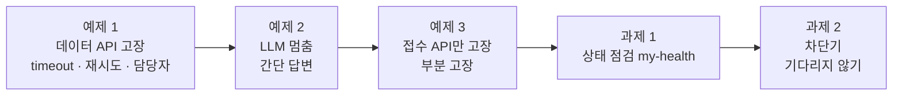
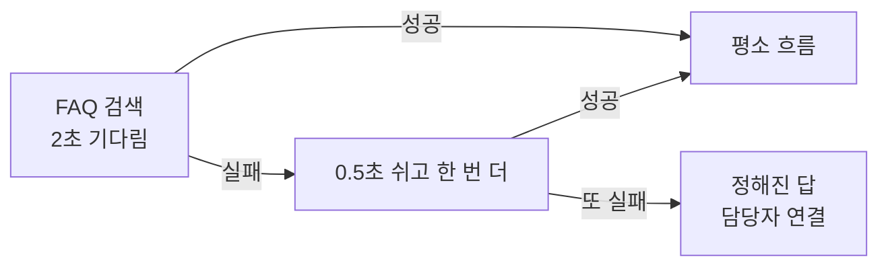
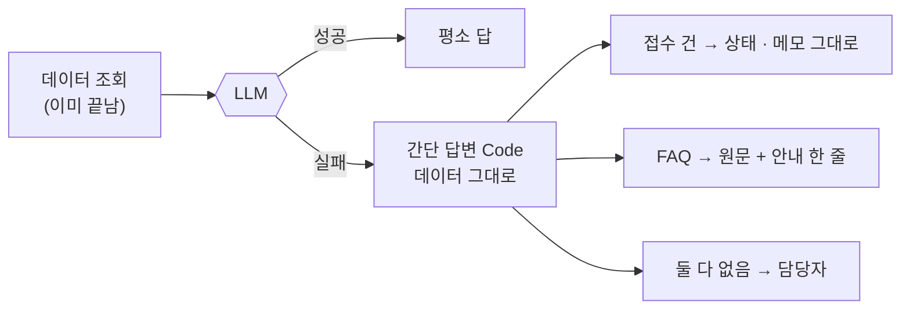
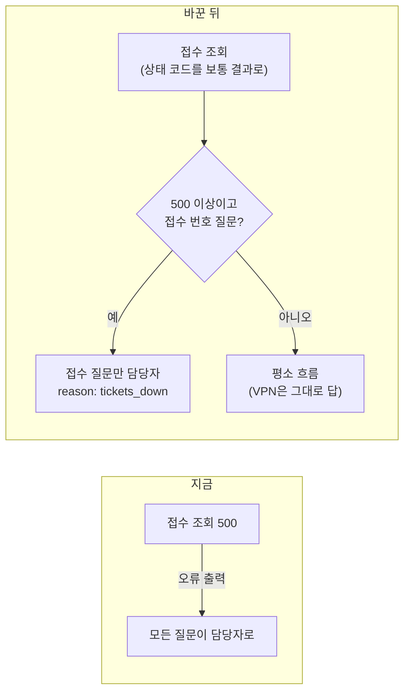
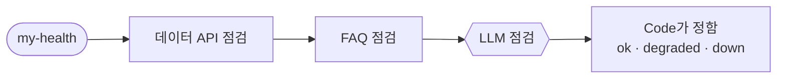
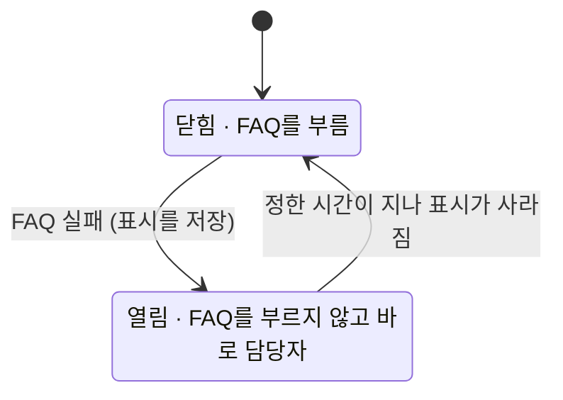

# Lab 03 · 멈춰도 답하게: 타임아웃 · 재시도 · 대체 경로 · 상태 점검

- 관련 강의: [3단계 · 운영 관점의 안정성](../../Lecture/72/03-STAGE3-STABILITY.md)
- 소요 시간: 50분 (6교시 한 시간) · 예제 1 10분 · 예제 2 10분 · 예제 3 10분 · 과제 1 10분 · 과제 2 10분
- 준비: Lab 02의 `my-work/helpdesk.json` (없으면 `cp reference/lab02-example2-cache.json my-work/helpdesk.json` 후 push)
- 목표: 데이터 API나 LLM이 **느려지거나 멈췄을 때** 워크플로우가 끝없이 기다리거나 500으로 끝나지 않고, **정해진 시간 안에 정해진 답**을 하게 만든다. 그리고 무엇이 멈췄는지 바로 알 수 있는 상태 점검을 만든다.



> 고장은 **일부러** 냅니다. `uv run tools/flow.py fault faq slow|error|ok`, `uv run tools/flow.py llm down|up`. 연습이 끝나면 반드시 되돌립니다 (테스트 파일은 `after`로 되돌림).

## 예제 1 · 데이터 API가 느리거나 오류일 때 (10분)

먼저 지금 워크플로우로 겪어 봅니다.

```bash
uv run tools/flow.py fault faq slow                 # FAQ가 8초 뒤에 답함
uv run tools/flow.py call my-helpdesk '{"question": "비밀번호를 잊어버렸어요", "no_cache": true}' -v
uv run tools/flow.py fault faq error                # FAQ가 500
uv run tools/flow.py call my-helpdesk '{"question": "비밀번호를 잊어버렸어요", "no_cache": true}' -v
uv run tools/flow.py fault all ok
```

`PERF.md` 4절 "고치기 전"을 채웁니다. 사용자는 몇 초를 기다렸고, 무엇을 받았나요?

**만들 것**: FAQ · 접수 조회가 **2초 안에** 답하지 않거나 실패하면 한 번 더 해 보고, 그래도 안 되면 `담당자 연결`로 정해진 답.

| 조건 | 값 |
| --- | --- |
| 기다리는 시간 | 2초, 다시 해 보기 1번 (0.5초 뒤) |
| 실패했을 때 | HTTP 200, `route: 담당자 연결`, 이유 (예: `reason: data_api_down`) |
| 기대 결과 | `cases/lab03.json` (케이스마다 `before`로 고장, `after`로 되돌림) |

### 이해하기

**외부 서비스는 반드시 멈춥니다.** 데이터 API, LLM, 어떤 서비스든 언젠가는 느려지거나 오류를 냅니다. 안정성 설계는 "멈추지 않게"가 아니라 **"멈춰도 정해진 시간 안에 정해진 답을 하게"** 만드는 것입니다.

**고치기 전에 겪은 두 가지.**

| 고장 | 사용자가 겪는 것 | 까닭 |
| --- | --- | --- |
| FAQ가 느림 (8초 뒤 답) | 8초 넘게 기다린 뒤에야 답 | 기다리는 한도가 없어 끝까지 기다림 |
| FAQ가 오류 (500) | 곧바로 HTTP 500, 아무 안내 없음 | 오류에서 워크플로우가 멈춤 |

느림이 오류보다 나쁠 때가 많습니다. 기다리는 동안 n8n도 그 일을 붙잡고 있어, 사람이 몰리면 다른 요청까지 밀립니다.

**세 가지 설정.**

| 설정 | 하는 일 | 비유 |
| --- | --- | --- |
| 기다리는 한도 (timeout) | 이 시간 안에 답이 없으면 실패로 봄 | 전화를 몇 번 울려도 안 받으면 끊기 |
| 다시 해 보기 (retry) | 실패하면 잠깐 쉬고 한 번 더 | 한 번 더 걸어 보기 |
| 실패해도 다른 길로 (오류 출력) | 멈추지 않고 두 번째 출력으로 보냄 | 안 되면 "담당자에게 전해 드릴게요" |



**최악의 시간을 먼저 계산합니다.** 기다림 2초, 한 번 더, 사이 0.5초면 최악 = 2 + 0.5 + 2 = 4.5초에 다른 단계 시간이 조금 더해집니다. 테스트(`cases/lab03.json`)의 느림 케이스는 이 안쪽(7초 안)을 기대합니다. 재시도를 늘리면 최악도 늘어납니다. 재시도는 "잠깐 끊긴" 고장에 쓰는 것이지 "계속 느린" 고장에 쓰는 것이 아닙니다 (계속 느리면 과제 2의 차단기).

**정해진 답에 까닭 남기기.** `route: 담당자 연결`만이 아니라 `reason`(예: `data_api_down`)을 두면, 운영자가 나중에 "오늘 데이터 고장으로 넘긴 것이 몇 건"인지 셀 수 있습니다.

**캐시는 고장에도 도움이 됩니다.** 질문 캐시를 FAQ 검색 **앞**에서 보므로, FAQ가 멈춰도 캐시에 있는 질문은 평소처럼 답합니다. 테스트 마지막 케이스가 이것을 확인합니다 (먼저 한 번 물어 캐시에 넣고 → FAQ를 고장 내고 → 같은 질문).

**테스트의 `before` · `after`.** 케이스 앞에서 고장을 켜고, 뒤에서 **반드시** 끕니다 (실패해도). 손으로 고장을 켰다면 직접 `fault all ok`로 되돌립니다.

<details><summary>▶ 1단계 · 세 가지 설정</summary>

기다리는 시간(timeout), 다시 해 보기(retry), 실패해도 멈추지 않고 다른 길로(error output). [AGENTS.md](AGENTS.md) 5절에 세 가지가 어디에 쓰이는지 있습니다. 하나는 `parameters` 안, 둘은 노드 바로 아래입니다.
</details>

<details><summary>▶ 2단계 · 최악의 시간은 얼마인가</summary>

timeout 2초 × 2번 + 기다림 0.5초. 테스트의 `max_seconds`는 몇 초인가요? retry를 3번으로 늘리면?
</details>

<details><summary>▶ 3단계 · 캐시가 있으면</summary>

FAQ가 멈춰도 캐시에 있는 질문은 답할 수 있어야 합니다. 테스트의 마지막 케이스는 어떤 순서로 무엇을 하나요? 캐시 확인이 FAQ 조회보다 **앞에** 있어야 하는 이유는?
</details>

<details><summary>▶ 빈칸 채우기 · 요청문(프롬프트) 뼈대</summary>

요청문에 꼭 들어갈 것: **① 어느 노드에 ② 기다리는 시간 ③ 다시 해 보기 횟수 · 기다림 ④ 실패하면 어디로(오류 출력) ⑤ 정해진 답의 칸(route · answer · reason) ⑥ 그대로 둘 설정 ⑦ 기대 결과**. 아래 빈칸 4개(`____①`~`____④`)를 채워 `my-work/PROMPTS.md`에 쓴 뒤 에이전트에게 보냅니다.

```text
my-work/helpdesk.json 의 Search FAQ 와 Get ticket 에 options.timeout ____① , 노드 설정 retryOnFail true, maxTries ____② , waitBetweenTries 500,
onError ____③ 을 넣어 줘. 두 노드의 오류 출력(main 1번)은 Data down(Set: route 담당자 연결, answer "사내 데이터 시스템이 응답하지 않아 담당자에게 연결합니다.", reason data_api_down)
→ Send data down(Respond). Get ticket 은 404 를 받아야 하니 ____④ 는 그대로 둔다. 기대 결과 cases/lab03.json, lab02 도 통과.
```

빈칸 힌트 (답이 아니라 **어디서 찾고 무엇을 생각하나**):

- ① 단위는 ms입니다. 위 조건 표의 "몇 초 안에"를 ms로 바꿉니다.
- ② 처음 한 번 + 다시 한 번입니다. 최악의 시간(시도 × timeout + 기다림)이 `cases/lab03.json`의 느림 케이스 `max_seconds`를 넘지 않는지 계산합니다 (교안 3단계 3절).
- ③ 실패해도 멈추지 않고 **두 번째 출력**으로 보내는 값입니다 (AGENTS.md 5절).
- ④ 4xx를 보통 결과로 받게 해 주는 옵션입니다. Lab 02 예제 2의 캐시 조회에도 썼습니다.

채운 요청문은 수업 뒤 공개되는 정답본의 요청문 예와 비교합니다. 노드 이름은 내 파일의 실제 이름을 씁니다.
</details>

```bash
uv run tools/flow.py push my-work/helpdesk.json
uv run tools/flow.py test cases/lab03.json -v
uv run tools/flow.py test cases/lab02.json -v            # 평소에는 그대로인지
```

## 예제 2 · LLM이 멈췄을 때 (10분)

OpenAI 키가 만료되거나, 서비스가 멈추거나, 사용 한도를 넘으면 LLM 노드가 실패합니다. 일부러 겪어 봅니다.

```bash
uv run tools/flow.py llm down
uv run tools/flow.py call my-helpdesk requests/faq-vpn-nocache.json -v
uv run tools/flow.py llm up                          # 반드시 되돌리기
```

**만들 것**: LLM 노드(분류 · 답)가 실패하면, LLM 없이 **데이터 그대로** 답하기.

| 질문 | LLM이 멈췄을 때 |
| --- | --- |
| FAQ가 있는 질문 | `route: 간단 답변`, FAQ 원문 + "자동 답변을 잠시 쓸 수 없다"는 안내 |
| 접수 번호 질문 | `route: 간단 답변`, 상태와 메모를 그대로 |
| 그 밖 | `route: 담당자 연결` |
| 기대 결과 | `cases/lab03-llm-down.json` (`before`가 `llm down`, `after`가 `llm up`) |

### 이해하기

**LLM이 멈추는 경우.** API 키 만료, 사용 한도 초과, 회사 쪽 장애, 네트워크. 오늘은 `llm down`으로 키를 일부러 틀리게 바꿔 이 상황을 만듭니다. 지금 워크플로우는 LLM 노드가 실패하면 그대로 멈춰 HTTP 500을 돌려줍니다.

**데이터는 이미 있습니다.** LLM이 실패하는 시점에는 FAQ 검색 결과와 접수 건을 **이미 조회했습니다.** LLM이 하던 일은 "그 데이터로 친절한 문장 쓰기"였습니다. 문장을 다듬지 못하더라도 데이터 자체는 사용자에게 줄 수 있습니다.



**대안(fallback)의 순서.** 다른 회사 LLM으로 바꾸는 방법도 있지만, 키 · 비용 · 품질을 하나 더 관리해야 합니다. 오늘은 **데이터로 답할 수 있는 것은 데이터로** 답합니다. 데이터도 없으면 사람에게 넘깁니다.

**사용자에게 솔직하게.** 평소 답과 같은 척하지 않습니다. FAQ 원문을 그대로 줄 때는 "자동 답변 기능을 잠시 쓸 수 없어 원문으로 안내한다"는 한 줄을 붙입니다. 결과의 `route`도 평소(`자동 답변`)와 다르게 두어, 운영자가 "오늘 간단 답변이 몇 건이었나"를 셀 수 있게 합니다.

**LLM 노드도 오류 출력을 가질 수 있습니다.** HTTP 노드처럼 Agent 노드에도 "실패하면 두 번째 출력으로" 설정을 둘 수 있습니다 (AGENTS.md 5절). 분류 LLM과 답 LLM 중 어느 것이 먼저 실패하든 같은 간단 답변으로 가게 잇습니다.

**테스트 `cases/lab03-llm-down.json`.** `before`가 `llm down`, `after`가 `llm up`입니다. FAQ 질문 · 접수 질문 · 모르는 질문 · 빈 질문 네 가지가 각각 맞는 대안으로 가는지 봅니다. 테스트가 중간에 멈춰도 `after`는 실행되지만, 혹시 LLM이 계속 실패하면 직접 `llm up`을 합니다.

<details><summary>▶ 1단계 · 데이터는 이미 있다</summary>

LLM이 실패하는 시점에는 FAQ 결과와 접수 건을 **이미 조회했습니다.** 그것을 그대로 쓰는 답을 Code로 만들 수 있습니다. 어느 노드의 오류 출력을 어디로 이을까요?
</details>

<details><summary>▶ 2단계 · 사용자에게 무엇을 알리나</summary>

평소 답과 같은 척하지 않고, 지금은 간단한 답이라는 것을 알립니다. `route`를 다르게 두는 이유는? (운영자가 나중에 세어 볼 수 있게)
</details>

<details><summary>▶ 빈칸 채우기 · 요청문(프롬프트) 뼈대</summary>

요청문에 꼭 들어갈 것: **① 어느 LLM 노드에 오류 출력 ② 오류 출력을 어디로 ③ 접수 번호가 있을 때의 답 ④ FAQ가 있을 때의 답과 안내 문장 ⑤ 둘 다 아닐 때 ⑥ 공통 칸(`llm_calls` · `reason`) ⑦ 기대 결과**. 아래 빈칸 4개(`____①`~`____④`)를 채워 `my-work/PROMPTS.md`에 쓴 뒤 에이전트에게 보냅니다.

```text
my-work/helpdesk.json 의 Classify 와 Answer Agent 에 onError continueErrorOutput 을 넣고, 두 노드의 오류 출력을 Simple answer(Code) → Send simple answer 로 이어 줘.
Simple answer: 질문에 접수 번호가 있고 Get ticket 결과에 status 가 있으면 route ____① , "<번호> 접수 건은 현재 '<status>' 상태입니다. <note>".
FAQ 결과가 있으면 route ____① , 첫 FAQ answer + " ( ____② )", sources [그 id].
아니면 route ____③ . 모두 llm_calls 0, reason ____④ . 기대 결과 cases/lab03-llm-down.json.
```

빈칸 힌트 (답이 아니라 **어디서 찾고 무엇을 생각하나**):

- ① AGENTS.md 3절의 `route` 세 값 중 "LLM 없이 데이터 그대로"인 것입니다 (두 곳에 같은 값).
- ② 사용자에게 평소 답이 아니라는 것을 알리는 안내 한 문장입니다. 내가 정합니다 (교안 3단계 5절 "같은 척하지 않는다").
- ③ 데이터로도 답할 수 없을 때입니다. 사람에게 넘기는 `route`.
- ④ AGENTS.md 3절 Lab 03 `reason` 값들 중 LLM이 멈춘 경우입니다.

채운 요청문은 수업 뒤 공개되는 정답본의 요청문 예와 비교합니다. 노드 이름은 내 파일의 실제 이름을 씁니다.
</details>

```bash
uv run tools/flow.py push my-work/helpdesk.json
uv run tools/flow.py test cases/lab03-llm-down.json -v
uv run tools/flow.py test cases/lab02.json -v            # llm up 이 된 뒤 평소대로인지
```

## 예제 3 · 접수 API만 멈췄을 때 (부분 고장, 10분)

먼저 예제 2까지 만든 워크플로우로 겪어 봅니다.

```bash
uv run tools/flow.py fault tickets error              # 접수 API만 500 (FAQ는 멀쩡)
uv run tools/flow.py call my-helpdesk requests/ticket-own.json -v
uv run tools/flow.py call my-helpdesk requests/faq-vpn-nocache.json -v
uv run tools/flow.py fault all ok
uv run tools/flow.py test cases/lab03-ticket.json -v  # 고치기 전
```

`PERF.md` 4절에 적습니다: 접수 질문과 **VPN 질문**은 각각 무엇을 받았나요? FAQ는 멀쩡한데 VPN 질문은 왜 그렇게 됐을까요?

**만들 것**: 접수 API가 500이면 **접수 질문만** `담당자 연결`(`reason: tickets_down`)로 보내고, 접수와 상관없는 FAQ 질문은 평소대로 답하기. 없는 접수 번호(404)는 고장이 아니므로 지금처럼.

| 질문 | 접수 API 500일 때 |
| --- | --- |
| 접수 번호 질문 (T-1002) | `route: 담당자 연결`, `reason: tickets_down`, 상태를 지어내지 않음, 3초 안 |
| FAQ 질문 (VPN) | `route: 자동 답변`, 답에 "인증서" |
| 없는 접수 번호 (T-9999, 평소) | `route: 자동 답변`, "찾지 못" 같은 말 |
| 기대 결과 | `cases/lab03-ticket.json` |

### 이해하기

**부분 고장.** 시스템 전체가 아니라 **일부만** 멈추는 고장입니다. 오늘은 접수 API만 500을 내고 FAQ는 멀쩡한 상황을 만듭니다. 실제 서비스에서 가장 흔한 고장 모양입니다.

**고치기 전에 겪는 이상한 일.** 예제 1에서 접수 조회가 실패하면 `Data down`(담당자 연결)으로 가게 이었습니다. 그런데 **VPN 질문도** 접수 조회를 거칩니다 (접수 번호가 없으면 없는 번호로 조회). 그래서 접수 API가 멈추면 접수와 상관없는 VPN 질문까지 담당자로 넘어갑니다. 멀쩡한 기능까지 함께 멈춘 것입니다.



**왜 오류 출력으로는 안 되나.** 오류 출력은 "실패했다"만 알 뿐, 그 요청이 어떤 질문인지 가리지 않고 한 길로 보냅니다. 질문에 따라 다르게 하려면 실패를 **보통 결과로 받아** 상태 코드와 질문을 함께 보고 워크플로우가 직접 나눠야 합니다.

**404와 500은 다릅니다.**

| 상태 코드 | 뜻 | 할 일 |
| --- | --- | --- |
| 200 | 접수 건이 있음 | 평소대로 |
| 404 | 그런 번호가 없음 (정상적인 답) | 평소대로 "찾지 못했다" |
| 500 이상 | 접수 시스템이 멈춤 | 접수 질문이면 담당자, 아니면 평소대로 |

**옵션은 재 보고 씁니다.** 이 n8n(2.42.6)에서 어떤 옵션 조합이 500을 보통 결과로 주는지는 강사가 직접 재 본 표가 AGENTS.md 5절에 있습니다. 결과 모양이 바뀌므로(`statusCode` · `body`), 뒤에서 접수 건을 읽던 곳(답 LLM의 지시문, 예제 2의 간단 답변)도 **모두** 새 자리에서 읽게 바꿔야 합니다. 한 곳이라도 남으면 답에 접수 상태가 빠집니다.

**덤으로 빨라지는 것.** 예제 1에서 접수 조회에 재시도를 켰더니, 접수 번호가 없는 평소 질문(없는 번호 → 404)도 재시도를 하느라 0.5초씩 더 기다리고 있었습니다. 상태 코드를 보통 결과로 받으면 404에 재시도하지 않으므로 평소 시간도 줄어듭니다. **안정성을 위해 넣은 설정이 평소를 느리게 만들 수 있다**는 예입니다.

**이 원칙의 이름.** 고장 난 부분만 줄이고 나머지는 평소대로: 우아한 저하(graceful degradation). 의존 서비스마다 실패를 따로 다루는 설계를 격벽(bulkhead)이라고 부릅니다.

<details><summary>▶ 1단계 · 오류 출력은 "어느 질문인지"를 모른다</summary>

예제 1에서 `Get ticket`의 오류 출력을 `Data down`에 이었습니다. 접수 API가 500이면 **모든 질문**이 그 길로 갑니다 (FAQ 질문도 접수 조회를 거치니까요). 질문에 따라 다르게 하려면, 실패를 오류 출력이 아니라 **보통 결과**로 받아 워크플로우가 직접 보고 나눠야 합니다.
</details>

<details><summary>▶ 2단계 · 상태 코드를 받으려면</summary>

[AGENTS.md](AGENTS.md) 5절의 표를 봅니다. 이 n8n에서는 `neverError`만으로는 500이 여전히 실패이고, `fullResponse`를 함께 켜야 `statusCode`가 담긴 보통 결과가 옵니다. 그러면 접수 건은 `$json.body`로 옮겨 갑니다. 뒤에서 `Get ticket`을 읽던 곳(답 Agent, 간단 답변 Code)도 함께 바꿔야 합니다.
</details>

<details><summary>▶ 3단계 · 404와 500</summary>

404(없는 번호)는 "답할 수 있는 결과"이고, 500은 "시스템이 멈춤"입니다. `statusCode >= 500`일 때만 고장으로 봅니다. 그리고 질문에 접수 번호가 있을 때만 `담당자 연결`입니다.
</details>

<details><summary>▶ 빈칸 채우기 · 요청문(프롬프트) 뼈대</summary>

요청문에 꼭 들어갈 것: **① `Get ticket`의 응답 설정 ② 바로 뒤에 둘 Code와 그 결과 칸 ③ 고장으로 보는 조건 둘 ④ 고장일 때의 정해진 답 ⑤ `Get ticket`을 읽던 곳 바꾸기 ⑥ 테스트**. 아래 빈칸 4개(`____①`~`____④`)를 채워 `my-work/PROMPTS.md`에 쓴 뒤 에이전트에게 보냅니다.

```text
my-work/helpdesk.json 의 Get ticket 응답 설정에 ____① 와 neverError 를 켜 줘 (결과가 {statusCode, body}).
Get ticket 보통 출력 다음에 Ticket check(Code): ticket = statusCode ____② 이면 {} 아니면 body, ticket_status = statusCode,
tickets_down = statusCode ____② 이고 질문에 접수 번호(/T-?\d{4}/i)가 있을 때만 true.
→ Tickets down?(If) true → Tickets down(Set: route 담당자 연결, category ticket, answer "접수 현황 시스템이 응답하지 않아 담당자에게 연결합니다. 잠시 뒤 다시 물어봐 주세요.", reason ____③ , llm_calls 0) → Send tickets down
  false → 지금 흐름(After data …).
$('Get ticket').first().json 을 읽던 곳은 모두 ____④ 로 바꾼다. 기대 결과 cases/lab03-ticket.json, lab03.json, lab03-llm-down.json 도 통과.
```

빈칸 힌트 (답이 아니라 **어디서 찾고 무엇을 생각하나**):

- ① 상태 코드 · 머리글 · 본문을 통째로 받게 하는 옵션입니다. AGENTS.md 5절 `neverError` 표의 셋째 줄.
- ② 서버 고장을 뜻하는 상태 코드 범위입니다. 404(없는 번호)는 고장이 아니라는 점을 생각합니다 (두 곳에 같은 조건).
- ③ AGENTS.md 3절 Lab 03 `reason` 값들 중 접수 API만 멈춘 경우입니다.
- ④ 이제 접수 건은 `Ticket check` 결과의 어느 칸에 있나요? AGENTS.md 5절 `Ticket check` 예 아래 줄.

채운 요청문은 수업 뒤 공개되는 정답본의 요청문 예와 비교합니다. 노드 이름은 내 파일의 실제 이름을 씁니다.
</details>

```bash
uv run tools/flow.py push my-work/helpdesk.json
uv run tools/flow.py test cases/lab03-ticket.json -v
uv run tools/flow.py test cases/lab03.json -v
uv run tools/flow.py test cases/lab03-llm-down.json -v
```

## 과제 1 · 상태 점검 워크플로우 (10분)

팀장이 요청했습니다.

> "어제 오후에 답이 이상하다는 문의가 몰렸는데, 데이터 쪽 문제인지 AI 쪽 문제인지 아무도 몰랐어요. 버튼 하나로 지금 무엇이 멀쩡한지 알려 주는 걸 만들어 주세요. 그리고 점검하다가 점검이 멈추면 안 됩니다."

| 조건 | 값 |
| --- | --- |
| 파일 · 웹훅 | `my-work/health.json` · `my-health` ([AGENTS.md](AGENTS.md) 3절) |
| 결과 | `status`(`ok` · `degraded` · `down`), `checks`(`data_api` · `faq` · `llm`), `failed`, `seconds` |
| 기대 결과 | `cases/lab03-challenge.json` (평소 · FAQ 오류 · FAQ 느림 · LLM 멈춤) |

**먼저 생각해 보기 (5분)**: 상태 점검이 FAQ를 8초 기다리면 점검의 뜻이 있을까요? 하나가 실패했을 때 나머지 점검은 계속해야 할까요?

### 이해하기

**상태 점검이란.** "지금 무엇이 멀쩡하고 무엇이 멈췄나"를 묻는 작은 요청입니다. 문의가 몰렸을 때 가장 먼저 열어 보는 화면이고, 운영에서는 기계(알림 시스템 · 부하 분산기)도 이 결과를 읽습니다.

**무엇을 점검하나.** 오늘 실습 워크플로우가 기대는 것 셋입니다.

| 점검 | 방법 | 실패하면 |
| --- | --- | --- |
| 데이터 API가 살아 있나 | `/health` 부르기 | 데이터 전부 못 씀 |
| FAQ 검색이 되나 | 실제로 짧은 검색 한 번 | FAQ 답을 못 씀 |
| LLM이 답하나 | 아주 짧은 질문 한 번 ("한 낱말로 답해") | 자동 답변을 못 씀 |

`/health`만 보면 안 되는 까닭: 오늘 고장 스위치는 `/health`에 영향을 주지 않습니다. 살아는 있는데 FAQ는 못 하는 상태를 놓칩니다. **실제 일과 같은 길**로 한 번씩 해 봐야 압니다.

**점검이 멈추면 안 됩니다.**
- 점검마다 **짧은 기다리는 한도**. FAQ가 8초 느리면 점검도 8초 걸리면 점검의 뜻이 없습니다.
- 하나가 실패해도 **다음 점검을 계속**. 오류 출력으로 빠지면 나머지가 멀쩡한지 모릅니다. 실패해도 보통 출력으로 계속 가는 설정을 씁니다 (AGENTS.md 5절).



**상태는 코드가 정합니다.** LLM에게 "상태를 판단해"라고 하면 안 됩니다: LLM이 멈췄을 수도 있으니까요. 세 점검의 참 · 거짓으로 Code가 정합니다.
- `ok`: 모두 됨.
- `degraded`: 일부만 됨 (사용자에게 줄 답이 조금은 있음).
- `down`: 사용자에게 줄 것이 없음.

`degraded`와 `down`의 정확한 기준은 내가 정해 요청문에 적습니다. 어떤 것이 멈추면 "아무것도 못 한다"고 볼지 생각해 봅니다 (예제 1 · 2에서 무엇이 멈춰도 무엇은 답할 수 있었나).

**결과 모양.** `status`, 점검별 참 · 거짓(`checks`), 실패한 것 이름(`failed`), 걸린 시간(`seconds`). 사람도 기계도 같은 모양을 읽습니다 (AGENTS.md 3절).

**테스트 `cases/lab03-challenge.json`.** 평소 · FAQ 오류 · FAQ 느림 · LLM 멈춤 네 경우마다 상태가 맞는지, 그리고 FAQ가 느릴 때도 점검이 **빨리 끝나는지** 봅니다.

<details><summary>▶ 1단계 · 점검 하나하나</summary>

데이터 API는 `/health`, FAQ는 실제 검색 한 번, LLM은 아주 짧은 질문 한 번. 점검마다 **짧은 timeout**과 "실패해도 다음으로"가 필요합니다. 오류 출력 대신 보통 출력으로 계속 가는 설정도 AGENTS.md 5절에 있습니다.
</details>

<details><summary>▶ 2단계 · ok · degraded · down을 누가 정하나</summary>

LLM에게 "상태를 판단해"라고 하지 않습니다 (LLM이 멈췄을 수도 있으니까요). 세 점검의 참·거짓으로 Code가 정합니다. `degraded`와 `down`의 기준을 직접 정해 요청문에 적습니다.
</details>

<details><summary>▶ 3단계 · 운영에서는</summary>

n8n에는 일정 시간마다 실행하는 Schedule Trigger가 있습니다. 5분마다 점검해 `degraded`이면 알림을 보내려면 무엇을 더해야 할까요? (오늘은 웹훅으로만, 76일차 에러 처리에서 다시)
</details>

<details><summary>▶ 빈칸 채우기 · 요청문(프롬프트) 뼈대</summary>

요청문에 꼭 들어갈 것: **① 새 파일 · 웹훅 ② 점검 셋(무엇을 어떻게 부르나) ③ 점검마다 짧은 timeout과 "실패해도 다음으로" ④ LLM 점검의 질문과 시간 ⑤ 참 · 거짓을 정하는 법 ⑥ `ok` · `degraded` · `down` 기준 ⑦ 기대 결과**. 아래 빈칸 4개(`____①`~`____④`)를 채워 `my-work/PROMPTS.md`에 쓴 뒤 에이전트에게 보냅니다.

```text
my-work/health.json 을 새로 만들어 줘 (웹훅 my-health, AGENTS.md 3절).
Start(Code t0) → Check data API(GET http://data-api:8800/health, timeout 2000, onError ____① , alwaysOutputData)
→ Check FAQ(GET /faq?q=vpn, 같은 설정) → Check LLM(Agent "Reply with the single word OK.", onError ____① , alwaysOutputData;
  모델 options timeout 8000, maxRetries 0) → Summarize(Code): data_api = ____② , faq = results 가 배열, llm = ____③ .
  failed = 거짓인 것 이름. status: 모두 참 ok, ____④ , 아니면 down. seconds.
기대 결과 cases/lab03-challenge.json.
```

빈칸 힌트 (답이 아니라 **어디서 찾고 무엇을 생각하나**):

- ① 실패해도 **보통** 출력으로 다음 점검에 넘어가게 하는 값입니다. 오류 출력으로 보내는 값과 다릅니다 (AGENTS.md 5절).
- ② `/health`가 평소 돌려주는 JSON 모양을 봅니다 (AGENTS.md 2절 표 마지막 줄). 그 모양이면 참.
- ③ LLM에게 무엇이라고 답하라고 했나요? 대문자 · 마침표가 붙어도 참이 되게 씁니다.
- ④ `degraded`의 기준입니다. "일부는 된다"를 어느 점검의 참 · 거짓으로 말할까요? 위 조건 표와 교안 3단계 8절 `status` 표. 내가 정해 적어도 됩니다.

채운 요청문은 수업 뒤 공개되는 정답본의 요청문 예와 비교합니다. 노드 이름은 내 파일의 실제 이름을 씁니다.
</details>

```bash
uv run tools/flow.py push my-work/health.json
uv run tools/flow.py test cases/lab03-challenge.json -v
uv run tools/flow.py doctor                           # 끝나면: 고장 스위치 · OpenAI 키가 평소대로인지
```

## 과제 2 · 차단기: 멈춘 곳은 잠깐 부르지 않기 (10분)

팀장이 다시 요청했습니다.

> "FAQ가 멈췄을 때 담당자로 넘기는 건 좋은데, 사람마다 5초씩 기다렸다가 넘어가요. 한 번 멈춘 걸 알았으면 잠깐은 기다리지 말고 바로 넘겨 주세요. 다시 살아나면 저절로 평소대로 돌아와야 하고요."

| 조건 | 값 |
| --- | --- |
| 기억하는 곳 | 데이터 API 캐시 키 `breaker-faq`, ttl **30초** ([AGENTS.md](AGENTS.md) 3절 캐시 키 표) |
| FAQ가 실패했을 때 | 지금처럼 `담당자 연결`(`reason: data_api_down`) + `breaker-faq` 저장 |
| `breaker-faq`가 있을 때 | FAQ를 부르지 않고 바로 `담당자 연결`, `reason: breaker_open`, 1초 안 |
| 기대 결과 | `cases/lab03-challenge2.json` (평소 · FAQ 느림 처음 · 다음 질문 · 되살아남) |

**먼저 생각해 보기 (2분)**: 30초가 지나면 무슨 일이 생기나요? 그때 FAQ가 아직 멈춰 있다면? 질문 캐시(예제 2)에 있는 질문은 차단기가 열려 있어도 답해야 할까요?

### 이해하기

**예제 1만으로 남는 문제.** FAQ가 계속 느리면, 질문하는 **사람마다** 4~5초씩 기다린 뒤 담당자로 넘어갑니다. 첫 사람에게서 이미 "FAQ가 멈췄다"를 알았는데도요. 그동안 멈춘 FAQ 서비스에는 요청이 계속 들어가 회복도 늦어집니다.

**차단기(circuit breaker).** 집의 전기 차단기처럼, 문제가 생기면 잠깐 **길을 끊습니다.**



| 때 | 하는 일 |
| --- | --- |
| 평소 (표시 없음) | FAQ를 평소처럼 부름 |
| FAQ가 실패 | 예제 1처럼 담당자로 넘기고, **"FAQ 멈춤" 표시를 저장** |
| 표시가 있음 | FAQ를 부르지 않고 바로 담당자 (`reason`을 다르게 두어 구분), 1초 안 |
| 정한 시간이 지남 | 표시가 저절로 사라짐 → 다음 질문이 다시 FAQ를 불러 봄. 아직 멈춰 있으면 또 표시 |

**표시를 어디에 두나.** 웹훅 워크플로우는 요청마다 새로 시작해 앞 요청을 기억하지 못합니다. 그래서 표시는 **바깥**에 둡니다: 오늘은 데이터 API 캐시의 정해진 키, 운영에서는 Redis 같은 저장소. 저장할 때 수명(ttl)을 주면 닫는 일을 따로 만들 필요가 없습니다.

**얼마나 열어 둘까.** 짧으면 자주 다시 불러 보느라 기다리는 사람이 늘고, 길면 FAQ가 되살아난 뒤에도 한동안 담당자로 넘깁니다. 오늘은 30초로 정했습니다 (위 조건 표).

**캐시와의 순서.** 질문 캐시에 있는 질문은 FAQ를 부르지 않고도 답할 수 있으므로, 차단기보다 **먼저** 봅니다. 차단기가 열려 있어도 캐시에 있는 질문은 평소처럼 답합니다.

**테스트 `cases/lab03-challenge2.json`의 순서.** (1) 평소 → (2) FAQ를 느리게 하고 첫 질문 → 기다린 뒤 담당자, 표시 저장 → (3) 다음 질문 → 기다리지 않고 바로 담당자 → (4) FAQ를 되돌리고 캐시(표시 포함)를 비운 뒤 → 평소 답. (3)이 1초 안이어야 하는 것이 이 과제의 핵심입니다.

> 이 과제 뒤에 `cases/lab03.json`을 돌리면, 앞 케이스(FAQ 느림)가 연 차단기가 아직 30초 안이라 다음 케이스(FAQ 오류)가 `reason: breaker_open`으로 아주 빨리 끝날 수 있습니다. 차단기가 제대로 일한 것입니다 (테스트는 `route`만 봅니다).

<details><summary>▶ 1단계 · 차단기를 보는 자리</summary>

질문 캐시를 본 **뒤**(캐시에 있으면 FAQ와 상관없이 답함), FAQ 검색 **앞**에 `breaker-faq`를 봅니다. 없으면(404) 평소대로, 있으면 바로 정해진 답.
</details>

<details><summary>▶ 2단계 · 여는 곳과 닫히는 때</summary>

FAQ 검색의 오류 출력에서 `breaker-faq`를 저장한 뒤 `Data down`으로 갑니다. 닫는 노드는 따로 만들지 않습니다: **ttl 30초가 지나면 데이터 API가 지웁니다.** 그 뒤 첫 질문이 다시 FAQ를 불러 보고, 아직 멈춰 있으면 또 엽니다.
</details>

<details><summary>▶ 빈칸 채우기 · 요청문(프롬프트) 뼈대</summary>

요청문에 꼭 들어갈 것: **① 차단기를 볼 자리 ② 열려 있을 때의 정해진 답(`reason`) ③ 여는 자리와 저장할 값 · ttl ④ 닫는 법 ⑤ 테스트**. 아래 빈칸 4개(`____①`~`____④`)를 채워 `my-work/PROMPTS.md`에 쓴 뒤 에이전트에게 보냅니다.

```text
my-work/helpdesk.json 에 FAQ 차단기를 더해 줘 (AGENTS.md 3절 캐시 키 표).
Cached? false → Breaker check(GET http://data-api:8800/cache/ ____① , neverError) → Breaker open?(value 있음)
  true → Breaker open(Set: route 담당자 연결, answer "사내 데이터 시스템이 응답하지 않아 담당자에게 연결합니다.", reason ____② , llm_calls 0) → Send breaker open
  false → Search FAQ.
Search FAQ 의 오류 출력 → Open breaker(POST /cache/ ____① {value:{open:true, since: Date.now()}, ttl ____③ }, neverError) → ____④ .
닫는 노드는 만들지 않는다 (ttl 이 지나면 데이터 API가 지움). 기대 결과 cases/lab03-challenge2.json, lab03.json 도 통과.
```

빈칸 힌트 (답이 아니라 **어디서 찾고 무엇을 생각하나**):

- ① 차단기 상태를 저장하는 캐시 키입니다. AGENTS.md 3절 캐시 키 표의 마지막 줄 (두 곳에 같은 키).
- ② AGENTS.md 3절 Lab 03 `reason` 값들 중 차단기가 열린 경우입니다.
- ③ 초 단위입니다. 위 조건 표와 캐시 키 표의 ttl 칸. 너무 길거나 짧으면 어떻게 되는지는 교안 3단계 7절.
- ④ 차단기를 연 뒤 **이번** 사용자에게는 어떤 답이 나가야 하나요? 예제 1에서 만든 정해진 답 노드입니다.

채운 요청문은 수업 뒤 공개되는 정답본의 요청문 예와 비교합니다. 노드 이름은 내 파일의 실제 이름을 씁니다.
</details>

```bash
uv run tools/flow.py push my-work/helpdesk.json
uv run tools/flow.py test cases/lab03-challenge2.json -v
uv run tools/flow.py test cases/lab03.json -v
uv run tools/flow.py doctor                           # 끝나면: 고장 스위치 · OpenAI 키가 평소대로인지
```

마지막으로 `PERF.md` 4~6절을 채우고, [테스트 보고서](templates/TEST-REPORT-TEMPLATE.md)를 `my-work/TEST-REPORT.md`로 채웁니다.

## 막혔을 때

| 증상 | 할 일 |
| --- | --- |
| 테스트 뒤에도 FAQ가 이상함 | `uv run tools/flow.py fault all ok` |
| 테스트 뒤에도 LLM이 모두 실패 | `uv run tools/flow.py llm up` (키를 `.env`에서 다시 등록) |
| 오류 출력으로 안 가고 워크플로우가 멈춤 | 그 노드에 `onError: continueErrorOutput`이 있는지, 두 번째 출력이 연결됐는지 |
| 재시도가 안 됨 | `fullResponse`를 켠 노드는 500도 보통 결과로 받아 재시도하지 않습니다. `neverError`만이면 500은 재시도합니다 ([AGENTS.md](AGENTS.md) 5절 표) |
| 예제 3 뒤 답에 접수 상태가 안 나옴 | `$('Get ticket').first().json`을 읽던 곳이 남음. `$('Ticket check').first().json.ticket`으로 |
| 차단기가 안 열림 | 오류 출력에 `Open breaker`가 이어졌는지, `curl -s localhost:8800/cache/breaker-faq` |
| 차단기가 안 닫힘 | ttl 30을 넣었는지. 급하면 `curl -s -XPOST localhost:8800/cache-clear` |
| 느릴 때 담당자 연결이 7초를 넘음 | timeout · 재시도 횟수 · 기다림의 합 |
| 계속 안 됨 | `reference/lab03-example1-resilient.json`, `reference/lab03-example2-llm-fallback.json` |

## 확인

- [ ] 예제 1: 고치기 전 시간 · 결과를 적었고, `cases/lab03.json` 통과, `lab02`도 통과.
- [ ] 예제 2: `cases/lab03-llm-down.json` 통과, `llm up` 뒤 `lab02` 통과.
- [ ] 예제 3: 고치기 전 두 질문의 결과를 적었고, `cases/lab03-ticket.json` 통과, `lab03` · `lab03-llm-down`도 통과.
- [ ] 과제 1: `cases/lab03-challenge.json` 통과.
- [ ] 과제 2: `cases/lab03-challenge2.json` 통과, `lab03`도 통과, 끝난 뒤 `doctor` → `ready`.
- [ ] `my-work/PERF.md`, `my-work/TEST-REPORT.md`.
