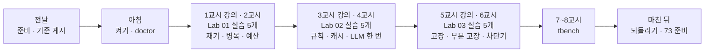
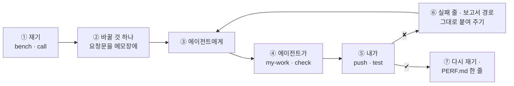

# 72일차 수강 안내 · 수업 준비부터 마칠 때까지

- 일자: 2026-10-26 (월) · 72일차
- 주제: Workflow 실행 흐름 최적화와 운영 관점 개선 (빠르게, 멈춰도 답하게)
- 실습 폴더: [Last3Mon/72](README.md) · 강의 자료: [Lecture/72](../../Lecture/72/README.md)
- 환경: 65일차 n8n 2.42.6 + **OpenAI API 키만**(`gpt-4.1-mini`) + **72일차 판 데이터 API**(고장 스위치 · 캐시) + CLI 코딩 에이전트 하나. **Ollama는 쓰지 않습니다.**
- 이 문서: 오늘 하루 내가 할 일을 수업 준비부터 마칠 때까지 순서대로 모은 수강 안내입니다. 수업 중에도 띄워 두고 어디까지 왔는지 확인하세요.



## 0. 하루 한눈에

| 교시 | 시간 | 할 일 | 문서 | 끝났다는 표시 |
| --- | --- | --- | --- | --- |
| 전날 | 약 10분 | 자료 받기 · n8n · 72일차 데이터 API · 기준 게시 · doctor | [PREP](../../Lecture/72/00-DAY72-PREP.md) | `ready` |
| 1 | 09:00~09:50 | 개요 · 1단계 강의 (재기와 병목) | [개요](../../Lecture/72/00-DAY72-OVERVIEW.md) 1~14장, [1단계](../../Lecture/72/01-STAGE1-MEASURE-BOTTLENECK.md) | |
| 2 | 10:00~10:50 | Lab 01 실습 5개 (예제 1~3 · 과제 1~2) | [Lab 01](LAB-01-Q-MEASURE-BOTTLENECK.md) | `lab01-challenge` · `lab01-challenge2` 통과 |
| 3 | 11:00~11:50 | 2단계 강의 (실행 흐름 최적화) | 개요 15~21장, [2단계](../../Lecture/72/02-STAGE2-OPTIMIZE-FLOW.md) | |
| 4 | 12:00~12:50 | Lab 02 실습 5개 | [Lab 02](LAB-02-Q-OPTIMIZE-FLOW.md) | `lab02-challenge` · `lab02-challenge2` 통과 |
| - | 13:00~14:00 | 점심 | | |
| 5 | 14:00~14:50 | 3단계 강의 (운영 관점의 안정성) | 개요 22~28장, [3단계](../../Lecture/72/03-STAGE3-STABILITY.md) | |
| 6 | 15:00~15:50 | Lab 03 실습 5개 | [Lab 03](LAB-03-Q-STABILITY.md) | `lab03-challenge` · `lab03-challenge2` · 보고서 |
| 7 | 16:00~16:50 | 바이브 코딩 `tbench`: 요청서 → TODO → SPEC → IMP-PLAN → 만들기 → 설치 | [VIBE-REQ-TBENCH](VIBE-REQ-TBENCH.md) → [VIBE-Q-TBENCH](VIBE-Q-TBENCH.md) | `Doc/*.md` · R1~R3 · R6~R8 · R14 · `pytest` |
| 8 | 17:00~17:50 | 바이브 코딩 발표 · **4단계 정리** (오늘의 의미 · 효과 · 회사에서 쓰는 법) · 73일차 예고 | [4단계 정리](../../Lecture/72/04-STAGE4-WRAPUP.md), [진행](../../Lecture/72/05-VIBE-CODING.md) | 최종 프로젝트 체크리스트 |

## 1. 전날 준비 (약 10분)

### 1.1 자료 받기

```bash
cd ~/aio-01d4-stu && git pull
```

### 1.2 n8n과 **72일차** 데이터 API 켜기 (Ollama는 끔)

```bash
sudo systemctl disable --now ollama 2>/dev/null   # WSL에 설치한 Ollama가 있으면 끄고 자동 시작도 끔
cd ~/aio-01d4-stu/Last3Mon/65/n8n
docker compose rm -sf ollama                      # Ollama 컨테이너가 있으면 지움 (없으면 그냥 지나감)
docker compose start
cd ~/aio-01d4-stu/Last3Mon/72/data-api
docker compose up -d --force-recreate             # 71일차 판을 72일차 판(+ 고장 스위치 · 캐시)으로 바꿈
curl -s localhost:8800/admin/fault                # {"faq": "ok", "tickets": "ok", "slow_seconds": 8}
```

### 1.3 기준 워크플로우 게시 · 준비 확인

```bash
cd ~/aio-01d4-stu/Last3Mon/72
uv run tools/flow.py push reference/baseline-helpdesk.json
uv run tools/flow.py call base-helpdesk requests/faq-vpn.json -v
uv run tools/flow.py doctor        # 마지막 줄 ready
```

### 1.4 미리 읽기 (선택, 5분)

[PREP 3절](../../Lecture/72/00-DAY72-PREP.md): 10번 중 9번은 2초, 1번은 9초라면 "느리다"고 해야 할까? (p50 · p95)

### 준비물

노트북과 충전기, WSL의 Docker, WSL 창 두 개, 브라우저, 66일차 `~/vibe/turl` (없어도 됨).

## 2. 수업 당일 아침 (09:00 전)

1. 노트북을 껐다 켰다면 1.2를 다시 합니다 (같은 명령 그대로). 기준 워크플로우는 게시된 채로 남아 있습니다.
2. 터미널 두 개, 둘 다 `cd ~/aio-01d4-stu/Last3Mon/72`. ① 에이전트(`codex`/`claude`/`agy`), ② 확인(`bench`·`push`·`test`).
3. 터미널 ②에서 `uv run tools/flow.py doctor` → `ready`.
4. `cp templates/PERF-REPORT-TEMPLATE.md my-work/PERF.md`, `my-work/PROMPTS.md`를 만들어 둡니다.

## 3. 실습할 때마다 같은 순서 (오늘은 "재고 → 바꾸고 → 다시 재기")



- **한 번에 한 가지만** 바꿉니다. 빨라졌으면 원래 테스트(`lab01`, `lab02`)로 품질이 그대로인지 확인합니다.
- 캐시가 남아 있으면 결과가 달라집니다. 이상하면 `curl -s -XPOST localhost:8800/cache-clear`.
- 고장 연습(`fault`, `llm down`)은 끝나면 **반드시 되돌립니다** (`fault all ok`, `llm up`).

## 4. 1~2교시 · 1단계 · 재기와 병목

1교시는 강의, 2교시는 [Lab 01](LAB-01-Q-MEASURE-BOTTLENECK.md) (50분, 실습 5개).

| 순서 | 할 일 | 파일 · 웹훅 | 확인 (터미널 ②) |
| --- | --- | --- | --- |
| 예제 1 (8분, 에이전트 없이) | 기준 재기 · Executions 노드 시간 보기 | `base-helpdesk` | `bench base-helpdesk requests/faq-vpn.json -n 5` (`ticket-own`, `off-topic`도), `PERF.md` 1절 |
| 예제 2 (12분) | 결과에 `timings` · `steps` · `llm_calls` (답은 그대로) | `cp reference/baseline-helpdesk.json my-work/helpdesk.json` → 웹훅 `my-helpdesk`로 | `push my-work/helpdesk.json` → `test cases/lab01.json` |
| 예제 3 (8분, 에이전트 없이) | 질문 종류 셋(FAQ · 접수 · IT 밖)을 재고 LLM 몫 계산 | (예제 2 그대로) | `bench my-helpdesk requests/ticket-own.json -n 5` 등 셋, `call ... -v`, `PERF.md` 2절 표 |
| 과제 1 (10분) | `faq_ms` · `ticket_ms`로 나누고 `slowest_step` | `my-work/helpdesk.json` 고치기 | `test cases/lab01-challenge.json`, `test cases/lab01.json` |
| 과제 2 (12분) | 시간 예산 `budget_ms`(기본 3000) · `over_budget` · `llm_ms` | `my-work/helpdesk.json` 고치기 | `test cases/lab01-challenge2.json`, `lab01-challenge`, `lab01` |

(명령 앞에는 모두 `uv run tools/flow.py`가 붙습니다.)

- 볼 것: 첫 호출과 그 뒤 호출의 차이, 단계 시간 중 LLM이 차지하는 몫.

## 5. 3~4교시 · 2단계 · 실행 흐름 최적화

3교시는 강의, 4교시는 [Lab 02](LAB-02-Q-OPTIMIZE-FLOW.md) (50분, 실습 5개).

| 순서 | 할 일 | 확인 |
| --- | --- | --- |
| 예제 1 (10분) | 데이터 조회를 앞으로, 규칙으로 분류되면 분류 LLM 생략 (`steps`에 `rule`) | `push my-work/helpdesk.json` → `test cases/lab02.json` (앞 네 케이스), `bench my-helpdesk requests/faq-printer.json -n 5` |
| 예제 2 (10분) | FAQ 답은 캐시, 같은 질문은 LLM 없이 (`cached: true`). 접수 현황 · `no_cache`는 캐시 안 함 | `test cases/lab02.json` 9/9, `test cases/lab01.json`, `curl -s localhost:8800/cache-stats` |
| 예제 3 (6분, 에이전트 없이) | 캐시 씀 · 안 씀 bench, `cache-stats`, 적중률 어림 | `bench my-helpdesk requests/faq-vpn.json -n 5`, `... faq-vpn-nocache.json -n 5` |
| 과제 1 (12분) | 처음 묻는 질문도 LLM 한 번 · 2.5초 안, 답 내용은 그대로 | 고치기 전 `test cases/lab02-challenge.json` · `bench ... faq-vpn-nocache -n 5` → 고친 뒤 `test cases/lab02-challenge.json --repeat 3`, `lab02`, `lab01`, 다시 `bench` |
| 과제 2 (12분) | 같은 FAQ로 답하는 질문은 말이 달라도 캐시 (`faq-<번호>` 키, `cache_by`) | `test cases/lab02-challenge2.json`, `lab02-challenge`, `lab02` |

- `PERF.md` 3절에 바꾼 것마다 한 줄: `llm_calls`, p50, p95, 품질 테스트, **잃은 것**.

## 6. 5~6교시 · 3단계 · 운영 관점의 안정성

5교시는 강의, 6교시는 [Lab 03](LAB-03-Q-STABILITY.md) (50분, 실습 5개).

| 순서 | 할 일 | 확인 |
| --- | --- | --- |
| 예제 1 (10분) | 먼저 겪기: `fault faq slow` · `fault faq error`로 `call` → `fault all ok`. 그다음 FAQ · 접수 조회에 timeout 2초 · 재시도 1번 · 실패하면 `담당자 연결` | `push my-work/helpdesk.json` → `test cases/lab03.json`, `test cases/lab02.json` |
| 예제 2 (10분) | 먼저 겪기: `llm down` → `call` → `llm up`. 그다음 LLM이 실패하면 데이터 그대로 `간단 답변` | `test cases/lab03-llm-down.json` (자동으로 down · up), `test cases/lab02.json` |
| 예제 3 (10분) | 먼저 겪기: `fault tickets error` → 접수 · VPN 질문 `call` → `fault all ok`. 그다음 접수 질문만 `담당자 연결`(`tickets_down`), FAQ는 평소대로 | `test cases/lab03-ticket.json`, `lab03`, `lab03-llm-down` |
| 과제 1 (10분) | 상태 점검 `my-health`: 데이터 API · FAQ · LLM, `ok` · `degraded` · `down` | `my-work/health.json` → `push` → `test cases/lab03-challenge.json` |
| 과제 2 (10분) | 차단기: FAQ가 실패하면 30초 동안 FAQ를 부르지 않고 바로 `담당자 연결`(`breaker_open`) | `test cases/lab03-challenge2.json`, `lab03`, 끝나면 `doctor` |

- 보고서: `PERF.md` 4~6절, `cp templates/TEST-REPORT-TEMPLATE.md my-work/TEST-REPORT.md`.

## 7. 7~8교시 · 바이브 코딩 `tbench`

[VIBE-REQ-TBENCH](VIBE-REQ-TBENCH.md)(요청서)를 **먼저** 읽고 [VIBE-Q-TBENCH](VIBE-Q-TBENCH.md)의 순서대로 갑니다: `Doc/TODO.md` → `Doc/SPEC.md` → `Doc/IMP-PLAN.md`(엔진 · TUI 단계) → 단계별 구현 → 확인 → `uv tool install` → 다른 폴더에서 사용. 요구는 14개(R1~R14)이고 50분 안에는 엔진 1단계 · TUI 1단계 · 설치까지, 나머지는 `Doc/IMP-PLAN.md`의 다음 단계로 집에서 이어 갑니다. 만드는 것은 URL · 웹훅을 N번 불러 p50 · p95 · max · 실패를 표와 스파크라인으로 보여 주고 바꾸기 전 · 후를 비교하는 TUI. 정답본 `VIBE-A-TBENCH.md`는 수업이 끝나면 `git pull`로 받습니다.

```bash
mkdir -p ~/vibe/tbench/Doc && cd ~/vibe/tbench
git init
# 에이전트는 Doc/TODO.md를 쓴 뒤에 켭니다: codex (또는 claude, agy)
```

| 시간 | 단계 | 확인 |
| --- | --- | --- |
| 16:00~16:09 | 0 준비 · 1 요청서 → `Doc/TODO.md` (에이전트 없이) | 할 일 ①~⑫ · 꼭 / 나중 |
| 16:09~16:15 | 2 `Doc/SPEC.md` → VIBE-Q 요구 표(R1~R14)와 비교 · commit | 요구마다 확인 방법 |
| 16:15~16:20 | 3 `Doc/IMP-PLAN.md` (엔진 1~3단계 · TUI 1~2단계 · 설치) · commit | 단계마다 체크리스트 |
| 16:20~16:44 | 4 구현: 엔진 1단계(R1 · R6 · R7 · R8) → TUI 1단계(R2), 막히면 5 문제 해결 팁 | 단계마다 `pytest` · 직접 실행 · commit |
| 16:44~16:50 | 6 확인 · 7 `uv tool install --editable .` · 8 다른 폴더에서 `tbench` | `cd ~/aio-01d4-stu/Last3Mon/72 && tbench ...` |

- 한 단계씩 요청하고, 매번 **직접 실행**하고, 단계마다 `git commit`.
- 8교시: 1~2명 발표 (10분) → [4단계 정리](../../Lecture/72/04-STAGE4-WRAPUP.md) (35분: 오늘 한 일의 의미 · 효과 · 산업에서의 응용 · 면접 질문 · 최종 프로젝트 체크리스트) → 73일차 예고.

## 8. 마친 뒤

| 할 일 | 이유 |
| --- | --- |
| `uv run tools/flow.py fault all ok`, `uv run tools/flow.py llm up`, `doctor` → `ready` | 고장 연습을 되돌려 두기 (내일도 같은 n8n · 데이터 API) |
| `PROMPTS.md`, `PERF.md`, `TEST-REPORT.md` 정리 | 최종 프로젝트 재료 (성능 · 안정성 보고) |
| `my-work/*.json`, `~/vibe/tbench` 지우지 않기 | 79일차 `tops`에서 다시 씀 |
| 73일차 준비: [00-DAY73-PREP](../../Lecture/73/00-DAY73-PREP.md) | 입력 · 출력 검증과 보안 |

## 9. 막혔을 때 (오늘 공통)

| 증상 | 할 일 |
| --- | --- |
| doctor의 fault switch ✘ | 데이터 API가 예전 판. 1.2의 72일차 `--force-recreate` |
| `! fault switch is on` | `uv run tools/flow.py fault all ok` |
| 모든 LLM 단계가 실패 | `llm down` 상태로 남음. `uv run tools/flow.py llm up` |
| 테스트를 다시 돌리면 결과가 다름 | 캐시. `curl -s -XPOST localhost:8800/cache-clear` |
| `call my-helpdesk`가 404 | 복사한 파일의 웹훅 경로를 바꿨는지, push했는지 |
| `base-helpdesk`가 안 됨 | `push reference/baseline-helpdesk.json` |
| 같은 곳을 3번 고쳐도 실패 | 요청을 더 작게, 또는 `reference/`로 이어 가기 |

## 확인

- [ ] 전날 72일차 데이터 API, 기준 게시, `doctor` → `ready`
- [ ] Lab 01: 기준 p50 · p95, 종류별 표, `lab01`, `lab01-challenge`, `lab01-challenge2`
- [ ] Lab 02: `lab02` 9/9, 적중률, `lab02-challenge`, `lab02-challenge2`, 바꾸기 전 · 후 p50 · p95
- [ ] Lab 03: `lab03`, `lab03-llm-down`, `lab03-ticket`, `lab03-challenge`, `lab03-challenge2`, `PERF.md` · `TEST-REPORT.md`
- [ ] `tbench`: `Doc/TODO.md` · `SPEC.md` · `IMP-PLAN.md` 먼저, 엔진 1단계 · TUI 1단계, `pytest`, 단계마다 commit, `uv tool install`
- [ ] 고장 되돌리기, 73일차 준비
