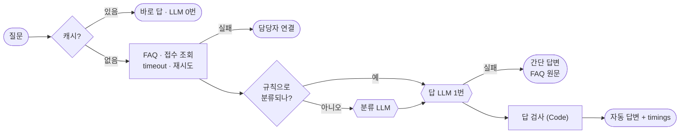

# 72일차 실습 · Workflow 실행 흐름 최적화와 운영 관점 개선 (바이브 코딩)

- 일자: 2026-10-26 (72일차)
- 교과목: 노코드 멀티 에이전트 워크플로우 설계 및 운영
- 단원: 운영·확장 관점의 AI 워크플로우 설계 고도화
- 강의 자료: [Lecture/72](../../Lecture/72/README.md)
- 하루 수강 안내: [LECTURE-72.md](LECTURE-72.md) (수업 준비부터 마칠 때까지 순서대로)
- 67~71일차처럼 CLI 코딩 에이전트에게 **내가 쓴 요청문**으로 워크플로우를 만들게 하고, **테스트로 확인**합니다. 오늘은 새 기능이 아니라 **같은 워크플로우를 빠르게, 멈춰도 답하게** 고칩니다.

## 오늘 고치는 것: 느리고, 가끔 멈추는 IT 헬프데스크

`reference/baseline-helpdesk.json`(웹훅 `base-helpdesk`)은 질문마다 LLM을 세 번 부릅니다 (분류 → 답 → 검토). 이것을 **재고 → 병목을 찾고 → 한 가지씩 고치고 → 다시 잽니다.** 그리고 데이터 API나 LLM이 멈춰도 정해진 답을 하게 만듭니다.



## 일하는 방식 (67~71일차와 같음)

| 누가 | 무엇을 |
| --- | --- |
| 나 | 재기(`bench`, `timings`), 무엇을 바꿀지 정하기, 요청문 쓰기, 한 가지씩 바꾸고 다시 재기, 고장 연습 |
| CLI 에이전트 | [AGENTS.md](AGENTS.md) 규칙대로 워크플로우 JSON 작성, `check`로 형식 오류 고치기 |
| `tools/flow.py` | check · push · call · test · **bench**(N번 불러 p50·p95) · **fault**(데이터 API 고장 스위치) · **llm down/up**(LLM 멈춤 연습) |

> **빨라졌다면 품질이 그대로인지** 원래 테스트로 확인합니다. 빠른데 틀린 답은 개선이 아닙니다.

## 실습 문서 읽는 법

- 실습 문서(`LAB-0x-Q-*.md`)는 요청문을 바로 주지 않습니다. 막히면 `▶` 를 위에서부터 하나씩 펼칩니다: 생각할 거리 → **빈칸 채우기**(요청문(프롬프트) 뼈대의 빈칸 4개 `____①`~`____④`를 내가 채움, 아래 빈칸 힌트는 답이 아니라 찾을 곳). 빈칸을 채운 모양은 실습 문서에 없고, 수업 뒤 공개되는 정답본(`LAB-0x-A-*.md`)의 요청문 예로 비교합니다. `VIBE-Q-TBENCH.md`는 요청서 → `Doc/TODO.md` → `Doc/SPEC.md` → `Doc/IMP-PLAN.md` → 구현 → 설치 순서입니다.
- 쓴 요청문은 `my-work/PROMPTS.md`에 모아 둡니다.
- 바이브 코딩은 **요청서(`VIBE-REQ-TBENCH.md`)부터** 읽고 `~/vibe/tbench/Doc/TODO.md`를 직접 쓴 뒤, `VIBE-Q-TBENCH.md`의 8단계(SPEC → IMP-PLAN → 구현 → 문제 해결 → 확인 → `uv tool install` → 다른 곳에서 사용)로 갑니다. 정답본 `VIBE-A-TBENCH.md`는 수업이 끝나면 올라옵니다.

## 구성

```text
Last3Mon/72/
├── README.md
├── AGENTS.md                          # CLI 에이전트용 작업 규칙 (계약 3절, 타임아웃·재시도·오류 출력 5절)
├── LAB-01-Q-MEASURE-BOTTLENECK.md     # 1단계 · bench → 단계별 시간 → 가장 느린 단계
├── LAB-02-Q-OPTIMIZE-FLOW.md          # 2단계 · 규칙 먼저 → 캐시 → LLM 한 번
├── LAB-03-Q-STABILITY.md              # 3단계 · 타임아웃·재시도·대체 경로 → LLM 멈춤 → 상태 점검
├── VIBE-REQ-TBENCH.md                 # 7교시 바이브 코딩 · 요청서 (가장 먼저, 여기서 Doc/TODO.md를 씀)
├── VIBE-Q-TBENCH.md                   # 7교시 바이브 코딩 · tbench 8단계 (TODO → SPEC → IMP-PLAN → 구현 → 설치), 요구 14개
├── *-A-*.md                           # 정답본 (VIBE-A는 수업이 끝난 뒤 올라옴, LAB-A는 아직 없음)
├── answers/                           # 정답 워크플로우 · 시나리오 실행 기록 (수업이 끝난 뒤 올라옴)
├── tools/flow.py
├── data-api/                          # 72일차 판 데이터 API (71일차 + 고장 스위치 + 캐시)
├── cases/                             # lab01 · lab01-challenge(2) · lab02 · lab02-challenge(2) · lab03 · lab03-llm-down · lab03-ticket · lab03-challenge(2)
├── requests/                          # 질문 10종 + 상태 점검
├── reference/                         # baseline-helpdesk(비교 기준) + 막혔을 때 이어 가는 워크플로우
├── templates/                         # 성능·안정성 보고서 · 테스트 보고서
├── my-work/
└── runs/                              # 테스트 · bench 보고서
```

## 준비

[실습 준비](../../Lecture/72/00-DAY72-PREP.md)를 끝내 주세요. 요약:

```bash
cd ~/aio-01d4-stu/Last3Mon/65/n8n && docker compose start   # Ollama는 쓰지 않음 · 처음 한 번 PREP 1절대로 끄기
cd ~/aio-01d4-stu/Last3Mon/72/data-api && docker compose up -d --force-recreate   # 72일차 판으로 바꿈 (고장 스위치 · 캐시)
cd ~/aio-01d4-stu/Last3Mon/72 && uv run tools/flow.py push reference/baseline-helpdesk.json
uv run tools/flow.py doctor                                                          # 마지막 줄 ready
```

## `flow.py` 명령

| 명령 | 하는 일 | 수업 준비 때 |
| --- | --- | --- |
| `uv run tools/flow.py bench base-helpdesk requests/faq-vpn.json -n 5` | 같은 요청 N번, 응답마다 시간, p50 · p95 · max · 실패 수, `runs/bench-*.json` | p50 2.61초 · p95 2.83초 |
| `uv run tools/flow.py call my-helpdesk requests/faq-vpn.json -v` | 한 번 부르고 결과(`timings` 포함) 보기 | |
| `uv run tools/flow.py test cases/lab02.json -v` | 테스트 (`before` · `after`로 캐시 비우기, 고장 켜고 끄기). `-v`는 케이스마다 보낸 요청 JSON과 받은 응답 JSON을 화면에 보여 줌. **모든 명령이 `-v`를 받음** (`bench -v`: 응답마다 · 정렬한 시간 · 단계별 평균 ms, `check`/`push -v`: 노드 · 연결 · docker 명령, `fault`/`doctor -v`: 요청 · 응답) | |
| `uv run tools/flow.py fault faq slow` · `fault faq error` · `fault all ok` | 데이터 API의 FAQ를 느리게(8초) · 오류(500)로 · 되돌리기 | |
| `uv run tools/flow.py llm down` · `llm up` | n8n의 OpenAI Credential을 일부러 틀린 키로 · `.env`의 키로 되돌리기 | 바로 적용 (재시작 없음) |

> `llm down`을 했다면 반드시 `llm up`. 테스트 파일의 `after`는 실패해도 되돌립니다.
