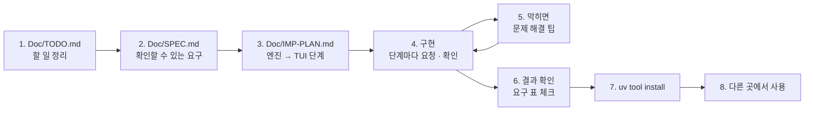

# 7교시 바이브 코딩 · `tbench` 만들기

> **먼저 [VIBE-REQ-TBENCH.md](VIBE-REQ-TBENCH.md)(요청서)를 읽고 `~/vibe/tbench/Doc/TODO.md`를 직접 쓴 뒤** 이 문서를 엽니다. 아래 1~8을 차례로 갑니다. 이 문서의 요구 표는 **내 SPEC을 쓴 뒤에** 비교하는 데 쓰고, 에이전트에게 통째로 붙여 넣지 않습니다.



- 시간: 16:00~16:50 (50분) · 발표와 정리는 8교시 · 50분 안에 못 한 단계는 집에서 `Doc/IMP-PLAN.md`의 다음 단계로 이어 갑니다
- 도구: CLI 코딩 에이전트(codex / claude / agy), Python + uv + [Textual](https://textual.textualize.io/) (`httpx` 등은 자유)
- 결과물: URL · 웹훅을 **N번** 불러 응답 시간 p50 · p95 · max, 실패 수와 실패 종류를 표와 **스파크라인**으로 보여 주는 TUI. 결과를 남겨 **바꾸기 전 · 후를 비교**하고, 기준을 주면 통과 · 실패를 종료 코드로 알립니다. `uv tool install`로 설치해 **어느 폴더에서나** `tbench`로 씁니다. 오늘 `flow.py bench`로 한 일을 내 도구로.

```text
$ tbench http://localhost:5678/webhook/my-helpdesk --body-file requests/faq-vpn-nocache.json -n 20
┌ tbench · POST /webhook/my-helpdesk · 20회 · 동시 1 ─────────────────┐
│ ▁▂▁▁▃▁▂█▁▁▂▁▁▁▂▁▁▁▁▂                                                  │
│ 완료 20/20   실패 0   p50 1.15s   p95 1.31s   max 3.02s  (첫 호출 제외 p50 1.14s) │
│ ┌ # ─ 상태 ─ 시간 ─ 메모 ──────────────────────────────────────────┐ │
│ │ 1   200   3.02s   first call                                      │ │
│ │ 2   200   1.14s                                                    │ │
│ └────────────────────────────────────────────────────────────────────┘ │
│ 단계 평균: classify 0 · data 22 · answer 1080 · total 1130 ms        │
│ [s] 저장  [c] 비교  [h] 기록  [q] 끝                                 │
└──────────────────────────────────────────────────────────────────────┘
```

> 요청문은 **직접** 씁니다. 단계마다 `▶` 를 펼치면 생각할 거리가 나옵니다. 정답 요청문은 없습니다.

## 시간 (50분)

| 시간 | 단계 | 결과 |
| --- | --- | --- |
| 16:00~16:09 | 0 준비 · 1 `Doc/TODO.md` (요청서 읽고 직접) | 할 일 ①~⑫ · 꼭 / 나중 |
| 16:09~16:15 | 2 `Doc/SPEC.md` → 아래 요구 표와 비교 · 고치기 | 요구마다 확인 방법 |
| 16:15~16:20 | 3 `Doc/IMP-PLAN.md` (엔진 단계 · TUI 단계) | 단계마다 체크리스트 |
| 16:20~16:44 | 4 구현: **엔진 1단계 → TUI 1단계** (막히면 5) | 단계마다 `pytest` · 직접 실행 · commit |
| 16:44~16:50 | 6 확인 · 7 `uv tool install` · 8 다른 폴더에서 | `cd ~/aio-01d4-stu/Last3Mon/72 && tbench ...` |

50분 안 목표: **R1 · R3 · R6 · R7 · R8(엔진 1단계) + R2(TUI 1단계) + R14(설치)**. R4 · R5 · R9~R13은 IMP-PLAN의 다음 단계로 8교시 뒤 · 집에서 이어 갑니다.

## 0. 준비 (1분)

```bash
mkdir -p ~/vibe/tbench/Doc && cd ~/vibe/tbench
git init
# 에이전트는 Doc/TODO.md를 쓴 뒤에 켭니다: codex (또는 claude, agy)
```

## 1. `Doc/TODO.md` · 만들고 싶은 것과 할 일 정리 (8분, 에이전트 없이)

[VIBE-REQ-TBENCH.md](VIBE-REQ-TBENCH.md)의 "할 일" 틀대로 씁니다. 요청의 말 ①~⑫를 **내 말로** 옮기고, 꼭 · 나중을 표시하고, 걱정되는 것과 50분 안에 못 할 것을 적습니다. "어떻게"는 아직 쓰지 않습니다.

<details><summary>▶ TODO와 SPEC은 무엇이 다른가</summary>

TODO는 **내가 이해한 것**(무엇을 · 왜)입니다. SPEC은 그것을 **확인할 수 있게** 바꾼 것(됐다 · 안 됐다를 말하는 방법)입니다. TODO에서 빠진 것은 SPEC에서도 빠지므로, TODO는 빠짐없이, SPEC은 정확하게.
</details>

`git add Doc/TODO.md && git commit -m "TODO"`

## 2. `Doc/SPEC.md` · 확인할 수 있는 요구로 (6분)

TODO의 할 일마다 **확인 방법**(파일 · 숫자 · 화면 · 종료 코드)을 붙여 SPEC을 만듭니다. 에이전트에게 "TODO.md를 읽고 SPEC.md 초안을 써 줘. 요구마다 확인 방법을 붙여"라고 시켜도 됩니다. 그러면 **반드시 내가 읽고 고칩니다.**

```markdown
# tbench SPEC

## 1. 요구 (확인할 수 있게)
| 번호 | 요구 | 요청의 어느 말 | 확인 방법 | 꼭 · 나중 |
| --- | --- | --- | --- | --- |
| R1 | | ① | | 꼭 |

## 2. 숨은 요구
## 3. 범위 밖 (하지 않을 것)
## 4. 정해 둘 것 (시간을 재는 범위, 백분위 계산 방법, 저장 폴더, 설정 파일 위치)
```

쓴 뒤 아래 표와 비교합니다. 빠진 요구, 내가 더 뽑은 요구를 `Doc/SPEC.md` 끝 "VIBE-Q와 비교"에 한 줄씩 적고 SPEC을 고칩니다.

### 요구 사항 (요청서에서 뽑은 것, 14개)

| 번호 | 요구 | 요청서의 말 | 확인 방법 | 50분 |
| --- | --- | --- | --- | --- |
| R1 | URL과 본문 파일(JSON)을 받아 N번 부르고, 한 번마다 상태 · 시간, 끝에 p50 · p95 · max · 실패 수 (`--plain` 글자 출력) | ① | `tbench <url> --body-file x.json -n 10 --plain`, 백분위 테스트 (1~10초 → 정한 방법의 값), 가짜 서버(3번째마다 500) n=6 → 실패 2 | 꼭 |
| R2 | TUI: 결과가 **오는 대로** 표에 한 줄씩, 위에 스파크라인과 요약 | ② | `tbench <url> --body-file x.json -n 20`, 가짜 서버 지연 0.5초에서 한 줄씩 늘어남 | 꼭 |
| R3 | 결과를 JSON으로 저장하고 두 파일을 비교해 p50 · p95 · max · 실패의 차이(%)를 표로. URL · 본문 해시 · N이 다르면 **경고** | ③ | `tbench compare a.json b.json`, 본문이 다른 두 파일 → 경고 줄 | 꼭 |
| R4 | 동시에 k개씩 (`--concurrency k`) | ④ | 가짜 서버 지연 0.3초 × 6번: k=1 약 1.8초, k=3 약 0.6초 | 나중 |
| R5 | 만들어 둔 요청 고르기: `requests/*.json` 폴더(또는 66일차 `turl` 저장분)에서 TUI로 고르기 | ⑤ | TUI에서 요청 목록 → 하나 고르면 그 본문으로 실행 | 나중 |
| R6 | 첫 호출을 표에 `first call`로 표시, 요약에 **첫 호출 제외 p50**, `--warmup N`(재기 전에 N번 불러 버림) | ⑥ | 가짜 서버가 첫 응답만 2초 → 표 1번 줄에 `first call`, 제외 p50이 따로, `--warmup 1`이면 시간 목록에서 빠짐 | 꼭 |
| R7 | 실패 종류를 따로 셈: `connect`(연결 안 됨) · `timeout`(`--timeout` 넘음) · `http_5xx` · `http_4xx` | ⑦ | 없는 포트 → connect, 지연 3초 + `--timeout 1` → timeout, 가짜 500 → http_5xx | 꼭 |
| R8 | 머리글 넣기(`--header "K: V"` 여러 번), 저장 · 기록 파일에서 `Authorization` · 키 머리글은 `***` | (끝 부탁) | `--header "Authorization: Bearer sk-test"`로 저장 → `grep -c sk-test out.json` → 0 | 꼭 |
| R9 | 응답 JSON에 `timings`가 있으면 단계별 평균(ms) 표 | ⑧ | 내 헬프데스크로 → `classify` · `data` · `answer` · `review` · `total` 평균 줄, `timings`가 없는 응답이면 표를 숨김 | 나중 |
| R10 | 기준 검사: `--max-p95 2.5` · `--max-failures 0` → 끝에 `PASS` · `FAIL` 한 줄, **종료 코드 0 · 1** | ⑨ | 기준을 넘는 가짜 서버 → `echo $?` 1, 넘지 않으면 0 | 나중 |
| R11 | 한 번마다 한 줄 기록: `--log runs.jsonl` (시각 · 번호 · 상태 · 시간 · 실패 종류) | ⑩ | `wc -l runs.jsonl` = N, 줄마다 JSON | 나중 |
| R12 | 설정 저장: `tbench profile save <이름> <url> --body-file ...`, `tbench run <이름>` (설정 파일은 **집 폴더**에, 어느 폴더에서나 같은 설정) | ⑪ | 다른 폴더에서 `tbench run vpn` → 같은 URL · 본문으로 실행 | 나중 |
| R13 | 기록 목록: `tbench history` → 저장한 결과의 날짜 · URL · N · p50 · p95 · 실패 표 (기본 저장 폴더) | ⑫ | 두 번 저장 → 두 줄, 최신이 위 | 나중 |
| R14 | `uv tool install`로 설치해 **어느 폴더에서나** `tbench` | 첫 문단 "어느 폴더에서나" | `cd /tmp && tbench --help`, `uv tool list`에 `tbench` | 꼭 |

숨은 요구 (요청서에 직접 없지만 없으면 안 되는 것):

| 숨은 요구 | 어디서 나왔나 |
| --- | --- |
| 시간은 **보내기 직전 ~ 본문을 다 받을 때까지.** 실패도 한 번으로 세고 시간 목록과 따로 둔다. 기본 `--timeout` 30초 | ① "한 번 한 번", ⑦ "오래 걸려서 포기" |
| p50 · p95 계산 방법을 하나로 정하고 **테스트로 고정** (예: nearest-rank, 1~10초 → p50 5 · p95 10) | ① — 방법마다 값이 달라 비교가 흔들림 |
| 부르는 동안 화면이 멈추지 않는다 (Textual worker) | ② "하나 올 때마다 바로" |
| 저장 파일에 **URL · 메서드 · 본문 해시 · N · 동시 수 · warmup · 시작 시각**을 같이 남긴다 | ③ "다른 질문으로 잰 걸 비교", ⑫ "언제 무엇을" |
| 기본 저장 폴더 · 설정 파일 위치를 **집 폴더 아래 한 곳**으로 (예: `~/.tbench/`) | ⑪ ⑫ + "어느 폴더에서나" |
| 엔진(부르기 · 계산 · 저장)과 화면(TUI)을 **나눈다.** `--plain` · `compare` · `history`는 화면 없이 엔진만 씀 | ⑨ "화면을 안 봐도", 테스트하기 쉬움 |
| 테스트는 **pytest 안에서 띄운 가짜 서버**(일부러 느리게 · 가끔 500 · 첫 응답만 느리게)로. 진짜 헬프데스크를 부르지 않는다 | "진짜 헬프데스크를 수십 번 두드리는 건 곤란 (OpenAI 요금)" |
| `pyproject.toml`에 명령 이름(`[project.scripts] tbench = ...`)이 있어야 `uv tool install`이 된다 | R14 |

범위 밖 (오늘 하지 않음): 그래프를 이미지 파일로 저장, 웹 화면, 여러 주소를 한꺼번에, 수천 번 부하 시험, 결과를 서버로 보내기.

`git add Doc/SPEC.md && git commit -m "SPEC"`

## 3. `Doc/IMP-PLAN.md` · 구현 계획 (5분)

SPEC의 요구를 **단계**로 나눕니다. 첫 원칙: **엔진(백엔드)을 먼저, 화면(TUI)은 나중에.** 화면은 엔진이 내놓은 결과를 보여 주기만 하면 되게 만듭니다. 에이전트에게 "SPEC.md를 읽고 IMP-PLAN.md를 엔진 단계와 TUI 단계로 나눠 써 줘. 단계마다 체크리스트와 확인 명령"이라고 시켜도 됩니다 (내가 읽고 고침).

```markdown
# tbench IMP-PLAN

## 엔진 1단계 · 부르고 재기 (R1 · R6 · R7 · R8)
- [ ] runner: 한 번 부르기 → {i, status, seconds, error_kind}
- [ ] stats: p50 · p95 · max · 실패 종류별 수 (nearest-rank, 테스트)
- [ ] 가짜 서버 fixture (지연 · N번째마다 500 · 첫 응답만 느림)
- [ ] --plain 출력, --warmup, --header (가리기)
- 확인: uv run pytest -q, uv run tbench <url> -n 5 --plain

## 엔진 2단계 · 남기고 비교 (R3 · R13 · R11)
## 엔진 3단계 · 동시 · 기준 · 응답 분석 · 설정 (R4 · R10 · R9 · R12)
## TUI 1단계 · 오는 대로 보이기 (R2)
## TUI 2단계 · 고르기 · 비교 · 기록 화면 (R5 · R3 · R13)
## 설치 (R14)
```

<details><summary>▶ 왜 엔진 먼저인가</summary>

- 엔진은 **화면 없이 테스트**할 수 있습니다 (`pytest`, `--plain`). 화면부터 만들면 숫자가 맞는지 눈으로만 봅니다.
- `compare` · `history` · R10의 종료 코드는 화면 없이 써야 합니다 (배포 전에 자동으로 돌림).
- TUI는 엔진이 결과를 **하나 낼 때마다** 받아 표에 더하기만 하면 됩니다. 그래서 엔진의 "한 번 부르기"가 결과를 하나씩 돌려주게(콜백 · 제너레이터) 정해 둡니다.
</details>

<details><summary>▶ 단계 크기</summary>

한 단계 = 에이전트 요청 한두 번 + 확인 한 번 + commit 한 번 (10분 안팎). 단계가 크면 에이전트가 많이 바꾸고, 틀렸을 때 어디가 틀렸는지 모릅니다.
</details>

`git add Doc/IMP-PLAN.md && git commit -m "IMP-PLAN"`

## 4. 구현 시작 (24분: 엔진 1단계 → TUI 1단계)

이제 에이전트를 켭니다. 첫 요청은 늘 같습니다.

```text
Doc/SPEC.md 와 Doc/IMP-PLAN.md 를 읽어 줘. 아직 코드는 쓰지 말고,
IMP-PLAN 의 "엔진 1단계"를 어떻게 만들지와 각 체크 항목의 확인 방법을 5줄로 먼저 말해 줘.
```

그다음 **한 단계씩**: "엔진 1단계만 만들어 줘. 끝나면 IMP-PLAN의 체크를 표시하고 확인 명령을 알려 줘" → 내가 확인 → commit → 다음 단계.

> **규모가 큰 프로젝트일수록 다단계로** 진행합니다. 오늘 `tbench`도 요구가 14개라 한 번에 시키면 에이전트가 수백 줄을 한꺼번에 쓰고, 어디가 틀렸는지 찾기 어렵습니다. 단계마다 ① 그 단계만 요청 ② 직접 확인 ③ IMP-PLAN 체크 ④ `git commit`. 다음 날 이어 갈 때도 "IMP-PLAN의 체크 안 된 첫 단계부터"로 시작하면 됩니다.

<details><summary>▶ 엔진 1단계 · 시간은 어디서 어디까지</summary>

"보내기 직전부터 응답 본문을 다 받을 때까지"인가요, "첫 바이트까지"인가요? 실패(연결 거부, timeout)도 한 번으로 셀까요? 실패 종류(R7)는 예외 종류(연결 오류 · 시간 초과)와 상태 코드로 나눕니다. 요청문에 정해 줍니다.
</details>

<details><summary>▶ 엔진 1단계 · p95를 직접 계산</summary>

10개로 p95를 구하면 어느 값이 될까요? 계산 방법을 하나로 정하고, 테스트로 고정합니다 (예: 1~10초 열 개 → p50과 p95가 몇인지). 오늘 1단계 강의 2절의 손 계산과 같은 방법이면 비교하기 쉽습니다.
</details>

<details><summary>▶ TUI 1단계 · 화면이 멈추지 않게</summary>

N번 부르는 동안 화면이 굳으면 안 됩니다. Textual에서 오래 걸리는 일을 따로 돌리는 방법(worker)을 요청문에 적습니다. 엔진이 결과를 하나 낼 때마다 표 · 스파크라인 · 요약이 바뀌어야 합니다. 첫 호출(R6)은 메모 칸에.
</details>

<details><summary>▶ 다음 단계들 (8교시 뒤 · 집에서)</summary>

- 엔진 2단계: 저장 칸에 조건을 함께(R3), 기본 저장 폴더에 쌓기(R13), 한 줄 기록(R11).
- 엔진 3단계: 동시 k개(R4, 결과를 보고 판단), 기준 검사 종료 코드(R10), 응답의 `timings` 평균(R9), 설정 파일(R12).
- TUI 2단계: 요청 고르기(R5, `turl` 저장 형식은 사람마다 다르니 내 것을 먼저 열어 보고 요청문에), 비교 · 기록 화면.
</details>

## 5. 바이브 코딩으로 문제 해결 팁

| 이럴 때 | 이렇게 |
| --- | --- |
| 에이전트가 "다 됐다"고 함 | **직접 실행**합니다 (`uv run tbench ...`, `uv run pytest -q`). 확인 방법은 SPEC에 있습니다 |
| 실패 · 오류 | 오류 출력 **전부**와 실행한 명령을 그대로 붙여 줍니다. "안 돼요"만 쓰지 않습니다 |
| 같은 곳을 3번 고쳐도 안 됨 | 멈추고 `git diff` · `git checkout .`로 되돌린 뒤, 단계를 **더 작게** 나눠 다시 요청 |
| 에이전트가 요청하지 않은 것까지 만듦 | "SPEC 3절 범위 밖"을 가리키고, 그 부분을 빼 달라고 합니다. 단계마다 commit해 두면 되돌리기 쉽습니다 |
| 화면이 다 끝난 뒤에야 나옴 · 굳음 | "엔진을 worker에서 돌리고 결과마다 표에 더하게" |
| 화면이 이상한데 오류가 안 보임 | `uv add --dev textual-dev` 뒤 다른 터미널에서 `uv run textual console`, 앱은 `uv run textual run --dev <파일>`로 (print · 오류가 콘솔에 보임) |
| 테스트가 진짜 헬프데스크를 부름 | "pytest 안에서 가짜 서버(`http.server`)를 띄워서. 진짜 n8n을 부르지 않는다" |
| p95가 늘 max와 같음 | n이 작으면 그럴 수 있습니다 (5개면 p95 = 5번째). 계산 방법을 테스트로 고정 |
| 대화가 길어져 에이전트가 앞 내용을 잊음 | 새 세션을 열고 "Doc/SPEC.md · Doc/IMP-PLAN.md를 읽고, 체크 안 된 첫 단계부터"로 다시 시작 |
| 설치한 `tbench`가 고친 내용을 모름 | `uv tool install --force .` 로 다시 설치 (또는 처음부터 `--editable`) |

## 6. 결과 확인

`Doc/SPEC.md` 1절 표의 확인 방법대로 **내가** 하나씩 하고 체크합니다. 오늘 50분 안 목표만:

```bash
cd ~/vibe/tbench
uv run pytest -q                                                          # 가짜 서버 테스트
uv run tbench http://localhost:5678/webhook/my-helpdesk \
  --body-file ~/aio-01d4-stu/Last3Mon/72/requests/faq-vpn-nocache.json -n 5 --plain    # R1 · R6 · R7
uv run tbench http://localhost:5678/webhook/my-helpdesk \
  --body-file ~/aio-01d4-stu/Last3Mon/72/requests/faq-vpn-nocache.json -n 10 --save before.json   # R2 · R3
grep -c "sk-" before.json                                                 # R8: 0
```

- [ ] R1 `--plain`으로 상태 · 시간과 p50 · p95 · max · 실패.
- [ ] R2 결과가 오는 대로 표 · 스파크라인.
- [ ] R3 저장 · 비교 표 (다른 본문이면 경고).
- [ ] R6 첫 호출 표시 · 제외 p50 · `--warmup`.
- [ ] R7 실패 종류별 수.
- [ ] R8 저장 파일에 키 없음.
- [ ] (이어서) R4 · R5 · R9 · R10 · R11 · R12 · R13.

## 7. `uv tool install`로 설치

`pyproject.toml`에 명령이 등록되어 있는지 먼저 봅니다.

```toml
[project.scripts]
tbench = "tbench.cli:main"
```

```bash
cd ~/vibe/tbench
uv tool install --editable .        # 고친 내용이 바로 반영됨 (수업 중 권함)
# uv tool install .                 # 지금 상태를 복사해 설치 (고치면 --force 로 다시)
uv tool list                        # tbench 가 보이는가
which tbench                        # ~/.local/bin/tbench
# 명령을 못 찾으면: uv tool update-shell 뒤 터미널을 새로 엶
```

- 지우기: `uv tool uninstall tbench`.
- `--editable`이 아닌 설치는 **설치할 때의 코드**를 씁니다. 고친 뒤 `uv tool install --force .`.

## 8. 다른 곳에서 사용

설치했으면 프로젝트 폴더 밖에서 씁니다. 오늘 Lab 02의 바꾸기 전 · 후를 내 도구로 비교해 봅니다.

```bash
cd ~/aio-01d4-stu/Last3Mon/72
tbench --help
uv run tools/flow.py push reference/lab02-example2-cache.json
tbench http://localhost:5678/webhook/my-helpdesk --body-file requests/faq-vpn-nocache.json -n 10 --save ~/before.json
uv run tools/flow.py push my-work/helpdesk.json                     # 내 Lab 02 과제 1 결과
tbench http://localhost:5678/webhook/my-helpdesk --body-file requests/faq-vpn-nocache.json -n 10 --save ~/after.json
tbench compare ~/before.json ~/after.json
```

- (R10을 만들었다면) `tbench ... --max-p95 2.5; echo $?` → 74일차 배포 전 검사에서 그대로 씁니다.
- (R12를 만들었다면) `tbench profile save vpn http://localhost:5678/webhook/my-helpdesk --body-file requests/faq-vpn-nocache.json` → 어느 폴더에서나 `tbench run vpn`.
- `~/vibe/tbench`는 지우지 마세요. 79일차 `tops`에서 다시 씁니다.

## 발표 (8교시, 3분)

| 내용 | |
| --- | --- |
| TODO → SPEC | 내 SPEC과 VIBE-Q 요구 표가 달랐던 곳 (빠뜨린 요구, 더 뽑은 요구) |
| IMP-PLAN | 엔진 · TUI를 어떻게 나눴나, 어디까지 체크했나 |
| 요청문 | 가장 잘 먹힌 요청문 한 개, 안 먹힌 요청문 한 개 |
| 막힌 곳 | 5절의 어느 팁으로 풀었나 |
| 시연 | 다른 폴더에서 `tbench compare`로 오늘 헬프데스크의 전 · 후 |

## 확인

- [ ] `Doc/TODO.md` → `Doc/SPEC.md` → `Doc/IMP-PLAN.md`를 에이전트 전에 (또는 에이전트와 함께 쓰고 내가 고쳐서) 만들고 commit했다.
- [ ] IMP-PLAN의 엔진 1단계 · TUI 1단계를 체크했다 (단계마다 commit).
- [ ] R1 · R2 · R3 · R6 · R7 · R8 확인, `uv run pytest -q`(가짜 서버).
- [ ] R14 `uv tool install`, 다른 폴더에서 `tbench`.
- [ ] 남은 요구는 IMP-PLAN에 체크 안 된 채로 남겨 두었다 (다음에 이어 감).
