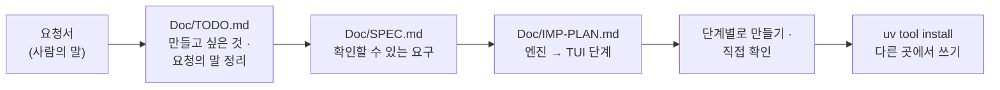

# 7교시 바이브 코딩 · 요청서 `tbench` (가장 먼저 읽기)

- 순서: **이 요청서** → 내 정리 `~/vibe/tbench/Doc/TODO.md` (8분) → [VIBE-Q-TBENCH.md](VIBE-Q-TBENCH.md)의 순서대로 `Doc/SPEC.md` → `Doc/IMP-PLAN.md` → 단계별로 만들기 → 설치 · 다른 곳에서 쓰기 → 수업이 끝나면 `VIBE-A-TBENCH.md`(정답본)로 확인
- 이 문서는 **만들어 달라는 사람의 말**입니다. 요구 사항 표도, 단계도 없습니다. 그것을 뽑아 내는 것이 첫 일입니다. 68 · 69 · 71일차와 같은 생각입니다.



## 왜 요청서부터인가

VIBE-Q 문서를 통째로 에이전트에게 주고 "이대로 만들어 줘"라고 하면, 무엇이 만들어지든 **내가 판단할 기준이 없습니다.** 실무에서는 요구 사항 표가 오지 않고, 이 요청서 같은 **사람의 말**이 옵니다. 말을 확인할 수 있는 요구로 바꾸는 일은 에이전트가 아니라 내가 합니다. 오늘 오전 Lab 01에서 고치기 전에 **먼저 잰 것**과 같은 일입니다: 기준이 있어야 "좋아졌다"를 말할 수 있습니다.

| 단계 | 누가 | 결과 |
| --- | --- | --- |
| 요청 → 할 일 목록 | **나** | `Doc/TODO.md`: 요청의 말 ①~⑫를 내 말로, 만들고 싶은 것 |
| 할 일 → 요구 | **나** (에이전트와 다듬어도 됨) | `Doc/SPEC.md`: 요구마다 "됐다 / 안 됐다"를 말할 수 있는 확인 방법 |
| 요구 → 단계 | **나** (에이전트와 다듬어도 됨) | `Doc/IMP-PLAN.md`: 엔진 단계와 화면(TUI) 단계로 나눈 순서 |
| 단계 → 코드 | 에이전트 | 단계마다 요청문 하나, `Doc/*.md`를 함께 읽게 함 |
| 확인 | **나** | 직접 `uv run tbench …`, `pytest`, 요구 표에 체크 |

## 요청 (헬프데스크 운영 담당자에게서 온 메시지, 그대로)

> 오늘 헬프데스크 빨라진 거 봤어요. 그런데 저는 n8n 화면도 `flow.py`도 잘 몰라요. 앞으로 뭘 바꿀 때마다 **제가 직접** "빨라졌나, 느려졌나"를 확인할 수 있는 작은 프로그램이 있으면 좋겠어요. 터미널에서 돌아가면 되고, **제 노트북 어느 폴더에서나** `tbench`라고 치면 되게 해 주세요.
>
> ① 주소 하나랑 보낼 내용을 주면 **여러 번** 불러서, 한 번 한 번 얼마나 걸렸는지, **몇 번 실패했는지** 알려 주세요. 평균만 주시면 안 돼요. 사용자들은 "평소엔 괜찮은데 **가끔 엄청 느리다**"고 하거든요. 보통 얼마인지, 느린 쪽은 얼마인지 따로 보고 싶어요.
>
> ② 20번, 50번 부르면 한참 걸리잖아요. 다 끝날 때까지 **멍하니 기다리기 싫어요.** 하나 올 때마다 바로 보이고, 들쭉날쭉한 **모양**을 한눈에 보고 싶어요.
>
> ③ 바꾸기 전에 한 번, 바꾼 뒤에 한 번 재서 **숫자로 비교**하고 싶어요. 어제 잰 것과도 비교할 수 있게 남겨 주세요. 그런데 지난번에 누가 **다른 질문으로 잰 걸** 비교해서 "두 배 빨라졌다"고 했다가 망신당했어요.
>
> ④ 월요일 아침엔 여러 사람이 **한꺼번에** 물어봐요. 그때도 버티는지 보고 싶어요.
>
> ⑤ 보낼 내용을 매번 새로 쓰기 귀찮아요. 이미 만들어 둔 요청들(`requests` 폴더나, 66일차에 만든 `turl`에 저장한 것)을 **골라서** 쓰고 싶어요.
>
> ⑥ 고치고 나서 다시 올리면 **첫 번째만 유난히 느리더라고요.** 그 한 번 때문에 결과가 나빠 보이는 건 싫어요. 첫 번을 빼고도 보고 싶고, 미리 몇 번 불러 두고 재는 것도 되면 좋겠어요.
>
> ⑦ 실패했다고만 하지 말고 **왜** 실패했는지요. 연결이 아예 안 된 건지, 너무 오래 걸려서 포기한 건지, 서버가 오류를 낸 건지에 따라 연락할 사람이 달라요.
>
> ⑧ 헬프데스크가 결과에 **단계별 시간**(`timings`)을 주잖아요. 그것도 모아서 단계마다 평균을 보여 주면, 어디가 느린지 개발자한테 바로 말할 수 있겠어요.
>
> ⑨ 나중에는 제가 화면을 안 봐도 되게, "**느린 쪽이 2.5초를 넘으면 실패**"처럼 기준을 주면 통과 · 실패만 알려 주는 것도 필요해요. 배포 전에 자동으로 돌려 보려고요.
>
> ⑩ 한 번 한 번의 기록이 **줄줄이** 파일에 남으면 좋겠어요. 나중에 다른 도구로 모아 보게요.
>
> ⑪ 매번 주소랑 옵션을 길게 치기 귀찮아요. 자주 쓰는 설정은 **파일에 저장**해 두고 이름으로 부르고 싶어요.
>
> ⑫ 그동안 잰 것들이 **목록으로** 보이면 좋겠어요. 언제, 무엇을, 얼마로 쟀는지요.
>
> 아, 어떤 주소는 열쇠(키)가 머리글에 들어가요. **남기는 파일에 키가 찍히면 안 돼요.** 그리고 이 프로그램을 시험할 때마다 **진짜 헬프데스크를 수십 번 두드리는 건** 곤란해요 (그때마다 OpenAI 요금이 나가요).

## 함께 받은 것

| 파일 · 자료 | 메모 |
| --- | --- |
| `~/aio-01d4-stu/Last3Mon/72/requests/*.json` | 보낼 내용(본문) 예. `faq-vpn-nocache.json`은 캐시 없이 재는 VPN 질문 |
| 오늘 `uv run tools/flow.py bench my-helpdesk requests/faq-vpn.json -n 5`의 출력 | `p50 · p95 · max · failures` 한 줄 (Lab 01 예제 1) |
| 오늘 `my-work/PERF.md` 1 · 3절 | 바꾸기 전 · 후를 사람이 손으로 적은 표 |
| 오늘 헬프데스크 응답의 `timings` | `classify_ms` · `data_ms` · `answer_ms` · `review_ms` · `total_ms` (⑧) |
| 66일차 `~/vibe/turl` (있으면) | 저장한 요청의 모양은 각자 다름 |

- 재 볼 주소: 내 헬프데스크 `http://localhost:5678/webhook/my-helpdesk` (POST, JSON 본문).

## 할 일 · 요청을 내 할 일 목록으로 (8분, 에이전트 없이)

`~/vibe/tbench/Doc/TODO.md`를 만들고 요청의 말 ①~⑫와 맨 끝 부탁 둘을 **내 말로** 한 줄씩 옮깁니다. 아직 "어떻게"는 쓰지 않습니다. **무엇을 · 왜**만 씁니다. 에이전트에게 맡기지 않고 직접 씁니다.

```markdown
# tbench TODO

## 만들고 싶은 것 (한 문단)
어느 폴더에서나 `tbench`로 웹훅을 여러 번 불러 ...

## 요청의 말 → 할 일
| # | 요청의 말 (짧게) | 할 일 (내 말) | 꼭 · 나중 |
| --- | --- | --- | --- |
| ① | 여러 번, 몇 번 실패, 보통 · 느린 쪽 | | 꼭 |
| ⑥ | 첫 번만 느림 | | |

## 요청에 없지만 걱정되는 것
## 오늘 50분 안에 못 할 것 같은 것
```

예 하나만 보여 드립니다.

| 요청의 말 | TODO에 쓸 할 일 (내 말) | 다음 단계(SPEC)에서 바뀔 모양 |
| --- | --- | --- |
| ① "평균만 주시면 안 돼요 … 보통 얼마인지, 느린 쪽은 얼마인지 따로" | "N번 부르고 한 번마다 상태 · 시간을 보여 주고, 끝에 보통(p50) · 느린 쪽(p95) · 가장 느린(max) · 실패 수" | R1: 백분위 계산 방법을 정해 테스트로 고정 (1~10초 → p50 · p95가 몇), 가짜 서버로 실패 수 확인 |

<details><summary>▶ 1단계 · 꼭 할 것과 나중에 할 것</summary>

요청의 말이 열두 개입니다. 50분 안에 다 만들기 어렵습니다. 담당자에게 **가장 먼저 필요한 것**은 무엇일까요? (힌트: 첫 문단 "빨라졌나, 느려졌나를 직접 확인") 그것 없이는 나머지가 의미 없는 것부터 "꼭"으로.
</details>

<details><summary>▶ 2단계 · 걱정되는 것 (숨은 요구의 씨앗)</summary>

- ① "한 번 한 번 얼마나 걸렸는지": 시간은 **어디서 어디까지**인가요? 끝없이 기다리면?
- ② "하나 올 때마다 바로": 부르는 동안 화면이 멈추면 안 됩니다.
- ③ "다른 질문으로 잰 걸 비교": 결과 파일에 무엇이 함께 남아야 하나요?
- ⑨ "통과 · 실패만": 사람이 아니라 **다른 프로그램**이 결과를 읽으려면 무엇으로 알려야 하나요? (종료 코드)
- "진짜 헬프데스크를 수십 번 두드리는 건 곤란" → 시험할 때 무엇을 대신 부르나요?
- "어느 폴더에서나 `tbench`" → 내 프로젝트 폴더 밖에서도 실행되려면?
</details>

## 그다음

[VIBE-Q-TBENCH.md](VIBE-Q-TBENCH.md)를 엽니다. 거기서 `Doc/TODO.md` → `Doc/SPEC.md` → `Doc/IMP-PLAN.md` → 단계별 구현 → 확인 → `uv tool install` → 다른 곳에서 사용 순서로 갑니다. VIBE-Q의 요구 표는 **내 SPEC을 쓴 뒤에** 비교하는 데 씁니다.
