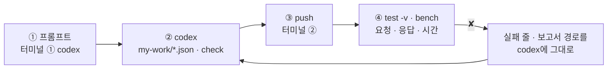
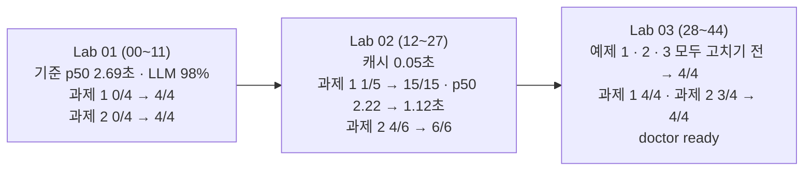

# 72일차 Lab 테스트 결과 · 실제로 만든 시나리오와 `test -v` 결과

> **정답 자료** · 72일차 n8n 워크플로우를 **만드는 프롬프트(codex) → push → `call -v` · `bench` · `test -v` 결과**를 학생이 가는 순서대로 한 문서에 모았습니다. 수업이 끝난 뒤 공개합니다.

- 실행: 2026-10-24, 실습을 Lab마다 5개(예제 3 + 과제 2)로 늘린 뒤 강사 노트북의 65일차 n8n 2.42.6 + 72일차 판 데이터 API(고장 스위치 · 캐시), OpenAI `gpt-4.1-mini`, 케이스 파일마다 **한 번씩** (Lab 02 과제 1만 `--repeat 3`), 모두 45단계
- 명령: `~/aio-01d4-stu/Last3Mon/72`에서 `uv run tools/flow.py test <케이스 파일> -v`, 한 번 부르기는 `call ... -v`, 시간 재기는 `bench ... -n 5`
- 아래 단계마다 **실행한 명령**과 **화면에 나온 출력 전부**를 그대로 붙였습니다. 같은 출력이 `NN-<이름>.txt`에, `test`의 보고서가 `NN-<이름>.json`(케이스마다 `request` · `response` · `problems` · `seconds`)에 있습니다 (`call` · `bench` · `fault` · `llm` · `doctor`만 한 단계는 보고서 없음).
- LLM 문장과 **시간은 실행마다 다릅니다.** 이번 실행에서 정답이 아닌 이유로 실패한 케이스는 셋이고 모두 같은 까닭입니다: **검토 LLM이 접수 답의 "처리 중"을 다른 말("승인 대기 중" 등)로 바꿔 씀** (02 · 12 · 15단계). 검토 LLM을 지우는 Lab 02 과제 1 뒤로는 나오지 않습니다.

## `-v`가 보여 주는 것

```text
✔ 다른 말로 묻는 VPN → FAQ 번호 캐시 · 0.1s     ← 케이스 이름 · 시간 (틀리면 틀린 곳)
    → request  POST /webhook/my-helpdesk          ← 보낸 요청 JSON
      { "question": "VPN 연결이 계속 끊어지는데요", "user": "최유진" }
    ← response HTTP 200                           ← 받은 응답 JSON
      { "route": "자동 답변", ..., "cached": true, "cache_by": "faq", "llm_calls": 0 }
```

오늘은 응답의 `timings` · `steps` · `llm_calls` · `cached` · `cache_by` · `reason`을 봐야 **왜 빨라졌는지, 어느 길로 갔는지** 알 수 있습니다.

## 이 문서 하나로 따라가기

단계마다 **① codex에 넣는 프롬프트 → ② codex가 `my-work/*.json`을 쓰고 `check` → ③ 내가 `push` → ④ 내가 `test -v` · `bench`** 순서입니다. 재기만 하는 예제(Lab 01 예제 1 · 3, Lab 02 예제 3)와 고장을 먼저 겪는 단계는 프롬프트가 없습니다.



- **프롬프트는 정답본(`LAB-0x-A-*.md`)의 요청문 예**를 그대로 썼습니다 (실습 문서 빈칸 채우기 뼈대의 `____`를 채운 글자).
- **이 기록의 워크플로우는 수업 준비 때 만든 정답 파일**입니다. 프롬프트를 codex에 보내 다시 만들어 재지는 않았습니다 (68일차부터 수업 준비는 정답 워크플로우만 실행).
- 학생은 `push my-work/helpdesk.json`, 이 기록은 같은 웹훅(`my-helpdesk`)의 정답 파일을 push했습니다. 그래서 `test` 명령과 결과 모양은 같습니다.
- 시간을 보는 케이스(`max_seconds`)는 노트북 · 네트워크 · OpenAI 응답에 따라 흔들립니다. 실패하면 먼저 같은 테스트를 한 번 더 돌려 봅니다.

## 시나리오 한눈에



| 단계 | 먼저 올린 것 (`push`) | 테스트 · 재기 | 결과 | 파일 |
| --- | --- | --- | --- | --- |
| 00 | 기준 `reference/baseline-helpdesk.json` | `call` + `bench` × 3 | 첫 호출 4.4초 · VPN p50 2.69 / p95 2.98초 | `00-lab01-baseline` |
| 01 | (같음) | `lab01 --webhook base-helpdesk` | **1/4** (시간 칸 없음) | `01-lab01-baseline` |
| 02 | 예제 2 `reference/lab01-example2-timings.json` | `lab01` | 3/4 (접수 답에서 검토 LLM이 "처리 중"을 바꿈) | `02-lab01` |
| 03 | (같음) | `call` VPN | `timings` · `llm_calls: 3` | `03-lab01-call` |
| 04 | (같음) | 예제 3 `bench` × 3 + `call` × 2 | VPN 2.91 · 접수 2.99 · 점심 2.48초 (p50), LLM 98% | `04-lab01-kinds` |
| 05 | (같음, 과제 1 전) | `lab01-challenge` | **0/4** | `05-lab01-challenge-before` |
| 06 | 과제 1 [`72-lab01-challenge-timings.json`](72-lab01-challenge-timings.json) | `lab01-challenge` | 4/4 | `06-lab01-challenge` |
| 07 | (같음) | `lab01` | 4/4 | `07-lab01-after-challenge` |
| 08 | (같음, 과제 2 전) | `lab01-challenge2` | **0/4** | `08-lab01-challenge2-before` |
| 09 | 과제 2 [`72-lab01-challenge2-budget.json`](72-lab01-challenge2-budget.json) | `lab01-challenge2` | 4/4 | `09-lab01-challenge2` |
| 10 | (같음) | `lab01-challenge` | 4/4 | `10-lab01-challenge-after2` |
| 11 | (같음) | `lab01` | 4/4 | `11-lab01-after2` |
| 12 | 예제 1 `reference/lab02-example1-rules.json` | `lab02` | 7/9 (캐시 케이스 · 접수 답 문장) | `12-lab02-rules` |
| 13 | (같음) | `bench` 프린터 | p50 2.45초 | `13-lab02-rules-bench` |
| 14 | 예제 2 `reference/lab02-example2-cache.json` | `lab02` | 9/9 (같은 질문 0.1초) | `14-lab02-cache` |
| 15 | (같음) | `lab01` | 3/4 (접수 답 문장) | `15-lab01-cache` |
| 16 | (같음) | `cache-stats` | entries 2 · hits 4 · misses 8 | `16-cache-stats` |
| 17 | (같음) | 예제 3 캐시 씀 · 안 씀 `bench` | p50 **0.05** · 1.99초 | `17-cache-hit-bench` |
| 18 | (같음, 과제 1 전) | `lab02-challenge` | **1/5** | `18-lab02-challenge-before` |
| 19 | (같음) | `bench` VPN 캐시 없이 | p50 2.22 / p95 2.45초 | `19-bench-before` |
| 20 | 과제 1 [`72-lab02-challenge-fast.json`](72-lab02-challenge-fast.json) | `lab02-challenge --repeat 3` | 15/15 | `20-lab02-challenge` |
| 21 | (같음) | `lab02` | 9/9 | `21-lab02-after-challenge` |
| 22 | (같음) | `lab01` | 4/4 | `22-lab01-after-challenge` |
| 23 | (같음) | `bench` VPN 캐시 없이 | p50 **1.12** / p95 1.32초 | `23-bench-after` |
| 24 | (같음, 과제 2 전) | `lab02-challenge2` | **4/6** | `24-lab02-challenge2-before` |
| 25 | 과제 2 [`72-lab02-challenge2-faqcache.json`](72-lab02-challenge2-faqcache.json) | `lab02-challenge2` | 6/6 (다른 말 VPN 0.1초) | `25-lab02-challenge2` |
| 26 | (같음) | `lab02-challenge` | 5/5 | `26-lab02-challenge-after2` |
| 27 | (같음) | `lab02` | 9/9 | `27-lab02-after2` |
| 28 | Lab 02 예제 2 다시 | `fault faq slow · error` + `call` | 느림 11.5초 · 오류 HTTP 500 | `28-lab03-fault-before` |
| 29 | 예제 1 `reference/lab03-example1-resilient.json` | `lab03` | 4/4 (느림 4.6초 · 오류 0.6초) | `29-lab03` |
| 30 | (같음) | `lab02` | 9/9 | `30-lab02-resilient` |
| 31 | (같음, 예제 2 전) | `llm down` + `call` + `llm up` | HTTP 500 · 1.3초 | `31-llm-down-before` |
| 32 | (같음) | `lab03-llm-down` | **1/4** | `32-lab03-llm-down-before` |
| 33 | 예제 2 `reference/lab03-example2-llm-fallback.json` | `lab03-llm-down` | 4/4 | `33-lab03-llm-down` |
| 34 | (같음) | `lab02` | 9/9 | `34-lab02-llm-fallback` |
| 35 | (같음) | `lab03` | 4/4 | `35-lab03-llm-fallback` |
| 36 | (같음, 예제 3 전) | `lab03-ticket` | **2/4** | `36-lab03-ticket-before` |
| 37 | 예제 3 `reference/lab03-example3-ticket-down.json` | `lab03-ticket` | 4/4 | `37-lab03-ticket` |
| 38 | (같음) | `lab03` | 4/4 | `38-lab03-after-ticket` |
| 39 | (같음) | `lab03-llm-down` | 4/4 | `39-lab03-llm-down-after-ticket` |
| 40 | 과제 1 [`72-lab03-challenge-health.json`](72-lab03-challenge-health.json) | `lab03-challenge` | 4/4 | `40-lab03-challenge` |
| 41 | (헬프데스크는 예제 3, 과제 2 전) | `lab03-challenge2` | **3/4** | `41-lab03-challenge2-before` |
| 42 | 과제 2 [`72-lab03-challenge2-breaker.json`](72-lab03-challenge2-breaker.json) | `lab03-challenge2` | 4/4 (다음 질문 0.1초) | `42-lab03-challenge2` |
| 43 | (같음) | `lab03` | 4/4 | `43-lab03-after-breaker` |
| 44 | — | `doctor` | `ready` | `44-doctor` |

---

## Lab 01 · 재고, 단계별 시간을 남기고, 병목 찾기

### 00 · 예제 1 · 기준을 bench로 재기

실행한 명령:

```bash
uv run tools/flow.py push reference/baseline-helpdesk.json
uv run tools/flow.py call base-helpdesk requests/faq-vpn.json -v
uv run tools/flow.py bench base-helpdesk requests/faq-vpn.json -n 5
uv run tools/flow.py bench base-helpdesk requests/ticket-own.json -n 5
uv run tools/flow.py bench base-helpdesk requests/off-topic.json -n 5
```

출력 (그대로):

```text
$ uv run tools/flow.py call base-helpdesk requests/faq-vpn.json -v
HTTP 200 · 4.4s
    → request  POST /webhook/base-helpdesk
      {
        "question": "VPN 접속이 자꾸 끊겨요. 어떻게 하나요?",
        "user": "이준호"
      }
    ← response HTTP 200
      {
        "route": "자동 답변",
        "category": "faq",
        "answer": "VPN 접속 오류가 발생하면 VPN 클라이언트를 최신 버전으로 업데이트하고 인증서 만료 여부를 확인한 후 다시 접속해 보시기 바랍니다. 추가 도움이 필요하시면 담당자에게 문의해 주시기 바랍니다.",
        "sources": [
          "FAQ-003"
        ]
      }

$ uv run tools/flow.py bench base-helpdesk requests/faq-vpn.json -n 5
POST http://localhost:5678/webhook/base-helpdesk × 5
✔ #1 · HTTP 200 · 2.98s · route=자동 답변
✔ #2 · HTTP 200 · 2.52s · route=자동 답변
✔ #3 · HTTP 200 · 2.69s · route=자동 답변
✔ #4 · HTTP 200 · 2.84s · route=자동 답변
✔ #5 · HTTP 200 · 2.54s · route=자동 답변
p50 2.69s · p95 2.98s · max 2.98s · failures 0/5
report: runs/bench-base-helpdesk-20261024-174234.json

$ uv run tools/flow.py bench base-helpdesk requests/ticket-own.json -n 5
POST http://localhost:5678/webhook/base-helpdesk × 5
✔ #1 · HTTP 200 · 3.04s · route=자동 답변
✔ #2 · HTTP 200 · 3.14s · route=자동 답변
✔ #3 · HTTP 200 · 2.61s · route=자동 답변
✔ #4 · HTTP 200 · 3.36s · route=자동 답변
✔ #5 · HTTP 200 · 2.68s · route=자동 답변
p50 3.04s · p95 3.36s · max 3.36s · failures 0/5
report: runs/bench-base-helpdesk-20261024-174249.json

$ uv run tools/flow.py bench base-helpdesk requests/off-topic.json -n 5
POST http://localhost:5678/webhook/base-helpdesk × 5
✔ #1 · HTTP 200 · 2.90s · route=자동 답변
✔ #2 · HTTP 200 · 2.55s · route=자동 답변
✔ #3 · HTTP 200 · 2.62s · route=자동 답변
✔ #4 · HTTP 200 · 2.56s · route=자동 답변
✔ #5 · HTTP 200 · 2.44s · route=자동 답변
p50 2.56s · p95 2.90s · max 2.90s · failures 0/5
report: runs/bench-base-helpdesk-20261024-174302.json
```

**쉽게 말하면**

- `call`은 한 번, `bench`는 같은 질문을 5번 불러 시간을 잽니다. 모두 ✔(HTTP 200)라 실패는 없습니다.
- 첫 `call`이 4.4초로 유난히 느린 것은 push로 n8n이 막 다시 켜졌기 때문입니다 (첫 호출, 콜드 스타트). 그래서 기준 숫자는 그 뒤 `bench`의 p50 · p95로 적습니다.
- 질문 세 종류 모두 2.5~3초 안팎입니다. IT와 상관없는 점심 질문도 거의 같은 시간이 걸린다는 것이 눈여겨볼 점입니다 (LLM을 세 번 똑같이 부르기 때문).

- push 직후 첫 호출 4.4초 (10/18 6.5초), 그 뒤 VPN p50 2.69 · p95 2.98초, 접수 3.04 · 3.36초, 점심 2.56 · 2.90초.

### 01 · 기준으로 `lab01` → 1/4

실행한 명령:

```bash
uv run tools/flow.py test cases/lab01.json -v --webhook base-helpdesk
```

출력 (그대로):

```text
POST http://localhost:5678/webhook/base-helpdesk · 4 case(s) × 1
✘ VPN FAQ · 단계별 시간 · 3.5s · timings has none of ['answer_ms']
    → request  POST /webhook/base-helpdesk
      {
        "question": "VPN 접속이 자꾸 끊겨요. 어떻게 하나요?",
        "user": "이준호",
        "no_cache": true
      }
    ← response HTTP 200
      {
        "route": "자동 답변",
        "category": "faq",
        "answer": "VPN 접속 오류가 발생하면 VPN 클라이언트를 최신 버전으로 업데이트하고 인증서 만료 여부를 확인한 후 다시 접속해 보시기 바랍니다. 추가 도움이 필요하시면 담당 직원에게 문의해 주십시오.",
        "sources": [
          "FAQ-003"
        ]
      }
✘ VPN FAQ · 전체 시간 · LLM 호출 수 · 2.9s · timings has none of ['total_ms']; steps has none of ['answer']; llm_calls has none of ['1', '2', '3']
    → request  POST /webhook/base-helpdesk
      {
        "question": "VPN 접속이 자꾸 끊겨요. 어떻게 하나요?",
        "user": "이준호",
        "no_cache": true
      }
    ← response HTTP 200
      {
        "route": "자동 답변",
        "category": "faq",
        "answer": "VPN 접속 오류가 발생하면 VPN 클라이언트를 최신 버전으로 업데이트하고 인증서 만료 여부를 확인한 후 다시 시도해 보시기 바랍니다. 추가 도움이 필요하시면 담당자에게 문의해 주십시오.",
        "sources": [
          "FAQ-003"
        ]
      }
✘ 접수 현황 · 2.8s · timings has none of ['answer_ms']
    → request  POST /webhook/base-helpdesk
      {
        "question": "T-1002 처리 상태 알려 주세요",
        "user": "박서연"
      }
    ← response HTTP 200
      {
        "route": "자동 답변",
        "category": "ticket",
        "answer": "T-1002 티켓은 현재 \"처리 중\" 상태이며, 인증서 발급 승인 대기 중입니다. 완료 예정일은 10월 20일입니다. 추가 문의 사항이 있으시면 010-2718-2818로 연락해 주시기 바랍니다.",
        "sources": []
      }
✔ 빈 질문 · 0.0s
    → request  POST /webhook/base-helpdesk
      {
        "question": "",
        "user": "이준호"
      }
    ← response HTTP 400
      {
        "error": "question is required"
      }
Passed 1/4
report: runs/lab01-20261024-174311.json
```

**쉽게 말하면**

- 기준 워크플로우는 **아직 아무것도 고치지 않은** 것이라 실패가 정상입니다.
- ✘ `timings has none of ['answer_ms']`: 응답에 단계별 시간 칸 `timings`가 아예 없어서 `answer_ms`를 찾지 못했다는 뜻입니다.
- ✘ `steps has none of ['answer']; llm_calls has none of ['1', '2', '3']`: 지나간 단계(`steps`)와 LLM 호출 수(`llm_calls`)도 없다는 뜻입니다. 예제 2에서 이 칸들을 만듭니다.
- ✔ 빈 질문은 처음부터 HTTP 400으로 거절하도록 되어 있어 통과합니다.

- 기준에는 `timings` · `steps` · `llm_calls`가 없어 빈 질문만 통과.

### 02 · 예제 2 · 단계별 시간 → `lab01` 3/4

codex에 입력하는 프롬프트 (터미널 ①, 학생이 만들 파일 `my-work/helpdesk.json` · 이 기록에서 push한 같은 역할의 정답 `reference/lab01-example2-timings.json`):

```text
my-work/helpdesk.json 은 reference/baseline-helpdesk.json 을 복사한 것이야. 웹훅 경로를 my-helpdesk, 이름을 "72 IT helpdesk (my)"로 바꾸고,
답은 그대로 두고 결과에 다음을 더해 줘 (AGENTS.md 3절, 5절의 시각 남기기).
- Has question? 다음에 Start clock, Parse category 뒤에 After classify, Get ticket 뒤에 After data, Answer 뒤에 After answer, Review 뒤에 After review (각각 Date.now()).
- Build result 에서 timings {classify_ms, data_ms, answer_ms, review_ms, total_ms}, steps(지나간 단계), llm_calls(지나간 Agent 수), cached:false.
  지나갔는지는 $('노드').isExecuted 로.
기대 결과 cases/lab01.json.
```

실행한 명령:

```bash
uv run tools/flow.py push reference/lab01-example2-timings.json
uv run tools/flow.py test cases/lab01.json -v
```

출력 (그대로):

```text
POST http://localhost:5678/webhook/my-helpdesk · 4 case(s) × 1
✔ VPN FAQ · 단계별 시간 · 4.3s
    → request  POST /webhook/my-helpdesk
      {
        "question": "VPN 접속이 자꾸 끊겨요. 어떻게 하나요?",
        "user": "이준호",
        "no_cache": true
      }
    ← response HTTP 200
      {
        "route": "자동 답변",
        "category": "faq",
        "answer": "VPN 접속 오류가 발생하면 VPN 클라이언트를 최신 버전으로 업데이트하고 인증서 만료 여부를 확인한 후 다시 접속해 보시기 바랍니다. 추가 도움이 필요하시면 담당자에게 문의해 주시기 바랍니다.",
        "sources": [
          "FAQ-003"
        ],
        "llm_calls": 3,
        "cached": false,
        "steps": [
          "classify",
          "faq",
          "ticket",
          "answer",
          "review"
        ],
        "timings": {
          "classify_ms": 1210,
          "data_ms": 29,
          "answer_ms": 1119,
          "review_ms": 1042,
          "total_ms": 3426
        }
      }
✔ VPN FAQ · 전체 시간 · LLM 호출 수 · 2.8s
    → request  POST /webhook/my-helpdesk
      {
        "question": "VPN 접속이 자꾸 끊겨요. 어떻게 하나요?",
        "user": "이준호",
        "no_cache": true
      }
    ← response HTTP 200
      {
        "route": "자동 답변",
        "category": "faq",
        "answer": "VPN 접속 오류가 발생하면 VPN 클라이언트를 최신 버전으로 업데이트하고 인증서 만료 여부를 확인한 후 다시 접속해 보시기 바랍니다. 추가 도움이 필요하시면 담당자에게 문의해 주시기 바랍니다.",
        "sources": [
          "FAQ-003"
        ],
        "llm_calls": 3,
        "cached": false,
        "steps": [
          "classify",
          "faq",
          "ticket",
          "answer",
          "review"
        ],
        "timings": {
          "classify_ms": 753,
          "data_ms": 19,
          "answer_ms": 1058,
          "review_ms": 890,
          "total_ms": 2731
        }
      }
✘ 접수 현황 · 3.3s · answer has none of ['처리 중']
    → request  POST /webhook/my-helpdesk
      {
        "question": "T-1002 처리 상태 알려 주세요",
        "user": "박서연"
      }
    ← response HTTP 200
      {
        "route": "자동 답변",
        "category": "ticket",
        "answer": "T-1002 티켓은 현재 인증서 발급 승인 대기 중이며, 10월 20일에 완료될 예정입니다. 추가 문의 사항이 있으시면 010-2718-2818로 연락해 주시기 바랍니다.",
        "sources": [],
        "llm_calls": 3,
        "cached": false,
        "steps": [
          "classify",
          "faq",
          "ticket",
          "answer",
          "review"
        ],
        "timings": {
          "classify_ms": 929,
          "data_ms": 21,
          "answer_ms": 1118,
          "review_ms": 1029,
          "total_ms": 3108
        }
      }
✔ 빈 질문 · 0.0s
    → request  POST /webhook/my-helpdesk
      {
        "question": "",
        "user": "이준호"
      }
    ← response HTTP 400
      {
        "error": "question is required"
      }
Passed 3/4
report: runs/lab01-20261024-174333.json
```

**쉽게 말하면**

- `timings` · `steps` · `llm_calls`를 넣은 뒤라 시간 · 구조 케이스는 ✔입니다.
- ✘ `접수 현황 · answer has none of ['처리 중']`: 답에 접수 상태 "처리 중"이라는 글자가 없었다는 뜻입니다. 워크플로우 잘못이 아니라 **검토 LLM이 문장을 다듬다가 "처리 중"을 다른 말로 바꿔 쓴 것**입니다 (LLM 문장은 실행마다 달라짐).
- 그래서 같은 테스트를 다시 돌리면 통과하기도 합니다 (07단계는 4/4). 이 문제는 Lab 02 과제 1에서 검토 LLM을 지우면 사라집니다.

- 접수 케이스는 검토 LLM이 "처리 중"을 바꿔 써서 실패 (정답의 잘못이 아님, 10/18 · 10/23은 4/4).

### 03 · 예제 2 · 한 번 불러 `timings` 보기

실행한 명령:

```bash
uv run tools/flow.py call my-helpdesk requests/faq-vpn.json -v
```

출력 (그대로):

```text
$ uv run tools/flow.py call my-helpdesk requests/faq-vpn.json -v
HTTP 200 · 2.7s
    → request  POST /webhook/my-helpdesk
      {
        "question": "VPN 접속이 자꾸 끊겨요. 어떻게 하나요?",
        "user": "이준호"
      }
    ← response HTTP 200
      {
        "route": "자동 답변",
        "category": "faq",
        "answer": "VPN 클라이언트를 최신 버전으로 업데이트하시고, 인증서 만료 여부를 확인한 후 다시 접속해 보시기 바랍니다. 추가 도움이 필요하시면 담당 직원에게 문의해 주십시오.",
        "sources": [
          "FAQ-003"
        ],
        "llm_calls": 3,
        "cached": false,
        "steps": [
          "classify",
          "faq",
          "ticket",
          "answer",
          "review"
        ],
        "timings": {
          "classify_ms": 616,
          "data_ms": 18,
          "answer_ms": 1124,
          "review_ms": 920,
          "total_ms": 2698
        }
      }
```

**쉽게 말하면**

- 응답의 `timings`를 보면 시간이 어디서 쓰였는지 보입니다: 분류 0.6초 + 데이터 0.02초 + 답 1.1초 + 검토 0.9초.
- 데이터 API는 0.02초뿐이고 나머지는 모두 LLM입니다. **느린 곳은 LLM 세 번**이라는 것이 오늘 고칠 방향입니다.

- 분류 616 · 데이터 18 · 답 1124 · 검토 920 · 합 2698ms. LLM 셋이 98.6%.

### 04 · 예제 3 · 질문 종류별로 재기

실행한 명령:

```bash
uv run tools/flow.py bench my-helpdesk requests/faq-vpn-nocache.json -n 5
uv run tools/flow.py bench my-helpdesk requests/ticket-own.json -n 5
uv run tools/flow.py bench my-helpdesk requests/off-topic.json -n 5
uv run tools/flow.py call my-helpdesk requests/ticket-own.json -v
uv run tools/flow.py call my-helpdesk requests/off-topic.json -v
```

출력 (그대로):

```text
$ uv run tools/flow.py bench my-helpdesk requests/faq-vpn-nocache.json -n 5
POST http://localhost:5678/webhook/my-helpdesk × 5
✔ #1 · HTTP 200 · 2.57s · route=자동 답변, llm_calls=3, cached=false
✔ #2 · HTTP 200 · 3.08s · route=자동 답변, llm_calls=3, cached=false
✔ #3 · HTTP 200 · 2.91s · route=자동 답변, llm_calls=3, cached=false
✔ #4 · HTTP 200 · 2.99s · route=자동 답변, llm_calls=3, cached=false
✔ #5 · HTTP 200 · 2.80s · route=자동 답변, llm_calls=3, cached=false
p50 2.91s · p95 3.08s · max 3.08s · failures 0/5
report: runs/bench-my-helpdesk-20261024-174351.json

$ uv run tools/flow.py bench my-helpdesk requests/ticket-own.json -n 5
POST http://localhost:5678/webhook/my-helpdesk × 5
✔ #1 · HTTP 200 · 2.86s · route=자동 답변, llm_calls=3, cached=false
✔ #2 · HTTP 200 · 3.05s · route=자동 답변, llm_calls=3, cached=false
✔ #3 · HTTP 200 · 3.12s · route=자동 답변, llm_calls=3, cached=false
✔ #4 · HTTP 200 · 2.94s · route=자동 답변, llm_calls=3, cached=false
✔ #5 · HTTP 200 · 2.99s · route=자동 답변, llm_calls=3, cached=false
p50 2.99s · p95 3.12s · max 3.12s · failures 0/5
report: runs/bench-my-helpdesk-20261024-174406.json

$ uv run tools/flow.py bench my-helpdesk requests/off-topic.json -n 5
POST http://localhost:5678/webhook/my-helpdesk × 5
✔ #1 · HTTP 200 · 2.38s · route=자동 답변, llm_calls=3, cached=false
✔ #2 · HTTP 200 · 2.36s · route=자동 답변, llm_calls=3, cached=false
✔ #3 · HTTP 200 · 2.48s · route=자동 답변, llm_calls=3, cached=false
✔ #4 · HTTP 200 · 2.49s · route=자동 답변, llm_calls=3, cached=false
✔ #5 · HTTP 200 · 2.84s · route=자동 답변, llm_calls=3, cached=false
p50 2.48s · p95 2.84s · max 2.84s · failures 0/5
report: runs/bench-my-helpdesk-20261024-174419.json

$ uv run tools/flow.py call my-helpdesk requests/ticket-own.json -v
HTTP 200 · 2.8s
    → request  POST /webhook/my-helpdesk
      {
        "question": "T-1002 처리 상태 알려 주세요",
        "user": "박서연"
      }
    ← response HTTP 200
      {
        "route": "자동 답변",
        "category": "ticket",
        "answer": "T-1002 티켓은 현재 인증서 발급 승인 대기 중이며, 10월 20일에 완료될 예정입니다. 추가 문의 사항이 있으시면 010-2718-2818로 연락해 주시기 바랍니다.",
        "sources": [],
        "llm_calls": 3,
        "cached": false,
        "steps": [
          "classify",
          "faq",
          "ticket",
          "answer",
          "review"
        ],
        "timings": {
          "classify_ms": 818,
          "data_ms": 43,
          "answer_ms": 877,
          "review_ms": 895,
          "total_ms": 2647
        }
      }

$ uv run tools/flow.py call my-helpdesk requests/off-topic.json -v
HTTP 200 · 2.5s
    → request  POST /webhook/my-helpdesk
      {
        "question": "오늘 점심 메뉴 추천해 주세요",
        "user": "이준호"
      }
    ← response HTTP 200
      {
        "route": "자동 답변",
        "category": "other",
        "answer": "찾으시는 정보를 확인하지 못했습니다. 점심 메뉴 추천은 담당 직원에게 문의해 주시기 바랍니다.",
        "sources": [],
        "llm_calls": 3,
        "cached": false,
        "steps": [
          "classify",
          "faq",
          "ticket",
          "answer",
          "review"
        ],
        "timings": {
          "classify_ms": 732,
          "data_ms": 19,
          "answer_ms": 740,
          "review_ms": 978,
          "total_ms": 2482
        }
      }
```

**쉽게 말하면**

- 질문 종류마다 5번씩 잽니다. 결과 끝의 `llm_calls=3`은 세 종류 모두 LLM을 세 번 불렀다는 뜻입니다.
- 점심 메뉴처럼 데이터가 없는 질문도 LLM 세 번 → 2.5초입니다. "건너뛸 수 있는 일을 하고 있다"는 증거입니다 (Lab 02에서 줄임).

- p50: VPN 2.91 · 접수 2.99 · 점심 2.48초. 접수 2647ms 중 LLM 2590ms(97.8%), 점심 2482ms 중 2450ms(98.7%).
- 점심 메뉴는 데이터가 없는데도 LLM 세 번 (`category: other`).

### 05 · 과제 1 하기 전 → `lab01-challenge` 0/4

실행한 명령:

```bash
uv run tools/flow.py test cases/lab01-challenge.json -v
```

출력 (그대로):

```text
POST http://localhost:5678/webhook/my-helpdesk · 4 case(s) × 1
✘ FAQ · 접수 시간 따로 · 2.7s · timings has none of ['faq_ms']
    → request  POST /webhook/my-helpdesk
      {
        "question": "VPN 접속이 자꾸 끊겨요. 어떻게 하나요?",
        "user": "이준호",
        "no_cache": true
      }
    ← response HTTP 200
      {
        "route": "자동 답변",
        "category": "faq",
        "answer": "VPN 접속 오류가 발생하면 VPN 클라이언트를 최신 버전으로 업데이트하고 인증서 만료 여부를 확인한 후 다시 접속해 보시기 바랍니다. 추가 도움이 필요하시면 담당 직원에게 문의해 주시기 바랍니다.",
        "sources": [
          "FAQ-003"
        ],
        "llm_calls": 3,
        "cached": false,
        "steps": [
          "classify",
          "faq",
          "ticket",
          "answer",
          "review"
        ],
        "timings": {
          "classify_ms": 595,
          "data_ms": 18,
          "answer_ms": 1005,
          "review_ms": 1012,
          "total_ms": 2643
        }
      }
✘ 접수 조회 시간 · 2.6s · timings has none of ['ticket_ms']
    → request  POST /webhook/my-helpdesk
      {
        "question": "VPN 접속이 자꾸 끊겨요. 어떻게 하나요?",
        "user": "이준호",
        "no_cache": true
      }
    ← response HTTP 200
      {
        "route": "자동 답변",
        "category": "faq",
        "answer": "VPN 접속 오류가 발생하면 VPN 클라이언트를 최신 버전으로 업데이트하고 인증서 만료 여부를 확인한 후 다시 접속해 보시기 바랍니다. 추가 도움이 필요하시면 담당 직원에게 문의해 주시기 바랍니다.",
        "sources": [
          "FAQ-003"
        ],
        "llm_calls": 3,
        "cached": false,
        "steps": [
          "classify",
          "faq",
          "ticket",
          "answer",
          "review"
        ],
        "timings": {
          "classify_ms": 716,
          "data_ms": 19,
          "answer_ms": 958,
          "review_ms": 881,
          "total_ms": 2594
        }
      }
✘ 가장 오래 걸린 단계 · 3.1s · slowest_step has none of ['classify', 'answer', 'review']
    → request  POST /webhook/my-helpdesk
      {
        "question": "VPN 접속이 자꾸 끊겨요. 어떻게 하나요?",
        "user": "이준호",
        "no_cache": true
      }
    ← response HTTP 200
      {
        "route": "자동 답변",
        "category": "faq",
        "answer": "VPN 접속 오류가 발생하면 VPN 클라이언트를 최신 버전으로 업데이트하고 인증서 만료 여부를 확인한 후 다시 접속해 보시기 바랍니다. 추가 도움이 필요하시면 담당자에게 문의해 주시기 바랍니다.",
        "sources": [
          "FAQ-003"
        ],
        "llm_calls": 3,
        "cached": false,
        "steps": [
          "classify",
          "faq",
          "ticket",
          "answer",
          "review"
        ],
        "timings": {
          "classify_ms": 991,
          "data_ms": 18,
          "answer_ms": 1024,
          "review_ms": 991,
          "total_ms": 3037
        }
      }
✘ 접수 현황도 같은 모양 · 2.8s · answer has none of ['처리 중']; slowest_step has none of ['classify', 'answer', 'review']
    → request  POST /webhook/my-helpdesk
      {
        "question": "T-1002 처리 상태 알려 주세요",
        "user": "박서연"
      }
    ← response HTTP 200
      {
        "route": "자동 답변",
        "category": "ticket",
        "answer": "T-1002 티켓은 현재 인증서 발급 승인 대기 중이며, 10월 20일에 완료될 예정입니다. 추가 문의 사항이 있으시면 010-2718-2818로 연락해 주시기 바랍니다.",
        "sources": [],
        "llm_calls": 3,
        "cached": false,
        "steps": [
          "classify",
          "faq",
          "ticket",
          "answer",
          "review"
        ],
        "timings": {
          "classify_ms": 803,
          "data_ms": 36,
          "answer_ms": 884,
          "review_ms": 1043,
          "total_ms": 2781
        }
      }
Passed 0/4
report: runs/lab01-challenge-20261024-174435.json
```

**쉽게 말하면**

- 과제 1을 하기 **전**이라 0/4가 정상입니다. 실패 줄은 "무엇을 만들어야 하는지" 알려 주는 목록으로 읽습니다.
- ✘ `timings has none of ['faq_ms']` · `['ticket_ms']`: 데이터 조회 시간이 아직 `data_ms` 하나로 합쳐져 있어 FAQ · 접수 칸이 따로 없습니다.
- ✘ `slowest_step has none of [...]`: 가장 느린 단계 이름 칸 `slowest_step`이 아직 없습니다.
- 마지막 케이스의 `answer has none of ['처리 중']`은 02단계와 같은 까닭(검토 LLM이 바꿔 씀)입니다.

- `faq_ms` · `ticket_ms` · `slowest_step`이 없음.

### 06 · 과제 1 · FAQ · 접수 나누기와 `slowest_step` → 4/4

codex에 입력하는 프롬프트 (터미널 ①, 학생이 만들 파일 `my-work/helpdesk.json (고침)` · 이 기록에서 push한 같은 역할의 정답 [`72-lab01-challenge-timings.json`](72-lab01-challenge-timings.json)):

```text
my-work/helpdesk.json 의 Search FAQ 와 Get ticket 사이에 After FAQ(Date.now()) 를 더해, timings 의 data_ms 를 faq_ms 와 ticket_ms 로 나눠 줘.
total_ms 를 뺀 timings 중 가장 큰 단계 이름(_ms 뺀 것)을 slowest_step 으로. cases/lab01-challenge.json, cases/lab01.json 둘 다 통과.
```

실행한 명령:

```bash
uv run tools/flow.py push answers/72-lab01-challenge-timings.json
uv run tools/flow.py test cases/lab01-challenge.json -v
```

출력 (그대로):

```text
POST http://localhost:5678/webhook/my-helpdesk · 4 case(s) × 1
✔ FAQ · 접수 시간 따로 · 4.5s
    → request  POST /webhook/my-helpdesk
      {
        "question": "VPN 접속이 자꾸 끊겨요. 어떻게 하나요?",
        "user": "이준호",
        "no_cache": true
      }
    ← response HTTP 200
      {
        "route": "자동 답변",
        "category": "faq",
        "answer": "VPN 접속 오류가 발생하면 VPN 클라이언트를 최신 버전으로 업데이트하고 인증서 만료 여부를 확인한 후 다시 접속해 보시기 바랍니다. 추가 도움이 필요하시면 담당자에게 문의해 주시기 바랍니다.",
        "sources": [
          "FAQ-003"
        ],
        "llm_calls": 3,
        "cached": false,
        "steps": [
          "classify",
          "faq",
          "ticket",
          "answer",
          "review"
        ],
        "timings": {
          "classify_ms": 1365,
          "faq_ms": 16,
          "ticket_ms": 14,
          "answer_ms": 1196,
          "review_ms": 993,
          "total_ms": 3614
        },
        "slowest_step": "classify"
      }
✔ 접수 조회 시간 · 2.7s
    → request  POST /webhook/my-helpdesk
      {
        "question": "VPN 접속이 자꾸 끊겨요. 어떻게 하나요?",
        "user": "이준호",
        "no_cache": true
      }
    ← response HTTP 200
      {
        "route": "자동 답변",
        "category": "faq",
        "answer": "VPN 접속 오류가 발생하면 VPN 클라이언트를 최신 버전으로 업데이트하고 인증서 만료 여부를 확인한 후 다시 접속해 보시기 바랍니다. 추가 도움이 필요하시면 담당자에게 문의해 주시기 바랍니다.",
        "sources": [
          "FAQ-003"
        ],
        "llm_calls": 3,
        "cached": false,
        "steps": [
          "classify",
          "faq",
          "ticket",
          "answer",
          "review"
        ],
        "timings": {
          "classify_ms": 774,
          "faq_ms": 17,
          "ticket_ms": 13,
          "answer_ms": 971,
          "review_ms": 815,
          "total_ms": 2601
        },
        "slowest_step": "answer"
      }
✔ 가장 오래 걸린 단계 · 3.0s
    → request  POST /webhook/my-helpdesk
      {
        "question": "VPN 접속이 자꾸 끊겨요. 어떻게 하나요?",
        "user": "이준호",
        "no_cache": true
      }
    ← response HTTP 200
      {
        "route": "자동 답변",
        "category": "faq",
        "answer": "VPN 접속 오류가 발생하면 VPN 클라이언트를 최신 버전으로 업데이트하고 인증서 만료 여부를 확인한 후 다시 시도해 보시기 바랍니다. 추가 도움이 필요하시면 담당자에게 문의해 주십시오.",
        "sources": [
          "FAQ-003"
        ],
        "llm_calls": 3,
        "cached": false,
        "steps": [
          "classify",
          "faq",
          "ticket",
          "answer",
          "review"
        ],
        "timings": {
          "classify_ms": 680,
          "faq_ms": 17,
          "ticket_ms": 10,
          "answer_ms": 1044,
          "review_ms": 1007,
          "total_ms": 2769
        },
        "slowest_step": "answer"
      }
✔ 접수 현황도 같은 모양 · 3.0s
    → request  POST /webhook/my-helpdesk
      {
        "question": "T-1002 처리 상태 알려 주세요",
        "user": "박서연"
      }
    ← response HTTP 200
      {
        "route": "자동 답변",
        "category": "ticket",
        "answer": "T-1002 티켓은 현재 \"처리 중\" 상태이며, 인증서 발급 승인 대기 중입니다. 10월 20일에 완료될 예정입니다. 추가 문의 사항이 있으시면 010-2718-2818로 연락해 주시기 바랍니다.",
        "sources": [],
        "llm_calls": 3,
        "cached": false,
        "steps": [
          "classify",
          "faq",
          "ticket",
          "answer",
          "review"
        ],
        "timings": {
          "classify_ms": 723,
          "faq_ms": 13,
          "ticket_ms": 11,
          "answer_ms": 1029,
          "review_ms": 1162,
          "total_ms": 2951
        },
        "slowest_step": "review"
      }
Passed 4/4
report: runs/lab01-challenge-20261024-174502.json
```

**쉽게 말하면**

- 칸을 나누고 `slowest_step`을 더한 뒤 4/4입니다.
- `slowest_step`은 실행마다 바뀝니다: push 직후 첫 호출은 분류(`classify`)가 가장 느렸고, 그 뒤로는 답 · 검토가 번갈아 1등입니다. 답 LLM과 검토 LLM의 시간이 비슷하기 때문입니다. 그래서 테스트는 셋 중 하나면 통과로 봅니다.

- `slowest_step`: classify 1 (push 직후 첫 호출, classify 1365ms) · answer 2 · review 1. 실행마다 바뀜.

### 07 · 과제 1 뒤 `lab01` → 4/4

실행한 명령:

```bash
uv run tools/flow.py test cases/lab01.json -v
```

출력 (그대로):

```text
POST http://localhost:5678/webhook/my-helpdesk · 4 case(s) × 1
✔ VPN FAQ · 단계별 시간 · 2.9s
    → request  POST /webhook/my-helpdesk
      {
        "question": "VPN 접속이 자꾸 끊겨요. 어떻게 하나요?",
        "user": "이준호",
        "no_cache": true
      }
    ← response HTTP 200
      {
        "route": "자동 답변",
        "category": "faq",
        "answer": "VPN 접속 오류가 발생하면 VPN 클라이언트를 최신 버전으로 업데이트하고 인증서 만료 여부를 확인한 후 다시 접속해 보시기 바랍니다. 추가 도움이 필요하시면 담당자에게 문의해 주시기 바랍니다.",
        "sources": [
          "FAQ-003"
        ],
        "llm_calls": 3,
        "cached": false,
        "steps": [
          "classify",
          "faq",
          "ticket",
          "answer",
          "review"
        ],
        "timings": {
          "classify_ms": 844,
          "faq_ms": 16,
          "ticket_ms": 9,
          "answer_ms": 990,
          "review_ms": 927,
          "total_ms": 2807
        },
        "slowest_step": "answer"
      }
✔ VPN FAQ · 전체 시간 · LLM 호출 수 · 2.8s
    → request  POST /webhook/my-helpdesk
      {
        "question": "VPN 접속이 자꾸 끊겨요. 어떻게 하나요?",
        "user": "이준호",
        "no_cache": true
      }
    ← response HTTP 200
      {
        "route": "자동 답변",
        "category": "faq",
        "answer": "VPN 접속 오류가 발생하면 VPN 클라이언트를 최신 버전으로 업데이트하고 인증서 만료 여부를 확인한 후 다시 접속해 보시기 바랍니다. 추가 도움이 필요하시면 담당자에게 문의해 주시기 바랍니다.",
        "sources": [
          "FAQ-003"
        ],
        "llm_calls": 3,
        "cached": false,
        "steps": [
          "classify",
          "faq",
          "ticket",
          "answer",
          "review"
        ],
        "timings": {
          "classify_ms": 715,
          "faq_ms": 16,
          "ticket_ms": 14,
          "answer_ms": 1064,
          "review_ms": 988,
          "total_ms": 2810
        },
        "slowest_step": "answer"
      }
✔ 접수 현황 · 3.0s
    → request  POST /webhook/my-helpdesk
      {
        "question": "T-1002 처리 상태 알려 주세요",
        "user": "박서연"
      }
    ← response HTTP 200
      {
        "route": "자동 답변",
        "category": "ticket",
        "answer": "T-1002 티켓은 현재 \"처리 중\" 상태이며, 인증서 발급 승인 대기 중입니다. 완료 예정일은 10월 20일입니다. 추가 문의 사항이 있으시면 010-2718-2818로 연락해 주시기 바랍니다.",
        "sources": [],
        "llm_calls": 3,
        "cached": false,
        "steps": [
          "classify",
          "faq",
          "ticket",
          "answer",
          "review"
        ],
        "timings": {
          "classify_ms": 810,
          "faq_ms": 16,
          "ticket_ms": 11,
          "answer_ms": 1014,
          "review_ms": 1058,
          "total_ms": 2925
        },
        "slowest_step": "review"
      }
✔ 빈 질문 · 0.0s
    → request  POST /webhook/my-helpdesk
      {
        "question": "",
        "user": "이준호"
      }
    ← response HTTP 400
      {
        "error": "question is required"
      }
Passed 4/4
report: runs/lab01-20261024-174511.json
```

**쉽게 말하면**

- 과제 1에서 칸을 더했어도 원래 테스트(`lab01`)가 그대로 통과하는지 확인합니다. 4/4라 **원래 계약을 깨지 않았습니다.**
- 이번에는 검토 LLM이 "처리 중"을 그대로 두어 02단계에서 실패했던 접수 케이스도 통과했습니다.

- 이번에는 접수 답에 "처리 중"이 남아 통과.

### 08 · 과제 2 하기 전 → `lab01-challenge2` 0/4

실행한 명령:

```bash
uv run tools/flow.py test cases/lab01-challenge2.json -v
```

출력 (그대로):

```text
POST http://localhost:5678/webhook/my-helpdesk · 4 case(s) × 1
✘ 예산 안 (넉넉한 예산) · 2.9s · over_budget = null (expected false); budget_ms = null (expected 60000); llm_ms has none of ['0', '1', '2', '3', '4', '5', '6', '7', '8', '9']
    → request  POST /webhook/my-helpdesk
      {
        "question": "VPN 접속이 자꾸 끊겨요. 어떻게 하나요?",
        "user": "이준호",
        "no_cache": true,
        "budget_ms": 60000
      }
    ← response HTTP 200
      {
        "route": "자동 답변",
        "category": "faq",
        "answer": "VPN 접속 오류가 발생하면 VPN 클라이언트를 최신 버전으로 업데이트하고 인증서 만료 여부를 확인한 후 다시 접속해 보시기 바랍니다. 추가 도움이 필요하시면 담당 직원에게 문의해 주시기 바랍니다.",
        "sources": [
          "FAQ-003"
        ],
        "llm_calls": 3,
        "cached": false,
        "steps": [
          "classify",
          "faq",
          "ticket",
          "answer",
          "review"
        ],
        "timings": {
          "classify_ms": 628,
          "faq_ms": 11,
          "ticket_ms": 11,
          "answer_ms": 1142,
          "review_ms": 1028,
          "total_ms": 2862
        },
        "slowest_step": "answer"
      }
✘ 예산 넘음 (0.5초 예산) · 2.7s · over_budget = null (expected true); budget_ms = null (expected 500)
    → request  POST /webhook/my-helpdesk
      {
        "question": "VPN 접속이 자꾸 끊겨요. 어떻게 하나요?",
        "user": "이준호",
        "no_cache": true,
        "budget_ms": 500
      }
    ← response HTTP 200
      {
        "route": "자동 답변",
        "category": "faq",
        "answer": "VPN 접속 오류가 발생하면 VPN 클라이언트를 최신 버전으로 업데이트하고 인증서 만료 여부를 확인한 후 다시 접속해 보시기 바랍니다. 추가 도움이 필요하시면 담당 직원에게 문의해 주시기 바랍니다.",
        "sources": [
          "FAQ-003"
        ],
        "llm_calls": 3,
        "cached": false,
        "steps": [
          "classify",
          "faq",
          "ticket",
          "answer",
          "review"
        ],
        "timings": {
          "classify_ms": 658,
          "faq_ms": 14,
          "ticket_ms": 11,
          "answer_ms": 1013,
          "review_ms": 930,
          "total_ms": 2640
        },
        "slowest_step": "answer"
      }
✘ 예산을 안 주면 3초 · 3.6s · budget_ms = null (expected 3000); llm_ms has none of ['0', '1', '2', '3', '4', '5', '6', '7', '8', '9']
    → request  POST /webhook/my-helpdesk
      {
        "question": "VPN 접속이 자꾸 끊겨요. 어떻게 하나요?",
        "user": "이준호",
        "no_cache": true
      }
    ← response HTTP 200
      {
        "route": "자동 답변",
        "category": "faq",
        "answer": "VPN 접속 오류가 발생하면 VPN 클라이언트를 최신 버전으로 업데이트하고 인증서 만료 여부를 확인한 후 다시 접속해 보시기 바랍니다. 추가 도움이 필요하시면 담당 직원에게 문의해 주십시오.",
        "sources": [
          "FAQ-003"
        ],
        "llm_calls": 3,
        "cached": false,
        "steps": [
          "classify",
          "faq",
          "ticket",
          "answer",
          "review"
        ],
        "timings": {
          "classify_ms": 650,
          "faq_ms": 14,
          "ticket_ms": 13,
          "answer_ms": 1767,
          "review_ms": 1061,
          "total_ms": 3520
        },
        "slowest_step": "answer"
      }
✘ 접수 현황도 같은 모양 · 2.8s · budget_ms = null (expected 3000); llm_ms has none of ['0', '1', '2', '3', '4', '5', '6', '7', '8', '9']
    → request  POST /webhook/my-helpdesk
      {
        "question": "T-1002 처리 상태 알려 주세요",
        "user": "박서연"
      }
    ← response HTTP 200
      {
        "route": "자동 답변",
        "category": "ticket",
        "answer": "T-1002 티켓은 현재 \"처리 중\" 상태이며, 인증서 발급 승인 대기 중입니다. 완료 예정일은 10월 20일입니다. 추가 문의 사항이 있으시면 010-2718-2818로 연락해 주시기 바랍니다.",
        "sources": [],
        "llm_calls": 3,
        "cached": false,
        "steps": [
          "classify",
          "faq",
          "ticket",
          "answer",
          "review"
        ],
        "timings": {
          "classify_ms": 772,
          "faq_ms": 14,
          "ticket_ms": 12,
          "answer_ms": 895,
          "review_ms": 1006,
          "total_ms": 2719
        },
        "slowest_step": "review"
      }
Passed 0/4
report: runs/lab01-challenge2-20261024-174523.json
```

**쉽게 말하면**

- 과제 2를 하기 **전**이라 0/4가 정상입니다.
- ✘ `over_budget = null (expected false)` · `budget_ms = null (expected 60000)`: 응답에 그 칸이 없어서 값이 `null`(없음)로 읽혔다는 뜻입니다.
- ✘ `llm_ms has none of ['0', ... '9']`: `llm_ms`에 숫자가 하나도 없다, 곧 칸이 없다는 뜻입니다.

- `budget_ms` · `over_budget` · `llm_ms`가 없음.

### 09 · 과제 2 · 시간 예산 → `lab01-challenge2` 4/4

codex에 입력하는 프롬프트 (터미널 ①, 학생이 만들 파일 `my-work/helpdesk.json (고침)` · 이 기록에서 push한 같은 역할의 정답 [`72-lab01-challenge2-budget.json`](72-lab01-challenge2-budget.json)):

```text
my-work/helpdesk.json 의 Build result 에서, 본문 budget_ms (없으면 3000, 숫자로)를 읽어
결과에 llm_ms(classify · answer · review 의 _ms 합, timings 밖에 둔다), budget_ms, over_budget(timings.total_ms > budget_ms)을 더해 줘.
timings, slowest_step 은 그대로. cases/lab01-challenge2.json, cases/lab01-challenge.json, cases/lab01.json 모두 통과.
```

실행한 명령:

```bash
uv run tools/flow.py push answers/72-lab01-challenge2-budget.json
uv run tools/flow.py test cases/lab01-challenge2.json -v
```

출력 (그대로):

```text
POST http://localhost:5678/webhook/my-helpdesk · 4 case(s) × 1
✔ 예산 안 (넉넉한 예산) · 4.2s
    → request  POST /webhook/my-helpdesk
      {
        "question": "VPN 접속이 자꾸 끊겨요. 어떻게 하나요?",
        "user": "이준호",
        "no_cache": true,
        "budget_ms": 60000
      }
    ← response HTTP 200
      {
        "route": "자동 답변",
        "category": "faq",
        "answer": "VPN 접속 오류가 발생하면 VPN 클라이언트를 최신 버전으로 업데이트하고 인증서 만료 여부를 확인한 후 다시 접속해 보시기 바랍니다. 추가 도움이 필요하시면 담당자에게 문의해 주시기 바랍니다.",
        "sources": [
          "FAQ-003"
        ],
        "llm_calls": 3,
        "cached": false,
        "steps": [
          "classify",
          "faq",
          "ticket",
          "answer",
          "review"
        ],
        "timings": {
          "classify_ms": 1208,
          "faq_ms": 17,
          "ticket_ms": 14,
          "answer_ms": 1230,
          "review_ms": 857,
          "total_ms": 3357
        },
        "slowest_step": "answer",
        "llm_ms": 3295,
        "budget_ms": 60000,
        "over_budget": false
      }
✔ 예산 넘음 (0.5초 예산) · 2.7s
    → request  POST /webhook/my-helpdesk
      {
        "question": "VPN 접속이 자꾸 끊겨요. 어떻게 하나요?",
        "user": "이준호",
        "no_cache": true,
        "budget_ms": 500
      }
    ← response HTTP 200
      {
        "route": "자동 답변",
        "category": "faq",
        "answer": "VPN 접속 오류가 발생하면 VPN 클라이언트를 최신 버전으로 업데이트하고 인증서 만료 여부를 확인한 후 다시 접속해 보시기 바랍니다. 추가 도움이 필요하시면 담당자에게 문의해 주시기 바랍니다.",
        "sources": [
          "FAQ-003"
        ],
        "llm_calls": 3,
        "cached": false,
        "steps": [
          "classify",
          "faq",
          "ticket",
          "answer",
          "review"
        ],
        "timings": {
          "classify_ms": 667,
          "faq_ms": 15,
          "ticket_ms": 11,
          "answer_ms": 980,
          "review_ms": 916,
          "total_ms": 2609
        },
        "slowest_step": "answer",
        "llm_ms": 2563,
        "budget_ms": 500,
        "over_budget": true
      }
✔ 예산을 안 주면 3초 · 3.2s
    → request  POST /webhook/my-helpdesk
      {
        "question": "VPN 접속이 자꾸 끊겨요. 어떻게 하나요?",
        "user": "이준호",
        "no_cache": true
      }
    ← response HTTP 200
      {
        "route": "자동 답변",
        "category": "faq",
        "answer": "VPN 접속 오류가 발생하면 VPN 클라이언트를 최신 버전으로 업데이트하고 인증서 만료 여부를 확인한 후 다시 접속해 보시기 바랍니다. 추가 도움이 필요하시면 담당자에게 문의해 주시기 바랍니다.",
        "sources": [
          "FAQ-003"
        ],
        "llm_calls": 3,
        "cached": false,
        "steps": [
          "classify",
          "faq",
          "ticket",
          "answer",
          "review"
        ],
        "timings": {
          "classify_ms": 761,
          "faq_ms": 18,
          "ticket_ms": 18,
          "answer_ms": 1027,
          "review_ms": 1185,
          "total_ms": 3023
        },
        "slowest_step": "review",
        "llm_ms": 2973,
        "budget_ms": 3000,
        "over_budget": true
      }
✔ 접수 현황도 같은 모양 · 2.9s
    → request  POST /webhook/my-helpdesk
      {
        "question": "T-1002 처리 상태 알려 주세요",
        "user": "박서연"
      }
    ← response HTTP 200
      {
        "route": "자동 답변",
        "category": "ticket",
        "answer": "T-1002 티켓은 현재 \"처리 중\" 상태이며, 인증서 발급 승인 대기 중입니다. 완료 예정일은 10월 20일입니다. 추가 문의 사항이 있으시면 010-2718-2818로 연락해 주시기 바랍니다.",
        "sources": [],
        "llm_calls": 3,
        "cached": false,
        "steps": [
          "classify",
          "faq",
          "ticket",
          "answer",
          "review"
        ],
        "timings": {
          "classify_ms": 795,
          "faq_ms": 13,
          "ticket_ms": 14,
          "answer_ms": 1017,
          "review_ms": 1046,
          "total_ms": 2904
        },
        "slowest_step": "review",
        "llm_ms": 2858,
        "budget_ms": 3000,
        "over_budget": false
      }
Passed 4/4
report: runs/lab01-challenge2-20261024-174548.json
```

**쉽게 말하면**

- 예산 칸을 만든 뒤 4/4입니다.
- 기본 예산 3초(3000ms)에서 VPN이 3023ms라 `over_budget: true`가 나왔습니다. 23ms 차이로 넘은 것이라 실행마다 true · false가 바뀔 수 있고, 테스트는 그래서 기본값 케이스에서 `budget_ms`만 봅니다.
- `llm_ms`를 `timings` 밖에 두었기 때문에 `slowest_step`이 `llm`으로 바뀌지 않고 그대로 단계 이름입니다.

- 예산 60000 → false (3357ms, push 직후), 500 → true, 기본 3000 → VPN 3023ms로 **true**, 접수 2904ms로 false.
- `llm_ms`는 `timings` 밖이라 `slowest_step`은 그대로 단계 이름.

### 10 · 과제 2 뒤 `lab01-challenge` → 4/4

실행한 명령:

```bash
uv run tools/flow.py test cases/lab01-challenge.json -v
```

출력 (그대로):

```text
POST http://localhost:5678/webhook/my-helpdesk · 4 case(s) × 1
✔ FAQ · 접수 시간 따로 · 2.7s
    → request  POST /webhook/my-helpdesk
      {
        "question": "VPN 접속이 자꾸 끊겨요. 어떻게 하나요?",
        "user": "이준호",
        "no_cache": true
      }
    ← response HTTP 200
      {
        "route": "자동 답변",
        "category": "faq",
        "answer": "VPN 접속 오류가 발생하면 VPN 클라이언트를 최신 버전으로 업데이트하고 인증서 만료 여부를 확인한 후 다시 접속해 보시기 바랍니다. 추가 도움이 필요하시면 담당자에게 문의해 주시기 바랍니다.",
        "sources": [
          "FAQ-003"
        ],
        "llm_calls": 3,
        "cached": false,
        "steps": [
          "classify",
          "faq",
          "ticket",
          "answer",
          "review"
        ],
        "timings": {
          "classify_ms": 603,
          "faq_ms": 9,
          "ticket_ms": 10,
          "answer_ms": 969,
          "review_ms": 1043,
          "total_ms": 2677
        },
        "slowest_step": "review",
        "llm_ms": 2615,
        "budget_ms": 3000,
        "over_budget": false
      }
✔ 접수 조회 시간 · 2.6s
    → request  POST /webhook/my-helpdesk
      {
        "question": "VPN 접속이 자꾸 끊겨요. 어떻게 하나요?",
        "user": "이준호",
        "no_cache": true
      }
    ← response HTTP 200
      {
        "route": "자동 답변",
        "category": "faq",
        "answer": "VPN 접속 오류가 발생하면 VPN 클라이언트를 최신 버전으로 업데이트하고 인증서 만료 여부를 확인한 후 다시 접속해 보시기 바랍니다. 추가 도움이 필요하시면 담당자에게 문의해 주시기 바랍니다.",
        "sources": [
          "FAQ-003"
        ],
        "llm_calls": 3,
        "cached": false,
        "steps": [
          "classify",
          "faq",
          "ticket",
          "answer",
          "review"
        ],
        "timings": {
          "classify_ms": 614,
          "faq_ms": 13,
          "ticket_ms": 13,
          "answer_ms": 1019,
          "review_ms": 876,
          "total_ms": 2543
        },
        "slowest_step": "answer",
        "llm_ms": 2509,
        "budget_ms": 3000,
        "over_budget": false
      }
✔ 가장 오래 걸린 단계 · 2.9s
    → request  POST /webhook/my-helpdesk
      {
        "question": "VPN 접속이 자꾸 끊겨요. 어떻게 하나요?",
        "user": "이준호",
        "no_cache": true
      }
    ← response HTTP 200
      {
        "route": "자동 답변",
        "category": "faq",
        "answer": "VPN 접속 오류가 발생하면 VPN 클라이언트를 최신 버전으로 업데이트하고 인증서 만료 여부를 확인한 후 다시 접속해 보시기 바랍니다. 추가 도움이 필요하시면 담당 직원에게 문의해 주시기 바랍니다.",
        "sources": [
          "FAQ-003"
        ],
        "llm_calls": 3,
        "cached": false,
        "steps": [
          "classify",
          "faq",
          "ticket",
          "answer",
          "review"
        ],
        "timings": {
          "classify_ms": 687,
          "faq_ms": 17,
          "ticket_ms": 10,
          "answer_ms": 1146,
          "review_ms": 965,
          "total_ms": 2838
        },
        "slowest_step": "answer",
        "llm_ms": 2798,
        "budget_ms": 3000,
        "over_budget": false
      }
✔ 접수 현황도 같은 모양 · 2.9s
    → request  POST /webhook/my-helpdesk
      {
        "question": "T-1002 처리 상태 알려 주세요",
        "user": "박서연"
      }
    ← response HTTP 200
      {
        "route": "자동 답변",
        "category": "ticket",
        "answer": "T-1002 티켓은 현재 \"처리 중\" 상태이며, 인증서 발급 승인 대기 중입니다. 완료 예정일은 10월 20일입니다. 추가 문의 사항이 있으시면 010-2718-2818로 연락해 주시기 바랍니다.",
        "sources": [],
        "llm_calls": 3,
        "cached": false,
        "steps": [
          "classify",
          "faq",
          "ticket",
          "answer",
          "review"
        ],
        "timings": {
          "classify_ms": 767,
          "faq_ms": 15,
          "ticket_ms": 9,
          "answer_ms": 1053,
          "review_ms": 1007,
          "total_ms": 2865
        },
        "slowest_step": "answer",
        "llm_ms": 2827,
        "budget_ms": 3000,
        "over_budget": false
      }
Passed 4/4
report: runs/lab01-challenge-20261024-174559.json
```

**쉽게 말하면**

- 과제 2를 해도 과제 1에서 만든 칸이 그대로라 4/4입니다. 고칠 때마다 **앞 테스트도 다시** 돌리는 까닭입니다.

- 과제 1의 칸이 그대로.

### 11 · 과제 2 뒤 `lab01` → 4/4

실행한 명령:

```bash
uv run tools/flow.py test cases/lab01.json -v
```

출력 (그대로):

```text
POST http://localhost:5678/webhook/my-helpdesk · 4 case(s) × 1
✔ VPN FAQ · 단계별 시간 · 3.0s
    → request  POST /webhook/my-helpdesk
      {
        "question": "VPN 접속이 자꾸 끊겨요. 어떻게 하나요?",
        "user": "이준호",
        "no_cache": true
      }
    ← response HTTP 200
      {
        "route": "자동 답변",
        "category": "faq",
        "answer": "VPN 접속 오류가 발생하면 VPN 클라이언트를 최신 버전으로 업데이트하고 인증서 만료 여부를 확인한 후 다시 접속해 보시기 바랍니다. 추가 도움이 필요하시면 담당자에게 문의해 주시기 바랍니다.",
        "sources": [
          "FAQ-003"
        ],
        "llm_calls": 3,
        "cached": false,
        "steps": [
          "classify",
          "faq",
          "ticket",
          "answer",
          "review"
        ],
        "timings": {
          "classify_ms": 785,
          "faq_ms": 14,
          "ticket_ms": 9,
          "answer_ms": 1053,
          "review_ms": 1031,
          "total_ms": 2902
        },
        "slowest_step": "answer",
        "llm_ms": 2869,
        "budget_ms": 3000,
        "over_budget": false
      }
✔ VPN FAQ · 전체 시간 · LLM 호출 수 · 2.7s
    → request  POST /webhook/my-helpdesk
      {
        "question": "VPN 접속이 자꾸 끊겨요. 어떻게 하나요?",
        "user": "이준호",
        "no_cache": true
      }
    ← response HTTP 200
      {
        "route": "자동 답변",
        "category": "faq",
        "answer": "VPN 접속 오류가 발생하면 VPN 클라이언트를 최신 버전으로 업데이트하고 인증서 만료 여부를 확인한 후 다시 접속해 보시기 바랍니다. 추가 도움이 필요하시면 담당 직원에게 문의해 주시기 바랍니다.",
        "sources": [
          "FAQ-003"
        ],
        "llm_calls": 3,
        "cached": false,
        "steps": [
          "classify",
          "faq",
          "ticket",
          "answer",
          "review"
        ],
        "timings": {
          "classify_ms": 750,
          "faq_ms": 15,
          "ticket_ms": 14,
          "answer_ms": 984,
          "review_ms": 895,
          "total_ms": 2672
        },
        "slowest_step": "answer",
        "llm_ms": 2629,
        "budget_ms": 3000,
        "over_budget": false
      }
✔ 접수 현황 · 3.4s
    → request  POST /webhook/my-helpdesk
      {
        "question": "T-1002 처리 상태 알려 주세요",
        "user": "박서연"
      }
    ← response HTTP 200
      {
        "route": "자동 답변",
        "category": "ticket",
        "answer": "T-1002 티켓은 현재 \"처리 중\" 상태이며, 인증서 발급 승인 대기 중입니다. 완료 예정일은 10월 20일입니다. 추가 문의 사항이 있으시면 010-2718-2818로 연락해 주시기 바랍니다.",
        "sources": [],
        "llm_calls": 3,
        "cached": false,
        "steps": [
          "classify",
          "faq",
          "ticket",
          "answer",
          "review"
        ],
        "timings": {
          "classify_ms": 938,
          "faq_ms": 10,
          "ticket_ms": 9,
          "answer_ms": 981,
          "review_ms": 1355,
          "total_ms": 3310
        },
        "slowest_step": "review",
        "llm_ms": 3274,
        "budget_ms": 3000,
        "over_budget": true
      }
✔ 빈 질문 · 0.0s
    → request  POST /webhook/my-helpdesk
      {
        "question": "",
        "user": "이준호"
      }
    ← response HTTP 400
      {
        "error": "question is required"
      }
Passed 4/4
report: runs/lab01-20261024-174609.json
```

**쉽게 말하면**

- 원래 테스트도 4/4. Lab 01을 마친 워크플로우는 처음 계약을 지키면서 시간 칸 · 예산 칸을 더 가졌습니다.

- 원래 계약 그대로.

## Lab 02 · 규칙 먼저, 캐시, LLM 한 번

### 12 · 예제 1 · 규칙 먼저 → `lab02` 7/9

codex에 입력하는 프롬프트 (터미널 ①, 학생이 만들 파일 `my-work/helpdesk.json (고침)` · 이 기록에서 push한 같은 역할의 정답 `reference/lab02-example1-rules.json`):

```text
my-work/helpdesk.json 의 순서를 바꿔 줘: Has question? → Start clock → Search FAQ → Get ticket → After data → Rule classify(Code) → Known?(If).
Rule classify: 질문에 T-1234 같은 번호(/T-?\d{4}/i)가 있으면 ticket, FAQ 결과가 1개 이상이면 faq, 아니면 unknown. {category, by:'rule'}.
Known? true → Answer, false → Classify → Parse category → After classify → Answer. Answer 는 $json.category 로 분류를 읽는다.
Build result: 분류는 Parse category 가 실행됐으면 그것, 아니면 Rule classify. steps 에 rule 또는 classify.
나머지(답, 검토, timings)는 그대로. 기대 결과 cases/lab02.json 앞 네 케이스.
```

실행한 명령:

```bash
uv run tools/flow.py push reference/lab02-example1-rules.json
uv run tools/flow.py test cases/lab02.json -v
```

출력 (그대로):

```text
✔ before: POST http://localhost:8800/cache-clear · HTTP 200 · 0.0s · {"cleared": 2}
POST http://localhost:5678/webhook/my-helpdesk · 9 case(s) × 1
✔ 예제 1 · 프린터 FAQ는 규칙으로 · 3.8s
    → request  POST /webhook/my-helpdesk
      {
        "question": "프린터 출력이 안 돼요",
        "user": "최유진"
      }
    ← response HTTP 200
      {
        "route": "자동 답변",
        "category": "faq",
        "answer": "프린터 전원과 네트워크 연결을 확인하시고, 인쇄 대기열을 비운 후 다시 시도해 보시기 바랍니다. 추가 도움이 필요하시면 담당 직원에게 문의해 주십시오.",
        "sources": [
          "FAQ-004"
        ],
        "llm_calls": 2,
        "cached": false,
        "steps": [
          "rule",
          "faq",
          "ticket",
          "answer",
          "review"
        ],
        "timings": {
          "data_ms": 41,
          "answer_ms": 1766,
          "review_ms": 1115,
          "total_ms": 2945
        }
      }
✔ 예제 1 · 접수 번호는 규칙으로 · 2.5s
    → request  POST /webhook/my-helpdesk
      {
        "question": "T-1002 처리 상태 알려 주세요",
        "user": "박서연"
      }
    ← response HTTP 200
      {
        "route": "자동 답변",
        "category": "ticket",
        "answer": "T-1002 티켓은 현재 \"처리 중\" 상태이며, 인증서 발급 승인 대기 중입니다. 완료 예정일은 10월 20일입니다. 추가 문의 사항이 있으시면 010-2718-2818로 연락해 주시기 바랍니다.",
        "sources": [],
        "llm_calls": 2,
        "cached": false,
        "steps": [
          "rule",
          "faq",
          "ticket",
          "answer",
          "review"
        ],
        "timings": {
          "data_ms": 32,
          "answer_ms": 1041,
          "review_ms": 1209,
          "total_ms": 2295
        }
      }
✔ 예제 1 · 없는 접수 번호 · 2.1s
    → request  POST /webhook/my-helpdesk
      {
        "question": "T-9999 접수 건은 어떻게 됐나요?",
        "user": "박서연"
      }
    ← response HTTP 200
      {
        "route": "자동 답변",
        "category": "ticket",
        "answer": "T-9999 접수 건은 현재 확인되지 않습니다. 담당 직원이 확인 후 도움을 드리겠습니다.",
        "sources": [],
        "llm_calls": 2,
        "cached": false,
        "steps": [
          "rule",
          "faq",
          "ticket",
          "answer",
          "review"
        ],
        "timings": {
          "data_ms": 23,
          "answer_ms": 1209,
          "review_ms": 797,
          "total_ms": 2040
        }
      }
✔ 예제 1 · 규칙으로 모르면 LLM이 분류 · 2.4s
    → request  POST /webhook/my-helpdesk
      {
        "question": "회의실 화면 공유가 안 되는데 누구에게 물어보나요?",
        "user": "이준호",
        "no_cache": true
      }
    ← response HTTP 200
      {
        "route": "자동 답변",
        "category": "faq",
        "answer": "죄송합니다만, 해당 정보를 찾지 못했습니다. 담당 직원이 곧 도움을 드리겠습니다. 감사합니다.",
        "sources": [],
        "llm_calls": 3,
        "cached": false,
        "steps": [
          "rule",
          "classify",
          "faq",
          "ticket",
          "answer",
          "review"
        ],
        "timings": {
          "data_ms": 21,
          "classify_ms": 582,
          "answer_ms": 908,
          "review_ms": 877,
          "total_ms": 2401
        }
      }
✔ 예제 2 · 처음 묻는 VPN · 2.3s
    → request  POST /webhook/my-helpdesk
      {
        "question": "VPN 접속이 자꾸 끊겨요. 어떻게 하나요?",
        "user": "이준호"
      }
    ← response HTTP 200
      {
        "route": "자동 답변",
        "category": "faq",
        "answer": "VPN 접속 오류가 발생하면 VPN 클라이언트를 최신 버전으로 업데이트하고 인증서 만료 여부를 확인한 후 다시 접속해 보시기 바랍니다. 추가 도움이 필요하시면 담당 직원에게 문의해 주시기 바랍니다.",
        "sources": [
          "FAQ-003"
        ],
        "llm_calls": 2,
        "cached": false,
        "steps": [
          "rule",
          "faq",
          "ticket",
          "answer",
          "review"
        ],
        "timings": {
          "data_ms": 20,
          "answer_ms": 1202,
          "review_ms": 994,
          "total_ms": 2234
        }
      }
✘ 예제 2 · 같은 질문 (띄어쓰기·대소문자 다름) · 1.9s · took 1.9s (expected at most 1s); cached = false (expected true); llm_calls = 2 (expected 0)
    → request  POST /webhook/my-helpdesk
      {
        "question": "  vpn 접속이 자꾸   끊겨요. 어떻게 하나요? ",
        "user": "최유진"
      }
    ← response HTTP 200
      {
        "route": "자동 답변",
        "category": "faq",
        "answer": "VPN 클라이언트를 최신 버전으로 업데이트하고 인증서 만료 여부를 확인한 후 다시 접속해 보시기 바랍니다. 문제가 계속되면 담당 직원에게 문의해 주십시오.",
        "sources": [
          "FAQ-003"
        ],
        "llm_calls": 2,
        "cached": false,
        "steps": [
          "rule",
          "faq",
          "ticket",
          "answer",
          "review"
        ],
        "timings": {
          "data_ms": 24,
          "answer_ms": 967,
          "review_ms": 890,
          "total_ms": 1898
        }
      }
✔ 예제 2 · no_cache면 캐시 안 씀 · 2.3s
    → request  POST /webhook/my-helpdesk
      {
        "question": "VPN 접속이 자꾸 끊겨요. 어떻게 하나요?",
        "user": "이준호",
        "no_cache": true
      }
    ← response HTTP 200
      {
        "route": "자동 답변",
        "category": "faq",
        "answer": "VPN 접속 오류가 발생하면 VPN 클라이언트를 최신 버전으로 업데이트하고 인증서 만료 여부를 확인한 후 다시 접속해 보시기 바랍니다. 추가 도움이 필요하시면 담당자에게 문의해 주시기 바랍니다.",
        "sources": [
          "FAQ-003"
        ],
        "llm_calls": 2,
        "cached": false,
        "steps": [
          "rule",
          "faq",
          "ticket",
          "answer",
          "review"
        ],
        "timings": {
          "data_ms": 17,
          "answer_ms": 1128,
          "review_ms": 1048,
          "total_ms": 2213
        }
      }
✔ 예제 2 · 접수 현황은 캐시 안 함 (1) · 2.2s
    → request  POST /webhook/my-helpdesk
      {
        "question": "T-1002 처리 상태 알려 주세요",
        "user": "박서연"
      }
    ← response HTTP 200
      {
        "route": "자동 답변",
        "category": "ticket",
        "answer": "T-1002 티켓은 현재 \"처리 중\" 상태이며, 인증서 발급 승인 대기 중입니다. 완료 예정일은 10월 20일입니다. 추가 문의 사항이 있으시면 010-2718-2818로 연락해 주시기 바랍니다.",
        "sources": [],
        "llm_calls": 2,
        "cached": false,
        "steps": [
          "rule",
          "faq",
          "ticket",
          "answer",
          "review"
        ],
        "timings": {
          "data_ms": 30,
          "answer_ms": 829,
          "review_ms": 1300,
          "total_ms": 2171
        }
      }
✘ 예제 2 · 접수 현황은 캐시 안 함 (2) · 2.0s · answer has none of ['처리 중']
    → request  POST /webhook/my-helpdesk
      {
        "question": "T-1002 처리 상태 알려 주세요",
        "user": "박서연"
      }
    ← response HTTP 200
      {
        "route": "자동 답변",
        "category": "ticket",
        "answer": "T-1002 티켓은 현재 인증서 발급 승인 대기 중이며, 10월 20일에 완료될 예정입니다. 추가 문의 사항이 있으시면 010-2718-2818로 연락해 주시기 바랍니다.",
        "sources": [],
        "llm_calls": 2,
        "cached": false,
        "steps": [
          "rule",
          "faq",
          "ticket",
          "answer",
          "review"
        ],
        "timings": {
          "data_ms": 20,
          "answer_ms": 951,
          "review_ms": 940,
          "total_ms": 1924
        }
      }
Passed 7/9
report: runs/lab02-20261024-174642.json
```

**쉽게 말하면**

- `before`가 먼저 캐시를 비웁니다 (`cleared: 2`는 지운 개수). 그래서 테스트끼리 서로 영향을 주지 않습니다.
- 예제 1(규칙 먼저) 케이스 넷은 모두 ✔입니다.
- ✘ `같은 질문 · took 1.9s (expected at most 1s); cached = false; llm_calls = 2`: 같은 질문이면 캐시에서 1초 안에 와야 하는데 아직 캐시가 없어 LLM을 두 번 불렀다는 뜻입니다. 캐시는 예제 2에서 만드니 **지금은 실패가 맞습니다.**
- ✘ `접수 현황은 캐시 안 함 (2) · answer has none of ['처리 중']`: 02단계와 같은 까닭(검토 LLM이 "처리 중"을 바꿔 씀)입니다.

- 예제 1 케이스 넷은 모두 통과. 실패 둘: "같은 질문" 캐시 케이스(캐시가 아직 없으니 맞음), 접수 답 문장(검토 LLM).

### 13 · 예제 1 · 규칙으로 정한 질문 재기

실행한 명령:

```bash
uv run tools/flow.py bench my-helpdesk requests/faq-printer.json -n 5
```

출력 (그대로):

```text
$ uv run tools/flow.py bench my-helpdesk requests/faq-printer.json -n 5
POST http://localhost:5678/webhook/my-helpdesk × 5
✔ #1 · HTTP 200 · 2.50s · route=자동 답변, llm_calls=2, cached=false
✔ #2 · HTTP 200 · 2.45s · route=자동 답변, llm_calls=2, cached=false
✔ #3 · HTTP 200 · 2.51s · route=자동 답변, llm_calls=2, cached=false
✔ #4 · HTTP 200 · 2.39s · route=자동 답변, llm_calls=2, cached=false
✔ #5 · HTTP 200 · 2.12s · route=자동 답변, llm_calls=2, cached=false
p50 2.45s · p95 2.51s · max 2.51s · failures 0/5
report: runs/bench-my-helpdesk-20261024-174654.json
```

**쉽게 말하면**

- 프린터 질문은 FAQ 낱말로 규칙이 분류하니 `llm_calls=2`(답 + 검토)입니다. 세 번이던 것이 두 번이 되어 p50 2.45초입니다.

- 프린터 p50 2.45초 (LLM 둘).

### 14 · 예제 2 · 캐시 → `lab02` 9/9

codex에 입력하는 프롬프트 (터미널 ①, 학생이 만들 파일 `my-work/helpdesk.json (고침)` · 이 기록에서 push한 같은 역할의 정답 `reference/lab02-example2-cache.json`):

```text
my-work/helpdesk.json 에 캐시를 더해 줘 (AGENTS.md 2절 데이터 API, 3절 캐시 규칙).
Start clock 다음: Cache key(Code: question 을 trim·소문자·연속 공백 하나, use_cache = body.no_cache !== true)
→ Cache lookup(GET http://data-api:8800/cache/<encodeURIComponent(key)>, neverError) → Cached?(value 있고 use_cache)
  true → Cached result(route·category·answer·sources + llm_calls 0, cached true, steps ['cache'], timings.total_ms) → Send cached
  false → 지금 흐름(Search FAQ ...).
Build result 뒤: Cache it?(category faq 이고 use_cache) true → Store in cache(POST /cache/<key> {value:{route,category,answer,sources}, ttl 600}) → Send result.
접수(ticket)는 저장하지 않는다. 기대 결과 cases/lab02.json 전체, lab01 도 통과.
```

실행한 명령:

```bash
uv run tools/flow.py push reference/lab02-example2-cache.json
uv run tools/flow.py test cases/lab02.json -v
```

출력 (그대로):

```text
✔ before: POST http://localhost:8800/cache-clear · HTTP 200 · 0.0s · {"cleared": 0}
POST http://localhost:5678/webhook/my-helpdesk · 9 case(s) × 1
✔ 예제 1 · 프린터 FAQ는 규칙으로 · 3.9s
    → request  POST /webhook/my-helpdesk
      {
        "question": "프린터 출력이 안 돼요",
        "user": "최유진"
      }
    ← response HTTP 200
      {
        "route": "자동 답변",
        "category": "faq",
        "answer": "프린터 전원과 네트워크 연결을 확인하시고, 인쇄 대기열을 비운 후 다시 시도해 보시기 바랍니다. 추가 도움이 필요하시면 담당 직원에게 문의해 주십시오.",
        "sources": [
          "FAQ-004"
        ],
        "llm_calls": 2,
        "cached": false,
        "steps": [
          "rule",
          "faq",
          "ticket",
          "answer",
          "review"
        ],
        "timings": {
          "data_ms": 76,
          "answer_ms": 1837,
          "review_ms": 1048,
          "total_ms": 2981
        }
      }
✔ 예제 1 · 접수 번호는 규칙으로 · 2.1s
    → request  POST /webhook/my-helpdesk
      {
        "question": "T-1002 처리 상태 알려 주세요",
        "user": "박서연"
      }
    ← response HTTP 200
      {
        "route": "자동 답변",
        "category": "ticket",
        "answer": "T-1002 티켓은 현재 \"처리 중\" 상태이며, 인증서 발급 승인 대기 중입니다. 완료 예정일은 10월 20일입니다. 추가 문의 사항이 있으시면 010-2718-2818로 연락해 주시기 바랍니다.",
        "sources": [],
        "llm_calls": 2,
        "cached": false,
        "steps": [
          "rule",
          "faq",
          "ticket",
          "answer",
          "review"
        ],
        "timings": {
          "data_ms": 32,
          "answer_ms": 911,
          "review_ms": 1002,
          "total_ms": 1957
        }
      }
✔ 예제 1 · 없는 접수 번호 · 2.0s
    → request  POST /webhook/my-helpdesk
      {
        "question": "T-9999 접수 건은 어떻게 됐나요?",
        "user": "박서연"
      }
    ← response HTTP 200
      {
        "route": "자동 답변",
        "category": "ticket",
        "answer": "T-9999 접수 건은 현재 확인되지 않습니다. 담당 직원이 확인 후 도움을 드리겠습니다.",
        "sources": [],
        "llm_calls": 2,
        "cached": false,
        "steps": [
          "rule",
          "faq",
          "ticket",
          "answer",
          "review"
        ],
        "timings": {
          "data_ms": 40,
          "answer_ms": 1008,
          "review_ms": 870,
          "total_ms": 1932
        }
      }
✔ 예제 1 · 규칙으로 모르면 LLM이 분류 · 2.6s
    → request  POST /webhook/my-helpdesk
      {
        "question": "회의실 화면 공유가 안 되는데 누구에게 물어보나요?",
        "user": "이준호",
        "no_cache": true
      }
    ← response HTTP 200
      {
        "route": "자동 답변",
        "category": "faq",
        "answer": "죄송합니다만, 해당 정보를 찾지 못했습니다. 담당 직원이 곧 도움을 드리겠습니다. 감사합니다.",
        "sources": [],
        "llm_calls": 3,
        "cached": false,
        "steps": [
          "rule",
          "classify",
          "faq",
          "ticket",
          "answer",
          "review"
        ],
        "timings": {
          "data_ms": 32,
          "classify_ms": 767,
          "answer_ms": 810,
          "review_ms": 962,
          "total_ms": 2586
        }
      }
✔ 예제 2 · 처음 묻는 VPN · 2.2s
    → request  POST /webhook/my-helpdesk
      {
        "question": "VPN 접속이 자꾸 끊겨요. 어떻게 하나요?",
        "user": "이준호"
      }
    ← response HTTP 200
      {
        "route": "자동 답변",
        "category": "faq",
        "answer": "VPN 접속 오류가 발생하면 VPN 클라이언트를 최신 버전으로 업데이트하고 인증서 만료 여부를 확인한 후 다시 접속해 보시기 바랍니다. 추가 도움이 필요하시면 담당자에게 문의해 주시기 바랍니다.",
        "sources": [
          "FAQ-003"
        ],
        "llm_calls": 2,
        "cached": false,
        "steps": [
          "rule",
          "faq",
          "ticket",
          "answer",
          "review"
        ],
        "timings": {
          "data_ms": 58,
          "answer_ms": 1140,
          "review_ms": 929,
          "total_ms": 2143
        }
      }
✔ 예제 2 · 같은 질문 (띄어쓰기·대소문자 다름) · 0.1s
    → request  POST /webhook/my-helpdesk
      {
        "question": "  vpn 접속이 자꾸   끊겨요. 어떻게 하나요? ",
        "user": "최유진"
      }
    ← response HTTP 200
      {
        "route": "자동 답변",
        "category": "faq",
        "answer": "VPN 접속 오류가 발생하면 VPN 클라이언트를 최신 버전으로 업데이트하고 인증서 만료 여부를 확인한 후 다시 접속해 보시기 바랍니다. 추가 도움이 필요하시면 담당자에게 문의해 주시기 바랍니다.",
        "sources": [
          "FAQ-003"
        ],
        "llm_calls": 0,
        "cached": true,
        "steps": [
          "cache"
        ],
        "timings": {
          "total_ms": 34
        }
      }
✔ 예제 2 · no_cache면 캐시 안 씀 · 2.3s
    → request  POST /webhook/my-helpdesk
      {
        "question": "VPN 접속이 자꾸 끊겨요. 어떻게 하나요?",
        "user": "이준호",
        "no_cache": true
      }
    ← response HTTP 200
      {
        "route": "자동 답변",
        "category": "faq",
        "answer": "VPN 접속 오류가 발생하면 VPN 클라이언트를 최신 버전으로 업데이트하고 인증서 만료 여부를 확인한 후 다시 접속해 보시기 바랍니다. 추가 도움이 필요하시면 담당자에게 문의해 주시기 바랍니다.",
        "sources": [
          "FAQ-003"
        ],
        "llm_calls": 2,
        "cached": false,
        "steps": [
          "rule",
          "faq",
          "ticket",
          "answer",
          "review"
        ],
        "timings": {
          "data_ms": 33,
          "answer_ms": 1024,
          "review_ms": 1125,
          "total_ms": 2194
        }
      }
✔ 예제 2 · 접수 현황은 캐시 안 함 (1) · 2.2s
    → request  POST /webhook/my-helpdesk
      {
        "question": "T-1002 처리 상태 알려 주세요",
        "user": "박서연"
      }
    ← response HTTP 200
      {
        "route": "자동 답변",
        "category": "ticket",
        "answer": "T-1002 티켓은 현재 \"처리 중\" 상태이며, 인증서 발급 승인 대기 중입니다. 완료 예정일은 10월 20일입니다. 추가 문의 사항이 있으시면 010-2718-2818로 연락해 주시기 바랍니다.",
        "sources": [],
        "llm_calls": 2,
        "cached": false,
        "steps": [
          "rule",
          "faq",
          "ticket",
          "answer",
          "review"
        ],
        "timings": {
          "data_ms": 35,
          "answer_ms": 964,
          "review_ms": 1161,
          "total_ms": 2173
        }
      }
✔ 예제 2 · 접수 현황은 캐시 안 함 (2) · 2.2s
    → request  POST /webhook/my-helpdesk
      {
        "question": "T-1002 처리 상태 알려 주세요",
        "user": "박서연"
      }
    ← response HTTP 200
      {
        "route": "자동 답변",
        "category": "ticket",
        "answer": "T-1002 티켓은 현재 \"처리 중\" 상태이며, 인증서 발급 승인 대기 중입니다. 10월 20일에 완료될 예정입니다. 추가 문의 사항이 있으시면 010-2718-2818로 연락해 주시기 바랍니다.",
        "sources": [],
        "llm_calls": 2,
        "cached": false,
        "steps": [
          "rule",
          "faq",
          "ticket",
          "answer",
          "review"
        ],
        "timings": {
          "data_ms": 27,
          "answer_ms": 886,
          "review_ms": 1239,
          "total_ms": 2168
        }
      }
Passed 9/9
report: runs/lab02-20261024-174725.json
```

**쉽게 말하면**

- 캐시를 넣은 뒤 9/9입니다.
- "같은 질문(띄어쓰기 · 대소문자 다름)"이 0.1초: 질문을 다듬은 글자를 키로 써서 앞 질문의 답을 캐시에서 바로 꺼냈습니다 (`cached: true`, `llm_calls: 0`).
- 접수 현황은 두 번 물어도 캐시하지 않고 매번 새로 조회합니다 (상태가 바뀌기 때문).

- 같은 질문(띄어쓰기 · 대소문자 다름) 0.1초, `cached: true`, `llm_calls: 0`. 이번에는 접수 답에도 "처리 중"이 남음.

### 15 · 캐시 뒤 `lab01` → 3/4

실행한 명령:

```bash
uv run tools/flow.py test cases/lab01.json -v
```

출력 (그대로):

```text
POST http://localhost:5678/webhook/my-helpdesk · 4 case(s) × 1
✔ VPN FAQ · 단계별 시간 · 2.1s
    → request  POST /webhook/my-helpdesk
      {
        "question": "VPN 접속이 자꾸 끊겨요. 어떻게 하나요?",
        "user": "이준호",
        "no_cache": true
      }
    ← response HTTP 200
      {
        "route": "자동 답변",
        "category": "faq",
        "answer": "VPN 접속 오류가 발생하면 VPN 클라이언트를 최신 버전으로 업데이트하고 인증서 만료 여부를 확인한 후 다시 접속해 보시기 바랍니다. 추가 도움이 필요하시면 담당자에게 문의해 주시기 바랍니다.",
        "sources": [
          "FAQ-003"
        ],
        "llm_calls": 2,
        "cached": false,
        "steps": [
          "rule",
          "faq",
          "ticket",
          "answer",
          "review"
        ],
        "timings": {
          "data_ms": 34,
          "answer_ms": 1125,
          "review_ms": 852,
          "total_ms": 2029
        }
      }
✔ VPN FAQ · 전체 시간 · LLM 호출 수 · 2.2s
    → request  POST /webhook/my-helpdesk
      {
        "question": "VPN 접속이 자꾸 끊겨요. 어떻게 하나요?",
        "user": "이준호",
        "no_cache": true
      }
    ← response HTTP 200
      {
        "route": "자동 답변",
        "category": "faq",
        "answer": "VPN 접속 오류가 발생하면 VPN 클라이언트를 최신 버전으로 업데이트하고 인증서 만료 여부를 확인한 후 다시 접속해 보시기 바랍니다. 추가 도움이 필요하시면 담당자에게 문의해 주시기 바랍니다.",
        "sources": [
          "FAQ-003"
        ],
        "llm_calls": 2,
        "cached": false,
        "steps": [
          "rule",
          "faq",
          "ticket",
          "answer",
          "review"
        ],
        "timings": {
          "data_ms": 30,
          "answer_ms": 1182,
          "review_ms": 890,
          "total_ms": 2114
        }
      }
✘ 접수 현황 · 2.1s · answer has none of ['처리 중']
    → request  POST /webhook/my-helpdesk
      {
        "question": "T-1002 처리 상태 알려 주세요",
        "user": "박서연"
      }
    ← response HTTP 200
      {
        "route": "자동 답변",
        "category": "ticket",
        "answer": "T-1002 티켓은 현재 인증서 발급 승인 대기 중이며, 10월 20일에 완료될 예정입니다. 추가 문의 사항이 있으시면 010-2718-2818로 연락해 주시기 바랍니다.",
        "sources": [],
        "llm_calls": 2,
        "cached": false,
        "steps": [
          "rule",
          "faq",
          "ticket",
          "answer",
          "review"
        ],
        "timings": {
          "data_ms": 50,
          "answer_ms": 884,
          "review_ms": 1046,
          "total_ms": 1992
        }
      }
✔ 빈 질문 · 0.0s
    → request  POST /webhook/my-helpdesk
      {
        "question": "",
        "user": "이준호"
      }
    ← response HTTP 400
      {
        "error": "question is required"
      }
Passed 3/4
report: runs/lab01-20261024-174732.json
```

**쉽게 말하면**

- ✘ `접수 현황 · answer has none of ['처리 중']`: 이번에도 **검토 LLM이 "처리 중"을 다른 말로 바꿔 쓴 것**입니다. 캐시와는 상관없습니다 (접수는 캐시하지 않음).
- 나머지 셋은 ✔이라 캐시를 넣어도 원래 계약은 그대로입니다.

- 접수 답 문장 (검토 LLM). 캐시와는 상관없음.

### 16 · 캐시 적중 세기

실행한 명령:

```bash
curl -s localhost:8800/cache-stats
```

출력 (그대로):

```text
$ curl -s localhost:8800/cache-stats; echo
{"entries": 2, "hits": 4, "misses": 8}
```

**쉽게 말하면**

- 데이터 API의 캐시 통계입니다. `entries 2`는 저장된 답 2개, `hits 4`는 캐시에서 찾은 횟수, `misses 8`은 찾았는데 없었던 횟수입니다. 적중률은 4 ÷ (4 + 8) ≈ 33%입니다.

- entries 2 · hits 4 · misses 8.

### 17 · 예제 3 · 캐시 씀 · 안 씀

실행한 명령:

```bash
curl -s -XPOST localhost:8800/cache-clear
uv run tools/flow.py bench my-helpdesk requests/faq-vpn.json -n 5
uv run tools/flow.py bench my-helpdesk requests/faq-vpn-nocache.json -n 5
curl -s localhost:8800/cache-stats
```

출력 (그대로):

```text
$ curl -s -XPOST localhost:8800/cache-clear; echo
{"cleared": 2}

$ uv run tools/flow.py bench my-helpdesk requests/faq-vpn.json -n 5
POST http://localhost:5678/webhook/my-helpdesk × 5
✔ #1 · HTTP 200 · 2.07s · route=자동 답변, llm_calls=2, cached=false
✔ #2 · HTTP 200 · 0.06s · route=자동 답변, llm_calls=0, cached=true
✔ #3 · HTTP 200 · 0.05s · route=자동 답변, llm_calls=0, cached=true
✔ #4 · HTTP 200 · 0.04s · route=자동 답변, llm_calls=0, cached=true
✔ #5 · HTTP 200 · 0.05s · route=자동 답변, llm_calls=0, cached=true
p50 0.05s · p95 2.07s · max 2.07s · failures 0/5
report: runs/bench-my-helpdesk-20261024-174734.json

$ uv run tools/flow.py bench my-helpdesk requests/faq-vpn-nocache.json -n 5
POST http://localhost:5678/webhook/my-helpdesk × 5
✔ #1 · HTTP 200 · 1.99s · route=자동 답변, llm_calls=2, cached=false
✔ #2 · HTTP 200 · 1.98s · route=자동 답변, llm_calls=2, cached=false
✔ #3 · HTTP 200 · 2.21s · route=자동 답변, llm_calls=2, cached=false
✔ #4 · HTTP 200 · 1.97s · route=자동 답변, llm_calls=2, cached=false
✔ #5 · HTTP 200 · 2.24s · route=자동 답변, llm_calls=2, cached=false
p50 1.99s · p95 2.24s · max 2.24s · failures 0/5
report: runs/bench-my-helpdesk-20261024-174745.json

$ curl -s localhost:8800/cache-stats; echo
{"entries": 1, "hits": 9, "misses": 1}
```

**쉽게 말하면**

- 캐시를 비우고 같은 VPN 질문 5번: 첫 번만 캐시에 없어 2.07초(`cached=false`), 나머지 넷은 캐시에서 0.04~0.06초(`cached=true`, `llm_calls=0`).
- 그래서 p50은 0.05초인데 p95 · max는 첫 번의 2.07초입니다. 캐시는 "보통"을 크게 줄이지만 "처음 묻는 질문"은 줄이지 못합니다.
- `no_cache`로 다시 재면 매번 LLM이라 p50 1.99초. 마지막 통계 `hits 9 · misses 1`은 `no_cache` 요청도 캐시를 **조회는** 해서 hits로 세기 때문입니다 (쓰지는 않음).

- 캐시 씀: 첫 번 2.07초, 나머지 0.04~0.06초 (p50 0.05초). 캐시 안 씀: p50 1.99초.
- 그 뒤 hits 9 · misses 1: `no_cache` 요청도 **조회는** 하므로 hits로 셈.

### 18 · 과제 1 하기 전 → `lab02-challenge` 1/5

실행한 명령:

```bash
uv run tools/flow.py test cases/lab02-challenge.json -v
```

출력 (그대로):

```text
✔ before: POST /webhook/my-helpdesk · HTTP 200 · 2.0s · {"route": "자동 답변", "category": "faq", "answer": "프린터 전원과 네트워크 연결을 확인하시고, 인쇄 대기열을 비운 후 다시 시도해 보시기 바랍니다. 추가 도움이 필요하시면 담당 직
POST http://localhost:5678/webhook/my-helpdesk · 5 case(s) × 1
✘ VPN · LLM 한 번 · 2.5초 안 · 2.2s · llm_calls = 2 (expected 1)
    → request  POST /webhook/my-helpdesk
      {
        "question": "VPN 접속이 자꾸 끊겨요. 어떻게 하나요?",
        "user": "이준호",
        "no_cache": true
      }
    ← response HTTP 200
      {
        "route": "자동 답변",
        "category": "faq",
        "answer": "VPN 접속 오류가 발생하면 VPN 클라이언트를 최신 버전으로 업데이트하고 인증서 만료 여부를 확인한 후 다시 접속해 보시기 바랍니다. 추가 도움이 필요하시면 담당자에게 문의해 주시기 바랍니다.",
        "sources": [
          "FAQ-003"
        ],
        "llm_calls": 2,
        "cached": false,
        "steps": [
          "rule",
          "faq",
          "ticket",
          "answer",
          "review"
        ],
        "timings": {
          "data_ms": 33,
          "answer_ms": 1054,
          "review_ms": 1038,
          "total_ms": 2141
        }
      }
✘ 비밀번호 · LLM 한 번 · 2.0s · llm_calls = 2 (expected 1)
    → request  POST /webhook/my-helpdesk
      {
        "question": "비밀번호를 잊어버렸어요. 재설정은 어떻게 하나요?",
        "user": "한지훈",
        "no_cache": true
      }
    ← response HTTP 200
      {
        "route": "자동 답변",
        "category": "faq",
        "answer": "사내 포털 로그인 화면의 '비밀번호 찾기'에서 휴대폰 인증 후 새 비밀번호를 설정하시면 됩니다. 추가 도움이 필요하시면 언제든 문의해 주시기 바랍니다.",
        "sources": [
          "FAQ-001"
        ],
        "llm_calls": 2,
        "cached": false,
        "steps": [
          "rule",
          "faq",
          "ticket",
          "answer",
          "review"
        ],
        "timings": {
          "data_ms": 72,
          "answer_ms": 943,
          "review_ms": 950,
          "total_ms": 1984
        }
      }
✘ 접수 현황 · LLM 한 번 · 2.3s · llm_calls = 2 (expected 1)
    → request  POST /webhook/my-helpdesk
      {
        "question": "T-1002 처리 상태 알려 주세요",
        "user": "박서연"
      }
    ← response HTTP 200
      {
        "route": "자동 답변",
        "category": "ticket",
        "answer": "T-1002 티켓은 현재 \"처리 중\" 상태이며, 인증서 발급 승인 대기 중입니다. 완료 예정일은 10월 20일입니다. 추가 문의 사항이 있으시면 010-2718-2818로 연락해 주시기 바랍니다.",
        "sources": [],
        "llm_calls": 2,
        "cached": false,
        "steps": [
          "rule",
          "faq",
          "ticket",
          "answer",
          "review"
        ],
        "timings": {
          "data_ms": 26,
          "answer_ms": 932,
          "review_ms": 1241,
          "total_ms": 2213
        }
      }
✘ 규칙으로 모르면 분류 + 답 두 번 · 2.8s · llm_calls = 3 (expected 2)
    → request  POST /webhook/my-helpdesk
      {
        "question": "회의실 화면 공유가 안 되는데 누구에게 물어보나요?",
        "user": "이준호",
        "no_cache": true
      }
    ← response HTTP 200
      {
        "route": "자동 답변",
        "category": "faq",
        "answer": "죄송합니다만, 해당 정보를 찾지 못했습니다. 담당 직원이 곧 도움을 드리겠습니다. 감사합니다.",
        "sources": [],
        "llm_calls": 3,
        "cached": false,
        "steps": [
          "rule",
          "classify",
          "faq",
          "ticket",
          "answer",
          "review"
        ],
        "timings": {
          "data_ms": 27,
          "classify_ms": 730,
          "answer_ms": 1041,
          "review_ms": 926,
          "total_ms": 2736
        }
      }
✔ 빈 질문은 LLM 없이 · 0.0s
    → request  POST /webhook/my-helpdesk
      {
        "question": "",
        "user": "이준호"
      }
    ← response HTTP 400
      {
        "error": "question is required"
      }
Passed 1/5
report: runs/lab02-challenge-20261024-174756.json
```

**쉽게 말하면**

- 과제 1을 하기 **전**이라 1/5가 정상입니다. `before`는 워밍업 호출(첫 호출이 느린 것을 미리 치움)입니다.
- ✘ `llm_calls = 2 (expected 1)`: 이 과제의 목표는 LLM 한 번인데 아직 답 + 검토 두 번을 부른다는 뜻입니다.
- ✘ `llm_calls = 3 (expected 2)`: 규칙으로 모르는 질문은 분류 + 답 + 검토 세 번. 목표는 분류 + 답 두 번입니다.
- 검토 LLM을 지우면 모두 하나씩 줄어듭니다 (20단계).

- `llm_calls`가 2 · 3 (답 + 검토). 빈 질문만 통과.

### 19 · 과제 1 하기 전 시간

실행한 명령:

```bash
uv run tools/flow.py bench my-helpdesk requests/faq-vpn-nocache.json -n 5
```

출력 (그대로):

```text
$ uv run tools/flow.py bench my-helpdesk requests/faq-vpn-nocache.json -n 5
POST http://localhost:5678/webhook/my-helpdesk × 5
✔ #1 · HTTP 200 · 2.26s · route=자동 답변, llm_calls=2, cached=false
✔ #2 · HTTP 200 · 2.45s · route=자동 답변, llm_calls=2, cached=false
✔ #3 · HTTP 200 · 2.11s · route=자동 답변, llm_calls=2, cached=false
✔ #4 · HTTP 200 · 2.22s · route=자동 답변, llm_calls=2, cached=false
✔ #5 · HTTP 200 · 2.03s · route=자동 답변, llm_calls=2, cached=false
p50 2.22s · p95 2.45s · max 2.45s · failures 0/5
report: runs/bench-my-helpdesk-20261024-174807.json
```

**쉽게 말하면**

- 고치기 전 시간을 재 둡니다 (캐시 없이 p50 2.22초). 고친 뒤(23단계)와 **같은 날, 같은 요청**으로 비교하려는 것입니다.

- p50 2.22 · p95 2.45초.

### 20 · 과제 1 · 검토를 검사 Code로 → 15/15

codex에 입력하는 프롬프트 (터미널 ①, 학생이 만들 파일 `my-work/helpdesk.json (고침)` · 이 기록에서 push한 같은 역할의 정답 [`72-lab02-challenge-fast.json`](72-lab02-challenge-fast.json)):

```text
my-work/helpdesk.json 에서 Review(검토 LLM)와 Review model 을 지우고, 그 자리에 Review check(Code)를 둬:
Answer 의 output 을 trim, 비었으면 empty, 한글이 없으면 not_korean, 400자 넘으면 자르고 too_long 을 review_problems 에.
Answer 지시문에 "합니다체, 3문장 이내"가 이미 있는지 확인. steps 에는 review 대신 check, llm_calls 는 검토를 세지 않는다.
나머지는 그대로. cases/lab02-challenge.json, lab02.json, lab01.json 모두 통과.
```

실행한 명령:

```bash
uv run tools/flow.py push answers/72-lab02-challenge-fast.json
uv run tools/flow.py test cases/lab02-challenge.json -v --repeat 3
```

출력 (그대로):

```text
✔ before: POST /webhook/my-helpdesk · HTTP 200 · 2.4s · {"route": "자동 답변", "category": "faq", "answer": "프린터 전원과 네트워크 연결을 확인하고, 인쇄 대기열을 비운 뒤 다시 출력해 보세요. 추가 도움이 필요하면 담당 직원이 도와드리
POST http://localhost:5678/webhook/my-helpdesk · 5 case(s) × 3
✔ VPN · LLM 한 번 · 2.5초 안 #1 · 1.1s
    → request  POST /webhook/my-helpdesk
      {
        "question": "VPN 접속이 자꾸 끊겨요. 어떻게 하나요?",
        "user": "이준호",
        "no_cache": true
      }
    ← response HTTP 200
      {
        "route": "자동 답변",
        "category": "faq",
        "answer": "VPN 접속 오류가 발생하면 VPN 클라이언트를 최신 버전으로 업데이트하고, 인증서 만료 여부를 확인한 뒤 다시 접속해 보시기 바랍니다. 추가 도움이 필요하면 담당자가 도와드리겠습니다.",
        "sources": [
          "FAQ-003"
        ],
        "llm_calls": 1,
        "cached": false,
        "steps": [
          "rule",
          "faq",
          "ticket",
          "answer",
          "check"
        ],
        "timings": {
          "data_ms": 37,
          "answer_ms": 986,
          "review_ms": 11,
          "total_ms": 1046
        }
      }
✔ VPN · LLM 한 번 · 2.5초 안 #2 · 1.1s
    → request  POST /webhook/my-helpdesk
      {
        "question": "VPN 접속이 자꾸 끊겨요. 어떻게 하나요?",
        "user": "이준호",
        "no_cache": true
      }
    ← response HTTP 200
      {
        "route": "자동 답변",
        "category": "faq",
        "answer": "VPN 접속 오류가 발생하면 VPN 클라이언트를 최신 버전으로 업데이트하고, 인증서 만료 여부를 확인한 뒤 다시 접속해 보시기 바랍니다. 추가 도움이 필요하면 담당자가 도와드리겠습니다.",
        "sources": [
          "FAQ-003"
        ],
        "llm_calls": 1,
        "cached": false,
        "steps": [
          "rule",
          "faq",
          "ticket",
          "answer",
          "check"
        ],
        "timings": {
          "data_ms": 28,
          "answer_ms": 1057,
          "review_ms": 14,
          "total_ms": 1107
        }
      }
✔ VPN · LLM 한 번 · 2.5초 안 #3 · 1.2s
    → request  POST /webhook/my-helpdesk
      {
        "question": "VPN 접속이 자꾸 끊겨요. 어떻게 하나요?",
        "user": "이준호",
        "no_cache": true
      }
    ← response HTTP 200
      {
        "route": "자동 답변",
        "category": "faq",
        "answer": "VPN 접속 오류가 발생하면 VPN 클라이언트를 최신 버전으로 업데이트하고, 인증서 만료 여부를 확인한 뒤 다시 접속해 보시기 바랍니다. 추가 도움이 필요하면 담당 직원이 도와드리겠습니다.",
        "sources": [
          "FAQ-003"
        ],
        "llm_calls": 1,
        "cached": false,
        "steps": [
          "rule",
          "faq",
          "ticket",
          "answer",
          "check"
        ],
        "timings": {
          "data_ms": 41,
          "answer_ms": 952,
          "review_ms": 20,
          "total_ms": 1023
        }
      }
✔ 비밀번호 · LLM 한 번 #1 · 1.0s
    → request  POST /webhook/my-helpdesk
      {
        "question": "비밀번호를 잊어버렸어요. 재설정은 어떻게 하나요?",
        "user": "한지훈",
        "no_cache": true
      }
    ← response HTTP 200
      {
        "route": "자동 답변",
        "category": "faq",
        "answer": "사내 포털 로그인 화면의 '비밀번호 찾기'에서 휴대폰 인증 후 새 비밀번호를 설정하시면 됩니다. 도움이 필요하시면 언제든 문의해 주세요.",
        "sources": [
          "FAQ-001"
        ],
        "llm_calls": 1,
        "cached": false,
        "steps": [
          "rule",
          "faq",
          "ticket",
          "answer",
          "check"
        ],
        "timings": {
          "data_ms": 81,
          "answer_ms": 868,
          "review_ms": 16,
          "total_ms": 974
        }
      }
✔ 비밀번호 · LLM 한 번 #2 · 0.9s
    → request  POST /webhook/my-helpdesk
      {
        "question": "비밀번호를 잊어버렸어요. 재설정은 어떻게 하나요?",
        "user": "한지훈",
        "no_cache": true
      }
    ← response HTTP 200
      {
        "route": "자동 답변",
        "category": "faq",
        "answer": "사내 포털 로그인 화면의 '비밀번호 찾기'에서 휴대폰 인증 후 새 비밀번호를 설정하시면 됩니다. 추가 도움이 필요하시면 담당 직원이 도와드리겠습니다.",
        "sources": [
          "FAQ-001"
        ],
        "llm_calls": 1,
        "cached": false,
        "steps": [
          "rule",
          "faq",
          "ticket",
          "answer",
          "check"
        ],
        "timings": {
          "data_ms": 32,
          "answer_ms": 824,
          "review_ms": 15,
          "total_ms": 881
        }
      }
✔ 비밀번호 · LLM 한 번 #3 · 0.9s
    → request  POST /webhook/my-helpdesk
      {
        "question": "비밀번호를 잊어버렸어요. 재설정은 어떻게 하나요?",
        "user": "한지훈",
        "no_cache": true
      }
    ← response HTTP 200
      {
        "route": "자동 답변",
        "category": "faq",
        "answer": "사내 포털 로그인 화면의 '비밀번호 찾기'에서 휴대폰 인증 후 새 비밀번호를 설정하시면 됩니다. 추가 도움이 필요하시면 담당 직원이 도와드리겠습니다.",
        "sources": [
          "FAQ-001"
        ],
        "llm_calls": 1,
        "cached": false,
        "steps": [
          "rule",
          "faq",
          "ticket",
          "answer",
          "check"
        ],
        "timings": {
          "data_ms": 48,
          "answer_ms": 811,
          "review_ms": 12,
          "total_ms": 879
        }
      }
✔ 접수 현황 · LLM 한 번 #1 · 0.9s
    → request  POST /webhook/my-helpdesk
      {
        "question": "T-1002 처리 상태 알려 주세요",
        "user": "박서연"
      }
    ← response HTTP 200
      {
        "route": "자동 답변",
        "category": "ticket",
        "answer": "T-1002 티켓은 현재 \"처리 중\" 상태이며, 인증서 발급 승인 대기 중입니다. 10월 20일에 완료될 예정입니다. 추가 문의가 필요하면 연락처 010-2718-2818로 연락해 주세요.",
        "sources": [],
        "llm_calls": 1,
        "cached": false,
        "steps": [
          "rule",
          "faq",
          "ticket",
          "answer",
          "check"
        ],
        "timings": {
          "data_ms": 29,
          "answer_ms": 798,
          "review_ms": 15,
          "total_ms": 848
        }
      }
✔ 접수 현황 · LLM 한 번 #2 · 1.0s
    → request  POST /webhook/my-helpdesk
      {
        "question": "T-1002 처리 상태 알려 주세요",
        "user": "박서연"
      }
    ← response HTTP 200
      {
        "route": "자동 답변",
        "category": "ticket",
        "answer": "T-1002 티켓은 현재 \"처리 중\" 상태이며, 인증서 발급 승인 대기 중입니다. 10월 20일에 완료될 예정입니다. 추가 문의가 필요하면 연락처 010-2718-2818로 연락해 주세요.",
        "sources": [],
        "llm_calls": 1,
        "cached": false,
        "steps": [
          "rule",
          "faq",
          "ticket",
          "answer",
          "check"
        ],
        "timings": {
          "data_ms": 28,
          "answer_ms": 924,
          "review_ms": 12,
          "total_ms": 971
        }
      }
✔ 접수 현황 · LLM 한 번 #3 · 1.1s
    → request  POST /webhook/my-helpdesk
      {
        "question": "T-1002 처리 상태 알려 주세요",
        "user": "박서연"
      }
    ← response HTTP 200
      {
        "route": "자동 답변",
        "category": "ticket",
        "answer": "T-1002 티켓은 현재 \"처리 중\" 상태이며, 인증서 발급 승인 대기 중입니다. 10월 20일에 완료될 예정입니다. 추가 문의가 필요하면 연락처 010-2718-2818로 연락해 주세요.",
        "sources": [],
        "llm_calls": 1,
        "cached": false,
        "steps": [
          "rule",
          "faq",
          "ticket",
          "answer",
          "check"
        ],
        "timings": {
          "data_ms": 30,
          "answer_ms": 1001,
          "review_ms": 45,
          "total_ms": 1096
        }
      }
✔ 규칙으로 모르면 분류 + 답 두 번 #1 · 1.6s
    → request  POST /webhook/my-helpdesk
      {
        "question": "회의실 화면 공유가 안 되는데 누구에게 물어보나요?",
        "user": "이준호",
        "no_cache": true
      }
    ← response HTTP 200
      {
        "route": "자동 답변",
        "category": "faq",
        "answer": "찾지 못했습니다. 담당 직원이 도움을 드리겠습니다.",
        "sources": [],
        "llm_calls": 2,
        "cached": false,
        "steps": [
          "rule",
          "classify",
          "faq",
          "ticket",
          "answer",
          "check"
        ],
        "timings": {
          "data_ms": 23,
          "classify_ms": 723,
          "answer_ms": 838,
          "review_ms": 15,
          "total_ms": 1606
        }
      }
✔ 규칙으로 모르면 분류 + 답 두 번 #2 · 1.4s
    → request  POST /webhook/my-helpdesk
      {
        "question": "회의실 화면 공유가 안 되는데 누구에게 물어보나요?",
        "user": "이준호",
        "no_cache": true
      }
    ← response HTTP 200
      {
        "route": "자동 답변",
        "category": "faq",
        "answer": "찾지 못했습니다. 담당 직원이 도움을 드리겠습니다.",
        "sources": [],
        "llm_calls": 2,
        "cached": false,
        "steps": [
          "rule",
          "classify",
          "faq",
          "ticket",
          "answer",
          "check"
        ],
        "timings": {
          "data_ms": 27,
          "classify_ms": 594,
          "answer_ms": 698,
          "review_ms": 13,
          "total_ms": 1339
        }
      }
✔ 규칙으로 모르면 분류 + 답 두 번 #3 · 1.6s
    → request  POST /webhook/my-helpdesk
      {
        "question": "회의실 화면 공유가 안 되는데 누구에게 물어보나요?",
        "user": "이준호",
        "no_cache": true
      }
    ← response HTTP 200
      {
        "route": "자동 답변",
        "category": "faq",
        "answer": "찾지 못했습니다. 담당 직원이 도움을 드리겠습니다.",
        "sources": [],
        "llm_calls": 2,
        "cached": false,
        "steps": [
          "rule",
          "classify",
          "faq",
          "ticket",
          "answer",
          "check"
        ],
        "timings": {
          "data_ms": 30,
          "classify_ms": 746,
          "answer_ms": 801,
          "review_ms": 15,
          "total_ms": 1599
        }
      }
✔ 빈 질문은 LLM 없이 #1 · 0.0s
    → request  POST /webhook/my-helpdesk
      {
        "question": "",
        "user": "이준호"
      }
    ← response HTTP 400
      {
        "error": "question is required"
      }
✔ 빈 질문은 LLM 없이 #2 · 0.1s
    → request  POST /webhook/my-helpdesk
      {
        "question": "",
        "user": "이준호"
      }
    ← response HTTP 400
      {
        "error": "question is required"
      }
✔ 빈 질문은 LLM 없이 #3 · 0.0s
    → request  POST /webhook/my-helpdesk
      {
        "question": "",
        "user": "이준호"
      }
    ← response HTTP 400
      {
        "error": "question is required"
      }
Passed 15/15
report: runs/lab02-challenge-20261024-174837.json
```

**쉽게 말하면**

- 검토 LLM을 검사 Code로 바꾼 뒤 15/15 (`--repeat 3`이라 5케이스 × 3번).
- VPN · 비밀번호 · 접수가 0.9~1.2초로 2.5초 기대 안에 넉넉히 들어옵니다. LLM이 한 번(`llm_calls: 1`)이 되었기 때문입니다.
- 세 번 반복해도 모두 통과하니 "운 좋게 한 번 통과"가 아닙니다.

- VPN 1.1~1.2초 · 비밀번호 0.9~1.0초 · 접수 0.9~1.1초 (`llm_calls: 1`), 규칙으로 모르는 질문 1.4~1.6초 (2).

### 21 · 과제 1 뒤 `lab02` → 9/9

실행한 명령:

```bash
uv run tools/flow.py test cases/lab02.json -v
```

출력 (그대로):

```text
✔ before: POST http://localhost:8800/cache-clear · HTTP 200 · 0.0s · {"cleared": 1}
POST http://localhost:5678/webhook/my-helpdesk · 9 case(s) × 1
✔ 예제 1 · 프린터 FAQ는 규칙으로 · 1.1s
    → request  POST /webhook/my-helpdesk
      {
        "question": "프린터 출력이 안 돼요",
        "user": "최유진"
      }
    ← response HTTP 200
      {
        "route": "자동 답변",
        "category": "faq",
        "answer": "프린터 전원과 네트워크 연결을 확인하고, 인쇄 대기열을 비운 뒤 다시 출력해 보세요. 추가 도움이 필요하면 담당 직원이 도와드리겠습니다.",
        "sources": [
          "FAQ-004"
        ],
        "llm_calls": 1,
        "cached": false,
        "steps": [
          "rule",
          "faq",
          "ticket",
          "answer",
          "check"
        ],
        "timings": {
          "data_ms": 28,
          "answer_ms": 999,
          "review_ms": 15,
          "total_ms": 1047
        }
      }
✔ 예제 1 · 접수 번호는 규칙으로 · 0.9s
    → request  POST /webhook/my-helpdesk
      {
        "question": "T-1002 처리 상태 알려 주세요",
        "user": "박서연"
      }
    ← response HTTP 200
      {
        "route": "자동 답변",
        "category": "ticket",
        "answer": "T-1002 티켓은 현재 \"처리 중\" 상태이며, 인증서 발급 승인 대기 중입니다. 10월 20일에 완료될 예정입니다. 추가 문의가 필요하면 연락처 010-2718-2818로 연락해 주세요.",
        "sources": [],
        "llm_calls": 1,
        "cached": false,
        "steps": [
          "rule",
          "faq",
          "ticket",
          "answer",
          "check"
        ],
        "timings": {
          "data_ms": 29,
          "answer_ms": 802,
          "review_ms": 50,
          "total_ms": 899
        }
      }
✔ 예제 1 · 없는 접수 번호 · 1.0s
    → request  POST /webhook/my-helpdesk
      {
        "question": "T-9999 접수 건은 어떻게 됐나요?",
        "user": "박서연"
      }
    ← response HTTP 200
      {
        "route": "자동 답변",
        "category": "ticket",
        "answer": "T-9999 접수 건은 찾지 못했습니다. 담당 직원이 도와드릴 예정입니다.",
        "sources": [],
        "llm_calls": 1,
        "cached": false,
        "steps": [
          "rule",
          "faq",
          "ticket",
          "answer",
          "check"
        ],
        "timings": {
          "data_ms": 28,
          "answer_ms": 901,
          "review_ms": 15,
          "total_ms": 951
        }
      }
✔ 예제 1 · 규칙으로 모르면 LLM이 분류 · 1.6s
    → request  POST /webhook/my-helpdesk
      {
        "question": "회의실 화면 공유가 안 되는데 누구에게 물어보나요?",
        "user": "이준호",
        "no_cache": true
      }
    ← response HTTP 200
      {
        "route": "자동 답변",
        "category": "faq",
        "answer": "찾지 못했습니다. 담당 직원이 도움을 드리겠습니다.",
        "sources": [],
        "llm_calls": 2,
        "cached": false,
        "steps": [
          "rule",
          "classify",
          "faq",
          "ticket",
          "answer",
          "check"
        ],
        "timings": {
          "data_ms": 30,
          "classify_ms": 572,
          "answer_ms": 898,
          "review_ms": 14,
          "total_ms": 1522
        }
      }
✔ 예제 2 · 처음 묻는 VPN · 1.2s
    → request  POST /webhook/my-helpdesk
      {
        "question": "VPN 접속이 자꾸 끊겨요. 어떻게 하나요?",
        "user": "이준호"
      }
    ← response HTTP 200
      {
        "route": "자동 답변",
        "category": "faq",
        "answer": "VPN 접속 오류가 발생하면 VPN 클라이언트를 최신 버전으로 업데이트하고, 인증서 만료 여부를 확인한 뒤 다시 접속해 보시기 바랍니다. 추가 도움이 필요하면 담당자가 도와드리겠습니다.",
        "sources": [
          "FAQ-003"
        ],
        "llm_calls": 1,
        "cached": false,
        "steps": [
          "rule",
          "faq",
          "ticket",
          "answer",
          "check"
        ],
        "timings": {
          "data_ms": 26,
          "answer_ms": 1106,
          "review_ms": 11,
          "total_ms": 1149
        }
      }
✔ 예제 2 · 같은 질문 (띄어쓰기·대소문자 다름) · 0.1s
    → request  POST /webhook/my-helpdesk
      {
        "question": "  vpn 접속이 자꾸   끊겨요. 어떻게 하나요? ",
        "user": "최유진"
      }
    ← response HTTP 200
      {
        "route": "자동 답변",
        "category": "faq",
        "answer": "VPN 접속 오류가 발생하면 VPN 클라이언트를 최신 버전으로 업데이트하고, 인증서 만료 여부를 확인한 뒤 다시 접속해 보시기 바랍니다. 추가 도움이 필요하면 담당자가 도와드리겠습니다.",
        "sources": [
          "FAQ-003"
        ],
        "llm_calls": 0,
        "cached": true,
        "steps": [
          "cache"
        ],
        "timings": {
          "total_ms": 21
        }
      }
✔ 예제 2 · no_cache면 캐시 안 씀 · 1.1s
    → request  POST /webhook/my-helpdesk
      {
        "question": "VPN 접속이 자꾸 끊겨요. 어떻게 하나요?",
        "user": "이준호",
        "no_cache": true
      }
    ← response HTTP 200
      {
        "route": "자동 답변",
        "category": "faq",
        "answer": "VPN 접속 오류가 발생하면 VPN 클라이언트를 최신 버전으로 업데이트하고, 인증서 만료 여부를 확인한 뒤 다시 접속해 보시기 바랍니다. 추가 도움이 필요하면 담당자가 도와드리겠습니다.",
        "sources": [
          "FAQ-003"
        ],
        "llm_calls": 1,
        "cached": false,
        "steps": [
          "rule",
          "faq",
          "ticket",
          "answer",
          "check"
        ],
        "timings": {
          "data_ms": 22,
          "answer_ms": 1013,
          "review_ms": 21,
          "total_ms": 1063
        }
      }
✔ 예제 2 · 접수 현황은 캐시 안 함 (1) · 1.1s
    → request  POST /webhook/my-helpdesk
      {
        "question": "T-1002 처리 상태 알려 주세요",
        "user": "박서연"
      }
    ← response HTTP 200
      {
        "route": "자동 답변",
        "category": "ticket",
        "answer": "T-1002 티켓은 현재 처리 중이며, 인증서 발급 승인 대기 중입니다. 10월 20일에 완료될 예정입니다. 추가 문의가 필요하면 연락처 010-2718-2818로 연락해 주세요.",
        "sources": [],
        "llm_calls": 1,
        "cached": false,
        "steps": [
          "rule",
          "faq",
          "ticket",
          "answer",
          "check"
        ],
        "timings": {
          "data_ms": 25,
          "answer_ms": 989,
          "review_ms": 33,
          "total_ms": 1069
        }
      }
✔ 예제 2 · 접수 현황은 캐시 안 함 (2) · 0.9s
    → request  POST /webhook/my-helpdesk
      {
        "question": "T-1002 처리 상태 알려 주세요",
        "user": "박서연"
      }
    ← response HTTP 200
      {
        "route": "자동 답변",
        "category": "ticket",
        "answer": "T-1002 티켓은 현재 \"처리 중\" 상태이며, 인증서 발급 승인 대기 중입니다. 10월 20일에 완료될 예정입니다. 추가 문의가 필요하면 연락처 010-2718-2818로 연락해 주세요.",
        "sources": [],
        "llm_calls": 1,
        "cached": false,
        "steps": [
          "rule",
          "faq",
          "ticket",
          "answer",
          "check"
        ],
        "timings": {
          "data_ms": 24,
          "answer_ms": 786,
          "review_ms": 17,
          "total_ms": 838
        }
      }
Passed 9/9
report: runs/lab02-20261024-174846.json
```

**쉽게 말하면**

- 검토 LLM이 없어져 접수 답의 "처리 중"이 바뀌지 않고 그대로 나옵니다. 그래서 그동안 가끔 실패하던 접수 케이스도 이제 통과합니다.

- 검토 LLM이 없으니 접수 답의 "처리 중"이 그대로.

### 22 · 과제 1 뒤 `lab01` → 4/4

실행한 명령:

```bash
uv run tools/flow.py test cases/lab01.json -v
```

출력 (그대로):

```text
POST http://localhost:5678/webhook/my-helpdesk · 4 case(s) × 1
✔ VPN FAQ · 단계별 시간 · 1.2s
    → request  POST /webhook/my-helpdesk
      {
        "question": "VPN 접속이 자꾸 끊겨요. 어떻게 하나요?",
        "user": "이준호",
        "no_cache": true
      }
    ← response HTTP 200
      {
        "route": "자동 답변",
        "category": "faq",
        "answer": "VPN 접속 오류가 발생하면 VPN 클라이언트를 최신 버전으로 업데이트하고, 인증서 만료 여부를 확인한 뒤 다시 접속해 보시기 바랍니다. 추가 도움이 필요하면 담당 직원이 도와드리겠습니다.",
        "sources": [
          "FAQ-003"
        ],
        "llm_calls": 1,
        "cached": false,
        "steps": [
          "rule",
          "faq",
          "ticket",
          "answer",
          "check"
        ],
        "timings": {
          "data_ms": 32,
          "answer_ms": 1122,
          "review_ms": 11,
          "total_ms": 1173
        }
      }
✔ VPN FAQ · 전체 시간 · LLM 호출 수 · 1.3s
    → request  POST /webhook/my-helpdesk
      {
        "question": "VPN 접속이 자꾸 끊겨요. 어떻게 하나요?",
        "user": "이준호",
        "no_cache": true
      }
    ← response HTTP 200
      {
        "route": "자동 답변",
        "category": "faq",
        "answer": "VPN 접속 오류가 발생하면 VPN 클라이언트를 최신 버전으로 업데이트하고, 인증서 만료 여부를 확인한 뒤 다시 접속해 보시기 바랍니다. 추가 도움이 필요하면 담당자가 도와드리겠습니다.",
        "sources": [
          "FAQ-003"
        ],
        "llm_calls": 1,
        "cached": false,
        "steps": [
          "rule",
          "faq",
          "ticket",
          "answer",
          "check"
        ],
        "timings": {
          "data_ms": 28,
          "answer_ms": 1219,
          "review_ms": 14,
          "total_ms": 1268
        }
      }
✔ 접수 현황 · 1.0s
    → request  POST /webhook/my-helpdesk
      {
        "question": "T-1002 처리 상태 알려 주세요",
        "user": "박서연"
      }
    ← response HTTP 200
      {
        "route": "자동 답변",
        "category": "ticket",
        "answer": "T-1002 티켓은 현재 \"처리 중\" 상태이며, 인증서 발급 승인 대기 중입니다. 10월 20일에 완료될 예정입니다. 추가 문의가 필요하면 연락처 010-2718-2818로 연락해 주세요.",
        "sources": [],
        "llm_calls": 1,
        "cached": false,
        "steps": [
          "rule",
          "faq",
          "ticket",
          "answer",
          "check"
        ],
        "timings": {
          "data_ms": 28,
          "answer_ms": 907,
          "review_ms": 15,
          "total_ms": 956
        }
      }
✔ 빈 질문 · 0.0s
    → request  POST /webhook/my-helpdesk
      {
        "question": "",
        "user": "이준호"
      }
    ← response HTTP 400
      {
        "error": "question is required"
      }
Passed 4/4
report: runs/lab01-20261024-174849.json
```

**쉽게 말하면**

- 원래 테스트도 4/4. `lab01`은 `steps`에 `answer`가 있는지만 보므로, `review`가 `check`로 바뀌어도 깨지지 않습니다.

- `lab01`은 `steps`에 `answer`만 봄.

### 23 · 과제 1 뒤 시간

실행한 명령:

```bash
uv run tools/flow.py bench my-helpdesk requests/faq-vpn-nocache.json -n 5
```

출력 (그대로):

```text
$ uv run tools/flow.py bench my-helpdesk requests/faq-vpn-nocache.json -n 5
POST http://localhost:5678/webhook/my-helpdesk × 5
✔ #1 · HTTP 200 · 1.32s · route=자동 답변, llm_calls=1, cached=false
✔ #2 · HTTP 200 · 1.14s · route=자동 답변, llm_calls=1, cached=false
✔ #3 · HTTP 200 · 1.11s · route=자동 답변, llm_calls=1, cached=false
✔ #4 · HTTP 200 · 1.12s · route=자동 답변, llm_calls=1, cached=false
✔ #5 · HTTP 200 · 1.05s · route=자동 답변, llm_calls=1, cached=false
p50 1.12s · p95 1.32s · max 1.32s · failures 0/5
report: runs/bench-my-helpdesk-20261024-174855.json
```

**쉽게 말하면**

- 같은 요청으로 다시 재면 p50 2.22 → **1.12초**. LLM 한 번을 빼서 약 1초 줄었습니다 (교안 1단계의 어림과 맞음).

- p50 2.22 → **1.12초**, p95 2.45 → 1.32초.

### 24 · 과제 2 하기 전 → `lab02-challenge2` 4/6

실행한 명령:

```bash
uv run tools/flow.py test cases/lab02-challenge2.json -v
```

출력 (그대로):

```text
✔ before: POST http://localhost:8800/cache-clear · HTTP 200 · 0.0s · {"cleared": 2}
POST http://localhost:5678/webhook/my-helpdesk · 6 case(s) × 1
✔ 처음 묻는 VPN (캐시 없음) · 1.1s
    → request  POST /webhook/my-helpdesk
      {
        "question": "VPN 접속이 자꾸 끊겨요. 어떻게 하나요?",
        "user": "이준호"
      }
    ← response HTTP 200
      {
        "route": "자동 답변",
        "category": "faq",
        "answer": "VPN 접속 오류가 발생하면 VPN 클라이언트를 최신 버전으로 업데이트하고, 인증서 만료 여부를 확인한 뒤 다시 접속해 보시기 바랍니다. 추가 도움이 필요하면 담당자가 도와드리겠습니다.",
        "sources": [
          "FAQ-003"
        ],
        "llm_calls": 1,
        "cached": false,
        "steps": [
          "rule",
          "faq",
          "ticket",
          "answer",
          "check"
        ],
        "timings": {
          "data_ms": 39,
          "answer_ms": 947,
          "review_ms": 16,
          "total_ms": 1009
        }
      }
✘ 다른 말로 묻는 VPN → FAQ 번호 캐시 · 1.2s · took 1.2s (expected at most 1s); cached = false (expected true); cache_by = null (expected faq); llm_calls = 1 (expected 0)
    → request  POST /webhook/my-helpdesk
      {
        "question": "VPN 연결이 계속 끊어지는데요",
        "user": "최유진"
      }
    ← response HTTP 200
      {
        "route": "자동 답변",
        "category": "faq",
        "answer": "VPN 연결이 계속 끊어질 경우, VPN 클라이언트를 최신 버전으로 업데이트하고 인증서 만료 여부를 확인한 뒤 다시 접속해 보시기 바랍니다. 현재 접수된 관련 티켓은 없습니다. 추가 도움이 필요하면 담당 직원이 도와드리겠습니다.",
        "sources": [
          "FAQ-003"
        ],
        "llm_calls": 1,
        "cached": false,
        "steps": [
          "rule",
          "faq",
          "ticket",
          "answer",
          "check"
        ],
        "timings": {
          "data_ms": 27,
          "answer_ms": 1067,
          "review_ms": 14,
          "total_ms": 1117
        }
      }
✘ 같은 말은 질문 캐시 · 0.1s · cache_by = null (expected question)
    → request  POST /webhook/my-helpdesk
      {
        "question": "  vpn 접속이 자꾸   끊겨요. 어떻게 하나요? ",
        "user": "최유진"
      }
    ← response HTTP 200
      {
        "route": "자동 답변",
        "category": "faq",
        "answer": "VPN 접속 오류가 발생하면 VPN 클라이언트를 최신 버전으로 업데이트하고, 인증서 만료 여부를 확인한 뒤 다시 접속해 보시기 바랍니다. 추가 도움이 필요하면 담당자가 도와드리겠습니다.",
        "sources": [
          "FAQ-003"
        ],
        "llm_calls": 0,
        "cached": true,
        "steps": [
          "cache"
        ],
        "timings": {
          "total_ms": 14
        }
      }
✔ no_cache면 FAQ 번호 캐시도 안 씀 · 1.1s
    → request  POST /webhook/my-helpdesk
      {
        "question": "VPN 연결이 계속 끊어지는데요",
        "user": "최유진",
        "no_cache": true
      }
    ← response HTTP 200
      {
        "route": "자동 답변",
        "category": "faq",
        "answer": "VPN 연결이 계속 끊어질 경우, VPN 클라이언트를 최신 버전으로 업데이트하고 인증서 만료 여부를 확인한 뒤 다시 접속해 보시기 바랍니다. 추가 도움이 필요하면 담당 직원이 도와드리겠습니다.",
        "sources": [
          "FAQ-003"
        ],
        "llm_calls": 1,
        "cached": false,
        "steps": [
          "rule",
          "faq",
          "ticket",
          "answer",
          "check"
        ],
        "timings": {
          "data_ms": 21,
          "answer_ms": 1014,
          "review_ms": 9,
          "total_ms": 1051
        }
      }
✔ 다른 FAQ는 따로 (프린터 처음) · 1.1s
    → request  POST /webhook/my-helpdesk
      {
        "question": "프린터 출력이 안 돼요",
        "user": "최유진"
      }
    ← response HTTP 200
      {
        "route": "자동 답변",
        "category": "faq",
        "answer": "프린터 전원과 네트워크 연결을 확인하고, 인쇄 대기열을 비운 뒤 다시 출력해 보세요. 추가 도움이 필요하면 담당 직원이 도와드리겠습니다.",
        "sources": [
          "FAQ-004"
        ],
        "llm_calls": 1,
        "cached": false,
        "steps": [
          "rule",
          "faq",
          "ticket",
          "answer",
          "check"
        ],
        "timings": {
          "data_ms": 26,
          "answer_ms": 1041,
          "review_ms": 17,
          "total_ms": 1091
        }
      }
✔ 접수 현황은 캐시 안 함 · 0.9s
    → request  POST /webhook/my-helpdesk
      {
        "question": "T-1002 처리 상태 알려 주세요",
        "user": "박서연"
      }
    ← response HTTP 200
      {
        "route": "자동 답변",
        "category": "ticket",
        "answer": "T-1002 티켓은 현재 \"처리 중\" 상태이며, 인증서 발급 승인 대기 중입니다. 10월 20일에 완료될 예정입니다. 추가 문의가 필요하면 연락처 010-2718-2818로 연락해 주세요.",
        "sources": [],
        "llm_calls": 1,
        "cached": false,
        "steps": [
          "rule",
          "faq",
          "ticket",
          "answer",
          "check"
        ],
        "timings": {
          "data_ms": 25,
          "answer_ms": 869,
          "review_ms": 13,
          "total_ms": 913
        }
      }
Passed 4/6
report: runs/lab02-challenge2-20261024-174901.json
```

**쉽게 말하면**

- 과제 2를 하기 **전**이라 4/6이 정상입니다.
- ✘ `다른 말로 묻는 VPN · cached = false; cache_by = null; llm_calls = 1`: 글자가 다른 질문이라 질문 캐시에 맞지 않아 LLM을 불렀다는 뜻입니다. 같은 FAQ(FAQ-003)로 답하는 질문이니 FAQ 번호 캐시가 있으면 맞았을 것입니다.
- ✘ `같은 말은 질문 캐시 · cache_by = null (expected question)`: 캐시에서는 왔지만(0.1초) **어느 캐시에서 왔는지** 알려 주는 `cache_by` 칸이 아직 없습니다.

- "다른 말 VPN"은 `cached: false`, LLM 1번, 1.2초. "같은 말"은 캐시는 맞지만 `cache_by` 칸이 없음.

### 25 · 과제 2 · FAQ 번호 캐시 → 6/6

codex에 입력하는 프롬프트 (터미널 ①, 학생이 만들 파일 `my-work/helpdesk.json (고침)` · 이 기록에서 push한 같은 역할의 정답 [`72-lab02-challenge2-faqcache.json`](72-lab02-challenge2-faqcache.json)):

```text
my-work/helpdesk.json 에 FAQ 번호 캐시를 더해 줘 (AGENTS.md 3절 캐시 키 표).
Rule classify 다음: FAQ cache key(Code: category 가 faq 이고 use_cache 이고 FAQ 결과가 있으면 faq_key = 'faq-' + 첫 FAQ id, 아니면 'none')
→ FAQ cache lookup(GET /cache/<faq_key>, neverError) → FAQ cached?(value 있고 faq_key 가 'none' 아님)
  true → FAQ cached result(llm_calls 0, cached true, cache_by 'faq', steps ['faq', 'rule', 'cache']) → Send
  false → Back to rule(Code: Rule classify 의 결과를 그대로) → Known?
Store in cache 뒤에 Store by FAQ(POST /cache/<faq_key>, 같은 value, ttl 600) → Result again.
질문 캐시의 Cached result 에는 cache_by 'question', Build result 에는 cache_by null.
기대 결과 cases/lab02-challenge2.json, lab02-challenge.json, lab02.json 도 통과.
```

실행한 명령:

```bash
uv run tools/flow.py push answers/72-lab02-challenge2-faqcache.json
uv run tools/flow.py test cases/lab02-challenge2.json -v
```

출력 (그대로):

```text
✔ before: POST http://localhost:8800/cache-clear · HTTP 200 · 0.0s · {"cleared": 3}
POST http://localhost:5678/webhook/my-helpdesk · 6 case(s) × 1
✔ 처음 묻는 VPN (캐시 없음) · 2.5s
    → request  POST /webhook/my-helpdesk
      {
        "question": "VPN 접속이 자꾸 끊겨요. 어떻게 하나요?",
        "user": "이준호"
      }
    ← response HTTP 200
      {
        "route": "자동 답변",
        "category": "faq",
        "answer": "VPN 접속 오류가 발생하면 VPN 클라이언트를 최신 버전으로 업데이트하고, 인증서 만료 여부를 확인한 뒤 다시 접속해 보시기 바랍니다. 추가 도움이 필요하면 담당자가 도와드리겠습니다.",
        "sources": [
          "FAQ-003"
        ],
        "llm_calls": 1,
        "cached": false,
        "cache_by": null,
        "steps": [
          "rule",
          "faq",
          "ticket",
          "answer",
          "check"
        ],
        "timings": {
          "data_ms": 71,
          "answer_ms": 1556,
          "review_ms": 23,
          "total_ms": 1665
        }
      }
✔ 다른 말로 묻는 VPN → FAQ 번호 캐시 · 0.1s
    → request  POST /webhook/my-helpdesk
      {
        "question": "VPN 연결이 계속 끊어지는데요",
        "user": "최유진"
      }
    ← response HTTP 200
      {
        "route": "자동 답변",
        "category": "faq",
        "answer": "VPN 접속 오류가 발생하면 VPN 클라이언트를 최신 버전으로 업데이트하고, 인증서 만료 여부를 확인한 뒤 다시 접속해 보시기 바랍니다. 추가 도움이 필요하면 담당자가 도와드리겠습니다.",
        "sources": [
          "FAQ-003"
        ],
        "llm_calls": 0,
        "cached": true,
        "cache_by": "faq",
        "steps": [
          "faq",
          "rule",
          "cache"
        ],
        "timings": {
          "total_ms": 44
        }
      }
✔ 같은 말은 질문 캐시 · 0.0s
    → request  POST /webhook/my-helpdesk
      {
        "question": "  vpn 접속이 자꾸   끊겨요. 어떻게 하나요? ",
        "user": "최유진"
      }
    ← response HTTP 200
      {
        "route": "자동 답변",
        "category": "faq",
        "answer": "VPN 접속 오류가 발생하면 VPN 클라이언트를 최신 버전으로 업데이트하고, 인증서 만료 여부를 확인한 뒤 다시 접속해 보시기 바랍니다. 추가 도움이 필요하면 담당자가 도와드리겠습니다.",
        "sources": [
          "FAQ-003"
        ],
        "llm_calls": 0,
        "cached": true,
        "cache_by": "question",
        "steps": [
          "cache"
        ],
        "timings": {
          "total_ms": 19
        }
      }
✔ no_cache면 FAQ 번호 캐시도 안 씀 · 1.2s
    → request  POST /webhook/my-helpdesk
      {
        "question": "VPN 연결이 계속 끊어지는데요",
        "user": "최유진",
        "no_cache": true
      }
    ← response HTTP 200
      {
        "route": "자동 답변",
        "category": "faq",
        "answer": "VPN 연결이 계속 끊어질 경우, VPN 클라이언트를 최신 버전으로 업데이트하고 인증서 만료 여부를 확인한 뒤 다시 접속해 보시기 바랍니다. 현재 접수된 관련 티켓은 없습니다. 추가 도움이 필요하면 담당 직원이 도와드리겠습니다.",
        "sources": [
          "FAQ-003"
        ],
        "llm_calls": 1,
        "cached": false,
        "cache_by": null,
        "steps": [
          "rule",
          "faq",
          "ticket",
          "answer",
          "check"
        ],
        "timings": {
          "data_ms": 27,
          "answer_ms": 1052,
          "review_ms": 20,
          "total_ms": 1110
        }
      }
✔ 다른 FAQ는 따로 (프린터 처음) · 1.2s
    → request  POST /webhook/my-helpdesk
      {
        "question": "프린터 출력이 안 돼요",
        "user": "최유진"
      }
    ← response HTTP 200
      {
        "route": "자동 답변",
        "category": "faq",
        "answer": "프린터 전원과 네트워크 연결을 확인하고, 인쇄 대기열을 비운 뒤 다시 출력해 보세요. 추가 도움이 필요하면 담당 직원이 도와드리겠습니다.",
        "sources": [
          "FAQ-004"
        ],
        "llm_calls": 1,
        "cached": false,
        "cache_by": null,
        "steps": [
          "rule",
          "faq",
          "ticket",
          "answer",
          "check"
        ],
        "timings": {
          "data_ms": 42,
          "answer_ms": 1035,
          "review_ms": 14,
          "total_ms": 1102
        }
      }
✔ 접수 현황은 캐시 안 함 · 1.1s
    → request  POST /webhook/my-helpdesk
      {
        "question": "T-1002 처리 상태 알려 주세요",
        "user": "박서연"
      }
    ← response HTTP 200
      {
        "route": "자동 답변",
        "category": "ticket",
        "answer": "T-1002 티켓은 현재 \"처리 중\" 상태이며, 인증서 발급 승인 대기 중입니다. 10월 20일에 완료될 예정입니다. 추가 문의가 필요하면 연락처 010-2718-2818로 연락해 주세요.",
        "sources": [],
        "llm_calls": 1,
        "cached": false,
        "cache_by": null,
        "steps": [
          "rule",
          "faq",
          "ticket",
          "answer",
          "check"
        ],
        "timings": {
          "data_ms": 34,
          "answer_ms": 796,
          "review_ms": 14,
          "total_ms": 852
        }
      }
Passed 6/6
report: runs/lab02-challenge2-20261024-174920.json
```

**쉽게 말하면**

- FAQ 번호 캐시를 넣은 뒤 6/6.
- "VPN 연결이 계속 끊어지는데요"처럼 다른 말로 물어도 같은 FAQ라 0.1초, `cache_by: faq`, `llm_calls: 0`입니다.
- `no_cache`를 보내면 두 캐시 모두 쓰지 않고(1.2초), 프린터처럼 다른 FAQ는 따로 계산합니다.

- "VPN 연결이 계속 끊어지는데요" → `cache_by: faq`, `llm_calls: 0`, 0.1초. 같은 말 → `cache_by: question`, 0.0초.

### 26 · 과제 2 뒤 `lab02-challenge` → 5/5

실행한 명령:

```bash
uv run tools/flow.py test cases/lab02-challenge.json -v
```

출력 (그대로):

```text
✔ before: POST /webhook/my-helpdesk · HTTP 200 · 1.1s · {"route": "자동 답변", "category": "faq", "answer": "프린터 전원과 네트워크 연결을 확인하고, 인쇄 대기열을 비운 뒤 다시 출력해 보세요. 추가 도움이 필요하면 담당 직원이 도와드리
POST http://localhost:5678/webhook/my-helpdesk · 5 case(s) × 1
✔ VPN · LLM 한 번 · 2.5초 안 · 1.1s
    → request  POST /webhook/my-helpdesk
      {
        "question": "VPN 접속이 자꾸 끊겨요. 어떻게 하나요?",
        "user": "이준호",
        "no_cache": true
      }
    ← response HTTP 200
      {
        "route": "자동 답변",
        "category": "faq",
        "answer": "VPN 접속 오류가 발생하면 VPN 클라이언트를 최신 버전으로 업데이트하고, 인증서 만료 여부를 확인한 뒤 다시 접속해 보시기 바랍니다. 추가 도움이 필요하면 담당자가 도와드리겠습니다.",
        "sources": [
          "FAQ-003"
        ],
        "llm_calls": 1,
        "cached": false,
        "cache_by": null,
        "steps": [
          "rule",
          "faq",
          "ticket",
          "answer",
          "check"
        ],
        "timings": {
          "data_ms": 27,
          "answer_ms": 1017,
          "review_ms": 16,
          "total_ms": 1067
        }
      }
✔ 비밀번호 · LLM 한 번 · 1.0s
    → request  POST /webhook/my-helpdesk
      {
        "question": "비밀번호를 잊어버렸어요. 재설정은 어떻게 하나요?",
        "user": "한지훈",
        "no_cache": true
      }
    ← response HTTP 200
      {
        "route": "자동 답변",
        "category": "faq",
        "answer": "사내 포털 로그인 화면의 '비밀번호 찾기'에서 휴대폰 인증 후 새 비밀번호를 설정하시면 됩니다. 도움이 필요하시면 언제든 문의해 주세요.",
        "sources": [
          "FAQ-001"
        ],
        "llm_calls": 1,
        "cached": false,
        "cache_by": null,
        "steps": [
          "rule",
          "faq",
          "ticket",
          "answer",
          "check"
        ],
        "timings": {
          "data_ms": 27,
          "answer_ms": 840,
          "review_ms": 40,
          "total_ms": 928
        }
      }
✔ 접수 현황 · LLM 한 번 · 0.9s
    → request  POST /webhook/my-helpdesk
      {
        "question": "T-1002 처리 상태 알려 주세요",
        "user": "박서연"
      }
    ← response HTTP 200
      {
        "route": "자동 답변",
        "category": "ticket",
        "answer": "T-1002 티켓은 현재 \"처리 중\" 상태이며, 인증서 발급 승인 대기 중입니다. 10월 20일에 완료될 예정입니다. 추가 문의가 필요하면 연락처 010-2718-2818로 연락해 주세요.",
        "sources": [],
        "llm_calls": 1,
        "cached": false,
        "cache_by": null,
        "steps": [
          "rule",
          "faq",
          "ticket",
          "answer",
          "check"
        ],
        "timings": {
          "data_ms": 28,
          "answer_ms": 835,
          "review_ms": 19,
          "total_ms": 891
        }
      }
✔ 규칙으로 모르면 분류 + 답 두 번 · 1.7s
    → request  POST /webhook/my-helpdesk
      {
        "question": "회의실 화면 공유가 안 되는데 누구에게 물어보나요?",
        "user": "이준호",
        "no_cache": true
      }
    ← response HTTP 200
      {
        "route": "자동 답변",
        "category": "faq",
        "answer": "찾지 못했습니다. 담당 직원이 도움을 드리겠습니다.",
        "sources": [],
        "llm_calls": 2,
        "cached": false,
        "cache_by": null,
        "steps": [
          "rule",
          "classify",
          "faq",
          "ticket",
          "answer",
          "check"
        ],
        "timings": {
          "data_ms": 27,
          "classify_ms": 842,
          "answer_ms": 771,
          "review_ms": 11,
          "total_ms": 1659
        }
      }
✔ 빈 질문은 LLM 없이 · 0.0s
    → request  POST /webhook/my-helpdesk
      {
        "question": "",
        "user": "이준호"
      }
    ← response HTTP 400
      {
        "error": "question is required"
      }
Passed 5/5
report: runs/lab02-challenge-20261024-174926.json
```

**쉽게 말하면**

- 과제 1 테스트도 5/5. 이 테스트의 요청은 모두 `no_cache`라 새 캐시가 끼어들지 않습니다.

- 모두 `no_cache`라 두 번째 캐시와 상관없음.

### 27 · 과제 2 뒤 `lab02` → 9/9

실행한 명령:

```bash
uv run tools/flow.py test cases/lab02.json -v
```

출력 (그대로):

```text
✔ before: POST http://localhost:8800/cache-clear · HTTP 200 · 0.0s · {"cleared": 4}
POST http://localhost:5678/webhook/my-helpdesk · 9 case(s) × 1
✔ 예제 1 · 프린터 FAQ는 규칙으로 · 1.2s
    → request  POST /webhook/my-helpdesk
      {
        "question": "프린터 출력이 안 돼요",
        "user": "최유진"
      }
    ← response HTTP 200
      {
        "route": "자동 답변",
        "category": "faq",
        "answer": "프린터 전원과 네트워크 연결을 확인하고, 인쇄 대기열을 비운 뒤 다시 출력해 보세요. 추가 도움이 필요하면 담당 직원이 도와드리겠습니다.",
        "sources": [
          "FAQ-004"
        ],
        "llm_calls": 1,
        "cached": false,
        "cache_by": null,
        "steps": [
          "rule",
          "faq",
          "ticket",
          "answer",
          "check"
        ],
        "timings": {
          "data_ms": 33,
          "answer_ms": 1111,
          "review_ms": 17,
          "total_ms": 1168
        }
      }
✔ 예제 1 · 접수 번호는 규칙으로 · 1.0s
    → request  POST /webhook/my-helpdesk
      {
        "question": "T-1002 처리 상태 알려 주세요",
        "user": "박서연"
      }
    ← response HTTP 200
      {
        "route": "자동 답변",
        "category": "ticket",
        "answer": "T-1002 티켓은 현재 처리 중이며, 인증서 발급 승인 대기 중입니다. 10월 20일에 완료될 예정입니다. 추가 문의가 필요하면 연락처 010-2718-2818로 연락 바랍니다.",
        "sources": [],
        "llm_calls": 1,
        "cached": false,
        "cache_by": null,
        "steps": [
          "rule",
          "faq",
          "ticket",
          "answer",
          "check"
        ],
        "timings": {
          "data_ms": 27,
          "answer_ms": 895,
          "review_ms": 16,
          "total_ms": 945
        }
      }
✔ 예제 1 · 없는 접수 번호 · 1.1s
    → request  POST /webhook/my-helpdesk
      {
        "question": "T-9999 접수 건은 어떻게 됐나요?",
        "user": "박서연"
      }
    ← response HTTP 200
      {
        "route": "자동 답변",
        "category": "ticket",
        "answer": "T-9999 접수 건은 찾지 못했습니다. 담당 직원이 도와드릴 예정입니다.",
        "sources": [],
        "llm_calls": 1,
        "cached": false,
        "cache_by": null,
        "steps": [
          "rule",
          "faq",
          "ticket",
          "answer",
          "check"
        ],
        "timings": {
          "data_ms": 25,
          "answer_ms": 946,
          "review_ms": 17,
          "total_ms": 998
        }
      }
✔ 예제 1 · 규칙으로 모르면 LLM이 분류 · 1.7s
    → request  POST /webhook/my-helpdesk
      {
        "question": "회의실 화면 공유가 안 되는데 누구에게 물어보나요?",
        "user": "이준호",
        "no_cache": true
      }
    ← response HTTP 200
      {
        "route": "자동 답변",
        "category": "faq",
        "answer": "찾지 못했습니다. 담당 직원이 도움을 드리겠습니다.",
        "sources": [],
        "llm_calls": 2,
        "cached": false,
        "cache_by": null,
        "steps": [
          "rule",
          "classify",
          "faq",
          "ticket",
          "answer",
          "check"
        ],
        "timings": {
          "data_ms": 25,
          "classify_ms": 623,
          "answer_ms": 1026,
          "review_ms": 14,
          "total_ms": 1699
        }
      }
✔ 예제 2 · 처음 묻는 VPN · 1.2s
    → request  POST /webhook/my-helpdesk
      {
        "question": "VPN 접속이 자꾸 끊겨요. 어떻게 하나요?",
        "user": "이준호"
      }
    ← response HTTP 200
      {
        "route": "자동 답변",
        "category": "faq",
        "answer": "VPN 접속 오류가 발생하면 VPN 클라이언트를 최신 버전으로 업데이트하고, 인증서 만료 여부를 확인한 뒤 다시 접속해 보시기 바랍니다. 추가 도움이 필요하면 담당자가 도와드리겠습니다.",
        "sources": [
          "FAQ-003"
        ],
        "llm_calls": 1,
        "cached": false,
        "cache_by": null,
        "steps": [
          "rule",
          "faq",
          "ticket",
          "answer",
          "check"
        ],
        "timings": {
          "data_ms": 27,
          "answer_ms": 1112,
          "review_ms": 23,
          "total_ms": 1168
        }
      }
✔ 예제 2 · 같은 질문 (띄어쓰기·대소문자 다름) · 0.0s
    → request  POST /webhook/my-helpdesk
      {
        "question": "  vpn 접속이 자꾸   끊겨요. 어떻게 하나요? ",
        "user": "최유진"
      }
    ← response HTTP 200
      {
        "route": "자동 답변",
        "category": "faq",
        "answer": "VPN 접속 오류가 발생하면 VPN 클라이언트를 최신 버전으로 업데이트하고, 인증서 만료 여부를 확인한 뒤 다시 접속해 보시기 바랍니다. 추가 도움이 필요하면 담당자가 도와드리겠습니다.",
        "sources": [
          "FAQ-003"
        ],
        "llm_calls": 0,
        "cached": true,
        "cache_by": "question",
        "steps": [
          "cache"
        ],
        "timings": {
          "total_ms": 15
        }
      }
✔ 예제 2 · no_cache면 캐시 안 씀 · 1.2s
    → request  POST /webhook/my-helpdesk
      {
        "question": "VPN 접속이 자꾸 끊겨요. 어떻게 하나요?",
        "user": "이준호",
        "no_cache": true
      }
    ← response HTTP 200
      {
        "route": "자동 답변",
        "category": "faq",
        "answer": "VPN 접속 오류가 발생하면 VPN 클라이언트를 최신 버전으로 업데이트하고, 인증서 만료 여부를 확인한 뒤 다시 접속해 보시기 바랍니다. 추가 도움이 필요하면 담당자가 도와드리겠습니다.",
        "sources": [
          "FAQ-003"
        ],
        "llm_calls": 1,
        "cached": false,
        "cache_by": null,
        "steps": [
          "rule",
          "faq",
          "ticket",
          "answer",
          "check"
        ],
        "timings": {
          "data_ms": 21,
          "answer_ms": 1065,
          "review_ms": 32,
          "total_ms": 1137
        }
      }
✔ 예제 2 · 접수 현황은 캐시 안 함 (1) · 1.0s
    → request  POST /webhook/my-helpdesk
      {
        "question": "T-1002 처리 상태 알려 주세요",
        "user": "박서연"
      }
    ← response HTTP 200
      {
        "route": "자동 답변",
        "category": "ticket",
        "answer": "T-1002 티켓은 현재 \"처리 중\" 상태이며, 인증서 발급 승인 대기 중입니다. 10월 20일에 완료될 예정입니다. 추가 문의가 필요하면 연락처 010-2718-2818로 연락해 주세요.",
        "sources": [],
        "llm_calls": 1,
        "cached": false,
        "cache_by": null,
        "steps": [
          "rule",
          "faq",
          "ticket",
          "answer",
          "check"
        ],
        "timings": {
          "data_ms": 30,
          "answer_ms": 936,
          "review_ms": 15,
          "total_ms": 988
        }
      }
✔ 예제 2 · 접수 현황은 캐시 안 함 (2) · 0.9s
    → request  POST /webhook/my-helpdesk
      {
        "question": "T-1002 처리 상태 알려 주세요",
        "user": "박서연"
      }
    ← response HTTP 200
      {
        "route": "자동 답변",
        "category": "ticket",
        "answer": "T-1002 티켓은 현재 \"처리 중\" 상태이며, 인증서 발급 승인 대기 중입니다. 10월 20일에 완료될 예정입니다. 추가 문의가 필요하면 연락처 010-2718-2818로 연락해 주세요.",
        "sources": [],
        "llm_calls": 1,
        "cached": false,
        "cache_by": null,
        "steps": [
          "rule",
          "faq",
          "ticket",
          "answer",
          "check"
        ],
        "timings": {
          "data_ms": 31,
          "answer_ms": 822,
          "review_ms": 14,
          "total_ms": 873
        }
      }
Passed 9/9
report: runs/lab02-20261024-174935.json
```

**쉽게 말하면**

- Lab 02 처음 테스트도 9/9. 두 번째 캐시를 더해도 질문 캐시 케이스가 그대로입니다.

- 원래 캐시 케이스 그대로.

## Lab 03 · 멈춰도 답하게

### 28 · 예제 1 · 고치기 전에 고장 겪기

실행한 명령:

```bash
uv run tools/flow.py push reference/lab02-example2-cache.json
uv run tools/flow.py fault faq slow
uv run tools/flow.py call my-helpdesk '{"question": "비밀번호를 잊어버렸어요", "no_cache": true}' -v
uv run tools/flow.py fault faq error
uv run tools/flow.py call my-helpdesk '{"question": "비밀번호를 잊어버렸어요", "no_cache": true}' -v
uv run tools/flow.py fault all ok
```

출력 (그대로):

```text
$ uv run tools/flow.py fault faq slow
✔ fault switch: {"faq": "slow", "tickets": "ok", "slow_seconds": 8.0}

$ uv run tools/flow.py call my-helpdesk '{"question": "비밀번호를 잊어버렸어요", "no_cache": true}' -v
HTTP 200 · 11.5s
    → request  POST /webhook/my-helpdesk
      {
        "question": "비밀번호를 잊어버렸어요",
        "no_cache": true
      }
    ← response HTTP 200
      {
        "route": "자동 답변",
        "category": "faq",
        "answer": "사내 포털 로그인 화면의 '비밀번호 찾기'에서 휴대폰 인증 후 새 비밀번호를 설정하시면 됩니다. 추가 도움이 필요하시면 언제든 문의해 주세요.",
        "sources": [
          "FAQ-001"
        ],
        "llm_calls": 2,
        "cached": false,
        "steps": [
          "rule",
          "faq",
          "ticket",
          "answer",
          "review"
        ],
        "timings": {
          "data_ms": 8144,
          "answer_ms": 1518,
          "review_ms": 1013,
          "total_ms": 10701
        }
      }

$ uv run tools/flow.py fault faq error
✔ fault switch: {"faq": "error", "tickets": "ok", "slow_seconds": 8.0}

$ uv run tools/flow.py call my-helpdesk '{"question": "비밀번호를 잊어버렸어요", "no_cache": true}' -v
HTTP 500 · 0.3s
    → request  POST /webhook/my-helpdesk
      {
        "question": "비밀번호를 잊어버렸어요",
        "no_cache": true
      }
    ← response HTTP 500
      {
        "message": "Error in workflow"
      }

$ uv run tools/flow.py fault all ok
✔ fault switch: {"faq": "ok", "tickets": "ok", "slow_seconds": 8.0}
```

**쉽게 말하면**

- **고치기 전에 고장을 먼저 겪어 보는** 단계라 결과가 나쁜 것이 정상입니다.
- FAQ를 8초 느리게 하면 11.5초를 기다린 뒤에야 평소 답이 옵니다. 기다리는 한도(timeout)가 없어 끝까지 기다렸기 때문입니다.
- FAQ가 오류(500)를 내면 0.3초 만에 **HTTP 500**: 워크플로우가 오류에서 멈춰 사용자는 아무 안내도 받지 못합니다.
- 마지막 `fault all ok`로 고장을 꼭 되돌립니다.

- FAQ 8초 늦음 → **11.5초** 뒤 평소 답 (10/23 13.2초). FAQ 500 → **HTTP 500** 0.3초.

### 29 · 예제 1 · timeout · 재시도 · 담당자 → `lab03` 4/4

codex에 입력하는 프롬프트 (터미널 ①, 학생이 만들 파일 `my-work/helpdesk.json (고침)` · 이 기록에서 push한 같은 역할의 정답 `reference/lab03-example1-resilient.json`):

```text
my-work/helpdesk.json 의 Search FAQ 와 Get ticket 에 options.timeout 2000, 노드 설정 retryOnFail true, maxTries 2, waitBetweenTries 500,
onError continueErrorOutput 을 넣어 줘. 두 노드의 오류 출력(main 1번)은 Data down(Set: route 담당자 연결, answer "사내 데이터 시스템이 응답하지 않아 담당자에게 연결합니다.", reason data_api_down)
→ Send data down(Respond). Get ticket 은 404 를 받아야 하니 neverError 는 그대로 둔다. 기대 결과 cases/lab03.json, lab02 도 통과.
```

실행한 명령:

```bash
uv run tools/flow.py push reference/lab03-example1-resilient.json
uv run tools/flow.py test cases/lab03.json -v
```

출력 (그대로):

```text
POST http://localhost:5678/webhook/my-helpdesk · 4 case(s) × 1
✔ 평소 · 3.1s
    → request  POST /webhook/my-helpdesk
      {
        "question": "VPN 접속이 자꾸 끊겨요. 어떻게 하나요?",
        "user": "이준호",
        "no_cache": true
      }
    ← response HTTP 200
      {
        "route": "자동 답변",
        "category": "faq",
        "answer": "VPN 접속 오류가 발생하면 VPN 클라이언트를 최신 버전으로 업데이트하고, 인증서 만료 여부를 확인한 뒤 다시 접속해 보시기 바랍니다. 추가 도움이 필요하면 담당자가 도와드리겠습니다.",
        "sources": [
          "FAQ-003"
        ],
        "llm_calls": 1,
        "cached": false,
        "steps": [
          "rule",
          "faq",
          "ticket",
          "answer",
          "check"
        ],
        "timings": {
          "data_ms": 605,
          "answer_ms": 1634,
          "review_ms": 13,
          "total_ms": 2270
        }
      }
✔ before: POST http://localhost:8800/admin/fault · HTTP 200 · 0.0s · {"faq": "slow", "tickets": "ok", "slow_seconds": 8.0}
✔ FAQ가 느릴 때 (8초) · 4.6s
    → request  POST /webhook/my-helpdesk
      {
        "question": "비밀번호를 잊어버렸어요",
        "user": "한지훈",
        "no_cache": true
      }
    ← response HTTP 200
      {
        "route": "담당자 연결",
        "answer": "사내 데이터 시스템이 응답하지 않아 담당자에게 연결합니다.",
        "reason": "data_api_down"
      }
✔ after: POST http://localhost:8800/admin/fault · HTTP 200 · 0.0s · {"faq": "ok", "tickets": "ok", "slow_seconds": 8.0}
✔ before: POST http://localhost:8800/admin/fault · HTTP 200 · 0.0s · {"faq": "error", "tickets": "ok", "slow_seconds": 8.0}
✔ FAQ가 오류일 때 (500) · 0.6s
    → request  POST /webhook/my-helpdesk
      {
        "question": "비밀번호를 잊어버렸어요",
        "user": "한지훈",
        "no_cache": true
      }
    ← response HTTP 200
      {
        "route": "담당자 연결",
        "answer": "사내 데이터 시스템이 응답하지 않아 담당자에게 연결합니다.",
        "reason": "data_api_down"
      }
✔ after: POST http://localhost:8800/admin/fault · HTTP 200 · 0.0s · {"faq": "ok", "tickets": "ok", "slow_seconds": 8.0}
✔ before: POST http://localhost:8800/cache-clear · HTTP 200 · 0.0s · {"cleared": 4}
✔ before: POST /webhook/my-helpdesk · HTTP 200 · 2.1s · {"route": "자동 답변", "category": "faq", "answer": "프린터 전원과 네트워크 연결을 확인하고, 인쇄 대기열을 비운 뒤 다시 출력해 보세요. 추가 도움이 필요하면 담당 직원이 도와드리
✔ before: POST http://localhost:8800/admin/fault · HTTP 200 · 0.0s · {"faq": "error", "tickets": "ok", "slow_seconds": 8.0}
✔ 캐시에 있으면 FAQ가 멈춰도 답 · 0.1s
    → request  POST /webhook/my-helpdesk
      {
        "question": "프린터 출력이 안 돼요",
        "user": "최유진"
      }
    ← response HTTP 200
      {
        "route": "자동 답변",
        "category": "faq",
        "answer": "프린터 전원과 네트워크 연결을 확인하고, 인쇄 대기열을 비운 뒤 다시 출력해 보세요. 추가 도움이 필요하면 담당 직원이 도와드리겠습니다.",
        "sources": [
          "FAQ-004"
        ],
        "llm_calls": 0,
        "cached": true,
        "steps": [
          "cache"
        ],
        "timings": {
          "total_ms": 21
        }
      }
✔ after: POST http://localhost:8800/admin/fault · HTTP 200 · 0.0s · {"faq": "ok", "tickets": "ok", "slow_seconds": 8.0}
Passed 4/4
report: runs/lab03-20261024-175023.json
✔ after: POST http://localhost:8800/admin/fault · HTTP 200 · 0.0s · {"faq": "ok", "tickets": "ok", "slow_seconds": 8.0}
```

**쉽게 말하면**

- timeout · 재시도 · 오류 출력을 넣은 뒤 4/4.
- `before` · `after` 줄은 테스트가 케이스 앞에서 고장을 켜고 뒤에서 끄는 것입니다.
- 느림은 4.6초(2초 기다림 + 0.5초 쉼 + 2초 다시) 뒤, 오류는 0.6초 뒤 `담당자 연결`로 정해진 답을 합니다. 캐시에 있는 질문은 FAQ가 멈춰도 0.1초에 답합니다.

- 느림 4.6초 · 오류 0.6초 → `담당자 연결`, 캐시에 있으면 0.1초.
- 평소 VPN의 `data_ms`가 **605ms** (예제 2 단계 32~76ms): `Get ticket`의 재시도가 `/tickets/NONE` 404에도 걸림 (예제 3에서 고침).

### 30 · 평소 그대로 → `lab02` 9/9

실행한 명령:

```bash
uv run tools/flow.py test cases/lab02.json -v
```

출력 (그대로):

```text
✔ before: POST http://localhost:8800/cache-clear · HTTP 200 · 0.0s · {"cleared": 1}
POST http://localhost:5678/webhook/my-helpdesk · 9 case(s) × 1
✔ 예제 1 · 프린터 FAQ는 규칙으로 · 1.8s
    → request  POST /webhook/my-helpdesk
      {
        "question": "프린터 출력이 안 돼요",
        "user": "최유진"
      }
    ← response HTTP 200
      {
        "route": "자동 답변",
        "category": "faq",
        "answer": "프린터 전원과 네트워크 연결을 확인하고, 인쇄 대기열을 비운 뒤 다시 출력해 보세요. 추가 도움이 필요하면 담당 직원이 도와드리겠습니다.",
        "sources": [
          "FAQ-004"
        ],
        "llm_calls": 1,
        "cached": false,
        "steps": [
          "rule",
          "faq",
          "ticket",
          "answer",
          "check"
        ],
        "timings": {
          "data_ms": 585,
          "answer_ms": 1071,
          "review_ms": 20,
          "total_ms": 1687
        }
      }
✔ 예제 1 · 접수 번호는 규칙으로 · 1.2s
    → request  POST /webhook/my-helpdesk
      {
        "question": "T-1002 처리 상태 알려 주세요",
        "user": "박서연"
      }
    ← response HTTP 200
      {
        "route": "자동 답변",
        "category": "ticket",
        "answer": "T-1002 티켓은 현재 \"처리 중\" 상태이며, 인증서 발급 승인 대기 중입니다. 10월 20일에 완료될 예정입니다. 추가 문의가 필요하면 연락처 010-2718-2818로 연락해 주세요.",
        "sources": [],
        "llm_calls": 1,
        "cached": false,
        "steps": [
          "rule",
          "faq",
          "ticket",
          "answer",
          "check"
        ],
        "timings": {
          "data_ms": 71,
          "answer_ms": 1030,
          "review_ms": 19,
          "total_ms": 1128
        }
      }
✔ 예제 1 · 없는 접수 번호 · 1.8s
    → request  POST /webhook/my-helpdesk
      {
        "question": "T-9999 접수 건은 어떻게 됐나요?",
        "user": "박서연"
      }
    ← response HTTP 200
      {
        "route": "자동 답변",
        "category": "ticket",
        "answer": "T-9999 접수 건은 찾지 못했습니다. 담당 직원이 도와드릴 예정입니다.",
        "sources": [],
        "llm_calls": 1,
        "cached": false,
        "steps": [
          "rule",
          "faq",
          "ticket",
          "answer",
          "check"
        ],
        "timings": {
          "data_ms": 555,
          "answer_ms": 1179,
          "review_ms": 24,
          "total_ms": 1774
        }
      }
✔ 예제 1 · 규칙으로 모르면 LLM이 분류 · 2.2s
    → request  POST /webhook/my-helpdesk
      {
        "question": "회의실 화면 공유가 안 되는데 누구에게 물어보나요?",
        "user": "이준호",
        "no_cache": true
      }
    ← response HTTP 200
      {
        "route": "자동 답변",
        "category": "faq",
        "answer": "찾지 못했습니다. 담당 직원이 도움을 드리겠습니다.",
        "sources": [],
        "llm_calls": 2,
        "cached": false,
        "steps": [
          "rule",
          "classify",
          "faq",
          "ticket",
          "answer",
          "check"
        ],
        "timings": {
          "data_ms": 554,
          "classify_ms": 650,
          "answer_ms": 927,
          "review_ms": 14,
          "total_ms": 2152
        }
      }
✔ 예제 2 · 처음 묻는 VPN · 1.7s
    → request  POST /webhook/my-helpdesk
      {
        "question": "VPN 접속이 자꾸 끊겨요. 어떻게 하나요?",
        "user": "이준호"
      }
    ← response HTTP 200
      {
        "route": "자동 답변",
        "category": "faq",
        "answer": "VPN 접속 오류가 발생하면 VPN 클라이언트를 최신 버전으로 업데이트하고, 인증서 만료 여부를 확인한 뒤 다시 접속해 보시기 바랍니다. 추가 도움이 필요하면 담당자가 도와드리겠습니다.",
        "sources": [
          "FAQ-003"
        ],
        "llm_calls": 1,
        "cached": false,
        "steps": [
          "rule",
          "faq",
          "ticket",
          "answer",
          "check"
        ],
        "timings": {
          "data_ms": 553,
          "answer_ms": 1015,
          "review_ms": 28,
          "total_ms": 1605
        }
      }
✔ 예제 2 · 같은 질문 (띄어쓰기·대소문자 다름) · 0.1s
    → request  POST /webhook/my-helpdesk
      {
        "question": "  vpn 접속이 자꾸   끊겨요. 어떻게 하나요? ",
        "user": "최유진"
      }
    ← response HTTP 200
      {
        "route": "자동 답변",
        "category": "faq",
        "answer": "VPN 접속 오류가 발생하면 VPN 클라이언트를 최신 버전으로 업데이트하고, 인증서 만료 여부를 확인한 뒤 다시 접속해 보시기 바랍니다. 추가 도움이 필요하면 담당자가 도와드리겠습니다.",
        "sources": [
          "FAQ-003"
        ],
        "llm_calls": 0,
        "cached": true,
        "steps": [
          "cache"
        ],
        "timings": {
          "total_ms": 19
        }
      }
✔ 예제 2 · no_cache면 캐시 안 씀 · 1.7s
    → request  POST /webhook/my-helpdesk
      {
        "question": "VPN 접속이 자꾸 끊겨요. 어떻게 하나요?",
        "user": "이준호",
        "no_cache": true
      }
    ← response HTTP 200
      {
        "route": "자동 답변",
        "category": "faq",
        "answer": "VPN 접속 오류는 VPN 클라이언트를 최신 버전으로 업데이트하고, 인증서 만료 여부를 확인한 뒤 다시 접속해 보시기 바랍니다. 추가 도움이 필요하면 담당 직원이 도와드리겠습니다.",
        "sources": [
          "FAQ-003"
        ],
        "llm_calls": 1,
        "cached": false,
        "steps": [
          "rule",
          "faq",
          "ticket",
          "answer",
          "check"
        ],
        "timings": {
          "data_ms": 551,
          "answer_ms": 1081,
          "review_ms": 34,
          "total_ms": 1685
        }
      }
✔ 예제 2 · 접수 현황은 캐시 안 함 (1) · 1.2s
    → request  POST /webhook/my-helpdesk
      {
        "question": "T-1002 처리 상태 알려 주세요",
        "user": "박서연"
      }
    ← response HTTP 200
      {
        "route": "자동 답변",
        "category": "ticket",
        "answer": "T-1002 티켓은 현재 \"처리 중\" 상태이며, 인증서 발급 승인 대기 중입니다. 10월 20일에 완료될 예정입니다. 추가 문의가 필요하면 연락처 010-2718-2818로 연락해 주세요.",
        "sources": [],
        "llm_calls": 1,
        "cached": false,
        "steps": [
          "rule",
          "faq",
          "ticket",
          "answer",
          "check"
        ],
        "timings": {
          "data_ms": 31,
          "answer_ms": 1062,
          "review_ms": 14,
          "total_ms": 1114
        }
      }
✔ 예제 2 · 접수 현황은 캐시 안 함 (2) · 1.1s
    → request  POST /webhook/my-helpdesk
      {
        "question": "T-1002 처리 상태 알려 주세요",
        "user": "박서연"
      }
    ← response HTTP 200
      {
        "route": "자동 답변",
        "category": "ticket",
        "answer": "T-1002 티켓은 현재 \"처리 중\" 상태이며, 인증서 발급 승인 대기 중입니다. 10월 20일에 완료될 예정입니다. 추가 문의가 필요하면 연락처 010-2718-2818로 연락해 주세요.",
        "sources": [],
        "llm_calls": 1,
        "cached": false,
        "steps": [
          "rule",
          "faq",
          "ticket",
          "answer",
          "check"
        ],
        "timings": {
          "data_ms": 47,
          "answer_ms": 977,
          "review_ms": 15,
          "total_ms": 1049
        }
      }
Passed 9/9
report: runs/lab02-20261024-175036.json
```

**쉽게 말하면**

- 고장 대비를 넣어도 평소 테스트(`lab02`)는 9/9. timeout 2초는 평소(수십 ms)에는 걸리지 않습니다.

- timeout 2초는 평소에는 영향 없음.

### 31 · 예제 2 · 고치기 전에 LLM 멈춤 겪기

실행한 명령:

```bash
uv run tools/flow.py llm down
uv run tools/flow.py call my-helpdesk requests/faq-vpn-nocache.json -v
uv run tools/flow.py llm up
```

출력 (그대로):

```text
$ uv run tools/flow.py llm down
✔ OpenAI credential: broken key (drill). Restore with: uv run tools/flow.py llm up

$ uv run tools/flow.py call my-helpdesk requests/faq-vpn-nocache.json -v
HTTP 500 · 1.3s
    → request  POST /webhook/my-helpdesk
      {
        "question": "VPN 접속이 자꾸 끊겨요. 어떻게 하나요?",
        "user": "이준호",
        "no_cache": true
      }
    ← response HTTP 500
      {
        "message": "Error in workflow"
      }

$ uv run tools/flow.py llm up
✔ OpenAI credential: real key from .env restored
```

**쉽게 말하면**

- 고치기 전에 LLM 멈춤을 겪어 봅니다. `llm down`은 OpenAI 키를 일부러 틀리게 바꿉니다.
- 1.3초 만에 **HTTP 500**: LLM 노드가 실패하자 워크플로우가 멈췄습니다. 마지막 `llm up`으로 진짜 키를 되돌립니다.

- LLM 401 → HTTP 500 1.3초.

### 32 · 예제 2 · 고치기 전 → `lab03-llm-down` 1/4

실행한 명령:

```bash
uv run tools/flow.py test cases/lab03-llm-down.json -v
```

출력 (그대로):

```text
✔ before: POST http://localhost:8800/cache-clear · HTTP 200 · 0.0s · {"cleared": 2}
✔ OpenAI credential: broken key (drill). Restore with: uv run tools/flow.py llm up
POST http://localhost:5678/webhook/my-helpdesk · 4 case(s) × 1
✘ VPN · FAQ 원문으로 · 0.9s · status 500 (expected 200); route = null (expected 간단 답변); answer has none of ['인증서']
    → request  POST /webhook/my-helpdesk
      {
        "question": "VPN 접속이 자꾸 끊겨요. 어떻게 하나요?",
        "user": "이준호",
        "no_cache": true
      }
    ← response HTTP 500
      {
        "message": "Error in workflow"
      }
✘ 접수 현황 · 상태 그대로 · 0.4s · status 500 (expected 200); route = null (expected 간단 답변); answer has none of ['처리 중']
    → request  POST /webhook/my-helpdesk
      {
        "question": "T-1002 처리 상태 알려 주세요",
        "user": "박서연"
      }
    ← response HTTP 500
      {
        "message": "Error in workflow"
      }
✘ 모르는 질문 · 담당자 · 0.9s · status 500 (expected 200); route = null (expected 담당자 연결)
    → request  POST /webhook/my-helpdesk
      {
        "question": "오늘 점심 메뉴 추천해 주세요",
        "user": "이준호"
      }
    ← response HTTP 500
      {
        "message": "Error in workflow"
      }
✔ 빈 질문 · 0.0s
    → request  POST /webhook/my-helpdesk
      {
        "question": "",
        "user": "이준호"
      }
    ← response HTTP 400
      {
        "error": "question is required"
      }
Passed 1/4
report: runs/lab03-llm-down-20261024-175047.json
✔ OpenAI credential: real key from .env restored
```

**쉽게 말하면**

- 고치기 **전**이라 1/4가 정상입니다.
- ✘ `status 500 (expected 200); route = null`: 응답이 HTTP 500이라 `route` 같은 칸이 하나도 없다는 뜻입니다. 기대는 LLM 없이도 200으로 `간단 답변`을 하는 것입니다.
- ✘ `answer has none of ['인증서']` · `['처리 중']`: 답 자체가 없으니 FAQ 원문 · 접수 상태 글자도 없습니다.
- ✔ 빈 질문은 LLM 전에 거절하니 고장과 상관없이 통과합니다.

- 빈 질문만 통과.

### 33 · 예제 2 · LLM 없이 간단 답변 → 4/4

codex에 입력하는 프롬프트 (터미널 ①, 학생이 만들 파일 `my-work/helpdesk.json (고침)` · 이 기록에서 push한 같은 역할의 정답 `reference/lab03-example2-llm-fallback.json`):

```text
my-work/helpdesk.json 의 Classify 와 Answer Agent 에 onError continueErrorOutput 을 넣고, 두 노드의 오류 출력을 Simple answer(Code) → Send simple answer 로 이어 줘.
Simple answer: 질문에 접수 번호가 있고 Get ticket 결과에 status 가 있으면 route 간단 답변, "<번호> 접수 건은 현재 '<status>' 상태입니다. <note>".
FAQ 결과가 있으면 route 간단 답변, 첫 FAQ answer + " (자동 답변 기능을 잠시 쓸 수 없어 FAQ 원문으로 안내합니다.)", sources [그 id].
아니면 route 담당자 연결. 모두 llm_calls 0, reason llm_down. 기대 결과 cases/lab03-llm-down.json.
```

실행한 명령:

```bash
uv run tools/flow.py push reference/lab03-example2-llm-fallback.json
uv run tools/flow.py test cases/lab03-llm-down.json -v
```

출력 (그대로):

```text
✔ before: POST http://localhost:8800/cache-clear · HTTP 200 · 0.0s · {"cleared": 0}
✔ OpenAI credential: broken key (drill). Restore with: uv run tools/flow.py llm up
POST http://localhost:5678/webhook/my-helpdesk · 4 case(s) × 1
✔ VPN · FAQ 원문으로 · 2.6s
    → request  POST /webhook/my-helpdesk
      {
        "question": "VPN 접속이 자꾸 끊겨요. 어떻게 하나요?",
        "user": "이준호",
        "no_cache": true
      }
    ← response HTTP 200
      {
        "route": "간단 답변",
        "category": "faq",
        "answer": "VPN 클라이언트를 최신 버전으로 업데이트하고, 인증서 만료 여부를 확인한 뒤 다시 접속합니다. (자동 답변 기능을 잠시 쓸 수 없어 FAQ 원문으로 안내합니다.)",
        "sources": [
          "FAQ-003"
        ],
        "llm_calls": 0,
        "reason": "llm_down"
      }
✔ 접수 현황 · 상태 그대로 · 0.3s
    → request  POST /webhook/my-helpdesk
      {
        "question": "T-1002 처리 상태 알려 주세요",
        "user": "박서연"
      }
    ← response HTTP 200
      {
        "route": "간단 답변",
        "category": "ticket",
        "answer": "T-1002 접수 건은 현재 '처리 중' 상태입니다. 인증서 발급 승인 대기 중이며 10월 20일 완료 예정입니다.",
        "sources": [],
        "llm_calls": 0,
        "reason": "llm_down"
      }
✔ 모르는 질문 · 담당자 · 0.8s
    → request  POST /webhook/my-helpdesk
      {
        "question": "오늘 점심 메뉴 추천해 주세요",
        "user": "이준호"
      }
    ← response HTTP 200
      {
        "route": "담당자 연결",
        "category": "other",
        "answer": "지금은 자동 답변을 할 수 없어 담당자에게 연결합니다.",
        "sources": [],
        "llm_calls": 0,
        "reason": "llm_down"
      }
✔ 빈 질문 · 0.0s
    → request  POST /webhook/my-helpdesk
      {
        "question": "",
        "user": "이준호"
      }
    ← response HTTP 400
      {
        "error": "question is required"
      }
Passed 4/4
report: runs/lab03-llm-down-20261024-175108.json
✔ OpenAI credential: real key from .env restored
```

**쉽게 말하면**

- LLM 노드에 오류 출력을 달고 간단 답변을 만든 뒤 4/4.
- VPN은 FAQ 원문을 그대로, 접수는 상태를 그대로(0.3초), 모르는 질문은 담당자로 보냅니다. LLM 없이 **데이터로 답할 수 있는 것은 데이터로** 답한 것입니다.

- VPN 2.6초 FAQ 원문 · 접수 0.3초 상태 그대로 · 점심 0.8초 담당자.

### 34 · `llm up` 뒤 `lab02` → 9/9

실행한 명령:

```bash
uv run tools/flow.py test cases/lab02.json -v
```

출력 (그대로):

```text
✔ before: POST http://localhost:8800/cache-clear · HTTP 200 · 0.0s · {"cleared": 0}
POST http://localhost:5678/webhook/my-helpdesk · 9 case(s) × 1
✔ 예제 1 · 프린터 FAQ는 규칙으로 · 1.8s
    → request  POST /webhook/my-helpdesk
      {
        "question": "프린터 출력이 안 돼요",
        "user": "최유진"
      }
    ← response HTTP 200
      {
        "route": "자동 답변",
        "category": "faq",
        "answer": "프린터 전원과 네트워크 연결을 확인하고, 인쇄 대기열을 비운 뒤 다시 출력해 보세요. 추가 도움이 필요하면 담당 직원이 도와드리겠습니다.",
        "sources": [
          "FAQ-004"
        ],
        "llm_calls": 1,
        "cached": false,
        "steps": [
          "rule",
          "faq",
          "ticket",
          "answer",
          "check"
        ],
        "timings": {
          "data_ms": 568,
          "answer_ms": 1078,
          "review_ms": 12,
          "total_ms": 1679
        }
      }
✔ 예제 1 · 접수 번호는 규칙으로 · 1.1s
    → request  POST /webhook/my-helpdesk
      {
        "question": "T-1002 처리 상태 알려 주세요",
        "user": "박서연"
      }
    ← response HTTP 200
      {
        "route": "자동 답변",
        "category": "ticket",
        "answer": "T-1002 티켓은 현재 처리 중이며, 인증서 발급 승인 대기 중입니다. 10월 20일에 완료될 예정입니다. 추가 문의가 필요하면 연락처 010-2718-2818로 연락 바랍니다.",
        "sources": [],
        "llm_calls": 1,
        "cached": false,
        "steps": [
          "rule",
          "faq",
          "ticket",
          "answer",
          "check"
        ],
        "timings": {
          "data_ms": 38,
          "answer_ms": 969,
          "review_ms": 15,
          "total_ms": 1032
        }
      }
✔ 예제 1 · 없는 접수 번호 · 1.7s
    → request  POST /webhook/my-helpdesk
      {
        "question": "T-9999 접수 건은 어떻게 됐나요?",
        "user": "박서연"
      }
    ← response HTTP 200
      {
        "route": "자동 답변",
        "category": "ticket",
        "answer": "T-9999 접수 건은 찾지 못했습니다. 담당 직원이 도와드리겠습니다.",
        "sources": [],
        "llm_calls": 1,
        "cached": false,
        "steps": [
          "rule",
          "faq",
          "ticket",
          "answer",
          "check"
        ],
        "timings": {
          "data_ms": 546,
          "answer_ms": 1011,
          "review_ms": 46,
          "total_ms": 1632
        }
      }
✔ 예제 1 · 규칙으로 모르면 LLM이 분류 · 2.2s
    → request  POST /webhook/my-helpdesk
      {
        "question": "회의실 화면 공유가 안 되는데 누구에게 물어보나요?",
        "user": "이준호",
        "no_cache": true
      }
    ← response HTTP 200
      {
        "route": "자동 답변",
        "category": "faq",
        "answer": "찾지 못했습니다. 담당 직원이 도움을 드리겠습니다.",
        "sources": [],
        "llm_calls": 2,
        "cached": false,
        "steps": [
          "rule",
          "classify",
          "faq",
          "ticket",
          "answer",
          "check"
        ],
        "timings": {
          "data_ms": 560,
          "classify_ms": 881,
          "answer_ms": 734,
          "review_ms": 23,
          "total_ms": 2206
        }
      }
✔ 예제 2 · 처음 묻는 VPN · 1.9s
    → request  POST /webhook/my-helpdesk
      {
        "question": "VPN 접속이 자꾸 끊겨요. 어떻게 하나요?",
        "user": "이준호"
      }
    ← response HTTP 200
      {
        "route": "자동 답변",
        "category": "faq",
        "answer": "VPN 접속 오류가 발생하면 VPN 클라이언트를 최신 버전으로 업데이트하고, 인증서 만료 여부를 확인한 뒤 다시 접속해 보시기 바랍니다. 추가 도움이 필요하면 담당자가 도와드리겠습니다.",
        "sources": [
          "FAQ-003"
        ],
        "llm_calls": 1,
        "cached": false,
        "steps": [
          "rule",
          "faq",
          "ticket",
          "answer",
          "check"
        ],
        "timings": {
          "data_ms": 560,
          "answer_ms": 1222,
          "review_ms": 12,
          "total_ms": 1803
        }
      }
✔ 예제 2 · 같은 질문 (띄어쓰기·대소문자 다름) · 0.1s
    → request  POST /webhook/my-helpdesk
      {
        "question": "  vpn 접속이 자꾸   끊겨요. 어떻게 하나요? ",
        "user": "최유진"
      }
    ← response HTTP 200
      {
        "route": "자동 답변",
        "category": "faq",
        "answer": "VPN 접속 오류가 발생하면 VPN 클라이언트를 최신 버전으로 업데이트하고, 인증서 만료 여부를 확인한 뒤 다시 접속해 보시기 바랍니다. 추가 도움이 필요하면 담당자가 도와드리겠습니다.",
        "sources": [
          "FAQ-003"
        ],
        "llm_calls": 0,
        "cached": true,
        "steps": [
          "cache"
        ],
        "timings": {
          "total_ms": 20
        }
      }
✔ 예제 2 · no_cache면 캐시 안 씀 · 1.7s
    → request  POST /webhook/my-helpdesk
      {
        "question": "VPN 접속이 자꾸 끊겨요. 어떻게 하나요?",
        "user": "이준호",
        "no_cache": true
      }
    ← response HTTP 200
      {
        "route": "자동 답변",
        "category": "faq",
        "answer": "VPN 접속 오류가 발생하면 VPN 클라이언트를 최신 버전으로 업데이트하고, 인증서 만료 여부를 확인한 뒤 다시 접속해 보시기 바랍니다. 추가 도움이 필요하면 담당자가 도와드리겠습니다.",
        "sources": [
          "FAQ-003"
        ],
        "llm_calls": 1,
        "cached": false,
        "steps": [
          "rule",
          "faq",
          "ticket",
          "answer",
          "check"
        ],
        "timings": {
          "data_ms": 560,
          "answer_ms": 1041,
          "review_ms": 17,
          "total_ms": 1625
        }
      }
✔ 예제 2 · 접수 현황은 캐시 안 함 (1) · 1.0s
    → request  POST /webhook/my-helpdesk
      {
        "question": "T-1002 처리 상태 알려 주세요",
        "user": "박서연"
      }
    ← response HTTP 200
      {
        "route": "자동 답변",
        "category": "ticket",
        "answer": "T-1002 티켓은 현재 처리 중이며, 인증서 발급 승인 대기 중입니다. 10월 20일에 완료될 예정입니다. 추가 문의가 필요하면 연락처 010-2718-2818로 연락 바랍니다.",
        "sources": [],
        "llm_calls": 1,
        "cached": false,
        "steps": [
          "rule",
          "faq",
          "ticket",
          "answer",
          "check"
        ],
        "timings": {
          "data_ms": 27,
          "answer_ms": 934,
          "review_ms": 19,
          "total_ms": 986
        }
      }
✔ 예제 2 · 접수 현황은 캐시 안 함 (2) · 1.2s
    → request  POST /webhook/my-helpdesk
      {
        "question": "T-1002 처리 상태 알려 주세요",
        "user": "박서연"
      }
    ← response HTTP 200
      {
        "route": "자동 답변",
        "category": "ticket",
        "answer": "T-1002 티켓은 현재 \"처리 중\" 상태이며, 인증서 발급 승인 대기 중입니다. 10월 20일에 완료될 예정입니다. 추가 문의가 필요하면 연락처 010-2718-2818로 연락해 주세요.",
        "sources": [],
        "llm_calls": 1,
        "cached": false,
        "steps": [
          "rule",
          "faq",
          "ticket",
          "answer",
          "check"
        ],
        "timings": {
          "data_ms": 31,
          "answer_ms": 1016,
          "review_ms": 43,
          "total_ms": 1110
        }
      }
Passed 9/9
report: runs/lab02-20261024-175123.json
```

**쉽게 말하면**

- `llm up` 뒤 평소 테스트 9/9. 대안 길을 넣어도 평소에는 원래 길로 갑니다.

- 평소대로.

### 35 · 데이터 고장도 그대로 → `lab03` 4/4

실행한 명령:

```bash
uv run tools/flow.py test cases/lab03.json -v
```

출력 (그대로):

```text
POST http://localhost:5678/webhook/my-helpdesk · 4 case(s) × 1
✔ 평소 · 1.7s
    → request  POST /webhook/my-helpdesk
      {
        "question": "VPN 접속이 자꾸 끊겨요. 어떻게 하나요?",
        "user": "이준호",
        "no_cache": true
      }
    ← response HTTP 200
      {
        "route": "자동 답변",
        "category": "faq",
        "answer": "VPN 접속 오류가 발생하면 VPN 클라이언트를 최신 버전으로 업데이트하고, 인증서 만료 여부를 확인한 뒤 다시 접속해 보시기 바랍니다. 추가 도움이 필요하면 담당자가 도와드리겠습니다.",
        "sources": [
          "FAQ-003"
        ],
        "llm_calls": 1,
        "cached": false,
        "steps": [
          "rule",
          "faq",
          "ticket",
          "answer",
          "check"
        ],
        "timings": {
          "data_ms": 571,
          "answer_ms": 1006,
          "review_ms": 16,
          "total_ms": 1600
        }
      }
✔ before: POST http://localhost:8800/admin/fault · HTTP 200 · 0.0s · {"faq": "slow", "tickets": "ok", "slow_seconds": 8.0}
✔ FAQ가 느릴 때 (8초) · 4.6s
    → request  POST /webhook/my-helpdesk
      {
        "question": "비밀번호를 잊어버렸어요",
        "user": "한지훈",
        "no_cache": true
      }
    ← response HTTP 200
      {
        "route": "담당자 연결",
        "answer": "사내 데이터 시스템이 응답하지 않아 담당자에게 연결합니다.",
        "reason": "data_api_down"
      }
✔ after: POST http://localhost:8800/admin/fault · HTTP 200 · 0.0s · {"faq": "ok", "tickets": "ok", "slow_seconds": 8.0}
✔ before: POST http://localhost:8800/admin/fault · HTTP 200 · 0.0s · {"faq": "error", "tickets": "ok", "slow_seconds": 8.0}
✔ FAQ가 오류일 때 (500) · 0.6s
    → request  POST /webhook/my-helpdesk
      {
        "question": "비밀번호를 잊어버렸어요",
        "user": "한지훈",
        "no_cache": true
      }
    ← response HTTP 200
      {
        "route": "담당자 연결",
        "answer": "사내 데이터 시스템이 응답하지 않아 담당자에게 연결합니다.",
        "reason": "data_api_down"
      }
✔ after: POST http://localhost:8800/admin/fault · HTTP 200 · 0.0s · {"faq": "ok", "tickets": "ok", "slow_seconds": 8.0}
✔ before: POST http://localhost:8800/cache-clear · HTTP 200 · 0.0s · {"cleared": 2}
✔ before: POST /webhook/my-helpdesk · HTTP 200 · 1.9s · {"route": "자동 답변", "category": "faq", "answer": "프린터 전원과 네트워크 연결을 확인하고, 인쇄 대기열을 비운 뒤 다시 출력해 보세요. 추가 도움이 필요하면 담당 직원이 도와드리
✔ before: POST http://localhost:8800/admin/fault · HTTP 200 · 0.0s · {"faq": "error", "tickets": "ok", "slow_seconds": 8.0}
✔ 캐시에 있으면 FAQ가 멈춰도 답 · 0.1s
    → request  POST /webhook/my-helpdesk
      {
        "question": "프린터 출력이 안 돼요",
        "user": "최유진"
      }
    ← response HTTP 200
      {
        "route": "자동 답변",
        "category": "faq",
        "answer": "프린터 전원과 네트워크 연결을 확인하고, 인쇄 대기열을 비운 뒤 다시 출력해 보세요. 추가 도움이 필요하면 담당 직원이 도와드리겠습니다.",
        "sources": [
          "FAQ-004"
        ],
        "llm_calls": 0,
        "cached": true,
        "steps": [
          "cache"
        ],
        "timings": {
          "total_ms": 21
        }
      }
✔ after: POST http://localhost:8800/admin/fault · HTTP 200 · 0.0s · {"faq": "ok", "tickets": "ok", "slow_seconds": 8.0}
Passed 4/4
report: runs/lab03-20261024-175132.json
✔ after: POST http://localhost:8800/admin/fault · HTTP 200 · 0.0s · {"faq": "ok", "tickets": "ok", "slow_seconds": 8.0}
```

**쉽게 말하면**

- 데이터 고장 테스트(`lab03`)도 그대로 4/4. 예제 2를 하면서 예제 1의 설정을 망가뜨리지 않았다는 확인입니다.

- 예제 1의 설정이 남아 있음.

### 36 · 예제 3 · 고치기 전 → `lab03-ticket` 2/4

실행한 명령:

```bash
uv run tools/flow.py test cases/lab03-ticket.json -v
```

출력 (그대로):

```text
✔ before: POST http://localhost:8800/cache-clear · HTTP 200 · 0.0s · {"cleared": 1}
POST http://localhost:5678/webhook/my-helpdesk · 4 case(s) × 1
✔ 평소 접수 현황 · 1.0s
    → request  POST /webhook/my-helpdesk
      {
        "question": "T-1002 처리 상태 알려 주세요",
        "user": "박서연"
      }
    ← response HTTP 200
      {
        "route": "자동 답변",
        "category": "ticket",
        "answer": "T-1002 티켓은 현재 처리 중이며, 인증서 발급 승인 대기 중입니다. 10월 20일에 완료될 예정입니다. 추가 문의가 필요하면 연락처 010-2718-2818로 연락해 주세요.",
        "sources": [],
        "llm_calls": 1,
        "cached": false,
        "steps": [
          "rule",
          "faq",
          "ticket",
          "answer",
          "check"
        ],
        "timings": {
          "data_ms": 33,
          "answer_ms": 915,
          "review_ms": 12,
          "total_ms": 970
        }
      }
✔ before: POST http://localhost:8800/admin/fault · HTTP 200 · 0.0s · {"faq": "ok", "tickets": "error", "slow_seconds": 8.0}
✘ 접수 API 500 · 접수 질문은 담당자 · 0.6s · reason = data_api_down (expected tickets_down)
    → request  POST /webhook/my-helpdesk
      {
        "question": "T-1002 처리 상태 알려 주세요",
        "user": "박서연"
      }
    ← response HTTP 200
      {
        "route": "담당자 연결",
        "answer": "사내 데이터 시스템이 응답하지 않아 담당자에게 연결합니다.",
        "reason": "data_api_down"
      }
✔ after: POST http://localhost:8800/admin/fault · HTTP 200 · 0.0s · {"faq": "ok", "tickets": "ok", "slow_seconds": 8.0}
✔ before: POST http://localhost:8800/admin/fault · HTTP 200 · 0.0s · {"faq": "ok", "tickets": "error", "slow_seconds": 8.0}
✘ 접수 API 500 · FAQ 질문은 그대로 답 · 0.6s · route = 담당자 연결 (expected 자동 답변); category = null (expected faq); answer has none of ['인증서']
    → request  POST /webhook/my-helpdesk
      {
        "question": "VPN 접속이 자꾸 끊겨요. 어떻게 하나요?",
        "user": "이준호",
        "no_cache": true
      }
    ← response HTTP 200
      {
        "route": "담당자 연결",
        "answer": "사내 데이터 시스템이 응답하지 않아 담당자에게 연결합니다.",
        "reason": "data_api_down"
      }
✔ after: POST http://localhost:8800/admin/fault · HTTP 200 · 0.0s · {"faq": "ok", "tickets": "ok", "slow_seconds": 8.0}
✔ 없는 접수 번호는 그대로 (404는 고장이 아님) · 1.6s
    → request  POST /webhook/my-helpdesk
      {
        "question": "T-9999 접수 건은 어떻게 됐나요?",
        "user": "박서연"
      }
    ← response HTTP 200
      {
        "route": "자동 답변",
        "category": "ticket",
        "answer": "T-9999 접수 건은 찾지 못했습니다. 담당 직원이 도와드릴 예정입니다.",
        "sources": [],
        "llm_calls": 1,
        "cached": false,
        "steps": [
          "rule",
          "faq",
          "ticket",
          "answer",
          "check"
        ],
        "timings": {
          "data_ms": 564,
          "answer_ms": 978,
          "review_ms": 10,
          "total_ms": 1558
        }
      }
Passed 2/4
report: runs/lab03-ticket-20261024-175136.json
✔ after: POST http://localhost:8800/admin/fault · HTTP 200 · 0.0s · {"faq": "ok", "tickets": "ok", "slow_seconds": 8.0}
```

**쉽게 말하면**

- 고치기 **전**이라 2/4가 정상입니다. 이번 고장은 접수 API만 500입니다.
- ✘ `reason = data_api_down (expected tickets_down)`: 담당자 연결은 했지만 까닭을 "데이터 전체 고장"으로 적었습니다. 접수 API만 멈춘 것을 구분하지 못한 것입니다.
- ✘ `FAQ 질문은 그대로 답 · route = 담당자 연결 (expected 자동 답변)`: FAQ는 멀쩡한데 VPN 질문까지 담당자로 갔습니다. 모든 질문이 접수 조회를 지나가고, 오류 출력은 어떤 질문인지 가리지 않고 같은 길로 보내기 때문입니다.
- ✔ 없는 접수 번호(404)는 고장이 아니라 평소 답이 맞습니다.

- 접수 API 500에서 접수 질문은 `reason: data_api_down`, **VPN 질문도 `담당자 연결`** (0.6초). 오류 출력은 질문을 가리지 않음.

### 37 · 예제 3 · 접수 API만 고장 → 4/4

codex에 입력하는 프롬프트 (터미널 ①, 학생이 만들 파일 `my-work/helpdesk.json (고침)` · 이 기록에서 push한 같은 역할의 정답 `reference/lab03-example3-ticket-down.json`):

```text
my-work/helpdesk.json 의 Get ticket 응답 설정에 fullResponse 와 neverError 를 켜 줘 (결과가 {statusCode, body}).
Get ticket 보통 출력 다음에 Ticket check(Code): ticket = statusCode 500 이상이면 {} 아니면 body, ticket_status = statusCode,
tickets_down = statusCode 500 이상이고 질문에 접수 번호(/T-?\d{4}/i)가 있을 때만 true.
→ Tickets down?(If) true → Tickets down(Set: route 담당자 연결, category ticket, answer "접수 현황 시스템이 응답하지 않아 담당자에게 연결합니다. 잠시 뒤 다시 물어봐 주세요.", reason tickets_down, llm_calls 0) → Send tickets down
  false → 지금 흐름(After data …).
$('Get ticket').first().json 을 읽던 곳은 모두 $('Ticket check').first().json.ticket 으로 바꾼다. 기대 결과 cases/lab03-ticket.json, lab03.json, lab03-llm-down.json 도 통과.
```

실행한 명령:

```bash
uv run tools/flow.py push reference/lab03-example3-ticket-down.json
uv run tools/flow.py test cases/lab03-ticket.json -v
```

출력 (그대로):

```text
✔ before: POST http://localhost:8800/cache-clear · HTTP 200 · 0.0s · {"cleared": 0}
POST http://localhost:5678/webhook/my-helpdesk · 4 case(s) × 1
✔ 평소 접수 현황 · 2.4s
    → request  POST /webhook/my-helpdesk
      {
        "question": "T-1002 처리 상태 알려 주세요",
        "user": "박서연"
      }
    ← response HTTP 200
      {
        "route": "자동 답변",
        "category": "ticket",
        "answer": "T-1002 티켓은 현재 \"처리 중\" 상태이며, 인증서 발급 승인 대기 중입니다. 10월 20일에 완료될 예정입니다. 추가 문의가 필요하면 연락처 010-2718-2818로 연락해 주세요.",
        "sources": [],
        "llm_calls": 1,
        "cached": false,
        "steps": [
          "rule",
          "faq",
          "ticket",
          "answer",
          "check"
        ],
        "timings": {
          "data_ms": 102,
          "answer_ms": 1458,
          "review_ms": 13,
          "total_ms": 1594
        }
      }
✔ before: POST http://localhost:8800/admin/fault · HTTP 200 · 0.0s · {"faq": "ok", "tickets": "error", "slow_seconds": 8.0}
✔ 접수 API 500 · 접수 질문은 담당자 · 0.1s
    → request  POST /webhook/my-helpdesk
      {
        "question": "T-1002 처리 상태 알려 주세요",
        "user": "박서연"
      }
    ← response HTTP 200
      {
        "route": "담당자 연결",
        "category": "ticket",
        "answer": "접수 현황 시스템이 응답하지 않아 담당자에게 연결합니다. 잠시 뒤 다시 물어봐 주세요.",
        "reason": "tickets_down",
        "llm_calls": 0
      }
✔ after: POST http://localhost:8800/admin/fault · HTTP 200 · 0.0s · {"faq": "ok", "tickets": "ok", "slow_seconds": 8.0}
✔ before: POST http://localhost:8800/admin/fault · HTTP 200 · 0.0s · {"faq": "ok", "tickets": "error", "slow_seconds": 8.0}
✔ 접수 API 500 · FAQ 질문은 그대로 답 · 1.1s
    → request  POST /webhook/my-helpdesk
      {
        "question": "VPN 접속이 자꾸 끊겨요. 어떻게 하나요?",
        "user": "이준호",
        "no_cache": true
      }
    ← response HTTP 200
      {
        "route": "자동 답변",
        "category": "faq",
        "answer": "VPN 접속 오류가 발생하면 VPN 클라이언트를 최신 버전으로 업데이트하고, 인증서 만료 여부를 확인한 뒤 다시 접속해 보시기 바랍니다.",
        "sources": [
          "FAQ-003"
        ],
        "llm_calls": 1,
        "cached": false,
        "steps": [
          "rule",
          "faq",
          "ticket",
          "answer",
          "check"
        ],
        "timings": {
          "data_ms": 38,
          "answer_ms": 1023,
          "review_ms": 12,
          "total_ms": 1083
        }
      }
✔ after: POST http://localhost:8800/admin/fault · HTTP 200 · 0.0s · {"faq": "ok", "tickets": "ok", "slow_seconds": 8.0}
✔ 없는 접수 번호는 그대로 (404는 고장이 아님) · 1.3s
    → request  POST /webhook/my-helpdesk
      {
        "question": "T-9999 접수 건은 어떻게 됐나요?",
        "user": "박서연"
      }
    ← response HTTP 200
      {
        "route": "자동 답변",
        "category": "ticket",
        "answer": "T-9999 접수 건은 찾지 못했습니다. 담당 직원이 도와드릴 예정입니다.",
        "sources": [],
        "llm_calls": 1,
        "cached": false,
        "steps": [
          "rule",
          "faq",
          "ticket",
          "answer",
          "check"
        ],
        "timings": {
          "data_ms": 44,
          "answer_ms": 1192,
          "review_ms": 22,
          "total_ms": 1270
        }
      }
Passed 4/4
report: runs/lab03-ticket-20261024-175154.json
✔ after: POST http://localhost:8800/admin/fault · HTTP 200 · 0.0s · {"faq": "ok", "tickets": "ok", "slow_seconds": 8.0}
```

**쉽게 말하면**

- `fullResponse`로 상태 코드를 보고 나눈 뒤 4/4.
- 접수 질문만 `tickets_down`으로 0.1초에 담당자, VPN 질문은 평소처럼 `자동 답변`. **멈춘 부분만 넘기고 나머지는 평소대로** 한 것입니다.

- 접수 질문 `tickets_down` 0.1초, VPN 질문 `자동 답변` 1.1초 (`data_ms` 38ms), 없는 번호(404)는 평소 답.

### 38 · 예제 3 뒤 `lab03` → 4/4

실행한 명령:

```bash
uv run tools/flow.py test cases/lab03.json -v
```

출력 (그대로):

```text
POST http://localhost:5678/webhook/my-helpdesk · 4 case(s) × 1
✔ 평소 · 1.2s
    → request  POST /webhook/my-helpdesk
      {
        "question": "VPN 접속이 자꾸 끊겨요. 어떻게 하나요?",
        "user": "이준호",
        "no_cache": true
      }
    ← response HTTP 200
      {
        "route": "자동 답변",
        "category": "faq",
        "answer": "VPN 접속 오류가 발생하면 VPN 클라이언트를 최신 버전으로 업데이트하고, 인증서 만료 여부를 확인한 뒤 다시 접속해 보시기 바랍니다. 추가 도움이 필요하면 담당자가 도와드리겠습니다.",
        "sources": [
          "FAQ-003"
        ],
        "llm_calls": 1,
        "cached": false,
        "steps": [
          "rule",
          "faq",
          "ticket",
          "answer",
          "check"
        ],
        "timings": {
          "data_ms": 61,
          "answer_ms": 1037,
          "review_ms": 14,
          "total_ms": 1120
        }
      }
✔ before: POST http://localhost:8800/admin/fault · HTTP 200 · 0.0s · {"faq": "slow", "tickets": "ok", "slow_seconds": 8.0}
✔ FAQ가 느릴 때 (8초) · 4.8s
    → request  POST /webhook/my-helpdesk
      {
        "question": "비밀번호를 잊어버렸어요",
        "user": "한지훈",
        "no_cache": true
      }
    ← response HTTP 200
      {
        "route": "담당자 연결",
        "answer": "사내 데이터 시스템이 응답하지 않아 담당자에게 연결합니다.",
        "reason": "data_api_down"
      }
✔ after: POST http://localhost:8800/admin/fault · HTTP 200 · 0.0s · {"faq": "ok", "tickets": "ok", "slow_seconds": 8.0}
✔ before: POST http://localhost:8800/admin/fault · HTTP 200 · 0.0s · {"faq": "error", "tickets": "ok", "slow_seconds": 8.0}
✔ FAQ가 오류일 때 (500) · 0.6s
    → request  POST /webhook/my-helpdesk
      {
        "question": "비밀번호를 잊어버렸어요",
        "user": "한지훈",
        "no_cache": true
      }
    ← response HTTP 200
      {
        "route": "담당자 연결",
        "answer": "사내 데이터 시스템이 응답하지 않아 담당자에게 연결합니다.",
        "reason": "data_api_down"
      }
✔ after: POST http://localhost:8800/admin/fault · HTTP 200 · 0.0s · {"faq": "ok", "tickets": "ok", "slow_seconds": 8.0}
✔ before: POST http://localhost:8800/cache-clear · HTTP 200 · 0.0s · {"cleared": 0}
✔ before: POST /webhook/my-helpdesk · HTTP 200 · 1.3s · {"route": "자동 답변", "category": "faq", "answer": "프린터 전원과 네트워크 연결을 확인하고, 인쇄 대기열을 비운 뒤 다시 출력해 보세요. 추가 도움이 필요하면 담당 직원이 도와드리
✔ before: POST http://localhost:8800/admin/fault · HTTP 200 · 0.0s · {"faq": "error", "tickets": "ok", "slow_seconds": 8.0}
✔ 캐시에 있으면 FAQ가 멈춰도 답 · 0.0s
    → request  POST /webhook/my-helpdesk
      {
        "question": "프린터 출력이 안 돼요",
        "user": "최유진"
      }
    ← response HTTP 200
      {
        "route": "자동 답변",
        "category": "faq",
        "answer": "프린터 전원과 네트워크 연결을 확인하고, 인쇄 대기열을 비운 뒤 다시 출력해 보세요. 추가 도움이 필요하면 담당 직원이 도와드리겠습니다.",
        "sources": [
          "FAQ-004"
        ],
        "llm_calls": 0,
        "cached": true,
        "steps": [
          "cache"
        ],
        "timings": {
          "total_ms": 17
        }
      }
✔ after: POST http://localhost:8800/admin/fault · HTTP 200 · 0.0s · {"faq": "ok", "tickets": "ok", "slow_seconds": 8.0}
Passed 4/4
report: runs/lab03-20261024-175202.json
✔ after: POST http://localhost:8800/admin/fault · HTTP 200 · 0.0s · {"faq": "ok", "tickets": "ok", "slow_seconds": 8.0}
```

**쉽게 말하면**

- 예제 3을 한 뒤에도 FAQ 고장 처리(`lab03`)가 그대로 4/4입니다.

- FAQ 고장 처리 그대로.

### 39 · 예제 3 뒤 `lab03-llm-down` → 4/4

실행한 명령:

```bash
uv run tools/flow.py test cases/lab03-llm-down.json -v
```

출력 (그대로):

```text
✔ before: POST http://localhost:8800/cache-clear · HTTP 200 · 0.0s · {"cleared": 1}
✔ OpenAI credential: broken key (drill). Restore with: uv run tools/flow.py llm up
POST http://localhost:5678/webhook/my-helpdesk · 4 case(s) × 1
✔ VPN · FAQ 원문으로 · 0.7s
    → request  POST /webhook/my-helpdesk
      {
        "question": "VPN 접속이 자꾸 끊겨요. 어떻게 하나요?",
        "user": "이준호",
        "no_cache": true
      }
    ← response HTTP 200
      {
        "route": "간단 답변",
        "category": "faq",
        "answer": "VPN 클라이언트를 최신 버전으로 업데이트하고, 인증서 만료 여부를 확인한 뒤 다시 접속합니다. (자동 답변 기능을 잠시 쓸 수 없어 FAQ 원문으로 안내합니다.)",
        "sources": [
          "FAQ-003"
        ],
        "llm_calls": 0,
        "reason": "llm_down"
      }
✔ 접수 현황 · 상태 그대로 · 0.5s
    → request  POST /webhook/my-helpdesk
      {
        "question": "T-1002 처리 상태 알려 주세요",
        "user": "박서연"
      }
    ← response HTTP 200
      {
        "route": "간단 답변",
        "category": "ticket",
        "answer": "T-1002 접수 건은 현재 '처리 중' 상태입니다. 인증서 발급 승인 대기 중이며 10월 20일 완료 예정입니다.",
        "sources": [],
        "llm_calls": 0,
        "reason": "llm_down"
      }
✔ 모르는 질문 · 담당자 · 0.3s
    → request  POST /webhook/my-helpdesk
      {
        "question": "오늘 점심 메뉴 추천해 주세요",
        "user": "이준호"
      }
    ← response HTTP 200
      {
        "route": "담당자 연결",
        "category": "other",
        "answer": "지금은 자동 답변을 할 수 없어 담당자에게 연결합니다.",
        "sources": [],
        "llm_calls": 0,
        "reason": "llm_down"
      }
✔ 빈 질문 · 0.0s
    → request  POST /webhook/my-helpdesk
      {
        "question": "",
        "user": "이준호"
      }
    ← response HTTP 400
      {
        "error": "question is required"
      }
Passed 4/4
report: runs/lab03-llm-down-20261024-175206.json
✔ OpenAI credential: real key from .env restored
```

**쉽게 말하면**

- LLM 멈춤 테스트도 4/4. 간단 답변이 바뀐 자리(`Ticket check`)에서 접수 건을 읽도록 함께 고쳤기 때문입니다.

- 간단 답변이 `Ticket check`의 접수 건을 읽음.

### 40 · 과제 1 · 상태 점검 → `lab03-challenge` 4/4

codex에 입력하는 프롬프트 (터미널 ①, 학생이 만들 파일 `my-work/health.json` · 이 기록에서 push한 같은 역할의 정답 [`72-lab03-challenge-health.json`](72-lab03-challenge-health.json)):

```text
my-work/health.json 을 새로 만들어 줘 (웹훅 my-health, AGENTS.md 3절).
Start(Code t0) → Check data API(GET http://data-api:8800/health, timeout 2000, onError continueRegularOutput, alwaysOutputData)
→ Check FAQ(GET /faq?q=vpn, 같은 설정) → Check LLM(Agent "Reply with the single word OK.", onError continueRegularOutput, alwaysOutputData;
  모델 options timeout 8000, maxRetries 0) → Summarize(Code): data_api = status ok, faq = results 가 배열, llm = output 에 ok.
  failed = 거짓인 것 이름. status: 모두 참 ok, data_api 나 llm 중 하나라도 참이면 degraded, 아니면 down. seconds.
기대 결과 cases/lab03-challenge.json.
```

실행한 명령:

```bash
uv run tools/flow.py push answers/72-lab03-challenge-health.json
uv run tools/flow.py test cases/lab03-challenge.json -v
```

출력 (그대로):

```text
POST http://localhost:5678/webhook/my-health · 4 case(s) × 1
✔ 평소 · 2.2s
    → request  POST /webhook/my-health
      {}
    ← response HTTP 200
      {
        "status": "ok",
        "checks": {
          "data_api": true,
          "faq": true,
          "llm": true
        },
        "failed": [],
        "seconds": 1.4
      }
✔ before: POST http://localhost:8800/admin/fault · HTTP 200 · 0.0s · {"faq": "error", "tickets": "ok", "slow_seconds": 8.0}
✔ FAQ 오류 · 1.0s
    → request  POST /webhook/my-health
      {}
    ← response HTTP 200
      {
        "status": "degraded",
        "checks": {
          "data_api": true,
          "faq": false,
          "llm": true
        },
        "failed": [
          "faq"
        ],
        "seconds": 1
      }
✔ after: POST http://localhost:8800/admin/fault · HTTP 200 · 0.0s · {"faq": "ok", "tickets": "ok", "slow_seconds": 8.0}
✔ before: POST http://localhost:8800/admin/fault · HTTP 200 · 0.0s · {"faq": "slow", "tickets": "ok", "slow_seconds": 8.0}
✔ FAQ 느림 (8초) · 점검은 빨리 끝남 · 3.0s
    → request  POST /webhook/my-health
      {}
    ← response HTTP 200
      {
        "status": "degraded",
        "checks": {
          "data_api": true,
          "faq": false,
          "llm": true
        },
        "failed": [
          "faq"
        ],
        "seconds": 2.9
      }
✔ after: POST http://localhost:8800/admin/fault · HTTP 200 · 0.0s · {"faq": "ok", "tickets": "ok", "slow_seconds": 8.0}
✔ OpenAI credential: broken key (drill). Restore with: uv run tools/flow.py llm up
✔ LLM 멈춤 · 0.4s
    → request  POST /webhook/my-health
      {}
    ← response HTTP 200
      {
        "status": "degraded",
        "checks": {
          "data_api": true,
          "faq": true,
          "llm": false
        },
        "failed": [
          "llm"
        ],
        "seconds": 0.3
      }
✔ OpenAI credential: real key from .env restored
Passed 4/4
report: runs/lab03-challenge-20261024-175230.json
✔ after: POST http://localhost:8800/admin/fault · HTTP 200 · 0.0s · {"faq": "ok", "tickets": "ok", "slow_seconds": 8.0}
```

**쉽게 말하면**

- 상태 점검 `my-health` 4/4.
- 평소에는 `ok`, FAQ 오류 · LLM 멈춤에서는 `degraded`(일부만 됨)를 1초 안팎에 알려 줍니다. FAQ가 8초 느려도 점검은 3.0초에 끝납니다 (점검마다 짧은 timeout).

- 평소 `ok` 2.2초 · FAQ 오류 `degraded` 1.0초 · FAQ 느림 3.0초 · LLM 멈춤 0.4초.

### 41 · 과제 2 하기 전 → `lab03-challenge2` 3/4

실행한 명령:

```bash
uv run tools/flow.py test cases/lab03-challenge2.json -v
```

출력 (그대로):

```text
✔ before: POST http://localhost:8800/cache-clear · HTTP 200 · 0.0s · {"cleared": 0}
POST http://localhost:5678/webhook/my-helpdesk · 4 case(s) × 1
✔ 평소 · 1.3s
    → request  POST /webhook/my-helpdesk
      {
        "question": "VPN 접속이 자꾸 끊겨요. 어떻게 하나요?",
        "user": "이준호",
        "no_cache": true
      }
    ← response HTTP 200
      {
        "route": "자동 답변",
        "category": "faq",
        "answer": "VPN 접속 오류가 발생하면 VPN 클라이언트를 최신 버전으로 업데이트하고, 인증서 만료 여부를 확인한 뒤 다시 접속해 보시기 바랍니다. 추가 도움이 필요하면 담당 직원이 도와드리겠습니다.",
        "sources": [
          "FAQ-003"
        ],
        "llm_calls": 1,
        "cached": false,
        "steps": [
          "rule",
          "faq",
          "ticket",
          "answer",
          "check"
        ],
        "timings": {
          "data_ms": 72,
          "answer_ms": 1098,
          "review_ms": 18,
          "total_ms": 1212
        }
      }
✔ before: POST http://localhost:8800/admin/fault · HTTP 200 · 0.0s · {"faq": "slow", "tickets": "ok", "slow_seconds": 8.0}
✔ FAQ 느림 · 처음 한 번은 기다린 뒤 담당자 · 4.6s
    → request  POST /webhook/my-helpdesk
      {
        "question": "비밀번호를 잊어버렸어요",
        "user": "한지훈",
        "no_cache": true
      }
    ← response HTTP 200
      {
        "route": "담당자 연결",
        "answer": "사내 데이터 시스템이 응답하지 않아 담당자에게 연결합니다.",
        "reason": "data_api_down"
      }
✘ FAQ 느림 · 다음 질문은 기다리지 않음 (차단기 열림) · 4.6s · took 4.6s (expected at most 1s); reason = data_api_down (expected breaker_open)
    → request  POST /webhook/my-helpdesk
      {
        "question": "프린터 출력이 안 돼요",
        "user": "최유진",
        "no_cache": true
      }
    ← response HTTP 200
      {
        "route": "담당자 연결",
        "answer": "사내 데이터 시스템이 응답하지 않아 담당자에게 연결합니다.",
        "reason": "data_api_down"
      }
✔ before: POST http://localhost:8800/admin/fault · HTTP 200 · 0.0s · {"faq": "ok", "tickets": "ok", "slow_seconds": 8.0}
✔ before: POST http://localhost:8800/cache-clear · HTTP 200 · 0.0s · {"cleared": 0}
✔ FAQ가 돌아오고 차단기를 비우면 평소대로 · 1.2s
    → request  POST /webhook/my-helpdesk
      {
        "question": "프린터 출력이 안 돼요",
        "user": "최유진",
        "no_cache": true
      }
    ← response HTTP 200
      {
        "route": "자동 답변",
        "category": "faq",
        "answer": "프린터 전원과 네트워크 연결을 확인하고, 인쇄 대기열을 비운 뒤 다시 출력해 보세요. 추가 도움이 필요하면 담당 직원이 도와드리겠습니다.",
        "sources": [
          "FAQ-004"
        ],
        "llm_calls": 1,
        "cached": false,
        "steps": [
          "rule",
          "faq",
          "ticket",
          "answer",
          "check"
        ],
        "timings": {
          "data_ms": 43,
          "answer_ms": 1092,
          "review_ms": 15,
          "total_ms": 1161
        }
      }
Passed 3/4
report: runs/lab03-challenge2-20261024-175242.json
✔ after: POST http://localhost:8800/admin/fault · HTTP 200 · 0.0s · {"faq": "ok", "tickets": "ok", "slow_seconds": 8.0}
✔ after: POST http://localhost:8800/cache-clear · HTTP 200 · 0.0s · {"cleared": 0}
```

**쉽게 말하면**

- 과제 2를 하기 **전**이라 3/4가 정상입니다.
- ✘ `다음 질문은 기다리지 않음 · took 4.6s (expected at most 1s); reason = data_api_down (expected breaker_open)`: FAQ가 느리다는 것을 앞 질문에서 이미 알았는데도 다음 사람도 4.6초를 똑같이 기다렸다는 뜻입니다. 차단기가 없어서 매번 FAQ를 다시 부르기 때문입니다.

- FAQ 느림에서 다음 질문도 4.6초 기다린 뒤 `data_api_down`.

### 42 · 과제 2 · 차단기 → 4/4

codex에 입력하는 프롬프트 (터미널 ①, 학생이 만들 파일 `my-work/helpdesk.json (고침)` · 이 기록에서 push한 같은 역할의 정답 [`72-lab03-challenge2-breaker.json`](72-lab03-challenge2-breaker.json)):

```text
my-work/helpdesk.json 에 FAQ 차단기를 더해 줘 (AGENTS.md 3절 캐시 키 표).
Cached? false → Breaker check(GET http://data-api:8800/cache/breaker-faq, neverError) → Breaker open?(value 있음)
  true → Breaker open(Set: route 담당자 연결, answer "사내 데이터 시스템이 응답하지 않아 담당자에게 연결합니다.", reason breaker_open, llm_calls 0) → Send breaker open
  false → Search FAQ.
Search FAQ 의 오류 출력 → Open breaker(POST /cache/breaker-faq {value:{open:true, since: Date.now()}, ttl 30}, neverError) → Data down.
닫는 노드는 만들지 않는다 (ttl 30초가 지나면 데이터 API가 지움). 기대 결과 cases/lab03-challenge2.json, lab03.json 도 통과.
```

실행한 명령:

```bash
uv run tools/flow.py push answers/72-lab03-challenge2-breaker.json
uv run tools/flow.py test cases/lab03-challenge2.json -v
```

출력 (그대로):

```text
✔ before: POST http://localhost:8800/cache-clear · HTTP 200 · 0.0s · {"cleared": 0}
POST http://localhost:5678/webhook/my-helpdesk · 4 case(s) × 1
✔ 평소 · 2.7s
    → request  POST /webhook/my-helpdesk
      {
        "question": "VPN 접속이 자꾸 끊겨요. 어떻게 하나요?",
        "user": "이준호",
        "no_cache": true
      }
    ← response HTTP 200
      {
        "route": "자동 답변",
        "category": "faq",
        "answer": "VPN 접속 오류가 발생하면 VPN 클라이언트를 최신 버전으로 업데이트하고, 인증서 만료 여부를 확인한 뒤 다시 접속해 보시기 바랍니다. 추가 도움이 필요하면 담당자가 도와드리겠습니다.",
        "sources": [
          "FAQ-003"
        ],
        "llm_calls": 1,
        "cached": false,
        "steps": [
          "rule",
          "faq",
          "ticket",
          "answer",
          "check"
        ],
        "timings": {
          "data_ms": 114,
          "answer_ms": 1678,
          "review_ms": 14,
          "total_ms": 1827
        }
      }
✔ before: POST http://localhost:8800/admin/fault · HTTP 200 · 0.0s · {"faq": "slow", "tickets": "ok", "slow_seconds": 8.0}
✔ FAQ 느림 · 처음 한 번은 기다린 뒤 담당자 · 4.8s
    → request  POST /webhook/my-helpdesk
      {
        "question": "비밀번호를 잊어버렸어요",
        "user": "한지훈",
        "no_cache": true
      }
    ← response HTTP 200
      {
        "route": "담당자 연결",
        "answer": "사내 데이터 시스템이 응답하지 않아 담당자에게 연결합니다.",
        "reason": "data_api_down"
      }
✔ FAQ 느림 · 다음 질문은 기다리지 않음 (차단기 열림) · 0.1s
    → request  POST /webhook/my-helpdesk
      {
        "question": "프린터 출력이 안 돼요",
        "user": "최유진",
        "no_cache": true
      }
    ← response HTTP 200
      {
        "route": "담당자 연결",
        "answer": "사내 데이터 시스템이 응답하지 않아 담당자에게 연결합니다.",
        "reason": "breaker_open",
        "llm_calls": 0
      }
✔ before: POST http://localhost:8800/admin/fault · HTTP 200 · 0.0s · {"faq": "ok", "tickets": "ok", "slow_seconds": 8.0}
✔ before: POST http://localhost:8800/cache-clear · HTTP 200 · 0.0s · {"cleared": 1}
✔ FAQ가 돌아오고 차단기를 비우면 평소대로 · 1.1s
    → request  POST /webhook/my-helpdesk
      {
        "question": "프린터 출력이 안 돼요",
        "user": "최유진",
        "no_cache": true
      }
    ← response HTTP 200
      {
        "route": "자동 답변",
        "category": "faq",
        "answer": "프린터 전원과 네트워크 연결을 확인하고, 인쇄 대기열을 비운 뒤 다시 출력해 보세요. 추가 도움이 필요하면 담당 직원이 도와드리겠습니다.",
        "sources": [
          "FAQ-004"
        ],
        "llm_calls": 1,
        "cached": false,
        "steps": [
          "rule",
          "faq",
          "ticket",
          "answer",
          "check"
        ],
        "timings": {
          "data_ms": 52,
          "answer_ms": 1005,
          "review_ms": 18,
          "total_ms": 1084
        }
      }
Passed 4/4
report: runs/lab03-challenge2-20261024-175304.json
✔ after: POST http://localhost:8800/admin/fault · HTTP 200 · 0.0s · {"faq": "ok", "tickets": "ok", "slow_seconds": 8.0}
✔ after: POST http://localhost:8800/cache-clear · HTTP 200 · 0.0s · {"cleared": 0}
```

**쉽게 말하면**

- 차단기를 넣은 뒤 4/4.
- 처음 한 번은 4.8초 기다린 뒤 담당자(`data_api_down`), 그때 차단기를 엽니다. 다음 질문은 FAQ를 부르지 않고 **0.1초** 만에 담당자(`breaker_open`).
- FAQ가 돌아오고 캐시(차단기 포함)를 비우면 다시 평소 답(1.1초).

- 처음 4.8초 `data_api_down` → 다음 질문 **0.1초** `breaker_open` → FAQ가 돌아오고 캐시를 비우면 1.1초 평소 답.

### 43 · 과제 2 뒤 `lab03` → 4/4

실행한 명령:

```bash
uv run tools/flow.py test cases/lab03.json -v
```

출력 (그대로):

```text
POST http://localhost:5678/webhook/my-helpdesk · 4 case(s) × 1
✔ 평소 · 1.2s
    → request  POST /webhook/my-helpdesk
      {
        "question": "VPN 접속이 자꾸 끊겨요. 어떻게 하나요?",
        "user": "이준호",
        "no_cache": true
      }
    ← response HTTP 200
      {
        "route": "자동 답변",
        "category": "faq",
        "answer": "VPN 접속 오류가 발생하면 VPN 클라이언트를 최신 버전으로 업데이트하고, 인증서 만료 여부를 확인한 뒤 다시 접속해 보시기 바랍니다. 추가 도움이 필요하면 담당자가 도와드리겠습니다.",
        "sources": [
          "FAQ-003"
        ],
        "llm_calls": 1,
        "cached": false,
        "steps": [
          "rule",
          "faq",
          "ticket",
          "answer",
          "check"
        ],
        "timings": {
          "data_ms": 77,
          "answer_ms": 1000,
          "review_ms": 16,
          "total_ms": 1104
        }
      }
✔ before: POST http://localhost:8800/admin/fault · HTTP 200 · 0.0s · {"faq": "slow", "tickets": "ok", "slow_seconds": 8.0}
✔ FAQ가 느릴 때 (8초) · 4.6s
    → request  POST /webhook/my-helpdesk
      {
        "question": "비밀번호를 잊어버렸어요",
        "user": "한지훈",
        "no_cache": true
      }
    ← response HTTP 200
      {
        "route": "담당자 연결",
        "answer": "사내 데이터 시스템이 응답하지 않아 담당자에게 연결합니다.",
        "reason": "data_api_down"
      }
✔ after: POST http://localhost:8800/admin/fault · HTTP 200 · 0.0s · {"faq": "ok", "tickets": "ok", "slow_seconds": 8.0}
✔ before: POST http://localhost:8800/admin/fault · HTTP 200 · 0.0s · {"faq": "error", "tickets": "ok", "slow_seconds": 8.0}
✔ FAQ가 오류일 때 (500) · 0.1s
    → request  POST /webhook/my-helpdesk
      {
        "question": "비밀번호를 잊어버렸어요",
        "user": "한지훈",
        "no_cache": true
      }
    ← response HTTP 200
      {
        "route": "담당자 연결",
        "answer": "사내 데이터 시스템이 응답하지 않아 담당자에게 연결합니다.",
        "reason": "breaker_open",
        "llm_calls": 0
      }
✔ after: POST http://localhost:8800/admin/fault · HTTP 200 · 0.0s · {"faq": "ok", "tickets": "ok", "slow_seconds": 8.0}
✔ before: POST http://localhost:8800/cache-clear · HTTP 200 · 0.0s · {"cleared": 1}
✔ before: POST /webhook/my-helpdesk · HTTP 200 · 1.3s · {"route": "자동 답변", "category": "faq", "answer": "프린터 전원과 네트워크 연결을 확인하고, 인쇄 대기열을 비운 뒤 다시 출력해 보세요. 추가 도움이 필요하면 담당 직원이 도와드리
✔ before: POST http://localhost:8800/admin/fault · HTTP 200 · 0.0s · {"faq": "error", "tickets": "ok", "slow_seconds": 8.0}
✔ 캐시에 있으면 FAQ가 멈춰도 답 · 0.1s
    → request  POST /webhook/my-helpdesk
      {
        "question": "프린터 출력이 안 돼요",
        "user": "최유진"
      }
    ← response HTTP 200
      {
        "route": "자동 답변",
        "category": "faq",
        "answer": "프린터 전원과 네트워크 연결을 확인하고, 인쇄 대기열을 비운 뒤 다시 출력해 보세요. 추가 도움이 필요하면 담당 직원이 도와드리겠습니다.",
        "sources": [
          "FAQ-004"
        ],
        "llm_calls": 0,
        "cached": true,
        "steps": [
          "cache"
        ],
        "timings": {
          "total_ms": 21
        }
      }
✔ after: POST http://localhost:8800/admin/fault · HTTP 200 · 0.0s · {"faq": "ok", "tickets": "ok", "slow_seconds": 8.0}
Passed 4/4
report: runs/lab03-20261024-175311.json
✔ after: POST http://localhost:8800/admin/fault · HTTP 200 · 0.0s · {"faq": "ok", "tickets": "ok", "slow_seconds": 8.0}
```

**쉽게 말하면**

- 데이터 고장 테스트도 4/4.
- FAQ 오류 케이스가 이번에는 0.1초입니다. 바로 앞 케이스(FAQ 느림)가 연 차단기가 아직 30초 안이라 `breaker_open`으로 바로 넘어갔기 때문입니다. 테스트는 `route`(담당자 연결)만 보므로 통과입니다.

- FAQ 오류 케이스는 앞 케이스(FAQ 느림)가 연 차단기 때문에 **0.1초** `breaker_open` (29단계 예제 1 정답은 0.6초 `data_api_down`). 테스트는 `route`만 봐서 통과.

### 44 · 끝나면 doctor → ready

실행한 명령:

```bash
uv run tools/flow.py doctor
```

출력 (그대로):

```text
$ uv run tools/flow.py doctor
! n8n install folder /Users/[USER]/day65-n8n
   → day 65 SETUP-N8N 5단계 (get.n8n.io 설치). 다른 곳에 설치했다면 Last3Mon/65/n8n/.env 에 N8N_HOME=<폴더>
✔ n8n container day65-n8n-n8n-1
✔ n8n http://localhost:5678
✔ data API http://localhost:8800
✔ fault switch /admin/fault (day 72 data API)
✔ n8n → http://data-api:8800
✔ credential 'OpenAI (.env)' (openAiCourse0001)
✔ node catalog (for check)
✔ CLI coding agent: codex, claude, agy
ready
```

**쉽게 말하면**

- 끝나면 `doctor`로 고장 스위치 · OpenAI 키가 평소대로인지 확인합니다. 마지막 줄 `ready`면 됩니다.
- 첫 줄의 `!`는 강사 Mac에 `~/day65-n8n` 폴더가 없어서 나온 경고입니다. 학생 WSL에서는 ✔입니다.

- 강사 Mac에는 `~/day65-n8n` 폴더가 없어 첫 줄이 `!`입니다 (학생 WSL은 ✔).

## 다시 돌려 보기

```bash
cd ~/aio-01d4-stu/Last3Mon/72
uv run tools/flow.py push answers/72-lab01-challenge2-budget.json
uv run tools/flow.py test cases/lab01-challenge2.json -v                   # 4/4
uv run tools/flow.py push answers/72-lab02-challenge2-faqcache.json
uv run tools/flow.py test cases/lab02-challenge2.json -v                   # 6/6
uv run tools/flow.py push reference/lab03-example3-ticket-down.json
uv run tools/flow.py test cases/lab03-ticket.json -v                       # 4/4
uv run tools/flow.py push answers/72-lab03-challenge2-breaker.json answers/72-lab03-challenge-health.json
uv run tools/flow.py test cases/lab03-challenge2.json -v                   # 4/4
uv run tools/flow.py test cases/lab03-challenge.json -v                    # 4/4
uv run tools/flow.py doctor                                                # ready
```

- 과제 정답 여섯 파일은 이 폴더(`Last3Mon/72/answers/`)에 있습니다 (강사 저장소 `Day/72/answers/`와 같은 파일). 예제 정답은 `reference/`.
- 고장 연습 뒤에는 `uv run tools/flow.py fault all ok`, `uv run tools/flow.py llm up`, `curl -s -XPOST localhost:8800/cache-clear`(차단기)로 되돌립니다 (테스트 파일은 `after`로 되돌림).
