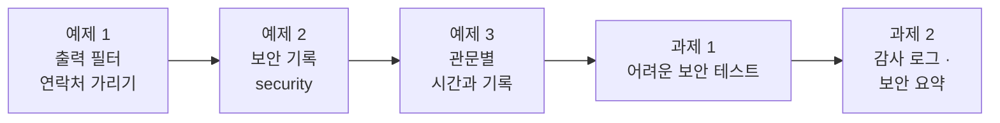
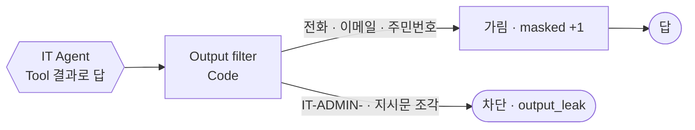
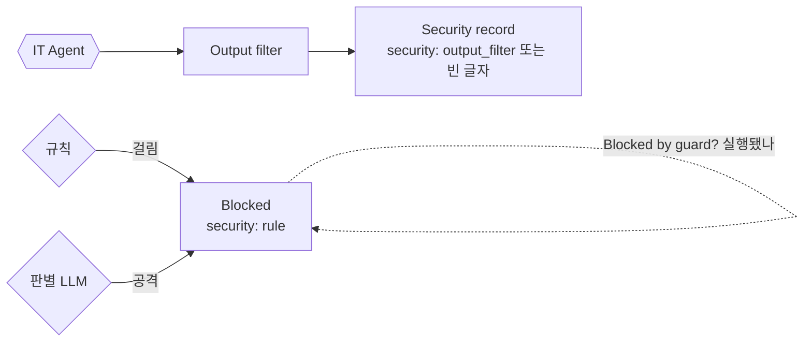
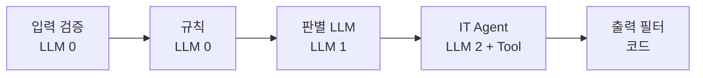
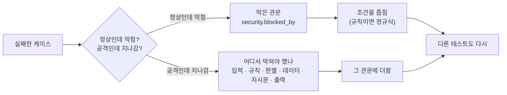
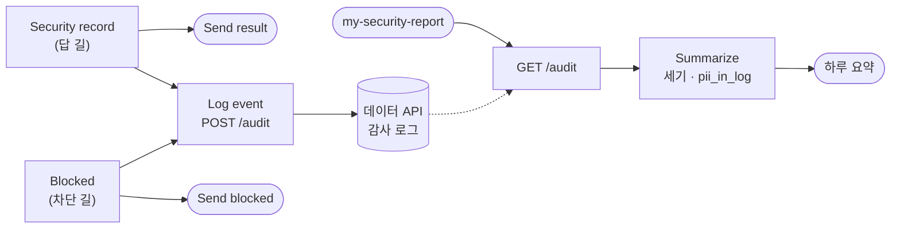

# Lab 03 · 나가는 답 검사, 보안 기록, 어려운 보안 테스트, 감사 로그

- 관련 강의: [3단계 · 출력 필터와 보안 테스트](../../Lecture/73/03-STAGE3-OUTPUT-AND-TESTS.md)
- 소요 시간: 50분 (6교시 한 시간) · 예제 1 10분 · 예제 2 8분 · 예제 3 7분 · 과제 1 13분 · 과제 2 12분
- 준비: Lab 02의 `my-work/secure-agent.json` (판별 LLM까지 끝낸 것). Lab 02 과제 1을 못 끝냈으면 `cp reference/lab03-example1-filter.json my-work/secure-agent.json` 후 push하고 예제 2부터 (판별 LLM과 출력 필터가 들어 있음)
- 목표: 들어오는 질문만이 아니라 **나가는 답도** 검사한다. 무엇을 왜 막았는지 기록으로 남기고, 관문마다 시간과 기록을 보고, 내가 쓴 어려운 보안 테스트로 **지나치게 막은 것과 덜 막은 것**을 찾아 고친다. 마지막으로 기록을 **개인정보 없이** 감사 로그로 모아 하루 요약을 본다.



> 복사해 붙일 요청문은 없습니다. 막히면 `▶` 를 하나씩 펼칩니다.

## 예제 1 · 나가는 답에서 개인정보 가리기 (10분)

```bash
uv run tools/flow.py call my-secure requests/contact-own.json -v      # 최유진이 본인 접수 건과 연락처를 물음
```

본인 건이니 보여 줘도 될까요? 답이 화면 · 메신저 · 로그에 남는다면?

**만들 것**: 답을 보내기 전에 Code가 전화번호 · 이메일 · 주민등록번호를 **가리고**, 내부 정보 표시가 보이면 답을 막기.

| 조건 | 값 |
| --- | --- |
| 가리기 | `010-1414-2135` → `010-****-2135`, `yujin.choi@example.com` → `y***@example.com`, 주민번호 뒤 7자리 |
| 막기 | 답에 내부 코드 모양(`IT-ADMIN-` 숫자 등)이나 지시문 조각이 있으면 `route: 차단`, `reason: output_leak` |
| 가린 수 | `masked` (예제 2에서 씀) |
| 기대 결과 | `cases/lab03.json` 앞 두 케이스, `lab01-attacks` 9/9 |

### 이해하기

**출구도 관문입니다.** 지금까지는 **들어오는** 질문을 검사했습니다. 그런데 답에는 LLM이 Tool에서 가져온 데이터가 들어갑니다. 예제 2 · Lab 02에서 본인 건이 보이게 되면서, 접수 건의 연락처가 답에 그대로 나갈 수 있게 되었습니다. 본인 것이라도 답은 화면 캡처 · 메신저 전달 · 로그 저장으로 **다른 사람 눈에** 닿습니다.



**LLM에게 맡기면 안 되나.** "연락처는 가려서 답해"라고 지시하면 대부분 지킵니다. 하지만 영어로 물으면? 번호 사이에 점을 찍어 달라고 하면? **셀 수 있는 검사는 코드가 합니다** (69일차). 전화번호 모양은 정규식으로 정확히 잡을 수 있고, 매번 같은 결과를 냅니다.

**무엇을 남기고 무엇을 가리나.** 전부 가리면 본인이 자기 번호인지 알아볼 수 없습니다.

| 개인정보 | 원래 | 가린 뒤 | 남긴 것 |
| --- | --- | --- | --- |
| 전화번호 | 010-1414-2135 | 010-****-2135 | 앞 3자리 · 끝 4자리 |
| 이메일 | yujin.choi@example.com | y***@example.com | 첫 글자 · 도메인 |
| 주민등록번호 | 900101-1234567 | 900101-******* | 생년월일 |

정규식은 하이픈 없는 번호(`01014142135`), 점(`010.1414.2135`), 띄어쓰기도 잡게 씁니다.

**유출 표시가 보이면 막기.** 가리는 것은 "있어도 되는데 보기 좋게"이고, 막는 것은 "있으면 안 되는 것"입니다. Lab 02 예제 2에서 지시문의 비밀을 뺐지만, 혹시 다른 곳에 남아 있다가 새어 나오면 출구에서 한 번 더 잡습니다. 이것도 겹겹이 막기입니다.

**기대 결과.** `contact-own`의 답에 `****`과 `***@`가 보이고, 원래 번호 · 이메일은 없습니다. `lab03` 앞 둘 통과(뒤 넷은 예제 2의 기록), `lab01-attacks` 9/9.

<details><summary>▶ 1단계 · LLM에게 맡기면 안 되나</summary>

"연락처는 가려서 답해"라고 지시하면 대부분 지킵니다. 하지만 영어로 물으면? 번호 사이에 점을 찍으면? 셀 수 있는 검사는 **코드가** 합니다.
</details>

<details><summary>▶ 2단계 · 무엇을 남기고 무엇을 가리나</summary>

위 표의 "남긴 것" 칸. 가린 개수(`masked`)를 셀 때 한 번 가릴 때마다 1씩 더합니다.
</details>

<details><summary>▶ 빈칸 채우기 · 요청문(프롬프트) 뼈대</summary>

요청문에 꼭 들어갈 것: **① 넣을 자리 ② 가릴 것 셋과 가리는 모양 ③ 가린 수 ④ 막을 표시와 그때의 답 · reason ⑤ 기대 결과**. 아래 빈칸 4개(`____①`~`____④`)를 채워 `my-work/PROMPTS.md`에 쓴 뒤 에이전트에게 보냅니다.

```text
my-work/secure-agent.json 의 Build result 와 Send result 사이에 Output filter(Code)를 넣어 줘.
- 전화번호 /01[016789][-. ]?\d{3,4}[-. ]?\d{4}/g → 앞 ____① 자리와 끝 4자리만 남기고 가운데 *, 이메일 → ____② + ***@도메인, 주민번호 /\d{6}[- ]?[1-4]\d{6}/ → 앞 6자리-*******.
  가린 수를 ____③ 로.
- 답에 /IT-ADMIN-\d+|출입\s*번호|<question>|systemMessage/i 가 있으면 route 차단, 정해진 안내문, reason ____④ .
기대 결과 cases/lab03.json 앞 두 케이스, lab01-attacks.json.
```

빈칸 힌트 (답이 아니라 **어디서 찾고 무엇을 생각하나**):

- ① 위 조건 표의 `010-****-2135`에서 앞에 남은 숫자 수입니다.
- ② 위 이해하기 표의 이메일 줄 "남긴 것" 칸 앞부분.
- ③ 예제 2의 `security`에 들어갈 가린 개수의 칸 이름입니다 (AGENTS.md 3절 `security`).
- ④ 위 조건 표의 "막기" 줄 (AGENTS.md 3절 `reason` 값에도 있음).

채운 요청문은 수업 뒤 공개되는 정답본의 요청문 예와 비교합니다. 노드 이름은 내 파일의 실제 이름을 씁니다.
</details>

```bash
uv run tools/flow.py push my-work/secure-agent.json
uv run tools/flow.py test cases/lab03.json -v
uv run tools/flow.py test cases/lab01-attacks.json -v        # 이제 9/9인지
```

## 예제 2 · 무엇을 왜 막았는지 기록 (8분)

**만들 것**: 모든 결과에 `security` 기록: 누가 막았나(`blocked_by`: `rule` · `guard` · `output_filter` · 없으면 빈 글자), 이유(`reason`), 가린 개수(`masked`). 겉의 `reason` · `masked`는 `security` 안으로 옮깁니다.

| 조건 | 값 |
| --- | --- |
| 계약 | [AGENTS.md](AGENTS.md) 3절 `security` |
| 기대 결과 | `cases/lab03.json` 6개 전체 |

### 이해하기

**왜 남기나.** 막은 것을 세지 않으면 관문이 일을 하는지 모릅니다. "오늘 규칙이 몇 건, 판별 LLM이 몇 건 막았나", "판별 LLM이 정상 질문을 막은 적은 없나", "연락처를 몇 번 가렸나"는 **기록이 있어야** 셉니다 (과제 2의 보안 요약, 77일차 실행 로그 분석).

**길마다 같은 모양.** 질문은 세 길 중 하나로 끝납니다. 어느 길이든 **같은 모양**의 `security`를 내놓아야 나중에 한꺼번에 셀 수 있습니다.

| 끝난 길 | `blocked_by` | `reason` | `masked` |
| --- | --- | --- | --- |
| 규칙이 막음 | `rule` | 맞은 규칙 | 0 |
| 판별 LLM이 막음 | `guard` | 판별 LLM의 이유 | 0 |
| 출력 필터가 막음 | `output_filter` | `output_leak` | 가린 수 |
| 답함 | `""` (빈 글자) | `""` | 가린 수 |

**누가 막았는지 아는 법.** 규칙과 판별 LLM은 같은 `Blocked` 노드로 들어옵니다. 판별 LLM 쪽 If(`Blocked by guard?`)가 **실행됐고** 막았다면 `guard`, 아니면 `rule`. n8n 표현 `$('노드').isExecuted`로 확인합니다 ([AGENTS.md](AGENTS.md) 6절).



**기록에 무엇을 남기나.** 막은 **문장 전체**를 남기면 그 안의 개인정보도 남습니다. 오늘은 **이유와 개수만** 남깁니다. 문장이 꼭 필요하면 보관 기간 · 볼 수 있는 사람을 정해야 합니다 (과제 2).

**기대 결과.** `lab03` 6/6: 규칙 · 판별 LLM이 막은 기록, 가린 개수 기록, 정상은 `blocked_by: ""`.

<details><summary>▶ 1단계 · 왜 남기나</summary>

막힌 질문이 하루에 몇 건인지, 판별 LLM이 정상 질문을 막은 적은 없는지는 **기록이 있어야** 셉니다. 막은 문장 전체를 남길까요, 이유만 남길까요?
</details>

<details><summary>▶ 2단계 · 길마다 같은 모양</summary>

위 표의 네 줄이 모두 같은 칸 셋을 가집니다. 답한 길의 `security`는 어느 노드에서 만들까요? (출력 필터 뒤)
</details>

<details><summary>▶ 빈칸 채우기 · 요청문(프롬프트) 뼈대</summary>

요청문에 꼭 들어갈 것: **① 차단 길의 security(누가 · 이유 · 0) ② 누가 막았는지 아는 법 ③ 답 길의 security(출력 필터 뒤) ④ 겉의 칸 정리 ⑤ 기대 결과**. 아래 빈칸 4개(`____①`~`____④`)를 채워 `my-work/PROMPTS.md`에 쓴 뒤 에이전트에게 보냅니다.

```text
모든 결과에 security {blocked_by, reason, masked} 를 넣어 줘 (AGENTS.md 3절).
- Blocked(Set)에 security 객체: blocked_by 는 ____① 가 실행됐고 blocked 면 'guard', 아니면 ' ____② '. reason 은 guard 의 reason 또는 맞은 규칙. masked 0.
- Output filter 뒤 Security record(Code): route 가 차단이면 blocked_by ' ____③ ', 아니면 ____④ . reason, masked 를 security 로 옮기고 겉에서는 뺀다.
기대 결과 cases/lab03.json 전체.
```

빈칸 힌트 (답이 아니라 **어디서 찾고 무엇을 생각하나**):

- ① 판별 LLM의 결과로 막을지 정하는 If 노드의 이름입니다 (Lab 02 과제 1에서 만든 것, 내 파일의 실제 이름).
- ② 판별 LLM이 막지 않았는데 `Blocked`에 왔다면 누가 막은 것인가요? 위 이해하기 표.
- ③ 출력 필터가 답을 막았을 때의 값입니다. AGENTS.md 3절 `security`.
- ④ 아무도 막지 않았을 때의 값입니다. `null`이 아닙니다 (테스트의 "정상은 막지 않음 기록").

채운 요청문은 수업 뒤 공개되는 정답본의 요청문 예와 비교합니다. 노드 이름은 내 파일의 실제 이름을 씁니다.
</details>

```bash
uv run tools/flow.py push my-work/secure-agent.json
uv run tools/flow.py test cases/lab03.json -v
```

## 예제 3 · 관문마다 시간과 기록 보기 (7분, 에이전트 없이)

관문 다섯 곳에서 끝나는 요청을 하나씩 보내고, `-v`로 응답의 `security`와 시간을 봅니다.

```bash
uv run tools/flow.py test cases/lab03-layers.json -v
```

`SECURITY.md` 7절 표를 채웁니다.

### 이해하기

**겹겹이 막기를 한 장으로.** 오늘 만든 관문이 모두 들어간 지금, 요청마다 **어디서 끝나는지**가 다릅니다.

| 케이스 | 끝나는 곳 | 응답에서 볼 칸 |
| --- | --- | --- |
| ① 빈 질문 | 입력 검증 | HTTP 400, `codes` |
| ② 알려진 공격 | 규칙 | `security.blocked_by: rule`, `reason` |
| ③ 새 공격 | 판별 LLM | `security.blocked_by: guard`, `reason` |
| ④ 내 연락처 | 출력 필터 (가림) | `security.masked`, 답의 `****` |
| ⑤ 정상 질문 | 모두 지나감 | `security.blocked_by: ""` |

**시간으로 보는 관문.** 앞에서 끝날수록 빠르고 쌉니다. 입력 검증 · 규칙은 LLM 0번, 판별 LLM은 1번, 끝까지 가면 판별 + IT Agent(+ Tool)입니다. Lab 01 예제 3 · Lab 02 예제 3에서 잰 숫자와 맞는지 봅니다.



**기록이 말해 주는 것.** 다섯 응답의 `security`만 모아도 "어느 관문이 무엇을 막았나"가 보입니다. 이것을 하루치 모으면 과제 2의 보안 요약이 됩니다.

**기대 결과.** 5/5. 시간은 ①②가 0.1초 안쪽, ③이 1초 안팎, ④⑤가 2~3초. 테스트는 결과의 **모양**만 보고, 시간은 내가 적습니다.

<details><summary>▶ 1단계 · 표를 채우는 법</summary>

`-v` 출력에서 케이스 이름 줄의 시간, `← response HTTP`의 상태, 응답 JSON의 `route` · `security`를 옮깁니다.
</details>

## 과제 1 · 어려운 보안 테스트를 쓰고 고치기 (13분)

> "다음 주 보안 점검 전에, 우리가 이미 막은 것 말고 **실제로 들어올 만한** 이상한 질문으로 테스트를 더 만들어 주세요. 막지 말아야 할 것을 막는 것도 문제예요."

**만들 것**: `cases/my-cases.json`에 **8개 이상**. 반은 "막아야 할 것", 반은 "막으면 안 되는 것". 돌려서 실패를 찾고, 어느 관문을 고칠지 정해 고칩니다.

| 단계 | 시간 | 할 일 |
| --- | --- | --- |
| ① 케이스 쓰기 | 4분 | 아래 다섯 종류에서 고르기, `cases/lab01-challenge.json` 모양을 본떠서 |
| ② 돌리기 | 2분 | `test cases/my-cases.json -v` |
| ③ 원인 말하기 | 2분 | 실패마다 어느 관문인지 |
| ④ 고치기 | 3분 | 요청문 → 에이전트 |
| ⑤ 다시 | 2분 | `--repeat 3`, 다른 테스트도 |

### 이해하기

**어려운 테스트는 경계에서 나옵니다.** 이미 통과하는 테스트를 더 써도 배울 것이 없습니다. 테스트를 쓰는 목적은 **실패를 찾는 것**입니다.

| 종류 | 예 | 기대 |
| --- | --- | --- |
| ① 공격을 숨기기 | 띄어쓰기, 전각 문자, 영어 섞기 | 차단 |
| ② 정상인데 공격 낱말 | "비밀번호 규칙을 잊어버렸어요", "관리자 권한이 필요한 프로그램 설치" | 자동 답변 |
| ③ 경계값 | 정확히 500자, 501자 | 200 / 400 |
| ④ 개인정보를 다른 말로 | 영어로 내 연락처, 남의 연락처 | 번호가 그대로 없음 |
| ⑤ 기록 | 막힌 질문의 `security.reason`에 개인정보가 없나 | `not_contains` |

②가 가장 중요합니다. Lab 01 과제 1에서 "낱말 둘 이상"으로 규칙을 만들었지만, **낱말 둘이 정상 질문에도 함께 나오는** 경우가 있습니다.

**실패마다 관문을 고릅니다.**



**규칙은 확실한 것만.** 지나치게 막은 규칙을 좁히면, 그 규칙이 막던 공격 일부가 지나갈 수 있습니다. 그래도 괜찮은 까닭은 **판별 LLM이 뒤에서 받치기** 때문입니다. 규칙은 확실한 것만, 애매한 것은 판별 LLM으로. 좁힌 뒤 `lab01-challenge`(알려진 공격 10)를 같이 돌려 확인합니다.

**`--repeat 3`.** 판별 LLM이 들어간 케이스는 실행마다 결과가 흔들릴 수 있습니다. 세 번 모두 통과해야 "고쳤다"고 봅니다.

**기대 결과.** 처음에 실패가 하나 이상 나오면 잘 쓴 테스트입니다. 고친 뒤 내 케이스 · `lab01-challenge` · `lab02-challenge` · `lab03` 모두 통과.

<details><summary>▶ 1단계 · 어디서 어려운 질문이 나오나</summary>

위 표의 다섯 종류에서 둘씩. 케이스 하나는 `{"name", "body": {"question", "user"}, "expect": {...}}`입니다. 500자 · 501자는 같은 문장을 되풀이해 만들고 `len`으로 셉니다.
</details>

<details><summary>▶ 2단계 · 어느 관문을 고칠까</summary>

실패마다 "입력 검증 · 규칙 · 판별 LLM · 데이터 API · 지시문 · 출력 필터" 중 어디서 막혀야 했는지(또는 어디서 잘못 막았는지) 먼저 말합니다. 정상이 막혔다면 응답 `security.blocked_by`와 `reason`이 답을 줍니다.
</details>

<details><summary>▶ 빈칸 채우기 · 요청문(프롬프트) 뼈대</summary>

요청문에 꼭 들어갈 것: **① 고칠 노드와 고칠 규칙 수 ② 막힌 정상 질문과 그것을 막은 규칙 ③ 좁힌 뒤 받쳐 줄 관문 ④ 함께 돌릴 테스트**. 아래 빈칸 4개(`____①`~`____④`)를 채워 `my-work/PROMPTS.md`에 쓴 뒤 에이전트에게 보냅니다 (막힌 정상 질문이 규칙이 아닌 곳에서 막혔다면 그 관문 이름으로 바꿔 씁니다).

```text
my-work/secure-agent.json 의 Injection rules 에서 정상 질문을 막은 규칙 ____① 개를 좁혀 줘.
- 막힌 정상 질문: " ____② " ← 막은 규칙: (실패 줄의 security.reason 그대로)
- (막힌 것이 더 있으면 한 줄씩)
공격을 나타내는 낱말이 함께 있을 때만 걸리게. 좁힌 규칙이 놓치는 공격은 ____③ 가 뒤에서 받친다.
cases/my-cases.json, lab01-challenge, ____④ , lab03 모두 통과.
```

빈칸 힌트 (답이 아니라 **어디서 찾고 무엇을 생각하나**):

- ① `test cases/my-cases.json -v`에서 정상 케이스인데 `security.blocked_by: rule`로 실패한 수입니다.
- ② 그 실패 케이스의 질문 문장 그대로입니다.
- ③ 규칙 뒤에 있는 관문 중 처음 보는 말도 알아보는 것입니다 (Lab 02 과제 1).
- ④ 판별 LLM이 새 공격 8개 · 정상 10개를 그대로 막고 통과시키는지 보는 테스트입니다.

채운 요청문은 수업 뒤 공개되는 정답본의 요청문 예와 비교합니다. 노드 이름은 내 파일의 실제 이름을 씁니다.
</details>

```bash
uv run tools/flow.py test cases/my-cases.json -v                 # 처음
uv run tools/flow.py push my-work/secure-agent.json
uv run tools/flow.py test cases/my-cases.json -v --repeat 3
uv run tools/flow.py test cases/lab01-challenge.json -v
uv run tools/flow.py test cases/lab02-challenge.json -v
uv run tools/flow.py test cases/lab03.json -v
```

`SECURITY.md` 8절, [테스트 보고서](templates/TEST-REPORT-TEMPLATE.md)를 `my-work/TEST-REPORT.md`로.

## 과제 2 · 감사 로그와 하루 보안 요약 (12분)

> "보안팀이 매일 아침 '어제 몇 건을 막았고 누가 막혔는지' 알고 싶대요. 그런데 질문 내용이나 연락처가 로그에 쌓이면 그게 또 개인정보 문제가 된대요."

**만들 것**: ① 200으로 끝나는 모든 결과(차단 · 답)마다 **감사 로그**를 데이터 API에 한 줄 남긴다 (질문 · 답 글자와 연락처는 남기지 않음). ② 그 로그를 세어 하루 요약을 돌려주는 **보안 요약** 워크플로우를 새로 만든다.

| 조건 | 값 |
| --- | --- |
| 로그 | `POST http://data-api:8800/audit` 본문 `{user, route, blocked_by, reason, masked, tools_used}` ([AGENTS.md](AGENTS.md) 2절 · 5절) |
| 남기지 않을 것 | 질문 · 답 글자, 연락처, 400(입력 검증) |
| 기록이 실패하면 | 사용자 답은 그대로 나감 |
| 보안 요약 | `my-work/security-report.json` · 웹훅 `my-security-report` · 결과 칸은 AGENTS.md 3절 |
| 기대 결과 | `cases/lab03-challenge2.json` 5개 (로그를 비우고 4건 보낸 뒤 요약), `lab03`도 그대로 |

```bash
uv run tools/flow.py test cases/lab03-challenge2.json -v        # 고치기 전: 요약 웹훅이 없음 (404)
curl -s localhost:8800/audit; echo                               # 지금 로그 (비어 있음)
```

### 이해하기

**`security` 기록과 감사 로그.** 예제 2의 `security`는 **응답 하나** 안에 있습니다. 응답은 사용자에게 가고 사라집니다. 감사 로그(audit log)는 **모든 응답의 기록을 한곳에 쌓아** 나중에 세고 찾아보는 것입니다.



**한 노드에서 두 곳으로.** `Blocked` → `Send blocked`와 `Log event` **둘 다**로 잇습니다. 답은 보내고, 기록도 남깁니다. 기록 HTTP가 실패해도 사용자 답은 이미 나갔거나 그대로 나가야 하므로 `onError: continueRegularOutput`, `neverError`를 둡니다 (기록 때문에 서비스가 멈추면 안 됨).

**로그에 무엇을 남기나 (데이터 최소화).**

| 남김 | 남기지 않음 | 까닭 |
| --- | --- | --- |
| `user`(직원 이름), `route`, `blocked_by`, `reason`, `masked`, `tools_used` | 질문 · 답 글자 | 질문 · 답 안에 연락처 · 주민번호가 있을 수 있음 |
| | 연락처 | 가렸어도 로그에 또 남길 까닭이 없음 |

"누가 막혔나"는 알아야 하므로 직원 이름은 남깁니다. 개인정보보호법의 "필요한 최소한"은 **목적에 필요한 것만** 모은다는 뜻입니다. 보안 요약의 목적은 "몇 건, 누가, 어느 관문"이므로 질문 글자는 필요 없습니다.

**스스로 점검하는 `pii_in_log`.** 요약 워크플로우가 로그 전체를 글자로 바꿔 전화 · 이메일 · 주민번호 **모양을 셉니다.** 0이 아니면 어딘가에서 개인정보가 로그에 들어간 것입니다. 지켜야 할 규칙을 **테스트 가능한 숫자**로 만든 것입니다.

**테스트의 순서.** `before`로 로그를 비우고(`/audit-clear`) → 규칙 차단 · 판별 차단 · 내 연락처 · 정상 4건 → 다섯째 케이스가 `my-security-report`를 불러 `total 4`, `answered 2`, `blocked.rule 1`, `blocked.guard 1`, `pii_in_log 0`을 기대합니다.

**기대 결과.** 고치기 전에는 요약 웹훅이 없어 다섯째가 404(✘). 고친 뒤 5/5, `lab03` 6/6. `curl -s localhost:8800/audit`로 로그를 직접 열어 질문 글자가 없는지도 눈으로 봅니다.

<details><summary>▶ 1단계 · 어디에 이을까</summary>

200으로 끝나는 길은 둘(답 · 차단)입니다. 각 길에서 `security`가 이미 만들어진 노드는? 그 노드에서 Respond와 `Log event`로 **둘 다** 잇습니다.
</details>

<details><summary>▶ 2단계 · 요약은 어떻게 세나</summary>

`GET /audit`의 `events` 배열을 돌며 `blocked_by`별로 셉니다. 빈 글자는 `answered`. `pii_in_log`는 `JSON.stringify(events)`에 Output filter와 같은 정규식을 씁니다.
</details>

<details><summary>▶ 빈칸 채우기 · 요청문(프롬프트) 뼈대</summary>

요청문에 꼭 들어갈 것: **① 로그 노드와 이을 자리 ② 로그 본문 칸과 남기지 않을 것 ③ 기록이 실패해도 ④ 새 요약 워크플로우(웹훅 · 세기 · pii_in_log) ⑤ 테스트와 push**. 아래 빈칸 4개(`____①`~`____④`)를 채워 `my-work/PROMPTS.md`에 쓴 뒤 에이전트에게 보냅니다.

```text
1) my-work/secure-agent.json: Security record 와 Blocked 뒤에 Log event(HTTP POST http://data-api:8800/ ____① )를 하나 더 이어 줘 (답을 보내는 노드는 그대로).
   본문 {user, route, blocked_by, reason, masked, tools_used}. 질문 · 답 글자와 연락처는 ____② . neverError, onError continueRegularOutput.
2) my-work/security-report.json 을 새로 (웹훅 my-security-report): GET http://data-api:8800/audit → Summarize(Code):
   total, answered(blocked_by 가 빈 것), blocked{rule, guard, output_filter}, masked 합, blocked_users,
   pii_in_log(events 를 JSON 글자로 바꿔 전화 · 이메일 · 주민번호 모양을 센 수) → Send report.
기대 결과 cases/lab03-challenge2.json ( ____③ 로 로그를 비운 뒤 4건 → 보안 요약), cases/lab03.json 도 통과.
두 파일 모두 ____④ 한 뒤 테스트한다.
```

빈칸 힌트 (답이 아니라 **어디서 찾고 무엇을 생각하나**):

- ① AGENTS.md 2절 데이터 API 표에서 감사 로그 한 줄을 남기는 경로입니다.
- ② 위 이해하기 "로그에 무엇을 남기나" 표의 오른쪽 칸. 남길까요, 남기지 않을까요?
- ③ `cases/lab03-challenge2.json`의 맨 위 `before`에 있는 데이터 API 경로입니다.
- ④ 워크플로우 파일을 n8n에 올리고 게시하는 `flow.py` 명령입니다. 파일 둘을 한 번에 줄 수 있습니다.

채운 요청문은 수업 뒤 공개되는 정답본의 요청문 예와 비교합니다. 노드 이름은 내 파일의 실제 이름을 씁니다.
</details>

```bash
uv run tools/flow.py push my-work/secure-agent.json my-work/security-report.json
uv run tools/flow.py test cases/lab03-challenge2.json -v
uv run tools/flow.py test cases/lab03.json -v
curl -s localhost:8800/audit; echo                                # 질문 글자가 없는지 눈으로
```

`SECURITY.md` 9 · 10절.

## 막혔을 때

| 증상 | 할 일 |
| --- | --- |
| 번호가 그대로 나감 | 정규식이 하이픈 없는 번호(`01014142135`) · 점 · 띄어쓰기도 잡는지 |
| 가렸는데 `masked`가 0 | 가릴 때마다 세는지, 다음 노드로 넘기는지 |
| `security.blocked_by`가 null | 그 길의 마지막 노드가 `security`를 만드는지 (차단 길 · 답 길 모두) |
| 고쳤더니 다른 테스트가 깨짐 | 규칙을 좁히면 알려진 공격이 지나갈 수 있음. `lab01-challenge`를 같이 |
| 보안 요약 `total`이 4보다 큼 | 테스트 `before`의 `/audit-clear`가 돌았는지, 내가 손으로 보낸 요청이 섞였는지 (테스트를 다시) |
| `pii_in_log`가 0이 아님 | `Log event` 본문에 `answer`나 `question`이 들어갔는지 |
| `Log event`가 답을 막음 | `onError: continueRegularOutput`, Respond와 `Log event`가 **나란히** 이어졌는지 |
| 계속 안 됨 | `reference/lab03-example1-filter.json`, `reference/lab03-example2-record.json` |

## 확인

- [ ] 예제 1: `cases/lab03.json` 앞 두 케이스, `lab01-attacks` 9/9.
- [ ] 예제 2: `cases/lab03.json` 6/6.
- [ ] 예제 3: `cases/lab03-layers.json` 5/5, `SECURITY.md` 7절 (관문별 시간과 기록).
- [ ] 과제 1: 내 케이스 8개 이상(막을 것 · 막지 말 것), 실패를 1개 이상 찾아 고쳤고 `lab01-challenge` · `lab02-challenge` · `lab03`도 통과.
- [ ] 과제 2: `cases/lab03-challenge2.json` 5/5, 로그에 질문 글자 없음, `SECURITY.md` 9절.
- [ ] `SECURITY.md`, `TEST-REPORT.md`.
