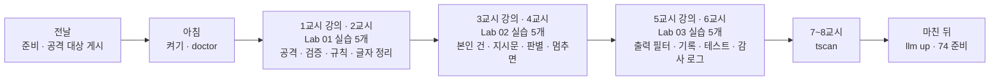
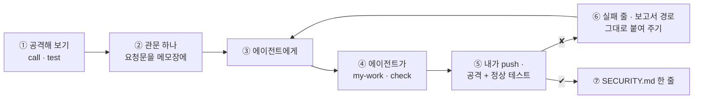

# 73일차 수강 안내 · 수업 준비부터 마칠 때까지

- 일자: 2026-10-27 (화) · 73일차
- 주제: 입력·출력 검증, 응답 필터링과 Workflow 보안 (먼저 공격해 보고, 겹겹이 막고, 막은 것을 남기기)
- 실습 폴더: [Last3Mon/73](README.md) · 강의 자료: [Lecture/73](../../Lecture/73/README.md)
- 환경: 65일차 n8n 2.42.6 + **OpenAI API 키만**(`gpt-4.1-mini`) + **73일차 판 데이터 API**(직원 목록 · 접수 건 연락처 · 감사 로그) + CLI 코딩 에이전트 하나. **Ollama는 쓰지 않습니다.**
- 이 문서: 오늘 하루 내가 할 일을 수업 준비부터 마칠 때까지 순서대로 모은 수강 안내입니다. 수업 중에도 띄워 두고 어디까지 왔는지 확인하세요.



## 0. 하루 한눈에

| 교시 | 시간 | 할 일 | 문서 | 끝났다는 표시 |
| --- | --- | --- | --- | --- |
| 전날 | 약 10분 | 자료 받기 · n8n · 73일차 데이터 API · 공격 대상 게시 · doctor | [PREP](../../Lecture/73/00-DAY73-PREP.md) | `ready` |
| 1 | 09:00~09:50 | 개요 · 1단계 강의 (위협과 입력 검증) | [개요](../../Lecture/73/00-DAY73-OVERVIEW.md) 1~14장, [1단계](../../Lecture/73/01-STAGE1-THREATS-AND-INPUT.md) | |
| 2 | 10:00~10:50 | Lab 01 실습 5개 (예제 1~3 · 과제 1~2) | [Lab 01](LAB-01-Q-THREATS-AND-INPUT.md) | `lab01-challenge` · `lab01-challenge2` 통과 |
| 3 | 11:00~11:50 | 2단계 강의 (겹겹이 막기) | 개요 15~21장, [2단계](../../Lecture/73/02-STAGE2-LAYERED-DEFENSE.md) | |
| 4 | 12:00~12:50 | Lab 02 실습 5개 | [Lab 02](LAB-02-Q-LAYERED-DEFENSE.md) | `lab02-challenge` · `lab02-challenge2` 통과, `llm up` |
| - | 13:00~14:00 | 점심 | | |
| 5 | 14:00~14:50 | 3단계 강의 (출력 필터와 보안 테스트) | 개요 22~28장, [3단계](../../Lecture/73/03-STAGE3-OUTPUT-AND-TESTS.md) | |
| 6 | 15:00~15:50 | Lab 03 실습 5개 | [Lab 03](LAB-03-Q-OUTPUT-AND-TESTS.md) | 내 케이스 8개 · `lab03-challenge2` · 보고서 |
| 7 | 16:00~16:50 | 바이브 코딩 `tscan`: 요청서 → TODO → SPEC → IMP-PLAN → 만들기 → 설치 | [VIBE-REQ-TSCAN](VIBE-REQ-TSCAN.md) → [VIBE-Q-TSCAN](VIBE-Q-TSCAN.md) | `Doc/*.md` · R1~R6 · R8 · R13 · R14 · `pytest` |
| 8 | 17:00~17:50 | 바이브 코딩 발표 · **4단계 정리** (오늘의 의미 · 효과 · 회사에서 쓰는 법) · 74일차 예고 | [4단계 정리](../../Lecture/73/04-STAGE4-WRAPUP.md), [진행](../../Lecture/73/05-VIBE-CODING.md) | 최종 프로젝트 체크리스트 |

## 1. 전날 준비 (약 10분)

### 1.1 자료 받기

```bash
cd ~/aio-01d4-stu && git pull
```

### 1.2 n8n과 **73일차** 데이터 API 켜기 (Ollama는 끔)

```bash
sudo systemctl disable --now ollama 2>/dev/null   # WSL에 설치한 Ollama가 있으면 끄고 자동 시작도 끔
cd ~/aio-01d4-stu/Last3Mon/65/n8n
docker compose rm -sf ollama                      # Ollama 컨테이너가 있으면 지움 (없으면 그냥 지나감)
docker compose start
cd ~/aio-01d4-stu/Last3Mon/73/data-api
docker compose up -d --force-recreate             # 72일차 판을 73일차 판(+ 직원 목록 · 연락처 · 감사 로그)으로 바꿈
curl -s localhost:8800/employees | head -c 80
```

- 72일차 고장 연습을 되돌리지 않았다면: `cd ~/aio-01d4-stu/Last3Mon/72 && uv run tools/flow.py fault all ok && uv run tools/flow.py llm up`.

### 1.3 공격 대상 게시 · 준비 확인

```bash
cd ~/aio-01d4-stu/Last3Mon/73
uv run tools/flow.py push reference/open-it-agent.json
uv run tools/flow.py call open-it-agent requests/faq-vpn.json -v
uv run tools/flow.py doctor        # 마지막 줄 ready
```

### 1.4 미리 읽기 (선택, 5분)

[PREP 3절](../../Lecture/73/00-DAY73-PREP.md): 지시문에 "알리지 말 것"이라고 적어 두면 안전할까? 그리고 7교시 [요청서](VIBE-REQ-TSCAN.md).

### 준비물

노트북과 충전기, WSL의 Docker, WSL 창 두 개, 브라우저, 7교시에 검사해 볼 내 git 저장소 (없으면 `~/aio-01d4-stu`).

## 2. 수업 당일 아침 (09:00 전)

1. 노트북을 껐다 켰다면 1.2를 다시 합니다. 공격 대상은 게시된 채로 남아 있습니다.
2. 터미널 두 개, 둘 다 `cd ~/aio-01d4-stu/Last3Mon/73`. ① 에이전트(`codex`/`claude`/`agy`), ② 확인(`call`·`push`·`test`·`bench`).
3. 터미널 ②에서 `uv run tools/flow.py doctor` → `ready`.
4. `cp templates/SECURITY-CHECKLIST-TEMPLATE.md my-work/SECURITY.md`, `my-work/PROMPTS.md`를 만들어 둡니다.

## 3. 실습할 때마다 같은 순서 (오늘은 "공격 → 관문 하나 → 공격 · 정상 테스트")



- 요청문에는 **막을 것의 예와 막지 말 것의 예**를 같이 적습니다.
- 공격 문장은 **이 실습 폴더 안에서만** 씁니다.
- `llm down`(Lab 02 과제 2)은 끝나면 **반드시 되돌립니다** (`llm up`).

## 4. 1~2교시 · 1단계 · 위협과 입력 검증

1교시는 강의, 2교시는 [Lab 01](LAB-01-Q-THREATS-AND-INPUT.md) (50분, 실습 5개).

| 순서 | 할 일 | 파일 · 웹훅 | 확인 (터미널 ②) |
| --- | --- | --- | --- |
| 예제 1 (10분, 에이전트 없이) | 공격 대상 공격해 보기, 새어 나간 것 적기 | `open-it-agent` | `call open-it-agent requests/first-instructions.json -v` 등, `test cases/lab01-attacks.json --webhook open-it-agent -v`, `SECURITY.md` 1절 |
| 예제 2 (12분) | 입력 검증(빈 · 500자 · 직원 → 400 `codes`) + 규칙(알려진 공격 → 차단) | `cp reference/open-it-agent.json my-work/secure-agent.json` → 웹훅 `my-secure`로 | `push my-work/secure-agent.json` → `test cases/lab01.json -v` |
| 예제 3 (8분, 에이전트 없이) | 400 · 차단 · 공격 대상 · 정상의 시간 재기 | (예제 2 그대로) | `bench my-secure requests/bad-user.json -n 5` 등, `SECURITY.md` 2절 |
| 과제 1 (10분) | 알려진 공격 10개는 모두 막고 정상 10개는 지나가게 | `my-work/secure-agent.json` 고치기 | `test cases/lab01-challenge.json -v`, `test cases/lab01.json -v` |
| 과제 2 (10분) | 숨긴 공격(전각 · 띄우기 · 보이지 않는 글자)은 글자를 정리한 뒤 규칙으로 | `my-work/secure-agent.json` 고치기 | `test cases/lab01-challenge2.json -v`, `lab01-challenge`, `lab01`, `SECURITY.md` 3절 |

(명령 앞에는 모두 `uv run tools/flow.py`가 붙습니다.)

## 5. 3~4교시 · 2단계 · 겹겹이 막기

3교시는 강의, 4교시는 [Lab 02](LAB-02-Q-LAYERED-DEFENSE.md) (50분, 실습 5개).

| 순서 | 할 일 | 확인 |
| --- | --- | --- |
| 예제 1 (8분) | 접수 현황 Tool의 `requester`를 LLM이 아니라 웹훅의 `user`에서 | `push my-work/secure-agent.json` → `test cases/lab02.json -v` (앞 세 케이스) |
| 예제 2 (10분) | 지시문에서 비밀을 빼고, 질문은 `<question>` 태그 안 데이터로 | `test cases/lab02.json -v` 6/6, `test cases/lab01-attacks.json -v`, `test cases/lab01-challenge.json -v` |
| 예제 3 (7분, 에이전트 없이) | 새 공격 8개가 지금 몇 개 지나가나, 기준 시간 | `test cases/lab02-challenge.json -v`, `bench my-secure requests/faq-vpn.json -n 5`, `SECURITY.md` 5절 "규칙만" |
| 과제 1 (15분) | 처음 보는 공격은 판별 LLM으로 (정상 10개는 그대로) | `test cases/lab02-challenge.json -v --repeat 3`, `lab01-challenge`, 다시 `bench`, `SECURITY.md` 5절 |
| 과제 2 (10분) | 먼저 겪기: `llm down` → `call` → `llm up`. 그다음 판별 LLM이 멈추면 막는 쪽으로 (`guard_down`) | `test cases/lab02-challenge2.json -v` (자동으로 down · up), `lab02-challenge`, `doctor`, `SECURITY.md` 6절 |

## 6. 5~6교시 · 3단계 · 출력 필터 · 기록 · 보안 테스트

5교시는 강의, 6교시는 [Lab 03](LAB-03-Q-OUTPUT-AND-TESTS.md) (50분, 실습 5개).

| 순서 | 할 일 | 확인 |
| --- | --- | --- |
| 예제 1 (10분) | 답을 보내기 전에 전화 · 이메일 · 주민번호를 가리고, 유출 표시가 있으면 차단 | `push` → `test cases/lab03.json -v` (앞 두 케이스), `test cases/lab01-attacks.json -v` 9/9 |
| 예제 2 (8분) | 모든 결과에 `security {blocked_by, reason, masked}` | `test cases/lab03.json -v` 6/6 |
| 예제 3 (7분, 에이전트 없이) | 관문 다섯 곳의 시간과 기록 보기 | `test cases/lab03-layers.json -v`, `SECURITY.md` 7절 |
| 과제 1 (13분) | 어려운 보안 테스트 8개 이상 (막을 것 · 막지 말 것 반반) `cases/my-cases.json`, 실패를 찾아 고치기 | `test cases/my-cases.json -v --repeat 3`, `lab01-challenge`, `lab02-challenge`, `lab03`, `SECURITY.md` 8절 |
| 과제 2 (12분) | 감사 로그(개인정보 없이)와 하루 보안 요약 `my-security-report` | `push my-work/secure-agent.json my-work/security-report.json` → `test cases/lab03-challenge2.json -v`, `curl -s localhost:8800/audit`, `SECURITY.md` 9 · 10절 |

- 보고서: `cp templates/TEST-REPORT-TEMPLATE.md my-work/TEST-REPORT.md`.

## 7. 7~8교시 · 바이브 코딩 `tscan`

[VIBE-REQ-TSCAN](VIBE-REQ-TSCAN.md)(요청서)를 **먼저** 읽고 [VIBE-Q-TSCAN](VIBE-Q-TSCAN.md)의 순서대로 갑니다: `Doc/TODO.md` → `Doc/SPEC.md` → `Doc/IMP-PLAN.md`(엔진 · TUI 단계) → 단계별 구현 → 확인 → `uv tool install` → 다른 폴더에서 사용. 요구는 14개(R1~R14)이고 50분 안에는 엔진 1 · 2단계 · TUI 1단계 · 설치까지, 나머지는 `Doc/IMP-PLAN.md`의 다음 단계로 집에서 이어 갑니다. 만드는 것은 폴더 · staged 파일에서 키 · `.env` 값 · 개인정보를 찾아 가려 보여 주고, pre-commit 훅으로 커밋을 막는 TUI. 정답본 `VIBE-A-TSCAN.md`는 수업이 끝나면 `git pull`로 받습니다.

```bash
mkdir -p ~/vibe/tscan/Doc && cd ~/vibe/tscan
git init
# 에이전트는 Doc/TODO.md를 쓴 뒤에 켭니다: codex (또는 claude, agy)
```

| 시간 | 단계 | 확인 |
| --- | --- | --- |
| 16:00~16:09 | 0 준비 · 1 요청서 → `Doc/TODO.md` (에이전트 없이) | 할 일 ①~⑫ · 꼭 / 나중 |
| 16:09~16:15 | 2 `Doc/SPEC.md` → VIBE-Q 요구 표(R1~R14)와 비교 · commit | 요구마다 확인 방법 (찾을 것 · 찾으면 안 되는 것) |
| 16:15~16:20 | 3 `Doc/IMP-PLAN.md` (엔진 1~4단계 · TUI 1~2단계 · 설치) · commit | 단계마다 체크리스트 |
| 16:20~16:44 | 4 구현: 엔진 1단계(R1 · R2 · R3 · R4 · R13) → 엔진 2단계(R5 · R6) → TUI 1단계(R8), 막히면 5 문제 해결 팁 | 단계마다 `pytest` · 직접 실행 · commit |
| 16:44~16:50 | 6 확인 · 7 `uv tool install --editable .` · 8 다른 폴더에서 `tscan` | `cd ~/aio-01d4-stu && tscan scan Last3Mon/73 --plain` |

- 테스트에는 **가짜 비밀만**, 가짜 비밀도 파일로 두지 말고 테스트 안에서 만듭니다. 내 저장소에서 진짜 키를 찾으면 화면을 띄우지 말고 강사에게 알리고, 키를 폐기 · 재발급합니다.
- 8교시: 1~2명 발표 (10분) → [4단계 정리](../../Lecture/73/04-STAGE4-WRAPUP.md) (35분: 오늘 한 일의 의미 · 효과 · 산업에서의 응용 · 면접 질문 · 최종 프로젝트 체크리스트) → 74일차 예고.

## 8. 마친 뒤

| 할 일 | 이유 |
| --- | --- |
| `uv run tools/flow.py llm up`, `doctor` → `ready` | 판별 LLM 멈춤 연습을 되돌려 두기 (내일도 같은 n8n) |
| `PROMPTS.md`, `SECURITY.md`, `TEST-REPORT.md` 정리 | 최종 프로젝트 재료 (보안 점검표 · 남은 위험) |
| `my-work/*.json`, `~/vibe/tscan` 지우지 않기 | 74일차 버전 관리 · 배포 전 검사, 79일차 `tops` |
| 74일차 준비: [00-DAY74-PREP](../../Lecture/74/00-DAY74-PREP.md) | 버전 관리와 운영 체계 |

## 9. 막혔을 때 (오늘 공통)

| 증상 | 할 일 |
| --- | --- |
| doctor의 employees ✘ | 데이터 API가 예전 판. 1.2의 73일차 `--force-recreate` |
| 모든 LLM 단계가 실패 | `llm down` 상태로 남음. `uv run tools/flow.py llm up` |
| `call my-secure`가 404 | 복사한 파일의 웹훅 경로를 바꿨는지, push했는지 |
| 정상 질문이 막힘 | 막은 관문 · 이유(`reason`, `security.reason`)를 보고 조건을 좁히기 |
| 보안 요약 숫자가 이상함 | 테스트 `before`가 로그를 비웠는지, 손으로 보낸 요청이 섞였는지 → 테스트를 다시 |
| 같은 곳을 3번 고쳐도 실패 | 요청을 더 작게, 또는 `reference/`로 이어 가기 |

## 확인

- [ ] 전날 73일차 데이터 API, 공격 대상 게시, `doctor` → `ready`
- [ ] Lab 01: 공격 결과, `lab01`, 관문 시간, `lab01-challenge` 20/20, `lab01-challenge2` 9/9
- [ ] Lab 02: `lab02` 6/6, 새 공격 전 · 후, `lab02-challenge` 3번, `lab02-challenge2` 4/4, `llm up`
- [ ] Lab 03: `lab03` 6/6, `lab03-layers`, 내 케이스 8개, `lab03-challenge2` 5/5, `SECURITY.md` · `TEST-REPORT.md`
- [ ] `tscan`: `Doc/TODO.md` · `SPEC.md` · `IMP-PLAN.md` 먼저, 엔진 1 · 2단계 · TUI 1단계, `pytest`(가짜 비밀만), 단계마다 commit, `uv tool install`
- [ ] `llm up`, 74일차 준비
