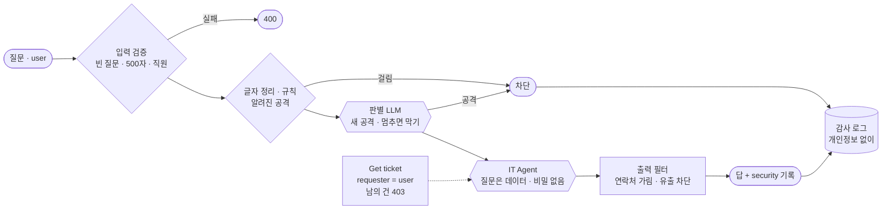

# 73일차 실습 · 입력·출력 검증, 응답 필터링과 Workflow 보안 (바이브 코딩)

- 일자: 2026-10-27 (73일차)
- 교과목: 노코드 멀티 에이전트 워크플로우 설계 및 운영
- 단원: 운영·확장 관점의 AI 워크플로우 설계 고도화
- 강의 자료: [Lecture/73](../../Lecture/73/README.md)
- 하루 수강 안내: [LECTURE-73.md](LECTURE-73.md) (수업 준비부터 마칠 때까지 순서대로)
- 67~72일차처럼 CLI 코딩 에이전트에게 **내가 쓴 요청문**으로 워크플로우를 만들게 하고, **테스트로 확인**합니다. 오늘은 먼저 **공격해 보고**, 겹겹이 막고, 막은 것을 남깁니다.

## 오늘 만드는 것: 겹겹이 지키는 IT 문의 Agent

`reference/open-it-agent.json`(웹훅 `open-it-agent`)은 67일차 IT 문의 Agent를 전 직원에게 그대로 연 것입니다. 지시문에 내부 메모가 있고, 질문한 사람을 LLM이 정하고, 입력·출력을 검사하지 않습니다. 이것을 공격해 보고, 관문을 하나씩 세웁니다.



## 일하는 방식 (67~72일차와 같음)

| 누가 | 무엇을 |
| --- | --- |
| 나 | 공격 대상 공격하기, 위협 목록, 막을 규칙과 정상 질문 정하기, 요청문, 결과 판단 |
| CLI 에이전트 | [AGENTS.md](AGENTS.md) 규칙대로 워크플로우 JSON 작성, `check`로 형식 오류 고치기 |
| `tools/flow.py` | check · push · call · test (`--webhook open-it-agent`로 같은 공격을 공격 대상에) · bench · **llm down/up**(판별 LLM 멈춤 연습) |

> **막는 만큼 정상 질문도 지나가야** 합니다. 공격 테스트와 정상 질문 테스트를 늘 함께 돌립니다.

## 실습 문서 읽는 법

- 실습 문서(`LAB-0x-Q-*.md`)는 요청문을 바로 주지 않습니다. 실습마다 **이해하기**(왜 · 지금과 바꾼 뒤 · 개념 · 테스트 케이스 · 기대 결과)를 먼저 읽고, 막히면 `▶` 를 위에서부터 하나씩 펼칩니다: 생각할 거리 → **빈칸 채우기**(요청문(프롬프트) 뼈대의 빈칸 4개 `____①`~`____④`를 내가 채움, 아래 빈칸 힌트는 답이 아니라 찾을 곳). 빈칸을 채운 모양은 실습 문서에 없고, 수업 뒤 공개되는 정답본(`LAB-0x-A-*.md`)의 요청문 예로 비교합니다.
- 쓴 요청문은 `my-work/PROMPTS.md`에 모아 둡니다.
- 바이브 코딩은 **요청서(`VIBE-REQ-TSCAN.md`)부터** 읽고 `~/vibe/tscan/Doc/TODO.md`를 직접 쓴 뒤, `VIBE-Q-TSCAN.md`의 8단계(SPEC → IMP-PLAN → 구현 → 문제 해결 → 확인 → `uv tool install` → 다른 곳에서 사용)로 갑니다. 정답본 `VIBE-A-TSCAN.md`는 수업이 끝나면 올라옵니다.

## 구성

```text
Last3Mon/73/
├── README.md
├── AGENTS.md                        # CLI 에이전트용 작업 규칙 (계약 3절, 관문 노드 5절)
├── LAB-01-Q-THREATS-AND-INPUT.md    # 1단계 · 공격해 보기 → 입력 검증 · 규칙 → 관문이 아낀 시간 → 알려진 공격 10 · 정상 10 → 숨긴 공격
├── LAB-02-Q-LAYERED-DEFENSE.md      # 2단계 · 본인 건만 → 비밀 없는 지시문 → 새 공격 재기 → 판별 LLM → 멈추면 막기
├── LAB-03-Q-OUTPUT-AND-TESTS.md     # 3단계 · 출력 필터 → 보안 기록 → 관문별 시간 → 어려운 보안 테스트 → 감사 로그
├── VIBE-REQ-TSCAN.md                # 7교시 바이브 코딩 · 요청서 (가장 먼저, 여기서 Doc/TODO.md를 씀)
├── VIBE-Q-TSCAN.md                  # 7교시 바이브 코딩 · tscan 8단계 (TODO → SPEC → IMP-PLAN → 구현 → 설치), 요구 14개
├── *-A-*.md                         # 정답본 (수업이 끝난 뒤 올라옴)
├── answers/                         # 정답 워크플로우 · 시나리오 실행 기록 (수업이 끝난 뒤 올라옴)
├── tools/flow.py
├── data-api/                        # 73일차 판 데이터 API (72일차 + 직원 목록 + 접수 건 연락처 + 감사 로그)
├── cases/                           # lab01-attacks · lab01 · lab01-challenge(2) · lab02 · lab02-challenge(2) · lab03 · lab03-layers · lab03-challenge2
├── requests/                        # 공격 · 정상 요청, samples.json (알려진 공격 10 · 새 공격 8 · 정상 10)
├── reference/                       # open-it-agent(공격 대상) + 막혔을 때 이어 가는 워크플로우
├── templates/                       # 보안 점검표 · 테스트 보고서
├── my-work/
└── runs/                            # 테스트 · bench 보고서
```

## 준비

[실습 준비](../../Lecture/73/00-DAY73-PREP.md)를 끝내 주세요. 요약:

```bash
cd ~/aio-01d4-stu/Last3Mon/65/n8n && docker compose start   # Ollama는 쓰지 않음 · 처음 한 번 PREP 1절대로 끄기
cd ~/aio-01d4-stu/Last3Mon/73/data-api && docker compose up -d --force-recreate   # 73일차 판 (직원 목록 · 연락처 · 감사 로그)
cd ~/aio-01d4-stu/Last3Mon/73 && uv run tools/flow.py push reference/open-it-agent.json
uv run tools/flow.py doctor                                                          # 마지막 줄 ready
```

## `flow.py` 명령

| 명령 | 하는 일 |
| --- | --- |
| `uv run tools/flow.py test cases/lab01-attacks.json --webhook open-it-agent -v` | 공격 9개를 공격 대상에 |
| `uv run tools/flow.py call my-secure requests/social-room.json -v` | 한 번 부르고 결과(`route` · `reason` · `security`) 보기 |
| `uv run tools/flow.py test cases/lab01-challenge.json -v` | 알려진 공격 10 + 정상 10. `-v`는 케이스마다 보낸 요청 JSON과 받은 응답 JSON을 화면에 보여 줌. **모든 명령이 `-v`를 받음** (`bench -v`: 응답마다 · 정렬한 시간, `check`/`push -v`: 노드 · 연결 · docker 명령, `doctor -v`: 본 것) |
| `uv run tools/flow.py bench my-secure requests/faq-vpn.json -n 5` | 관문이 더한 시간 재기 (p50 · p95 · max · 실패) |
| `uv run tools/flow.py llm down` · `llm up` | n8n의 OpenAI Credential을 일부러 틀린 키로 · `.env`의 키로 되돌리기 (Lab 02 과제 2) |

> 오늘 쓰는 공격 문장은 **이 실습 폴더 안에서만** 씁니다. 회사나 다른 서비스에 시험하지 않습니다. `llm down`을 했다면 반드시 `llm up`.
