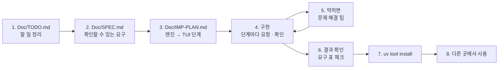

# 7교시 바이브 코딩 · `tscan` 만들기

> **먼저 [VIBE-REQ-TSCAN.md](VIBE-REQ-TSCAN.md)(요청서)를 읽고 `~/vibe/tscan/Doc/TODO.md`를 직접 쓴 뒤** 이 문서를 엽니다. 아래 1~8을 차례로 갑니다. 이 문서의 요구 표는 **내 SPEC을 쓴 뒤에** 비교하는 데 쓰고, 에이전트에게 통째로 붙여 넣지 않습니다.



- 시간: 16:00~16:50 (50분) · 발표와 정리는 8교시 · 50분 안에 못 한 단계는 집에서 `Doc/IMP-PLAN.md`의 다음 단계로 이어 갑니다
- 도구: CLI 코딩 에이전트(codex / claude / agy), Python + uv + [Textual](https://textual.textualize.io/), git
- 결과물: 폴더 · **git에 올리기 직전(staged) 파일**에서 API 키, `.env` 값, 주민등록번호 · 전화번호 · 이메일을 찾아 **가린 채로** 보여 주는 TUI. pre-commit 훅으로 등록해 비밀이 커밋되지 않게 막고, 다른 프로그램이 읽을 결과와 종료 코드를 줍니다. `uv tool install`로 설치해 **어느 폴더에서나** `tscan`으로 씁니다. 오늘 n8n 출력 필터로 한 일을 내 저장소에.

```text
$ tscan ~/aio-01d4-stu
┌ tscan · 파일 214 · 찾은 것 3 · 건너뜀 12 ───────────────────────────────┐
│ 종류        파일                                   줄   값             │
│ openai_key  Last3Mon/.env                          1    sk-…****…a9    │
│ phone       my-work/PROMPTS.md                     12   010-****-2135  │
│ email       my-work/PROMPTS.md                     12   y***@example…  │
│ ┌ 미리 보기 ───────────────────────────────────────────────────────┐   │
│ │ 11  최유진 본인 건 확인                                            │   │
│ │ 12  연락처 010-****-2135, y***@example.com                         │   │
│ └──────────────────────────────────────────────────────────────────┘   │
│ [i] 괜찮아(무시 목록에)  [r] 다시 검사  [q] 끝                             │
└──────────────────────────────────────────────────────────────────────────┘
```

> 요청문은 **직접** 씁니다. 단계마다 `▶` 를 펼치면 생각할 거리가 나옵니다. 정답 요청문은 없습니다.
>
> **테스트에는 가짜 비밀만.** 내 저장소에서 진짜 키를 찾으면 화면을 띄워 두지 말고 강사에게 알리고, 키를 폐기 · 재발급합니다.

## 시간 (50분)

| 시간 | 단계 | 결과 |
| --- | --- | --- |
| 16:00~16:09 | 0 준비 · 1 `Doc/TODO.md` (요청서 읽고 직접) | 할 일 ①~⑫ · 꼭 / 나중 |
| 16:09~16:15 | 2 `Doc/SPEC.md` → 아래 요구 표와 비교 · 고치기 | 요구마다 확인 방법 |
| 16:15~16:20 | 3 `Doc/IMP-PLAN.md` (엔진 단계 · TUI 단계) | 단계마다 체크리스트 |
| 16:20~16:44 | 4 구현: **엔진 1단계 → 엔진 2단계 → TUI 1단계** (막히면 5) | 단계마다 `pytest` · 직접 실행 · commit |
| 16:44~16:50 | 6 확인 · 7 `uv tool install` · 8 다른 폴더에서 | `cd ~/aio-01d4-stu && tscan scan . --plain` |

50분 안 목표: **R1 · R2 · R3 · R4 · R13(엔진 1단계) + R5 · R6(엔진 2단계) + R8(TUI 1단계) + R14(설치)**. R7 · R9~R12는 IMP-PLAN의 다음 단계로 8교시 뒤 · 집에서 이어 갑니다.

## 0. 준비 (1분)

```bash
mkdir -p ~/vibe/tscan/Doc && cd ~/vibe/tscan
git init
# 에이전트는 Doc/TODO.md를 쓴 뒤에 켭니다: codex (또는 claude, agy)
```

## 1. `Doc/TODO.md` · 만들고 싶은 것과 할 일 정리 (8분, 에이전트 없이)

[VIBE-REQ-TSCAN.md](VIBE-REQ-TSCAN.md)의 "할 일" 틀대로 씁니다. 요청의 말 ①~⑫를 **내 말로** 옮기고, 꼭 · 나중을 표시하고, 걱정되는 것과 50분 안에 못 할 것을 적습니다. "어떻게"는 아직 쓰지 않습니다.

<details><summary>▶ TODO와 SPEC은 무엇이 다른가</summary>

TODO는 **내가 이해한 것**(무엇을 · 왜)입니다. SPEC은 그것을 **확인할 수 있게** 바꾼 것(됐다 · 안 됐다를 말하는 방법)입니다. TODO에서 빠진 것은 SPEC에서도 빠지므로, TODO는 빠짐없이, SPEC은 정확하게.
</details>

`git add Doc/TODO.md && git commit -m "TODO"`

## 2. `Doc/SPEC.md` · 확인할 수 있는 요구로 (6분)

TODO의 할 일마다 **확인 방법**(가짜 폴더 · 찾은 수 · 화면 · 종료 코드)을 붙여 SPEC을 만듭니다. 에이전트에게 "TODO.md를 읽고 SPEC.md 초안을 써 줘. 요구마다 확인 방법을 붙여"라고 시켜도 됩니다. 그러면 **반드시 내가 읽고 고칩니다.**

```markdown
# tscan SPEC

## 1. 요구 (확인할 수 있게)
| 번호 | 요구 | 요청의 어느 말 | 확인 방법 | 꼭 · 나중 |
| --- | --- | --- | --- | --- |
| R1 | | ① | | 꼭 |

## 2. 숨은 요구
## 3. 범위 밖 (하지 않을 것)
## 4. 정해 둘 것 (종류별 정규식, 가리는 모양, 종료 코드, 무시 목록 형식, 설정 파일 위치)
```

<details><summary>▶ 확인 방법은 가짜 폴더로</summary>

"키를 찾는다"는 확인 방법이 아닙니다. "가짜 폴더에 `sk-test-…` 하나, 전화 둘, 날짜 하나를 넣고 → 찾은 것 3, 날짜는 0"이 확인 방법입니다. **찾아야 할 것과 찾으면 안 되는 것**을 둘 다 적습니다 (오늘 Lab 01 과제 1 · Lab 03 과제 1과 같음).
</details>

쓴 뒤 아래 표와 비교합니다. 빠진 요구, 내가 더 뽑은 요구를 `Doc/SPEC.md` 끝 "VIBE-Q와 비교"에 한 줄씩 적고 SPEC을 고칩니다.

### 요구 사항 (요청서에서 뽑은 것, 14개)

| 번호 | 요구 | 요청서의 말 | 확인 방법 | 50분 |
| --- | --- | --- | --- | --- |
| R1 | 폴더의 글자 파일을 훑어 API 키(`sk-…` 등) · 주민등록번호 · 전화번호 · 이메일을 찾아 종류 · 파일 · 줄 (`tscan scan <폴더> --plain`) | ① | 가짜 폴더 → 종류별 찾은 수, 파일 · 줄 번호 | 꼭 |
| R2 | 찾은 값은 **가려서**만 보여 준다. 원래 값은 화면 · 결과 파일 · 오류 메시지 어디에도 | ② ⑩ | 가짜 키로 실행 → `--plain` · `--json` 출력에 원래 값 `grep -c` 0 | 꼭 |
| R3 | `.env` 파일의 값(6자 이상)이 다른 파일에 그대로 있으면 `env_value`로 (값은 출력하지 않음) | ③ | `.env`의 `TOKEN=abc123def456`을 다른 파일에 붙임 → 찾음, 출력에 `abc123def456` 없음 | 꼭 |
| R4 | 잘못 찾기 줄이기: 날짜 · 버전 · 긴 주문 번호는 찾지 않음 (경계 · 자리수 · 앞자리 조건) | ④ | 가짜 폴더의 `2026-10-27` · `202610271234` · `1.0.10-20261027` → 0건 | 꼭 |
| R5 | `tscan staged`: `git add`한 파일의 **staged 내용**만 검사, 찾으면 종료 코드 1, 없으면 0 | ⑤ | 임시 git 폴더에 가짜 키 파일 `git add` → `echo $?` 1, 지우고 다시 → 0 | 꼭 |
| R6 | `tscan install-hook` · `uninstall-hook`: pre-commit 훅으로 등록 · 해제. 이미 다른 훅이 있으면 덮지 않고 알림 | ⑥ | 훅 설치 → 가짜 키 커밋이 멈춤, 기존 훅이 있는 폴더 → 그대로 남음 | 꼭 |
| R7 | 무시 표시 `.tscanignore` (`path:line`, `kind:path`, `path` 글롭) | ⑦ | 한 줄 더함 → 그 항목만 사라짐 | 나중 |
| R8 | TUI: 찾은 목록, 고르면 앞뒤 2줄 미리 보기(**미리 보기도 가려서**), `[i]` 무시 목록에 더하고 다시 검사 | ⑧ | `tscan <폴더>` → 고르기 · 미리 보기의 다른 비밀도 가려짐 · `[i]` 뒤 목록에서 빠짐 | 꼭 |
| R9 | `tscan history`: 지난 커밋들(`git log -p`)에 들어갔던 비밀 (커밋 · 파일 · 종류) | ⑨ | 가짜 키를 커밋한 뒤 지운 임시 저장소 → 그 커밋이 나옴 | 나중 |
| R10 | `--json`: 다른 프로그램이 읽는 결과(가린 값), 종료 코드 0 없음 · 1 찾음 · 2 오류 | ⑩ | `tscan scan x --json \| python -m json.tool`, `echo $?` | 나중 |
| R11 | 사용자 모양 더하기: `.tscan.toml`(프로젝트) · `~/.tscan/rules.toml`(내 컴퓨터)에 `name` · `pattern` | ⑪ | 사번 `E-\d{6}` 더함 → 가짜 사번 찾음 | 나중 |
| R12 | 요약: 종류별 · 파일별 개수, 건너뛴 파일 수 (`--summary`) | ⑫ | 가짜 폴더 → 숫자가 맞음 | 나중 |
| R13 | 건너뛰기: `.git` · `node_modules` · `.venv` · 1MB 넘는 파일 · 바이너리(NUL 바이트) | ⑫ "건너뛴 게" | 가짜 폴더에 큰 파일 · 바이너리 → 찾지 않고 건너뛴 수로 | 꼭 |
| R14 | `uv tool install`로 설치해 **어느 폴더에서나** `tscan` | 첫 문단 "어느 폴더에서나" | `cd /tmp && tscan --help`, `uv tool list`에 `tscan` | 꼭 |

숨은 요구 (요청서에 직접 없지만 없으면 안 되는 것):

| 숨은 요구 | 어디서 나왔나 |
| --- | --- |
| 찾은 즉시 가리고, **원래 값은 결과 객체에 담지 않는다** (나중에 실수로 출력할 수 없게) | ② "그대로 보여 주면 안 돼요" |
| `.env` 값은 메모리에서만 비교하고, 출력 · 로그 · 결과 파일에는 가린 값만 | ③ + ② |
| staged 검사는 작업 폴더 파일이 아니라 **staged 내용**(`git show :<path>`)을 본다 (`git add` 뒤에 고친 파일) | ⑤ "`git add`한 파일만" |
| 테스트의 가짜 비밀은 **테스트 안에서 만들어** 임시 폴더에 쓴다 (`"sk-" + "test-" + ...`). 저장소에 가짜 비밀 파일을 두면 `tscan`이 내 저장소를 검사할 때 또 걸림 | "시험할 때 진짜 키를 쓰면 안 돼요" |
| 엔진(찾기 · 가리기 · git)과 화면(TUI)을 **나눈다.** `--plain` · `staged` · `--json`은 화면 없이 엔진만 씀 | ⑤ ⑩ "다른 프로그램이 읽는", 테스트하기 쉬움 |
| 종료 코드를 정해 둔다: 0 없음, 1 찾음, 2 실행 오류 | ⑤ "커밋이 멈추게", ⑩ |
| `pyproject.toml`에 명령 이름(`[project.scripts] tscan = ...`)이 있어야 `uv tool install`이 된다 | R14 |

범위 밖 (오늘 하지 않음): 찾은 키를 자동으로 폐기 · 재발급, 기록에서 비밀 지우기(히스토리 다시 쓰기), 결과를 서버로 보내기, 모든 회사 · 서비스의 키 형식.

`git add Doc/SPEC.md && git commit -m "SPEC"`

## 3. `Doc/IMP-PLAN.md` · 구현 계획 (5분)

SPEC의 요구를 **단계**로 나눕니다. 첫 원칙: **엔진(백엔드)을 먼저, 화면(TUI)은 나중에.** 화면은 엔진이 내놓은 결과를 보여 주기만 하면 되게 만듭니다. 에이전트에게 "SPEC.md를 읽고 IMP-PLAN.md를 엔진 단계와 TUI 단계로 나눠 써 줘. 단계마다 체크리스트와 확인 명령"이라고 시켜도 됩니다 (내가 읽고 고침).

```markdown
# tscan IMP-PLAN

## 엔진 1단계 · 찾고 가리기 (R1 · R2 · R3 · R4 · R13)
- [ ] patterns: 종류별 정규식 · 경계 조건, mask(): 앞 몇 글자 + … + 뒤 몇 글자
- [ ] scan_text(text) → [{kind, line, masked}] (원래 값은 담지 않음)
- [ ] scan_folder(path): 건너뛰기, .env 값 모으기 → env_value
- [ ] tests: 임시 폴더에 가짜 비밀을 테스트 안에서 써서, 찾아야 할 것 · 찾으면 안 되는 것
- [ ] cli: tscan scan <folder> --plain
- 확인: uv run pytest -q, uv run tscan scan <가짜 폴더> --plain

## 엔진 2단계 · 커밋 전에 막기 (R5 · R6)
## TUI 1단계 · 목록 · 미리 보기 (R8)
## 설치 (R14)
## 엔진 3단계 · 무시 · JSON · 요약 (R7 · R10 · R12)
## 엔진 4단계 · 기록 · 사용자 모양 (R9 · R11)
## TUI 2단계 · [i] 무시 · 다시 검사
```

<details><summary>▶ 왜 엔진 먼저인가</summary>

- 엔진은 **화면 없이 테스트**할 수 있습니다 (`pytest`, `--plain`). 화면부터 만들면 찾은 수가 맞는지 눈으로만 봅니다.
- pre-commit 훅(R6)과 배포 전 검사(R10)는 화면 없이 돌아야 합니다. 훅에서 TUI가 뜨면 커밋이 멈춘 채 기다립니다.
- TUI는 엔진의 결과 목록을 표에 넣고, 고른 줄의 미리 보기를 엔진에게 **가린 채로** 받아 보여 주기만 하면 됩니다.
</details>

<details><summary>▶ 단계 크기</summary>

한 단계 = 에이전트 요청 한두 번 + 확인 한 번 + commit 한 번 (10분 안팎). 단계가 크면 에이전트가 많이 바꾸고, 틀렸을 때 어디가 틀렸는지 모릅니다.
</details>

`git add Doc/IMP-PLAN.md && git commit -m "IMP-PLAN"`

## 4. 구현 시작 (24분: 엔진 1단계 → 엔진 2단계 → TUI 1단계)

이제 에이전트를 켭니다. 첫 요청은 늘 같습니다.

```text
Doc/SPEC.md 와 Doc/IMP-PLAN.md 를 읽어 줘. 아직 코드는 쓰지 말고,
IMP-PLAN 의 "엔진 1단계"를 어떻게 만들지와 각 체크 항목의 확인 방법을 5줄로 먼저 말해 줘.
```

그다음 **한 단계씩**: "엔진 1단계만 만들어 줘. 끝나면 IMP-PLAN의 체크를 표시하고 확인 명령을 알려 줘" → 내가 확인 → commit → 다음 단계.

> **규모가 큰 프로젝트일수록 다단계로** 진행합니다. 오늘 `tscan`도 요구가 14개라 한 번에 시키면 에이전트가 수백 줄을 한꺼번에 쓰고, 어디가 틀렸는지 찾기 어렵습니다. 단계마다 ① 그 단계만 요청 ② 직접 확인 ③ IMP-PLAN 체크 ④ `git commit`.

<details><summary>▶ 엔진 1단계 · 무엇을 찾나 · 어떻게 가리나</summary>

종류마다 정규식을 하나씩 정합니다. 오늘 Lab 03 예제 1 출력 필터의 정규식과 같은 것도 있습니다. 가릴 때 몇 글자를 남길지(앞 3자, 뒤 2~4자) 정하고, **가리기 전 값은 어디에도 남기지 않게** 요청문에 적습니다. 결과 객체에 원래 값이 있으면, 언젠가 누군가 그것을 출력합니다.
</details>

<details><summary>▶ 엔진 1단계 · 잘못 찾기</summary>

`2026-10-27` 같은 날짜, 주문 번호도 숫자 모양이 비슷합니다. 주민번호의 7번째 자리(1~4), 전화번호의 앞자리(010 등), **앞뒤가 숫자가 아닐 때만**(경계) 같은 조건으로 좁힙니다. 테스트에 "찾으면 안 되는 것"도 넣습니다 (오늘 Lab 03 과제 1의 "막으면 안 되는 것"과 같음).
</details>

<details><summary>▶ 엔진 1단계 · 가짜 비밀은 어디에</summary>

`tests/data/secrets.txt`에 가짜 키를 적어 두면, 다 만든 `tscan`으로 내 저장소를 검사할 때 그 파일이 걸립니다. pytest의 `tmp_path`에 **테스트가 실행될 때** 써 넣습니다. 글자를 쪼개 이어 붙이면(`"sk-" + "test-" + "a" * 20`) 소스 파일 자체도 걸리지 않습니다.
</details>

<details><summary>▶ 엔진 2단계 · 커밋 전에 막는다</summary>

비밀이 한 번 git에 들어가면 지워도 기록에 남습니다. 그래서 **커밋 전에** 막습니다. staged 파일 목록은 `git diff --cached --name-only --diff-filter=ACM`, 내용은 `git show :<path>`. 훅은 `.git/hooks/pre-commit` 파일이고 실행 권한이 있어야 합니다. 이미 다른 훅이 있으면 어떻게 할까요?
</details>

<details><summary>▶ TUI 1단계 · 미리 보기도 가린 채로</summary>

미리 보기의 앞뒤 줄에도 다른 비밀이 있을 수 있습니다. 미리 보기를 만들 때도 **같은 가리기**를 거치게 합니다. 큰 폴더는 검사가 오래 걸리므로 worker로 돌립니다 (72일차 `tbench`와 같음).
</details>

<details><summary>▶ 다음 단계들 (8교시 뒤 · 집에서)</summary>

- 엔진 3단계: 무시 목록(R7), JSON과 종료 코드(R10), 요약(R12).
- 엔진 4단계: 기록 검사(R9, `git log -p`의 `+` 줄만), 사용자 모양(R11, 설정 파일은 집 폴더와 프로젝트 둘).
- TUI 2단계: `[i]`로 무시 목록에 더하고 다시 검사.
</details>

## 5. 바이브 코딩으로 문제 해결 팁

| 이럴 때 | 이렇게 |
| --- | --- |
| 에이전트가 "다 됐다"고 함 | **직접 실행**합니다 (`uv run tscan scan ...`, `uv run pytest -q`). 확인 방법은 SPEC에 있습니다 |
| 실패 · 오류 | 오류 출력 **전부**와 실행한 명령을 그대로 붙여 줍니다. 단, **진짜 비밀이 보이는 출력은 붙이지 않습니다** |
| 같은 곳을 3번 고쳐도 안 됨 | 멈추고 `git diff` · `git checkout .`로 되돌린 뒤, 단계를 **더 작게** 나눠 다시 요청 |
| 날짜 · 번호를 전화번호로 찾음 | "찾으면 안 되는 것도 테스트에. 앞뒤가 숫자가 아닐 때만" |
| 찾은 값을 그대로 출력 | "가리기 전 값은 결과 객체에도 남기지 말게" |
| 테스트에 진짜 키 · 가짜 비밀 파일 | "가짜 값만, 테스트 안에서 tmp_path에. 진짜 .env를 읽는 테스트 금지" |
| 훅이 안 돎 | "실행 권한(`chmod +x`)과, 훅 안에서 `tscan`을 찾을 수 있는지(PATH)" |
| 기존 훅을 덮어씀 | "있으면 멈추고 알리게. 내 훅에는 표시 줄을 넣어 지울 때 내 것만 지우게" |
| 화면이 이상한데 오류가 안 보임 | `uv add --dev textual-dev` 뒤 다른 터미널에서 `uv run textual console` |
| 대화가 길어져 에이전트가 앞 내용을 잊음 | 새 세션을 열고 "Doc/SPEC.md · Doc/IMP-PLAN.md를 읽고, 체크 안 된 첫 단계부터"로 다시 시작 |
| 설치한 `tscan`이 고친 내용을 모름 | `uv tool install --force .` 로 다시 설치 (또는 처음부터 `--editable`) |

## 6. 결과 확인

`Doc/SPEC.md` 1절 표의 확인 방법대로 **내가** 하나씩 하고 체크합니다. 오늘 50분 안 목표만:

```bash
cd ~/vibe/tscan
uv run pytest -q                                      # 가짜 비밀 테스트
mkdir -p /tmp/fake && printf 'key=sk-test-%s\ncall 010-0000-0000\ndate 2026-10-27\n' abcdefghijklmnopqrst > /tmp/fake/a.txt
uv run tscan scan /tmp/fake --plain                   # R1 · R2 · R4: 키 · 전화 찾고, 날짜는 안 찾음, 값은 가려짐
uv run tscan scan /tmp/fake --plain | grep -c abcdefghijklmnopqrst    # R2: 0
cd /tmp/fake && git init -q && git add a.txt && tscan staged; echo $?   # R5: 1
```

- [ ] R1 종류 · 파일 · 줄.
- [ ] R2 원래 값이 출력에 없음.
- [ ] R3 `.env` 값이 다른 파일에 있으면 찾음.
- [ ] R4 날짜 · 번호는 안 찾음.
- [ ] R5 `tscan staged` 종료 코드.
- [ ] R6 pre-commit 훅으로 커밋이 멈춤, 기존 훅은 그대로.
- [ ] R8 TUI 목록 · 미리 보기(가려서).
- [ ] R13 건너뛴 파일.
- [ ] (이어서) R7 · R9 · R10 · R11 · R12.

## 7. `uv tool install`로 설치

`pyproject.toml`에 명령이 등록되어 있는지 먼저 봅니다.

```toml
[project.scripts]
tscan = "tscan.cli:main"
```

```bash
cd ~/vibe/tscan
uv tool install --editable .        # 고친 내용이 바로 반영됨 (수업 중 권함)
uv tool list                        # tscan 이 보이는가
which tscan                         # ~/.local/bin/tscan
# 명령을 못 찾으면: uv tool update-shell 뒤 터미널을 새로 엶
```

- 지우기: `uv tool uninstall tscan`.
- pre-commit 훅은 설치된 `tscan`을 부릅니다. 설치 전에 훅을 걸면 훅이 명령을 못 찾습니다.

## 8. 다른 곳에서 사용

설치했으면 내 저장소에 씁니다. **진짜 키가 보이면** 화면을 닫고 강사에게 알립니다 (값은 가려져 있어도).

```bash
cd ~/aio-01d4-stu
tscan --help
tscan scan Last3Mon/73 --plain                      # 오늘 실습 폴더
tscan scan Last3Mon/73/my-work --plain              # 내가 쓴 PROMPTS.md · SECURITY.md에 개인정보가 섞였나
cd ~/vibe/tscan && tscan install-hook               # 내 tscan 저장소에 훅
echo "k=sk-test-$(printf 'x%.0s' {1..20})" > leak.txt && git add leak.txt && git commit -m leak   # 멈추는지
git rm --cached leak.txt && rm leak.txt
```

- (R10을 만들었다면) `tscan scan . --json; echo $?` → 74일차 배포 전 검사에서 그대로 씁니다.
- `~/vibe/tscan`은 지우지 마세요. 79일차 `tops`에서 다시 씁니다.

## 발표 (8교시, 3분)

| 내용 | |
| --- | --- |
| TODO → SPEC | 내 SPEC과 VIBE-Q 요구 표가 달랐던 곳 (빠뜨린 요구, 더 뽑은 요구) |
| IMP-PLAN | 엔진 · TUI를 어떻게 나눴나, 어디까지 체크했나 |
| 요청문 | 가장 잘 먹힌 요청문 한 개, 안 먹힌 요청문 한 개 |
| 막힌 곳 | 5절의 어느 팁으로 풀었나 (잘못 찾기 · 값이 출력에 남음 · 훅) |
| 시연 | 가짜 키를 커밋하려다 막히는 장면 |

## 확인

- [ ] `Doc/TODO.md` → `Doc/SPEC.md` → `Doc/IMP-PLAN.md`를 에이전트 전에 (또는 에이전트와 함께 쓰고 내가 고쳐서) 만들고 commit했다.
- [ ] IMP-PLAN의 엔진 1 · 2단계와 TUI 1단계를 체크했다 (단계마다 commit).
- [ ] R1 · R2 · R3 · R4 · R5 · R6 · R8 · R13 확인, `uv run pytest -q`(가짜 비밀만).
- [ ] R14 `uv tool install`, 다른 폴더에서 `tscan`.
- [ ] 남은 요구는 IMP-PLAN에 체크 안 된 채로 남겨 두었다 (다음에 이어 감).
