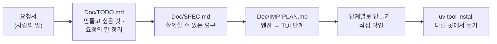

# 7교시 바이브 코딩 · 요청서 `tscan` (가장 먼저 읽기)

- 순서: **이 요청서** → 내 정리 `~/vibe/tscan/Doc/TODO.md` (8분) → [VIBE-Q-TSCAN.md](VIBE-Q-TSCAN.md)의 순서대로 `Doc/SPEC.md` → `Doc/IMP-PLAN.md` → 단계별로 만들기 → 설치 · 다른 곳에서 쓰기 → 수업이 끝나면 `VIBE-A-TSCAN.md`(정답본)로 확인
- 이 문서는 **만들어 달라는 사람의 말**입니다. 요구 사항 표도, 단계도 없습니다. 그것을 뽑아 내는 것이 첫 일입니다. 72일차 `tbench`와 같은 순서입니다.



## 왜 요청서부터인가

요구 사항 표를 통째로 에이전트에게 주고 "이대로 만들어 줘"라고 하면, 무엇이 만들어지든 **내가 판단할 기준이 없습니다.** 실무에서는 요구 사항 표가 오지 않고, 이 요청서 같은 **사람의 말**이 옵니다. 오늘 오전 Lab 01에서 막기 전에 **먼저 공격해 본 것**과 같습니다: 무엇을 막을지 알아야 막았는지 말할 수 있습니다.

| 단계 | 누가 | 결과 |
| --- | --- | --- |
| 요청 → 할 일 목록 | **나** | `Doc/TODO.md`: 요청의 말 ①~⑫를 내 말로, 만들고 싶은 것 |
| 할 일 → 요구 | **나** (에이전트와 다듬어도 됨) | `Doc/SPEC.md`: 요구마다 "됐다 / 안 됐다"를 말할 수 있는 확인 방법 |
| 요구 → 단계 | **나** (에이전트와 다듬어도 됨) | `Doc/IMP-PLAN.md`: 엔진 단계와 화면(TUI) 단계로 나눈 순서 |
| 단계 → 코드 | 에이전트 | 단계마다 요청문 하나, `Doc/*.md`를 함께 읽게 함 |
| 확인 | **나** | 직접 `uv run tscan …`, `pytest`, 요구 표에 체크 |

## 요청 (사내 보안 담당자에게서 온 메시지, 그대로)

> 오늘 IT 문의 Agent에서 답에 섞인 연락처를 가리는 거 봤어요. 그런데 사고는 Agent 답보다 **git 저장소**에서 더 자주 나요. 지난달에도 누가 `.env`에 있던 OpenAI 키를 그대로 커밋해서, 키를 폐기하고 다시 받느라 하루가 갔어요. 개발자들이 **자기 노트북에서 직접** 돌려 볼 수 있는 작은 검사 도구가 있으면 좋겠어요. 터미널에서 돌아가면 되고, **어느 폴더에서나** `tscan`이라고 치면 되게 해 주세요.
>
> ① 폴더를 하나 주면 안의 파일을 다 훑어서 **API 키, 주민등록번호, 전화번호, 이메일**처럼 보이는 것을 찾아 주세요. 어느 파일 몇째 줄인지요.
>
> ② 그런데 찾은 걸 **화면에 그대로 보여 주면 안 돼요.** 검사 도구 화면을 옆 사람이 보거나 캡처해서 메신저에 올리면, 그게 또 유출이에요. 앞뒤 몇 글자만 보여 주세요.
>
> ③ `.env` 파일에 적힌 값(키 · 비밀번호)이 **다른 파일에 그대로 복사돼** 있는 것도 찾아 주세요. 키 모양이 아니어도요. 지난달 사고가 딱 이거였어요.
>
> ④ 날짜(`2026-10-27`)나 주문 번호까지 전화번호라고 잡으면 아무도 안 써요. 지난번 도구는 하루에 경고가 수백 개 떠서 다들 꺼 버렸어요. **잘못 잡는 건 적게** 해 주세요.
>
> ⑤ 제일 중요한 건 **커밋하기 전에** 막는 거예요. 한 번 커밋되면 지워도 기록에 남거든요. `git add`한 파일만 빠르게 보고, 뭔가 있으면 커밋이 멈추게요.
>
> ⑥ 그걸 개발자가 매번 손으로 돌리진 않을 거예요. `git commit` 할 때 **저절로** 돌게 한 번만 설치하면 되게 해 주세요. 이미 다른 훅을 쓰는 사람도 있으니 그건 망가뜨리지 말고요.
>
> ⑦ 테스트용 가짜 키처럼 일부러 넣은 건 **"이건 괜찮아"라고 표시**해서 다음부터 안 보이게 하고 싶어요.
>
> ⑧ 찾은 목록을 **화면에서 보면서** 하나 고르면 그 줄 앞뒤를 보여 주면 좋겠어요. 물론 앞뒤 줄도 가려서요. 거기서 바로 "괜찮아" 표시도 하고요.
>
> ⑨ 이미 **예전에 커밋된** 비밀은 없는지도 보고 싶어요. 지금 파일엔 없어도 기록 어딘가에 남아 있을 수 있잖아요.
>
> ⑩ 나중에는 배포 전에 자동으로 돌릴 거라, 사람이 아니라 **다른 프로그램이 읽을 수 있는** 결과도 주세요. 물론 거기에도 값은 가려서요.
>
> ⑪ 우리 회사만 쓰는 것도 찾고 싶어요. 사번(`E-123456`)이나 사내 토큰 모양 같은 거요. **제가 모양을 더할 수** 있게요.
>
> ⑫ 다 훑고 나면 **종류별로 몇 개, 어느 파일에 몇 개**인지 한눈에 보여 주세요. 큰 파일이나 그림 파일처럼 건너뛴 게 있으면 그것도 몇 개인지요.
>
> 아, 이 도구를 **시험할 때 진짜 키를 쓰면 안 돼요.** 테스트 파일에 진짜 키가 들어가면 그 테스트 파일이 또 유출이에요. 그리고 검사하다가 **진짜 비밀을 찾으면** 화면을 띄워 두지 말고 저한테 바로 알려 주세요. 키는 폐기하고 새로 받아야 해요.

## 함께 받은 것

| 파일 · 자료 | 메모 |
| --- | --- |
| 오늘 Lab 03 예제 1의 `Output filter` 정규식 | 전화 · 이메일 · 주민번호, 가리는 모양 (앞 3 · 끝 4 등) |
| 오늘 Lab 01 과제 2의 글자 정리 | 전각 · 보이지 않는 글자 (숨긴 비밀에도 쓸 수 있음) |
| `~/aio-01d4-stu` 저장소 | 검사해 볼 내 저장소 (진짜 `.env`는 `Last3Mon/.env`, **값을 화면에 띄우지 않기**) |
| 가짜 비밀 예 | `sk-test-` + 아무 글자 20개, `010-0000-0000`, `test@example.com`, `900101-1000000` |

## 할 일 · 요청을 내 할 일 목록으로 (8분, 에이전트 없이)

`~/vibe/tscan/Doc/TODO.md`를 만들고 요청의 말 ①~⑫와 맨 끝 부탁 둘을 **내 말로** 한 줄씩 옮깁니다. 아직 "어떻게"는 쓰지 않습니다. **무엇을 · 왜**만 씁니다. 에이전트에게 맡기지 않고 직접 씁니다.

```markdown
# tscan TODO

## 만들고 싶은 것 (한 문단)
어느 폴더에서나 `tscan`으로 폴더 · 커밋하려는 파일에서 비밀 · 개인정보를 찾아 가린 채로 ...

## 요청의 말 → 할 일
| # | 요청의 말 (짧게) | 할 일 (내 말) | 꼭 · 나중 |
| --- | --- | --- | --- |
| ① | 키 · 주민번호 · 전화 · 이메일, 몇째 줄 | | 꼭 |
| ② | 화면에 그대로 X | | |
| ... | | | |
| 끝 | 시험에 진짜 키 X | | |
| 끝 | 진짜 비밀을 찾으면 | | |

## 요청에 없지만 걱정되는 것
## 오늘 50분 안에 못 할 것 같은 것
```

예 하나만 보여 드립니다.

| 요청의 말 | TODO에 쓸 할 일 (내 말) | 다음 단계(SPEC)에서 바뀔 모양 |
| --- | --- | --- |
| ④ "날짜나 주문 번호까지 전화번호라고 잡으면 아무도 안 써요" | "전화번호 · 주민번호 모양을 좁혀서, 날짜 · 긴 숫자는 잡지 않게. 잡으면 안 되는 것도 시험" | R6: 가짜 폴더에 `2026-10-27` · `202610271234` · `1.0.10-20261027`를 넣고 0건, 진짜 모양(가짜 값)은 모두 찾음 |

<details><summary>▶ 1단계 · 꼭 할 것과 나중에 할 것</summary>

요청의 말이 열두 개입니다. 50분 안에 다 만들기 어렵습니다. 담당자가 **"제일 중요한 건"**이라고 한 것은 무엇인가요? 그리고 그것을 하려면 먼저 무엇이 있어야 하나요? (찾기 → 커밋 전에 막기)
</details>

<details><summary>▶ 2단계 · 걱정되는 것 (숨은 요구의 씨앗)</summary>

- ② "그대로 보여 주면 안 돼요": 화면만일까요? 다른 프로그램이 읽는 결과(⑩), 테스트 기대값, 오류 메시지는?
- ③ "`.env` 값이 다른 파일에": `.env`의 값을 읽어야 찾을 수 있습니다. 그 값을 어디에 얼마나 들고 있어야 할까요?
- ⑤ "`git add`한 파일만": 고치기 전 파일과 `git add`한 내용이 다를 수 있습니다. 무엇을 봐야 하나요?
- ⑥ "망가뜨리지 말고": 이미 훅이 있으면 어떻게 할까요?
- "시험에 진짜 키 X" → 시험에 쓸 가짜 비밀을 **파일로 저장해 두면** 그 파일을 이 도구가 또 찾습니다. 어떻게 할까요?
- "어느 폴더에서나 `tscan`" → 내 프로젝트 폴더 밖에서도 실행되려면? (72일차 `tbench`와 같음)
</details>

## 그다음

[VIBE-Q-TSCAN.md](VIBE-Q-TSCAN.md)를 엽니다. 거기서 `Doc/TODO.md` → `Doc/SPEC.md` → `Doc/IMP-PLAN.md` → 단계별 구현 → 확인 → `uv tool install` → 다른 곳에서 사용 순서로 갑니다. VIBE-Q의 요구 표는 **내 SPEC을 쓴 뒤에** 비교하는 데 씁니다.
