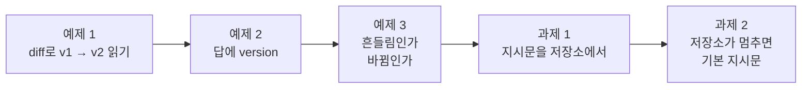
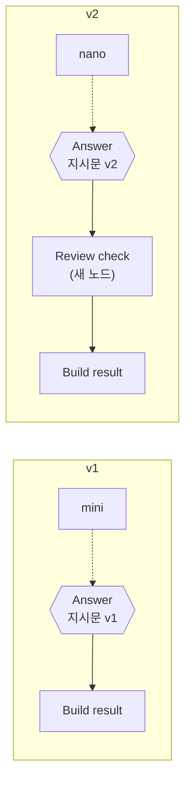
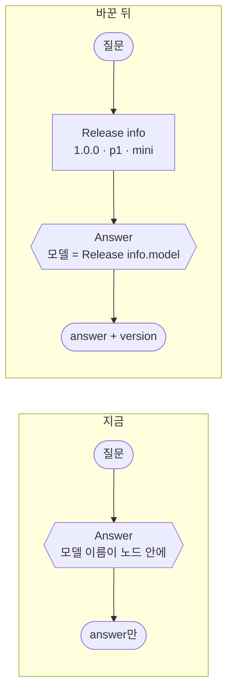
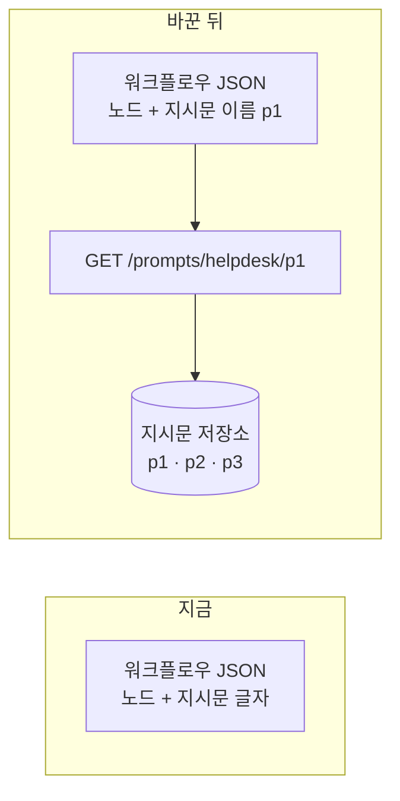
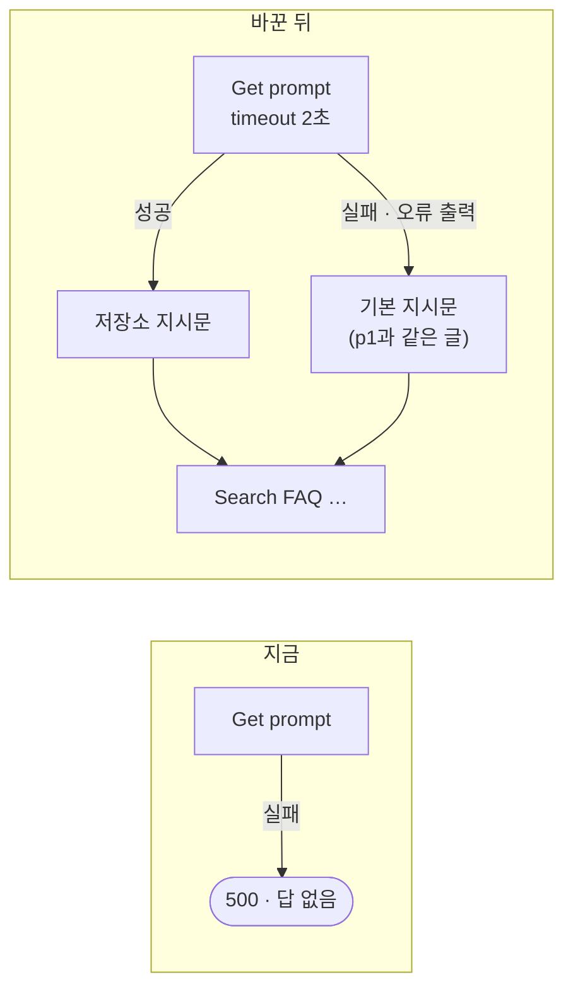

# Lab 01 · 무엇이 바뀌었나, 답마다 버전, 지시문은 저장소로

- 관련 강의: [1단계 · 무엇이 바뀌나](../../Lecture/74/01-STAGE1-WHAT-CHANGES.md)
- 소요 시간: 50분 (2교시 한 시간) · 예제 1 10분 · 예제 2 12분 · 예제 3 8분 · 과제 1 10분 · 과제 2 10분
- 준비: [실습 준비](../../Lecture/74/00-DAY74-PREP.md)의 `doctor` → `ready`, `rel-v1` · `rel-v2` 게시
- 목표: AI 워크플로우에서 **바뀌는 것 세 가지(모델 · 지시문 · 흐름)** 를 구분해 읽고, 차이가 **진짜 바뀐 것인지 흔들림인지** 재서 가르고, 답마다 어느 버전이 답했는지 남기고, 지시문을 워크플로우 밖 저장소로 꺼낸다. 저장소가 멈춰도 답은 나가게 한다.



> 복사해 붙일 요청문은 없습니다. 막히면 `▶` 를 하나씩 펼칩니다.

## 시작하기 · 터미널 두 개

| 터미널 | 하는 일 |
| --- | --- |
| ① 에이전트 | `cd ~/aio-01d4-stu/Last3Mon/74` 후 `codex` (또는 `claude`, `agy`). 내가 쓴 요청문을 보낸다 |
| ② 확인 | `cd ~/aio-01d4-stu/Last3Mon/74` 에서 `diff` · `push` · `test` · `bench`를 **내가** 실행한다 |

`cp templates/CHANGELOG-TEMPLATE.md my-work/CHANGELOG.md` 후 표를 채워 갑니다. 쓴 요청문은 `my-work/PROMPTS.md`에 모읍니다.

## 예제 1 · v1 → v2에서 무엇이 바뀌었나 (10분, 에이전트 없이)

누군가 헬프데스크를 고쳐 v2를 만들었습니다. 무엇을 고쳤는지 적어 두지 않았습니다.

```bash
uv run tools/flow.py diff reference/helpdesk-v1.json reference/helpdesk-v2.json
uv run tools/flow.py diff reference/helpdesk-v1.json reference/helpdesk-v2.json --full    # 긴 값(지시문) 전 · 후
uv run tools/flow.py call rel-v1 requests/faq-vpn.json -v
uv run tools/flow.py call rel-v2 requests/faq-vpn.json -v
```

`CHANGELOG.md` 1절을 채웁니다. 답이 달라진 이유는 지시문 때문일까요, 모델 때문일까요, 새 노드 때문일까요?

### 이해하기

**왜 "무엇이 바뀌었나"부터 읽나.** 어제 잘 되던 헬프데스크가 오늘 이상한 답을 한다는 문의가 왔습니다. 가장 먼저 묻는 질문은 "그 사이 무엇이 바뀌었나"입니다. 일반 프로그램이면 코드의 차이(`git diff`)를 봅니다. n8n 워크플로우는 JSON 한 덩어리라서, 그대로 글자 비교를 하면 노드 위치 · id 같은 의미 없는 차이가 섞여 정작 중요한 한 줄이 묻힙니다. `flow.py diff`는 **노드 이름끼리 맞춰** 노드 · 설정 · 연결의 차이만 보여 줍니다.

**AI 워크플로우에서 바뀌는 것 셋.**

| 바뀌는 것 | v2에서 | 같은 질문에 답이 바뀌나 |
| --- | --- | --- |
| 모델 | `Answer model`의 모델 이름 | 예. 같은 지시문이라도 모델이 다르면 말투 · 길이 · 정확도가 다름 |
| 지시문 (Prompt) | `Answer`의 `systemMessage` 길이가 바뀜 | 예. 한 문장만 더해도 답의 모양이 바뀜 |
| 흐름 (Workflow) | 새 노드 하나 · 연결 셋 · 웹훅 경로 | 경우에 따라. 답을 자르거나 거르는 노드면 예 |



**한꺼번에 바뀌면 원인을 모릅니다.** v2는 셋이 **동시에** 바뀌었습니다. v2의 답 끝에 무엇이 붙었다면, 그것이 지시문의 새 문장 때문인지 모델 때문인지 새 노드 때문인지 이 한 번의 비교로는 가를 수 없습니다. 72일차 성능 튜닝의 "한 번에 하나만 바꾸고 다시 잰다"가 버전 관리에서도 그대로입니다.

**`--full`로 긴 값을 봅니다.** 지시문처럼 70자가 넘는 값은 "changed (307 → 419 chars)"로만 나옵니다. `--full`(또는 `-v`)을 붙이면 전 · 후 글자가 다 나옵니다. 어느 문장이 더해졌는지 찾습니다.

**기대 결과.** 바뀐 것 7개. `CHANGELOG.md` 1절에 지시문 · 모델 · 노드 · 연결의 전 · 후와, `call` 두 번의 답 차이(출처 번호 · 길이 · 시간)를 적습니다.

<details><summary>▶ 1단계 · 바뀐 것 7개를 셋으로 나누기</summary>

`diff`의 줄 앞 기호: `+` 더함, `-` 뺌, `~` 값이 바뀜. 각 줄이 모델 · 지시문 · 흐름 중 어디에 속하나요? 웹훅 경로(`rel-v1 → rel-v2`)는 답을 바꾸나요?
</details>

<details><summary>▶ 2단계 · 브라우저로 보면</summary>

n8n 화면에서 두 워크플로우를 열어 비교해 봅니다. 지시문 한 문장 차이를 화면에서 찾을 수 있나요? `diff`가 하는 일을 7교시 `tver`로 직접 만듭니다.
</details>

## 예제 2 · 답마다 버전 남기기 (12분)

**만들 것**: v1을 복사해, 모델 이름을 **한 곳**(릴리스 정보)에서 정하고 답마다 `version`을 남기기.

```bash
cp reference/helpdesk-v1.json my-work/helpdesk.json
```

| 조건 | 값 |
| --- | --- |
| 파일 · 웹훅 | `my-work/helpdesk.json` · `my-helpdesk` (경로 · 이름을 바꿈) |
| 릴리스 정보 | `release` `1.0.0`, `prompt_version` `p1`, `model` `gpt-4.1-mini` — 워크플로우 앞쪽 한 곳 (Set) |
| 결과 | `version: {release, prompt_version, model}` ([AGENTS.md](AGENTS.md) 3절) |
| 기대 결과 | `cases/lab01.json` |

### 이해하기

**지금 무엇이 문제인가.** v1의 답은 `{route, answer, sources}`뿐입니다. 답을 받은 사람도, 나중에 로그를 보는 사람도 **어느 버전이 이 답을 썼는지** 모릅니다. 내일 1.1.0을 배포하고 모레 2.0.0을 카나리로 내보내면, 같은 시각에 여러 버전이 동시에 답합니다. 문의가 왔을 때 답에 버전이 없으면 원인을 좁힐 수 없습니다.



**한 곳에서 정하고, 모두 그것을 읽는다.** 모델 이름을 `Answer model` 노드 안에 그대로 두고 결과에도 따로 `gpt-4.1-mini`라고 적으면, 누군가 노드에서만 모델을 바꿨을 때 **결과의 이름과 실제 모델이 달라집니다.** 기록이 거짓말을 하게 됩니다. 그래서 릴리스 정보(Set) 하나에 적고, 모델 노드는 표현식으로 그 값을 **읽고**, 결과도 같은 값을 **읽습니다** (70일차 설정 표와 같은 생각).

**버전의 세 칸.**

| 칸 | 뜻 | 오늘의 값 |
| --- | --- | --- |
| `release` | 이 답을 낸 묶음 전체의 이름 | `1.0.0` |
| `prompt_version` | 지시문 자체의 버전 | `p1` |
| `model` | 실제로 부른 모델 | `gpt-4.1-mini` |

**테스트 케이스.**

| 케이스 | 보내는 것 | 기대 |
| --- | --- | --- |
| 버전이 결과에 | VPN 질문 | `version.release` 1.0.0 · `prompt_version` p1 · `model` gpt-4.1-mini, 답에 "인증서" |
| 접수 현황도 버전과 함께 | T-1002 (박서연) | `version.release` 1.0.0, "처리 중" |
| 빈 질문 | `question: ""` | 400 (그대로) |

**기대 결과.** `lab01` 3/3.

<details><summary>▶ 1단계 · 한 곳에서</summary>

모델 노드의 모델 칸도 표현식(`=`로 시작)을 받습니다 ([AGENTS.md](AGENTS.md) 5절 "릴리스 정보 (Set) · 모델 이름을 표현식으로"). 앞 노드 이름이 정확해야 합니다.
</details>

<details><summary>▶ 2단계 · 왜 답마다</summary>

"어제 오후에 이상한 답이 나갔다"는 문의가 오면, 그 답이 어느 릴리스였는지 알아야 원인을 찾습니다 (77일차 로그 분석). 로그에만 남기지 않고 답에도 넣으면, 문의한 사람이 보낸 화면만으로도 버전을 압니다.
</details>

<details><summary>▶ 빈칸 채우기 · 요청문(프롬프트) 뼈대</summary>

요청문에 꼭 들어갈 것: **① 파일 · 웹훅 경로 ② 릴리스 정보 노드와 세 값 ③ 모델 노드가 읽는 곳 ④ 결과에 더할 칸 ⑤ 그대로 둘 것 ⑥ 기대 결과**. 아래 빈칸 4개(`____①`~`____④`)를 채워 `my-work/PROMPTS.md`에 쓴 뒤 에이전트에게 보냅니다.

```text
my-work/helpdesk.json (v1 을 복사한 것) 의 웹훅 경로를 ____① 로, 이름을 "74 IT helpdesk (my)" 로 바꿔 줘.
Has question? 뒤에 Release info(Set) 를 넣어 release 1.0.0, prompt_version p1, model gpt-4.1-mini.
Answer model 의 모델 값은 ____② 로 Release info 의 model 을 읽게.
Build result 결과에 ____③ : {release, prompt_version, model} 을 Release info 에서 더해 줘. 지시문은 ____④ .
기대 결과 cases/lab01.json.
```

빈칸 힌트 (답이 아니라 **어디서 찾고 무엇을 생각하나**):

- ① `cases/lab01.json`의 맨 위 `webhook` 값입니다 (AGENTS.md 3절 표에도).
- ② n8n에서 앞 노드의 값을 읽는 글자입니다. `=`로 시작하고 `$('노드 이름')`을 씁니다 (AGENTS.md 5절).
- ③ AGENTS.md 3절 결과 모양에서 버전 세 칸을 감싸는 이름입니다.
- ④ 예제 2에서 바꾸면 안 되는 것. 지시문까지 바꾸면 무엇 때문에 답이 바뀌었는지 또 모르게 됩니다.

채운 요청문은 수업 뒤 공개되는 정답본의 요청문 예와 비교합니다. 노드 이름은 내 파일의 실제 이름을 씁니다.
</details>

```bash
uv run tools/flow.py push my-work/helpdesk.json
uv run tools/flow.py test cases/lab01.json -v
```

## 예제 3 · 흔들림인가, 바뀜인가 (8분, 에이전트 없이)

예제 1에서 v1과 v2의 답이 달랐습니다. 그런데 LLM은 같은 질문에도 가끔 다른 답을 합니다. 그 차이가 **v2가 바뀌어서** 생긴 것인지, **그냥 흔들린 것**인지 어떻게 알까요?

```bash
uv run tools/flow.py test cases/lab01-compare.json --webhook rel-v1 --repeat 3
uv run tools/flow.py test cases/lab01-compare.json --webhook rel-v2 --repeat 3
uv run tools/flow.py bench rel-v1 requests/faq-vpn.json -n 5
uv run tools/flow.py bench rel-v2 requests/faq-vpn.json -n 5
```

`CHANGELOG.md` 1절의 "실제로" 칸에 통과 수와 p50을 적습니다.

### 이해하기

**한 번의 비교는 증거가 약합니다.** 답 하나씩을 나란히 놓고 "v2가 더 낫다"고 하면, 그 한 번이 우연일 수 있습니다. 같은 케이스를 **여러 번** 돌려서 결과가 늘 같으면 그 차이는 진짜이고, 돌릴 때마다 달라지면 흔들림입니다. 이것이 실험의 기본입니다: **신호(바뀐 것) 대 잡음(흔들림)**.

| 결과 | 3번 돌리면 | 뜻 |
| --- | --- | --- |
| v1은 3번 모두 ✘, v2는 3번 모두 ✔ | 늘 같음 | 진짜 바뀜 (신호) |
| v1이 ✔ ✘ ✔, v2도 ✘ ✔ ✔ | 흔들림 | 바뀐 것인지 알 수 없음 (잡음) |
| 둘 다 3번 모두 ✔ | 늘 같음 | 이 케이스로는 차이 없음 |

**`temperature 0`이어도 흔들립니다.** 오늘 모델 노드는 `temperature 0`입니다. 대체로 같은 답을 하지만 공급자 서버의 계산 순서 같은 이유로 **조금씩** 다를 수 있습니다. 그래서 테스트는 답 글자 전체가 아니라 **꼭 있어야 할 낱말**(해결 낱말 · 출처 번호)을 봅니다.

**`lab01-compare`가 보는 것.**

| 케이스 | 기대 낱말 | 바뀌었다면 어디 때문일까 |
| --- | --- | --- |
| VPN · 해결 낱말 | "인증서" | |
| VPN · 출처 번호 | `[FAQ-003]` | 지시문 (v2에 출처 번호 문장) |
| 프린터 · 해결 낱말 | "대기열" · "전원" 중 하나 | |
| 프린터 · 출처 번호 | `[FAQ-` | 지시문 |
| 접수 현황 | "처리 중" | |

**시간도 바뀐 것입니다.** `bench`로 다섯 번 재서 p50을 비교합니다. 모델이 작아지면(mini → nano) 보통 빨라집니다. 하지만 이것도 예제 1처럼 **셋이 한꺼번에** 바뀌었으므로, 빨라진 것이 모델 때문이라고 단정할 수는 없습니다. 2단계(Lab 02)에서는 한 릴리스에 한 가지만 바꿔 이 문제를 풉니다.

**기대 결과.** v1은 출처 번호 두 케이스가 3번 모두 ✘(나머지 ✔), v2는 모두 ✔. 출처 번호는 흔들림이 아니라 **바뀐 것**입니다. p50은 v1 · v2가 다릅니다.

<details><summary>▶ 1단계 · 흔들린 케이스가 있으면</summary>

3번 중 한 번만 ✘인 케이스가 있으면 그 답을 `runs/*.json`에서 읽습니다. 낱말을 다르게 썼나요(예: "재부팅" vs "다시 시작"), 아니면 정말 내용이 빠졌나요? 테스트의 기대 낱말이 너무 좁은 것일 수도 있습니다.
</details>

<details><summary>▶ 2단계 · 원인을 가르려면</summary>

v2의 세 변화(지시문 · 모델 · 새 노드)를 하나씩 따로 켠 버전 셋을 만들어 같은 테스트를 돌리면 원인이 갈립니다. 오늘은 그 일을 2단계에서 **릴리스**(1.1.0은 지시문만, 2.0.0은 모델만)로 합니다.
</details>

## 과제 1 · 지시문은 저장소에서 (10분)

팀장이 요청했습니다.

> "지시문 한 문장 고칠 때마다 워크플로우를 열어 고치고 push 하니, 무엇이 바뀌었는지 섞여요. 지시문은 따로 관리하고 버전으로 부르게 해 주세요."

데이터 API에 지시문 저장소가 있습니다.

```bash
curl -s localhost:8800/prompts/helpdesk
curl -s localhost:8800/prompts/helpdesk/p1
```

| 조건 | 값 |
| --- | --- |
| 바꿀 것 | 답 Agent의 지시문을 `GET /prompts/helpdesk/<prompt_version>`의 `text`로 |
| 결과 | `version.prompt_source: "registry"` |
| 기대 결과 | `cases/lab01-challenge.json`, `cases/lab01.json`도 |

**먼저 생각해 보기 (2분)**: 지시문을 밖으로 꺼내면 얻는 것과 새로 생기는 위험(저장소가 멈추면?)은?

### 이해하기

**지시문은 코드와 다른 속도로 바뀝니다.** 노드 · 연결은 한 달에 몇 번 바뀌지만, 지시문은 하루에도 몇 번 고칩니다 ("출처 번호를 붙여라", "존댓말로"). 지시문이 워크플로우 안에 있으면 한 문장을 고칠 때마다 워크플로우 전체가 새 버전이 되고, push로 n8n이 재시작되고, 변경 기록에 지시문 변경과 흐름 변경이 섞입니다.



**저장소가 주는 것.**

| 지시문이 워크플로우 안에 | 지시문이 저장소에 |
| --- | --- |
| 한 문장 고쳐도 push · 재시작 | 저장소에 새 버전을 더함, 워크플로우는 그대로 |
| 변경 기록에 흐름 변경이 섞임 | 지시문 변경만 따로 (p1 → p2) |
| 예전 지시문은 git 기록을 뒤져야 | p1 · p2 · p3이 나란히 남음 (되돌리기 쉬움) |
| 지시문을 고치는 사람 = n8n을 고치는 사람 | 지시문 담당(기획 · 운영)이 따로 고칠 수 있음 |

**버전은 바꾸지 않고 더합니다.** p1을 고치고 싶으면 p1을 덮어쓰지 않고 p4를 만듭니다. p1이 그대로 남아 있어야 "어제의 답"을 다시 만들 수 있고, 되돌릴 수 있습니다 (3단계). 이것을 **불변(immutable) 버전**이라고 합니다.

**`prompt_source`.** 결과에 지시문을 **어디서** 가져왔는지(`registry`)를 남깁니다. 과제 2에서 저장소가 멈추면 이 값이 `fallback`이 됩니다.

**테스트 케이스 (`lab01-challenge`).**

| 케이스 | 기대 |
| --- | --- |
| 지시문은 저장소에서 | `prompt_source` registry, `prompt_version` p1, "인증서" |
| p1은 출처 번호를 붙이지 않음 | "대기열" · "전원", `[FAQ-` **없음** |
| 접수 현황 | "처리 중" |

**기대 결과.** 예제 2 상태로 돌리면 첫 케이스가 ✘(`prompt_source`가 없음), 고친 뒤 3/3. `lab01`도 3/3.

<details><summary>▶ 1단계 · 지시문을 표현식으로</summary>

Agent의 `systemMessage`도 표현식으로 앞 노드 결과를 읽을 수 있습니다 ([AGENTS.md](AGENTS.md) 5절 "지시문 저장소 (HTTP) → Agent의 systemMessage"). 어느 버전을 가져올지는 릴리스 정보의 `prompt_version`.
</details>

<details><summary>▶ 2단계 · 확인</summary>

p1은 출처 번호를 붙이지 않습니다. 테스트가 그것도 봅니다. 릴리스 정보의 `prompt_version`만 `p2`로 바꿔 push 해 보면 답이 어떻게 바뀌나요? (확인 후 `p1`로 되돌리기)
</details>

<details><summary>▶ 빈칸 채우기 · 요청문(프롬프트) 뼈대</summary>

요청문에 꼭 들어갈 것: **① 넣을 노드와 자리 ② 부를 주소 ③ 지시문 칸이 읽을 곳 ④ 결과에 더할 칸 ⑤ 기대 결과**. 아래 빈칸 4개(`____①`~`____④`)를 채워 `my-work/PROMPTS.md`에 쓴 뒤 에이전트에게 보냅니다.

```text
my-work/helpdesk.json 의 Release info 뒤에 Get prompt(HTTP GET) 를 넣어 줘.
주소는 http://data-api:8800/prompts/helpdesk/ ____① (Release info 의 값을 표현식으로).
Answer 의 systemMessage 는 지금 글자 대신 ____② 의 text 를 표현식으로 읽게.
Build result 의 version 에 ____③ : ' ____④ ' 를 더해 줘. 다른 것은 그대로.
기대 결과 cases/lab01-challenge.json, cases/lab01.json.
```

빈칸 힌트 (답이 아니라 **어디서 찾고 무엇을 생각하나**):

- ① 릴리스 정보 세 값 중 지시문의 버전 이름 칸입니다 (예제 2에서 넣은 것).
- ② 지시문 글자를 가져오는 노드의 이름입니다 (이 요청문의 첫 줄).
- ③ 지시문을 어디서 가져왔는지 남기는 칸 이름입니다 (AGENTS.md 3절 `version` 안).
- ④ 저장소에서 가져왔을 때의 값입니다 (`cases/lab01-challenge.json`의 기대).

채운 요청문은 수업 뒤 공개되는 정답본의 요청문 예와 비교합니다. 노드 이름은 내 파일의 실제 이름을 씁니다.
</details>

```bash
uv run tools/flow.py push my-work/helpdesk.json
uv run tools/flow.py test cases/lab01-challenge.json -v
uv run tools/flow.py test cases/lab01.json -v
```

## 과제 2 · 저장소가 멈추면, 기본 지시문으로 (10분)

> "지시문 저장소 서버를 점검하느라 5분 껐더니 헬프데스크가 통째로 500을 냈대요. 지시문 하나 못 가져왔다고 답을 아예 안 하는 건 좀… 그리고 저장소가 느릴 때 직원이 한참 기다리는 것도 안 돼요."

먼저 겪어 봅니다.

```bash
uv run tools/flow.py fault prompts error
uv run tools/flow.py call my-helpdesk requests/faq-vpn.json -v      # 무엇이 오나
uv run tools/flow.py fault prompts ok                               # 반드시 되돌리기
uv run tools/flow.py test cases/lab01-challenge2.json -v            # 고치기 전 (케이스마다 고장을 켜고 끔)
```

**만들 것**: 지시문 저장소가 **오류를 내거나 2초 안에 답하지 않으면**, 워크플로우 안에 둔 기본 지시문(p1과 같은 글)으로 답하고 `prompt_source: "fallback"`.

| 조건 | 값 |
| --- | --- |
| 기다리는 한도 | `Get prompt` timeout 2초 |
| 실패하면 | 오류 출력 → 기본 지시문(Set, p1과 같은 글) → 원래 다음 노드 |
| 결과 | `version.prompt_source`: `registry` 또는 `fallback` |
| 기대 결과 | `cases/lab01-challenge2.json` 4개, `lab01-challenge`도 그대로 |

### 이해하기

**밖으로 꺼낸 것은 멈출 수 있습니다.** 과제 1에서 지시문을 저장소로 꺼내면서 워크플로우는 **부르는 곳이 하나 늘었습니다.** 저장소가 멈추면 `Get prompt`가 실패하고, 실패한 노드에서 워크플로우가 멈춰 HTTP 500이 나갑니다. 저장소가 느리면 직원은 그만큼 기다립니다. 의존하는 것이 늘면 장애가 들어올 문도 늘어납니다 (72일차 Lab 03).



**fail-open이 맞는 자리.** 73일차 판별 LLM이 멈추면 **막는 쪽(fail-closed)**을 골랐습니다. 보안 관문이었기 때문입니다. 지시문 저장소는 보안 관문이 아니라 **편의를 위한 의존**입니다. 지시문을 못 가져와도 미리 넣어 둔 기본 지시문으로 답하면 직원은 도움을 받습니다. 그래서 여기서는 **계속 가는 쪽(fail-open, graceful degradation)**을 고릅니다.

| | 73일차 판별 LLM | 오늘 지시문 저장소 |
| --- | --- | --- |
| 멈추면 생기는 위험 | 공격이 그대로 지나감 | 지시문이 최신이 아닐 수 있음 |
| 고른 쪽 | 막는다 (`guard_down`) | 기본 지시문으로 답한다 (`fallback`) |
| 사용자에게 | "잠시 뒤 다시" | 평소처럼 답 |

**기본 지시문은 무엇으로.** 가장 최근에 **검증된** 지시문(오늘은 p1)을 워크플로우 안에 복사해 둡니다. 이것을 "마지막으로 잘 됐던 것(last known good)"이라고 부릅니다. 기본 지시문으로 답했다는 것은 `prompt_source: fallback`으로 남겨, 나중에 몇 번이나 저장소 없이 답했는지 셀 수 있게 합니다.

**오래 기다리지 않게.** 오류(500)는 바로 오지만, 느린 저장소는 응답이 올 때까지 기다리게 합니다. `timeout 2000`(ms)을 두면 2초가 지났을 때 실패로 보고 기본 지시문으로 갑니다. 그래서 느림 케이스의 기대는 `max_seconds 6`입니다 (2초 + LLM 답).

**테스트의 `before` · `after`.** 케이스마다 `before`가 `fault prompts error`(또는 `slow`)를 켜고, `after`가 **반드시** `ok`로 되돌립니다 (실패해도). 손으로 `fault`를 켰다면 직접 `fault prompts ok`.

**테스트 케이스.**

| 케이스 | 고장 | 기대 |
| --- | --- | --- |
| 평소 · 저장소에서 | 없음 | `registry`, "인증서" |
| 저장소 고장 · 기본 지시문으로 답 | `prompts error` | HTTP 200, `자동 답변`, `fallback`, "인증서" |
| 저장소 느림 · 오래 기다리지 않음 | `prompts slow` (8초) | `fallback`, 6초 안 |
| 되돌린 뒤 · 다시 저장소에서 | 없음 | `registry`, "대기열" |

**기대 결과.** 고치기 전에는 고장 · 느림 두 케이스가 ✘(500, 또는 8초 넘게 걸림). 고친 뒤 4/4.

<details><summary>▶ 1단계 · 어디서 멈추나</summary>

`fault prompts error` 상태에서 `call -v`의 응답을 봅니다. 몇 번 노드에서 멈췄을까요? n8n 화면의 Executions에서 빨간 노드를 찾습니다.
</details>

<details><summary>▶ 2단계 · 실패해도 멈추지 않게</summary>

72일차 Lab 03과 73일차 Lab 02 과제 2에서 쓴 노드 설정 하나입니다. 실패하면 멈추지 않고 **두 번째 출력**으로 보냅니다 (AGENTS.md 5절 "지시문 저장소가 멈추면").
</details>

<details><summary>▶ 빈칸 채우기 · 요청문(프롬프트) 뼈대</summary>

요청문에 꼭 들어갈 것: **① 고칠 노드와 기다리는 한도 ② 실패했을 때 가는 곳 ③ 기본 지시문의 글 ④ 두 갈래가 다시 만나는 곳 ⑤ 지시문 칸과 결과 칸 ⑥ 기대 결과**. 아래 빈칸 4개(`____①`~`____④`)를 채워 `my-work/PROMPTS.md`에 쓴 뒤 에이전트에게 보냅니다.

```text
my-work/helpdesk.json 의 Get prompt 에 options.timeout ____① 과 onError ____② 를 넣어 줘.
성공 쪽은 Registry prompt(Set, text = $json.text), 실패 쪽은 Fallback prompt(Set, text = data-api/data/prompts/helpdesk- ____③ .md 와 같은 글).
두 Set 모두 Search FAQ 로 이어 줘. Answer 의 systemMessage 는 Registry prompt 가 실행됐으면 그 text, 아니면 Fallback prompt 의 text.
version.prompt_source 는 Registry prompt 가 실행됐으면 'registry', 아니면 ' ____④ '.
기대 결과 cases/lab01-challenge2.json, cases/lab01-challenge.json.
```

빈칸 힌트 (답이 아니라 **어디서 찾고 무엇을 생각하나**):

- ① 단위는 ms입니다. 위 조건 표의 "2초".
- ② 실패해도 멈추지 않고 두 번째 출력으로 보내는 값입니다 (73일차 Lab 02 과제 2와 같은 값).
- ③ 마지막으로 검증된 지시문의 버전 이름입니다 (오늘 운영 중인 릴리스 1.0.0의 지시문).
- ④ `cases/lab01-challenge2.json`의 고장 케이스 기대값입니다.

채운 요청문은 수업 뒤 공개되는 정답본의 요청문 예와 비교합니다. 노드 이름은 내 파일의 실제 이름을 씁니다.
</details>

```bash
uv run tools/flow.py push my-work/helpdesk.json
uv run tools/flow.py test cases/lab01-challenge2.json -v
uv run tools/flow.py test cases/lab01-challenge.json -v
uv run tools/flow.py doctor                                   # fault switch가 모두 ok인지
```

## 막혔을 때

| 증상 | 할 일 |
| --- | --- |
| `version.model`과 실제 모델이 다름 | 모델 노드의 모델 값이 릴리스 정보를 읽는지 |
| 지시문이 글자 그대로 `{{ ... }}` | 표현식 앞에 `=`가 있는지 |
| `Get prompt` 404 | `prompt_version` 값(`p1`)과 저장소 버전 이름 |
| 고장 케이스가 여전히 500 | `onError`가 `Get prompt` 노드 바로 아래(파라미터 밖)에 있는지, 오류 출력이 연결됐는지 |
| 느림 케이스가 8초 넘게 걸림 | `timeout`이 `options` 안에 있는지 (`"options": {"timeout": 2000}`) |
| `fault` 뒤 다른 테스트가 이상함 | `uv run tools/flow.py fault prompts ok` |
| 계속 안 됨 | `cp reference/lab01-example2-version.json my-work/helpdesk.json` 후 push |

## 확인

- [ ] 예제 1: v1 → v2의 바뀐 것 7개를 `CHANGELOG.md` 1절에 셋(모델 · 지시문 · 흐름)으로 나눠 적었다.
- [ ] 예제 2: `cases/lab01.json` 3/3.
- [ ] 예제 3: `lab01-compare`를 v1 · v2에 3번씩, 출처 번호가 흔들림이 아니라 바뀐 것임을 숫자로, p50 둘.
- [ ] 과제 1: `cases/lab01-challenge.json` 3/3, `lab01`도 3/3.
- [ ] 과제 2: `cases/lab01-challenge2.json` 4/4, `fault prompts ok`로 되돌림.
- [ ] `my-work/PROMPTS.md`.
