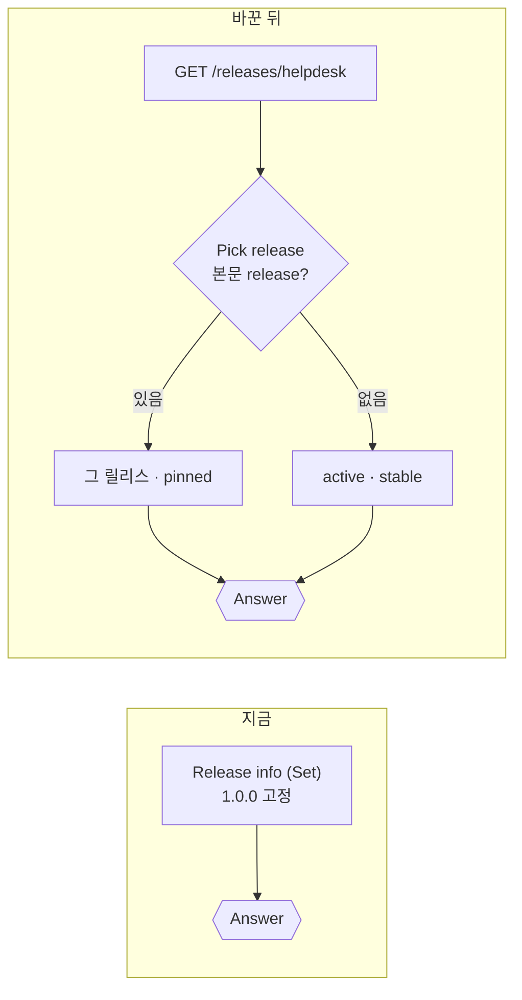
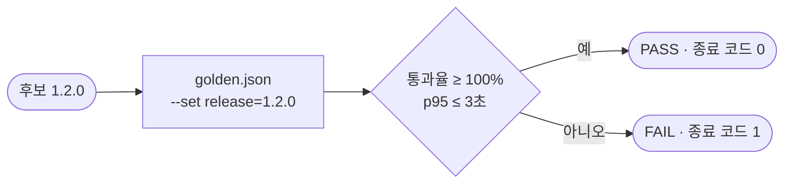
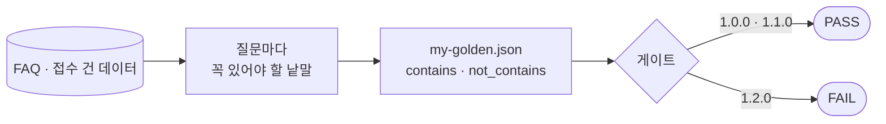
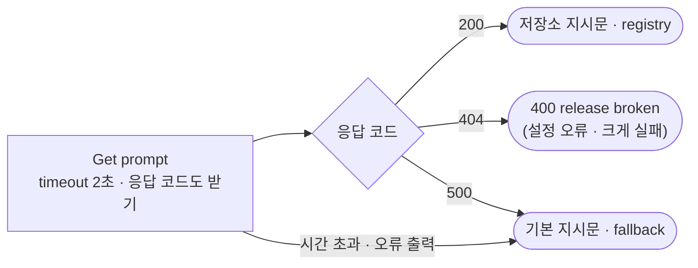

# Lab 02 · 릴리스 고르기, 후보 시험, 배포 전 게이트

- 관련 강의: [2단계 · 릴리스와 배포 전 게이트](../../Lecture/74/02-STAGE2-RELEASE-GATE.md)
- 소요 시간: 50분 (4교시 한 시간) · 예제 1 12분 · 예제 2 8분 · 예제 3 7분 · 과제 1 13분 · 과제 2 10분
- 준비: Lab 01의 `my-work/helpdesk.json` (없으면 `cp reference/lab01-example2-version.json my-work/helpdesk.json` 후 push. 지시문 저장소 · 기본 지시문은 Lab 01 과제 1 · 2를 끝낸 것)
- 목표: 워크플로우가 **운영 중인 릴리스**를 데이터 API에서 읽게 하고, 후보 릴리스를 운영을 바꾸지 않고 **고정해서 시험**하고, 배포 전에 **게이트**로 통과 여부를 숫자로 정한다. 게이트의 기준은 재서 정하고, 나쁜 릴리스를 못 막는 게이트를 고치고, **망가진 릴리스**는 장애와 구분해 크게 실패하게 한다.


> 복사해 붙일 요청문은 없습니다. 막히면 `▶` 를 하나씩 펼칩니다. 기록은 `cp templates/RELEASE-CHECKLIST-TEMPLATE.md my-work/RELEASE.md`에.

## 예제 1 · 운영 중인 릴리스를 읽고, 후보는 고정해서 (12분)

```bash
uv run tools/flow.py release helpdesk            # active 1.0.0, 릴리스 다섯 개
uv run tools/flow.py test cases/lab02.json -v    # 고치기 전
```

**만들 것**: 릴리스 정보(Set)를 데이터 API(`GET /releases/helpdesk`)로 바꾸기. 본문에 `release`가 있으면 그 릴리스로 **고정**.

| 조건 | 값 |
| --- | --- |
| 정하는 순서 | 본문 `release`(고정, `channel: pinned`) → 없으면 `active`(`channel: stable`) |
| 없는 릴리스 | HTTP 400 `{"error": "unknown release", "release", "known"}` |
| 지시문 · 모델 | 고른 릴리스의 `prompt_version` · `model` |
| 기대 결과 | `cases/lab02.json` 5개, `lab01-challenge` · `lab01-challenge2`도 그대로 |

### 이해하기

**지금 무엇이 문제인가.** Lab 01의 릴리스 정보는 워크플로우 **안의** Set 노드입니다. 1.1.0을 내보내려면 Set의 값을 고치고 push 해야 합니다. push 하면 n8n이 재시작되고, "무엇이 바뀌었나"에 워크플로우 변경이 섞이고, 되돌릴 때도 다시 push 합니다. 그리고 1.1.0을 **운영에 내보내기 전에** 시험해 볼 방법이 없습니다.



**배포 = 데이터 API의 값 하나.** 운영 중인 릴리스(`active`)를 워크플로우가 **매번 읽게** 하면, 배포는 그 값을 바꾸는 일이 됩니다 (3단계 `flow.py release`). 워크플로우는 그대로, push도 재시작도 없습니다. 이것을 **설정과 코드의 분리**, 또는 원격 설정(remote config)이라고 합니다.

**고정(pin)은 후보 시험의 문.** 본문에 `release: "1.1.0"`을 넣으면 운영과 상관없이 그 릴리스로 답합니다. 운영 사용자는 계속 1.0.0을 받고, 테스트만 1.1.0을 받습니다. `flow.py test ... --set release=1.1.0`이 모든 요청에 이 칸을 더해 줍니다. 실제 서비스에서는 이 문을 **운영자 · 테스트에만** 엽니다 (73일차: 누구나 쓰게 두면 공격면).

**`channel` 세 가지.**

| `channel` | 언제 | 예제 |
| --- | --- | --- |
| `stable` | 본문에 `release`가 없고 카나리 대상도 아님 | 오늘 예제 1 |
| `pinned` | 본문 `release`로 고정 | 오늘 예제 1 |
| `canary` | 카나리 대상 직원 (Lab 03 예제 2) | 3단계 |

**없는 릴리스는 400.** `release: "9.9.9"`처럼 모르는 이름을 고정하면, 그냥 active로 답해 버리지 말고 **400으로 거절**합니다. 테스트가 엉뚱한 릴리스를 시험하고 PASS를 받는 일을 막습니다.

**테스트 케이스 (`lab02`).**

| 케이스 | 보내는 것 | 기대 |
| --- | --- | --- |
| 운영 중인 릴리스 (active) | VPN | 1.0.0 · `stable` · p1 |
| 후보 시험 · 1.1.0 고정 | VPN + `release 1.1.0` | 1.1.0 · `pinned` · p2, `[FAQ-003]` |
| 후보 시험 · 2.0.0 (작은 모델) | VPN + `release 2.0.0` | 2.0.0 · `gpt-5.4-nano` |
| 없는 릴리스 | `release 9.9.9` | 400, `known`에 1.0.0 |
| 빈 질문 | | 400 |

**기대 결과.** 고치기 전에는 고정 케이스들이 ✘(늘 1.0.0). 고친 뒤 5/5, `lab01-challenge` 3/3, `lab01-challenge2` 4/4.

<details><summary>▶ 1단계 · 왜 밖에서 읽나</summary>

릴리스를 바꿀 때마다 push 하면 n8n이 재시작되고, "무엇이 바뀌었나"에 워크플로우 변경이 섞입니다. 밖에서 읽으면 **배포 = 데이터 API의 값 하나**를 바꾸는 일이 됩니다 (3단계). `curl -s localhost:8800/releases/helpdesk`로 무엇이 오는지 먼저 봅니다.
</details>

<details><summary>▶ 2단계 · 고르는 일은 코드가</summary>

"본문에 release가 있으면 그것, 없으면 active"는 틀리면 안 되는 규칙이라 LLM이 아니라 Code 노드가 정합니다 (AGENTS.md 5절 "릴리스 고르기"). 고른 릴리스의 `prompt_version` · `model`을 다음 노드들이 읽습니다.
</details>

<details><summary>▶ 빈칸 채우기 · 요청문(프롬프트) 뼈대</summary>

요청문에 꼭 들어갈 것: **① 바꿀 노드와 새 노드 ② 고르는 순서와 channel ③ 모르는 릴리스 ④ 다음 노드들이 읽을 곳 ⑤ 그대로 둘 것 ⑥ 기대 결과**. 아래 빈칸 4개(`____①`~`____④`)를 채워 `my-work/PROMPTS.md`에 쓴 뒤 에이전트에게 보냅니다.

```text
my-work/helpdesk.json 의 Release info(Set) 를 Get release(HTTP GET http://data-api:8800/releases/helpdesk) → Pick release(Code) → Known release?(If) 로 바꿔 줘.
Pick release: 본문 release 가 있으면 그 릴리스 · channel ____① , 없으면 active · channel ____② . 고른 릴리스의 prompt_version · model 을 돌려준다.
releases 에 없으면 Known release? false → Reject release(400, {error: 'unknown release', release, ____③ }).
Get prompt · Answer model · Build result 는 Release info 대신 ____④ 를 읽게. 기본 지시문(Fallback prompt)은 그대로.
기대 결과 cases/lab02.json, cases/lab01-challenge.json, cases/lab01-challenge2.json.
```

빈칸 힌트 (답이 아니라 **어디서 찾고 무엇을 생각하나**):

- ① · ② 위 이해하기 "`channel` 세 가지" 표.
- ③ 400 응답에 "알려진 릴리스 목록"을 담는 칸 이름입니다 (`cases/lab02.json`의 "없는 릴리스" 기대, AGENTS.md 3절).
- ④ 릴리스를 고른 노드의 이름입니다 (이 요청문의 첫 줄).

채운 요청문은 수업 뒤 공개되는 정답본의 요청문 예와 비교합니다. 노드 이름은 내 파일의 실제 이름을 씁니다.
</details>

```bash
uv run tools/flow.py push my-work/helpdesk.json
uv run tools/flow.py test cases/lab02.json -v
uv run tools/flow.py test cases/lab01-challenge.json        # 원래 것도
uv run tools/flow.py test cases/lab01-challenge2.json
```

## 예제 2 · 게이트로 네 릴리스를 재기 (8분, 에이전트 없이)

`cases/golden.json`은 운영팀이 "배포 전에 꼭 돌리는" 테스트입니다. 열어 읽어 봅니다.

```bash
uv run tools/flow.py gate cases/golden.json --set release=1.0.0 --max-p95 3
uv run tools/flow.py gate cases/golden.json --set release=1.1.0 --max-p95 3
uv run tools/flow.py gate cases/golden.json --set release=1.2.0 --max-p95 3
uv run tools/flow.py gate cases/golden.json --set release=2.0.0 --max-p95 3
uv run tools/flow.py call my-helpdesk '{"question": "프린터 출력이 안 돼요", "user": "최유진", "release": "1.2.0"}' -v
```

`RELEASE.md` 1절의 "약한 golden" 칸을 채웁니다. 1.2.0의 답을 직접 읽어 보면 내보내도 될까요?

### 이해하기

**게이트(gate)는 문지기입니다.** 배포 전에 정해 둔 테스트를 돌리고, 기준을 넘으면 PASS(문이 열림), 못 넘으면 FAIL(문이 닫힘). 사람의 "괜찮아 보이는데요"가 아니라 **숫자**로 정합니다.



| 게이트 기준 | 오늘 | 뜻 |
| --- | --- | --- |
| 통과율 | `--min-pass 1.0` (기본) | 케이스가 모두 통과해야 |
| 처리시간 | `--max-p95 3` | 케이스 시간의 p95가 3초 이내 |
| 결과 | PASS / FAIL, 종료 코드 0 / 1 | 자동화(CI)가 종료 코드로 다음 단계를 정함 |
| 기록 | `/gates/helpdesk`에 한 줄 | 3단계에서 "게이트를 지난 것만 배포"에 씀 |

**네 릴리스는 한 가지씩만 다릅니다.** 1.1.0은 지시문만(출처 번호), 1.2.0은 지시문만(한 문장으로 짧게), 2.0.0은 모델만(작은 모델) 바뀌었습니다. 그래서 1.0.0과 결과가 다르면 **그 한 가지** 때문이라고 말할 수 있습니다. Lab 01 예제 3에서 v2로는 할 수 없던 일입니다.

**golden이 무엇을 확인하나 읽어 봅니다.** `golden.json`의 케이스 6개는 `status: 200`과 `route: 자동 답변`만 봅니다. 답의 **내용**은 보지 않습니다. 이 게이트가 PASS라는 말은 "200으로 답이 나왔다"는 뜻일 뿐입니다.

**기대 결과.** 네 릴리스 모두 PASS. 그런데 1.2.0의 답은 "IT 포털에서 확인해 주세요" 같은 떠넘기기입니다. **게이트는 테스트만큼만 막습니다.**

<details><summary>▶ 1단계 · 게이트가 PASS인데</summary>

게이트는 테스트를 돌릴 뿐입니다. golden이 무엇을 확인하는지(상태 코드? 답의 내용?) 보면 PASS의 뜻이 보입니다. 1.2.0의 지시문은 `curl -s localhost:8800/prompts/helpdesk/p3`.
</details>

## 예제 3 · 기준선 재기: 시간과 흔들림 (7분, 에이전트 없이)

예제 2의 `--max-p95 3`은 누가 정한 숫자일까요? 기준은 **지금(1.0.0)을 재서** 정합니다.

```bash
uv run tools/flow.py bench my-helpdesk requests/faq-vpn.json -n 5 --set release=1.0.0
uv run tools/flow.py bench my-helpdesk requests/faq-vpn.json -n 5 --set release=2.0.0
uv run tools/flow.py gate cases/golden.json --set release=1.0.0 --repeat 3 --max-p95 3
```

`RELEASE.md` 1절 아래에 "기준선" 한 줄(1.0.0 p50 · p95, 2.0.0 p50 · p95, 3번 반복 통과 수)을 적습니다.

### 이해하기

**기준선(baseline)이 없으면 기준도 없습니다.** "3초 안"이라는 기준은 지금 운영 중인 1.0.0이 보통 몇 초인지 알아야 의미가 있습니다. 1.0.0이 늘 1초면 3초는 너무 느슨하고, 늘 2.8초면 너무 빡빡해서 같은 릴리스도 FAIL이 납니다. 기준은 **재서 정하고, 여유를 둡니다.**

| 정하는 법 | 예 | 좋은 점 · 나쁜 점 |
| --- | --- | --- |
| 감으로 | "3초면 되겠지" | 쉽지만 근거 없음 |
| 기준선 × 여유 | 1.0.0 p95 × 1.5 | 지금보다 많이 나빠지는 것만 막음 |
| 서비스 목표(SLO)에서 | "직원 문의 95%는 5초 안" | 사용자 쪽 약속에서 내려옴 (78일차) |

**흔들림도 기준선입니다.** 같은 릴리스로 같은 테스트를 3번 돌려 **3번 다 통과하는지** 봅니다. 1.0.0이 가끔 FAIL이면, 후보가 FAIL 했을 때 그것이 후보 탓인지 흔들림 탓인지 모릅니다. 흔들리는 테스트(flaky test)는 게이트를 믿지 못하게 만듭니다. 고치거나(기대 낱말을 데이터에 맞게), 반복을 기준에 넣습니다 (`--repeat 3`).

**작은 모델의 시간.** 2.0.0은 지시문은 1.1.0과 같고 모델만 작습니다. 빨라졌다면 모델 덕분이라고 말할 수 있습니다 (한 가지만 바꿨으니까). 75일차에는 같은 비교를 **비용**으로 합니다.

**기대 결과.** 1.0.0 · 2.0.0의 p50 · p95 (실행마다 다름), 1.0.0의 golden 3번 반복 18/18.

<details><summary>▶ 1단계 · p95는 다섯 번으로 충분한가</summary>

`-n 5`면 p95는 다섯 개 중 가장 느린 값입니다 (72일차 nearest-rank). 한 번 튄 값이 그대로 p95가 됩니다. 기준을 정할 때는 더 많이(`-n 20`) 재는 것이 좋지만 오늘은 시간과 비용 때문에 5번입니다.
</details>

## 과제 1 · 나쁜 릴리스를 막는 게이트 (13분)

> "어제 1.2.0을 게이트 통과로 내보냈다가 '포털 보세요'만 하는 답 때문에 문의가 쏟아졌어요. 게이트가 이런 릴리스를 막게 해 주세요. 대신 1.0.0 · 1.1.0은 지금처럼 통과해야 합니다. 그리고 작은 모델(2.0.0)로 바꿔도 되는지도 같은 게이트로 알려 주세요."

**만들 것**: `cases/my-golden.json` — 1.0.0 · 1.1.0은 PASS, 1.2.0은 FAIL이 되는 게이트 테스트. 그 게이트로 2.0.0을 판단.

| 조건 | 값 |
| --- | --- |
| 바꾸지 않을 것 | 워크플로우 (`my-work/helpdesk.json`) — **테스트만** 고친다 |
| 기대 | `gate cases/my-golden.json --set release=1.0.0` · `1.1.0` PASS, `1.2.0` FAIL |
| 판단 | 2.0.0의 게이트 결과 · p95를 `RELEASE.md`에, 내보낼지 한 줄 |

**먼저 생각해 보기 (3분)**: 1.2.0의 답에 **없는** 것은 무엇인가요? 질문마다 "이 말이 없으면 답이 아니다"인 낱말을 정답표처럼 정합니다 (71일차).

### 이해하기

**테스트를 강하게.** 약한 golden은 "답이 나왔나"만 봤습니다. 강한 golden은 "**맞는** 답이 나왔나"를 봅니다. 그 기준을 어디서 가져오느냐가 핵심입니다.



**기대는 데이터에서, 사람이.** 기대 낱말을 정하는 방법은 둘입니다.

| | 지금 답을 보고 기대를 만듦 | 데이터를 보고 기대를 정함 |
| --- | --- | --- |
| 방법 | 1.0.0의 답을 복사해 기대로 | FAQ의 해결 방법 · 접수 건의 상태 · 예정일에서 |
| 문제 | 1.0.0이 틀린 것도 정답이 됨 | 사람이 시간을 씀 |
| 오늘 | 하지 않음 | 이렇게 |

`curl -s 'localhost:8800/faq?q=프린터'`, `curl -s 'localhost:8800/tickets/T-1002'`로 데이터를 봅니다.

**무엇을 확인하나.**

| 질문 | 확인할 것 | 판정 칸 |
| --- | --- | --- |
| FAQ 질문 4개 | 해결 방법의 핵심 낱말 (예: VPN은 "인증서") | `contains` |
| 접수 질문 2개 | 상태("처리 중" · "완료"), 예정일 | `contains` |
| 떠넘기기 | "포털을 확인" 같은 말이 없음 | `not_contains` |

`contains`는 목록의 낱말 중 **하나라도** 있으면 통과입니다. 같은 뜻의 다른 말(예: "최신" · "업데이트")을 같이 적으면 흔들림이 줄어듭니다.

**금지 문구는 글자가 정확해야.** `not_contains: ["포털을 참고"]`를 적었는데 1.2.0이 "포털**에서** … 확인해 주세요"라고 쓰면 걸리지 않습니다. 떠넘기기를 막는 데는 금지 문구보다 **해결 낱말이 있는지**(`contains`)가 더 튼튼합니다.

**작은 모델 판단.** 2.0.0이 PASS라면 "게이트가 보는 것은 괜찮다"는 뜻입니다. 말투 · 길이 · 드문 질문 · 비용은 게이트가 보지 않습니다. 그래서 바로 전원에게 내보내지 않고 카나리로 먼저 (3단계).

**기대 결과.** 1.0.0 · 1.1.0 PASS, 1.2.0 FAIL (해결 낱말 케이스 대부분 ✘), 2.0.0은 결과를 보고 판단.

<details><summary>▶ 1단계 · 무엇을 확인하나</summary>

FAQ 질문마다 해결 방법의 핵심 낱말, 접수 질문마다 상태 · 예정일. 그리고 "포털을 보라"로 떠넘기지 않는지(`not_contains`). `cp cases/golden.json cases/my-golden.json`에서 시작해 `expect`만 바꿉니다.
</details>

<details><summary>▶ 2단계 · 에이전트에게 맡길 수 있나</summary>

테스트를 에이전트가 써도 됩니다. 단, **기대 낱말은 내가 데이터(FAQ · 접수 건)를 보고 정한 것**이어야 합니다. 에이전트가 1.0.0의 답을 보고 기대를 만들면, 1.0.0이 틀린 것도 정답이 됩니다.
</details>

<details><summary>▶ 3단계 · 1.0.0도 FAIL이면</summary>

기대 낱말이 너무 좁습니다. 1.0.0의 실패 줄을 보고, 답이 정말 틀렸는지(데이터와 다름) 아니면 같은 뜻을 다른 말로 썼는지 가립니다. 같은 뜻이면 그 말을 목록에 더합니다. **틀렸다면** 기대를 고치지 말고 1.0.0의 문제로 적습니다.
</details>

<details><summary>▶ 빈칸 채우기 · 요청문(프롬프트) 뼈대</summary>

요청문에 꼭 들어갈 것: **① 만들 파일과 시작점 ② 바꾸지 말 것 ③ 질문마다 기대 낱말(내가 데이터에서 정한 것) ④ 떠넘기기 금지 ⑤ 기대**. 아래 빈칸 4개(`____①`~`____④`)를 채워 `my-work/PROMPTS.md`에 쓴 뒤 에이전트에게 보냅니다.

```text
cases/golden.json 을 cases/my-golden.json 으로 복사해 expect 만 강하게 바꿔 줘. 워크플로우는 ____① .
질문마다 답에 꼭 있어야 할 낱말을 ____② 로 (아래는 내가 FAQ · 접수 건 데이터에서 정한 것):
VPN 인증서 / VPN 업데이트 · 최신 / 비밀번호 비밀번호 찾기 · 휴대폰 / 프린터 대기열 · 전원 / 메일함 보관함 · 삭제 /
T-1002 처리 중 / T-1002 10월 20일 · 20일 / T-1001 처리 완료 · 완료.
프린터 질문에는 " ____③ " 같은 떠넘기기 말이 없어야 한다 (not_contains).
기대: gate --set release=1.0.0 · 1.1.0 PASS, release= ____④ FAIL.
```

빈칸 힌트 (답이 아니라 **어디서 찾고 무엇을 생각하나**):

- ① 과제 조건 표의 "바꾸지 않을 것".
- ② 목록의 낱말 중 하나라도 있으면 통과인 판정 칸 이름입니다 (AGENTS.md 8절, 위 "무엇을 확인하나" 표).
- ③ 1.2.0의 지시문(`/prompts/helpdesk/p3`)이 시키는 말입니다. 실제 1.2.0 답의 글자를 예제 2의 `call -v`에서 찾습니다.
- ④ 막아야 할 릴리스입니다 (팀장의 말).

채운 요청문은 수업 뒤 공개되는 정답본의 요청문 예와 비교합니다.
</details>

```bash
uv run tools/flow.py gate cases/my-golden.json --set release=1.0.0 --max-p95 3
uv run tools/flow.py gate cases/my-golden.json --set release=1.1.0 --max-p95 3
uv run tools/flow.py gate cases/my-golden.json --set release=1.2.0 --max-p95 3     # FAIL이어야
uv run tools/flow.py gate cases/my-golden.json --set release=2.0.0 --max-p95 3
```

## 과제 2 · 망가진 릴리스는 크게 실패하게 (10분)

운영팀이 새 릴리스 2.1.0을 데이터 API에 올렸습니다.

```bash
uv run tools/flow.py release helpdesk                        # 2.1.0의 prompt 칸을 봅니다
curl -s localhost:8800/prompts/helpdesk                       # 저장소에 있는 지시문 버전
uv run tools/flow.py test cases/lab02-challenge2.json -v      # 고치기 전
uv run tools/flow.py gate cases/my-golden.json --set release=2.1.0 --max-p95 3
```

> "2.1.0이 게이트를 통과했대서 내보내려는데, 지시문 이름이 저장소에 없는 것 같아요. 그런데 왜 답은 멀쩡히 나오죠? 이러다 진짜 1.1.0의 출처 번호도 없이 기본 지시문으로 계속 나가는 건 아니죠?"

**만들 것**: 저장소가 **404(그런 지시문이 없음)** 를 주면 기본 지시문으로 넘어가지 말고 HTTP 400 `release broken`. 저장소 **장애(500 · 시간 초과)** 일 때만 기본 지시문.

| 조건 | 값 |
| --- | --- |
| 404 | HTTP 400 `{"error": "release broken", "release", "prompt_version"}` |
| 500 · 시간 초과 | 지금처럼 기본 지시문, `prompt_source: fallback` |
| 200 | 저장소 지시문, `prompt_source: registry` |
| 기대 결과 | `cases/lab02-challenge2.json` 5개, `gate my-golden --set release=2.1.0` FAIL, `lab02`도 그대로 |

### 이해하기

**Lab 01 과제 2의 기본 지시문이 무엇을 숨겼나.** Lab 01 과제 2에서 "저장소가 실패하면 기본 지시문으로"를 만들었습니다. 그런데 "실패"에는 두 종류가 있습니다.

| 실패 | 저장소의 답 | 뜻 | 맞는 대응 |
| --- | --- | --- | --- |
| 장애 | 500, 시간 초과 | 저장소가 **잠깐** 아픔. 다시 하면 될 수도 | 기본 지시문으로 계속 (graceful degradation) |
| 설정 오류 | **404** `prompt not found` | 릴리스가 **없는 지시문**을 가리킴. 다시 해도 안 됨 | 크게 실패 (fail fast) |

2.1.0은 `p9`를 가리키는데 저장소에는 p1~p3만 있습니다. 지금 워크플로우는 404도 "실패"로 보고 기본 지시문(p1)으로 답합니다. 그래서 2.1.0은 **겉으로 멀쩡하고**, 강한 golden도 통과합니다(p1의 답이니까). 그대로 배포하면 운영팀은 2.1.0의 새 지시문이 나간다고 믿지만, 실제로는 1.0.0의 지시문이 나갑니다. **장애를 견디려고 만든 장치가 잘못된 설정을 숨긴 것**입니다.



**크게 실패해야 게이트가 잡습니다.** 404에서 400 `release broken`을 내면, 2.1.0을 고정한 게이트 테스트가 모두 400을 받아 **FAIL**이 됩니다. 문제는 배포 **전에**, 사람이 아니라 게이트가 찾습니다. "조용히 넘어가는 오류"가 가장 비쌉니다.

**응답 코드를 읽으려면.** HTTP 노드는 기본으로 4xx · 5xx를 **오류**로 보고 오류 출력으로 보냅니다. 그러면 404와 500이 같은 길로 갑니다. `neverError`(오류로 보지 않음) + `fullResponse`(응답 코드 · 본문을 같이 받음)를 켜면 다음 Code가 `$json.statusCode`로 가를 수 있습니다. 시간 초과는 응답 코드가 없으므로 지금처럼 오류 출력으로 갑니다 ([AGENTS.md](AGENTS.md) 5절 "응답 코드로 가르기").

**장애일 때 없는 릴리스는?** 저장소 장애 중에도 `release: "9.9.9"`는 400 `unknown release`여야 합니다. 릴리스 고르기(Pick release)는 지시문을 가져오기 **전**이라 영향이 없습니다. 테스트가 이것도 봅니다.

**테스트 케이스 (`lab02-challenge2`).**

| 케이스 | 고장 | 기대 |
| --- | --- | --- |
| 망가진 릴리스 2.1.0 | 없음 | 400 `release broken`, `prompt_version` p9 |
| 평소 · 1.1.0 | 없음 | `registry` · p2, `[FAQ-003]` |
| 저장소 고장 · 1.1.0 | `prompts error` | 200, 1.1.0, `fallback`, "인증서" |
| 저장소 고장 · 없는 릴리스 | `prompts error` | 400 `unknown release` |
| 운영(active 1.0.0) | 없음 | 1.0.0 · `registry`, "대기열" |

**기대 결과.** 고치기 전: 2.1.0 케이스 ✘(200으로 기본 지시문 답), 나머지 ✔. `gate my-golden 2.1.0`은 **PASS**(위험!). 고친 뒤: 5/5, `gate my-golden 2.1.0` FAIL.

<details><summary>▶ 1단계 · 2.1.0이 왜 멀쩡해 보이나</summary>

고치기 전 `test -v`에서 2.1.0 케이스의 응답 `version.prompt_source`를 봅니다. `curl -s localhost:8800/prompts/helpdesk/p9`는 무엇을 주나요?
</details>

<details><summary>▶ 2단계 · 두 실패를 가르는 곳</summary>

`Get prompt`의 성공 쪽 다음 노드(지금 `Registry prompt`)를 Code로 바꿔 응답 코드로 셋으로 가르고(200 · 404 · 그 밖), 404면 If로 400 응답. 실패 쪽(시간 초과)은 그대로 `Fallback prompt`.
</details>

<details><summary>▶ 빈칸 채우기 · 요청문(프롬프트) 뼈대</summary>

요청문에 꼭 들어갈 것: **① HTTP 노드 응답 옵션 ② 응답 코드별로 할 일 ③ 400 응답 모양 ④ 그대로 둘 것 ⑤ 기대 결과**. 아래 빈칸 4개(`____①`~`____④`)를 채워 `my-work/PROMPTS.md`에 쓴 뒤 에이전트에게 보냅니다.

```text
my-work/helpdesk.json 의 Get prompt 에 options.response.response 로 neverError true, ____① true 를 더해 줘 (timeout 2000 · onError 는 그대로).
성공 쪽 Registry prompt 를 Code 로 바꿔: statusCode 200 이면 {state: 'registry', text: body.text}, ____② 이면 {state: 'broken'}, 그 밖이면 {state: 'fallback', text: 기본 지시문}.
Prompt broken?(If, state == 'broken') true → Reject broken(HTTP ____③ , {error: 'release broken', release, prompt_version}), false → Search FAQ.
prompt_source 는 Registry prompt 의 state 가 'registry' 면 registry, 아니면 fallback. 실패 쪽(시간 초과) Fallback prompt 는 ____④ .
기대 결과 cases/lab02-challenge2.json, cases/lab02.json.
```

빈칸 힌트 (답이 아니라 **어디서 찾고 무엇을 생각하나**):

- ① 응답 코드와 본문을 같이 받는 옵션 이름입니다 (위 이해하기 "응답 코드를 읽으려면").
- ② 저장소가 "그런 지시문이 없다"고 할 때의 응답 코드입니다 (`curl -s -o /dev/null -w '%{http_code}' localhost:8800/prompts/helpdesk/p9`).
- ③ `cases/lab02-challenge2.json`의 첫 케이스 `status`.
- ④ 장애는 지금처럼 견뎌야 합니다. 바꿀까요, 둘까요?

채운 요청문은 수업 뒤 공개되는 정답본의 요청문 예와 비교합니다. 노드 이름은 내 파일의 실제 이름을 씁니다.
</details>

```bash
uv run tools/flow.py push my-work/helpdesk.json
uv run tools/flow.py test cases/lab02-challenge2.json -v
uv run tools/flow.py gate cases/my-golden.json --set release=2.1.0 --max-p95 3     # FAIL이어야
uv run tools/flow.py test cases/lab02.json
uv run tools/flow.py test cases/lab01-challenge2.json
```

## 막혔을 때

| 증상 | 할 일 |
| --- | --- |
| 늘 `1.0.0` | 본문 `release`를 읽는지, `--set release=...`를 붙였는지 |
| 2.0.0인데 `version.model`이 mini | 모델 노드가 고른 릴리스의 `model`을 읽는지 |
| 없는 릴리스가 500 | 모르는 릴리스면 If로 400 갈래 |
| 게이트가 1.0.0도 FAIL | 기대 낱말이 너무 좁음. 1.0.0의 실패 줄을 보고 데이터의 낱말로 |
| 2.1.0이 여전히 200 | `fullResponse`가 켜졌는지 (`$json.statusCode`가 있는지 `call -v`로), 404 갈래가 If로 이어졌는지 |
| 저장소 고장인데 400 | 500을 `broken`으로 본 것. 404만 `broken` |
| `fault` 뒤 다른 테스트가 이상함 | `uv run tools/flow.py fault prompts ok` |
| 계속 안 됨 | `cp reference/lab02-example1-release.json my-work/helpdesk.json` 후 push |

## 확인

- [ ] 예제 1: `cases/lab02.json` 5/5, `lab01-challenge` · `lab01-challenge2`도 통과.
- [ ] 예제 2: 네 릴리스의 golden 게이트 결과를 `RELEASE.md` 1절에, 1.2.0의 답을 읽어 봄.
- [ ] 예제 3: 1.0.0 · 2.0.0의 p50 · p95, 1.0.0 golden 3번 반복 (기준선).
- [ ] 과제 1: `my-golden`으로 1.0.0 · 1.1.0 PASS, 1.2.0 FAIL, 2.0.0 판단 한 줄.
- [ ] 과제 2: `cases/lab02-challenge2.json` 5/5, `gate my-golden 2.1.0` FAIL (고치기 전 PASS였음을 `RELEASE.md`에).
