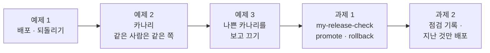
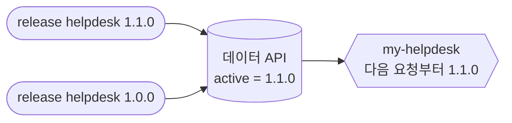
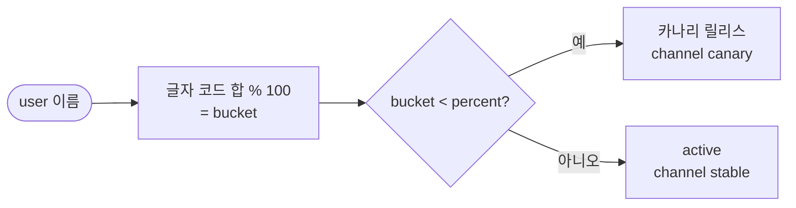
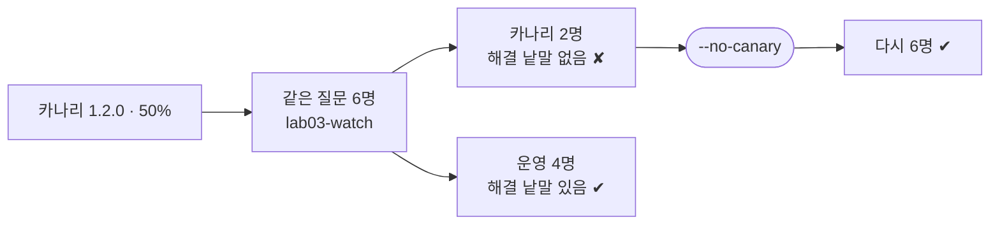
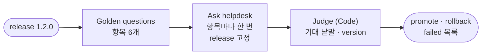
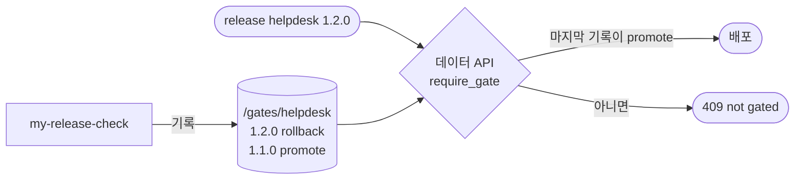

# Lab 03 · 배포 · 되돌리기, 카나리, 릴리스 점검 워크플로우

- 관련 강의: [3단계 · 배포 · 되돌리기 · 카나리](../../Lecture/74/03-STAGE3-DEPLOY-AND-ROLLBACK.md)
- 소요 시간: 50분 (6교시 한 시간) · 예제 1 8분 · 예제 2 12분 · 예제 3 7분 · 과제 1 13분 · 과제 2 10분
- 준비: Lab 02의 `my-work/helpdesk.json` (없으면 `cp reference/lab02-example1-release.json my-work/helpdesk.json` 후 push. 망가진 릴리스 처리는 Lab 02 과제 2를 끝낸 것), Lab 02 과제 1의 `cases/my-golden.json`
- 목표: 배포와 되돌리기를 **값 하나**로 하고, 새 릴리스를 일부 직원에게만 먼저 내보내고(카나리), 나쁜 카나리를 보고 끄고, 내보낼지 되돌릴지를 판단하는 점검을 n8n 워크플로우로 만들고, **점검을 지난 릴리스만 배포되게** 한다.



> 배포 · 되돌리기는 **사람이** `flow.py release`로 합니다. 테스트 파일은 `before`로 바꾸고 `after`로 처음 상태(`--reset`)로 되돌립니다. 끝나면 `uv run tools/flow.py release helpdesk --reset`.

## 예제 1 · 배포와 되돌리기 (8분, 에이전트 없이)

```bash
uv run tools/flow.py release helpdesk 1.1.0                      # 배포
uv run tools/flow.py call my-helpdesk requests/faq-vpn.json -v   # version.release, 답 끝의 [FAQ-003]
uv run tools/flow.py release helpdesk 1.0.0                      # 되돌리기
uv run tools/flow.py call my-helpdesk requests/faq-vpn.json -v
uv run tools/flow.py test cases/lab03.json -v
```

`RELEASE.md` 3절에 걸린 시간과 확인 방법을 적습니다. push를 했나요? n8n이 재시작됐나요?

### 이해하기

**배포와 되돌리기가 값 하나.** Lab 02 예제 1 덕분에 워크플로우는 질문마다 `GET /releases/helpdesk`로 `active`를 읽습니다. 그래서 배포는 `active`를 1.1.0으로, 되돌리기는 1.0.0으로 바꾸는 **한 줄**입니다. 다음 요청부터 바로 바뀌고, push도 n8n 재시작도 없습니다.

| 되돌리기 방법 | 걸리는 일 | 위험 |
| --- | --- | --- |
| 예전 JSON을 찾아 push | 파일 찾기 · import · n8n 재시작 (분 단위) | 그 사이 다른 것도 바뀔 수 있음, 예전 파일이 정말 그때 것인지 모름 |
| **`active` 값 하나** | 명령 한 줄 (초 단위) | 되돌릴 릴리스가 남아 있어야 함 |



**이전 것을 지우지 않습니다.** 되돌릴 수 있는 것은 1.0.0 릴리스와 p1 지시문이 데이터 API에 **그대로 남아 있기** 때문입니다. Lab 01 과제 1의 "버전은 바꾸지 않고 더한다"가 여기서 값을 냅니다.

**확인은 답의 `version`으로.** "배포했다"는 명령이 성공한 것이고, "배포됐다"는 실제 답이 바뀐 것입니다. `call -v`의 `version.release`와 답 끝의 출처 번호를 봅니다.

**기대 결과.** 1.1.0이면 `version.release` 1.1.0 · `[FAQ-003]`, 되돌리면 1.0.0 · 출처 번호 없음. `lab03` 2/2.

<details><summary>▶ 1단계 · 되돌릴 수 있다는 것</summary>

되돌리기가 "예전 JSON을 찾아 push"라면 몇 분이 걸리고, 그 사이 다른 것도 바뀔 수 있습니다. 오늘은 **값 하나**입니다. 되돌릴 이전 릴리스가 데이터 API에 그대로 남아 있어야 하는 이유는?
</details>

## 예제 2 · 카나리: 일부 직원에게만 먼저 (12분)

```bash
uv run tools/flow.py release helpdesk --canary 1.1.0 --percent 50    # 대상 직원이 표시됨
uv run tools/flow.py test cases/lab03-canary.json -v                 # 고치기 전
```

**만들 것**: 카나리가 켜져 있으면 대상 직원은 카나리 릴리스, 나머지는 active. **같은 사람은 늘 같은 쪽**.

| 조건 | 값 |
| --- | --- |
| 대상 규칙 | 이름 글자 코드의 합 % 100 < `percent` ([AGENTS.md](AGENTS.md) 3절) |
| 순서 | 고정(`release`) > 카나리 > active |
| 결과 | `version.channel`: `pinned` · `canary` · `stable` |
| 기대 결과 | `cases/lab03-canary.json` 6개 (50%: 최유진 · 정우성이 카나리), `lab02`도 |

### 이해하기

**카나리(canary)는 탄광의 새입니다.** 옛날 광부들은 유독 가스를 먼저 알아채는 카나리아를 데리고 들어갔습니다. 새 릴리스도 **먼저 일부에게만** 내보내 문제가 있는지 봅니다. 나쁘면 일부만 영향을 받고, 좋으면 넓힙니다.



**왜 무작위로 고르지 않나.** 요청마다 무작위로 고르면 같은 사람이 질문할 때마다 다른 릴리스의 답을 받습니다. 대화가 이어질 때 말투가 바뀌고, 문제가 생겼을 때 누가 어느 릴리스를 썼는지 찾기 어렵습니다. 그래서 이름 · 사번처럼 **바뀌지 않는 값**으로 나눕니다. 이것을 고정 배정(sticky bucketing)이라고 합니다.

**오늘 직원의 bucket.**

| 직원 | bucket | 50% 카나리일 때 |
| --- | --- | --- |
| 최유진 | 0 | 카나리 |
| 정우성 | 42 | 카나리 |
| 한지훈 | 52 | 운영 |
| 이준호 | 56 | 운영 |
| 박서연 | 57 | 운영 |
| 김민지 | 80 | 운영 |

`flow.py release helpdesk`가 카나리일 때 대상 직원을 보여 줍니다. 워크플로우와 `flow.py`가 **같은 규칙**을 써야 둘의 말이 맞습니다.

**순서가 중요합니다.** 고정(`release`)이 카나리보다 먼저입니다. 그래야 카나리 대상인 최유진도 테스트에서 `release: 1.0.0`을 고정하면 1.0.0을 받습니다. 순서가 바뀌면 후보 시험이 카나리에 섞입니다.

**기대 결과.** 고치기 전(Lab 02 상태): 카나리 대상 케이스가 ✘(늘 stable). 고친 뒤 6/6, `lab02` 5/5. 끝나면 `--reset`.

<details><summary>▶ 1단계 · 왜 무작위로 고르지 않나</summary>

요청마다 무작위로 고르면 같은 사람이 질문할 때마다 다른 릴리스의 답을 받습니다. 대화가 이어질 때 어색하고, 문제가 생겼을 때 누가 어느 릴리스를 썼는지 찾기 어렵습니다.
</details>

<details><summary>▶ 2단계 · 카나리로 무엇을 보나</summary>

카나리 직원의 답 · 시간 · 실패를 운영 쪽과 비교합니다 (예제 3, 77일차 로그 분석). 나쁘면 `--no-canary` 하나로 끝납니다.
</details>

<details><summary>▶ 빈칸 채우기 · 요청문(프롬프트) 뼈대</summary>

요청문에 꼭 들어갈 것: **① 고칠 노드 ② 대상 규칙(식) ③ 순서 ④ channel 값 ⑤ 기대 결과**. 아래 빈칸 4개(`____①`~`____④`)를 채워 `my-work/PROMPTS.md`에 쓴 뒤 에이전트에게 보냅니다.

```text
my-work/helpdesk.json 의 Pick release 에 카나리를 더해 줘.
bucket = user 이름 글자의 codePointAt 합 % ____① . 본문 release 가 없고 canary 가 있고 bucket ____② canary.percent 이면
canary.release 를 쓰고 channel ' ____③ '. 순서는 고정 > 카나리 > active ( ____④ 가 맨 먼저).
기대 결과 cases/lab03-canary.json, cases/lab02.json.
```

빈칸 힌트 (답이 아니라 **어디서 찾고 무엇을 생각하나**):

- ① AGENTS.md 3절 "카나리 대상 규칙"의 나누는 수.
- ② "작으면 카나리"입니다. 같은 값(=)이면 들어가나요?
- ③ 위 "`channel` 세 가지"(Lab 02 예제 1) 중 하나.
- ④ 후보 시험이 카나리에 섞이지 않으려면 무엇이 가장 먼저여야 하나요?

채운 요청문은 수업 뒤 공개되는 정답본의 요청문 예와 비교합니다. 노드 이름은 내 파일의 실제 이름을 씁니다.
</details>

```bash
uv run tools/flow.py push my-work/helpdesk.json
uv run tools/flow.py test cases/lab03-canary.json -v
uv run tools/flow.py test cases/lab02.json
uv run tools/flow.py release helpdesk --reset
```

## 예제 3 · 나쁜 카나리를 보고 끄기 (7분, 에이전트 없이)

누군가 1.2.0을 50% 카나리로 내보냈습니다. 같은 질문을 여섯 직원이 합니다.

```bash
uv run tools/flow.py test cases/lab03-watch.json -v           # before가 카나리 1.2.0 50%를 켭니다
uv run tools/flow.py release helpdesk                         # 누가 카나리인가
uv run tools/flow.py release helpdesk --no-canary             # 카나리 끄기
uv run tools/flow.py test cases/lab03-watch.json --no-before -v   # 끈 뒤 (before를 건너뜀)
uv run tools/flow.py release helpdesk --reset
```

`RELEASE.md` 3절에 "영향 받은 직원 수 / 여섯", "끄는 데 걸린 시간", "끈 뒤 통과 수"를 적습니다.

### 이해하기

**카나리는 보는 것까지가 카나리입니다.** 일부에게 내보내기만 하고 아무도 보지 않으면, 그냥 느린 배포입니다. 카나리 쪽과 운영 쪽을 **같은 질문으로 비교**해 차이가 있으면 멈춥니다.



**이 예제에서는 아무것도 만들지 않습니다.** 예제 2까지 만든 헬프데스크를 그대로 두고, 누가 잘못된 카나리를 켰을 때 **알아채고 끄는 연습**만 합니다.

**상황.** 운영 릴리스(active)는 1.0.0입니다. 누군가 1.2.0을 50% 카나리로 내보냈습니다. 1.2.0은 지시문 p3("답을 한 문장으로 짧게", [AGENTS.md](AGENTS.md) 2절)를 씁니다. 답이 짧아지면서 해결 방법(프린터 **대기열** 비우기)이 빠집니다. HTTP는 200이라 오류로 보이지 않습니다. **답의 내용을 봐야 알 수 있는 나쁜 릴리스**입니다.

**명령마다 하는 일.**

| 순서 | 명령 | 하는 일 |
| --- | --- | --- |
| 1 | `test cases/lab03-watch.json -v` | 테스트 파일 맨 위 `before`가 `reset` 뒤 **카나리 1.2.0 50%를 켭니다** (사고 상황 만들기). 이어서 여섯 직원이 같은 질문 "프린터 출력이 안 돼요"를 보내고, 답에 `대기열`이 있는지 봅니다 |
| 2 | `release helpdesk` | 지금 상태(active · canary)와 카나리 대상 직원을 봅니다. 1번에서 ✘가 난 직원과 맞는지 확인합니다 |
| 3 | `release helpdesk --no-canary` | 카나리를 끕니다. 명령 한 줄 |
| 4 | `test cases/lab03-watch.json --no-before -v` | 같은 테스트를 다시 돌립니다. **`--no-before`가 없으면 `before`가 카나리를 다시 켜서** 끈 효과를 잴 수 없습니다 |
| 5 | `release helpdesk --reset` | 다음 과제를 위해 처음 상태로 |

**누가 ✘가 나나.** 예제 2의 규칙(bucket < 50이면 카나리)대로 최유진(0) · 정우성(42)만 1.2.0을 받습니다. 1번 출력에서 두 사람의 `version.channel`은 `canary`, `version.release`는 `1.2.0`이고, 나머지 넷은 `stable` · `1.0.0`입니다. 같은 질문을 했는데 **카나리 쪽만** 해결 낱말이 없습니다. 이렇게 운영 쪽과 나란히 비교해 차이를 찾는 것이 "카나리를 본다"의 뜻입니다.

**끈 뒤.** 카나리가 없으면 여섯 명 모두 active 1.0.0을 받습니다. 4번 출력에서 모두의 `version.channel`이 `stable`인지 봅니다.

**피해 반경(blast radius).** 전원에게 바로 배포했다면 여섯 명 모두 "포털에서 확인하세요"를 받았을 것입니다. 50% 카나리라서 둘만 받았고, 끄는 데는 명령 한 줄입니다. 카나리 비율은 처음에 작게(1~5%) 시작해 늘리는 것이 보통입니다. 오늘은 여섯 명이라 50%로 둘만 걸리게 했습니다.

**무엇을 보나.**

| 볼 것 | 오늘 | 운영에서 |
| --- | --- | --- |
| 답의 내용 | 해결 낱말이 있는가 (`lab03-watch`) | 샘플 답 읽기, 사용자 평가(👍👎) |
| 실패 · 오류 | HTTP 상태 | 오류율 대시보드 (77일차) |
| 시간 | 케이스 시간 | p95 (72일차) |
| 누가 받았나 | `version.channel` | 로그의 `version`으로 나눠 세기 |

**기대 결과.** 켠 상태: 카나리 둘(최유진 · 정우성) ✘, 운영 넷 ✔ (4/6). 끈 뒤 6/6.

<details><summary>▶ 1단계 · 카나리를 끄면 무엇이 남나</summary>

`--no-canary` 뒤 `release helpdesk`를 봅니다. active는 그대로 1.0.0입니다. 카나리를 끄는 것은 "되돌리기"가 아니라 **아직 배포하지 않은 것을 거두는 일**입니다. 1.2.0 릴리스 자체는 데이터 API에 남아 있습니다 (왜 지우지 않을까요?).
</details>

## 과제 1 · 릴리스 점검 워크플로우 (13분)

> "게이트를 매번 노트북에서 돌리니 사람마다 결과가 달라요. n8n에 '이 릴리스 내보내도 돼?'를 물으면 답해 주는 점검을 만들어 주세요. 운영 중인 사람들에게는 영향이 없어야 합니다."

**만들 것**: `my-work/release-check.json` (`my-release-check`). 릴리스를 받아, 정해 둔 질문 6개를 **그 릴리스로 고정해** 헬프데스크에 물어보고, 답을 검사해 `promote` 또는 `rollback`.

| 조건 | 값 |
| --- | --- |
| 계약 | [AGENTS.md](AGENTS.md) 3절 릴리스 점검 |
| 질문 · 기대 | Lab 02 과제 1의 `my-golden`에서 6개 (질문 · 사용자 · 기대 낱말) |
| 판단 | 6개 모두 통과면 `promote`, 하나라도 실패면 `rollback`, 실패한 질문 목록 |
| 기대 결과 | `cases/lab03-challenge.json` (1.1.0 → promote, 1.2.0 → rollback, 릴리스 없음 → 400) |

**먼저 생각해 보기 (3분)**: 점검이 헬프데스크를 부를 때 왜 `release`를 **고정**해야 할까요? 고정하지 않으면 무엇을 점검하게 되나요?

### 이해하기

**노트북의 게이트를 서버로.** `flow.py gate`는 내 노트북에서 돕니다. 사람마다 다른 버전의 테스트 파일, 다른 기준, 다른 시각에 돌리면 결과가 다릅니다. 점검을 **한 곳(n8n)에** 두면 누가 물어도 같은 질문 · 같은 기준으로 답합니다. 회사에서 CI 서버가 테스트를 도는 것과 같은 이유입니다.



**고정해서 물어야 합니다.** 점검이 `release` 없이 헬프데스크를 부르면 **운영 중인 1.0.0**이 답합니다. 1.2.0을 점검한다면서 1.0.0의 답을 채점하게 됩니다. 그래서 Judge는 답의 `version.release`가 점검하는 릴리스와 **같은지**도 봅니다. 다르면 고정이 먹지 않은 것이고, 그 질문은 실패로 셉니다.

**1 → N → 1.** Code가 질문 6개를 **항목 6개**로 돌려주면 다음 HTTP 노드가 항목마다 한 번씩 부릅니다 (66일차). 그 뒤 Code에서 `$input.all()`(답 6개)과 `$('Golden questions').all()`(질문 6개)을 같은 순서로 맞춰 채점하고 하나로 모읍니다.

**판단은 코드가.** "답에 기대 낱말이 있는가"는 글자 검사라 LLM이 아니라 Code가 합니다. LLM이 채점하면 채점도 흔들립니다 (LLM 채점은 79일차).

**기대 결과.** 1.1.0 → `promote` 6/6, 1.2.0 → `rollback` (해결 낱말 없음), 본문에 `release`가 없으면 400. `call my-release-check '{"release": "2.0.0"}'`의 결과를 `RELEASE.md`에.

<details><summary>▶ 1단계 · 질문 6개를 한 번에</summary>

Code가 질문 6개를 **항목 6개**로 돌려주면, 다음 HTTP 노드가 항목마다 한 번씩 부릅니다 (66일차 1 → N → 1). 내 웹훅 주소는 n8n 안에서도 `http://localhost:5678/webhook/my-helpdesk` (AGENTS.md 5절 "HTTP로 내 웹훅 부르기").
</details>

<details><summary>▶ 2단계 · 검사는 코드가</summary>

답에 기대 낱말이 있는지, 답의 `version.release`가 점검한 릴리스와 같은지. 같지 않다면? (고정이 안 먹은 것)
</details>

<details><summary>▶ 3단계 · 운영에서는</summary>

새 릴리스를 데이터 API에 올리면 이 점검을 자동으로 부르고, `promote`면 카나리 → 배포, `rollback`이면 멈추고 알림. 오늘은 사람이 결과를 보고 `flow.py release`를 합니다. 과제 2에서 "점검을 지난 것만 배포"를 데이터 API가 지키게 합니다.
</details>

<details><summary>▶ 빈칸 채우기 · 요청문(프롬프트) 뼈대</summary>

요청문에 꼭 들어갈 것: **① 파일 · 웹훅 ② 질문 6개를 항목으로 ③ 부를 곳과 고정 ④ 채점 기준 ⑤ 결과 모양 ⑥ 기대 결과**. 아래 빈칸 4개(`____①`~`____④`)를 채워 `my-work/PROMPTS.md`에 쓴 뒤 에이전트에게 보냅니다.

```text
my-work/release-check.json 을 새로 만들어 줘. 웹훅 ____① , 본문 release 가 없으면 400.
Golden questions(Code): cases/my-golden.json 의 질문 6개(question · user · expect 낱말)를 항목 6개로, 각 항목에 release.
Ask helpdesk(HTTP POST http://localhost:5678/webhook/my-helpdesk): 항목마다 {question, user, ____② } 로 (neverError, timeout 30000).
Judge(Code): 답에 expect 낱말 중 하나가 있고 답의 version.release 가 점검한 release 와 ____③ 이면 통과.
결과 {release, passed, total, failed, seconds, verdict}: 모두 통과면 ' ____④ ', 아니면 'rollback'.
기대 결과 cases/lab03-challenge.json.
```

빈칸 힌트 (답이 아니라 **어디서 찾고 무엇을 생각하나**):

- ① `cases/lab03-challenge.json`의 `webhook` (AGENTS.md 3절 표).
- ② 운영이 아니라 후보를 점검하려면 본문에 무엇을 더해야 하나요? ("먼저 생각해 보기")
- ③ 고정이 먹었는지 확인하는 비교입니다.
- ④ AGENTS.md 3절 `verdict`의 두 값 중 "내보내도 됨".

채운 요청문은 수업 뒤 공개되는 정답본의 요청문 예와 비교합니다.
</details>

```bash
uv run tools/flow.py push my-work/release-check.json
uv run tools/flow.py test cases/lab03-challenge.json -v
uv run tools/flow.py call my-release-check '{"release": "2.0.0"}' -v
```

## 과제 2 · 점검을 남기고, 지난 것만 배포 (10분)

> "점검이 rollback이라고 했는데 누가 실수로 그 릴리스를 배포했어요. 점검 결과를 남기고, 점검을 지나지 않은 릴리스는 아예 배포가 안 되게 해 주세요. 카나리도요."

데이터 API에는 **배포 정책**이 있습니다. 켜면, 마지막 점검 기록이 `promote`인 릴리스만 `active` · 카나리가 됩니다 (아니면 409).

```bash
uv run tools/flow.py release helpdesk --require-gate on
uv run tools/flow.py release helpdesk                         # 릴리스마다 마지막 점검 기록 (Lab 02의 gate가 남긴 것)
uv run tools/flow.py release helpdesk 2.1.0                   # 기록이 없거나 rollback이면 거절 (409)
uv run tools/flow.py release helpdesk --reset                 # 정책 · active · 카나리는 처음으로 (점검 기록은 남음)
uv run tools/flow.py test cases/lab03-challenge2.json -v      # 고치기 전
```

**만들 것**: 릴리스 점검이 판단한 뒤 그 결과를 `POST http://data-api:8800/gates/helpdesk`에 남기고, 답에 `recorded: true`.

| 조건 | 값 |
| --- | --- |
| 기록할 것 | `{release, verdict, passed, total, failed, seconds, source: "my-release-check"}` |
| 기록이 실패하면 | 판단 결과는 그대로 보내고 `recorded: false` |
| 결과 | 과제 1의 결과 + `recorded` |
| 기대 결과 | `cases/lab03-challenge2.json` 5개 (정책을 켜고 1.2.0 · 1.1.0 점검 → 1.2.0 배포 거부 · 1.1.0 배포, 점검 안 한 2.0.0 카나리 거부) |

### 이해하기

**판단과 실행 사이의 틈.** 과제 1의 점검은 `rollback`이라고 **말할** 뿐입니다. 배포는 사람이 `flow.py release`로 하니, 사람이 점검을 안 보거나 잘못 보면 그대로 나갑니다. 판단을 **기록**하고, 배포하는 쪽이 그 기록을 **확인**하게 하면 틈이 닫힙니다.



**누가 무엇을.** 워크플로우는 **기록만** 하고 배포는 하지 않습니다 (AGENTS.md 9절: 워크플로우 안에서 `/releases`에 POST 하지 않는다). 판단하는 쪽과 배포하는 쪽을 나누면, 점검 워크플로우가 고장 나거나 속아도 배포까지 저절로 일어나지는 않습니다. 73일차 "판별 LLM에는 Tool을 주지 않는다"와 같은 생각입니다(최소 권한).

**정책은 데이터 API가 지킵니다.** "점검을 지난 것만 배포"를 사람의 약속이나 문서로 두지 않고, 배포를 받는 곳(데이터 API)이 **거절**하게 합니다. 이것을 **코드로 된 정책(policy as code)**이라고 합니다. 카나리도 같은 정책을 받습니다. 점검 안 한 2.0.0은 카나리로도 못 나갑니다.

**기록이 실패해도 판단은 보냅니다.** 기록 노드가 실패했다고 점검 결과까지 500이면, 사람이 판단을 못 봅니다. 기록 노드는 `onError: continueRegularOutput`으로 두고 `recorded`로 성공 여부만 알립니다 (73일차 감사 로그와 같은 모양).

**`flow.py gate`도 기록합니다.** Lab 02에서 `gate --set release=...`를 돌릴 때마다 `/gates/helpdesk`에 한 줄씩 남았습니다 (`source: flow.py gate`). 그래서 예제 1의 1.1.0 배포는 정책이 켜져 있어도 됩니다(Lab 02 과제 1에서 PASS 기록이 있으면). 테스트의 `before`는 기록을 비우고 시작합니다.

**테스트 케이스 (`lab03-challenge2`, `before`: 기록 비우기 · reset · 정책 켜기, `after`: reset).**

| 케이스 | 하는 일 | 기대 |
| --- | --- | --- |
| 1.2.0 점검 · 기록 | `my-release-check` 1.2.0 | `rollback`, `recorded` true |
| 1.1.0 점검 · 기록 | `my-release-check` 1.1.0 | `promote`, `recorded` true |
| 1.2.0 배포 거부 | `before`: active 1.2.0 → **409**를 기대 | 운영은 그대로 1.0.0 |
| 1.1.0 배포 | `before`: active 1.1.0 → 200 | `version.release` 1.1.0 · `stable` |
| 2.0.0 카나리 거부 | `before`: canary 2.0.0 → **409**를 기대 | 최유진도 1.1.0 · `stable` |

**기대 결과.** 고치기 전: 점검 두 케이스가 ✘(`recorded`가 없음), 그리고 기록이 없어 1.1.0 배포도 409로 멈춥니다. 고친 뒤 5/5. `release helpdesk`에 릴리스마다 마지막 점검이 보입니다.

<details><summary>▶ 1단계 · 고치기 전에 왜 멈추나</summary>

고치기 전 `test -v`에서 `before`가 ✘로 멈추는 줄을 봅니다. 1.1.0을 배포하려는데 409 `not gated`, `last_gate: null`. 점검은 `promote`라고 답했지만 아무 데도 남기지 않았기 때문입니다.
</details>

<details><summary>▶ 2단계 · 기록 노드를 어디에</summary>

Judge 뒤, Send verdict 앞. 기록의 응답(`{"stored": true}`)이 오면 Send verdict는 Judge의 결과에 `recorded`만 더해 보냅니다 (`$('Judge').first().json`).
</details>

<details><summary>▶ 빈칸 채우기 · 요청문(프롬프트) 뼈대</summary>

요청문에 꼭 들어갈 것: **① 넣을 노드와 자리 ② 기록 주소와 본문 ③ 실패했을 때 ④ 결과에 더할 칸 ⑤ 하지 말 것 ⑥ 기대 결과**. 아래 빈칸 4개(`____①`~`____④`)를 채워 `my-work/PROMPTS.md`에 쓴 뒤 에이전트에게 보냅니다.

```text
my-work/release-check.json 의 Judge 와 Send verdict 사이에 Record gate(HTTP POST http://data-api:8800/ ____① ) 를 넣어 줘.
본문: {release, verdict, passed, total, failed, seconds, source: 'my-release-check'} (Judge 의 결과에서).
Record gate 는 timeout 3000, neverError, onError ____② (기록이 실패해도 판단은 보냄).
Send verdict 는 Judge 의 결과에 recorded: (기록 응답의 ____③ 가 true 인지) 를 더해 보낸다.
워크플로우에서 /releases 에는 ____④ . 기대 결과 cases/lab03-challenge2.json, cases/lab03-challenge.json.
```

빈칸 힌트 (답이 아니라 **어디서 찾고 무엇을 생각하나**):

- ① AGENTS.md 2절 데이터 API 표에서 점검 기록을 남기는 경로 (릴리스 이름 포함).
- ② 실패해도 **원래 출력으로** 계속 가게 하는 값입니다 (73일차 감사 로그 `Log event`와 같은 값).
- ③ `POST /gates/helpdesk`가 성공하면 돌려주는 칸 이름 (`curl`로 한 번 보내 봐도 됩니다).
- ④ 위 이해하기 "누가 무엇을". 워크플로우는 배포를 하나요?

채운 요청문은 수업 뒤 공개되는 정답본의 요청문 예와 비교합니다. 노드 이름은 내 파일의 실제 이름을 씁니다.
</details>

```bash
uv run tools/flow.py push my-work/release-check.json
uv run tools/flow.py test cases/lab03-challenge2.json -v
uv run tools/flow.py test cases/lab03-challenge.json
uv run tools/flow.py release helpdesk                         # 릴리스마다 마지막 점검
uv run tools/flow.py release helpdesk --reset
```

마지막으로 `RELEASE.md` 2 · 3절, `CHANGELOG.md` 2절을 채웁니다.

## 막혔을 때

| 증상 | 할 일 |
| --- | --- |
| 카나리 대상이 테스트와 다름 | 글자 코드 합(`codePointAt`) · `% 100` · `<`(작다) |
| 카나리 뒤 다른 테스트가 이상함 | `uv run tools/flow.py release helpdesk --reset` |
| `lab03-watch`를 끈 뒤에도 ✘ | `--no-before`를 붙였는지 (붙이지 않으면 before가 카나리를 다시 켬) |
| 점검이 늘 `rollback` | 점검이 받은 답의 `version.release`가 고정한 값인지, 기대 낱말이 데이터와 맞는지 |
| 점검의 HTTP가 404 | 헬프데스크(`my-helpdesk`)가 push돼 있는지 |
| `recorded`가 늘 false | 기록 주소(`/gates/helpdesk`), 본문의 `release` · `verdict`가 비지 않았는지 (`curl -s localhost:8800/gates/helpdesk`) |
| 정책을 켠 뒤 배포가 다 409 | 정상. 점검(또는 `gate --set release=...`)을 먼저. 끝나면 `--reset` |
| 계속 안 됨 | `cp reference/lab03-example2-canary.json my-work/helpdesk.json` 후 push |

## 확인

- [ ] 예제 1: 배포 · 되돌리기를 값 하나로, `cases/lab03.json` 2/2, `RELEASE.md` 3절.
- [ ] 예제 2: `cases/lab03-canary.json` 6/6, `lab02`도 통과, `--reset`.
- [ ] 예제 3: 나쁜 카나리에 영향 받은 직원 수, `--no-canary` 뒤 6/6, `--reset`.
- [ ] 과제 1: `cases/lab03-challenge.json` 3/3, 2.0.0 점검 결과.
- [ ] 과제 2: `cases/lab03-challenge2.json` 5/5, `release helpdesk`에 점검 기록, `--reset`.
- [ ] `RELEASE.md`, `CHANGELOG.md`.
