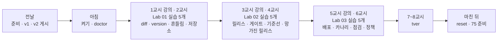
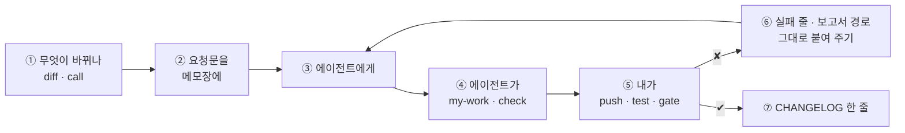

# 74일차 수강 안내 · 수업 준비부터 마칠 때까지

- 일자: 2026-10-28 (수) · 74일차
- 주제: 모델·Prompt·Workflow 버전 관리와 운영 체계 (바뀐 것 남기기 · 게이트 · 카나리 · 되돌리기)
- 실습 폴더: [Last3Mon/74](README.md) · 강의 자료: [Lecture/74](../../Lecture/74/README.md)
- 환경: 65일차 n8n 2.42.6 + **OpenAI API 키만**(`gpt-4.1-mini`, `gpt-5.4-nano`) + **74일차 판 데이터 API**(지시문 저장소 · 릴리스 · 점검 기록 · 배포 정책) + CLI 코딩 에이전트 하나. **Ollama는 쓰지 않습니다.**
- 이 문서: 오늘 하루 내가 할 일을 수업 준비부터 마칠 때까지 순서대로 모은 수강 안내입니다. 수업 중에도 띄워 두고 어디까지 왔는지 확인하세요.



## 0. 하루 한눈에

| 교시 | 시간 | 할 일 | 문서 | 끝났다는 표시 |
| --- | --- | --- | --- | --- |
| 전날 | 약 10분 | 자료 받기 · n8n · 74일차 데이터 API · v1 · v2 게시 · doctor | [PREP](../../Lecture/74/00-DAY74-PREP.md) | `ready` |
| 1 | 09:00~09:50 | 개요 · 1단계 강의 (무엇이 바뀌나) | [개요](../../Lecture/74/00-DAY74-OVERVIEW.md) 1~14장, [1단계](../../Lecture/74/01-STAGE1-WHAT-CHANGES.md) | |
| 2 | 10:00~10:50 | Lab 01 실습 5개 (예제 1~3 · 과제 1~2) | [Lab 01](LAB-01-Q-WHAT-CHANGES.md) | `lab01-challenge` · `lab01-challenge2` 통과 |
| 3 | 11:00~11:50 | 2단계 강의 (릴리스와 배포 전 게이트) | 개요 15~21장, [2단계](../../Lecture/74/02-STAGE2-RELEASE-GATE.md) | |
| 4 | 12:00~12:50 | Lab 02 실습 5개 | [Lab 02](LAB-02-Q-RELEASE-GATE.md) | `my-golden`으로 1.2.0 FAIL, `lab02-challenge2` 통과 |
| - | 13:00~14:00 | 점심 | | |
| 5 | 14:00~14:50 | 3단계 강의 (배포 · 되돌리기 · 카나리) | 개요 22~28장, [3단계](../../Lecture/74/03-STAGE3-DEPLOY-AND-ROLLBACK.md) | |
| 6 | 15:00~15:50 | Lab 03 실습 5개 | [Lab 03](LAB-03-Q-DEPLOY-AND-ROLLBACK.md) | `lab03-challenge` · `lab03-challenge2` 통과, `--reset` |
| 7 | 16:00~16:50 | 바이브 코딩 `tver`: 요청서 → TODO → SPEC → IMP-PLAN → 만들기 → 설치 | [VIBE-REQ-TVER](VIBE-REQ-TVER.md) → [VIBE-Q-TVER](VIBE-Q-TVER.md) | `Doc/*.md` · R1~R6 · R8 · R14 · `pytest` |
| 8 | 17:00~17:50 | 바이브 코딩 발표 · **4단계 정리** (오늘의 의미 · 효과 · 회사에서 쓰는 법) · 75일차 예고 | [4단계 정리](../../Lecture/74/04-STAGE4-WRAPUP.md), [진행](../../Lecture/74/05-VIBE-CODING.md) | 최종 프로젝트 체크리스트 |

## 1. 전날 준비 (약 10분)

### 1.1 자료 받기

```bash
cd ~/aio-01d4-stu && git pull
```

### 1.2 n8n과 **74일차** 데이터 API 켜기 (Ollama는 끔)

```bash
sudo systemctl disable --now ollama 2>/dev/null   # WSL에 설치한 Ollama가 있으면 끄고 자동 시작도 끔
cd ~/aio-01d4-stu/Last3Mon/65/n8n
docker compose rm -sf ollama                      # Ollama 컨테이너가 있으면 지움 (없으면 그냥 지나감)
docker compose start
cd ~/aio-01d4-stu/Last3Mon/74/data-api
docker compose up -d --force-recreate             # 73일차 판을 74일차 판(+ 지시문 저장소 · 릴리스 · 점검 기록)으로 바꿈
sleep 3                                           # 데이터 API가 뜰 때까지
curl -s localhost:8800/releases/helpdesk | head -c 80
```

- 73일차 판별 LLM 멈춤 연습을 되돌리지 않았다면: `cd ~/aio-01d4-stu/Last3Mon/73 && uv run tools/flow.py llm up`.

### 1.3 v1 · v2 게시 · 준비 확인

```bash
cd ~/aio-01d4-stu/Last3Mon/74
uv run tools/flow.py push reference/helpdesk-v1.json reference/helpdesk-v2.json
uv run tools/flow.py call rel-v1 requests/faq-vpn.json -v
uv run tools/flow.py doctor        # 마지막 줄 ready
```

### 1.4 미리 읽기 (선택, 5분)

[PREP 3절](../../Lecture/74/00-DAY74-PREP.md): 어제와 오늘 답이 다르면 무엇부터 확인할까? 그리고 7교시 [요청서](VIBE-REQ-TVER.md).

### 준비물

노트북과 충전기, WSL의 Docker, WSL 창 두 개, 브라우저, 68일차 `~/vibe/tflow` · 73일차 `~/vibe/tscan` (없어도 됨).

## 2. 수업 당일 아침 (09:00 전)

1. 노트북을 껐다 켰다면 1.2를 다시 합니다 (릴리스 · 점검 기록은 처음으로 돌아갑니다 — 괜찮음).
2. 터미널 두 개, 둘 다 `cd ~/aio-01d4-stu/Last3Mon/74`. ① 에이전트(`codex`/`claude`/`agy`), ② 확인(`diff`·`push`·`test`·`gate`·`release`).
3. 터미널 ②에서 `uv run tools/flow.py doctor` → `ready`, `uv run tools/flow.py release helpdesk`.
4. `cp templates/CHANGELOG-TEMPLATE.md my-work/CHANGELOG.md`, `cp templates/RELEASE-CHECKLIST-TEMPLATE.md my-work/RELEASE.md`, `my-work/PROMPTS.md`.

## 3. 실습할 때마다 같은 순서 (오늘은 "바뀐 것 → 버전 → 게이트")



- 배포 · 카나리 · 되돌리기 · 정책은 **내가** `flow.py release`로 합니다. 끝나면 `uv run tools/flow.py release helpdesk --reset`.
- 후보는 `--set release=...`로 고정해 시험합니다.
- `fault prompts error`(Lab 01 과제 2)는 끝나면 **반드시 되돌립니다** (`fault prompts ok`).

## 4. 1~2교시 · 1단계 · 무엇이 바뀌나

1교시는 강의, 2교시는 [Lab 01](LAB-01-Q-WHAT-CHANGES.md) (50분, 실습 5개).

| 순서 | 할 일 | 파일 · 웹훅 | 확인 (터미널 ②) |
| --- | --- | --- | --- |
| 예제 1 (10분, 에이전트 없이) | v1 → v2의 바뀐 것 7개 읽기 | `reference/helpdesk-v1.json` · `v2.json` | `diff reference/helpdesk-v1.json reference/helpdesk-v2.json [--full]`, `call rel-v1 -v` · `call rel-v2 -v` → `CHANGELOG.md` 1절 |
| 예제 2 (12분) | 모델을 한 곳(릴리스 정보)에서, 답마다 `version` | `cp reference/helpdesk-v1.json my-work/helpdesk.json` → 웹훅 `my-helpdesk`로 | `push my-work/helpdesk.json` → `test cases/lab01.json -v` |
| 예제 3 (8분, 에이전트 없이) | 같은 테스트를 v1 · v2에 3번씩, 시간 | (그대로) | `test cases/lab01-compare.json --webhook rel-v1 --repeat 3` · `rel-v2`, `bench rel-v1` · `rel-v2 requests/faq-vpn.json -n 5` |
| 과제 1 (10분) | 지시문을 저장소(`/prompts/helpdesk/p1`)에서 | `my-work/helpdesk.json` 고치기 | `test cases/lab01-challenge.json -v`, `test cases/lab01.json -v` |
| 과제 2 (10분) | 먼저 겪기: `fault prompts error` → `call` → `fault prompts ok`. 그다음 저장소가 멈추면 기본 지시문(`fallback`) | `my-work/helpdesk.json` 고치기 | `test cases/lab01-challenge2.json -v` (자동으로 고장 켜고 끔), `lab01-challenge`, `doctor` |

(명령 앞에는 모두 `uv run tools/flow.py`가 붙습니다.)

## 5. 3~4교시 · 2단계 · 릴리스와 게이트

3교시는 강의, 4교시는 [Lab 02](LAB-02-Q-RELEASE-GATE.md) (50분, 실습 5개).

| 순서 | 할 일 | 확인 |
| --- | --- | --- |
| 예제 1 (12분) | 운영 중인 릴리스를 `/releases/helpdesk`에서, 본문 `release`면 고정, 없는 릴리스 400 | `push` → `test cases/lab02.json -v`, `test cases/lab01-challenge.json`, `test cases/lab01-challenge2.json` |
| 예제 2 (8분, 에이전트 없이) | 네 릴리스를 약한 `golden.json`으로 게이트, 1.2.0 답 읽기 | `gate cases/golden.json --set release=1.0.0 --max-p95 3` (1.1.0 · 1.2.0 · 2.0.0도), `call my-helpdesk '{... "release": "1.2.0"}' -v` → `RELEASE.md` 1절 |
| 예제 3 (7분, 에이전트 없이) | 기준선: 1.0.0 · 2.0.0 시간, golden 3번 반복 | `bench my-helpdesk requests/faq-vpn.json -n 5 --set release=1.0.0` (2.0.0도), `gate cases/golden.json --set release=1.0.0 --repeat 3 --max-p95 3` |
| 과제 1 (13분) | 1.2.0을 막는 `cases/my-golden.json` (1.0.0 · 1.1.0은 PASS), 2.0.0 판단 | `gate cases/my-golden.json --set release=...` 네 번, `RELEASE.md` 1절 |
| 과제 2 (10분) | 망가진 릴리스 2.1.0(p9): 404는 400 `release broken`, 장애(500 · 시간 초과)만 기본 지시문 | `test cases/lab02-challenge2.json -v`, `gate cases/my-golden.json --set release=2.1.0` (고치기 전 PASS → 뒤 FAIL), `lab02` |

## 6. 5~6교시 · 3단계 · 배포 · 되돌리기 · 카나리

5교시는 강의, 6교시는 [Lab 03](LAB-03-Q-DEPLOY-AND-ROLLBACK.md) (50분, 실습 5개).

| 순서 | 할 일 | 확인 |
| --- | --- | --- |
| 예제 1 (8분, 에이전트 없이) | `release helpdesk 1.1.0` → 확인 → `release helpdesk 1.0.0` | `call my-helpdesk requests/faq-vpn.json -v`, `test cases/lab03.json -v`, `RELEASE.md` 3절 |
| 예제 2 (12분) | 카나리: 이름 글자 코드 합 % 100 < percent, 같은 사람은 같은 쪽, 고정이 먼저 | `push` → `test cases/lab03-canary.json -v`, `test cases/lab02.json`, `release helpdesk --reset` |
| 예제 3 (7분, 에이전트 없이) | 나쁜 카나리(1.2.0 50%)를 보고 끄기 | `test cases/lab03-watch.json -v` → `release helpdesk --no-canary` → `test cases/lab03-watch.json --no-before -v` → `--reset` |
| 과제 1 (13분) | 릴리스 점검 `my-release-check`: 질문 6개를 고정해 묻고 `promote` · `rollback` | `push my-work/release-check.json` → `test cases/lab03-challenge.json -v`, `call my-release-check '{"release": "2.0.0"}' -v` |
| 과제 2 (10분) | 점검 결과를 `/gates/helpdesk`에 남기고, 정책(`--require-gate on`)으로 지난 것만 배포 | `test cases/lab03-challenge2.json -v`, `release helpdesk`, `--reset` |

- 기록: `RELEASE.md` 2 · 3절, `CHANGELOG.md` 2절.

## 7. 7~8교시 · 바이브 코딩 `tver`

[VIBE-REQ-TVER](VIBE-REQ-TVER.md)(요청서)를 **먼저** 읽고 [VIBE-Q-TVER](VIBE-Q-TVER.md)의 순서대로 갑니다: `Doc/TODO.md` → `Doc/SPEC.md` → `Doc/IMP-PLAN.md`(엔진 · TUI 단계) → 단계별 구현 → 확인 → `uv tool install` → 다른 폴더에서 사용. 요구는 14개(R1~R14)이고 50분 안에는 엔진 1 · 2단계 · TUI 1단계 · 설치까지, 나머지는 `Doc/IMP-PLAN.md`의 다음 단계로 집에서 이어 갑니다. 만드는 것은 n8n 워크플로우를 git에 버전으로 저장하고 두 버전을 노드 단위로 비교해 모델 · 지시문 · 흐름으로 나눠 보여 주는 TUI. 정답본 `VIBE-A-TVER.md`는 수업이 끝나면 `git pull`로 받습니다.

```bash
mkdir -p ~/vibe/tver/Doc && cd ~/vibe/tver
git init
# 에이전트는 Doc/TODO.md를 쓴 뒤에 켭니다: codex (또는 claude, agy)
```

| 시간 | 단계 | 확인 |
| --- | --- | --- |
| 16:00~16:09 | 0 준비 · 1 요청서 → `Doc/TODO.md` (에이전트 없이) | 할 일 ①~⑫ · 꼭 / 나중 |
| 16:09~16:15 | 2 `Doc/SPEC.md` → VIBE-Q 요구 표(R1~R14)와 비교 · commit | 요구마다 확인 방법 |
| 16:15~16:20 | 3 `Doc/IMP-PLAN.md` (엔진 1~4단계 · TUI 1단계 · 설치) · commit | 단계마다 체크리스트 |
| 16:20~16:44 | 4 구현: 엔진 1단계(R1~R4) → 엔진 2단계(R5 · R6) → TUI 1단계(R8), 막히면 5 문제 해결 팁 | 단계마다 `pytest` · 직접 실행 · commit |
| 16:44~16:50 | 6 확인 · 7 `uv tool install --editable .` · 8 다른 폴더에서 `tver` | `cd ~/aio-01d4-stu/Last3Mon/74 && tver diff reference/helpdesk-v1.json reference/helpdesk-v2.json` |

- 8교시: 1~2명 발표 (10분) → [4단계 정리](../../Lecture/74/04-STAGE4-WRAPUP.md) (35분: 오늘 한 일의 의미 · 효과 · 산업에서의 응용 · 면접 질문 · 최종 프로젝트 체크리스트) → 75일차 예고.

## 8. 마친 뒤

| 할 일 | 이유 |
| --- | --- |
| `uv run tools/flow.py release helpdesk --reset`, `fault prompts ok`, `doctor` → `ready` | 내일 처음 상태로 (정책 · 카나리 꺼짐) |
| `PROMPTS.md`, `CHANGELOG.md`, `RELEASE.md` 정리 | 최종 프로젝트 재료 (운영 체계) |
| `my-work/*.json`, `cases/my-golden.json`, `~/vibe/tver`, `~/.tver/store` 지우지 않기 | 75일차 비용 비교 · 79일차 `tops` |
| 75일차 준비: [00-DAY75-PREP](../../Lecture/75/00-DAY75-PREP.md) | 사용량 · 비용 |

## 9. 막혔을 때 (오늘 공통)

| 증상 | 할 일 |
| --- | --- |
| doctor의 releases · gates ✘ | 데이터 API가 예전 판. 1.2의 74일차 `--force-recreate` |
| doctor에 `release state is not the start state` | `uv run tools/flow.py release helpdesk --reset` |
| doctor에 `fault switch is on` | `uv run tools/flow.py fault all ok` |
| 늘 같은 릴리스 | 본문 `release` · `--set`을 붙였는지, 워크플로우가 `/releases`를 읽는지 |
| 카나리 · 정책 뒤 다른 테스트가 이상함 | `release helpdesk --reset` |
| 배포가 409 `not gated` | 정책이 켜져 있음. 점검(또는 `gate --set release=...`)을 먼저, 끝나면 `--reset` |
| `call my-helpdesk`가 404 | 복사한 파일의 웹훅 경로를 바꿨는지, push했는지 |
| 같은 곳을 3번 고쳐도 실패 | 요청을 더 작게, 또는 `reference/`로 이어 가기 |

## 확인

- [ ] 전날 74일차 데이터 API, v1 · v2 게시, `doctor` → `ready`
- [ ] Lab 01: `CHANGELOG.md` 1절, `lab01` 3/3, v1 · v2 흔들림 비교, `lab01-challenge` 3/3, `lab01-challenge2` 4/4
- [ ] Lab 02: `lab02` 5/5, 네 릴리스 게이트, 기준선, `my-golden`으로 1.2.0 FAIL, `lab02-challenge2` 5/5 · 2.1.0 FAIL
- [ ] Lab 03: `lab03` 2/2, `lab03-canary` 6/6, 나쁜 카나리 4/6 → 6/6, `lab03-challenge` 3/3, `lab03-challenge2` 5/5, `RELEASE.md`
- [ ] `tver`: `Doc/TODO.md` · `SPEC.md` · `IMP-PLAN.md` 먼저, 엔진 1 · 2단계 · TUI 1단계, `pytest`, 단계마다 commit, `uv tool install`
- [ ] `--reset` · `fault prompts ok`, 75일차 준비
