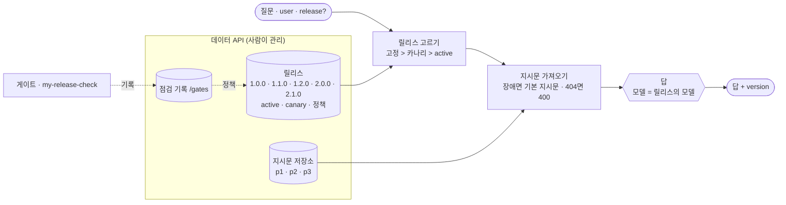

# 74일차 실습 · 모델·Prompt·Workflow 버전 관리와 운영 체계 (바이브 코딩)

- 일자: 2026-10-28 (74일차)
- 교과목: 노코드 멀티 에이전트 워크플로우 설계 및 운영
- 단원: AI 워크플로우 운영 및 관리 역량 강화
- 강의 자료: [Lecture/74](../../Lecture/74/README.md)
- 하루 수강 안내: [LECTURE-74.md](LECTURE-74.md) (수업 준비부터 마칠 때까지 순서대로)
- 67~73일차처럼 CLI 코딩 에이전트에게 **내가 쓴 요청문**으로 워크플로우를 만들게 하고, **테스트로 확인**합니다. 오늘은 고칠 때마다 **무엇이 바뀌었는지 남기고, 배포 전에 검사하고, 조금씩 내보내고, 되돌릴 수 있게** 합니다.

## 오늘 만드는 것: 버전이 붙은 헬프데스크

모델 이름 · 지시문 · 워크플로우가 한 JSON 안에 섞여 있으면 "어제와 무엇이 달라졌나"를 알기 어렵습니다. 지시문과 모델을 **릴리스**로 묶어 밖에서 관리하고, 답마다 버전을 남기고, 후보 릴리스를 **게이트**로 검사한 뒤 카나리 · 배포 · 되돌리기를 합니다. 점검 결과를 남기고, 점검을 지난 릴리스만 배포되게 합니다.



## 일하는 방식 (67~73일차와 같음)

| 누가 | 무엇을 |
| --- | --- |
| 나 | 바뀐 것 읽기(`diff`), 흔들림 재기, 게이트 테스트 쓰기(기대는 데이터에서), 배포 · 카나리 · 되돌리기 · 정책(`flow.py release`), 판단 |
| CLI 에이전트 | [AGENTS.md](AGENTS.md) 규칙대로 워크플로우 JSON 작성, `check`로 형식 오류 고치기 |
| `tools/flow.py` | check · push · call · test(`--set release=...`) · **diff** · **gate** · **release** · bench · fault · llm · doctor (모두 `-v`) |

> 게이트는 **테스트만큼만** 막습니다. 나쁜 릴리스를 막지 못한 게이트는 테스트가 약한 것입니다.

## 실습 15개 (Lab마다 예제 3 · 과제 2)

| | 예제 1 | 예제 2 | 예제 3 | 과제 1 | 과제 2 |
| --- | --- | --- | --- | --- | --- |
| [Lab 01](LAB-01-Q-WHAT-CHANGES.md) | v1 → v2 diff (에이전트 없이) | 답마다 `version` | 흔들림인가 바뀜인가 (에이전트 없이) | 지시문을 저장소에서 | 저장소가 멈추면 기본 지시문 |
| [Lab 02](LAB-02-Q-RELEASE-GATE.md) | 릴리스 읽기 · 후보 고정 | 약한 golden 게이트 (에이전트 없이) | 기준선: 시간 · 반복 (에이전트 없이) | 나쁜 릴리스를 막는 게이트 | 망가진 릴리스는 400 |
| [Lab 03](LAB-03-Q-DEPLOY-AND-ROLLBACK.md) | 배포 · 되돌리기 (에이전트 없이) | 카나리 | 나쁜 카나리 끄기 (에이전트 없이) | 릴리스 점검 워크플로우 | 점검 기록 · 지난 것만 배포 |

## 실습 문서 읽는 법

- 실습 문서(`LAB-0x-Q-*.md`, `VIBE-Q-TVER.md`)에는 **복사해 붙일 요청문이 없습니다.** 실습마다 `### 이해하기`(왜 · 지금 → 바뀐 뒤 · 테스트 케이스 · 기대 결과)를 읽고, 막히면 `▶` 를 하나씩 펼칩니다. 요청문은 `▶ 빈칸 채우기`의 빈칸 4개(`____①`~`____④`)를 채워서 씁니다.
- 쓴 요청문은 `my-work/PROMPTS.md`에, 바뀐 것은 `my-work/CHANGELOG.md`에, 게이트 · 배포 기록은 `my-work/RELEASE.md`에 모아 둡니다.

## 구성

```text
Last3Mon/74/
├── README.md
├── LECTURE-74.md                    # 하루 수강 안내
├── AGENTS.md                        # CLI 에이전트용 작업 규칙 (계약 3절, 릴리스 · 지시문 · 기본 지시문 · 점검 기록 노드 5절)
├── LAB-01-Q-WHAT-CHANGES.md         # 1단계 · diff · version · 흔들림 · 지시문 저장소 · 저장소가 멈추면
├── LAB-02-Q-RELEASE-GATE.md         # 2단계 · 릴리스 고르기 · 게이트 · 기준선 · 강한 테스트 · 망가진 릴리스
├── LAB-03-Q-DEPLOY-AND-ROLLBACK.md  # 3단계 · 배포 · 카나리 · 나쁜 카나리 · 릴리스 점검 · 점검 기록
├── VIBE-REQ-TVER.md                 # 7교시 바이브 코딩 요청서 (가장 먼저 읽기)
├── VIBE-Q-TVER.md                   # 7교시 바이브 코딩 · tver (워크플로우 버전 저장 · 비교 TUI)
├── tools/flow.py
├── data-api/                        # 74일차 판 데이터 API (73일차 + 지시문 저장소 + 릴리스 + 점검 기록 · 배포 정책)
│   └── data/prompts/ · releases.json
├── cases/                           # lab01 · lab01-compare · lab01-challenge(2) · lab02 · golden · lab02-challenge2 · lab03 · lab03-canary · lab03-watch · lab03-challenge(2)
├── requests/
├── reference/                       # helpdesk-v1 · v2 (비교용) + 막혔을 때 이어 가는 워크플로우
├── templates/                       # 변경 기록 · 릴리스 점검표
├── my-work/
└── runs/
```

## 준비

[실습 준비](../../Lecture/74/00-DAY74-PREP.md)를 끝내 주세요. 요약:

```bash
cd ~/aio-01d4-stu/Last3Mon/65/n8n && docker compose start   # Ollama는 쓰지 않음 · 처음 한 번 PREP 1절대로 끄기
cd ~/aio-01d4-stu/Last3Mon/74/data-api && docker compose up -d --force-recreate   # 74일차 판
cd ~/aio-01d4-stu/Last3Mon/74 && uv run tools/flow.py push reference/helpdesk-v1.json reference/helpdesk-v2.json
uv run tools/flow.py doctor                                                          # 마지막 줄 ready
```

## `flow.py` 명령 (오늘 더해진 것)

| 명령 | 하는 일 |
| --- | --- |
| `uv run tools/flow.py diff reference/helpdesk-v1.json reference/helpdesk-v2.json [--full]` | 노드 · 설정 · 연결 차이 (`--full` · `-v`면 긴 값 전 · 후) |
| `uv run tools/flow.py test cases/golden.json --set release=1.1.0 -v` | 모든 요청에 `release`를 더해 후보 시험 |
| `uv run tools/flow.py gate cases/golden.json --set release=1.2.0 --max-p95 3 [--repeat 3]` | 통과율 · p95로 PASS/FAIL, 결과를 `/gates/helpdesk`에 남김 |
| `uv run tools/flow.py bench my-helpdesk requests/faq-vpn.json -n 5 --set release=2.0.0` | 릴리스를 고정해 시간 재기 |
| `uv run tools/flow.py release helpdesk` · `release helpdesk 1.1.0` · `--canary 1.1.0 --percent 50` · `--no-canary` · `--require-gate on` · `--reset` | 지금 릴리스(릴리스마다 마지막 점검) 보기 · 배포 · 카나리 · 끄기 · 정책 · 처음 상태로 |
| `uv run tools/flow.py fault prompts error\|slow\|ok` | 지시문 저장소 고장 연습 (끝나면 `ok`) |
