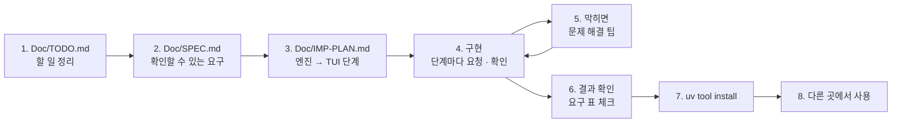

# 7교시 바이브 코딩 · `tver` 만들기

> **먼저 [VIBE-REQ-TVER.md](VIBE-REQ-TVER.md)(요청서)를 읽고 `~/vibe/tver/Doc/TODO.md`를 직접 쓴 뒤** 이 문서를 엽니다. 아래 1~8을 차례로 갑니다. 이 문서의 요구 표는 **내 SPEC을 쓴 뒤에** 비교하는 데 쓰고, 에이전트에게 통째로 붙여 넣지 않습니다.



- 시간: 16:00~16:50 (50분) · 발표와 정리는 8교시 · 50분 안에 못 한 단계는 집에서 `Doc/IMP-PLAN.md`의 다음 단계로 이어 갑니다
- 도구: CLI 코딩 에이전트(codex / claude / agy), Python + uv + [Textual](https://textual.textualize.io/), git
- 결과물: n8n 워크플로우 JSON을 **git에 버전으로 저장**하고, 두 버전을 **노드 단위로** 비교해 바뀐 것을 **모델 · 지시문 · 흐름**으로 나눠 보여 주는 TUI. 지시문은 줄 단위로, 뜻 없는 차이는 빼고, 키가 든 파일은 저장하지 않습니다. `uv tool install`로 설치해 **어느 폴더에서나** `tver`로 씁니다. 오늘 `flow.py diff`로 한 일을 내 도구로.

```text
$ tver ~/aio-01d4-stu/Last3Mon/74/my-work/helpdesk.json
┌ tver · helpdesk.json · ~/.tver/store ──────────────────────────────────────┐
│ 6 version(s)                                                               │
│ ┌ 버전 ─────────────────────┐ ┌ 바뀐 것 ──────────────────────────────────┐ │
│ │ > 87090f0 10-27 21:08  1 … │ │ b8461aa → e0dc13e · 15 change(s) · model 1 │ │
│ │   9e2ac9a 10-27 21:08 14 … │ │ ├ Get release   [flow] + node …            │ │
│ │   e0dc13e 10-27 21:08 15 … │ │ ├ Answer model  [model] ~ model.value …    │ │
│ │   b8461aa 10-27 21:08 12 … │ │ └ Answer        [prompt] ~ systemMessage … │ │
│ └────────────────────────────┘ └────────────────────────────────────────────┘ │
│ ┌ 자세히 ────────────────────────────────────────────────────────────────┐   │
│ │ ~ 'Answer model' parameters.model.value: ={{ $('Release info')… → …    │   │
│ └────────────────────────────────────────────────────────────────────────┘   │
│ [s] 지금 파일을 버전으로 저장  [q] 끝                                          │
└──────────────────────────────────────────────────────────────────────────────┘
```

> 요청문은 **직접** 씁니다. 단계마다 `▶` 를 펼치면 생각할 거리가 나옵니다. 정답 요청문은 없습니다.
>
> **시험할 때 내 n8n을 바꾸지 않습니다.** `tver`는 n8n에서 가져오기만 하고 올리지 않습니다. 저장소는 `~/.tver/store`(또는 `--repo`)에 따로 둡니다.

## 시간 (50분)

| 시간 | 단계 | 결과 |
| --- | --- | --- |
| 16:00~16:09 | 0 준비 · 1 `Doc/TODO.md` (요청서 읽고 직접) | 할 일 ①~⑫ · 꼭 / 나중 |
| 16:09~16:15 | 2 `Doc/SPEC.md` → 아래 요구 표와 비교 · 고치기 | 요구마다 확인 방법 |
| 16:15~16:20 | 3 `Doc/IMP-PLAN.md` (엔진 단계 · TUI 단계) | 단계마다 체크리스트 |
| 16:20~16:44 | 4 구현: **엔진 1단계 → 엔진 2단계 → TUI 1단계** (막히면 5) | 단계마다 `pytest` · 직접 실행 · commit |
| 16:44~16:50 | 6 확인 · 7 `uv tool install` · 8 다른 폴더에서 | `cd ~/aio-01d4-stu/Last3Mon/74 && tver diff reference/helpdesk-v1.json reference/helpdesk-v2.json` |

50분 안 목표: **R1 · R2 · R3 · R4(엔진 1단계) + R5 · R6(엔진 2단계) + R8(TUI 1단계) + R14(설치)**. R7 · R9~R13은 IMP-PLAN의 다음 단계로 8교시 뒤 · 집에서 이어 갑니다.

## 0. 준비 (1분)

```bash
mkdir -p ~/vibe/tver/Doc && cd ~/vibe/tver
git init
# 에이전트는 Doc/TODO.md를 쓴 뒤에 켭니다: codex (또는 claude, agy)
```

## 1. `Doc/TODO.md` · 만들고 싶은 것과 할 일 정리 (8분, 에이전트 없이)

[VIBE-REQ-TVER.md](VIBE-REQ-TVER.md)의 "할 일" 틀대로 씁니다. 요청의 말 ①~⑫를 **내 말로** 옮기고, 꼭 · 나중을 표시하고, 걱정되는 것과 50분 안에 못 할 것을 적습니다. "어떻게"는 아직 쓰지 않습니다.

<details><summary>▶ TODO와 SPEC은 무엇이 다른가</summary>

TODO는 **내가 이해한 것**(무엇을 · 왜)입니다. SPEC은 그것을 **확인할 수 있게** 바꾼 것(됐다 · 안 됐다를 말하는 방법)입니다. TODO에서 빠진 것은 SPEC에서도 빠지므로, TODO는 빠짐없이, SPEC은 정확하게.
</details>

`git add Doc/TODO.md && git commit -m "TODO"`

## 2. `Doc/SPEC.md` · 확인할 수 있는 요구로 (6분)

TODO의 할 일마다 **확인 방법**(시험 파일 · 바뀐 수 · 버전 수 · 종료 코드)을 붙여 SPEC을 만듭니다. 에이전트에게 "TODO.md를 읽고 SPEC.md 초안을 써 줘. 요구마다 확인 방법을 붙여"라고 시켜도 됩니다. 그러면 **반드시 내가 읽고 고칩니다.**

```markdown
# tver SPEC

## 1. 요구 (확인할 수 있게)
| 번호 | 요구 | 요청의 어느 말 | 확인 방법 | 꼭 · 나중 |
| --- | --- | --- | --- | --- |
| R1 | | ① | | 꼭 |

## 2. 숨은 요구
## 3. 범위 밖 (하지 않을 것)
## 4. 정해 둘 것 (짝짓는 기준, 빼는 칸, 모델 · 지시문 · 흐름 분류 규칙, 저장소 위치, 파일 이름, 종료 코드)
```

<details><summary>▶ 확인 방법은 v1 · v2로</summary>

"노드 단위로 비교한다"는 확인 방법이 아닙니다. "`helpdesk-v1` → `v2`: 7개, 모델 1 · 지시문 1 · 흐름 5 (오늘 `flow.py diff`와 같은 7줄)"가 확인 방법입니다. **바뀌었다고 나와야 할 것과 나오면 안 되는 것**(노드 위치만 바꾼 파일 → 0개)을 둘 다 적습니다 (오늘 Lab 02 과제 1의 강한 golden과 같음).
</details>

쓴 뒤 아래 표와 비교합니다. 빠진 요구, 내가 더 뽑은 요구를 `Doc/SPEC.md` 끝 "VIBE-Q와 비교"에 한 줄씩 적고 SPEC을 고칩니다.

### 요구 사항 (요청서에서 뽑은 것, 14개)

| 번호 | 요구 | 요청서의 말 | 확인 방법 | 50분 |
| --- | --- | --- | --- | --- |
| R1 | 두 파일을 노드 **이름**으로 짝지어 + 노드 · − 노드 · ~ 바뀐 설정(점 경로: 전 → 후) · + / − 연결 (`tver diff a.json b.json`) | ① | v1 → v2 → 7줄, `flow.py diff`와 같음 | 꼭 |
| R2 | 뜻 없는 차이 빼기: `id` · `position` · `webhookId` · 내보내기 도장(`versionId` · `updatedAt` 등), 노드 순서 · 키 순서 | ② | 노드 위치 · id를 바꾸고 순서를 뒤집은 파일 → 0개 | 꼭 |
| R3 | 80자 넘거나 여러 줄인 값(지시문 · 코드)은 **줄 단위** diff (`+` · `-` 줄) | ③ | v1 → v2의 `systemMessage`에 `+ … [FAQ-003]` 줄 | 꼭 |
| R4 | 바뀐 것을 **모델 · 지시문 · 흐름**으로 나눠 한 줄 요약 | ④ | v1 → v2 → "7 change(s) · model 1 · prompt 1 · flow 5" | 꼭 |
| R5 | `tver save <파일>`: 정리한 JSON을 git 저장소에 쓰고 커밋, 메시지는 바로 전 버전과의 요약. 같으면 "no change"(커밋 없음) | ⑤ | 같은 파일 두 번 → 버전 1개 | 꼭 |
| R6 | `tver log <이름>` 버전 목록(커밋 · 시각 · 요약), `tver diff <rev1> <rev2> <이름>` 두 버전 비교 | ⑥ | 두 번 저장 → 목록 2줄, 비교가 R1 · R4와 같은 모양 | 꼭 |
| R7 | 키처럼 보이는 값(`sk-…` 등)이 있으면 저장 거부, 메시지에도 **가려서** | ⑦ | 가짜 키를 넣은 파일 → 저장 안 됨, 메시지에 원래 값 없음 | 나중 |
| R8 | TUI: 왼쪽 버전 목록, 오른쪽 바뀐 노드 트리(고른 버전 vs 바로 전), 바뀐 것 하나를 고르면 전 · 후 / 줄 diff. `[s]` 지금 파일을 저장 | ⑧ | `tver <파일>` → 목록 · 트리 · 자세히, `[s]` 뒤 목록이 한 줄 늘어남 | 꼭 |
| R9 | `tver pull`: 켜진 n8n 컨테이너에서 모든 워크플로우를 내보내 각각 버전으로 (**n8n에는 쓰지 않음**) | ⑨ · 끝 | `tver pull` → "N new version(s)", n8n은 그대로 | 나중 |
| R10 | `tver restore <rev> <이름> -o <파일>`: 예전 버전을 파일로 (저장소는 바꾸지 않음, push는 사람이) | ⑩ | 꺼낸 파일과 그 버전을 `tver diff` → 0개, `log`의 버전 수 그대로 | 나중 |
| R11 | `--json` 결과, 종료 코드: diff 0 같음 · 1 다름, 모든 명령 2 오류 | ⑪ | `tver diff a a; echo $?` → 0, `a b` → 1, 없는 파일 → 2 | 나중 |
| R12 | 이름만 바뀐 노드: 짝 없는 − · + 노드 중 종류 · 설정이 같으면 "renamed" 한 줄 | ⑫ | `Search FAQ` → `Find FAQ`로만 바꿈 → `renamed` 1개 | 나중 |
| R13 | `tver save <폴더>`: 폴더의 `*.json` 중 **워크플로우만**(`nodes` · `connections`) 저장, 나머지는 skipped | 끝 "워크플로우 파일만" | `my-work`에 `cases.json` · 메모 → skipped | 나중 |
| R14 | `uv tool install`로 설치해 **어느 폴더에서나** `tver`, 저장소는 내 프로젝트 밖(`~/.tver/store`, `--repo` · `$TVER_REPO`) | 첫 문단 · 끝 | `cd /tmp && tver --help`, `uv tool list`에 `tver` | 꼭 |

숨은 요구 (요청서에 직접 없지만 없으면 안 되는 것):

| 숨은 요구 | 어디서 나왔나 |
| --- | --- |
| **저장할 때도** 정리한 JSON(키 정렬, 뜻 없는 칸 없음)으로 쓴다. 그래야 "같다"를 글자 비교로 판단하고, 저장소의 `git diff`도 읽힌다 | ② + ⑤ |
| 분류 규칙을 정해 둔다: Chat model의 `model` → 모델, Agent의 `systemMessage` · `text` · Code의 `jsCode` → 지시문, 나머지 설정과 연결 → 흐름 | ④ |
| 파일 이름을 안전하게: 워크플로우 이름의 공백 · `/` · 한글을 바꾼 소문자 이름 | ⑨ |
| 엔진(정리 · 비교 · 저장)과 화면(TUI)을 **나눈다.** `diff` · `save` · `--json`은 화면 없이 엔진만 씀 | ⑪ "다른 프로그램이 읽는", 테스트하기 쉬움 |
| 테스트용 저장소는 `tmp_path`에. 내 진짜 `~/.tver/store`를 쓰는 테스트 금지 | "시험할 때 망가뜨리면 안 돼요" |
| `pyproject.toml`에 명령 이름(`[project.scripts] tver = ...`)이 있어야 `uv tool install`이 된다 | R14 |

범위 밖 (오늘 하지 않음): n8n에 자동으로 올리기(push), 여러 사람이 동시에 저장할 때 합치기, 원격 git 서버로 보내기, Credential 값 다루기.

`git add Doc/SPEC.md && git commit -m "SPEC"`

## 3. `Doc/IMP-PLAN.md` · 구현 계획 (5분)

SPEC의 요구를 **단계**로 나눕니다. 첫 원칙: **엔진(백엔드)을 먼저, 화면(TUI)은 나중에.** 화면은 엔진이 내놓은 바뀐 것 목록을 보여 주기만 하면 되게 만듭니다. 에이전트에게 "SPEC.md를 읽고 IMP-PLAN.md를 엔진 단계와 TUI 단계로 나눠 써 줘. 단계마다 체크리스트와 확인 명령"이라고 시켜도 됩니다 (내가 읽고 고침).

```markdown
# tver IMP-PLAN

## 엔진 1단계 · 정리하고 비교하기 (R1 · R2 · R3 · R4)
- [ ] clean(workflow): 뜻 없는 칸 빼기, 노드 이름순, dumps는 키 정렬
- [ ] compare(old, new) → [Change{op, node, category, key, before, after, lines}]
- [ ] category(node, key): model · prompt · flow, summary() · 한 줄 요약
- [ ] tests: v1 → v2 7개 · 1/1/5, 위치만 바꾼 파일 0개, 지시문 줄 diff
- [ ] cli: tver diff a.json b.json
- 확인: uv run pytest -q, uv run tver diff <v1> <v2>

## 엔진 2단계 · git에 저장 · 목록 (R5 · R6)
## TUI 1단계 · 버전 목록 · 바뀐 것 트리 · 자세히 (R8)
## 설치 (R14)
## 엔진 3단계 · 키 거부 · JSON · 폴더 (R7 · R11 · R13)
## 엔진 4단계 · n8n에서 가져오기 · 꺼내기 · 이름 바꿈 (R9 · R10 · R12)
```

<details><summary>▶ 왜 엔진 먼저인가</summary>

- 엔진은 **화면 없이 테스트**할 수 있습니다 (`pytest`, `tver diff`). 화면부터 만들면 바뀐 수가 맞는지 눈으로만 봅니다.
- 배포 전 검사(R11)는 화면 없이 돌아야 합니다. 74일차 게이트처럼 종료 코드로 다음 단계를 정합니다.
- TUI는 엔진에게 "이 버전과 바로 전 버전의 바뀐 것"을 받아 트리에 넣기만 하면 됩니다.
</details>

<details><summary>▶ 단계 크기</summary>

한 단계 = 에이전트 요청 한두 번 + 확인 한 번 + commit 한 번 (10분 안팎). 단계가 크면 에이전트가 많이 바꾸고, 틀렸을 때 어디가 틀렸는지 모릅니다. 오늘 Lab의 "한 릴리스에 한 가지"와 같은 생각입니다.
</details>

`git add Doc/IMP-PLAN.md && git commit -m "IMP-PLAN"`

## 4. 구현 시작 (24분: 엔진 1단계 → 엔진 2단계 → TUI 1단계)

이제 에이전트를 켭니다. 첫 요청은 늘 같습니다.

```text
Doc/SPEC.md 와 Doc/IMP-PLAN.md 를 읽어 줘. 아직 코드는 쓰지 말고,
IMP-PLAN 의 "엔진 1단계"를 어떻게 만들지와 각 체크 항목의 확인 방법을 5줄로 먼저 말해 줘.
```

그다음 **한 단계씩**: "엔진 1단계만 만들어 줘. 끝나면 IMP-PLAN의 체크를 표시하고 확인 명령을 알려 줘" → 내가 확인 → commit → 다음 단계.

> **규모가 큰 프로젝트일수록 다단계로** 진행합니다. 오늘 `tver`도 요구가 14개라 한 번에 시키면 에이전트가 수백 줄을 한꺼번에 쓰고, 어디가 틀렸는지 찾기 어렵습니다. 단계마다 ① 그 단계만 요청 ② 직접 확인 ③ IMP-PLAN 체크 ④ `git commit`.

<details><summary>▶ 엔진 1단계 · 무엇으로 짝짓나</summary>

노드는 `id`도 있고 `name`도 있습니다. 에이전트가 파일을 새로 쓰면 `id`가 바뀌기도 합니다 (오늘 정답 파일들도 그랬습니다). 어느 것으로 맞춰야 "같은 노드"를 찾을까요? 이름을 바꾼 노드는 R12에서.
</details>

<details><summary>▶ 엔진 1단계 · 모델 · 지시문 · 흐름</summary>

어느 설정이 "모델"이고 어느 것이 "지시문"인가요? (Chat model 노드의 `parameters.model.value`, Agent의 `options.systemMessage` · `text`, Code의 `jsCode`) 나머지와 연결은 "흐름". 테스트로 v1 → v2가 "model 1 · prompt 1 · flow 5"가 되는지 고정합니다. 웹훅 경로 변경은 어디로 셀까요?
</details>

<details><summary>▶ 엔진 2단계 · 왜 정리해서 저장하나</summary>

n8n에서 노드를 조금 옮기기만 해도 `position`이 바뀌어 git diff가 시끄러워집니다. 키 순서도 매번 다를 수 있습니다. 저장 전에 같은 정리(엔진 1단계의 `clean`)를 거치면 "바뀐 게 없음"을 글자 비교로 알 수 있습니다. 커밋 메시지는 바로 전 버전과 `compare`한 요약 한 줄.
</details>

<details><summary>▶ TUI 1단계 · 화면 나누기</summary>

데이터(두 버전 → 바뀐 것 목록)와 화면을 나눕니다 (`tflow` · `tscan`과 같음). 버전을 고를 때마다 git에서 두 버전을 꺼내 비교하므로 worker로 돌립니다. 트리는 노드 이름 → 바뀐 것들, 잎을 고르면 아래에 전 · 후.
</details>

<details><summary>▶ 다음 단계들 (8교시 뒤 · 집에서)</summary>

- 엔진 3단계: 키 거부(R7, 73일차 `tscan`의 키 모양 · 가리기), `--json` · 종료 코드(R11), 폴더 저장(R13).
- 엔진 4단계: n8n에서 가져오기(R9, `docker exec … n8n export:workflow --all`), 꺼내기(R10, `git show <rev>:<파일>`), 이름 바꿈(R12).
</details>

## 5. 바이브 코딩으로 문제 해결 팁

| 이럴 때 | 이렇게 |
| --- | --- |
| 에이전트가 "다 됐다"고 함 | **직접 실행**합니다 (`uv run tver diff ...`, `uv run pytest -q`). 확인 방법은 SPEC에 있습니다 |
| 실패 · 오류 | 오류 출력 **전부**와 실행한 명령을 그대로 붙여 줍니다 |
| 같은 곳을 3번 고쳐도 안 됨 | 멈추고 `git diff` · `git checkout .`로 되돌린 뒤, 단계를 **더 작게** 나눠 다시 요청 |
| 모든 노드가 "바뀜"으로 나옴 | "id · position을 빼고 비교" |
| 노드 짝이 안 맞음 | "name으로 짝짓기" |
| 지시문 diff가 한 줄로 뭉개짐 | "80자 넘는 값은 difflib로 줄 단위" |
| 같은 파일인데 커밋이 계속 생김 | "키 정렬 · 정리 후 저장, 바뀐 게 없으면 커밋하지 않기" |
| 테스트가 내 `~/.tver/store`를 씀 | "테스트는 `tmp_path`의 저장소로 (`--repo`)" |
| 화면이 이상한데 오류가 안 보임 | `uv add --dev textual-dev` 뒤 다른 터미널에서 `uv run textual console` |
| 대화가 길어져 에이전트가 앞 내용을 잊음 | 새 세션을 열고 "Doc/SPEC.md · Doc/IMP-PLAN.md를 읽고, 체크 안 된 첫 단계부터"로 다시 시작 |
| 설치한 `tver`가 고친 내용을 모름 | `uv tool install --force .` 로 다시 설치 (또는 처음부터 `--editable`) |

## 6. 결과 확인

`Doc/SPEC.md` 1절 표의 확인 방법대로 **내가** 하나씩 하고 체크합니다. 오늘 50분 안 목표만:

```bash
cd ~/vibe/tver
L=~/aio-01d4-stu/Last3Mon/74
uv run pytest -q
uv run tver diff $L/reference/helpdesk-v1.json $L/reference/helpdesk-v2.json        # R1 · R3 · R4: 7개 · model 1 · prompt 1 · flow 5
uv run tver --repo /tmp/tver-try save $L/reference/helpdesk-v1.json                  # R5: saved
uv run tver --repo /tmp/tver-try save $L/reference/helpdesk-v1.json                  # R5: no change
uv run tver --repo /tmp/tver-try log helpdesk-v1.json                                # R6: 1줄
```

- [ ] R1 노드 · 설정 · 연결.
- [ ] R2 뜻 없는 차이 없음.
- [ ] R3 지시문 줄 단위.
- [ ] R4 모델 · 지시문 · 흐름 요약.
- [ ] R5 저장 · 같으면 저장 안 함.
- [ ] R6 목록 · 두 버전 비교.
- [ ] R8 TUI 목록 · 트리 · 자세히.
- [ ] (이어서) R7 · R9 · R10 · R11 · R12 · R13.

## 7. `uv tool install`로 설치

`pyproject.toml`에 명령이 등록되어 있는지 먼저 봅니다.

```toml
[project.scripts]
tver = "tver.cli:main"
```

```bash
cd ~/vibe/tver
uv tool install --editable .        # 고친 내용이 바로 반영됨 (수업 중 권함)
uv tool list                        # tver 가 보이는가
which tver                          # ~/.local/bin/tver
# 명령을 못 찾으면: uv tool update-shell 뒤 터미널을 새로 엶
```

- 지우기: `uv tool uninstall tver`.

## 8. 다른 곳에서 사용

설치했으면 오늘 Lab에 씁니다.

```bash
cd ~/aio-01d4-stu/Last3Mon/74
tver diff reference/helpdesk-v1.json reference/helpdesk-v2.json
tver save my-work/helpdesk.json                     # 오늘 단계마다 한 번씩 저장했다면 버전이 여러 개
tver log helpdesk.json
tver my-work/helpdesk.json                          # TUI
tver save my-work                                   # (R13) 워크플로우만, 나머지는 skipped
tver pull                                           # (R9) 지금 n8n의 워크플로우를 모두 버전으로 (읽기만)
```

- `~/vibe/tver`와 `~/.tver/store`는 지우지 마세요. 79일차 `tops`에서 다시 씁니다.

## 발표 (8교시, 3분)

| 내용 | |
| --- | --- |
| TODO → SPEC | 내 SPEC과 VIBE-Q 요구 표가 달랐던 곳 (빠뜨린 요구, 더 뽑은 요구) |
| IMP-PLAN | 엔진 · TUI를 어떻게 나눴나, 어디까지 체크했나 |
| 요청문 | 가장 잘 먹힌 요청문 한 개, 안 먹힌 요청문 한 개 |
| 막힌 곳 | 5절의 어느 팁으로 풀었나 (짝짓기 · 시끄러운 diff · 같은 파일 커밋) |
| 시연 | 오늘 Lab의 `helpdesk.json` 버전들을 TUI로 |

## 확인

- [ ] `Doc/TODO.md` → `Doc/SPEC.md` → `Doc/IMP-PLAN.md`를 에이전트 전에 (또는 에이전트와 함께 쓰고 내가 고쳐서) 만들고 commit했다.
- [ ] IMP-PLAN의 엔진 1 · 2단계와 TUI 1단계를 체크했다 (단계마다 commit).
- [ ] R1 · R2 · R3 · R4 · R5 · R6 · R8 확인, `uv run pytest -q`.
- [ ] R14 `uv tool install`, 다른 폴더에서 `tver`.
- [ ] 남은 요구는 IMP-PLAN에 체크 안 된 채로 남겨 두었다 (다음에 이어 감).
