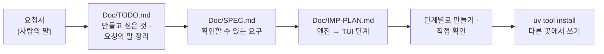

# 7교시 바이브 코딩 · 요청서 `tver` (가장 먼저 읽기)

- 순서: **이 요청서** → 내 정리 `~/vibe/tver/Doc/TODO.md` (8분) → [VIBE-Q-TVER.md](VIBE-Q-TVER.md)의 순서대로 `Doc/SPEC.md` → `Doc/IMP-PLAN.md` → 단계별로 만들기 → 설치 · 다른 곳에서 쓰기 → 수업이 끝나면 `VIBE-A-TVER.md`(정답본)로 확인
- 이 문서는 **만들어 달라는 사람의 말**입니다. 요구 사항 표도, 단계도 없습니다. 그것을 뽑아 내는 것이 첫 일입니다. 72일차 `tbench` · 73일차 `tscan`과 같은 순서입니다.



## 왜 요청서부터인가

요구 사항 표를 통째로 에이전트에게 주고 "이대로 만들어 줘"라고 하면, 무엇이 만들어지든 **내가 판단할 기준이 없습니다.** 실무에서는 요구 사항 표가 오지 않고, 이 요청서 같은 **사람의 말**이 옵니다. 오늘 Lab 02에서 게이트의 기대 낱말을 **데이터를 보고 내가** 정한 것과 같습니다: 무엇이 맞는지 알아야 맞았는지 말할 수 있습니다.

| 단계 | 누가 | 결과 |
| --- | --- | --- |
| 요청 → 할 일 목록 | **나** | `Doc/TODO.md`: 요청의 말 ①~⑫를 내 말로, 만들고 싶은 것 |
| 할 일 → 요구 | **나** (에이전트와 다듬어도 됨) | `Doc/SPEC.md`: 요구마다 "됐다 / 안 됐다"를 말할 수 있는 확인 방법 |
| 요구 → 단계 | **나** (에이전트와 다듬어도 됨) | `Doc/IMP-PLAN.md`: 엔진 단계와 화면(TUI) 단계로 나눈 순서 |
| 단계 → 코드 | 에이전트 | 단계마다 요청문 하나, `Doc/*.md`를 함께 읽게 함 |
| 확인 | **나** | 직접 `uv run tver …`, `pytest`, 요구 표에 체크 |

## 요청 (운영팀장에게서 온 메시지, 그대로)

> 오늘 `flow.py diff`로 v1 → v2를 비교한 거 봤어요. 그런데 그건 파일 두 개가 **이미 있을 때** 얘기잖아요. 우리 팀은 n8n 화면에서 고치고, 에이전트가 고치고, 누가 언제 무엇을 바꿨는지 남는 게 없어요. 워크플로우를 **버전으로 남기고 비교하는** 작은 도구가 있으면 좋겠어요. 터미널에서 돌아가면 되고, **어느 폴더에서나** `tver`라고 치면 되게 해 주세요.
>
> ① 워크플로우 파일 두 개를 주면 **노드 단위로** 무엇이 더해지고 빠지고 바뀌었는지, 연결은 어떻게 바뀌었는지 보여 주세요. 오늘 `flow.py diff`처럼요.
>
> ② n8n에서 노드를 옆으로 옮기기만 해도 파일이 바뀌어요. 그런 **뜻 없는 차이**(위치, id, 순서)는 빼 주세요. 그게 섞이면 아무도 diff를 안 읽어요.
>
> ③ 지시문이 바뀌면 "307자 → 419자"만 나오면 몰라요. **어느 문장이** 바뀌었는지 보여 주세요.
>
> ④ 오늘 강의에서 바뀌는 게 모델 · 지시문 · 흐름 세 가지라고 했죠? 바뀐 것을 **그 셋으로 나눠** 몇 개씩인지 한 줄로 알려 주세요. 사고가 나면 그 줄부터 봐요.
>
> ⑤ 파일을 주면 **버전으로 저장**해 주세요. git이면 좋겠어요. 저장할 때 무엇이 바뀌었는지 요약을 같이 남기고, **바뀐 게 없으면 저장하지 마세요.** 의미 없는 버전이 쌓이면 못 읽어요.
>
> ⑥ 저장한 버전의 **목록**을 보고, 아무 두 버전이나 골라 **비교**할 수 있게요.
>
> ⑦ 워크플로우 파일에 **API 키** 같은 게 들어 있으면 저장하지 말고 알려 주세요. git에 한 번 들어가면 지워도 남는다고 어제 배웠잖아요.
>
> ⑧ **화면에서** 버전 목록을 보고, 하나 고르면 그 바로 전 버전과 무엇이 바뀌었는지 노드별로 펼쳐 보고, 바뀐 것 하나를 고르면 전 · 후를 자세히 보여 주세요.
>
> ⑨ 사람들이 파일로 내보내기를 잊어요. **n8n에서 바로** 지금 워크플로우들을 가져와서 한꺼번에 버전으로 남겨 주면 좋겠어요.
>
> ⑩ 문제가 생기면 **예전 버전을 파일로 꺼내** 주세요. n8n에 올리는 건 사람이 할게요 (자동으로 올리면 무서워요).
>
> ⑪ 나중에 배포 전에 자동으로 돌릴 거라, 사람이 아니라 **다른 프로그램이 읽을 수 있는** 결과도 주세요. 바뀐 게 있으면 그걸 알 수 있는 종료 코드도요.
>
> ⑫ 누가 노드 **이름만 바꾸면** 지금은 "하나 빠지고 하나 더해짐"으로 나와요. 이름만 바뀐 거면 그렇다고 알려 주세요.
>
> 아, `my-work` 폴더를 통째로 주면 **워크플로우 파일만** 골라서 저장해 주세요. 테스트 파일이나 메모까지 워크플로우인 줄 알면 안 돼요. 그리고 **시험할 때** 진짜 우리 n8n을 망가뜨리면 안 돼요 — 저장소는 따로 두고, 가져오기만 하고 n8n에 올리지는 않게요.

## 함께 받은 것

| 파일 · 자료 | 메모 |
| --- | --- |
| `reference/helpdesk-v1.json` · `helpdesk-v2.json` | 시험 자료. `flow.py diff` 결과(7개)와 같아야 함 |
| 오늘 Lab의 `my-work/helpdesk.json` (단계마다) | 버전으로 저장해 볼 것 (예제 2 → 과제 1 → 과제 2 → Lab 02 …) |
| `tools/flow.py`의 `diff` | 노드 이름으로 짝짓는 방법 (읽어도 됨) |
| 68일차 `~/vibe/tflow` | 노드 · 연결 읽기 코드 (있으면) |
| n8n 컨테이너 | `docker exec day65-n8n-n8n-1 n8n export:workflow --all --output=...` (읽기만) |

## 할 일 · 요청을 내 할 일 목록으로 (8분, 에이전트 없이)

`~/vibe/tver/Doc/TODO.md`를 만들고 요청의 말 ①~⑫와 맨 끝 부탁 둘을 **내 말로** 한 줄씩 옮깁니다. 아직 "어떻게"는 쓰지 않습니다. **무엇을 · 왜**만 씁니다. 에이전트에게 맡기지 않고 직접 씁니다.

```markdown
# tver TODO

## 만들고 싶은 것 (한 문단)
어느 폴더에서나 `tver`로 n8n 워크플로우를 버전으로 남기고, 두 버전을 노드 단위로 비교해 ...

## 요청의 말 → 할 일
| # | 요청의 말 (짧게) | 할 일 (내 말) | 꼭 · 나중 |
| --- | --- | --- | --- |
| ① | 노드 단위 비교, 연결 | | 꼭 |
| ② | 뜻 없는 차이 빼기 | | |
| ... | | | |
| 끝 | 폴더 통째로 → 워크플로우만 | | |
| 끝 | 시험할 때 n8n을 망가뜨리지 않기 | | |

## 요청에 없지만 걱정되는 것
## 오늘 50분 안에 못 할 것 같은 것
```

예 하나만 보여 드립니다.

| 요청의 말 | TODO에 쓸 할 일 (내 말) | 다음 단계(SPEC)에서 바뀔 모양 |
| --- | --- | --- |
| ⑤ "바뀐 게 없으면 저장하지 마세요" | "같은 내용이면 버전을 만들지 않음. 노드만 옮긴 것도 같은 내용으로 봄 (② 와 연결)" | R5: 같은 파일을 두 번 save → 버전 1개, 노드 위치만 바꾼 파일을 save → "no change" |

<details><summary>▶ 1단계 · 꼭 할 것과 나중에 할 것</summary>

요청의 말이 열두 개입니다. 50분 안에 다 만들기 어렵습니다. 팀장이 사고가 나면 **"그 줄부터 봐요"**라고 한 것은 무엇인가요? 그리고 버전 목록 · 화면을 만들려면 먼저 무엇이 있어야 하나요? (비교 → 저장 → 목록 → 화면)
</details>

<details><summary>▶ 2단계 · 걱정되는 것 (숨은 요구의 씨앗)</summary>

- ② "뜻 없는 차이": 비교할 때만 빼면 될까요, 저장할 때도 빼야 할까요? (저장한 파일끼리 git diff를 볼 때)
- ⑤ "바뀐 게 없으면": 무엇을 "같다"고 볼까요? 키 순서가 다른 JSON은?
- ⑦ "API 키": 저장을 거부할 때, 찾은 키를 오류 메시지에 그대로 보여 주면? (73일차)
- ⑨ "n8n에서 바로": 워크플로우마다 파일 이름은 어떻게 정할까요? 이름에 공백 · 한글 · `/`가 있으면?
- ⑩ "예전 버전을 파일로": 꺼내는 일이 저장소를 바꾸면 안 됩니다. 왜일까요?
- "어느 폴더에서나 `tver`" → 저장소는 어디에 둘까요? (내 프로젝트 폴더 밖, 72일차 `tbench`와 같음)
</details>

## 그다음

[VIBE-Q-TVER.md](VIBE-Q-TVER.md)를 엽니다. 거기서 `Doc/TODO.md` → `Doc/SPEC.md` → `Doc/IMP-PLAN.md` → 단계별 구현 → 확인 → `uv tool install` → 다른 곳에서 사용 순서로 갑니다. VIBE-Q의 요구 표는 **내 SPEC을 쓴 뒤에** 비교하는 데 씁니다.
