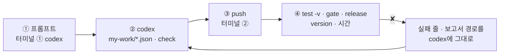
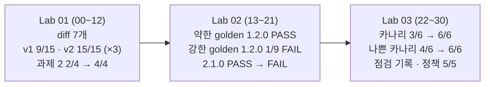

# 74일차 Lab 테스트 결과 · 실제로 만든 시나리오와 `test -v` 결과

> **정답 자료** · 74일차 n8n 워크플로우를 **만드는 프롬프트(codex) → push → `call -v` · `bench` · `test -v` · `gate` · `release` 결과**를 학생이 가는 순서대로 한 문서에 모았습니다. 수업이 끝난 뒤 공개합니다.

- 실행: 2026-10-27, 실습을 Lab마다 5개(예제 3 + 과제 2)로 늘린 뒤 강사 노트북의 65일차 n8n 2.42.6 + 74일차 판 데이터 API(지시문 저장소 · 릴리스 · 점검 기록 · 배포 정책), OpenAI `gpt-4.1-mini` · `gpt-5.4-nano`, 케이스 파일마다 **한 번씩** (Lab 01 예제 3 · Lab 02 예제 3만 `--repeat 3`), 모두 31단계 (00~30)
- 명령: `~/aio-01d4-stu/Last3Mon/74`에서 `uv run tools/flow.py ...`. 아래 단계마다 **실행한 명령**과 **화면에 나온 출력 전부**를 그대로 붙이고, 그 아래 **쉽게 말하면**으로 결과를 풀어 썼습니다 (특히 ✘가 나온 까닭과 그것이 예상한 것인지). 같은 출력이 `NN-<이름>.txt`에, `test`의 마지막 보고서가 `NN-<이름>.json`에 있습니다 (`diff` · `call` · `bench`만 한 단계와 28단계는 보고서 없음).
- LLM 문장과 **시간은 실행마다 다릅니다.** 이번 실행에서 정답의 잘못으로 실패한 케이스는 없습니다. ✘는 모두 "고치기 전" 단계와 일부러 보여 주는 단계(나쁜 릴리스 · 나쁜 카나리)에서 본 것입니다.
- 수업 준비 중 실제로 일어난 일: v2와 2.0.0의 작은 모델 `gpt-4.1-nano`가 OpenAI에서 **지원 종료**되어 500이 났습니다. `gpt-5.4-nano`로 바꾼 뒤 처음부터 다시 돌린 기록입니다.

## `-v`가 보여 주는 것

```text
✔ 후보 시험 · 1.1.0 고정 · 1.6s                ← 케이스 이름 · 시간 (틀리면 틀린 곳)
    → request  POST /webhook/my-helpdesk          ← 보낸 요청 JSON (--set release=... 이 더해진 것)
      { "question": "VPN …", "user": "이준호", "release": "1.1.0" }
    ← response HTTP 200                           ← 받은 응답 JSON
      { "route": "자동 답변", "answer": "… [FAQ-003]", "version": { "release": "1.1.0", "channel": "pinned", … } }
```

오늘은 응답의 **`version`**(release · prompt_version · model · channel · prompt_source)을 봐야 **어느 릴리스가 답했는지** 알 수 있습니다.

## 이 문서 하나로 따라가기

단계마다 **① codex에 넣는 프롬프트 → ② codex가 `my-work/*.json`(또는 `cases/my-golden.json`)을 쓰고 `check` → ③ 내가 `push` → ④ 내가 `test -v` · `gate` · `release`** 순서입니다. 재기만 하는 예제(Lab 01 예제 1 · 3, Lab 02 예제 2 · 3, Lab 03 예제 1 · 3)와 고치기 전 단계는 프롬프트가 없습니다.



- **프롬프트는 정답본(`LAB-0x-A-*.md`)의 요청문 예**를 그대로 썼습니다 (실습 문서 빈칸 채우기 뼈대의 `____`를 채운 글자라 빈칸 자리에 띄어쓰기가 남아 있습니다).
- **이 기록의 워크플로우는 수업 준비 때 만든 정답 파일**입니다. 프롬프트를 codex에 보내 다시 만들어 재지는 않았습니다 (68일차부터 수업 준비는 정답 워크플로우만 실행).
- 학생은 `push my-work/helpdesk.json`, 이 기록은 같은 웹훅(`my-helpdesk`)의 정답 파일을 push했습니다. 그래서 `test` 명령과 결과 모양은 같습니다.

## 시나리오 한눈에



| 단계 | 먼저 올린 것 (`push`) | 테스트 · 재기 | 결과 | 파일 |
| --- | --- | --- | --- | --- |
| 00 | `reference/helpdesk-v1.json` · `v2.json` | `release --reset` · `doctor` | ready | `00-prep` |
| 01 | (없음) | `diff` · `diff --full` | 7개 | `01-lab01-diff` |
| 02 | (같음) | `call rel-v1` · `rel-v2` | 2.8초 / 1.0초 `[FAQ-003]` | `02-lab01-call-v1-v2` |
| 03 | `reference/lab01-example2-version.json` | `lab01` | 3/3 | `03-lab01-version` |
| 04 | (같음) | `lab01-compare --webhook rel-v1 --repeat 3` | 9/15 | `04-lab01-compare-v1` |
| 05 | (같음) | `lab01-compare --webhook rel-v2 --repeat 3` | 15/15 | `05-lab01-compare-v2` |
| 06 | (같음) | `bench rel-v1` · `rel-v2` | p50 1.23 / 0.98초 | `06-lab01-bench-v1-v2` |
| 07 | (같음) | `lab01-challenge` | 2/3 | `07-lab01-challenge-before` |
| 08 | `answers/74-lab01-challenge-registry.json` | `lab01-challenge` | 3/3 | `08-lab01-challenge` |
| 09 | (같음) | `lab01` | 3/3 | `09-lab01-after-challenge` |
| 10 | (같음) | `lab01-challenge2` | 2/4 | `10-lab01-challenge2-before` |
| 11 | `answers/74-lab01-challenge2-fallback.json` | `lab01-challenge2` | 4/4 | `11-lab01-challenge2` |
| 12 | (같음) | `lab01-challenge` | 3/3 | `12-lab01-challenge-after2` |
| 13 | (같음) | `release` · `lab02` | 1/5 | `13-lab02-before` |
| 14 | `reference/lab02-example1-release.json` | `lab02` | 5/5 | `14-lab02-release` |
| 15 | (같음) | `lab01-challenge` · `lab01-challenge2` | 3/3 · 4/4 | `15-lab02-lab01-again` |
| 16 | (같음) | `gate golden` × 4 · `call 1.2.0` | 모두 PASS | `16-lab02-golden` |
| 17 | (같음) | `bench --set` × 2 · `gate --repeat 3` | 1.23 / 1.12초 · 18/18 | `17-lab02-baseline` |
| 18 | (같음) | `gate my-golden` × 4 | 1.2.0만 FAIL 1/9 | `18-lab02-my-golden` |
| 19 | (같음) | `lab02-challenge2` · `gate my-golden 2.1.0` | 4/5 · PASS | `19-lab02-challenge2-before` |
| 20 | `answers/74-lab02-challenge2-broken.json` | `lab02-challenge2` · `gate my-golden 2.1.0` | 5/5 · FAIL | `20-lab02-challenge2` |
| 21 | (같음) | `lab02` · `lab01-challenge2` | 5/5 · 4/4 | `21-lab02-after-challenge2` |
| 22 | (같음) | `release` · `call` × 2 · `lab03` | 2/2 | `22-lab03-deploy` |
| 23 | (같음) | `release --canary` · `lab03-canary` | 3/6 | `23-lab03-canary-before` |
| 24 | `reference/lab03-example2-canary.json` | `lab03-canary` · `lab02` · `lab02-challenge2` | 6/6 · 5/5 · 5/5 | `24-lab03-canary` |
| 25 | (같음) | `lab03-watch` | 4/6 | `25-lab03-watch` |
| 26 | (같음) | `--no-canary` · `lab03-watch --no-before` | 6/6 | `26-lab03-watch-after` |
| 27 | `answers/74-lab03-challenge-release-check.json` | `lab03-challenge` · `call 2.0.0` | 3/3 · promote | `27-lab03-challenge` |
| 28 | (같음) | `lab03-challenge2` | 점검 둘 ✘ · 1.1.0 배포 409로 멈춤 | `28-lab03-challenge2-before` |
| 29 | `answers/74-lab03-challenge2-gated.json` | `lab03-challenge2` | 5/5 | `29-lab03-challenge2` |
| 30 | (같음) | `--require-gate on` · `gate` · `release` · `doctor` | 2.1.0 거부 · 2.0.0 배포 · ready | `30-lab03-gate-flow` |

## 준비

### 00 · 수업 준비 · 처음 상태 · v1 · v2 게시 · doctor

실행한 명령:

```bash
uv run tools/flow.py release helpdesk --reset
uv run tools/flow.py push reference/helpdesk-v1.json reference/helpdesk-v2.json
uv run tools/flow.py doctor
```

출력 (그대로):

```text
✔ helpdesk: active 1.0.0 · no canary
  * 1.0.0  prompt p1  model gpt-4.1-mini  첫 릴리스  gate promote 9/9
    1.1.0  prompt p2  model gpt-4.1-mini  FAQ 답 끝에 출처 번호  gate promote 6/6
    1.2.0  prompt p3  model gpt-4.1-mini  답을 한 문장으로 짧게  gate promote 6/6
    2.0.0  prompt p2  model gpt-5.4-nano  더 작은 모델 (비용)  gate rollback 0/6
    2.1.0  prompt p9  model gpt-4.1-mini  출처 번호 · 존댓말 다듬기 (지시문 이름 확인 필요)

✔ pushed '74 IT helpdesk v1 (provided)' (id w0ed73a832099852)
   POST http://localhost:5678/webhook/rel-v1
✔ pushed '74 IT helpdesk v2 (provided)' (id w8e65b72e125f790)
   POST http://localhost:5678/webhook/rel-v2

! n8n install folder /Users/[USER]/day65-n8n
   → day 65 SETUP-N8N 5단계 (get.n8n.io 설치). 다른 곳에 설치했다면 Last3Mon/65/n8n/.env 에 N8N_HOME=<폴더>
✔ n8n container day65-n8n-n8n-1
✔ n8n http://localhost:5678
✔ data API http://localhost:8800
✔ releases /releases/helpdesk · gates /gates/helpdesk (day 74 data API)
✔ n8n → http://data-api:8800
✔ credential 'OpenAI (.env)' (openAiCourse0001)
✔ node catalog (for check)
✔ CLI coding agent: codex, claude, agy
ready
```

**쉽게 말하면**

- 릴리스를 처음 상태(active 1.0.0, 카나리 없음)로 돌리고, 비교용 v1 · v2(`rel-v1` · `rel-v2`)를 게시하고, `doctor`가 `ready`입니다.
- v2는 처음에 `gpt-4.1-nano`였는데 OpenAI가 지원 종료해 500이 났습니다. 10/27 `gpt-5.4-nano`로 바꾼 뒤의 기록입니다 (1단계 강의 2절).

## Lab 01 · 무엇이 바뀌었나, 답마다 버전, 지시문은 저장소로

### 01 · Lab 01 예제 1 · v1 → v2에서 바뀐 것 → 7개

실행한 명령:

```bash
uv run tools/flow.py diff reference/helpdesk-v1.json reference/helpdesk-v2.json
uv run tools/flow.py diff reference/helpdesk-v1.json reference/helpdesk-v2.json --full
```

출력 (그대로):

```text
74 IT helpdesk v1 (provided)  →  74 IT helpdesk v2 (provided)
+ node 'Review check' (code)
~ 'Answer' parameters.options.systemMessage: changed (307 → 419 chars)
~ 'Answer model' parameters.model.value: gpt-4.1-mini → gpt-5.4-nano
~ 'Question webhook' parameters.path: rel-v1 → rel-v2
+ link Answer → Review check (main)
+ link Review check → Build result (main)
- link Answer → Build result (main)
7 change(s)

74 IT helpdesk v1 (provided)  →  74 IT helpdesk v2 (provided)
+ node 'Review check' (code)
~ 'Answer' parameters.options.systemMessage: changed (307 → 419 chars)
    before: You are the company IT help desk. Answer in Korean in at most 3 sentences, using only the FAQ entries and the ticket record given. Never invent steps, dates or names. For a ticket, say its status and note. If the data does not answer the question, say "찾지 못했습니다" and that a staff member will help. Use 합니다체.
    after:  You are the company IT help desk. Answer in Korean in at most 3 sentences, using only the FAQ entries and the ticket record given. Never invent steps, dates or names. For a ticket, say its status and note. If the data does not answer the question, say "찾지 못했습니다" and that a staff member will help. Use 합니다체.
When the answer comes from a FAQ entry, end with its id in brackets, for example [FAQ-003]. Keep answers short.
~ 'Answer model' parameters.model.value: gpt-4.1-mini → gpt-5.4-nano
~ 'Question webhook' parameters.path: rel-v1 → rel-v2
+ link Answer → Review check (main)
+ link Review check → Build result (main)
- link Answer → Build result (main)
7 change(s)
```

**쉽게 말하면**

- 노드 단위로 비교하니 바뀐 것이 7개: 새 노드 `Review check`, 지시문 307 → 419자, 모델 mini → nano, 웹훅 경로, 연결 셋.
- `--full`로 보면 지시문에 두 문장(출처 번호 붙이기 · 짧게)이 더해졌습니다.
- 셋(모델 · 지시문 · 흐름)이 **한꺼번에** 바뀌었다는 것이 핵심입니다. 예상한 결과.

### 02 · 예제 1 · 같은 질문을 v1 · v2에

실행한 명령:

```bash
uv run tools/flow.py call rel-v1 requests/faq-vpn.json -v
uv run tools/flow.py call rel-v2 requests/faq-vpn.json -v
```

출력 (그대로):

```text
HTTP 200 · 2.8s
    → request  POST /webhook/rel-v1
      {
        "question": "VPN 접속이 자꾸 끊겨요. 어떻게 하나요?",
        "user": "이준호"
      }
    ← response HTTP 200
      {
        "route": "자동 답변",
        "answer": "VPN 접속 오류는 VPN 클라이언트를 최신 버전으로 업데이트하고, 인증서 만료 여부를 확인한 뒤 다시 접속하시기 바랍니다. 현재 접수된 관련 문의는 없습니다. 추가 도움이 필요하시면 담당자가 도와드리겠습니다.",
        "sources": [
          "FAQ-003"
        ]
      }

HTTP 200 · 1.0s
    → request  POST /webhook/rel-v2
      {
        "question": "VPN 접속이 자꾸 끊겨요. 어떻게 하나요?",
        "user": "이준호"
      }
    ← response HTTP 200
      {
        "route": "자동 답변",
        "answer": "VPN 접속이 끊기는 경우 VPN 클라이언트를 최신 버전으로 업데이트하고, 인증서 만료 여부를 확인한 뒤 다시 접속해 보시기 바랍니다. [FAQ-003]",
        "sources": [
          "FAQ-003"
        ]
      }
```

**쉽게 말하면**

- v1은 2.8초, 출처 번호 없음. v2는 1.0초, 끝에 `[FAQ-003]`.
- 답이 달라진 것은 보이지만, 이 한 번으로는 지시문 · 모델 · 노드 중 무엇 때문인지 모릅니다. 시간도 한 번 잰 값입니다 (예제 3에서 다시).

### 03 · Lab 01 예제 2 · 답마다 version → `lab01` 3/3

codex에 입력하는 프롬프트 (터미널 ①, 학생이 만들 파일 `my-work/helpdesk.json` · 이 기록에서 push한 같은 역할의 정답 `reference/lab01-example2-version.json`):

```text
my-work/helpdesk.json (v1 을 복사한 것) 의 웹훅 경로를 my-helpdesk 로, 이름을 "74 IT helpdesk (my)" 로 바꿔 줘.
Has question? 뒤에 Release info(Set) 를 넣어 release 1.0.0, prompt_version p1, model gpt-4.1-mini.
Answer model 의 모델 값은 ={{ $('Release info').first().json.model }} 로 Release info 의 model 을 읽게.
Build result 결과에 version : {release, prompt_version, model} 을 Release info 에서 더해 줘. 지시문은 그대로 .
기대 결과 cases/lab01.json.
```

실행한 명령:

```bash
uv run tools/flow.py push reference/lab01-example2-version.json
uv run tools/flow.py test cases/lab01.json -v
```

출력 (그대로):

```text
! unpublished '74 IT helpdesk + release API (reference)' (w2caac7c1a6981b8): it used the same webhook path
✔ pushed '74 IT helpdesk + version (reference)' (id w473a152b356a298)
   POST http://localhost:5678/webhook/my-helpdesk

POST http://localhost:5678/webhook/my-helpdesk · 3 case(s) × 1
✔ 버전이 결과에 · 2.5s
    → request  POST /webhook/my-helpdesk
      {
        "question": "VPN 접속이 자꾸 끊겨요. 어떻게 하나요?",
        "user": "이준호"
      }
    ← response HTTP 200
      {
        "route": "자동 답변",
        "answer": "VPN 접속 오류는 VPN 클라이언트를 최신 버전으로 업데이트하고, 인증서 만료 여부를 확인한 뒤 다시 접속하시기 바랍니다. 현재 접수된 관련 문의는 없습니다. 추가 도움이 필요하시면 담당자가 도와드리겠습니다.",
        "sources": [
          "FAQ-003"
        ],
        "version": {
          "release": "1.0.0",
          "prompt_version": "p1",
          "model": "gpt-4.1-mini"
        }
      }
✔ 접수 현황도 버전과 함께 · 1.1s
    → request  POST /webhook/my-helpdesk
      {
        "question": "T-1002 처리 상태 알려 주세요",
        "user": "박서연"
      }
    ← response HTTP 200
      {
        "route": "자동 답변",
        "answer": "T-1002 티켓은 현재 처리 중이며, 인증서 발급 승인 대기 중입니다. 10월 20일에 완료될 예정입니다. 추가 문의가 있으시면 연락 주시기 바랍니다.",
        "sources": [],
        "version": {
          "release": "1.0.0",
          "prompt_version": "p1",
          "model": "gpt-4.1-mini"
        }
      }
✔ 빈 질문 · 0.0s
    → request  POST /webhook/my-helpdesk
      {
        "question": "",
        "user": "이준호"
      }
    ← response HTTP 400
      {
        "error": "question is required"
      }
Passed 3/3
report: runs/lab01-20261027-183702.json
```

**쉽게 말하면**

- 답에 `version: {release 1.0.0, prompt_version p1, model gpt-4.1-mini}`가 붙었습니다. 모델 노드와 결과가 같은 `Release info`를 읽습니다.
- 빈 질문은 그대로 400. 3/3, 예상한 결과.

### 04 · Lab 01 예제 3 · `lab01-compare`를 v1에 3번 → 9/15

실행한 명령:

```bash
uv run tools/flow.py test cases/lab01-compare.json --webhook rel-v1 --repeat 3
```

출력 (그대로):

```text
POST http://localhost:5678/webhook/rel-v1 · 5 case(s) × 3
✔ VPN · 해결 낱말 #1 · 1.2s
✔ VPN · 해결 낱말 #2 · 1.2s
✔ VPN · 해결 낱말 #3 · 1.1s
✘ VPN · 출처 번호 #1 · 1.1s · answer has none of ['[FAQ-003]']
✘ VPN · 출처 번호 #2 · 1.2s · answer has none of ['[FAQ-003]']
✘ VPN · 출처 번호 #3 · 1.3s · answer has none of ['[FAQ-003]']
✔ 프린터 · 해결 낱말 #1 · 1.0s
✔ 프린터 · 해결 낱말 #2 · 1.1s
✔ 프린터 · 해결 낱말 #3 · 1.1s
✘ 프린터 · 출처 번호 #1 · 1.1s · answer has none of ['[FAQ-']
✘ 프린터 · 출처 번호 #2 · 1.2s · answer has none of ['[FAQ-']
✘ 프린터 · 출처 번호 #3 · 1.0s · answer has none of ['[FAQ-']
✔ 접수 현황 #1 · 0.9s
✔ 접수 현황 #2 · 1.0s
✔ 접수 현황 #3 · 1.1s
Passed 9/15
report: runs/lab01-compare-20261027-183719.json
```

**쉽게 말하면**

- 출처 번호 두 케이스가 **세 번 모두** ✘, 나머지 셋은 세 번 모두 ✔ (9/15).
- 흔들림이 아니라 늘 같은 결과입니다. v1은 출처 번호를 붙이지 않는 버전이라 ✘가 **예상한 것**입니다.

### 05 · 예제 3 · 같은 테스트를 v2에 3번 → 15/15

실행한 명령:

```bash
uv run tools/flow.py test cases/lab01-compare.json --webhook rel-v2 --repeat 3
```

출력 (그대로):

```text
POST http://localhost:5678/webhook/rel-v2 · 5 case(s) × 3
✔ VPN · 해결 낱말 #1 · 1.0s
✔ VPN · 해결 낱말 #2 · 1.0s
✔ VPN · 해결 낱말 #3 · 1.0s
✔ VPN · 출처 번호 #1 · 0.9s
✔ VPN · 출처 번호 #2 · 1.1s
✔ VPN · 출처 번호 #3 · 0.9s
✔ 프린터 · 해결 낱말 #1 · 1.4s
✔ 프린터 · 해결 낱말 #2 · 1.1s
✔ 프린터 · 해결 낱말 #3 · 1.2s
✔ 프린터 · 출처 번호 #1 · 1.4s
✔ 프린터 · 출처 번호 #2 · 1.1s
✔ 프린터 · 출처 번호 #3 · 1.2s
✔ 접수 현황 #1 · 1.1s
✔ 접수 현황 #2 · 1.0s
✔ 접수 현황 #3 · 1.0s
Passed 15/15
report: runs/lab01-compare-20261027-183736.json
```

**쉽게 말하면**

- v2는 다섯 케이스 모두 세 번 다 ✔. 출처 번호의 차이는 **흔들림이 아니라 바뀐 것**(신호)입니다.
- 그래도 지시문 · 모델 · 노드 중 무엇 때문인지는 아직 모릅니다 → Lab 02의 한 가지씩 바꾼 릴리스.

### 06 · 예제 3 · v1 · v2 시간 (`bench -n 5`)

실행한 명령:

```bash
uv run tools/flow.py bench rel-v1 requests/faq-vpn.json -n 5
uv run tools/flow.py bench rel-v2 requests/faq-vpn.json -n 5
```

출력 (그대로):

```text
POST http://localhost:5678/webhook/rel-v1 × 5
✔ #1 · HTTP 200 · 1.26s · route=자동 답변
✔ #2 · HTTP 200 · 1.11s · route=자동 답변
✔ #3 · HTTP 200 · 1.23s · route=자동 답변
✔ #4 · HTTP 200 · 1.34s · route=자동 답변
✔ #5 · HTTP 200 · 1.18s · route=자동 답변
p50 1.23s · p95 1.34s · max 1.34s · failures 0/5
report: runs/bench-rel-v1-20261027-183742.json

POST http://localhost:5678/webhook/rel-v2 × 5
✔ #1 · HTTP 200 · 1.20s · route=자동 답변
✔ #2 · HTTP 200 · 0.97s · route=자동 답변
✔ #3 · HTTP 200 · 0.98s · route=자동 답변
✔ #4 · HTTP 200 · 1.02s · route=자동 답변
✔ #5 · HTTP 200 · 0.98s · route=자동 답변
p50 0.98s · p95 1.20s · max 1.20s · failures 0/5
report: runs/bench-rel-v2-20261027-183747.json
```

**쉽게 말하면**

- v1 p50 1.23초 · p95 1.34초, v2 p50 0.98초 · p95 1.20초. v2가 조금 빠릅니다.
- 모델이 작아진 덕일 것 같지만 셋이 함께 바뀌어 단정할 수 없습니다. 시간은 실행마다 다릅니다.

### 07 · Lab 01 과제 1 하기 전 → `lab01-challenge` 2/3

실행한 명령:

```bash
uv run tools/flow.py test cases/lab01-challenge.json -v
```

출력 (그대로):

```text
POST http://localhost:5678/webhook/my-helpdesk · 3 case(s) × 1
✘ 지시문은 저장소에서 · 1.2s · version.prompt_source = null (expected registry)
    → request  POST /webhook/my-helpdesk
      {
        "question": "VPN 접속이 자꾸 끊겨요. 어떻게 하나요?",
        "user": "이준호"
      }
    ← response HTTP 200
      {
        "route": "자동 답변",
        "answer": "VPN 접속 오류는 VPN 클라이언트를 최신 버전으로 업데이트하고, 인증서 만료 여부를 확인한 뒤 다시 접속하시기 바랍니다. 현재 접수된 문의 건이 없어 추가 지원이 필요하시면 IT 담당자에게 문의해 주세요.",
        "sources": [
          "FAQ-003"
        ],
        "version": {
          "release": "1.0.0",
          "prompt_version": "p1",
          "model": "gpt-4.1-mini"
        }
      }
✔ p1은 출처 번호를 붙이지 않음 · 1.1s
    → request  POST /webhook/my-helpdesk
      {
        "question": "프린터 출력이 안 돼요",
        "user": "최유진"
      }
    ← response HTTP 200
      {
        "route": "자동 답변",
        "answer": "프린터 전원과 네트워크 연결을 확인하고, 인쇄 대기열을 비운 뒤 다시 출력해 보시기 바랍니다. 현재 접수된 관련 문의는 없습니다. 추가 도움이 필요하시면 담당 직원이 도와드리겠습니다.",
        "sources": [
          "FAQ-004"
        ],
        "version": {
          "release": "1.0.0",
          "prompt_version": "p1",
          "model": "gpt-4.1-mini"
        }
      }
✔ 접수 현황 · 1.2s
    → request  POST /webhook/my-helpdesk
      {
        "question": "T-1002 처리 상태 알려 주세요",
        "user": "박서연"
      }
    ← response HTTP 200
      {
        "route": "자동 답변",
        "answer": "T-1002 티켓은 현재 처리 중이며, 인증서 발급 승인 대기 중입니다. 10월 20일에 완료될 예정입니다. 추가 문의가 있으시면 연락 주시기 바랍니다.",
        "sources": [],
        "version": {
          "release": "1.0.0",
          "prompt_version": "p1",
          "model": "gpt-4.1-mini"
        }
      }
Passed 2/3
report: runs/lab01-challenge-20261027-183751.json
```

**쉽게 말하면**

- 첫 케이스 ✘: `version.prompt_source`가 없습니다. 지시문이 아직 워크플로우 안에 있기 때문입니다.
- 나머지 둘(p1은 출처 번호 없음, 접수 현황)은 ✔. 예상한 결과.

### 08 · Lab 01 과제 1 · 지시문을 저장소에서 → 3/3

codex에 입력하는 프롬프트 (터미널 ①, 학생이 만들 파일 `my-work/helpdesk.json` · 이 기록에서 push한 같은 역할의 정답 `answers/74-lab01-challenge-registry.json`):

```text
my-work/helpdesk.json 의 Release info 뒤에 Get prompt(HTTP GET) 를 넣어 줘.
주소는 http://data-api:8800/prompts/helpdesk/ prompt_version (Release info 의 값을 표현식으로).
Answer 의 systemMessage 는 지금 글자 대신 Get prompt 의 text 를 표현식으로 읽게.
Build result 의 version 에 prompt_source : ' registry ' 를 더해 줘. 다른 것은 그대로.
기대 결과 cases/lab01-challenge.json, cases/lab01.json.
```

실행한 명령:

```bash
uv run tools/flow.py push answers/74-lab01-challenge-registry.json
uv run tools/flow.py test cases/lab01-challenge.json -v
```

출력 (그대로):

```text
! unpublished '74 IT helpdesk + version (reference)' (w473a152b356a298): it used the same webhook path
✔ pushed '74 IT helpdesk + prompt registry (answer)' (id w10c91b5c7439d37)
   POST http://localhost:5678/webhook/my-helpdesk

POST http://localhost:5678/webhook/my-helpdesk · 3 case(s) × 1
✔ 지시문은 저장소에서 · 2.7s
    → request  POST /webhook/my-helpdesk
      {
        "question": "VPN 접속이 자꾸 끊겨요. 어떻게 하나요?",
        "user": "이준호"
      }
    ← response HTTP 200
      {
        "route": "자동 답변",
        "answer": "VPN 접속 오류는 VPN 클라이언트를 최신 버전으로 업데이트하고, 인증서 만료 여부를 확인한 뒤 다시 접속하시기 바랍니다. 현재 접수된 관련 문의는 없습니다. 추가 도움이 필요하시면 담당자가 도와드리겠습니다.",
        "sources": [
          "FAQ-003"
        ],
        "version": {
          "release": "1.0.0",
          "prompt_version": "p1",
          "model": "gpt-4.1-mini",
          "prompt_source": "registry"
        }
      }
✔ p1은 출처 번호를 붙이지 않음 · 1.3s
    → request  POST /webhook/my-helpdesk
      {
        "question": "프린터 출력이 안 돼요",
        "user": "최유진"
      }
    ← response HTTP 200
      {
        "route": "자동 답변",
        "answer": "프린터 전원과 네트워크 연결을 확인하고, 인쇄 대기열을 비운 뒤 다시 출력해 보시기 바랍니다. 현재 접수된 관련 문의는 없습니다. 추가 도움이 필요하시면 담당 직원이 도와드리겠습니다.",
        "sources": [
          "FAQ-004"
        ],
        "version": {
          "release": "1.0.0",
          "prompt_version": "p1",
          "model": "gpt-4.1-mini",
          "prompt_source": "registry"
        }
      }
✔ 접수 현황 · 1.4s
    → request  POST /webhook/my-helpdesk
      {
        "question": "T-1002 처리 상태 알려 주세요",
        "user": "박서연"
      }
    ← response HTTP 200
      {
        "route": "자동 답변",
        "answer": "T-1002 티켓은 현재 처리 중이며, 인증서 발급 승인 대기 중입니다. 10월 20일에 완료될 예정입니다. 추가 문의가 있으시면 연락 주시기 바랍니다.",
        "sources": [],
        "version": {
          "release": "1.0.0",
          "prompt_version": "p1",
          "model": "gpt-4.1-mini",
          "prompt_source": "registry"
        }
      }
Passed 3/3
report: runs/lab01-challenge-20261027-183810.json
```

**쉽게 말하면**

- `Get prompt`가 `/prompts/helpdesk/p1`을 읽고 Agent의 지시문이 그 `text`가 됐습니다. `prompt_source: registry`.
- 3/3, 예상한 결과.

### 09 · 과제 1 뒤 `lab01` → 3/3

실행한 명령:

```bash
uv run tools/flow.py test cases/lab01.json -v
```

출력 (그대로):

```text
POST http://localhost:5678/webhook/my-helpdesk · 3 case(s) × 1
✔ 버전이 결과에 · 1.3s
    → request  POST /webhook/my-helpdesk
      {
        "question": "VPN 접속이 자꾸 끊겨요. 어떻게 하나요?",
        "user": "이준호"
      }
    ← response HTTP 200
      {
        "route": "자동 답변",
        "answer": "VPN 접속 오류는 VPN 클라이언트를 최신 버전으로 업데이트하고, 인증서 만료 여부를 확인한 뒤 다시 접속하시기 바랍니다. 현재 접수된 문의 건은 없습니다만, 추가 도움이 필요하시면 담당자가 도와드리겠습니다.",
        "sources": [
          "FAQ-003"
        ],
        "version": {
          "release": "1.0.0",
          "prompt_version": "p1",
          "model": "gpt-4.1-mini",
          "prompt_source": "registry"
        }
      }
✔ 접수 현황도 버전과 함께 · 0.9s
    → request  POST /webhook/my-helpdesk
      {
        "question": "T-1002 처리 상태 알려 주세요",
        "user": "박서연"
      }
    ← response HTTP 200
      {
        "route": "자동 답변",
        "answer": "T-1002 티켓은 현재 처리 중이며, 인증서 발급 승인 대기 중입니다. 10월 20일에 완료될 예정입니다. 추가 문의가 있으시면 연락 주시기 바랍니다.",
        "sources": [],
        "version": {
          "release": "1.0.0",
          "prompt_version": "p1",
          "model": "gpt-4.1-mini",
          "prompt_source": "registry"
        }
      }
✔ 빈 질문 · 0.0s
    → request  POST /webhook/my-helpdesk
      {
        "question": "",
        "user": "이준호"
      }
    ← response HTTP 400
      {
        "error": "question is required"
      }
Passed 3/3
report: runs/lab01-20261027-183812.json
```

**쉽게 말하면**

- 예제 2의 테스트도 그대로 통과. 지시문을 밖으로 꺼내도 답은 같습니다 (p1 글이 같으니까).

### 10 · Lab 01 과제 2 하기 전 → `lab01-challenge2` 2/4

실행한 명령:

```bash
uv run tools/flow.py test cases/lab01-challenge2.json -v
```

출력 (그대로):

```text
POST http://localhost:5678/webhook/my-helpdesk · 4 case(s) × 1
✔ 평소 · 저장소에서 · 1.3s
    → request  POST /webhook/my-helpdesk
      {
        "question": "VPN 접속이 자꾸 끊겨요. 어떻게 하나요?",
        "user": "이준호"
      }
    ← response HTTP 200
      {
        "route": "자동 답변",
        "answer": "VPN 접속 오류는 VPN 클라이언트를 최신 버전으로 업데이트하고, 인증서 만료 여부를 확인한 뒤 다시 접속하시기 바랍니다. 현재 접수된 관련 문의는 없습니다. 추가 도움이 필요하시면 담당자가 도와드리겠습니다.",
        "sources": [
          "FAQ-003"
        ],
        "version": {
          "release": "1.0.0",
          "prompt_version": "p1",
          "model": "gpt-4.1-mini",
          "prompt_source": "registry"
        }
      }
✔ before: POST http://localhost:8800/admin/fault · HTTP 200 · 0.0s · {"faq": "ok", "tickets": "ok", "prompts": "error", "slow_seconds": 8.0}
    → request  POST http://localhost:8800/admin/fault
      {
        "prompts": "error"
      }
    ← response HTTP 200
      {
        "faq": "ok",
        "tickets": "ok",
        "prompts": "error",
        "slow_seconds": 8.0
      }
✘ 저장소 고장 · 기본 지시문으로 답 · 0.1s · status 500 (expected 200); route = null (expected 자동 답변); version.prompt_source = null (expected fallback); answer has none of ['인증서']
    → request  POST /webhook/my-helpdesk
      {
        "question": "VPN 접속이 자꾸 끊겨요. 어떻게 하나요?",
        "user": "이준호"
      }
    ← response HTTP 500
      {
        "message": "Error in workflow"
      }
✔ after: POST http://localhost:8800/admin/fault · HTTP 200 · 0.0s · {"faq": "ok", "tickets": "ok", "prompts": "ok", "slow_seconds": 8.0}
    → request  POST http://localhost:8800/admin/fault
      {
        "prompts": "ok"
      }
    ← response HTTP 200
      {
        "faq": "ok",
        "tickets": "ok",
        "prompts": "ok",
        "slow_seconds": 8.0
      }
✔ before: POST http://localhost:8800/admin/fault · HTTP 200 · 0.0s · {"faq": "ok", "tickets": "ok", "prompts": "slow", "slow_seconds": 8.0}
    → request  POST http://localhost:8800/admin/fault
      {
        "prompts": "slow",
        "slow_seconds": 8
      }
    ← response HTTP 200
      {
        "faq": "ok",
        "tickets": "ok",
        "prompts": "slow",
        "slow_seconds": 8.0
      }
✘ 저장소 느림 · 오래 기다리지 않음 · 9.1s · took 9.1s (expected at most 6s); version.prompt_source = registry (expected fallback)
    → request  POST /webhook/my-helpdesk
      {
        "question": "프린터 출력이 안 돼요",
        "user": "최유진"
      }
    ← response HTTP 200
      {
        "route": "자동 답변",
        "answer": "프린터 전원과 네트워크 연결을 확인하고, 인쇄 대기열을 비운 뒤 다시 출력해 보시기 바랍니다. 현재 접수된 관련 문의는 없으며, 추가 도움이 필요하시면 직원이 도와드리겠습니다.",
        "sources": [
          "FAQ-004"
        ],
        "version": {
          "release": "1.0.0",
          "prompt_version": "p1",
          "model": "gpt-4.1-mini",
          "prompt_source": "registry"
        }
      }
✔ after: POST http://localhost:8800/admin/fault · HTTP 200 · 0.0s · {"faq": "ok", "tickets": "ok", "prompts": "ok", "slow_seconds": 8.0}
    → request  POST http://localhost:8800/admin/fault
      {
        "prompts": "ok",
        "slow_seconds": 8
      }
    ← response HTTP 200
      {
        "faq": "ok",
        "tickets": "ok",
        "prompts": "ok",
        "slow_seconds": 8.0
      }
✔ 되돌린 뒤 · 다시 저장소에서 · 1.1s
    → request  POST /webhook/my-helpdesk
      {
        "question": "프린터 출력이 안 돼요",
        "user": "최유진"
      }
    ← response HTTP 200
      {
        "route": "자동 답변",
        "answer": "프린터 전원과 네트워크 연결을 확인하고, 인쇄 대기열을 비운 뒤 다시 출력해 보시기 바랍니다. 현재 접수된 관련 문의는 없습니다. 추가 도움이 필요하시면 담당자가 도와드리겠습니다.",
        "sources": [
          "FAQ-004"
        ],
        "version": {
          "release": "1.0.0",
          "prompt_version": "p1",
          "model": "gpt-4.1-mini",
          "prompt_source": "registry"
        }
      }
Passed 2/4
report: runs/lab01-challenge2-20261027-183824.json
✔ after: POST http://localhost:8800/admin/fault · HTTP 200 · 0.0s · {"faq": "ok", "tickets": "ok", "prompts": "ok", "slow_seconds": 8.0}
    → request  POST http://localhost:8800/admin/fault
      {
        "prompts": "ok",
        "slow_seconds": 8
      }
    ← response HTTP 200
      {
        "faq": "ok",
        "tickets": "ok",
        "prompts": "ok",
        "slow_seconds": 8.0
      }
```

**쉽게 말하면**

- 저장소 고장(`prompts error`): **HTTP 500** `Error in workflow` (0.1초). 지시문 하나 못 가져와서 답을 통째로 못 했습니다.
- 저장소 느림(`prompts slow` 8초): **9.1초** 기다린 뒤 답 (`max_seconds 6` ✘). 답은 맞았지만 너무 오래 걸렸습니다.
- 평소 · 되돌린 뒤 두 케이스는 ✔. `after`가 고장 스위치를 매번 `ok`로 되돌렸습니다. 예상한 결과.

### 11 · Lab 01 과제 2 · 저장소가 멈추면 기본 지시문 → 4/4

codex에 입력하는 프롬프트 (터미널 ①, 학생이 만들 파일 `my-work/helpdesk.json` · 이 기록에서 push한 같은 역할의 정답 `answers/74-lab01-challenge2-fallback.json`):

```text
my-work/helpdesk.json 의 Get prompt 에 options.timeout 2000 과 onError continueErrorOutput 를 넣어 줘.
성공 쪽은 Registry prompt(Set, text = $json.text), 실패 쪽은 Fallback prompt(Set, text = data-api/data/prompts/helpdesk- p1 .md 와 같은 글).
두 Set 모두 Search FAQ 로 이어 줘. Answer 의 systemMessage 는 Registry prompt 가 실행됐으면 그 text, 아니면 Fallback prompt 의 text.
version.prompt_source 는 Registry prompt 가 실행됐으면 'registry', 아니면 ' fallback '.
기대 결과 cases/lab01-challenge2.json, cases/lab01-challenge.json.
```

실행한 명령:

```bash
uv run tools/flow.py push answers/74-lab01-challenge2-fallback.json
uv run tools/flow.py test cases/lab01-challenge2.json -v
```

출력 (그대로):

```text
! unpublished '74 IT helpdesk + prompt registry (answer)' (w10c91b5c7439d37): it used the same webhook path
✔ pushed '74 IT helpdesk + prompt fallback (answer)' (id w5215c7f75644ed0)
   POST http://localhost:5678/webhook/my-helpdesk

POST http://localhost:5678/webhook/my-helpdesk · 4 case(s) × 1
✔ 평소 · 저장소에서 · 2.6s
    → request  POST /webhook/my-helpdesk
      {
        "question": "VPN 접속이 자꾸 끊겨요. 어떻게 하나요?",
        "user": "이준호"
      }
    ← response HTTP 200
      {
        "route": "자동 답변",
        "answer": "VPN 접속 오류는 VPN 클라이언트를 최신 버전으로 업데이트하고, 인증서 만료 여부를 확인한 뒤 다시 접속하시기 바랍니다. 현재 접수된 문의 건은 없습니다. 추가 도움이 필요하시면 담당자가 도와드리겠습니다.",
        "sources": [
          "FAQ-003"
        ],
        "version": {
          "release": "1.0.0",
          "prompt_version": "p1",
          "model": "gpt-4.1-mini",
          "prompt_source": "registry"
        }
      }
✔ before: POST http://localhost:8800/admin/fault · HTTP 200 · 0.0s · {"faq": "ok", "tickets": "ok", "prompts": "error", "slow_seconds": 8.0}
    → request  POST http://localhost:8800/admin/fault
      {
        "prompts": "error"
      }
    ← response HTTP 200
      {
        "faq": "ok",
        "tickets": "ok",
        "prompts": "error",
        "slow_seconds": 8.0
      }
✔ 저장소 고장 · 기본 지시문으로 답 · 1.3s
    → request  POST /webhook/my-helpdesk
      {
        "question": "VPN 접속이 자꾸 끊겨요. 어떻게 하나요?",
        "user": "이준호"
      }
    ← response HTTP 200
      {
        "route": "자동 답변",
        "answer": "VPN 접속 오류는 VPN 클라이언트를 최신 버전으로 업데이트하고, 인증서 만료 여부를 확인한 뒤 다시 접속하시기 바랍니다. 현재 접수된 문의 건은 없습니다. 추가 도움이 필요하시면 담당자가 도와드리겠습니다.",
        "sources": [
          "FAQ-003"
        ],
        "version": {
          "release": "1.0.0",
          "prompt_version": "p1",
          "model": "gpt-4.1-mini",
          "prompt_source": "fallback"
        }
      }
✔ after: POST http://localhost:8800/admin/fault · HTTP 200 · 0.0s · {"faq": "ok", "tickets": "ok", "prompts": "ok", "slow_seconds": 8.0}
    → request  POST http://localhost:8800/admin/fault
      {
        "prompts": "ok"
      }
    ← response HTTP 200
      {
        "faq": "ok",
        "tickets": "ok",
        "prompts": "ok",
        "slow_seconds": 8.0
      }
✔ before: POST http://localhost:8800/admin/fault · HTTP 200 · 0.0s · {"faq": "ok", "tickets": "ok", "prompts": "slow", "slow_seconds": 8.0}
    → request  POST http://localhost:8800/admin/fault
      {
        "prompts": "slow",
        "slow_seconds": 8
      }
    ← response HTTP 200
      {
        "faq": "ok",
        "tickets": "ok",
        "prompts": "slow",
        "slow_seconds": 8.0
      }
✔ 저장소 느림 · 오래 기다리지 않음 · 3.0s
    → request  POST /webhook/my-helpdesk
      {
        "question": "프린터 출력이 안 돼요",
        "user": "최유진"
      }
    ← response HTTP 200
      {
        "route": "자동 답변",
        "answer": "프린터 전원과 네트워크 연결을 확인하고, 인쇄 대기열을 비운 뒤 다시 출력해 보시기 바랍니다. 추가 도움이 필요하시면 담당 직원이 도와드리겠습니다.",
        "sources": [
          "FAQ-004"
        ],
        "version": {
          "release": "1.0.0",
          "prompt_version": "p1",
          "model": "gpt-4.1-mini",
          "prompt_source": "fallback"
        }
      }
✔ after: POST http://localhost:8800/admin/fault · HTTP 200 · 0.0s · {"faq": "ok", "tickets": "ok", "prompts": "ok", "slow_seconds": 8.0}
    → request  POST http://localhost:8800/admin/fault
      {
        "prompts": "ok",
        "slow_seconds": 8
      }
    ← response HTTP 200
      {
        "faq": "ok",
        "tickets": "ok",
        "prompts": "ok",
        "slow_seconds": 8.0
      }
✔ 되돌린 뒤 · 다시 저장소에서 · 1.4s
    → request  POST /webhook/my-helpdesk
      {
        "question": "프린터 출력이 안 돼요",
        "user": "최유진"
      }
    ← response HTTP 200
      {
        "route": "자동 답변",
        "answer": "프린터 전원과 네트워크 연결을 확인하고, 인쇄 대기열을 비운 뒤 다시 출력해 보시기 바랍니다. 현재 접수된 관련 문의는 없습니다. 추가 도움이 필요하시면 담당자가 도와드리겠습니다.",
        "sources": [
          "FAQ-004"
        ],
        "version": {
          "release": "1.0.0",
          "prompt_version": "p1",
          "model": "gpt-4.1-mini",
          "prompt_source": "registry"
        }
      }
Passed 4/4
report: runs/lab01-challenge2-20261027-183845.json
✔ after: POST http://localhost:8800/admin/fault · HTTP 200 · 0.0s · {"faq": "ok", "tickets": "ok", "prompts": "ok", "slow_seconds": 8.0}
    → request  POST http://localhost:8800/admin/fault
      {
        "prompts": "ok",
        "slow_seconds": 8
      }
    ← response HTTP 200
      {
        "faq": "ok",
        "tickets": "ok",
        "prompts": "ok",
        "slow_seconds": 8.0
      }
```

**쉽게 말하면**

- 고장: 200, `fallback`, "인증서" (1.3초). 느림: 2초에 포기하고 기본 지시문으로 3.0초.
- 고장이 끝나면 다시 `registry`. 4/4, 예상한 결과.

### 12 · 과제 2 뒤 `lab01-challenge` → 3/3

실행한 명령:

```bash
uv run tools/flow.py test cases/lab01-challenge.json -v
```

출력 (그대로):

```text
POST http://localhost:5678/webhook/my-helpdesk · 3 case(s) × 1
✔ 지시문은 저장소에서 · 1.2s
    → request  POST /webhook/my-helpdesk
      {
        "question": "VPN 접속이 자꾸 끊겨요. 어떻게 하나요?",
        "user": "이준호"
      }
    ← response HTTP 200
      {
        "route": "자동 답변",
        "answer": "VPN 접속 오류는 VPN 클라이언트를 최신 버전으로 업데이트하고, 인증서 만료 여부를 확인한 뒤 다시 접속하시기 바랍니다. 현재 접수된 문의 건이 없어 추가 지원이 필요하시면 IT 담당자에게 문의해 주세요.",
        "sources": [
          "FAQ-003"
        ],
        "version": {
          "release": "1.0.0",
          "prompt_version": "p1",
          "model": "gpt-4.1-mini",
          "prompt_source": "registry"
        }
      }
✔ p1은 출처 번호를 붙이지 않음 · 1.1s
    → request  POST /webhook/my-helpdesk
      {
        "question": "프린터 출력이 안 돼요",
        "user": "최유진"
      }
    ← response HTTP 200
      {
        "route": "자동 답변",
        "answer": "프린터 전원과 네트워크 연결을 확인하고, 인쇄 대기열을 비운 뒤 다시 출력해 보시기 바랍니다. 추가 도움이 필요하시면 담당 직원이 도와드리겠습니다.",
        "sources": [
          "FAQ-004"
        ],
        "version": {
          "release": "1.0.0",
          "prompt_version": "p1",
          "model": "gpt-4.1-mini",
          "prompt_source": "registry"
        }
      }
✔ 접수 현황 · 1.1s
    → request  POST /webhook/my-helpdesk
      {
        "question": "T-1002 처리 상태 알려 주세요",
        "user": "박서연"
      }
    ← response HTTP 200
      {
        "route": "자동 답변",
        "answer": "T-1002 티켓은 현재 처리 중이며, 인증서 발급 승인 대기 중입니다. 10월 20일에 완료될 예정입니다. 추가 문의가 있으시면 연락 주시기 바랍니다.",
        "sources": [],
        "version": {
          "release": "1.0.0",
          "prompt_version": "p1",
          "model": "gpt-4.1-mini",
          "prompt_source": "registry"
        }
      }
Passed 3/3
report: runs/lab01-challenge-20261027-183849.json
```

**쉽게 말하면**

- 평소에는 여전히 저장소 지시문(`registry`)으로 답합니다. 기본 지시문 길을 더해도 평소 동작은 그대로.

## Lab 02 · 릴리스 고르기, 후보 시험, 배포 전 게이트

### 13 · Lab 02 예제 1 하기 전 → `lab02` 1/5

실행한 명령:

```bash
uv run tools/flow.py release helpdesk
uv run tools/flow.py test cases/lab02.json -v
```

출력 (그대로):

```text
✔ helpdesk: active 1.0.0 · no canary
  * 1.0.0  prompt p1  model gpt-4.1-mini  첫 릴리스  gate promote 9/9
    1.1.0  prompt p2  model gpt-4.1-mini  FAQ 답 끝에 출처 번호  gate promote 6/6
    1.2.0  prompt p3  model gpt-4.1-mini  답을 한 문장으로 짧게  gate promote 6/6
    2.0.0  prompt p2  model gpt-5.4-nano  더 작은 모델 (비용)  gate rollback 0/6
    2.1.0  prompt p9  model gpt-4.1-mini  출처 번호 · 존댓말 다듬기 (지시문 이름 확인 필요)

✔ before: POST http://localhost:8800/releases/helpdesk/reset · HTTP 200 · 0.0s · {"name": "helpdesk", "active": "1.0.0", "canary": null, "require_gate": false, "releases": {"1.0.0": {"prompt_version": 
    → request  POST http://localhost:8800/releases/helpdesk/reset
      {}
    ← response HTTP 200
      {
        "name": "helpdesk",
        "active": "1.0.0",
        "canary": null,
        "require_gate": false,
        "releases": {
          "1.0.0": {
            "prompt_version": "p1",
            "model": "gpt-4.1-mini",
            "note": "첫 릴리스"
          },
          "1.1.0": {
            "prompt_version": "p2",
            "model": "gpt-4.1-mini",
            "note": "FAQ 답 끝에 출처 번호"
          },
          "1.2.0": {
            "prompt_version": "p3",
            "model": "gpt-4.1-mini",
            "note": "답을 한 문장으로 짧게"
          },
          "2.0.0": {
            "prompt_version": "p2",
            "model": "gpt-5.4-nano",
            "note": "더 작은 모델 (비용)"
          },
          "2.1.0": {
            "prompt_version": "p9",
            "model": "gpt-4.1-mini",
            "note": "출처 번호 · 존댓말 다듬기 (지시문 이름 확인 필요)"
          }
        }
      }
POST http://localhost:5678/webhook/my-helpdesk · 5 case(s) × 1
✘ 운영 중인 릴리스 (active) · 1.2s · version.channel = null (expected stable)
    → request  POST /webhook/my-helpdesk
      {
        "question": "VPN 접속이 자꾸 끊겨요. 어떻게 하나요?",
        "user": "이준호"
      }
    ← response HTTP 200
      {
        "route": "자동 답변",
        "answer": "VPN 접속 오류는 VPN 클라이언트를 최신 버전으로 업데이트하고, 인증서 만료 여부를 확인한 뒤 다시 접속하시기 바랍니다. 현재 접수된 문의 건은 없습니다만, 추가 도움이 필요하시면 담당자가 도와드리겠습니다.",
        "sources": [
          "FAQ-003"
        ],
        "version": {
          "release": "1.0.0",
          "prompt_version": "p1",
          "model": "gpt-4.1-mini",
          "prompt_source": "registry"
        }
      }
✘ 후보 시험 · 1.1.0 고정 · 1.6s · version.release = 1.0.0 (expected 1.1.0); version.channel = null (expected pinned); version.prompt_version = p1 (expected p2); answer has none of ['[FAQ-003]']
    → request  POST /webhook/my-helpdesk
      {
        "question": "VPN 접속이 자꾸 끊겨요. 어떻게 하나요?",
        "user": "이준호",
        "release": "1.1.0"
      }
    ← response HTTP 200
      {
        "route": "자동 답변",
        "answer": "VPN 접속 오류는 VPN 클라이언트를 최신 버전으로 업데이트하고, 인증서 만료 여부를 확인한 뒤 다시 접속하시기 바랍니다. 현재 접수된 문의 건은 없습니다만, 추가 도움이 필요하시면 담당자가 도와드리겠습니다.",
        "sources": [
          "FAQ-003"
        ],
        "version": {
          "release": "1.0.0",
          "prompt_version": "p1",
          "model": "gpt-4.1-mini",
          "prompt_source": "registry"
        }
      }
✘ 후보 시험 · 2.0.0 (작은 모델) · 1.3s · version.release = 1.0.0 (expected 2.0.0); version.model = gpt-4.1-mini (expected gpt-5.4-nano)
    → request  POST /webhook/my-helpdesk
      {
        "question": "VPN 접속이 자꾸 끊겨요. 어떻게 하나요?",
        "user": "이준호",
        "release": "2.0.0"
      }
    ← response HTTP 200
      {
        "route": "자동 답변",
        "answer": "VPN 접속 오류는 VPN 클라이언트를 최신 버전으로 업데이트하고, 인증서 만료 여부를 확인한 뒤 다시 접속하시기 바랍니다. 현재 접수된 관련 문의는 없습니다. 추가 도움이 필요하시면 담당자가 도와드리겠습니다.",
        "sources": [
          "FAQ-003"
        ],
        "version": {
          "release": "1.0.0",
          "prompt_version": "p1",
          "model": "gpt-4.1-mini",
          "prompt_source": "registry"
        }
      }
✘ 없는 릴리스 · 1.2s · status 200 (expected 400); known has none of ['1.0.0']
    → request  POST /webhook/my-helpdesk
      {
        "question": "VPN 접속이 자꾸 끊겨요. 어떻게 하나요?",
        "user": "이준호",
        "release": "9.9.9"
      }
    ← response HTTP 200
      {
        "route": "자동 답변",
        "answer": "VPN 접속 오류는 VPN 클라이언트를 최신 버전으로 업데이트하고, 인증서 만료 여부를 확인한 뒤 다시 접속하시기 바랍니다. 현재 접수된 관련 문의는 없습니다. 추가 도움이 필요하시면 담당자가 도와드리겠습니다.",
        "sources": [
          "FAQ-003"
        ],
        "version": {
          "release": "1.0.0",
          "prompt_version": "p1",
          "model": "gpt-4.1-mini",
          "prompt_source": "registry"
        }
      }
✔ 빈 질문 · 0.0s
    → request  POST /webhook/my-helpdesk
      {
        "question": "",
        "user": "이준호"
      }
    ← response HTTP 400
      {
        "error": "question is required"
      }
Passed 1/5
report: runs/lab02-20261027-183854.json
```

**쉽게 말하면**

- `release helpdesk`: active 1.0.0, 릴리스 다섯 개.
- 고정한 1.1.0 · 2.0.0도 1.0.0으로 답했고, 9.9.9도 200으로 답했습니다. 릴리스가 아직 워크플로우 안의 Set이라 본문 `release`를 보지 않습니다. `channel`도 없습니다.
- 빈 질문 하나만 ✔ (1/5). 예상한 결과.

### 14 · Lab 02 예제 1 · 릴리스를 밖에서 읽고 고정 → 5/5

codex에 입력하는 프롬프트 (터미널 ①, 학생이 만들 파일 `my-work/helpdesk.json` · 이 기록에서 push한 같은 역할의 정답 `reference/lab02-example1-release.json`):

```text
my-work/helpdesk.json 의 Release info(Set) 를 Get release(HTTP GET http://data-api:8800/releases/helpdesk) → Pick release(Code) → Known release?(If) 로 바꿔 줘.
Pick release: 본문 release 가 있으면 그 릴리스 · channel pinned , 없으면 active · channel stable . 고른 릴리스의 prompt_version · model 을 돌려준다.
releases 에 없으면 Known release? false → Reject release(400, {error: 'unknown release', release, known }).
Get prompt · Answer model · Build result 는 Release info 대신 Pick release 를 읽게. 기본 지시문(Fallback prompt)은 그대로.
기대 결과 cases/lab02.json, cases/lab01-challenge.json, cases/lab01-challenge2.json.
```

실행한 명령:

```bash
uv run tools/flow.py push reference/lab02-example1-release.json
uv run tools/flow.py test cases/lab02.json -v
```

출력 (그대로):

```text
! unpublished '74 IT helpdesk + prompt fallback (answer)' (w5215c7f75644ed0): it used the same webhook path
✔ pushed '74 IT helpdesk + release API (reference)' (id w2caac7c1a6981b8)
   POST http://localhost:5678/webhook/my-helpdesk

✔ before: POST http://localhost:8800/releases/helpdesk/reset · HTTP 200 · 0.0s · {"name": "helpdesk", "active": "1.0.0", "canary": null, "require_gate": false, "releases": {"1.0.0": {"prompt_version": 
    → request  POST http://localhost:8800/releases/helpdesk/reset
      {}
    ← response HTTP 200
      {
        "name": "helpdesk",
        "active": "1.0.0",
        "canary": null,
        "require_gate": false,
        "releases": {
          "1.0.0": {
            "prompt_version": "p1",
            "model": "gpt-4.1-mini",
            "note": "첫 릴리스"
          },
          "1.1.0": {
            "prompt_version": "p2",
            "model": "gpt-4.1-mini",
            "note": "FAQ 답 끝에 출처 번호"
          },
          "1.2.0": {
            "prompt_version": "p3",
            "model": "gpt-4.1-mini",
            "note": "답을 한 문장으로 짧게"
          },
          "2.0.0": {
            "prompt_version": "p2",
            "model": "gpt-5.4-nano",
            "note": "더 작은 모델 (비용)"
          },
          "2.1.0": {
            "prompt_version": "p9",
            "model": "gpt-4.1-mini",
            "note": "출처 번호 · 존댓말 다듬기 (지시문 이름 확인 필요)"
          }
        }
      }
POST http://localhost:5678/webhook/my-helpdesk · 5 case(s) × 1
✔ 운영 중인 릴리스 (active) · 2.3s
    → request  POST /webhook/my-helpdesk
      {
        "question": "VPN 접속이 자꾸 끊겨요. 어떻게 하나요?",
        "user": "이준호"
      }
    ← response HTTP 200
      {
        "route": "자동 답변",
        "answer": "VPN 접속 오류는 VPN 클라이언트를 최신 버전으로 업데이트하고, 인증서 만료 여부를 확인한 뒤 다시 접속하시기 바랍니다. 현재 접수된 관련 문의는 없습니다. 추가 도움이 필요하시면 담당자가 도와드리겠습니다.",
        "sources": [
          "FAQ-003"
        ],
        "version": {
          "release": "1.0.0",
          "prompt_version": "p1",
          "model": "gpt-4.1-mini",
          "channel": "stable",
          "prompt_source": "registry"
        }
      }
✔ 후보 시험 · 1.1.0 고정 · 1.2s
    → request  POST /webhook/my-helpdesk
      {
        "question": "VPN 접속이 자꾸 끊겨요. 어떻게 하나요?",
        "user": "이준호",
        "release": "1.1.0"
      }
    ← response HTTP 200
      {
        "route": "자동 답변",
        "answer": "VPN 접속 오류가 발생하면 VPN 클라이언트를 최신 버전으로 업데이트하고, 인증서 만료 여부를 확인한 뒤 다시 접속하시기 바랍니다. 추가 도움이 필요하면 담당 직원이 도와드리겠습니다. [FAQ-003]",
        "sources": [
          "FAQ-003"
        ],
        "version": {
          "release": "1.1.0",
          "prompt_version": "p2",
          "model": "gpt-4.1-mini",
          "channel": "pinned",
          "prompt_source": "registry"
        }
      }
✔ 후보 시험 · 2.0.0 (작은 모델) · 1.0s
    → request  POST /webhook/my-helpdesk
      {
        "question": "VPN 접속이 자꾸 끊겨요. 어떻게 하나요?",
        "user": "이준호",
        "release": "2.0.0"
      }
    ← response HTTP 200
      {
        "route": "자동 답변",
        "answer": "VPN 접속이 끊기는 경우 VPN 클라이언트를 최신 버전으로 업데이트하고, 인증서 만료 여부를 확인한 뒤 다시 접속해 보시기 바랍니다. 접수 건은 찾지 못했습니다. [FAQ-003]",
        "sources": [
          "FAQ-003"
        ],
        "version": {
          "release": "2.0.0",
          "prompt_version": "p2",
          "model": "gpt-5.4-nano",
          "channel": "pinned",
          "prompt_source": "registry"
        }
      }
✔ 없는 릴리스 · 0.1s
    → request  POST /webhook/my-helpdesk
      {
        "question": "VPN 접속이 자꾸 끊겨요. 어떻게 하나요?",
        "user": "이준호",
        "release": "9.9.9"
      }
    ← response HTTP 400
      {
        "error": "unknown release",
        "release": "9.9.9",
        "known": [
          "1.0.0",
          "1.1.0",
          "1.2.0",
          "2.0.0",
          "2.1.0"
        ]
      }
✔ 빈 질문 · 0.2s
    → request  POST /webhook/my-helpdesk
      {
        "question": "",
        "user": "이준호"
      }
    ← response HTTP 400
      {
        "error": "question is required"
      }
Passed 5/5
report: runs/lab02-20261027-183911.json
```

**쉽게 말하면**

- 본문 `release`가 없으면 1.0.0 · `stable`, 있으면 그 릴리스 · `pinned`. 2.0.0은 `gpt-5.4-nano`로 답했고, 9.9.9는 400 `known` 목록.
- 5/5, 예상한 결과.

### 15 · 예제 1 뒤 `lab01-challenge` 3/3 · `lab01-challenge2` 4/4

실행한 명령:

```bash
uv run tools/flow.py test cases/lab01-challenge.json
uv run tools/flow.py test cases/lab01-challenge2.json
```

출력 (그대로):

```text
POST http://localhost:5678/webhook/my-helpdesk · 3 case(s) × 1
✔ 지시문은 저장소에서 · 1.2s
✔ p1은 출처 번호를 붙이지 않음 · 1.3s
✔ 접수 현황 · 1.2s
Passed 3/3
report: runs/lab01-challenge-20261027-183915.json

POST http://localhost:5678/webhook/my-helpdesk · 4 case(s) × 1
✔ 평소 · 저장소에서 · 1.4s
✔ before: POST http://localhost:8800/admin/fault · HTTP 200 · 0.0s · {"faq": "ok", "tickets": "ok", "prompts": "error", "slow_seconds": 8.0}
✔ 저장소 고장 · 기본 지시문으로 답 · 1.1s
✔ after: POST http://localhost:8800/admin/fault · HTTP 200 · 0.0s · {"faq": "ok", "tickets": "ok", "prompts": "ok", "slow_seconds": 8.0}
✔ before: POST http://localhost:8800/admin/fault · HTTP 200 · 0.0s · {"faq": "ok", "tickets": "ok", "prompts": "slow", "slow_seconds": 8.0}
✔ 저장소 느림 · 오래 기다리지 않음 · 3.1s
✔ after: POST http://localhost:8800/admin/fault · HTTP 200 · 0.0s · {"faq": "ok", "tickets": "ok", "prompts": "ok", "slow_seconds": 8.0}
✔ 되돌린 뒤 · 다시 저장소에서 · 1.3s
Passed 4/4
report: runs/lab01-challenge2-20261027-183922.json
✔ after: POST http://localhost:8800/admin/fault · HTTP 200 · 0.0s · {"faq": "ok", "tickets": "ok", "prompts": "ok", "slow_seconds": 8.0}
```

**쉽게 말하면**

- Lab 01의 테스트도 그대로 통과. 릴리스를 밖에서 읽게 바꿔도 지시문 저장소 · 기본 지시문은 그대로 일합니다.

### 16 · Lab 02 예제 2 · 약한 golden으로 네 릴리스 → 모두 PASS

실행한 명령:

```bash
uv run tools/flow.py gate cases/golden.json --set release=1.0.0 --max-p95 3
uv run tools/flow.py gate cases/golden.json --set release=1.1.0 --max-p95 3
uv run tools/flow.py gate cases/golden.json --set release=1.2.0 --max-p95 3
uv run tools/flow.py gate cases/golden.json --set release=2.0.0 --max-p95 3
uv run tools/flow.py call my-helpdesk '{"question": "프린터 출력이 안 돼요", "user": "최유진", "release": "1.2.0"}' -v
```

출력 (그대로):

```text
POST http://localhost:5678/webhook/my-helpdesk · 6 case(s) × 1
✔ VPN · 1.2s
✔ 비밀번호 · 1.2s
✔ 프린터 · 1.1s
✔ 메일함 · 1.3s
✔ 접수 처리 중 · 1.0s
✔ 접수 처리 완료 · 1.6s
Passed 6/6
report: runs/golden-20261027-183929.json
gate [release=1.0.0]: pass 6/6 (100%) · p95 1.6s → PASS
✔ gate record → /gates/helpdesk: 1.0.0 promote

POST http://localhost:5678/webhook/my-helpdesk · 6 case(s) × 1
✔ VPN · 1.1s
✔ 비밀번호 · 1.0s
✔ 프린터 · 1.1s
✔ 메일함 · 1.1s
✔ 접수 처리 중 · 1.1s
✔ 접수 처리 완료 · 1.1s
Passed 6/6
report: runs/golden-20261027-183936.json
gate [release=1.1.0]: pass 6/6 (100%) · p95 1.1s → PASS
✔ gate record → /gates/helpdesk: 1.1.0 promote

POST http://localhost:5678/webhook/my-helpdesk · 6 case(s) × 1
✔ VPN · 0.8s
✔ 비밀번호 · 0.9s
✔ 프린터 · 0.8s
✔ 메일함 · 1.0s
✔ 접수 처리 중 · 1.2s
✔ 접수 처리 완료 · 1.5s
Passed 6/6
report: runs/golden-20261027-183942.json
gate [release=1.2.0]: pass 6/6 (100%) · p95 1.5s → PASS
✔ gate record → /gates/helpdesk: 1.2.0 promote

POST http://localhost:5678/webhook/my-helpdesk · 6 case(s) × 1
✔ VPN · 1.1s
✔ 비밀번호 · 1.1s
✔ 프린터 · 2.0s
✔ 메일함 · 1.2s
✔ 접수 처리 중 · 1.0s
✔ 접수 처리 완료 · 1.2s
Passed 6/6
report: runs/golden-20261027-183950.json
gate [release=2.0.0]: pass 6/6 (100%) · p95 2.0s → PASS
✔ gate record → /gates/helpdesk: 2.0.0 promote

HTTP 200 · 0.9s
    → request  POST /webhook/my-helpdesk
      {
        "question": "프린터 출력이 안 돼요",
        "user": "최유진",
        "release": "1.2.0"
      }
    ← response HTTP 200
      {
        "route": "자동 답변",
        "answer": "IT 포털에서 프린터 문제 해결 방법을 확인해 주세요.",
        "sources": [
          "FAQ-004"
        ],
        "version": {
          "release": "1.2.0",
          "prompt_version": "p3",
          "model": "gpt-4.1-mini",
          "channel": "pinned",
          "prompt_source": "registry"
        }
      }
```

**쉽게 말하면**

- 1.0.0 · 1.1.0 · 1.2.0 · 2.0.0 **모두 6/6 PASS** (p95 1.6 · 1.1 · 1.5 · 2.0초).
- 그런데 1.2.0의 프린터 답은 "IT 포털에서 프린터 문제 해결 방법을 확인해 주세요." 해결 방법이 없는 떠넘기기입니다.
- golden이 `status 200`과 `route`만 봐서 생긴 일입니다. **게이트는 테스트만큼만 막습니다.** 예상한 결과 (일부러 보여 주는 것).

### 17 · Lab 02 예제 3 · 기준선: 시간과 3번 반복

실행한 명령:

```bash
uv run tools/flow.py bench my-helpdesk requests/faq-vpn.json -n 5 --set release=1.0.0
uv run tools/flow.py bench my-helpdesk requests/faq-vpn.json -n 5 --set release=2.0.0
uv run tools/flow.py gate cases/golden.json --set release=1.0.0 --repeat 3 --max-p95 3
```

출력 (그대로):

```text
POST http://localhost:5678/webhook/my-helpdesk × 5
✔ #1 · HTTP 200 · 1.18s · route=자동 답변, release=1.0.0
✔ #2 · HTTP 200 · 1.42s · route=자동 답변, release=1.0.0
✔ #3 · HTTP 200 · 1.17s · route=자동 답변, release=1.0.0
✔ #4 · HTTP 200 · 1.23s · route=자동 답변, release=1.0.0
✔ #5 · HTTP 200 · 1.23s · route=자동 답변, release=1.0.0
p50 1.23s · p95 1.42s · max 1.42s · failures 0/5
report: runs/bench-my-helpdesk-20261027-183957.json

POST http://localhost:5678/webhook/my-helpdesk × 5
✔ #1 · HTTP 200 · 1.10s · route=자동 답변, release=2.0.0
✔ #2 · HTTP 200 · 1.24s · route=자동 답변, release=2.0.0
✔ #3 · HTTP 200 · 1.05s · route=자동 답변, release=2.0.0
✔ #4 · HTTP 200 · 1.12s · route=자동 답변, release=2.0.0
✔ #5 · HTTP 200 · 1.12s · route=자동 답변, release=2.0.0
p50 1.12s · p95 1.24s · max 1.24s · failures 0/5
report: runs/bench-my-helpdesk-20261027-184003.json

POST http://localhost:5678/webhook/my-helpdesk · 6 case(s) × 3
✔ VPN #1 · 1.1s
✔ VPN #2 · 1.1s
✔ VPN #3 · 1.2s
✔ 비밀번호 #1 · 1.1s
✔ 비밀번호 #2 · 1.3s
✔ 비밀번호 #3 · 1.3s
✔ 프린터 #1 · 1.1s
✔ 프린터 #2 · 1.0s
✔ 프린터 #3 · 1.3s
✔ 메일함 #1 · 1.1s
✔ 메일함 #2 · 1.1s
✔ 메일함 #3 · 1.1s
✔ 접수 처리 중 #1 · 1.1s
✔ 접수 처리 중 #2 · 1.0s
✔ 접수 처리 중 #3 · 1.0s
✔ 접수 처리 완료 #1 · 1.5s
✔ 접수 처리 완료 #2 · 1.1s
✔ 접수 처리 완료 #3 · 1.1s
Passed 18/18
report: runs/golden-20261027-184024.json
gate [release=1.0.0]: pass 18/18 (100%) · p95 1.5s → PASS
✔ gate record → /gates/helpdesk: 1.0.0 promote
```

**쉽게 말하면**

- VPN p50 · p95: 1.0.0 1.23 · 1.42초, 2.0.0 1.12 · 1.24초. 지시문이 같은(1.1.0과) 상태에서 모델만 바뀐 2.0.0이 조금 빠릅니다.
- 1.0.0 golden 3번 반복 18/18 (p95 1.5초). 흔들리지 않으니 이 게이트의 FAIL은 믿을 수 있습니다. `--max-p95 3`은 약 두 배 여유.

### 18 · Lab 02 과제 1 · 강한 golden → 1.0.0 · 1.1.0 PASS, 1.2.0 FAIL

codex에 입력하는 프롬프트 (터미널 ①, 학생이 만들 파일 `cases/my-golden.json` · 이 기록에서 push한 같은 역할의 정답 `answers/74-lab02-challenge-golden.json`):

```text
cases/golden.json 을 cases/my-golden.json 으로 복사해 expect 만 강하게 바꿔 줘. 워크플로우는 바꾸지 않는다 .
질문마다 답에 꼭 있어야 할 낱말을 contains 로 (아래는 내가 FAQ · 접수 건 데이터에서 정한 것):
VPN 인증서 / VPN 업데이트 · 최신 / 비밀번호 비밀번호 찾기 · 휴대폰 / 프린터 대기열 · 전원 / 메일함 보관함 · 삭제 /
T-1002 처리 중 / T-1002 10월 20일 · 20일 / T-1001 처리 완료 · 완료.
프린터 질문에는 " IT 포털을 확인 · 포털을 참고 " 같은 떠넘기기 말이 없어야 한다 (not_contains).
기대: gate --set release=1.0.0 · 1.1.0 PASS, release= 1.2.0 FAIL.
```

실행한 명령:

```bash
uv run tools/flow.py gate answers/74-lab02-challenge-golden.json --set release=1.0.0 --max-p95 3
uv run tools/flow.py gate answers/74-lab02-challenge-golden.json --set release=1.1.0 --max-p95 3
uv run tools/flow.py gate answers/74-lab02-challenge-golden.json --set release=1.2.0 --max-p95 3
uv run tools/flow.py gate answers/74-lab02-challenge-golden.json --set release=2.0.0 --max-p95 3
```

출력 (그대로):

```text
POST http://localhost:5678/webhook/my-helpdesk · 9 case(s) × 1
✔ VPN · 해결 방법 · 1.2s
✔ VPN · 순서도 (업데이트) · 1.3s
✔ 비밀번호 · 해결 방법 · 1.4s
✔ 프린터 · 해결 방법 · 1.1s
✔ 메일함 · 해결 방법 · 1.2s
✔ 접수 처리 중 · 상태와 예정일 · 1.0s
✔ 접수 처리 중 · 예정일 · 1.0s
✔ 접수 처리 완료 · 1.1s
✔ 포털로 떠넘기지 않기 · 1.1s
Passed 9/9
report: runs/74-lab02-challenge-golden-20261027-184034.json
gate [release=1.0.0]: pass 9/9 (100%) · p95 1.4s → PASS
✔ gate record → /gates/helpdesk: 1.0.0 promote

POST http://localhost:5678/webhook/my-helpdesk · 9 case(s) × 1
✔ VPN · 해결 방법 · 1.0s
✔ VPN · 순서도 (업데이트) · 1.7s
✔ 비밀번호 · 해결 방법 · 1.1s
✔ 프린터 · 해결 방법 · 1.3s
✔ 메일함 · 해결 방법 · 1.0s
✔ 접수 처리 중 · 상태와 예정일 · 1.0s
✔ 접수 처리 중 · 예정일 · 1.0s
✔ 접수 처리 완료 · 1.0s
✔ 포털로 떠넘기지 않기 · 1.2s
Passed 9/9
report: runs/74-lab02-challenge-golden-20261027-184045.json
gate [release=1.1.0]: pass 9/9 (100%) · p95 1.7s → PASS
✔ gate record → /gates/helpdesk: 1.1.0 promote

POST http://localhost:5678/webhook/my-helpdesk · 9 case(s) × 1
✘ VPN · 해결 방법 · 0.9s · answer has none of ['인증서']
✘ VPN · 순서도 (업데이트) · 0.7s · answer has none of ['업데이트', '최신']
✘ 비밀번호 · 해결 방법 · 0.9s · answer has none of ['비밀번호 찾기', '휴대폰']
✘ 프린터 · 해결 방법 · 0.9s · answer has none of ['대기열', '전원']
✘ 메일함 · 해결 방법 · 0.9s · answer has none of ['보관함', '삭제']
✘ 접수 처리 중 · 상태와 예정일 · 1.0s · answer has none of ['처리 중']
✘ 접수 처리 중 · 예정일 · 0.9s · answer has none of ['10월 20일', '20일']
✘ 접수 처리 완료 · 1.3s · answer has none of ['처리 완료', '완료']
✔ 포털로 떠넘기지 않기 · 0.7s
Passed 1/9
report: runs/74-lab02-challenge-golden-20261027-184053.json
gate [release=1.2.0]: pass 1/9 (11%) · p95 1.3s → FAIL · pass rate 11% < 100%
✔ gate record → /gates/helpdesk: 1.2.0 rollback

POST http://localhost:5678/webhook/my-helpdesk · 9 case(s) × 1
✔ VPN · 해결 방법 · 1.1s
✔ VPN · 순서도 (업데이트) · 1.3s
✔ 비밀번호 · 해결 방법 · 1.3s
✔ 프린터 · 해결 방법 · 1.3s
✔ 메일함 · 해결 방법 · 1.3s
✔ 접수 처리 중 · 상태와 예정일 · 1.0s
✔ 접수 처리 중 · 예정일 · 1.1s
✔ 접수 처리 완료 · 1.2s
✔ 포털로 떠넘기지 않기 · 1.1s
Passed 9/9
report: runs/74-lab02-challenge-golden-20261027-184104.json
gate [release=2.0.0]: pass 9/9 (100%) · p95 1.3s → PASS
✔ gate record → /gates/helpdesk: 2.0.0 promote
```

**쉽게 말하면**

- 1.0.0 9/9 · 1.1.0 9/9 PASS, **1.2.0 1/9 FAIL**, 2.0.0 9/9 PASS (p95 1.3초).
- 1.2.0이 통과한 하나는 "포털로 떠넘기지 않기"(`not_contains`)입니다. 답이 "IT 포털**에서** … 확인해 주세요"라 "IT 포털을 확인" · "포털을 참고"에 걸리지 않았습니다. 막은 것은 해결 낱말(`contains`) 여덟 케이스.
- 테스트만 고쳤고 워크플로우는 그대로입니다. 예상한 결과.

### 19 · Lab 02 과제 2 하기 전 → `lab02-challenge2` 4/5, 2.1.0 게이트 PASS

실행한 명령:

```bash
uv run tools/flow.py test cases/lab02-challenge2.json -v
uv run tools/flow.py gate answers/74-lab02-challenge-golden.json --set release=2.1.0 --max-p95 3
```

출력 (그대로):

```text
✔ before: POST http://localhost:8800/releases/helpdesk/reset · HTTP 200 · 0.0s · {"name": "helpdesk", "active": "1.0.0", "canary": null, "require_gate": false, "releases": {"1.0.0": {"prompt_version": 
    → request  POST http://localhost:8800/releases/helpdesk/reset
      {}
    ← response HTTP 200
      {
        "name": "helpdesk",
        "active": "1.0.0",
        "canary": null,
        "require_gate": false,
        "releases": {
          "1.0.0": {
            "prompt_version": "p1",
            "model": "gpt-4.1-mini",
            "note": "첫 릴리스"
          },
          "1.1.0": {
            "prompt_version": "p2",
            "model": "gpt-4.1-mini",
            "note": "FAQ 답 끝에 출처 번호"
          },
          "1.2.0": {
            "prompt_version": "p3",
            "model": "gpt-4.1-mini",
            "note": "답을 한 문장으로 짧게"
          },
          "2.0.0": {
            "prompt_version": "p2",
            "model": "gpt-5.4-nano",
            "note": "더 작은 모델 (비용)"
          },
          "2.1.0": {
            "prompt_version": "p9",
            "model": "gpt-4.1-mini",
            "note": "출처 번호 · 존댓말 다듬기 (지시문 이름 확인 필요)"
          }
        }
      }
POST http://localhost:5678/webhook/my-helpdesk · 5 case(s) × 1
✘ 망가진 릴리스 2.1.0 · 400 release broken · 1.3s · status 200 (expected 400); error = null (expected release broken); prompt_version = null (expected p9)
    → request  POST /webhook/my-helpdesk
      {
        "question": "VPN 접속이 자꾸 끊겨요. 어떻게 하나요?",
        "user": "이준호",
        "release": "2.1.0"
      }
    ← response HTTP 200
      {
        "route": "자동 답변",
        "answer": "VPN 접속 오류는 VPN 클라이언트를 최신 버전으로 업데이트하고, 인증서 만료 여부를 확인한 뒤 다시 접속하시기 바랍니다. 현재 접수된 문의 건이 없어 추가 지원이 필요하시면 IT 담당자에게 문의해 주세요.",
        "sources": [
          "FAQ-003"
        ],
        "version": {
          "release": "2.1.0",
          "prompt_version": "p9",
          "model": "gpt-4.1-mini",
          "channel": "pinned",
          "prompt_source": "fallback"
        }
      }
✔ 평소 · 1.1.0은 저장소의 p2 · 1.1s
    → request  POST /webhook/my-helpdesk
      {
        "question": "VPN 접속이 자꾸 끊겨요. 어떻게 하나요?",
        "user": "이준호",
        "release": "1.1.0"
      }
    ← response HTTP 200
      {
        "route": "자동 답변",
        "answer": "VPN 접속 오류가 발생하면 VPN 클라이언트를 최신 버전으로 업데이트하고, 인증서 만료 여부를 확인한 뒤 다시 접속하시기 바랍니다. 추가 도움이 필요하면 담당자가 도와드리겠습니다. [FAQ-003]",
        "sources": [
          "FAQ-003"
        ],
        "version": {
          "release": "1.1.0",
          "prompt_version": "p2",
          "model": "gpt-4.1-mini",
          "channel": "pinned",
          "prompt_source": "registry"
        }
      }
✔ before: POST http://localhost:8800/admin/fault · HTTP 200 · 0.0s · {"faq": "ok", "tickets": "ok", "prompts": "error", "slow_seconds": 8.0}
    → request  POST http://localhost:8800/admin/fault
      {
        "prompts": "error"
      }
    ← response HTTP 200
      {
        "faq": "ok",
        "tickets": "ok",
        "prompts": "error",
        "slow_seconds": 8.0
      }
✔ 저장소 고장 · 1.1.0도 기본 지시문으로 · 1.2s
    → request  POST /webhook/my-helpdesk
      {
        "question": "VPN 접속이 자꾸 끊겨요. 어떻게 하나요?",
        "user": "이준호",
        "release": "1.1.0"
      }
    ← response HTTP 200
      {
        "route": "자동 답변",
        "answer": "VPN 접속 오류는 VPN 클라이언트를 최신 버전으로 업데이트하고, 인증서 만료 여부를 확인한 뒤 다시 접속하시기 바랍니다. 현재 접수된 문의 건이 없어 추가 지원이 필요하시면 IT 담당자에게 문의해 주세요.",
        "sources": [
          "FAQ-003"
        ],
        "version": {
          "release": "1.1.0",
          "prompt_version": "p2",
          "model": "gpt-4.1-mini",
          "channel": "pinned",
          "prompt_source": "fallback"
        }
      }
✔ after: POST http://localhost:8800/admin/fault · HTTP 200 · 0.0s · {"faq": "ok", "tickets": "ok", "prompts": "ok", "slow_seconds": 8.0}
    → request  POST http://localhost:8800/admin/fault
      {
        "prompts": "ok"
      }
    ← response HTTP 200
      {
        "faq": "ok",
        "tickets": "ok",
        "prompts": "ok",
        "slow_seconds": 8.0
      }
✔ before: POST http://localhost:8800/admin/fault · HTTP 200 · 0.0s · {"faq": "ok", "tickets": "ok", "prompts": "error", "slow_seconds": 8.0}
    → request  POST http://localhost:8800/admin/fault
      {
        "prompts": "error"
      }
    ← response HTTP 200
      {
        "faq": "ok",
        "tickets": "ok",
        "prompts": "error",
        "slow_seconds": 8.0
      }
✔ 저장소 고장 · 없는 릴리스는 그대로 400 · 0.0s
    → request  POST /webhook/my-helpdesk
      {
        "question": "VPN 접속이 자꾸 끊겨요. 어떻게 하나요?",
        "user": "이준호",
        "release": "9.9.9"
      }
    ← response HTTP 400
      {
        "error": "unknown release",
        "release": "9.9.9",
        "known": [
          "1.0.0",
          "1.1.0",
          "1.2.0",
          "2.0.0",
          "2.1.0"
        ]
      }
✔ after: POST http://localhost:8800/admin/fault · HTTP 200 · 0.0s · {"faq": "ok", "tickets": "ok", "prompts": "ok", "slow_seconds": 8.0}
    → request  POST http://localhost:8800/admin/fault
      {
        "prompts": "ok"
      }
    ← response HTTP 200
      {
        "faq": "ok",
        "tickets": "ok",
        "prompts": "ok",
        "slow_seconds": 8.0
      }
✔ 운영(active 1.0.0)은 그대로 · 1.1s
    → request  POST /webhook/my-helpdesk
      {
        "question": "프린터 출력이 안 돼요",
        "user": "최유진"
      }
    ← response HTTP 200
      {
        "route": "자동 답변",
        "answer": "프린터 전원과 네트워크 연결을 확인하고, 인쇄 대기열을 비운 뒤 다시 출력해 보시기 바랍니다. 접수된 문의 건은 없으며, 추가 도움이 필요하시면 직원이 도와드리겠습니다.",
        "sources": [
          "FAQ-004"
        ],
        "version": {
          "release": "1.0.0",
          "prompt_version": "p1",
          "model": "gpt-4.1-mini",
          "channel": "stable",
          "prompt_source": "registry"
        }
      }
Passed 4/5
report: runs/lab02-challenge2-20261027-184109.json
✔ after: POST http://localhost:8800/admin/fault · HTTP 200 · 0.0s · {"faq": "ok", "tickets": "ok", "prompts": "ok", "slow_seconds": 8.0}
    → request  POST http://localhost:8800/admin/fault
      {
        "prompts": "ok",
        "slow_seconds": 8
      }
    ← response HTTP 200
      {
        "faq": "ok",
        "tickets": "ok",
        "prompts": "ok",
        "slow_seconds": 8.0
      }
✔ after: POST http://localhost:8800/releases/helpdesk/reset · HTTP 200 · 0.0s · {"name": "helpdesk", "active": "1.0.0", "canary": null, "require_gate": false, "releases": {"1.0.0": {"prompt_version": 
    → request  POST http://localhost:8800/releases/helpdesk/reset
      {}
    ← response HTTP 200
      {
        "name": "helpdesk",
        "active": "1.0.0",
        "canary": null,
        "require_gate": false,
        "releases": {
          "1.0.0": {
            "prompt_version": "p1",
            "model": "gpt-4.1-mini",
            "note": "첫 릴리스"
          },
          "1.1.0": {
            "prompt_version": "p2",
            "model": "gpt-4.1-mini",
            "note": "FAQ 답 끝에 출처 번호"
          },
          "1.2.0": {
            "prompt_version": "p3",
            "model": "gpt-4.1-mini",
            "note": "답을 한 문장으로 짧게"
          },
          "2.0.0": {
            "prompt_version": "p2",
            "model": "gpt-5.4-nano",
            "note": "더 작은 모델 (비용)"
          },
          "2.1.0": {
            "prompt_version": "p9",
            "model": "gpt-4.1-mini",
            "note": "출처 번호 · 존댓말 다듬기 (지시문 이름 확인 필요)"
          }
        }
      }

POST http://localhost:5678/webhook/my-helpdesk · 9 case(s) × 1
✔ VPN · 해결 방법 · 1.2s
✔ VPN · 순서도 (업데이트) · 1.2s
✔ 비밀번호 · 해결 방법 · 1.5s
✔ 프린터 · 해결 방법 · 1.1s
✔ 메일함 · 해결 방법 · 1.3s
✔ 접수 처리 중 · 상태와 예정일 · 1.0s
✔ 접수 처리 중 · 예정일 · 1.0s
✔ 접수 처리 완료 · 1.0s
✔ 포털로 떠넘기지 않기 · 1.0s
Passed 9/9
report: runs/74-lab02-challenge-golden-20261027-184120.json
gate [release=2.1.0]: pass 9/9 (100%) · p95 1.5s → PASS
✔ gate record → /gates/helpdesk: 2.1.0 promote
```

**쉽게 말하면**

- 2.1.0(p9) 케이스 ✘: 400이어야 하는데 **200**으로 답했습니다. 저장소가 404를 줬지만 Lab 01 과제 2의 기본 지시문이 받아 버렸습니다.
- 그래서 강한 golden으로 2.1.0을 게이트하면 **9/9 PASS**. 망가진 릴리스가 게이트를 통과합니다 (위험!).
- 나머지 넷(평소 1.1.0, 저장소 고장 1.1.0 → fallback, 고장 중 없는 릴리스 400, 운영 1.0.0)은 ✔. 예상한 결과.

### 20 · Lab 02 과제 2 · 404는 400 release broken → 5/5, 2.1.0 게이트 FAIL

codex에 입력하는 프롬프트 (터미널 ①, 학생이 만들 파일 `my-work/helpdesk.json` · 이 기록에서 push한 같은 역할의 정답 `answers/74-lab02-challenge2-broken.json`):

```text
my-work/helpdesk.json 의 Get prompt 에 options.response.response 로 neverError true, fullResponse true 를 더해 줘 (timeout 2000 · onError 는 그대로).
성공 쪽 Registry prompt 를 Code 로 바꿔: statusCode 200 이면 {state: 'registry', text: body.text}, 404 이면 {state: 'broken'}, 그 밖이면 {state: 'fallback', text: 기본 지시문}.
Prompt broken?(If, state == 'broken') true → Reject broken(HTTP 400 , {error: 'release broken', release, prompt_version}), false → Search FAQ.
prompt_source 는 Registry prompt 의 state 가 'registry' 면 registry, 아니면 fallback. 실패 쪽(시간 초과) Fallback prompt 는 그대로 둔다 .
기대 결과 cases/lab02-challenge2.json, cases/lab02.json.
```

실행한 명령:

```bash
uv run tools/flow.py push answers/74-lab02-challenge2-broken.json
uv run tools/flow.py test cases/lab02-challenge2.json -v
uv run tools/flow.py gate answers/74-lab02-challenge-golden.json --set release=2.1.0 --max-p95 3
```

출력 (그대로):

```text
! unpublished '74 IT helpdesk + release API (reference)' (w2caac7c1a6981b8): it used the same webhook path
✔ pushed '74 IT helpdesk + broken release check (answer)' (id w86d00ad9781296e)
   POST http://localhost:5678/webhook/my-helpdesk

✔ before: POST http://localhost:8800/releases/helpdesk/reset · HTTP 200 · 0.0s · {"name": "helpdesk", "active": "1.0.0", "canary": null, "require_gate": false, "releases": {"1.0.0": {"prompt_version": 
    → request  POST http://localhost:8800/releases/helpdesk/reset
      {}
    ← response HTTP 200
      {
        "name": "helpdesk",
        "active": "1.0.0",
        "canary": null,
        "require_gate": false,
        "releases": {
          "1.0.0": {
            "prompt_version": "p1",
            "model": "gpt-4.1-mini",
            "note": "첫 릴리스"
          },
          "1.1.0": {
            "prompt_version": "p2",
            "model": "gpt-4.1-mini",
            "note": "FAQ 답 끝에 출처 번호"
          },
          "1.2.0": {
            "prompt_version": "p3",
            "model": "gpt-4.1-mini",
            "note": "답을 한 문장으로 짧게"
          },
          "2.0.0": {
            "prompt_version": "p2",
            "model": "gpt-5.4-nano",
            "note": "더 작은 모델 (비용)"
          },
          "2.1.0": {
            "prompt_version": "p9",
            "model": "gpt-4.1-mini",
            "note": "출처 번호 · 존댓말 다듬기 (지시문 이름 확인 필요)"
          }
        }
      }
POST http://localhost:5678/webhook/my-helpdesk · 5 case(s) × 1
✔ 망가진 릴리스 2.1.0 · 400 release broken · 1.0s
    → request  POST /webhook/my-helpdesk
      {
        "question": "VPN 접속이 자꾸 끊겨요. 어떻게 하나요?",
        "user": "이준호",
        "release": "2.1.0"
      }
    ← response HTTP 400
      {
        "error": "release broken",
        "release": "2.1.0",
        "prompt_version": "p9"
      }
✔ 평소 · 1.1.0은 저장소의 p2 · 2.0s
    → request  POST /webhook/my-helpdesk
      {
        "question": "VPN 접속이 자꾸 끊겨요. 어떻게 하나요?",
        "user": "이준호",
        "release": "1.1.0"
      }
    ← response HTTP 200
      {
        "route": "자동 답변",
        "answer": "VPN 접속 오류가 발생하면 VPN 클라이언트를 최신 버전으로 업데이트하고, 인증서 만료 여부를 확인한 뒤 다시 접속하시기 바랍니다. 추가 도움이 필요하면 담당자가 도와드리겠습니다. [FAQ-003]",
        "sources": [
          "FAQ-003"
        ],
        "version": {
          "release": "1.1.0",
          "prompt_version": "p2",
          "model": "gpt-4.1-mini",
          "channel": "pinned",
          "prompt_source": "registry"
        }
      }
✔ before: POST http://localhost:8800/admin/fault · HTTP 200 · 0.0s · {"faq": "ok", "tickets": "ok", "prompts": "error", "slow_seconds": 8.0}
    → request  POST http://localhost:8800/admin/fault
      {
        "prompts": "error"
      }
    ← response HTTP 200
      {
        "faq": "ok",
        "tickets": "ok",
        "prompts": "error",
        "slow_seconds": 8.0
      }
✔ 저장소 고장 · 1.1.0도 기본 지시문으로 · 1.2s
    → request  POST /webhook/my-helpdesk
      {
        "question": "VPN 접속이 자꾸 끊겨요. 어떻게 하나요?",
        "user": "이준호",
        "release": "1.1.0"
      }
    ← response HTTP 200
      {
        "route": "자동 답변",
        "answer": "VPN 접속 오류는 VPN 클라이언트를 최신 버전으로 업데이트하고, 인증서 만료 여부를 확인한 뒤 다시 접속하시기 바랍니다. 현재 접수된 문의 건이 없어 추가 지원이 필요하면 담당자가 도와드리겠습니다.",
        "sources": [
          "FAQ-003"
        ],
        "version": {
          "release": "1.1.0",
          "prompt_version": "p2",
          "model": "gpt-4.1-mini",
          "channel": "pinned",
          "prompt_source": "fallback"
        }
      }
✔ after: POST http://localhost:8800/admin/fault · HTTP 200 · 0.0s · {"faq": "ok", "tickets": "ok", "prompts": "ok", "slow_seconds": 8.0}
    → request  POST http://localhost:8800/admin/fault
      {
        "prompts": "ok"
      }
    ← response HTTP 200
      {
        "faq": "ok",
        "tickets": "ok",
        "prompts": "ok",
        "slow_seconds": 8.0
      }
✔ before: POST http://localhost:8800/admin/fault · HTTP 200 · 0.0s · {"faq": "ok", "tickets": "ok", "prompts": "error", "slow_seconds": 8.0}
    → request  POST http://localhost:8800/admin/fault
      {
        "prompts": "error"
      }
    ← response HTTP 200
      {
        "faq": "ok",
        "tickets": "ok",
        "prompts": "error",
        "slow_seconds": 8.0
      }
✔ 저장소 고장 · 없는 릴리스는 그대로 400 · 0.1s
    → request  POST /webhook/my-helpdesk
      {
        "question": "VPN 접속이 자꾸 끊겨요. 어떻게 하나요?",
        "user": "이준호",
        "release": "9.9.9"
      }
    ← response HTTP 400
      {
        "error": "unknown release",
        "release": "9.9.9",
        "known": [
          "1.0.0",
          "1.1.0",
          "1.2.0",
          "2.0.0",
          "2.1.0"
        ]
      }
✔ after: POST http://localhost:8800/admin/fault · HTTP 200 · 0.0s · {"faq": "ok", "tickets": "ok", "prompts": "ok", "slow_seconds": 8.0}
    → request  POST http://localhost:8800/admin/fault
      {
        "prompts": "ok"
      }
    ← response HTTP 200
      {
        "faq": "ok",
        "tickets": "ok",
        "prompts": "ok",
        "slow_seconds": 8.0
      }
✔ 운영(active 1.0.0)은 그대로 · 1.3s
    → request  POST /webhook/my-helpdesk
      {
        "question": "프린터 출력이 안 돼요",
        "user": "최유진"
      }
    ← response HTTP 200
      {
        "route": "자동 답변",
        "answer": "프린터 전원과 네트워크 연결을 확인하고, 인쇄 대기열을 비운 뒤 다시 출력해 보시기 바랍니다. 추가 도움이 필요하시면 담당 직원이 도와드리겠습니다.",
        "sources": [
          "FAQ-004"
        ],
        "version": {
          "release": "1.0.0",
          "prompt_version": "p1",
          "model": "gpt-4.1-mini",
          "channel": "stable",
          "prompt_source": "registry"
        }
      }
Passed 5/5
report: runs/lab02-challenge2-20261027-184139.json
✔ after: POST http://localhost:8800/admin/fault · HTTP 200 · 0.0s · {"faq": "ok", "tickets": "ok", "prompts": "ok", "slow_seconds": 8.0}
    → request  POST http://localhost:8800/admin/fault
      {
        "prompts": "ok",
        "slow_seconds": 8
      }
    ← response HTTP 200
      {
        "faq": "ok",
        "tickets": "ok",
        "prompts": "ok",
        "slow_seconds": 8.0
      }
✔ after: POST http://localhost:8800/releases/helpdesk/reset · HTTP 200 · 0.0s · {"name": "helpdesk", "active": "1.0.0", "canary": null, "require_gate": false, "releases": {"1.0.0": {"prompt_version": 
    → request  POST http://localhost:8800/releases/helpdesk/reset
      {}
    ← response HTTP 200
      {
        "name": "helpdesk",
        "active": "1.0.0",
        "canary": null,
        "require_gate": false,
        "releases": {
          "1.0.0": {
            "prompt_version": "p1",
            "model": "gpt-4.1-mini",
            "note": "첫 릴리스"
          },
          "1.1.0": {
            "prompt_version": "p2",
            "model": "gpt-4.1-mini",
            "note": "FAQ 답 끝에 출처 번호"
          },
          "1.2.0": {
            "prompt_version": "p3",
            "model": "gpt-4.1-mini",
            "note": "답을 한 문장으로 짧게"
          },
          "2.0.0": {
            "prompt_version": "p2",
            "model": "gpt-5.4-nano",
            "note": "더 작은 모델 (비용)"
          },
          "2.1.0": {
            "prompt_version": "p9",
            "model": "gpt-4.1-mini",
            "note": "출처 번호 · 존댓말 다듬기 (지시문 이름 확인 필요)"
          }
        }
      }

POST http://localhost:5678/webhook/my-helpdesk · 9 case(s) × 1
✘ VPN · 해결 방법 · 0.1s · status 400 (expected 200); route = null (expected 자동 답변); answer has none of ['인증서']
✘ VPN · 순서도 (업데이트) · 0.1s · status 400 (expected 200); answer has none of ['업데이트', '최신']
✘ 비밀번호 · 해결 방법 · 0.1s · status 400 (expected 200); answer has none of ['비밀번호 찾기', '휴대폰']
✘ 프린터 · 해결 방법 · 0.0s · status 400 (expected 200); answer has none of ['대기열', '전원']
✘ 메일함 · 해결 방법 · 0.1s · status 400 (expected 200); answer has none of ['보관함', '삭제']
✘ 접수 처리 중 · 상태와 예정일 · 0.1s · status 400 (expected 200); answer has none of ['처리 중']
✘ 접수 처리 중 · 예정일 · 0.1s · status 400 (expected 200); answer has none of ['10월 20일', '20일']
✘ 접수 처리 완료 · 0.0s · status 400 (expected 200); answer has none of ['처리 완료', '완료']
✘ 포털로 떠넘기지 않기 · 0.0s · status 400 (expected 200)
Passed 0/9
report: runs/74-lab02-challenge-golden-20261027-184140.json
gate [release=2.1.0]: pass 0/9 (0%) · p95 0.0s → FAIL · pass rate 0% < 100%
✔ gate record → /gates/helpdesk: 2.1.0 rollback
```

**쉽게 말하면**

- 2.1.0은 400 `{error: release broken, release 2.1.0, prompt_version p9}`. 저장소 장애(500)는 여전히 기본 지시문.
- 같은 강한 golden으로 2.1.0을 게이트하면 **0/9 FAIL** (모두 400이라 p95는 0.0초로 나옴). 설정 오류를 크게 실패하게 하자 게이트가 잡았습니다.
- 5/5, 예상한 결과.

### 21 · 과제 2 뒤 `lab02` 5/5 · `lab01-challenge2` 4/4

실행한 명령:

```bash
uv run tools/flow.py test cases/lab02.json
uv run tools/flow.py test cases/lab01-challenge2.json
```

출력 (그대로):

```text
✔ before: POST http://localhost:8800/releases/helpdesk/reset · HTTP 200 · 0.0s · {"name": "helpdesk", "active": "1.0.0", "canary": null, "require_gate": false, "releases": {"1.0.0": {"prompt_version": 
POST http://localhost:5678/webhook/my-helpdesk · 5 case(s) × 1
✔ 운영 중인 릴리스 (active) · 1.3s
✔ 후보 시험 · 1.1.0 고정 · 1.1s
✔ 후보 시험 · 2.0.0 (작은 모델) · 1.2s
✔ 없는 릴리스 · 0.1s
✔ 빈 질문 · 0.1s
Passed 5/5
report: runs/lab02-20261027-184144.json

POST http://localhost:5678/webhook/my-helpdesk · 4 case(s) × 1
✔ 평소 · 저장소에서 · 1.2s
✔ before: POST http://localhost:8800/admin/fault · HTTP 200 · 0.0s · {"faq": "ok", "tickets": "ok", "prompts": "error", "slow_seconds": 8.0}
✔ 저장소 고장 · 기본 지시문으로 답 · 1.2s
✔ after: POST http://localhost:8800/admin/fault · HTTP 200 · 0.0s · {"faq": "ok", "tickets": "ok", "prompts": "ok", "slow_seconds": 8.0}
✔ before: POST http://localhost:8800/admin/fault · HTTP 200 · 0.0s · {"faq": "ok", "tickets": "ok", "prompts": "slow", "slow_seconds": 8.0}
✔ 저장소 느림 · 오래 기다리지 않음 · 3.0s
✔ after: POST http://localhost:8800/admin/fault · HTTP 200 · 0.0s · {"faq": "ok", "tickets": "ok", "prompts": "ok", "slow_seconds": 8.0}
✔ 되돌린 뒤 · 다시 저장소에서 · 1.0s
Passed 4/4
report: runs/lab01-challenge2-20261027-184150.json
✔ after: POST http://localhost:8800/admin/fault · HTTP 200 · 0.0s · {"faq": "ok", "tickets": "ok", "prompts": "ok", "slow_seconds": 8.0}
```

**쉽게 말하면**

- 앞의 테스트가 그대로 통과. 응답 코드로 가르는 길을 더해도 고정 · 없는 릴리스 · 기본 지시문은 그대로입니다.

## Lab 03 · 배포 · 되돌리기, 카나리, 릴리스 점검

### 22 · Lab 03 예제 1 · 배포 · 되돌리기 → `lab03` 2/2

실행한 명령:

```bash
uv run tools/flow.py release helpdesk 1.1.0
uv run tools/flow.py call my-helpdesk requests/faq-vpn.json -v
uv run tools/flow.py release helpdesk 1.0.0
uv run tools/flow.py call my-helpdesk requests/faq-vpn.json -v
uv run tools/flow.py test cases/lab03.json -v
```

출력 (그대로):

```text
✔ helpdesk: active 1.1.0 · no canary
    1.0.0  prompt p1  model gpt-4.1-mini  첫 릴리스  gate promote 9/9
  * 1.1.0  prompt p2  model gpt-4.1-mini  FAQ 답 끝에 출처 번호  gate promote 9/9
    1.2.0  prompt p3  model gpt-4.1-mini  답을 한 문장으로 짧게  gate rollback 1/9
    2.0.0  prompt p2  model gpt-5.4-nano  더 작은 모델 (비용)  gate promote 9/9
    2.1.0  prompt p9  model gpt-4.1-mini  출처 번호 · 존댓말 다듬기 (지시문 이름 확인 필요)  gate rollback 0/9

HTTP 200 · 1.2s
    → request  POST /webhook/my-helpdesk
      {
        "question": "VPN 접속이 자꾸 끊겨요. 어떻게 하나요?",
        "user": "이준호"
      }
    ← response HTTP 200
      {
        "route": "자동 답변",
        "answer": "VPN 접속 오류가 발생하면 VPN 클라이언트를 최신 버전으로 업데이트하고, 인증서 만료 여부를 확인한 뒤 다시 접속하시기 바랍니다. 추가 도움이 필요하면 담당 직원이 도와드리겠습니다. [FAQ-003]",
        "sources": [
          "FAQ-003"
        ],
        "version": {
          "release": "1.1.0",
          "prompt_version": "p2",
          "model": "gpt-4.1-mini",
          "channel": "stable",
          "prompt_source": "registry"
        }
      }

✔ helpdesk: active 1.0.0 · no canary
  * 1.0.0  prompt p1  model gpt-4.1-mini  첫 릴리스  gate promote 9/9
    1.1.0  prompt p2  model gpt-4.1-mini  FAQ 답 끝에 출처 번호  gate promote 9/9
    1.2.0  prompt p3  model gpt-4.1-mini  답을 한 문장으로 짧게  gate rollback 1/9
    2.0.0  prompt p2  model gpt-5.4-nano  더 작은 모델 (비용)  gate promote 9/9
    2.1.0  prompt p9  model gpt-4.1-mini  출처 번호 · 존댓말 다듬기 (지시문 이름 확인 필요)  gate rollback 0/9

HTTP 200 · 1.1s
    → request  POST /webhook/my-helpdesk
      {
        "question": "VPN 접속이 자꾸 끊겨요. 어떻게 하나요?",
        "user": "이준호"
      }
    ← response HTTP 200
      {
        "route": "자동 답변",
        "answer": "VPN 접속 오류는 VPN 클라이언트를 최신 버전으로 업데이트하고, 인증서 만료 여부를 확인한 뒤 다시 접속하시기 바랍니다. 현재 접수된 관련 문의는 없으며, 추가 도움이 필요하시면 담당자가 도와드리겠습니다.",
        "sources": [
          "FAQ-003"
        ],
        "version": {
          "release": "1.0.0",
          "prompt_version": "p1",
          "model": "gpt-4.1-mini",
          "channel": "stable",
          "prompt_source": "registry"
        }
      }

✔ before: POST http://localhost:8800/releases/helpdesk/reset · HTTP 200 · 0.0s · {"name": "helpdesk", "active": "1.0.0", "canary": null, "require_gate": false, "releases": {"1.0.0": {"prompt_version": 
    → request  POST http://localhost:8800/releases/helpdesk/reset
      {}
    ← response HTTP 200
      {
        "name": "helpdesk",
        "active": "1.0.0",
        "canary": null,
        "require_gate": false,
        "releases": {
          "1.0.0": {
            "prompt_version": "p1",
            "model": "gpt-4.1-mini",
            "note": "첫 릴리스"
          },
          "1.1.0": {
            "prompt_version": "p2",
            "model": "gpt-4.1-mini",
            "note": "FAQ 답 끝에 출처 번호"
          },
          "1.2.0": {
            "prompt_version": "p3",
            "model": "gpt-4.1-mini",
            "note": "답을 한 문장으로 짧게"
          },
          "2.0.0": {
            "prompt_version": "p2",
            "model": "gpt-5.4-nano",
            "note": "더 작은 모델 (비용)"
          },
          "2.1.0": {
            "prompt_version": "p9",
            "model": "gpt-4.1-mini",
            "note": "출처 번호 · 존댓말 다듬기 (지시문 이름 확인 필요)"
          }
        }
      }
POST http://localhost:5678/webhook/my-helpdesk · 2 case(s) × 1
✔ before: POST http://localhost:8800/releases/helpdesk · HTTP 200 · 0.0s · {"name": "helpdesk", "active": "1.1.0", "canary": null, "require_gate": false, "releases": {"1.0.0": {"prompt_version": 
    → request  POST http://localhost:8800/releases/helpdesk
      {
        "active": "1.1.0"
      }
    ← response HTTP 200
      {
        "name": "helpdesk",
        "active": "1.1.0",
        "canary": null,
        "require_gate": false,
        "releases": {
          "1.0.0": {
            "prompt_version": "p1",
            "model": "gpt-4.1-mini",
            "note": "첫 릴리스"
          },
          "1.1.0": {
            "prompt_version": "p2",
            "model": "gpt-4.1-mini",
            "note": "FAQ 답 끝에 출처 번호"
          },
          "1.2.0": {
            "prompt_version": "p3",
            "model": "gpt-4.1-mini",
            "note": "답을 한 문장으로 짧게"
          },
          "2.0.0": {
            "prompt_version": "p2",
            "model": "gpt-5.4-nano",
            "note": "더 작은 모델 (비용)"
          },
          "2.1.0": {
            "prompt_version": "p9",
            "model": "gpt-4.1-mini",
            "note": "출처 번호 · 존댓말 다듬기 (지시문 이름 확인 필요)"
          }
        }
      }
✔ 배포 · 1.1.0을 active로 · 1.1s
    → request  POST /webhook/my-helpdesk
      {
        "question": "VPN 접속이 자꾸 끊겨요. 어떻게 하나요?",
        "user": "이준호"
      }
    ← response HTTP 200
      {
        "route": "자동 답변",
        "answer": "VPN 접속 오류가 발생하면 VPN 클라이언트를 최신 버전으로 업데이트하고, 인증서 만료 여부를 확인한 뒤 다시 접속하시기 바랍니다. 추가 도움이 필요하면 담당자가 도와드리겠습니다. [FAQ-003]",
        "sources": [
          "FAQ-003"
        ],
        "version": {
          "release": "1.1.0",
          "prompt_version": "p2",
          "model": "gpt-4.1-mini",
          "channel": "stable",
          "prompt_source": "registry"
        }
      }
✔ before: POST http://localhost:8800/releases/helpdesk · HTTP 200 · 0.0s · {"name": "helpdesk", "active": "1.0.0", "canary": null, "require_gate": false, "releases": {"1.0.0": {"prompt_version": 
    → request  POST http://localhost:8800/releases/helpdesk
      {
        "active": "1.0.0"
      }
    ← response HTTP 200
      {
        "name": "helpdesk",
        "active": "1.0.0",
        "canary": null,
        "require_gate": false,
        "releases": {
          "1.0.0": {
            "prompt_version": "p1",
            "model": "gpt-4.1-mini",
            "note": "첫 릴리스"
          },
          "1.1.0": {
            "prompt_version": "p2",
            "model": "gpt-4.1-mini",
            "note": "FAQ 답 끝에 출처 번호"
          },
          "1.2.0": {
            "prompt_version": "p3",
            "model": "gpt-4.1-mini",
            "note": "답을 한 문장으로 짧게"
          },
          "2.0.0": {
            "prompt_version": "p2",
            "model": "gpt-5.4-nano",
            "note": "더 작은 모델 (비용)"
          },
          "2.1.0": {
            "prompt_version": "p9",
            "model": "gpt-4.1-mini",
            "note": "출처 번호 · 존댓말 다듬기 (지시문 이름 확인 필요)"
          }
        }
      }
✔ 되돌리기 · 1.0.0 · 1.1s
    → request  POST /webhook/my-helpdesk
      {
        "question": "VPN 접속이 자꾸 끊겨요. 어떻게 하나요?",
        "user": "이준호"
      }
    ← response HTTP 200
      {
        "route": "자동 답변",
        "answer": "VPN 접속 오류는 VPN 클라이언트를 최신 버전으로 업데이트하고, 인증서 만료 여부를 확인한 뒤 다시 접속하시기 바랍니다. 현재 접수된 관련 문의는 없습니다. 추가 도움이 필요하시면 담당자가 도와드리겠습니다.",
        "sources": [
          "FAQ-003"
        ],
        "version": {
          "release": "1.0.0",
          "prompt_version": "p1",
          "model": "gpt-4.1-mini",
          "channel": "stable",
          "prompt_source": "registry"
        }
      }
Passed 2/2
report: runs/lab03-20261027-184155.json
✔ after: POST http://localhost:8800/releases/helpdesk/reset · HTTP 200 · 0.0s · {"name": "helpdesk", "active": "1.0.0", "canary": null, "require_gate": false, "releases": {"1.0.0": {"prompt_version": 
    → request  POST http://localhost:8800/releases/helpdesk/reset
      {}
    ← response HTTP 200
      {
        "name": "helpdesk",
        "active": "1.0.0",
        "canary": null,
        "require_gate": false,
        "releases": {
          "1.0.0": {
            "prompt_version": "p1",
            "model": "gpt-4.1-mini",
            "note": "첫 릴리스"
          },
          "1.1.0": {
            "prompt_version": "p2",
            "model": "gpt-4.1-mini",
            "note": "FAQ 답 끝에 출처 번호"
          },
          "1.2.0": {
            "prompt_version": "p3",
            "model": "gpt-4.1-mini",
            "note": "답을 한 문장으로 짧게"
          },
          "2.0.0": {
            "prompt_version": "p2",
            "model": "gpt-5.4-nano",
            "note": "더 작은 모델 (비용)"
          },
          "2.1.0": {
            "prompt_version": "p9",
            "model": "gpt-4.1-mini",
            "note": "출처 번호 · 존댓말 다듬기 (지시문 이름 확인 필요)"
          }
        }
      }
```

**쉽게 말하면**

- `release helpdesk 1.1.0` 뒤 다음 요청이 1.1.0 · `[FAQ-003]`, `release helpdesk 1.0.0` 뒤 다음 요청이 1.0.0 · 출처 번호 없음.
- push도 n8n 재시작도 없었습니다. 값 하나. 2/2, 예상한 결과.

### 23 · Lab 03 예제 2 하기 전 → `lab03-canary` 3/6

실행한 명령:

```bash
uv run tools/flow.py release helpdesk --canary 1.1.0 --percent 50
uv run tools/flow.py test cases/lab03-canary.json -v
```

출력 (그대로):

```text
✔ helpdesk: active 1.0.0 · canary 1.1.0 50%
  * 1.0.0  prompt p1  model gpt-4.1-mini  첫 릴리스  gate promote 9/9
  c 1.1.0  prompt p2  model gpt-4.1-mini  FAQ 답 끝에 출처 번호  gate promote 9/9
    1.2.0  prompt p3  model gpt-4.1-mini  답을 한 문장으로 짧게  gate rollback 1/9
    2.0.0  prompt p2  model gpt-5.4-nano  더 작은 모델 (비용)  gate promote 9/9
    2.1.0  prompt p9  model gpt-4.1-mini  출처 번호 · 존댓말 다듬기 (지시문 이름 확인 필요)  gate rollback 0/9
  canary users: 최유진(0), 정우성(42)

✔ before: POST http://localhost:8800/releases/helpdesk/reset · HTTP 200 · 0.0s · {"name": "helpdesk", "active": "1.0.0", "canary": null, "require_gate": false, "releases": {"1.0.0": {"prompt_version": 
    → request  POST http://localhost:8800/releases/helpdesk/reset
      {}
    ← response HTTP 200
      {
        "name": "helpdesk",
        "active": "1.0.0",
        "canary": null,
        "require_gate": false,
        "releases": {
          "1.0.0": {
            "prompt_version": "p1",
            "model": "gpt-4.1-mini",
            "note": "첫 릴리스"
          },
          "1.1.0": {
            "prompt_version": "p2",
            "model": "gpt-4.1-mini",
            "note": "FAQ 답 끝에 출처 번호"
          },
          "1.2.0": {
            "prompt_version": "p3",
            "model": "gpt-4.1-mini",
            "note": "답을 한 문장으로 짧게"
          },
          "2.0.0": {
            "prompt_version": "p2",
            "model": "gpt-5.4-nano",
            "note": "더 작은 모델 (비용)"
          },
          "2.1.0": {
            "prompt_version": "p9",
            "model": "gpt-4.1-mini",
            "note": "출처 번호 · 존댓말 다듬기 (지시문 이름 확인 필요)"
          }
        }
      }
✔ before: POST http://localhost:8800/releases/helpdesk · HTTP 200 · 0.0s · {"name": "helpdesk", "active": "1.0.0", "canary": {"release": "1.1.0", "percent": 50}, "require_gate": false, "releases"
    → request  POST http://localhost:8800/releases/helpdesk
      {
        "canary": {
          "release": "1.1.0",
          "percent": 50
        }
      }
    ← response HTTP 200
      {
        "name": "helpdesk",
        "active": "1.0.0",
        "canary": {
          "release": "1.1.0",
          "percent": 50
        },
        "require_gate": false,
        "releases": {
          "1.0.0": {
            "prompt_version": "p1",
            "model": "gpt-4.1-mini",
            "note": "첫 릴리스"
          },
          "1.1.0": {
            "prompt_version": "p2",
            "model": "gpt-4.1-mini",
            "note": "FAQ 답 끝에 출처 번호"
          },
          "1.2.0": {
            "prompt_version": "p3",
            "model": "gpt-4.1-mini",
            "note": "답을 한 문장으로 짧게"
          },
          "2.0.0": {
            "prompt_version": "p2",
            "model": "gpt-5.4-nano",
            "note": "더 작은 모델 (비용)"
          },
          "2.1.0": {
            "prompt_version": "p9",
            "model": "gpt-4.1-mini",
            "note": "출처 번호 · 존댓말 다듬기 (지시문 이름 확인 필요)"
          }
        }
      }
POST http://localhost:5678/webhook/my-helpdesk · 6 case(s) × 1
✘ 최유진 (bucket 0) → 카나리 · 1.1s · version.release = 1.0.0 (expected 1.1.0); version.channel = stable (expected canary)
    → request  POST /webhook/my-helpdesk
      {
        "question": "프린터 출력이 안 돼요",
        "user": "최유진"
      }
    ← response HTTP 200
      {
        "route": "자동 답변",
        "answer": "프린터 전원과 네트워크 연결을 확인하고, 인쇄 대기열을 비운 뒤 다시 출력해 보시기 바랍니다. 접수된 문의 건은 없으며, 추가 도움이 필요하시면 담당자가 도와드리겠습니다.",
        "sources": [
          "FAQ-004"
        ],
        "version": {
          "release": "1.0.0",
          "prompt_version": "p1",
          "model": "gpt-4.1-mini",
          "channel": "stable",
          "prompt_source": "registry"
        }
      }
✘ 정우성 (bucket 42) → 카나리 · 1.3s · version.release = 1.0.0 (expected 1.1.0); version.channel = stable (expected canary)
    → request  POST /webhook/my-helpdesk
      {
        "question": "VPN 접속이 자꾸 끊겨요. 어떻게 하나요?",
        "user": "정우성"
      }
    ← response HTTP 200
      {
        "route": "자동 답변",
        "answer": "VPN 접속 오류는 VPN 클라이언트를 최신 버전으로 업데이트하고, 인증서 만료 여부를 확인한 뒤 다시 접속하시기 바랍니다. 현재 접수된 문의 건이 없어 추가 지원이 필요하시면 IT 담당자에게 문의해 주세요.",
        "sources": [
          "FAQ-003"
        ],
        "version": {
          "release": "1.0.0",
          "prompt_version": "p1",
          "model": "gpt-4.1-mini",
          "channel": "stable",
          "prompt_source": "registry"
        }
      }
✔ 이준호 (bucket 56) → 운영 · 1.3s
    → request  POST /webhook/my-helpdesk
      {
        "question": "VPN 접속이 자꾸 끊겨요. 어떻게 하나요?",
        "user": "이준호"
      }
    ← response HTTP 200
      {
        "route": "자동 답변",
        "answer": "VPN 접속 오류는 VPN 클라이언트를 최신 버전으로 업데이트하고, 인증서 만료 여부를 확인한 뒤 다시 접속하시기 바랍니다. 현재 접수된 문의 건은 없습니다. 추가 도움이 필요하시면 담당자가 도와드리겠습니다.",
        "sources": [
          "FAQ-003"
        ],
        "version": {
          "release": "1.0.0",
          "prompt_version": "p1",
          "model": "gpt-4.1-mini",
          "channel": "stable",
          "prompt_source": "registry"
        }
      }
✔ 김민지 (bucket 80) → 운영 · 1.1s
    → request  POST /webhook/my-helpdesk
      {
        "question": "메일함 용량이 꽉 찼대요",
        "user": "김민지"
      }
    ← response HTTP 200
      {
        "route": "자동 답변",
        "answer": "메일함 용량이 초과된 경우, 오래된 메일과 큰 첨부 파일을 보관함으로 옮기거나 삭제하여 용량을 확보하시기 바랍니다. 현재 접수된 관련 문의는 없습니다. 추가 도움이 필요하시면 담당 직원이 도와드리겠습니다.",
        "sources": [
          "FAQ-005"
        ],
        "version": {
          "release": "1.0.0",
          "prompt_version": "p1",
          "model": "gpt-4.1-mini",
          "channel": "stable",
          "prompt_source": "registry"
        }
      }
✔ 고정이 카나리보다 먼저 · 1.0s
    → request  POST /webhook/my-helpdesk
      {
        "question": "프린터 출력이 안 돼요",
        "user": "최유진",
        "release": "1.0.0"
      }
    ← response HTTP 200
      {
        "route": "자동 답변",
        "answer": "프린터 전원과 네트워크 연결을 확인하고, 인쇄 대기열을 비운 뒤 다시 출력해 보시기 바랍니다. 접수된 문의 건은 없으며, 추가 도움이 필요하시면 직원이 도와드리겠습니다.",
        "sources": [
          "FAQ-004"
        ],
        "version": {
          "release": "1.0.0",
          "prompt_version": "p1",
          "model": "gpt-4.1-mini",
          "channel": "pinned",
          "prompt_source": "registry"
        }
      }
✘ 같은 사람은 늘 같은 쪽 · 1.2s · version.release = 1.0.0 (expected 1.1.0); version.channel = stable (expected canary)
    → request  POST /webhook/my-helpdesk
      {
        "question": "프린터 출력이 안 돼요",
        "user": "최유진"
      }
    ← response HTTP 200
      {
        "route": "자동 답변",
        "answer": "프린터 전원과 네트워크 연결을 확인하고, 인쇄 대기열을 비운 뒤 다시 출력해 보시기 바랍니다. 추가 도움이 필요하시면 담당 직원이 도와드리겠습니다.",
        "sources": [
          "FAQ-004"
        ],
        "version": {
          "release": "1.0.0",
          "prompt_version": "p1",
          "model": "gpt-4.1-mini",
          "channel": "stable",
          "prompt_source": "registry"
        }
      }
Passed 3/6
report: runs/lab03-canary-20261027-184202.json
✔ after: POST http://localhost:8800/releases/helpdesk/reset · HTTP 200 · 0.0s · {"name": "helpdesk", "active": "1.0.0", "canary": null, "require_gate": false, "releases": {"1.0.0": {"prompt_version": 
    → request  POST http://localhost:8800/releases/helpdesk/reset
      {}
    ← response HTTP 200
      {
        "name": "helpdesk",
        "active": "1.0.0",
        "canary": null,
        "require_gate": false,
        "releases": {
          "1.0.0": {
            "prompt_version": "p1",
            "model": "gpt-4.1-mini",
            "note": "첫 릴리스"
          },
          "1.1.0": {
            "prompt_version": "p2",
            "model": "gpt-4.1-mini",
            "note": "FAQ 답 끝에 출처 번호"
          },
          "1.2.0": {
            "prompt_version": "p3",
            "model": "gpt-4.1-mini",
            "note": "답을 한 문장으로 짧게"
          },
          "2.0.0": {
            "prompt_version": "p2",
            "model": "gpt-5.4-nano",
            "note": "더 작은 모델 (비용)"
          },
          "2.1.0": {
            "prompt_version": "p9",
            "model": "gpt-4.1-mini",
            "note": "출처 번호 · 존댓말 다듬기 (지시문 이름 확인 필요)"
          }
        }
      }
```

**쉽게 말하면**

- 카나리 1.1.0 50%를 켰지만 최유진 · 정우성(카나리 대상)도 1.0.0 · `stable`로 답했습니다. 워크플로우가 아직 카나리를 보지 않습니다.
- 운영 쪽 둘과 "고정이 카나리보다 먼저"는 ✔ (3/6). 예상한 결과.

### 24 · Lab 03 예제 2 · 카나리 → 6/6, `lab02` 5/5, `lab02-challenge2` 5/5

codex에 입력하는 프롬프트 (터미널 ①, 학생이 만들 파일 `my-work/helpdesk.json` · 이 기록에서 push한 같은 역할의 정답 `reference/lab03-example2-canary.json`):

```text
my-work/helpdesk.json 의 Pick release 에 카나리를 더해 줘.
bucket = user 이름 글자의 codePointAt 합 % 100 . 본문 release 가 없고 canary 가 있고 bucket < canary.percent 이면
canary.release 를 쓰고 channel ' canary '. 순서는 고정 > 카나리 > active ( 고정(본문 release) 가 맨 먼저).
기대 결과 cases/lab03-canary.json, cases/lab02.json.
```

실행한 명령:

```bash
uv run tools/flow.py push reference/lab03-example2-canary.json
uv run tools/flow.py test cases/lab03-canary.json -v
uv run tools/flow.py test cases/lab02.json
uv run tools/flow.py test cases/lab02-challenge2.json
uv run tools/flow.py release helpdesk --reset
```

출력 (그대로):

```text
! unpublished '74 IT helpdesk + broken release check (answer)' (w86d00ad9781296e): it used the same webhook path
✔ pushed '74 IT helpdesk + canary (reference)' (id w2e1e5fc96604a25)
   POST http://localhost:5678/webhook/my-helpdesk

✔ before: POST http://localhost:8800/releases/helpdesk/reset · HTTP 200 · 0.0s · {"name": "helpdesk", "active": "1.0.0", "canary": null, "require_gate": false, "releases": {"1.0.0": {"prompt_version": 
    → request  POST http://localhost:8800/releases/helpdesk/reset
      {}
    ← response HTTP 200
      {
        "name": "helpdesk",
        "active": "1.0.0",
        "canary": null,
        "require_gate": false,
        "releases": {
          "1.0.0": {
            "prompt_version": "p1",
            "model": "gpt-4.1-mini",
            "note": "첫 릴리스"
          },
          "1.1.0": {
            "prompt_version": "p2",
            "model": "gpt-4.1-mini",
            "note": "FAQ 답 끝에 출처 번호"
          },
          "1.2.0": {
            "prompt_version": "p3",
            "model": "gpt-4.1-mini",
            "note": "답을 한 문장으로 짧게"
          },
          "2.0.0": {
            "prompt_version": "p2",
            "model": "gpt-5.4-nano",
            "note": "더 작은 모델 (비용)"
          },
          "2.1.0": {
            "prompt_version": "p9",
            "model": "gpt-4.1-mini",
            "note": "출처 번호 · 존댓말 다듬기 (지시문 이름 확인 필요)"
          }
        }
      }
✔ before: POST http://localhost:8800/releases/helpdesk · HTTP 200 · 0.0s · {"name": "helpdesk", "active": "1.0.0", "canary": {"release": "1.1.0", "percent": 50}, "require_gate": false, "releases"
    → request  POST http://localhost:8800/releases/helpdesk
      {
        "canary": {
          "release": "1.1.0",
          "percent": 50
        }
      }
    ← response HTTP 200
      {
        "name": "helpdesk",
        "active": "1.0.0",
        "canary": {
          "release": "1.1.0",
          "percent": 50
        },
        "require_gate": false,
        "releases": {
          "1.0.0": {
            "prompt_version": "p1",
            "model": "gpt-4.1-mini",
            "note": "첫 릴리스"
          },
          "1.1.0": {
            "prompt_version": "p2",
            "model": "gpt-4.1-mini",
            "note": "FAQ 답 끝에 출처 번호"
          },
          "1.2.0": {
            "prompt_version": "p3",
            "model": "gpt-4.1-mini",
            "note": "답을 한 문장으로 짧게"
          },
          "2.0.0": {
            "prompt_version": "p2",
            "model": "gpt-5.4-nano",
            "note": "더 작은 모델 (비용)"
          },
          "2.1.0": {
            "prompt_version": "p9",
            "model": "gpt-4.1-mini",
            "note": "출처 번호 · 존댓말 다듬기 (지시문 이름 확인 필요)"
          }
        }
      }
POST http://localhost:5678/webhook/my-helpdesk · 6 case(s) × 1
✔ 최유진 (bucket 0) → 카나리 · 2.8s
    → request  POST /webhook/my-helpdesk
      {
        "question": "프린터 출력이 안 돼요",
        "user": "최유진"
      }
    ← response HTTP 200
      {
        "route": "자동 답변",
        "answer": "프린터 전원과 네트워크 연결을 확인하고, 인쇄 대기열을 비운 뒤 다시 출력해 보시기 바랍니다. 추가 도움이 필요하면 담당 직원이 도와드리겠습니다. [FAQ-004]",
        "sources": [
          "FAQ-004"
        ],
        "version": {
          "release": "1.1.0",
          "prompt_version": "p2",
          "model": "gpt-4.1-mini",
          "channel": "canary",
          "prompt_source": "registry"
        }
      }
✔ 정우성 (bucket 42) → 카나리 · 1.4s
    → request  POST /webhook/my-helpdesk
      {
        "question": "VPN 접속이 자꾸 끊겨요. 어떻게 하나요?",
        "user": "정우성"
      }
    ← response HTTP 200
      {
        "route": "자동 답변",
        "answer": "VPN 접속 오류는 VPN 클라이언트를 최신 버전으로 업데이트하고, 인증서 만료 여부를 확인한 뒤 다시 접속하시기 바랍니다. 추가 도움이 필요하면 문의해 주세요. [FAQ-003]",
        "sources": [
          "FAQ-003"
        ],
        "version": {
          "release": "1.1.0",
          "prompt_version": "p2",
          "model": "gpt-4.1-mini",
          "channel": "canary",
          "prompt_source": "registry"
        }
      }
✔ 이준호 (bucket 56) → 운영 · 1.1s
    → request  POST /webhook/my-helpdesk
      {
        "question": "VPN 접속이 자꾸 끊겨요. 어떻게 하나요?",
        "user": "이준호"
      }
    ← response HTTP 200
      {
        "route": "자동 답변",
        "answer": "VPN 접속 오류는 VPN 클라이언트를 최신 버전으로 업데이트하고, 인증서 만료 여부를 확인한 뒤 다시 접속하시기 바랍니다. 현재 접수된 문의 건이 없어 추가 지원이 필요하시면 IT 담당자에게 문의해 주세요.",
        "sources": [
          "FAQ-003"
        ],
        "version": {
          "release": "1.0.0",
          "prompt_version": "p1",
          "model": "gpt-4.1-mini",
          "channel": "stable",
          "prompt_source": "registry"
        }
      }
✔ 김민지 (bucket 80) → 운영 · 1.1s
    → request  POST /webhook/my-helpdesk
      {
        "question": "메일함 용량이 꽉 찼대요",
        "user": "김민지"
      }
    ← response HTTP 200
      {
        "route": "자동 답변",
        "answer": "메일함 용량이 초과된 경우, 오래된 메일과 큰 첨부 파일을 보관함으로 옮기거나 삭제하여 용량을 확보하시기 바랍니다. 현재 접수된 관련 문의는 없습니다. 추가 도움이 필요하시면 담당 직원이 도와드리겠습니다.",
        "sources": [
          "FAQ-005"
        ],
        "version": {
          "release": "1.0.0",
          "prompt_version": "p1",
          "model": "gpt-4.1-mini",
          "channel": "stable",
          "prompt_source": "registry"
        }
      }
✔ 고정이 카나리보다 먼저 · 1.1s
    → request  POST /webhook/my-helpdesk
      {
        "question": "프린터 출력이 안 돼요",
        "user": "최유진",
        "release": "1.0.0"
      }
    ← response HTTP 200
      {
        "route": "자동 답변",
        "answer": "프린터 전원과 네트워크 연결을 확인하고, 인쇄 대기열을 비운 뒤 다시 출력해 보시기 바랍니다. 현재 접수된 관련 문의는 없으며, 추가 도움이 필요하시면 직원이 도와드리겠습니다.",
        "sources": [
          "FAQ-004"
        ],
        "version": {
          "release": "1.0.0",
          "prompt_version": "p1",
          "model": "gpt-4.1-mini",
          "channel": "pinned",
          "prompt_source": "registry"
        }
      }
✔ 같은 사람은 늘 같은 쪽 · 1.3s
    → request  POST /webhook/my-helpdesk
      {
        "question": "프린터 출력이 안 돼요",
        "user": "최유진"
      }
    ← response HTTP 200
      {
        "route": "자동 답변",
        "answer": "프린터 전원과 네트워크 연결을 확인하고, 인쇄 대기열을 비운 뒤 다시 출력해 보시기 바랍니다. 추가 도움이 필요하면 담당 직원이 도와드리겠습니다. [FAQ-004]",
        "sources": [
          "FAQ-004"
        ],
        "version": {
          "release": "1.1.0",
          "prompt_version": "p2",
          "model": "gpt-4.1-mini",
          "channel": "canary",
          "prompt_source": "registry"
        }
      }
Passed 6/6
report: runs/lab03-canary-20261027-184226.json
✔ after: POST http://localhost:8800/releases/helpdesk/reset · HTTP 200 · 0.0s · {"name": "helpdesk", "active": "1.0.0", "canary": null, "require_gate": false, "releases": {"1.0.0": {"prompt_version": 
    → request  POST http://localhost:8800/releases/helpdesk/reset
      {}
    ← response HTTP 200
      {
        "name": "helpdesk",
        "active": "1.0.0",
        "canary": null,
        "require_gate": false,
        "releases": {
          "1.0.0": {
            "prompt_version": "p1",
            "model": "gpt-4.1-mini",
            "note": "첫 릴리스"
          },
          "1.1.0": {
            "prompt_version": "p2",
            "model": "gpt-4.1-mini",
            "note": "FAQ 답 끝에 출처 번호"
          },
          "1.2.0": {
            "prompt_version": "p3",
            "model": "gpt-4.1-mini",
            "note": "답을 한 문장으로 짧게"
          },
          "2.0.0": {
            "prompt_version": "p2",
            "model": "gpt-5.4-nano",
            "note": "더 작은 모델 (비용)"
          },
          "2.1.0": {
            "prompt_version": "p9",
            "model": "gpt-4.1-mini",
            "note": "출처 번호 · 존댓말 다듬기 (지시문 이름 확인 필요)"
          }
        }
      }

✔ before: POST http://localhost:8800/releases/helpdesk/reset · HTTP 200 · 0.0s · {"name": "helpdesk", "active": "1.0.0", "canary": null, "require_gate": false, "releases": {"1.0.0": {"prompt_version": 
POST http://localhost:5678/webhook/my-helpdesk · 5 case(s) × 1
✔ 운영 중인 릴리스 (active) · 1.6s
✔ 후보 시험 · 1.1.0 고정 · 1.3s
✔ 후보 시험 · 2.0.0 (작은 모델) · 1.4s
✔ 없는 릴리스 · 0.1s
✔ 빈 질문 · 0.1s
Passed 5/5
report: runs/lab02-20261027-184231.json

✔ before: POST http://localhost:8800/releases/helpdesk/reset · HTTP 200 · 0.0s · {"name": "helpdesk", "active": "1.0.0", "canary": null, "require_gate": false, "releases": {"1.0.0": {"prompt_version": 
POST http://localhost:5678/webhook/my-helpdesk · 5 case(s) × 1
✔ 망가진 릴리스 2.1.0 · 400 release broken · 0.1s
✔ 평소 · 1.1.0은 저장소의 p2 · 1.2s
✔ before: POST http://localhost:8800/admin/fault · HTTP 200 · 0.0s · {"faq": "ok", "tickets": "ok", "prompts": "error", "slow_seconds": 8.0}
✔ 저장소 고장 · 1.1.0도 기본 지시문으로 · 1.2s
✔ after: POST http://localhost:8800/admin/fault · HTTP 200 · 0.0s · {"faq": "ok", "tickets": "ok", "prompts": "ok", "slow_seconds": 8.0}
✔ before: POST http://localhost:8800/admin/fault · HTTP 200 · 0.0s · {"faq": "ok", "tickets": "ok", "prompts": "error", "slow_seconds": 8.0}
✔ 저장소 고장 · 없는 릴리스는 그대로 400 · 0.0s
✔ after: POST http://localhost:8800/admin/fault · HTTP 200 · 0.0s · {"faq": "ok", "tickets": "ok", "prompts": "ok", "slow_seconds": 8.0}
✔ 운영(active 1.0.0)은 그대로 · 1.1s
Passed 5/5
report: runs/lab02-challenge2-20261027-184235.json
✔ after: POST http://localhost:8800/admin/fault · HTTP 200 · 0.0s · {"faq": "ok", "tickets": "ok", "prompts": "ok", "slow_seconds": 8.0}
✔ after: POST http://localhost:8800/releases/helpdesk/reset · HTTP 200 · 0.0s · {"name": "helpdesk", "active": "1.0.0", "canary": null, "require_gate": false, "releases": {"1.0.0": {"prompt_version":

✔ helpdesk: active 1.0.0 · no canary
  * 1.0.0  prompt p1  model gpt-4.1-mini  첫 릴리스  gate promote 9/9
    1.1.0  prompt p2  model gpt-4.1-mini  FAQ 답 끝에 출처 번호  gate promote 9/9
    1.2.0  prompt p3  model gpt-4.1-mini  답을 한 문장으로 짧게  gate rollback 1/9
    2.0.0  prompt p2  model gpt-5.4-nano  더 작은 모델 (비용)  gate promote 9/9
    2.1.0  prompt p9  model gpt-4.1-mini  출처 번호 · 존댓말 다듬기 (지시문 이름 확인 필요)  gate rollback 0/9
```

**쉽게 말하면**

- 최유진(0) · 정우성(42)은 1.1.0 · `canary`, 이준호(56) · 김민지(80)는 1.0.0 · `stable`. 같은 사람은 다시 물어도 같은 쪽. 고정은 카나리보다 먼저.
- 앞의 테스트도 그대로. 끝에 `--reset`. 예상한 결과.

### 25 · Lab 03 예제 3 · 나쁜 카나리(1.2.0 50%) → 4/6

실행한 명령:

```bash
uv run tools/flow.py test cases/lab03-watch.json -v
uv run tools/flow.py release helpdesk
```

출력 (그대로):

```text
✔ before: POST http://localhost:8800/releases/helpdesk/reset · HTTP 200 · 0.0s · {"name": "helpdesk", "active": "1.0.0", "canary": null, "require_gate": false, "releases": {"1.0.0": {"prompt_version": 
    → request  POST http://localhost:8800/releases/helpdesk/reset
      {}
    ← response HTTP 200
      {
        "name": "helpdesk",
        "active": "1.0.0",
        "canary": null,
        "require_gate": false,
        "releases": {
          "1.0.0": {
            "prompt_version": "p1",
            "model": "gpt-4.1-mini",
            "note": "첫 릴리스"
          },
          "1.1.0": {
            "prompt_version": "p2",
            "model": "gpt-4.1-mini",
            "note": "FAQ 답 끝에 출처 번호"
          },
          "1.2.0": {
            "prompt_version": "p3",
            "model": "gpt-4.1-mini",
            "note": "답을 한 문장으로 짧게"
          },
          "2.0.0": {
            "prompt_version": "p2",
            "model": "gpt-5.4-nano",
            "note": "더 작은 모델 (비용)"
          },
          "2.1.0": {
            "prompt_version": "p9",
            "model": "gpt-4.1-mini",
            "note": "출처 번호 · 존댓말 다듬기 (지시문 이름 확인 필요)"
          }
        }
      }
✔ before: POST http://localhost:8800/releases/helpdesk · HTTP 200 · 0.0s · {"name": "helpdesk", "active": "1.0.0", "canary": {"release": "1.2.0", "percent": 50}, "require_gate": false, "releases"
    → request  POST http://localhost:8800/releases/helpdesk
      {
        "canary": {
          "release": "1.2.0",
          "percent": 50
        }
      }
    ← response HTTP 200
      {
        "name": "helpdesk",
        "active": "1.0.0",
        "canary": {
          "release": "1.2.0",
          "percent": 50
        },
        "require_gate": false,
        "releases": {
          "1.0.0": {
            "prompt_version": "p1",
            "model": "gpt-4.1-mini",
            "note": "첫 릴리스"
          },
          "1.1.0": {
            "prompt_version": "p2",
            "model": "gpt-4.1-mini",
            "note": "FAQ 답 끝에 출처 번호"
          },
          "1.2.0": {
            "prompt_version": "p3",
            "model": "gpt-4.1-mini",
            "note": "답을 한 문장으로 짧게"
          },
          "2.0.0": {
            "prompt_version": "p2",
            "model": "gpt-5.4-nano",
            "note": "더 작은 모델 (비용)"
          },
          "2.1.0": {
            "prompt_version": "p9",
            "model": "gpt-4.1-mini",
            "note": "출처 번호 · 존댓말 다듬기 (지시문 이름 확인 필요)"
          }
        }
      }
POST http://localhost:5678/webhook/my-helpdesk · 6 case(s) × 1
✘ 최유진 · 프린터 · 0.9s · answer has none of ['대기열']
    → request  POST /webhook/my-helpdesk
      {
        "question": "프린터 출력이 안 돼요",
        "user": "최유진"
      }
    ← response HTTP 200
      {
        "route": "자동 답변",
        "answer": "IT 포털에서 프린터 문제 해결 방법을 확인해 주세요.",
        "sources": [
          "FAQ-004"
        ],
        "version": {
          "release": "1.2.0",
          "prompt_version": "p3",
          "model": "gpt-4.1-mini",
          "channel": "canary",
          "prompt_source": "registry"
        }
      }
✘ 정우성 · 프린터 · 0.9s · answer has none of ['대기열']
    → request  POST /webhook/my-helpdesk
      {
        "question": "프린터 출력이 안 돼요",
        "user": "정우성"
      }
    ← response HTTP 200
      {
        "route": "자동 답변",
        "answer": "IT 포털에서 프린터 문제 해결 방법을 확인해 주세요.",
        "sources": [
          "FAQ-004"
        ],
        "version": {
          "release": "1.2.0",
          "prompt_version": "p3",
          "model": "gpt-4.1-mini",
          "channel": "canary",
          "prompt_source": "registry"
        }
      }
✔ 한지훈 · 프린터 · 1.1s
    → request  POST /webhook/my-helpdesk
      {
        "question": "프린터 출력이 안 돼요",
        "user": "한지훈"
      }
    ← response HTTP 200
      {
        "route": "자동 답변",
        "answer": "프린터 전원과 네트워크 연결을 확인하고, 인쇄 대기열을 비운 뒤 다시 출력해 보시기 바랍니다. 추가 도움이 필요하시면 담당 직원이 도와드리겠습니다.",
        "sources": [
          "FAQ-004"
        ],
        "version": {
          "release": "1.0.0",
          "prompt_version": "p1",
          "model": "gpt-4.1-mini",
          "channel": "stable",
          "prompt_source": "registry"
        }
      }
✔ 이준호 · 프린터 · 1.3s
    → request  POST /webhook/my-helpdesk
      {
        "question": "프린터 출력이 안 돼요",
        "user": "이준호"
      }
    ← response HTTP 200
      {
        "route": "자동 답변",
        "answer": "프린터 전원과 네트워크 연결을 확인하고, 인쇄 대기열을 비운 뒤 다시 출력해 보시기 바랍니다. 현재 접수된 관련 문의는 없습니다. 추가 도움이 필요하시면 담당자가 도와드리겠습니다.",
        "sources": [
          "FAQ-004"
        ],
        "version": {
          "release": "1.0.0",
          "prompt_version": "p1",
          "model": "gpt-4.1-mini",
          "channel": "stable",
          "prompt_source": "registry"
        }
      }
✔ 박서연 · 프린터 · 1.1s
    → request  POST /webhook/my-helpdesk
      {
        "question": "프린터 출력이 안 돼요",
        "user": "박서연"
      }
    ← response HTTP 200
      {
        "route": "자동 답변",
        "answer": "프린터 전원과 네트워크 연결을 확인하고, 인쇄 대기열을 비운 뒤 다시 출력해 보시기 바랍니다. 추가 도움이 필요하시면 담당 직원이 도와드리겠습니다.",
        "sources": [
          "FAQ-004"
        ],
        "version": {
          "release": "1.0.0",
          "prompt_version": "p1",
          "model": "gpt-4.1-mini",
          "channel": "stable",
          "prompt_source": "registry"
        }
      }
✔ 김민지 · 프린터 · 1.1s
    → request  POST /webhook/my-helpdesk
      {
        "question": "프린터 출력이 안 돼요",
        "user": "김민지"
      }
    ← response HTTP 200
      {
        "route": "자동 답변",
        "answer": "프린터 전원과 네트워크 연결을 확인하고, 인쇄 대기열을 비운 뒤 다시 출력해 보시기 바랍니다. 접수된 문의 건은 없으며, 추가 도움이 필요하시면 직원이 도와드리겠습니다.",
        "sources": [
          "FAQ-004"
        ],
        "version": {
          "release": "1.0.0",
          "prompt_version": "p1",
          "model": "gpt-4.1-mini",
          "channel": "stable",
          "prompt_source": "registry"
        }
      }
Passed 4/6
report: runs/lab03-watch-20261027-184241.json

✔ helpdesk: active 1.0.0 · canary 1.2.0 50%
  * 1.0.0  prompt p1  model gpt-4.1-mini  첫 릴리스  gate promote 9/9
    1.1.0  prompt p2  model gpt-4.1-mini  FAQ 답 끝에 출처 번호  gate promote 9/9
  c 1.2.0  prompt p3  model gpt-4.1-mini  답을 한 문장으로 짧게  gate rollback 1/9
    2.0.0  prompt p2  model gpt-5.4-nano  더 작은 모델 (비용)  gate promote 9/9
    2.1.0  prompt p9  model gpt-4.1-mini  출처 번호 · 존댓말 다듬기 (지시문 이름 확인 필요)  gate rollback 0/9
  canary users: 최유진(0), 정우성(42)
```

**쉽게 말하면**

- 카나리 둘(최유진 · 정우성)은 "대기열"이 없는 한 문장 답(1.2.0)이라 ✘, 운영 넷은 ✔.
- `release helpdesk`가 카나리 1.2.0 50%를 보여 줍니다. 전원 배포였다면 여섯 명 모두 ✘였을 것. 예상한 결과.

### 26 · 예제 3 · `--no-canary` 뒤 → 6/6

실행한 명령:

```bash
uv run tools/flow.py release helpdesk --no-canary
uv run tools/flow.py test cases/lab03-watch.json --no-before -v
uv run tools/flow.py release helpdesk --reset
```

출력 (그대로):

```text
✔ helpdesk: active 1.0.0 · no canary
  * 1.0.0  prompt p1  model gpt-4.1-mini  첫 릴리스  gate promote 9/9
    1.1.0  prompt p2  model gpt-4.1-mini  FAQ 답 끝에 출처 번호  gate promote 9/9
    1.2.0  prompt p3  model gpt-4.1-mini  답을 한 문장으로 짧게  gate rollback 1/9
    2.0.0  prompt p2  model gpt-5.4-nano  더 작은 모델 (비용)  gate promote 9/9
    2.1.0  prompt p9  model gpt-4.1-mini  출처 번호 · 존댓말 다듬기 (지시문 이름 확인 필요)  gate rollback 0/9

POST http://localhost:5678/webhook/my-helpdesk · 6 case(s) × 1
✔ 최유진 · 프린터 · 1.3s
    → request  POST /webhook/my-helpdesk
      {
        "question": "프린터 출력이 안 돼요",
        "user": "최유진"
      }
    ← response HTTP 200
      {
        "route": "자동 답변",
        "answer": "프린터 전원과 네트워크 연결을 확인하고, 인쇄 대기열을 비운 뒤 다시 출력해 보시기 바랍니다. 추가 도움이 필요하시면 담당 직원이 도와드리겠습니다.",
        "sources": [
          "FAQ-004"
        ],
        "version": {
          "release": "1.0.0",
          "prompt_version": "p1",
          "model": "gpt-4.1-mini",
          "channel": "stable",
          "prompt_source": "registry"
        }
      }
✔ 정우성 · 프린터 · 1.4s
    → request  POST /webhook/my-helpdesk
      {
        "question": "프린터 출력이 안 돼요",
        "user": "정우성"
      }
    ← response HTTP 200
      {
        "route": "자동 답변",
        "answer": "프린터 전원과 네트워크 연결을 확인하고, 인쇄 대기열을 비운 뒤 다시 출력해 보시기 바랍니다. 접수된 문의 건은 없으며, 추가 도움이 필요하시면 담당자가 도와드리겠습니다.",
        "sources": [
          "FAQ-004"
        ],
        "version": {
          "release": "1.0.0",
          "prompt_version": "p1",
          "model": "gpt-4.1-mini",
          "channel": "stable",
          "prompt_source": "registry"
        }
      }
✔ 한지훈 · 프린터 · 1.0s
    → request  POST /webhook/my-helpdesk
      {
        "question": "프린터 출력이 안 돼요",
        "user": "한지훈"
      }
    ← response HTTP 200
      {
        "route": "자동 답변",
        "answer": "프린터 전원과 네트워크 연결을 확인하고, 인쇄 대기열을 비운 뒤 다시 출력해 보시기 바랍니다. 추가 도움이 필요하시면 담당 직원이 도와드리겠습니다.",
        "sources": [
          "FAQ-004"
        ],
        "version": {
          "release": "1.0.0",
          "prompt_version": "p1",
          "model": "gpt-4.1-mini",
          "channel": "stable",
          "prompt_source": "registry"
        }
      }
✔ 이준호 · 프린터 · 1.3s
    → request  POST /webhook/my-helpdesk
      {
        "question": "프린터 출력이 안 돼요",
        "user": "이준호"
      }
    ← response HTTP 200
      {
        "route": "자동 답변",
        "answer": "프린터 전원과 네트워크 연결을 확인하고, 인쇄 대기열을 비운 뒤 다시 출력해 보시기 바랍니다. 추가 도움이 필요하시면 담당 직원이 도와드리겠습니다.",
        "sources": [
          "FAQ-004"
        ],
        "version": {
          "release": "1.0.0",
          "prompt_version": "p1",
          "model": "gpt-4.1-mini",
          "channel": "stable",
          "prompt_source": "registry"
        }
      }
✔ 박서연 · 프린터 · 1.2s
    → request  POST /webhook/my-helpdesk
      {
        "question": "프린터 출력이 안 돼요",
        "user": "박서연"
      }
    ← response HTTP 200
      {
        "route": "자동 답변",
        "answer": "프린터 전원과 네트워크 연결을 확인하고, 인쇄 대기열을 비운 뒤 다시 출력해 보시기 바랍니다. 추가 도움이 필요하시면 담당 직원이 도와드리겠습니다.",
        "sources": [
          "FAQ-004"
        ],
        "version": {
          "release": "1.0.0",
          "prompt_version": "p1",
          "model": "gpt-4.1-mini",
          "channel": "stable",
          "prompt_source": "registry"
        }
      }
✔ 김민지 · 프린터 · 1.4s
    → request  POST /webhook/my-helpdesk
      {
        "question": "프린터 출력이 안 돼요",
        "user": "김민지"
      }
    ← response HTTP 200
      {
        "route": "자동 답변",
        "answer": "프린터 전원과 네트워크 연결을 확인하고, 인쇄 대기열을 비운 뒤 다시 출력해 보시기 바랍니다. 현재 접수된 관련 문의는 없습니다. 추가 도움이 필요하시면 담당 직원이 도와드리겠습니다.",
        "sources": [
          "FAQ-004"
        ],
        "version": {
          "release": "1.0.0",
          "prompt_version": "p1",
          "model": "gpt-4.1-mini",
          "channel": "stable",
          "prompt_source": "registry"
        }
      }
Passed 6/6
report: runs/lab03-watch-20261027-184249.json

✔ helpdesk: active 1.0.0 · no canary
  * 1.0.0  prompt p1  model gpt-4.1-mini  첫 릴리스  gate promote 9/9
    1.1.0  prompt p2  model gpt-4.1-mini  FAQ 답 끝에 출처 번호  gate promote 9/9
    1.2.0  prompt p3  model gpt-4.1-mini  답을 한 문장으로 짧게  gate rollback 1/9
    2.0.0  prompt p2  model gpt-5.4-nano  더 작은 모델 (비용)  gate promote 9/9
    2.1.0  prompt p9  model gpt-4.1-mini  출처 번호 · 존댓말 다듬기 (지시문 이름 확인 필요)  gate rollback 0/9
```

**쉽게 말하면**

- 카나리를 끄고 `--no-before`로 다시 재니 여섯 명 모두 ✔. active는 처음부터 1.0.0이라 운영 쪽은 아무 일도 없었습니다.

### 27 · Lab 03 과제 1 · 릴리스 점검 → `lab03-challenge` 3/3

codex에 입력하는 프롬프트 (터미널 ①, 학생이 만들 파일 `my-work/release-check.json` · 이 기록에서 push한 같은 역할의 정답 `answers/74-lab03-challenge-release-check.json`):

```text
my-work/release-check.json 을 새로 만들어 줘. 웹훅 my-release-check , 본문 release 가 없으면 400.
Golden questions(Code): cases/my-golden.json 의 질문 6개(question · user · expect 낱말)를 항목 6개로, 각 항목에 release.
Ask helpdesk(HTTP POST http://localhost:5678/webhook/my-helpdesk): 항목마다 {question, user, release } 로 (neverError, timeout 30000).
Judge(Code): 답에 expect 낱말 중 하나가 있고 답의 version.release 가 점검한 release 와 같으면 이면 통과.
결과 {release, passed, total, failed, seconds, verdict}: 모두 통과면 ' promote ', 아니면 'rollback'.
기대 결과 cases/lab03-challenge.json.
```

실행한 명령:

```bash
uv run tools/flow.py push answers/74-lab03-challenge-release-check.json
uv run tools/flow.py test cases/lab03-challenge.json -v
uv run tools/flow.py call my-release-check '{"release": "2.0.0"}' -v
```

출력 (그대로):

```text
! unpublished '74 Release check + gate record (answer)' (w9589252e9498695): it used the same webhook path
✔ pushed '74 Release check (answer)' (id w50ae3687e1cc859)
   POST http://localhost:5678/webhook/my-release-check

POST http://localhost:5678/webhook/my-release-check · 3 case(s) × 1
✔ 1.1.0 · 내보내도 됨 · 3.1s
    → request  POST /webhook/my-release-check
      {
        "release": "1.1.0"
      }
    ← response HTTP 200
      {
        "release": "1.1.0",
        "passed": 6,
        "total": 6,
        "failed": [],
        "seconds": 2,
        "verdict": "promote"
      }
✔ 1.2.0 · 되돌림 · 1.6s
    → request  POST /webhook/my-release-check
      {
        "release": "1.2.0"
      }
    ← response HTTP 200
      {
        "release": "1.2.0",
        "passed": 0,
        "total": 6,
        "failed": [
          "VPN 접속이 자꾸 끊겨요. 어떻게 하나요?",
          "비밀번호를 잊어버렸어요. 재설정은 어떻게 하나요?",
          "프린터 출력이 안 돼요",
          "메일함 용량이 꽉 찼대요",
          "T-1002 처리 상태 알려 주세요",
          "T-1001 어떻게 됐나요?"
        ],
        "seconds": 1.6,
        "verdict": "rollback"
      }
✔ 릴리스 없음 · 0.0s
    → request  POST /webhook/my-release-check
      {}
    ← response HTTP 400
      {
        "error": "release is required"
      }
Passed 3/3
report: runs/lab03-challenge-20261027-184308.json

HTTP 200 · 1.9s
    → request  POST /webhook/my-release-check
      {
        "release": "2.0.0"
      }
    ← response HTTP 200
      {
        "release": "2.0.0",
        "passed": 6,
        "total": 6,
        "failed": [],
        "seconds": 1.8,
        "verdict": "promote"
      }
```

**쉽게 말하면**

- 1.1.0 → `promote` 6/6 (3.1초), 1.2.0 → `rollback` 0/6 (1.6초), `release` 없으면 400.
- `call my-release-check '{"release": "2.0.0"}'` → `promote` 6/6 (1.8초). 3/3, 예상한 결과.

### 28 · Lab 03 과제 2 하기 전 → 점검 둘 ✘, 1.1.0 배포가 409로 멈춤

실행한 명령:

```bash
uv run tools/flow.py test cases/lab03-challenge2.json -v
```

출력 (그대로):

```text
✔ before: POST http://localhost:8800/gates/helpdesk/clear · HTTP 200 · 0.0s · {"cleared": 19}
    → request  POST http://localhost:8800/gates/helpdesk/clear
      {}
    ← response HTTP 200
      {
        "cleared": 19
      }
✔ before: POST http://localhost:8800/releases/helpdesk/reset · HTTP 200 · 0.0s · {"name": "helpdesk", "active": "1.0.0", "canary": null, "require_gate": false, "releases": {"1.0.0": {"prompt_version": 
    → request  POST http://localhost:8800/releases/helpdesk/reset
      {}
    ← response HTTP 200
      {
        "name": "helpdesk",
        "active": "1.0.0",
        "canary": null,
        "require_gate": false,
        "releases": {
          "1.0.0": {
            "prompt_version": "p1",
            "model": "gpt-4.1-mini",
            "note": "첫 릴리스"
          },
          "1.1.0": {
            "prompt_version": "p2",
            "model": "gpt-4.1-mini",
            "note": "FAQ 답 끝에 출처 번호"
          },
          "1.2.0": {
            "prompt_version": "p3",
            "model": "gpt-4.1-mini",
            "note": "답을 한 문장으로 짧게"
          },
          "2.0.0": {
            "prompt_version": "p2",
            "model": "gpt-5.4-nano",
            "note": "더 작은 모델 (비용)"
          },
          "2.1.0": {
            "prompt_version": "p9",
            "model": "gpt-4.1-mini",
            "note": "출처 번호 · 존댓말 다듬기 (지시문 이름 확인 필요)"
          }
        }
      }
✔ before: POST http://localhost:8800/releases/helpdesk/policy · HTTP 200 · 0.0s · {"name": "helpdesk", "active": "1.0.0", "canary": null, "require_gate": true, "releases": {"1.0.0": {"prompt_version": "
    → request  POST http://localhost:8800/releases/helpdesk/policy
      {
        "require_gate": true
      }
    ← response HTTP 200
      {
        "name": "helpdesk",
        "active": "1.0.0",
        "canary": null,
        "require_gate": true,
        "releases": {
          "1.0.0": {
            "prompt_version": "p1",
            "model": "gpt-4.1-mini",
            "note": "첫 릴리스"
          },
          "1.1.0": {
            "prompt_version": "p2",
            "model": "gpt-4.1-mini",
            "note": "FAQ 답 끝에 출처 번호"
          },
          "1.2.0": {
            "prompt_version": "p3",
            "model": "gpt-4.1-mini",
            "note": "답을 한 문장으로 짧게"
          },
          "2.0.0": {
            "prompt_version": "p2",
            "model": "gpt-5.4-nano",
            "note": "더 작은 모델 (비용)"
          },
          "2.1.0": {
            "prompt_version": "p9",
            "model": "gpt-4.1-mini",
            "note": "출처 번호 · 존댓말 다듬기 (지시문 이름 확인 필요)"
          }
        }
      }
POST http://localhost:5678/webhook/my-release-check · 5 case(s) × 1
✘ 1.2.0 점검 · 기록 · 24.2s · recorded = null (expected true)
    → request  POST /webhook/my-release-check
      {
        "release": "1.2.0"
      }
    ← response HTTP 200
      {
        "release": "1.2.0",
        "passed": 0,
        "total": 6,
        "failed": [
          "VPN 접속이 자꾸 끊겨요. 어떻게 하나요?",
          "비밀번호를 잊어버렸어요. 재설정은 어떻게 하나요?",
          "프린터 출력이 안 돼요",
          "메일함 용량이 꽉 찼대요",
          "T-1002 처리 상태 알려 주세요",
          "T-1001 어떻게 됐나요?"
        ],
        "seconds": 24.1,
        "verdict": "rollback"
      }
✘ 1.1.0 점검 · 기록 · 7.9s · recorded = null (expected true)
    → request  POST /webhook/my-release-check
      {
        "release": "1.1.0"
      }
    ← response HTTP 200
      {
        "release": "1.1.0",
        "passed": 6,
        "total": 6,
        "failed": [],
        "seconds": 7.9,
        "verdict": "promote"
      }
✔ before: POST http://localhost:8800/releases/helpdesk · HTTP 409 · 0.0s · {"error": "not gated", "release": "1.2.0", "last_gate": null}
    → request  POST http://localhost:8800/releases/helpdesk
      {
        "active": "1.2.0"
      }
    ← response HTTP 409
      {
        "error": "not gated",
        "release": "1.2.0",
        "last_gate": null
      }
✔ 점검에 떨어진 1.2.0은 배포 거부 (409) · 운영은 1.0.0 · 7.9s
    → request  POST /webhook/my-helpdesk
      {
        "question": "VPN 접속이 자꾸 끊겨요. 어떻게 하나요?",
        "user": "이준호"
      }
    ← response HTTP 200
      {
        "route": "자동 답변",
        "answer": "VPN 접속 오류는 VPN 클라이언트를 최신 버전으로 업데이트하고, 인증서 만료 여부를 확인한 뒤 다시 접속하시기 바랍니다. 현재 접수된 관련 문의는 없으며, 추가 도움이 필요하시면 담당 직원이 도와드리겠습니다.",
        "sources": [
          "FAQ-003"
        ],
        "version": {
          "release": "1.0.0",
          "prompt_version": "p1",
          "model": "gpt-4.1-mini",
          "channel": "stable",
          "prompt_source": "registry"
        }
      }
✘ before: POST http://localhost:8800/releases/helpdesk · HTTP 409 · 0.0s · {"error": "not gated", "release": "1.1.0", "last_gate": null}
    → request  POST http://localhost:8800/releases/helpdesk
      {
        "active": "1.1.0"
      }
    ← response HTTP 409
      {
        "error": "not gated",
        "release": "1.1.0",
        "last_gate": null
      }
✔ after: POST http://localhost:8800/releases/helpdesk/reset · HTTP 200 · 0.0s · {"name": "helpdesk", "active": "1.0.0", "canary": null, "require_gate": false, "releases": {"1.0.0": {"prompt_version": 
    → request  POST http://localhost:8800/releases/helpdesk/reset
      {}
    ← response HTTP 200
      {
        "name": "helpdesk",
        "active": "1.0.0",
        "canary": null,
        "require_gate": false,
        "releases": {
          "1.0.0": {
            "prompt_version": "p1",
            "model": "gpt-4.1-mini",
            "note": "첫 릴리스"
          },
          "1.1.0": {
            "prompt_version": "p2",
            "model": "gpt-4.1-mini",
            "note": "FAQ 답 끝에 출처 번호"
          },
          "1.2.0": {
            "prompt_version": "p3",
            "model": "gpt-4.1-mini",
            "note": "답을 한 문장으로 짧게"
          },
          "2.0.0": {
            "prompt_version": "p2",
            "model": "gpt-5.4-nano",
            "note": "더 작은 모델 (비용)"
          },
          "2.1.0": {
            "prompt_version": "p9",
            "model": "gpt-4.1-mini",
            "note": "출처 번호 · 존댓말 다듬기 (지시문 이름 확인 필요)"
          }
        }
      }
✘ the 'before' step failed (http://localhost:8800/releases/helpdesk). Is it pushed / is the data API the day 74 version?
```

**쉽게 말하면**

- 점검 두 케이스 ✘: 결과에 `recorded`가 없습니다 (판단은 맞게 냄).
- 1.2.0 배포 거부 케이스는 ✔ (409). 그런데 기록이 **아예 없어서** 거부된 것입니다.
- 다음 케이스의 `before`(1.1.0 배포)가 **409 `not gated` · `last_gate: null`**로 실패해 테스트가 멈췄습니다 (그래서 이 단계는 보고서 `.json`이 없음). 점검이 promote라고 말했지만 남기지 않았기 때문. 예상한 결과.
- 이번 실행에서 1.2.0 점검이 24.2초 걸렸습니다 (OpenAI 응답이 이때 느렸음, 다음 단계에서는 10.6초).

### 29 · Lab 03 과제 2 · 점검 기록 · 지난 것만 배포 → 5/5

codex에 입력하는 프롬프트 (터미널 ①, 학생이 만들 파일 `my-work/release-check.json` · 이 기록에서 push한 같은 역할의 정답 `answers/74-lab03-challenge2-gated.json`):

```text
my-work/release-check.json 의 Judge 와 Send verdict 사이에 Record gate(HTTP POST http://data-api:8800/ gates/helpdesk ) 를 넣어 줘.
본문: {release, verdict, passed, total, failed, seconds, source: 'my-release-check'} (Judge 의 결과에서).
Record gate 는 timeout 3000, neverError, onError continueRegularOutput (기록이 실패해도 판단은 보냄).
Send verdict 는 Judge 의 결과에 recorded: (기록 응답의 stored 가 true 인지) 를 더해 보낸다.
워크플로우에서 /releases 에는 POST 하지 않는다 . 기대 결과 cases/lab03-challenge2.json, cases/lab03-challenge.json.
```

실행한 명령:

```bash
uv run tools/flow.py push answers/74-lab03-challenge2-gated.json
uv run tools/flow.py test cases/lab03-challenge2.json -v
uv run tools/flow.py release helpdesk
```

출력 (그대로):

```text
! unpublished '74 Release check (answer)' (w50ae3687e1cc859): it used the same webhook path
✔ pushed '74 Release check + gate record (answer)' (id w9589252e9498695)
   POST http://localhost:5678/webhook/my-release-check

✔ before: POST http://localhost:8800/gates/helpdesk/clear · HTTP 200 · 0.0s · {"cleared": 0}
    → request  POST http://localhost:8800/gates/helpdesk/clear
      {}
    ← response HTTP 200
      {
        "cleared": 0
      }
✔ before: POST http://localhost:8800/releases/helpdesk/reset · HTTP 200 · 0.0s · {"name": "helpdesk", "active": "1.0.0", "canary": null, "require_gate": false, "releases": {"1.0.0": {"prompt_version": 
    → request  POST http://localhost:8800/releases/helpdesk/reset
      {}
    ← response HTTP 200
      {
        "name": "helpdesk",
        "active": "1.0.0",
        "canary": null,
        "require_gate": false,
        "releases": {
          "1.0.0": {
            "prompt_version": "p1",
            "model": "gpt-4.1-mini",
            "note": "첫 릴리스"
          },
          "1.1.0": {
            "prompt_version": "p2",
            "model": "gpt-4.1-mini",
            "note": "FAQ 답 끝에 출처 번호"
          },
          "1.2.0": {
            "prompt_version": "p3",
            "model": "gpt-4.1-mini",
            "note": "답을 한 문장으로 짧게"
          },
          "2.0.0": {
            "prompt_version": "p2",
            "model": "gpt-5.4-nano",
            "note": "더 작은 모델 (비용)"
          },
          "2.1.0": {
            "prompt_version": "p9",
            "model": "gpt-4.1-mini",
            "note": "출처 번호 · 존댓말 다듬기 (지시문 이름 확인 필요)"
          }
        }
      }
✔ before: POST http://localhost:8800/releases/helpdesk/policy · HTTP 200 · 0.0s · {"name": "helpdesk", "active": "1.0.0", "canary": null, "require_gate": true, "releases": {"1.0.0": {"prompt_version": "
    → request  POST http://localhost:8800/releases/helpdesk/policy
      {
        "require_gate": true
      }
    ← response HTTP 200
      {
        "name": "helpdesk",
        "active": "1.0.0",
        "canary": null,
        "require_gate": true,
        "releases": {
          "1.0.0": {
            "prompt_version": "p1",
            "model": "gpt-4.1-mini",
            "note": "첫 릴리스"
          },
          "1.1.0": {
            "prompt_version": "p2",
            "model": "gpt-4.1-mini",
            "note": "FAQ 답 끝에 출처 번호"
          },
          "1.2.0": {
            "prompt_version": "p3",
            "model": "gpt-4.1-mini",
            "note": "답을 한 문장으로 짧게"
          },
          "2.0.0": {
            "prompt_version": "p2",
            "model": "gpt-5.4-nano",
            "note": "더 작은 모델 (비용)"
          },
          "2.1.0": {
            "prompt_version": "p9",
            "model": "gpt-4.1-mini",
            "note": "출처 번호 · 존댓말 다듬기 (지시문 이름 확인 필요)"
          }
        }
      }
POST http://localhost:5678/webhook/my-release-check · 5 case(s) × 1
✔ 1.2.0 점검 · 기록 · 10.6s
    → request  POST /webhook/my-release-check
      {
        "release": "1.2.0"
      }
    ← response HTTP 200
      {
        "release": "1.2.0",
        "passed": 0,
        "total": 6,
        "failed": [
          "VPN 접속이 자꾸 끊겨요. 어떻게 하나요?",
          "비밀번호를 잊어버렸어요. 재설정은 어떻게 하나요?",
          "프린터 출력이 안 돼요",
          "메일함 용량이 꽉 찼대요",
          "T-1002 처리 상태 알려 주세요",
          "T-1001 어떻게 됐나요?"
        ],
        "seconds": 9.5,
        "verdict": "rollback",
        "recorded": true
      }
✔ 1.1.0 점검 · 기록 · 1.9s
    → request  POST /webhook/my-release-check
      {
        "release": "1.1.0"
      }
    ← response HTTP 200
      {
        "release": "1.1.0",
        "passed": 6,
        "total": 6,
        "failed": [],
        "seconds": 1.7,
        "verdict": "promote",
        "recorded": true
      }
✔ before: POST http://localhost:8800/releases/helpdesk · HTTP 409 · 0.0s · {"error": "not gated", "release": "1.2.0", "last_gate": {"t": 1793094252.829, "release": "1.2.0", "verdict": "rollback",
    → request  POST http://localhost:8800/releases/helpdesk
      {
        "active": "1.2.0"
      }
    ← response HTTP 409
      {
        "error": "not gated",
        "release": "1.2.0",
        "last_gate": {
          "t": 1793094252.829,
          "release": "1.2.0",
          "verdict": "rollback",
          "passed": 0,
          "total": 6,
          "failed": [
            "VPN 접속이 자꾸 끊겨요. 어떻게 하나요?",
            "비밀번호를 잊어버렸어요. 재설정은 어떻게 하나요?",
            "프린터 출력이 안 돼요",
            "메일함 용량이 꽉 찼대요",
            "T-1002 처리 상태 알려 주세요",
            "T-1001 어떻게 됐나요?"
          ],
          "seconds": 9.5,
          "source": "my-release-check"
        }
      }
✔ 점검에 떨어진 1.2.0은 배포 거부 (409) · 운영은 1.0.0 · 7.7s
    → request  POST /webhook/my-helpdesk
      {
        "question": "VPN 접속이 자꾸 끊겨요. 어떻게 하나요?",
        "user": "이준호"
      }
    ← response HTTP 200
      {
        "route": "자동 답변",
        "answer": "VPN 접속 오류는 VPN 클라이언트를 최신 버전으로 업데이트하고, 인증서 만료 여부를 확인한 뒤 다시 접속하시기 바랍니다. 현재 접수된 문의 건이 없어 추가 지원이 필요하시면 IT 담당자에게 문의해 주십시오.",
        "sources": [
          "FAQ-003"
        ],
        "version": {
          "release": "1.0.0",
          "prompt_version": "p1",
          "model": "gpt-4.1-mini",
          "channel": "stable",
          "prompt_source": "registry"
        }
      }
✔ before: POST http://localhost:8800/releases/helpdesk · HTTP 200 · 0.0s · {"name": "helpdesk", "active": "1.1.0", "canary": null, "require_gate": true, "releases": {"1.0.0": {"prompt_version": "
    → request  POST http://localhost:8800/releases/helpdesk
      {
        "active": "1.1.0"
      }
    ← response HTTP 200
      {
        "name": "helpdesk",
        "active": "1.1.0",
        "canary": null,
        "require_gate": true,
        "releases": {
          "1.0.0": {
            "prompt_version": "p1",
            "model": "gpt-4.1-mini",
            "note": "첫 릴리스"
          },
          "1.1.0": {
            "prompt_version": "p2",
            "model": "gpt-4.1-mini",
            "note": "FAQ 답 끝에 출처 번호"
          },
          "1.2.0": {
            "prompt_version": "p3",
            "model": "gpt-4.1-mini",
            "note": "답을 한 문장으로 짧게"
          },
          "2.0.0": {
            "prompt_version": "p2",
            "model": "gpt-5.4-nano",
            "note": "더 작은 모델 (비용)"
          },
          "2.1.0": {
            "prompt_version": "p9",
            "model": "gpt-4.1-mini",
            "note": "출처 번호 · 존댓말 다듬기 (지시문 이름 확인 필요)"
          }
        }
      }
✔ 점검을 지난 1.1.0은 배포 · 1.3s
    → request  POST /webhook/my-helpdesk
      {
        "question": "VPN 접속이 자꾸 끊겨요. 어떻게 하나요?",
        "user": "이준호"
      }
    ← response HTTP 200
      {
        "route": "자동 답변",
        "answer": "VPN 접속 오류는 VPN 클라이언트를 최신 버전으로 업데이트하고, 인증서 만료 여부를 확인한 뒤 다시 접속하시기 바랍니다. 추가 도움이 필요하시면 문의해 주세요. [FAQ-003]",
        "sources": [
          "FAQ-003"
        ],
        "version": {
          "release": "1.1.0",
          "prompt_version": "p2",
          "model": "gpt-4.1-mini",
          "channel": "stable",
          "prompt_source": "registry"
        }
      }
✔ before: POST http://localhost:8800/releases/helpdesk · HTTP 409 · 0.0s · {"error": "not gated", "release": "2.0.0", "last_gate": null}
    → request  POST http://localhost:8800/releases/helpdesk
      {
        "canary": {
          "release": "2.0.0",
          "percent": 50
        }
      }
    ← response HTTP 409
      {
        "error": "not gated",
        "release": "2.0.0",
        "last_gate": null
      }
✔ 점검 안 한 2.0.0은 카나리도 거부 (409) · 1.3s
    → request  POST /webhook/my-helpdesk
      {
        "question": "프린터 출력이 안 돼요",
        "user": "최유진"
      }
    ← response HTTP 200
      {
        "route": "자동 답변",
        "answer": "프린터 전원과 네트워크 연결을 확인하고, 인쇄 대기열을 비운 뒤 다시 출력해 보시기 바랍니다. 추가 도움이 필요하면 담당 직원이 도와드리겠습니다. [FAQ-004]",
        "sources": [
          "FAQ-004"
        ],
        "version": {
          "release": "1.1.0",
          "prompt_version": "p2",
          "model": "gpt-4.1-mini",
          "channel": "stable",
          "prompt_source": "registry"
        }
      }
Passed 5/5
report: runs/lab03-challenge2-20261027-184425.json
✔ after: POST http://localhost:8800/releases/helpdesk/reset · HTTP 200 · 0.0s · {"name": "helpdesk", "active": "1.0.0", "canary": null, "require_gate": false, "releases": {"1.0.0": {"prompt_version": 
    → request  POST http://localhost:8800/releases/helpdesk/reset
      {}
    ← response HTTP 200
      {
        "name": "helpdesk",
        "active": "1.0.0",
        "canary": null,
        "require_gate": false,
        "releases": {
          "1.0.0": {
            "prompt_version": "p1",
            "model": "gpt-4.1-mini",
            "note": "첫 릴리스"
          },
          "1.1.0": {
            "prompt_version": "p2",
            "model": "gpt-4.1-mini",
            "note": "FAQ 답 끝에 출처 번호"
          },
          "1.2.0": {
            "prompt_version": "p3",
            "model": "gpt-4.1-mini",
            "note": "답을 한 문장으로 짧게"
          },
          "2.0.0": {
            "prompt_version": "p2",
            "model": "gpt-5.4-nano",
            "note": "더 작은 모델 (비용)"
          },
          "2.1.0": {
            "prompt_version": "p9",
            "model": "gpt-4.1-mini",
            "note": "출처 번호 · 존댓말 다듬기 (지시문 이름 확인 필요)"
          }
        }
      }

✔ helpdesk: active 1.0.0 · no canary
  * 1.0.0  prompt p1  model gpt-4.1-mini  첫 릴리스
    1.1.0  prompt p2  model gpt-4.1-mini  FAQ 답 끝에 출처 번호  gate promote 6/6
    1.2.0  prompt p3  model gpt-4.1-mini  답을 한 문장으로 짧게  gate rollback 0/6
    2.0.0  prompt p2  model gpt-5.4-nano  더 작은 모델 (비용)
    2.1.0  prompt p9  model gpt-4.1-mini  출처 번호 · 존댓말 다듬기 (지시문 이름 확인 필요)
```

**쉽게 말하면**

- 1.2.0 점검 → `rollback` · `recorded` true, 1.1.0 → `promote` · `recorded` true.
- 정책이 켜진 상태에서 1.2.0 배포는 409(마지막 기록 rollback), 1.1.0 배포는 200 → 다음 답이 1.1.0 · `stable`, 점검 안 한 2.0.0 카나리는 409.
- 5/5. `after`가 reset해서 끝에 active 1.0.0 · 정책 꺼짐. 예상한 결과.

### 30 · 정책을 켜고 `flow.py gate` 기록으로 배포 · doctor

실행한 명령:

```bash
uv run tools/flow.py release helpdesk --require-gate on
uv run tools/flow.py release helpdesk 2.1.0
uv run tools/flow.py gate cases/golden.json --set release=2.0.0 --max-p95 3
uv run tools/flow.py release helpdesk 2.0.0
uv run tools/flow.py release helpdesk --reset
uv run tools/flow.py doctor
```

출력 (그대로):

```text
✔ helpdesk: active 1.0.0 · no canary · deploy needs a passing gate
  * 1.0.0  prompt p1  model gpt-4.1-mini  첫 릴리스
    1.1.0  prompt p2  model gpt-4.1-mini  FAQ 답 끝에 출처 번호  gate promote 6/6
    1.2.0  prompt p3  model gpt-4.1-mini  답을 한 문장으로 짧게  gate rollback 0/6
    2.0.0  prompt p2  model gpt-5.4-nano  더 작은 모델 (비용)
    2.1.0  prompt p9  model gpt-4.1-mini  출처 번호 · 존댓말 다듬기 (지시문 이름 확인 필요)

✘ refused: 2.1.0 has no passing gate record (never gated)
   → run the gate (flow.py gate ... --set release=<version>) or my-release-check first

POST http://localhost:5678/webhook/my-helpdesk · 6 case(s) × 1
✔ VPN · 1.1s
✔ 비밀번호 · 1.1s
✔ 프린터 · 1.3s
✔ 메일함 · 1.4s
✔ 접수 처리 중 · 1.1s
✔ 접수 처리 완료 · 1.1s
Passed 6/6
report: runs/golden-20261027-184432.json
gate [release=2.0.0]: pass 6/6 (100%) · p95 1.4s → PASS
✔ gate record → /gates/helpdesk: 2.0.0 promote

✔ helpdesk: active 2.0.0 · no canary · deploy needs a passing gate
    1.0.0  prompt p1  model gpt-4.1-mini  첫 릴리스
    1.1.0  prompt p2  model gpt-4.1-mini  FAQ 답 끝에 출처 번호  gate promote 6/6
    1.2.0  prompt p3  model gpt-4.1-mini  답을 한 문장으로 짧게  gate rollback 0/6
  * 2.0.0  prompt p2  model gpt-5.4-nano  더 작은 모델 (비용)  gate promote 6/6
    2.1.0  prompt p9  model gpt-4.1-mini  출처 번호 · 존댓말 다듬기 (지시문 이름 확인 필요)

✔ helpdesk: active 1.0.0 · no canary
  * 1.0.0  prompt p1  model gpt-4.1-mini  첫 릴리스
    1.1.0  prompt p2  model gpt-4.1-mini  FAQ 답 끝에 출처 번호  gate promote 6/6
    1.2.0  prompt p3  model gpt-4.1-mini  답을 한 문장으로 짧게  gate rollback 0/6
    2.0.0  prompt p2  model gpt-5.4-nano  더 작은 모델 (비용)  gate promote 6/6
    2.1.0  prompt p9  model gpt-4.1-mini  출처 번호 · 존댓말 다듬기 (지시문 이름 확인 필요)

! n8n install folder /Users/[USER]/day65-n8n
   → day 65 SETUP-N8N 5단계 (get.n8n.io 설치). 다른 곳에 설치했다면 Last3Mon/65/n8n/.env 에 N8N_HOME=<폴더>
✔ n8n container day65-n8n-n8n-1
✔ n8n http://localhost:5678
✔ data API http://localhost:8800
✔ releases /releases/helpdesk · gates /gates/helpdesk (day 74 data API)
✔ n8n → http://data-api:8800
✔ credential 'OpenAI (.env)' (openAiCourse0001)
✔ node catalog (for check)
✔ CLI coding agent: codex, claude, agy
ready
```

**쉽게 말하면**

- 정책을 켠 뒤 2.1.0 배포: `refused … (never gated)`.
- `gate cases/golden.json --set release=2.0.0` PASS → `/gates/helpdesk`에 2.0.0 promote 기록 → `release helpdesk 2.0.0`이 됩니다. 노트북의 게이트 기록도 정책이 인정합니다.
- `--reset` 뒤 `doctor` → `ready`. 내일을 위해 처음 상태로 돌려 두었습니다.

## 다시 돌려 보기

강사 노트북에서 같은 순서를 다시 돌리려면 (강사 저장소 `~/work/AIO-01D4/Last3Mon/74`, 정답 파일이 있는 곳):

```bash
cd ~/work/AIO-01D4/Last3Mon/74
uv run tools/flow.py release helpdesk --reset
uv run tools/flow.py push reference/helpdesk-v1.json reference/helpdesk-v2.json
uv run tools/flow.py push answers/74-lab02-challenge2-broken.json && uv run tools/flow.py test cases/lab02-challenge2.json -v
uv run tools/flow.py gate answers/74-lab02-challenge-golden.json --set release=1.2.0 --max-p95 3    # FAIL
uv run tools/flow.py push reference/lab03-example2-canary.json answers/74-lab03-challenge2-gated.json
uv run tools/flow.py test cases/lab03-canary.json -v
uv run tools/flow.py test cases/lab03-challenge2.json -v
uv run tools/flow.py release helpdesk --reset && uv run tools/flow.py doctor
```

- 결과의 ✔ · ✘(판정)는 같게 나와야 합니다. LLM 문장과 시간은 다를 수 있습니다. 특히 1.2.0 점검 · 게이트 시간은 OpenAI 응답에 따라 1.6초 ~ 24초까지 봤습니다.
