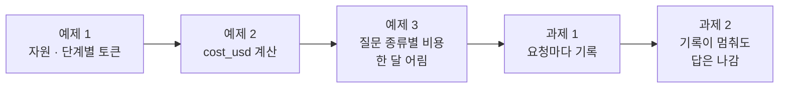
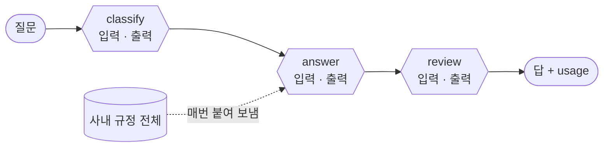
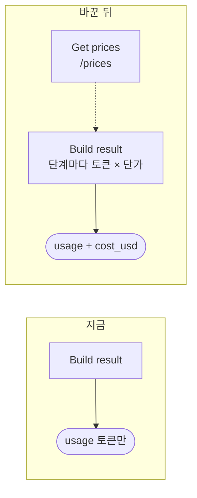
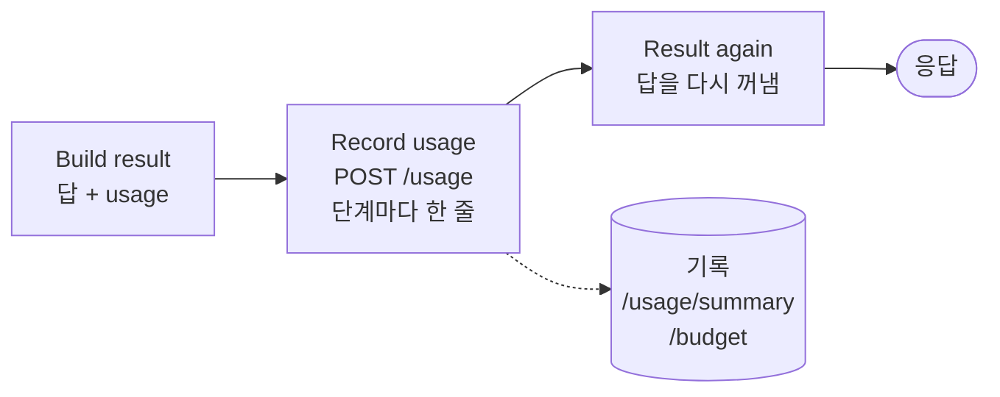
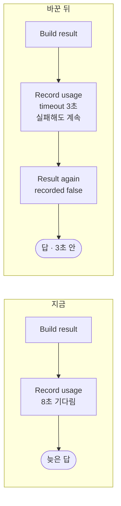

# Lab 01 · 자원과 토큰을 재고, 비용을 계산하고, 기록하기

- 관련 강의: [1단계 · 사용량 재기](../../Lecture/75/01-STAGE1-MEASURE-USAGE.md)
- 소요 시간: 50분 (2교시 한 시간) · 예제 1 10분 · 예제 2 12분 · 예제 3 8분 · 과제 1 10분 · 과제 2 10분
- 준비: [실습 준비](../../Lecture/75/00-DAY75-PREP.md)의 `doctor` → `ready`, `base-cost` 게시
- 목표: 질문 하나가 쓰는 **자원 · 토큰 · 돈**을 단계별로 재고, 단가표로 비용을 계산해 결과에 남기고, 질문 종류마다 비용을 비교해 한 달을 어림하고, 요청마다 기록해 합계를 본다. 기록이 멈춰도 답은 나가게 한다.



> 복사해 붙일 요청문은 없습니다. 막히면 `▶` 를 하나씩 펼칩니다. 오늘은 호출마다 실제로 돈이 듭니다 (질문 하나에 약 $0.001 이하). 같은 테스트를 수십 번 반복하지 않습니다.

## 시작하기 · 터미널 두 개

| 터미널 | 하는 일 |
| --- | --- |
| ① 에이전트 | `cd ~/aio-01d4-stu/Last3Mon/75` 후 `codex` (또는 `claude`, `agy`). 내가 쓴 요청문을 보낸다 |
| ② 확인 | `cd ~/aio-01d4-stu/Last3Mon/75` 에서 `call` · `push` · `test` · `usage`를 **내가** 실행한다 |

`cp templates/COST-PLAN-TEMPLATE.md my-work/COST.md` 후 표를 채워 갑니다. 쓴 요청문은 `my-work/PROMPTS.md`에 모읍니다.

## 예제 1 · 자원과 단계별 토큰 (10분, 에이전트 없이)

오늘 고칠 헬프데스크 `base-cost`는 질문마다 LLM을 세 번(분류 · 답 · 검토) 부릅니다. 먼저 무엇이 얼마나 드는지 봅니다.

```bash
docker stats --no-stream                                   # 컨테이너마다 CPU · 메모리
uv run tools/flow.py call base-cost requests/faq-vpn.json
uv run tools/flow.py call base-cost requests/ticket-own.json
curl -s localhost:8800/prices                              # 1M 토큰당 달러
```

`COST.md` 1 · 2절을 채웁니다. `usage.by_step`에서 입력 토큰이 가장 많은 단계는? 그 단계가 무엇을 보내는지 n8n 화면에서 `Answer` 노드를 열어 봅니다.

### 이해하기

**"비용"에는 세 가지가 있습니다.**

| 무엇 | 어디서 드나 | 오늘 재는 방법 |
| --- | --- | --- |
| 컴퓨팅 자원 | 내 컴퓨터(서버)의 CPU · 메모리 · 디스크 | `docker stats` |
| API 사용량 | LLM 공급자에게 보낸 · 받은 **토큰** | 응답의 `usage` (`prompt_tokens` · `completion_tokens`) |
| 돈 | 토큰 × 단가 | `/prices`의 단가로 계산 (예제 2) |

LLM은 OpenAI 서버에서 계산합니다. 그래서 질문을 보내는 동안에도 내 노트북의 CPU는 거의 오르지 않습니다. 내 쪽 자원에서 눈여겨볼 것은 n8n의 **메모리**입니다. 실행 기록이 쌓이면 늘어납니다. 반대로 돈은 거의 전부 **토큰**에서 나옵니다.

**토큰은 LLM이 글을 세는 단위입니다.** 글자도 낱말도 아니고, 모델이 글을 잘게 나눈 조각입니다. 영어는 대략 낱말 하나가 토큰 1~2개, 한국어는 글자 1~2개가 토큰 하나쯤입니다. 공급자는 **보낸 토큰(입력, `prompt_tokens`)**과 **받은 토큰(출력, `completion_tokens`)**을 따로 세고, 값도 따로 매깁니다.



**무엇을 보나.** `usage.by_step`은 단계마다 입력 · 출력 토큰입니다. 세 단계 중 **한 단계의 입력**이 전체의 대부분이라면, 줄일 곳이 그곳입니다 (Lab 02 예제 1). VPN 질문과 접수 질문의 입력이 비슷하다면, 질문과 관계없이 **매번 같이 보내는 것**이 있다는 뜻입니다.

**기대 결과.** 세 단계 중 `answer`의 입력이 가장 많고, 질문 종류가 달라도 입력 토큰이 비슷합니다. `COST.md` 2절에 VPN 질문의 단계별 토큰을 적습니다.

<details><summary>▶ 1단계 · 자원은 무엇을 보나</summary>

질문을 보내기 전과 보낸 직후에 `docker stats --no-stream`을 한 번씩 봅니다. CPU는 오르나요? n8n의 메모리는 몇 MiB인가요? 실행 기록이 수만 건 쌓이면 무엇이 늘까요?
</details>

<details><summary>▶ 2단계 · 계산해 보기</summary>

단가는 **1M(1,000,000) 토큰당** 달러입니다. VPN 질문의 입력 · 출력 토큰 합을 `gpt-4.1-mini` 단가로 계산하면? 하루 1,000개 · 한 달 22일이면? (손으로 한 번 해 보면 예제 2의 식이 보입니다)
</details>

### 실행 결과 · 자원과 단계별 토큰

수업 준비 때(10/28) 강사 노트북에서 정답 워크플로우로 실제로 나온 출력입니다. LLM 문장 · 토큰 · 비용 · 시간은 실행마다 조금씩 다르고, ✔ · ✘는 같아야 합니다.

`docker stats --no-stream` (질문을 보내는 동안)

```text
NAME                    CPU %     MEM USAGE / LIMIT
day67-data-data-api-1   0.02%     20.3MiB / 7.818GiB
day65-n8n-runners-1     0.21%     100.5MiB / 7.818GiB
day65-n8n-n8n-1         0.27%     642.6MiB / 7.818GiB
```

`call base-cost requests/faq-vpn.json` (줄임)

```text
HTTP 200 · 4.3s
  "llm_calls": 3,
  "usage": {
    "prompt_tokens": 1999,
    "completion_tokens": 150,
    "by_step": {
      "classify": { "model": "gpt-4.1-mini", "prompt_tokens": 78,   "completion_tokens": 6 },
      "answer":   { "model": "gpt-4.1-mini", "prompt_tokens": 1781, "completion_tokens": 78 },
      "review":   { "model": "gpt-4.1-mini", "prompt_tokens": 140,  "completion_tokens": 66 }
    }
  }
```

`call base-cost requests/ticket-own.json` (줄임)

```text
HTTP 200 · 3.3s
  "usage": { "prompt_tokens": 1973, "completion_tokens": 97,
    "by_step": { "classify": { … 71 … }, "answer": { … 1791 … }, "review": { … 111 … } } }
```

**왜 이렇게 나왔나**

- CPU가 1%도 오르지 않은 것은 LLM 계산이 **OpenAI 서버에서** 일어나기 때문입니다. 내 노트북은 요청을 보내고 기다리기만 합니다. 메모리는 n8n이 가장 많이 씁니다 (실행 기록이 쌓이면 늘어남).
- VPN 질문 입력 1,999토큰 중 **1,781(89%)이 `answer` 단계 하나**입니다. 접수 질문도 `answer`가 1,791로 거의 같습니다. 질문이 무엇이든 `Answer`가 지시문 뒤에 사내 규정 전체를 매번 붙여 보내기 때문입니다.
- 결과에 `cost_usd`가 없습니다. 토큰만 알려 주고 얼마인지는 계산하지 않는 워크플로우라서입니다 (예제 2에서 더함). 손 계산: (1,999 × 0.40 + 150 × 1.60) ÷ 1,000,000 = $0.00104.

## 예제 2 · 결과에 비용 남기기 (12분)

**만들 것**: 기준을 복사해, 단계마다 비용을 계산하고 합(`cost_usd`)을 결과에. 단가는 `/prices`에서.

```bash
cp reference/baseline-cost.json my-work/cost.json
```

| 조건 | 값 |
| --- | --- |
| 파일 · 웹훅 | `my-work/cost.json` · `my-cost` (경로 · 이름을 바꿈) |
| 단가 | `GET http://data-api:8800/prices` (워크플로우에 숫자를 쓰지 않음) |
| 계산 | [AGENTS.md](AGENTS.md) 3절 `cost_usd` 식, 단계별 `usage.by_step.<단계>.cost_usd` |
| 기대 결과 | `cases/lab01.json` |

### 이해하기

**지금 무엇이 문제인가.** `base-cost`는 토큰은 알려 주지만 **얼마인지**는 말하지 않습니다. 사람이 매번 단가표를 보고 곱해야 합니다. 결과에 `cost_usd`가 있으면 테스트가 "질문 하나에 $0.0002 이하"처럼 **비용을 기대 결과로** 확인할 수 있고 (Lab 02 과제), 기록하면 하루 합계와 예산도 셀 수 있습니다 (과제 1, Lab 03).



**식은 하나입니다.**

```text
단계 비용 = (입력 토큰 × input 단가 + 출력 토큰 × output 단가) ÷ 1,000,000
cost_usd  = 단계 비용의 합 (소수 8자리에서 반올림)
```

**단가는 밖에서 읽습니다.** 단가를 Code에 숫자로 쓰면 가격이 바뀔 때마다 워크플로우를 고쳐야 하고, 고치는 것을 잊으면 비용 숫자가 조용히 틀립니다. 70일차 설정 표, 74일차 지시문 저장소와 같은 생각: **바뀌는 값은 한 곳(밖)에 두고 읽는다.** 오늘 단가는 `data-api/data/prices.json`에 있고 사람이 가격표를 보고 정합니다.

**단계마다 그 단계의 모델 단가로.** 지금은 세 단계가 모두 `gpt-4.1-mini`지만 Lab 02 예제 2에서 일부가 `gpt-5.4-nano`로 바뀝니다. 그때 고치지 않아도 되게, 처음부터 **단계의 모델 이름으로 단가를 찾게** 만듭니다.

**테스트 케이스.**

| 케이스 | 보내는 것 | 기대 |
| --- | --- | --- |
| VPN · 비용과 단계별 사용량 | VPN 질문 | `cost_usd` · `usage.by_step.answer.cost_usd`가 0보다 크고 $0.01 이하, "인증서" |
| 접수 현황 · 비용 | T-1002 (박서연) | `cost_usd` 범위, "처리 중" |
| 빈 질문은 LLM 없이 | `question: ""` | 400 (그대로) |

**`range`**: 테스트 파일의 `"range": {"cost_usd": [0.000001, 0.01]}`는 숫자가 그 사이에 있는지 봅니다 (AGENTS.md 8절). 테스트 줄 끝에 `· 3 calls · $0.00…`이 나오면 결과에 `llm_calls` · `cost_usd`가 있다는 뜻입니다.

**기대 결과.** `lab01` 3/3. `call my-cost`의 `cost_usd`가 예제 1에서 손으로 계산한 값과 같습니다.

<details><summary>▶ 1단계 · 단가는 어디서</summary>

`curl -s localhost:8800/prices`의 모양을 봅니다. `models` 안에 모델 이름마다 `input` · `output`. n8n에서는 앞에 HTTP 노드를 하나 두고, 계산하는 Code가 `$('그 노드').first().json.models`를 읽습니다.
</details>

<details><summary>▶ 2단계 · 단계마다 다른 모델</summary>

`Build result`에는 단계 목록(`steps`: classify · answer · review와 각 모델 이름)이 이미 있습니다. 그 모델 이름으로 단가를 찾아 단계마다 계산하게 요청합니다.
</details>

<details><summary>▶ 빈칸 채우기 · 요청문(프롬프트) 뼈대</summary>

요청문에 꼭 들어갈 것: **① 파일 · 웹훅 경로 ② 단가를 읽는 노드와 주소 ③ 계산식과 단위 ④ 결과 칸 이름 ⑤ 반올림 ⑥ 기대 결과**. 아래 빈칸 4개(`____①`~`____④`)를 채워 `my-work/PROMPTS.md`에 쓴 뒤 에이전트에게 보냅니다.

```text
my-work/cost.json (baseline 을 복사한 것) 의 웹훅 경로를 ____① 로, 이름을 "75 IT helpdesk (my)" 로 바꿔 줘.
Has question? 뒤에 Get prices(HTTP GET http://data-api:8800/ ____② ) 를 넣어 줘.
Build result 에서 단계마다 cost_usd = (prompt_tokens × input + completion_tokens × output) ÷ ____③ 를
그 단계 model 의 단가로 계산해 usage.by_step.<단계>.cost_usd 에, 합을 cost_usd 에 넣어 줘. 소수 ____④ 자리에서 반올림.
기대 결과 cases/lab01.json.
```

빈칸 힌트 (답이 아니라 **어디서 찾고 무엇을 생각하나**):

- ① `cases/lab01.json`의 맨 위 `webhook` 값입니다 (AGENTS.md 3절 표에도).
- ② AGENTS.md 2절 데이터 API 표에서 단가를 주는 주소입니다.
- ③ 단가의 단위(`unit`)를 봅니다. "1M 토큰당"을 숫자로.
- ④ AGENTS.md 3절 `cost_usd` 설명의 반올림 자리입니다.

채운 요청문은 수업 뒤 공개되는 정답본의 요청문 예와 비교합니다. 노드 이름은 내 파일의 실제 이름을 씁니다.
</details>

```bash
uv run tools/flow.py push my-work/cost.json
uv run tools/flow.py test cases/lab01.json -v
uv run tools/flow.py call my-cost requests/faq-vpn.json
```

### 실행 결과 · 결과에 비용 남기기

수업 준비 때(10/28) 강사 노트북에서 정답 워크플로우로 실제로 나온 출력입니다. LLM 문장 · 토큰 · 비용 · 시간은 실행마다 조금씩 다르고, ✔ · ✘는 같아야 합니다.

고친 뒤 (`test cases/lab01.json -v`, 결과 줄만)

```text
✔ VPN · 비용과 단계별 사용량 · 5.1s · 자동 답변 · 3 calls · $0.001040
✔ 접수 현황 · 비용 · 3.3s · 자동 답변 · 3 calls · $0.000946
✔ 빈 질문은 LLM 없이 · 0.0s
Passed 3/3
```

**왜 이렇게 나왔나**

- 줄 끝에 `· 3 calls · $0.001040`이 나온 것은 결과에 `llm_calls` · `cost_usd`가 생겼기 때문입니다 (`flow.py`가 두 칸이 있으면 보여 줌).
- VPN $0.001040은 예제 1의 손 계산 $0.00104와 같습니다. `Get prices`의 단가로 단계마다 계산해 더했기 때문입니다.
- 빈 질문은 `Has question?`에서 400으로 끝나 LLM을 부르지 않으므로 비용 표시가 없습니다.
- 고치기 전(`base-cost`를 복사한 그대로)에는 웹훅 `my-cost`가 아직 없으므로 404입니다. 경로를 바꾸고 push해야 테스트가 시작됩니다.

## 예제 3 · 질문 종류별 비용, 한 달 어림 (8분, 에이전트 없이)

팀장이 묻습니다. "전 직원이 쓰면 한 달에 얼마예요?" 질문 하나의 비용은 알았습니다. 그런데 질문마다 비용이 같을까요?

```bash
uv run tools/flow.py test cases/lab01-mix.json        # 일곱 질문, 줄마다 호출 수 · 비용
```

`COST.md` 3절을 채웁니다. 종류별 평균과 하루 비중(FAQ 60% · 접수 30% · 그 밖 10%, 연습용 가정)으로 한 달을 어림합니다.

### 이해하기

**한 달 비용 = 질문 하나의 비용 × 하루 질문 수 × 일하는 날.** 식은 간단하지만 "질문 하나의 비용"을 무엇으로 잡느냐에 따라 답이 크게 달라집니다. VPN 하나만 재서 곱하면, 더 싸거나 비싼 질문이 섞일 때 틀립니다.

**종류별로 재고, 비중으로 섞습니다 (가중 평균).**

```text
한 달 ≈ (FAQ 평균 × 0.6 + 접수 평균 × 0.3 + 그 밖 평균 × 0.1) × 1,000 × 22
```

비중은 실제로는 지난 기록에서 셉니다 (과제 1의 기록, 77일차 로그 분석). 오늘은 기록이 아직 없으니 가정한 값을 씁니다.

**무엇을 보나.**

| 볼 것 | 질문 |
| --- | --- |
| 일곱 질문의 비용 차이 | 크게 다른가, 비슷한가? 비슷하다면 왜? (예제 1의 "매번 같이 보내는 것") |
| 호출 수 | 일곱 질문 모두 3번인가? 질문이 쉬워도 3번인가? |
| 가장 싼 질문과 비싼 질문 | 무엇이 차이를 만드나 (출력 길이? FAQ 개수?) |

**고정비와 변동비.** 질문과 관계없이 매번 드는 몫(같이 보내는 긴 글, 늘 부르는 단계)을 **고정비**, 질문에 따라 달라지는 몫(질문 · FAQ · 답의 길이)을 **변동비**라고 생각해 봅니다. 고정비가 크면 질문 종류가 달라도 비용이 비슷하고, 줄일 때도 **고정비부터** 줄이는 것이 효과가 큽니다 (Lab 02).

**기대 결과.** 7/7 (이 파일은 비용을 보여 주기만 하고 기대는 HTTP 200뿐). 일곱 질문 모두 3 calls, 비용이 서로 비슷합니다. `COST.md` 3절에 종류별 평균과 한 달 어림 두 가지(가중 · 단순 평균)를 적습니다.

<details><summary>▶ 1단계 · 왜 다 비슷한가</summary>

예제 1에서 `answer` 단계의 입력 토큰이 VPN 질문과 접수 질문에서 거의 같았습니다. 질문이 몇 글자든 같이 보내는 것이 있다면, 비용의 대부분은 질문과 관계없이 정해집니다.
</details>

<details><summary>▶ 2단계 · 어림을 믿을 수 있나</summary>

LLM 답의 길이는 실행마다 조금씩 다릅니다. 같은 파일을 한 번 더 돌리면 비용이 똑같이 나올까요? 어림은 "대략 이 정도"를 정하는 것이고, 실제 숫자는 기록(과제 1)과 보고서(Lab 03 과제)로 다시 봅니다.
</details>

### 실행 결과 · 질문 종류별 비용

수업 준비 때(10/28) 강사 노트북에서 정답 워크플로우로 실제로 나온 출력입니다. LLM 문장 · 토큰 · 비용 · 시간은 실행마다 조금씩 다르고, ✔ · ✘는 같아야 합니다.

`test cases/lab01-mix.json` (예제 2 정답)

```text
✔ FAQ · VPN · 3.2s · 자동 답변 · 3 calls · $0.001040
✔ FAQ · 프린터 · 3.9s · 자동 답변 · 3 calls · $0.000960
✔ FAQ · 비밀번호 · 3.5s · 자동 답변 · 3 calls · $0.000953
✔ FAQ · 메일 · 3.4s · 자동 답변 · 3 calls · $0.000965
✔ 접수 · T-1002 · 3.0s · 자동 답변 · 3 calls · $0.000946
✔ 접수 · T-1001 · 3.2s · 자동 답변 · 3 calls · $0.000890
✔ 규칙에 없는 질문 · 2.6s · 자동 답변 · 3 calls · $0.000830
Passed 7/7
```

**왜 이렇게 나왔나**

- 일곱 질문이 **$0.00083 ~ 0.00104로 비슷합니다.** 질문마다 다른 몫(질문 · FAQ · 답의 길이)보다 매번 같은 몫(규정 전체 약 1,600토큰)이 훨씬 크기 때문입니다 — 고정비.
- 모두 3 calls입니다. 쉬운 질문도 분류 · 답 · 검토를 다 거치기 때문입니다 (Lab 02 과제 1에서 줄임).
- 가장 싼 질문(회의실, $0.000830)은 FAQ 검색에 걸린 것이 없어 FAQ 글을 덜 보냈고 답도 짧았습니다.
- 종류별 평균: FAQ $0.000980 · 접수 $0.000918 · 그 밖 $0.000830. 비중 60 · 30 · 10%면 $0.000946 × 1,000 × 22 ≈ **$20.8**, 단순 평균 ≈ $20.7. 고정비가 커서 두 어림이 거의 같습니다.

## 과제 1 · 요청마다 기록하고 합계 보기 (10분)

> "한 번 물을 때 얼마인지는 알겠는데, 오늘 전체로 얼마 썼는지, 누가 많이 쓰는지 알고 싶어요."

```bash
uv run tools/flow.py test cases/lab01-challenge.json -v        # 고치기 전
```

**만들 것**: 답을 만든 뒤 데이터 API `POST /usage`에 LLM 호출 하나당 한 줄을 남기기. 응답은 그대로.

| 조건 | 값 |
| --- | --- |
| 기록 | `Build result` 뒤 `Record usage`, `usage.by_step`의 단계마다 한 줄 (같은 요청은 같은 `request_id`) |
| 한 줄 | `{request_id, user, step, model, prompt_tokens, completion_tokens, cost_usd, route}` (AGENTS.md 2절) |
| 응답 | 기록 뒤에도 `Build result`의 결과 그대로 |
| 기대 결과 | `cases/lab01-challenge.json` (요청 3개 뒤 `/usage/summary`의 `requests`가 3) |

### 이해하기

**답에 남긴 비용은 그 사람만 봅니다.** 예제 2의 `cost_usd`는 질문한 사람의 화면에만 있습니다. 오늘 전체 합계, 사람별 · 모델별 합계, 그리고 Lab 03의 **하루 예산 · 사용자별 한도**는 모두 **어딘가에 쌓인 기록**이 있어야 셀 수 있습니다. 기록이 없으면 예산도 없습니다.



**요청 수와 호출 수는 다릅니다.** 질문 하나에 LLM을 세 번 부르면 기록은 세 줄입니다. 이 세 줄이 **한 요청**이라는 것을 알리려고 같은 `request_id`를 붙입니다. n8n에는 실행마다 번호가 있습니다 (AGENTS.md 5절). `/usage/summary`는 `request_id`가 다른 것만 세어 `requests`, 줄 수를 `calls`로 줍니다.

| 요약 칸 | 질문 3개 · 각 3단계일 때 |
| --- | --- |
| `requests` | 3 |
| `calls` | 9 |
| `by_user` | 사람마다 호출 수 · 토큰 · 비용 |
| `by_model` | 모델마다 |

**기록 뒤에 답을 다시 꺼내는 까닭.** n8n은 앞 노드의 출력이 다음 노드의 입력이 됩니다. `Record usage`(HTTP)를 지나면 `$json`은 기록 API의 응답(`{"stored": 3}`)이 됩니다. 그래서 응답하기 전에 `Build result`의 결과를 다시 꺼냅니다.

**테스트 케이스.**

| 케이스 | 보내는 것 | 기대 |
| --- | --- | --- |
| 기록 1 · VPN | 이준호 | "인증서" |
| 기록 2 · 접수 | 박서연 | "처리 중" |
| 기록 3 · 다른 사람 | 한지훈 · 비밀번호 | "비밀번호 찾기" |
| 사용량 요약 · 요청 3건 | 웹훅이 아니라 `/usage/summary` (`url`) | `requests` 3, 세 사람, `gpt-4.1-mini` |

테스트 파일의 `before`가 기록을 먼저 비웁니다 (`/usage-clear`). 케이스에 `url`이 있으면 웹훅 대신 그 주소를 부릅니다 (AGENTS.md 8절).

**기대 결과.** 고치기 전: 답 세 개는 ✔, 요약은 ✘ (`requests` 0). 고친 뒤 4/4. `flow.py usage`로 사람별 비용을 봅니다.

<details><summary>▶ 1단계 · 한 요청을 묶는 번호</summary>

AGENTS.md 5절 "사용량 기록"에 이번 실행의 번호를 읽는 표현식이 있습니다. 호출 세 줄에 같은 번호를 쓰면 한 요청으로 묶입니다. 요약의 `requests`가 9로 나오면 무엇이 잘못됐을까요?
</details>

<details><summary>▶ 2단계 · 기록 응답이 오류면</summary>

기록 API가 400 · 500을 돌려주면 HTTP 노드는 보통 실패하고, 워크플로우가 멈춥니다. 오류 응답도 성공 쪽으로 받는 옵션이 있습니다 (AGENTS.md 5절, 74일차 Lab 02 과제 2). 기록이 아예 멈추는 경우는 과제 2에서 다룹니다.
</details>

<details><summary>▶ 빈칸 채우기 · 요청문(프롬프트) 뼈대</summary>

요청문에 꼭 들어갈 것: **① 넣을 노드와 주소 ② 한 줄의 칸 ③ 한 요청을 묶는 번호 ④ 누가 물었나 ⑤ 응답을 다시 꺼내는 곳 ⑥ 기대 결과**. 아래 빈칸 4개(`____①`~`____④`)를 채워 `my-work/PROMPTS.md`에 쓴 뒤 에이전트에게 보냅니다.

```text
my-work/cost.json 의 Build result 뒤에 Record usage(HTTP POST http://data-api:8800/usage) 를 넣어 줘.
본문은 items: usage.by_step 의 단계마다 한 줄 {request_id, user, step, model, prompt_tokens, completion_tokens, cost_usd, route}.
request_id 는 ____① , user 는 웹훅 본문의 ____② .
기록 응답이 오류여도 멈추지 않게 options.response 에 ____③ , 그다음 Result again(Code) 이 ____④ 의 결과를 다시 꺼내 Send result 로.
기대 결과 cases/lab01-challenge.json.
```

빈칸 힌트 (답이 아니라 **어디서 찾고 무엇을 생각하나**):

- ① n8n이 실행마다 주는 번호를 읽는 표현식입니다 (AGENTS.md 5절 "사용량 기록").
- ② 요청 본문에서 사람 이름이 들어 있는 칸입니다 (`requests/faq-vpn.json`을 열어 봅니다).
- ③ 404 · 500 같은 응답도 실패로 보지 않게 하는 HTTP 노드 옵션입니다 (74일차 Lab 02 과제 2와 같은 이름).
- ④ 사용자에게 보낼 답을 만든 노드입니다.

채운 요청문은 수업 뒤 공개되는 정답본의 요청문 예와 비교합니다. 노드 이름은 내 파일의 실제 이름을 씁니다.
</details>

```bash
uv run tools/flow.py push my-work/cost.json
uv run tools/flow.py test cases/lab01-challenge.json -v
uv run tools/flow.py usage
```

### 실행 결과 · 요청마다 기록

수업 준비 때(10/28) 강사 노트북에서 정답 워크플로우로 실제로 나온 출력입니다. LLM 문장 · 토큰 · 비용 · 시간은 실행마다 조금씩 다르고, ✔ · ✘는 같아야 합니다.

고치기 전 (예제 2 정답, `test cases/lab01-challenge.json -v`)

```text
✔ 기록 1 · VPN · 3.5s · 자동 답변 · 3 calls · $0.001040
✔ 기록 2 · 접수 · 3.0s · 자동 답변 · 3 calls · $0.000946
✔ 기록 3 · 다른 사람 · 3.4s · 자동 답변 · 3 calls · $0.000955
✘ 사용량 요약 · 요청 3건 · 0.0s · $0.000000 · requests = 0 (expected 3); cost_usd = 0.0 (expected 1e-06..0.05); by_user has none of ['이준호', '박서연', '한지훈']; by_model has none of ['gpt-4.1-mini']
Passed 3/4
```

고친 뒤 (`test … -v` 결과 줄, `flow.py usage`)

```text
✔ 기록 1 · VPN · 5.0s · 자동 답변 · 3 calls · $0.001040
✔ 기록 2 · 접수 · 3.5s · 자동 답변 · 3 calls · $0.000959
✔ 기록 3 · 다른 사람 · 3.4s · 자동 답변 · 3 calls · $0.000953
✔ 사용량 요약 · 요청 3건 · 0.0s · $0.002951
Passed 4/4

requests 3 · calls 9 · tokens in 5950 / out 357 · $0.002951
  model  gpt-4.1-mini      9 calls · in    5950 · out    357 · $0.002951
  user   이준호               3 calls · in    1999 · out    150 · $0.001040
  user   박서연               3 calls · in    1973 · out    106 · $0.000959
  user   한지훈               3 calls · in    1978 · out    101 · $0.000953
  route  자동 답변             9 calls · in    5950 · out    357 · $0.002951
budget $1.0 / used $0.002951 · remaining $0.997049 · over False · per user 20/min · question 500 chars
```

**왜 이렇게 나왔나**

- 고치기 전에도 답 세 개는 ✔입니다. 답 · 비용은 예제 2 그대로 맞기 때문입니다. 요약만 ✘(`requests = 0`)인 것은 **아무 데도 기록하지 않아** 데이터 API가 모르기 때문입니다.
- 고친 뒤 `requests 3 · calls 9`: 질문 3개 × 단계 3개 = 9줄이 기록됐고, 같은 요청의 세 줄이 같은 번호로 묶여 요청은 3입니다. 번호가 줄마다 다르면 `requests`가 9로 나옵니다.
- `budget`의 `used $0.002951`은 기록된 `cost_usd`의 합입니다. 기록이 쌓여야 Lab 03의 예산 · 한도가 셀 수 있습니다.

## 과제 2 · 기록이 멈춰도 답은 나가게 (10분)

> "기록 서버를 점검하느라 껐더니 헬프데스크가 한참 멈췄다가 답했대요. 기록 때문에 직원이 기다리면 안 돼요. 대신 기록이 빠진 답은 나중에 셀 수 있게 표시해 주세요."

먼저 겪어 봅니다.

```bash
uv run tools/flow.py fault usage slow                              # 기록 API가 8초 늦게 답함
uv run tools/flow.py call my-cost requests/faq-vpn.json -v         # 몇 초 걸리나
uv run tools/flow.py fault usage ok                                # 반드시 되돌리기
uv run tools/flow.py test cases/lab01-challenge2.json -v           # 고치기 전 (케이스마다 고장을 켜고 끔)
```

**만들 것**: 기록 API가 **오류를 내거나 3초 안에 답하지 않아도** 답은 그대로 보내고, 기록됐는지를 `recorded: true|false`로.

| 조건 | 값 |
| --- | --- |
| 기다리는 한도 | `Record usage` timeout 3초 |
| 실패하면 | 멈추지 않고 같은 출력으로 다음 노드 (`Result again`) |
| 결과 | 과제 1 결과 + `recorded` (기록 응답의 `stored`가 1 이상이면 true) |
| 기대 결과 | `cases/lab01-challenge2.json` 4개, `lab01-challenge`도 그대로 |

### 이해하기

**기록은 답을 위한 것이 아닙니다.** 사용자에게 중요한 것은 답이고, 기록은 운영하는 쪽의 일입니다. 그런데 과제 1의 워크플로우는 기록이 끝나야 답을 보냅니다. 기록 API가 느리면 사용자가 그만큼 기다리고, 아예 멈추면 답도 못 받을 수 있습니다. **부가 기능이 본 기능을 막지 않게** 합니다.



**계속 가되, 표시를 남깁니다.** 74일차 지시문 저장소처럼 여기도 **계속 가는 쪽(fail-open)**입니다. 다만 값이 있습니다. 기록되지 않은 요청은 Lab 03의 하루 예산 · 사용자별 한도에 **세어지지 않습니다.** 예산이 실제보다 적게 쓴 것처럼 보입니다. 그래서 `recorded: false`를 답에 남겨, 나중에 몇 건이 빠졌는지 셀 수 있게 합니다.

| | 73일차 판별 LLM | 74일차 지시문 저장소 | 오늘 사용량 기록 |
| --- | --- | --- | --- |
| 멈추면 | 막는다 | 기본 지시문으로 답 | 답은 그대로, 기록만 빠짐 |
| 남기는 표시 | `guard_down` | `prompt_source: fallback` | `recorded: false` |
| 치르는 값 | 사용자가 기다림 | 지시문이 최신이 아닐 수 있음 | 예산 · 한도가 덜 셈 |

**오류 출력이 두 갈래가 아니어도 됩니다.** 74일차는 실패하면 **다른 길**(기본 지시문)로 가야 해서 오류 출력을 따로 이었습니다 (`continueErrorOutput`). 오늘은 실패해도 **같은 길**(답을 다시 꺼내 보냄)로 가면 되므로, 실패한 항목을 같은 출력으로 흘려보내는 설정을 씁니다. 그 항목에는 `stored`가 없으니 `recorded`가 false가 됩니다.

**테스트 케이스.**

| 케이스 | 고장 | 기대 |
| --- | --- | --- |
| 기록 API 고장(500) · 답은 나감 | `usage error` | `recorded: false`, "인증서" |
| 기록 API 느림(8초) · 답은 나감 | `usage slow` | `recorded: false`, "대기열", 15초 안 |
| 고친 뒤 · 기록됨 | 없음 | `recorded: true`, "비밀번호 찾기" |
| 요약 · 기록된 요청은 1건 | `/usage/summary` | `requests` 1 (고장 난 두 건은 빠짐) |

**기대 결과.** 고치기 전에는 `recorded`가 없어 세 케이스가 ✘, 느림 케이스는 시간도 오래 걸립니다. 고친 뒤 4/4. 마지막 케이스가 "기록이 빠지면 예산에서도 빠진다"를 숫자로 보여 줍니다.

<details><summary>▶ 1단계 · 어디서 기다리나</summary>

`fault usage slow` 상태의 `call -v`에서 걸린 시간을 봅니다. LLM 세 번에 몇 초, 나머지 몇 초는 어디서? n8n 화면의 Executions에서 노드마다 걸린 시간을 봅니다.
</details>

<details><summary>▶ 2단계 · 실패해도 같은 길로</summary>

n8n 노드의 Settings에 "On Error" 설정이 있습니다. 72 · 73 · 74일차에 쓴 두 갈래 값과 다른, **같은 출력으로 계속**하는 값입니다 (AGENTS.md에는 없으니 n8n 화면의 Settings에서 이름을 찾아 봅니다).
</details>

<details><summary>▶ 빈칸 채우기 · 요청문(프롬프트) 뼈대</summary>

요청문에 꼭 들어갈 것: **① 고칠 노드와 기다리는 한도 ② 실패했을 때의 설정 ③ `recorded`를 정하는 값 ④ 그대로 둘 것 ⑤ 기대 결과**. 아래 빈칸 4개(`____①`~`____④`)를 채워 `my-work/PROMPTS.md`에 쓴 뒤 에이전트에게 보냅니다.

```text
my-work/cost.json 의 Record usage 에 options.timeout ____① 과 onError ____② 를 넣어 줘.
Result again 은 Build result 의 결과에 recorded 를 더해: 기록 응답의 ____③ 가 1 이상이면 true, 아니면 false.
기록이 실패해도 사용자에게 가는 answer · cost_usd 는 ____④ .
기대 결과 cases/lab01-challenge2.json, cases/lab01-challenge.json.
```

빈칸 힌트 (답이 아니라 **어디서 찾고 무엇을 생각하나**):

- ① 단위는 ms입니다. 위 조건 표의 "3초".
- ② n8n Settings의 On Error 값 중 "같은 출력으로 계속"하는 것의 JSON 이름입니다 (`continue`로 시작).
- ③ 기록 API가 성공하면 돌려주는 칸입니다 (`curl -s -XPOST localhost:8800/usage -d '{}'`로 모양을 봅니다).
- ④ 이 과제에서 바뀌면 안 되는 것입니다.

채운 요청문은 수업 뒤 공개되는 정답본의 요청문 예와 비교합니다. 노드 이름은 내 파일의 실제 이름을 씁니다.
</details>

```bash
uv run tools/flow.py push my-work/cost.json
uv run tools/flow.py test cases/lab01-challenge2.json -v
uv run tools/flow.py test cases/lab01-challenge.json -v
uv run tools/flow.py doctor                                   # fault switch가 모두 ok인지
```

### 실행 결과 · 기록이 멈춰도 답은 나가게

수업 준비 때(10/28) 강사 노트북에서 정답 워크플로우로 실제로 나온 출력입니다. LLM 문장 · 토큰 · 비용 · 시간은 실행마다 조금씩 다르고, ✔ · ✘는 같아야 합니다.

고치기 전 (과제 1 정답, `test cases/lab01-challenge2.json -v` 결과 줄)

```text
✘ 기록 API 고장(500) · 답은 나감 · 3.4s · 자동 답변 · 3 calls · $0.001040 · recorded = null (expected false)
✘ 기록 API 느림(8초) · 답은 나감 · 11.2s · 자동 답변 · 3 calls · $0.000962 · recorded = null (expected false)
✘ 고친 뒤 · 기록됨 · 3.5s · 자동 답변 · 3 calls · $0.000953 · recorded = null (expected true)
✔ 요약 · 기록된 요청은 1건 · 0.0s · $0.000953
Passed 1/4
```

고친 뒤

```text
✔ 기록 API 고장(500) · 답은 나감 · 4.4s · 자동 답변 · 3 calls · $0.001040
✔ 기록 API 느림(8초) · 답은 나감 · 6.1s · 자동 답변 · 3 calls · $0.000960
✔ 고친 뒤 · 기록됨 · 3.7s · 자동 답변 · 3 calls · $0.000955
✔ 요약 · 기록된 요청은 1건 · 0.0s · $0.000955
Passed 4/4
```

**왜 이렇게 나왔나**

- 고치기 전 고장(500) 케이스도 답은 나왔습니다. 과제 1에서 기록 응답이 오류여도 받아 넘기게 했기 때문입니다. ✘는 `recorded` 칸이 아직 없어서입니다.
- 고치기 전 느림 케이스가 **11.2초**: LLM 세 번(약 3초) 뒤 기록 API의 8초를 끝까지 기다렸습니다. 고친 뒤 **6.1초**는 3초에 기다리기를 그만두고 답을 보냈기 때문입니다.
- 요약 `requests` 1은 고치기 전 · 후 모두 같습니다. 고장 · 느림 두 건은 기록 서버가 저장하지 않았고, 정상인 한 건만 남았습니다. 기록이 빠진 만큼 예산에서도 빠진다는 것을 이 숫자가 보여 줍니다.
- 수업 준비 때 처음에는 느림 모드의 서버가 8초 뒤 **결국 저장**해 다음 테스트의 요청 수가 하나 많았습니다 (1단계 강의 8절). 지금 데이터 API는 늦게 답하고 저장하지 않습니다.

## 막혔을 때

| 증상 | 할 일 |
| --- | --- |
| `usage`가 비어 있음 | LLM 노드가 AI Agent면 토큰이 없습니다. HTTP로 OpenAI를 부르는지 (AGENTS.md 5절) |
| `cost_usd`가 너무 큼 (예: 1040) | 1,000,000으로 나눴는지 |
| `cost_usd`가 0 | 단계의 모델 이름과 `/prices`의 모델 이름이 같은지 |
| OpenAI 400 `max_tokens` | `gpt-5.4-nano`는 `max_completion_tokens`만 받습니다 (`check`가 알려 줌) |
| OpenAI 401 | Credential이 망가짐: `uv run tools/flow.py llm up` |
| 요약의 `requests`가 9 | `request_id`가 호출마다 다름 |
| 응답이 `{"stored": 3}` | 기록 뒤에 답을 다시 꺼내지 않음 |
| `fault` 뒤 다른 테스트가 이상함 | `uv run tools/flow.py fault usage ok` |
| 계속 안 됨 | `cp reference/lab01-example2-cost.json my-work/cost.json` 후 push |

## 확인

- [ ] 예제 1: `COST.md` 1 · 2절 (자원 · 단계별 토큰 · 손 계산).
- [ ] 예제 2: `cases/lab01.json` 3/3.
- [ ] 예제 3: `lab01-mix` 7/7, `COST.md` 3절 (종류별 평균 · 한 달 어림 두 가지).
- [ ] 과제 1: `cases/lab01-challenge.json` 4/4, `flow.py usage`로 사람별 비용.
- [ ] 과제 2: `cases/lab01-challenge2.json` 4/4, `fault usage ok`로 되돌림.
- [ ] `my-work/PROMPTS.md`.
